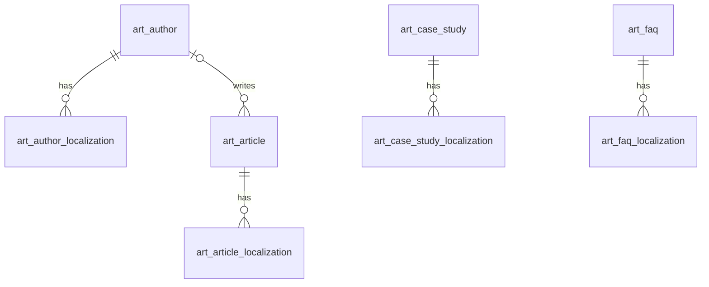

# 文章（article）模块设计

| 项 | 内容 |
|---|---|
| 模块 ID | `article` |
| 名称 | 文章 |
| 层 | L3 |
| 表前缀 | `art_` |
| API 前缀 | `article` |
| 可停用 | 是 |
| 模块版本 | 1.0.0（module.json 的 version） |
| 平台版本 | `>=1.0.0 <2.0.0`（module.json 的 platform） |
| 里程碑切片 | M1：—；M2：文章、案例、FAQ、作者；M3：—；M4：—（详见第 13 节） |
| 模块负责人 | 待定 |
| 文档版本 | V1.5 |
| 状态 | 草案 |
| 更新日期 | 2026-10-20 |
| 依据 | 系统设计 V1.9 第 9 章及 3.2、3.8、24–29 章；平台框架设计 V1.7 第 4、7–13 章；ADR-002、ADR-003、ADR-005、ADR-009、ADR-018 |

> 本文只引用《平台框架设计》第 4 章中的契约，不定义新的跨模块契约；需要新契约时按平台框架设计 2.3 提出契约变更请求。

## 1. 职责与边界

### 1.1 职责

管理文章、案例、FAQ 与作者；注册 ARTICLE、CASE_STUDY、FAQ，提供对应草稿、发布贡献、富文本、搜索与结构化数据。

功能交付范围按第 13 章分为 M1–M4；表结构、约束与枚举以第 3、4 章为准。

### 1.2 不负责的事

| 事项 | 归属模块 | 边界 |
|---|---|---|
| 内容生命周期与路由 | content / url | 本模块只承担自身职责；不直接修改 cnt_、url_ 表 |
| 身份、权限、设置、任务及审计 | platform-core | 复用平台公共服务 |
| 第三方客户端与网络传输 | infrastructure | 仅经既有端口或 L2 服务使用，不在业务模块引入客户端 |

### 1.3 协作概览

| 协作方式 | 对象 | 本模块行为 |
|---|---|---|
| 服务接口 | ContentApi、MediaApi、TaxonomyApi | 方法与事务边界见 2.2；无跨模块表访问 |
| 扩展点 | ContentTypeProvider、PublishContributor、DataSourceProvider、BreadcrumbProvider、SchemaOrgProvider、SeoVariableProvider、SearchDocumentProvider、MediaReferenceCollector、TranslatableContentProvider、TranslatableResourceProvider | 实现/收集清单见 2.4、2.5 |
| 领域事件 | 见 2.6 | 与本地事务一起登记，提交后异步投递；重复与过期处理独立验证 |

### 1.4 适用的架构约束

遵守 P2、P3 与 ADR-018：编译依赖只到 platform-core/platform-api，跨模块协作只用第 2 章登记契约；只访问自己的表，禁止跨模块 JOIN/外键。遵守 ADR-003：事务内登记、提交后投递、监听器幂等并检查过期。遵守 ADR-009：每次请求/任务明确站点上下文，站点表默认过滤。

公开读取只用当前语言发布态，不跨语言回退（ADR-005）；预览与公开缓存隔离。后台中文文案与错误集中管理，前台文案经 UiTextApi，样式只用 Design Token。远程端口在数据库事务外调用，密钥经 SecretCipher，不写日志。

## 2. 依赖与契约

### 2.1 module.json

```json
{
  "id": "article",
  "name": "文章",
  "version": "1.0.0",
  "layer": "L3",
  "platform": ">=1.0.0 <2.0.0",
  "requires": {
    "content": "^1.0",
    "media": "^1.0",
    "taxonomy": "^1.0"
  },
  "optional": {},
  "disableable": true,
  "tablePrefix": "art_",
  "apiPrefix": "article",
  "permissions": [
    {
      "code": "article:article:view",
      "name": "查看文章"
    },
    {
      "code": "content:article:edit",
      "name": "编辑文章"
    },
    {
      "code": "article:case-study:view",
      "name": "查看案例"
    },
    {
      "code": "content:case-study:edit",
      "name": "编辑案例"
    },
    {
      "code": "article:faq:view",
      "name": "查看FAQ"
    },
    {
      "code": "content:faq:edit",
      "name": "编辑常见问题"
    },
    {
      "code": "article:author:manage",
      "name": "管理作者"
    },
    {
      "code": "content:article:review",
      "name": "审核文章"
    },
    {
      "code": "content:article:publish",
      "name": "发布文章"
    },
    {
      "code": "content:article:delete",
      "name": "删除文章"
    },
    {
      "code": "content:case-study:review",
      "name": "审核案例"
    },
    {
      "code": "content:case-study:publish",
      "name": "发布案例"
    },
    {
      "code": "content:case-study:delete",
      "name": "删除案例"
    },
    {
      "code": "content:faq:review",
      "name": "审核常见问题"
    },
    {
      "code": "content:faq:publish",
      "name": "发布常见问题"
    },
    {
      "code": "content:faq:delete",
      "name": "删除常见问题"
    }
  ],
  "menus": [
    {
      "key": "article",
      "name": "文章",
      "parent": "editorial",
      "route": "/article/articles",
      "permission": "article:article:view",
      "order": 100
    }
  ],
  "settings": null,
  "components": [
    "faq",
    "article-list",
    "case-list"
  ],
  "events": {
    "publishes": [
      "TranslatableResourceChangedEvent",
      "SiteResourceChangedEvent"
    ],
    "subscribes": [
      "ContentPurgedEvent",
      "LocalizationDeletedEvent",
      "TermChangedEvent",
      "MediaDeletedEvent",
      "SiteSettingsChangedEvent",
      "ModuleDisabledEvent"
    ]
  }
}
```

描述符为 M0 工程建立后的实现要求；目前尚无实际控制器、Schema 或组件包。依赖只声明运行能力；Maven 仍只依赖 platform-api/core。组件清单是本模块负责的类型，运行时 UI 不登记成可拖入布局的组件。

### 2.2 使用的服务接口

| 接口（平台框架设计小节） | 方法 | 用途 | 调用位置与时机 | 测试替身 |
|---|---|---|---|---|
| `ContentApi`（4.4.16） | lockDraftForWrite、create、updateDraftMeta、findPublishedSnapshot、findPublishedCards | 读当前发布快照与卡片；内容类型所属模块创建身份并标记草稿变化 | 读接口在查询阶段调用；写方法加入业务事务，远程文本翻译必须在事务外 | `InMemoryContentApi` |
| `MediaApi`（4.4.18） | findAll、views、imageSources | 媒体视图、图片源与授权下载；不读取媒体表 | 读接口在查询阶段调用；写方法加入业务事务，远程文本翻译必须在事务外 | `InMemoryMediaApi` |
| `TaxonomyApi`（4.4.19） | findTerms、termViews、assignmentsOf | 词汇表、分类视图与内容指派；不读取分类表 | 读接口在查询阶段调用；写方法加入业务事务，远程文本翻译必须在事务外 | `InMemoryTaxonomyApi` |
| `SiteApi`（4.4.1） | 按该契约声明的方法 | 语言、站点模块开关 | 业务事务内；站点切换由任务入口完成 | `InMemorySiteApi` |
| `SiteContextProvider`（4.4.2） | 按该契约声明的方法 | 当前站点；异步与任务由 core 恢复 | 业务事务内；站点切换由任务入口完成 | `FakeSiteContextProvider` |
| `PermissionChecker`（4.4.7） | 按该契约声明的方法 | 后台权限与数据范围 | 业务事务内；站点切换由任务入口完成 | `FakePermissionChecker` |
| `AuditApi`（4.4.9） | 按该契约声明的方法 | 同事务写审计，密钥与个人数据脱敏 | 业务事务内；站点切换由任务入口完成 | `InMemoryAuditApi` |
| `EventMetaFactory`（4.4.14） | 按该契约声明的方法 | 事件 ID、版本、站点与操作人 | 业务事务内；站点切换由任务入口完成 | `FakeEventMetaFactory` |
| `ReferenceWriteApi`（4.10，Proposed） | replaceMedia | 原保存事务内协调，失败回滚，站点隔离 | MANDATORY；不得afterCommit补写 | 框架4.10对应协议替身 |

所有 L2/L3/L4 读写隐式使用当前站点；按 ID 查询单批最多 500。可选服务用 ObjectProvider 注入并检查当前站点启用状态，缺失时降级，不通过业务表绕过服务。


### 2.3 提供的服务接口

不适用：本模块不提供跨模块服务接口；其他模块通过 2.4 的既有扩展点或领域事件协作。

### 2.4 实现的扩展点

| 扩展点（平台框架设计小节） | 计划实现类 | 适用范围 | order | 收集方 |
|---|---|---|---|---|
| `ContentTypeProvider`（4.5.2） | `ArticleContentTypeProvider` | ARTICLE / CASE_STUDY 可路由；FAQ 不可路由 | OWNER=500 | content / url（经 content） |
| `PublishContributor`（4.5.3） | `ArticlePublishContributor` | 每个类型各一个 card；对应 parts.article / parts.caseStudy / parts.faq | OWNER=500 | content |
| `DataSourceProvider`（4.5.6） | `ArticleDataSourceProvider` | faq-by-context | DEFAULT=1000 | delivery |
| `BreadcrumbProvider`（4.5.9） | `ArticleBreadcrumbProvider` | 按本模块职责及 3、4 章登记的内容/资源类型 | DEFAULT=1000 | delivery / seo |
| `SchemaOrgProvider`（4.5.10） | `ArticleSchemaOrgProvider` | Article / BlogPosting、案例 Article；FAQPage 由 page 对实际展示问答组装 | OWNER=500 | seo |
| `SeoVariableProvider`（4.5.11） | `ArticleSeoVariableProvider` | 按本模块职责及 3、4 章登记的内容/资源类型 | DEFAULT=1000 | seo |
| `SearchDocumentProvider`（4.5.14） | `ArticleSearchDocumentProvider` | 按本模块职责及 3、4 章登记的内容/资源类型 | DEFAULT=1000 | search |
| `MediaReferenceCollector`（4.5.16） | `ArticleMediaReferenceCollector` | 按本模块职责及 3、4 章登记的内容/资源类型 | DEFAULT=1000 | media |
| `TranslatableContentProvider`（4.5.20） | `ArticleTranslatableContentProvider` | ARTICLE / CASE_STUDY / FAQ 的正文和标题等中文字段 | DEFAULT=1000 | translation |
| `TranslatableResourceProvider`（4.5.21） | `ArticleTranslatableResourceProvider` | article.author（框架4.10.2登记） | DEFAULT=1000 | translation |
| `PlatformModule`（4.5.22） | `ArticleModule` | 本模块安装/升级；可停用模块提供影响报告与停用后保留数据规则 | DEFAULT=1000 | core |

以上类名为待实现名称。PublishContributor 不调用调用方的写方法，不访问外部服务；翻译提供方只写本模块草稿/资源，先校验源指纹与共同 version。停用时 analyzeDisableImpact 返回本模块内容、组件及外部引用的影响，数据保留。

### 2.5 收集的扩展点

不适用：不收集业务扩展点；PlatformModule 与任务 SPI 由 core 收集。

### 2.6 发布与订阅的事件

发布：

| 事件 | 触发事务 | 现有 payload 字段 | 订阅方 |
|---|---|---|---|
| `TranslatableResourceChangedEvent` | 源语言可翻译文本实际变化时 UPSERTED，资源整体删除时 DELETED；非文本变化与目标语言 apply 不发布此事件 | meta、resourceType、resourceId、change | 框架 4.2.4；未登记发布方的差异在第 14 章列出 |

订阅：

| 事件 | 处理 | 幂等 | 过期与删除 | 失败与重试 |
|---|---|---|---|---|
| `ContentPurgedEvent` | 按事件 contentId/localizationIds 清理本模块外部引用或子行；历史业务快照按 4.6 保留；不回查已不存在的父内容 | 本模块事务内的幂等标记与数据变更一起提交；缓存重复失效安全 | 清理使用事件中的 ID；查不到父对象仍须清理 | 失败抛出保留未完成投递；业务副作用转入已有任务/队列后重试 |
| `LocalizationDeletedEvent` | 仅清理对应语言的本模块本地化/投影，不删除其他语言或共享业务字段 | 本模块事务内的幂等标记与数据变更一起提交；缓存重复失效安全 | 清理使用事件中的 ID；查不到父对象仍须清理 | 失败抛出保留未完成投递；业务副作用转入已有任务/队列后重试 |
| `TermChangedEvent` | 按 change/termId 更新相关草稿引用或重算候选；草稿指派不冒充发布态指派 | 本模块事务内的幂等标记与数据变更一起提交；缓存重复失效安全 | 读取当前状态/指纹；只有匹配的当前结果才更新；不以 occurredAt 单独当全序 | 失败抛出保留未完成投递；业务副作用转入已有任务/队列后重试 |
| `MediaDeletedEvent` | 仅处理被引用媒体：更新当前媒体视图或按 4.6 防御性清理；仍有有效引用的媒体不能被主动删除 | 本模块事务内的幂等标记与数据变更一起提交；缓存重复失效安全 | 清理使用事件中的 ID；查不到父对象仍须清理 | 失败抛出保留未完成投递；业务副作用转入已有任务/队列后重试 |
| `SiteSettingsChangedEvent` | 按 scopes、settingKeys、localeChanges 筛选 4.6 的相关变化；不对无关设置做全量重建 | 本模块事务内的幂等标记与数据变更一起提交；缓存重复失效安全 | 读取当前状态/指纹；只有匹配的当前结果才更新；不以 occurredAt 单独当全序 | 失败抛出保留未完成投递；业务副作用转入已有任务/队列后重试 |
| `ModuleDisabledEvent` | 当前站点隐藏该模块的公开能力，保留自身数据；处理事件.moduleId 而非假定是接收方自身 | 本模块事务内的幂等标记与数据变更一起提交；缓存重复失效安全 | 读取当前状态/指纹；只有匹配的当前结果才更新；不以 occurredAt 单独当全序 | 失败抛出保留未完成投递；业务副作用转入已有任务/队列后重试 |

监听器按框架 5.8 建立站点/system 上下文；`ContentPurgedEvent` 在模块停用时仍必须清理（deliverWhenModuleDisabled）。其他停用期间跳过并完成的事件，重新启用后通过扫描当前状态补偿，不能假定还会重投。数据库幂等标记与本模块数据在同一事务提交；外部发送、下载、搜索与 CDN 调用不得被数据库长事务包裹，使用已声明的任务/端口和业务幂等键。事件 payload 仅引用框架现有字段，本文不扩展签名。

SiteResourceChangedEvent（框架4.10.2，Proposed）：发布：作者资源全部生效变化；media引用已同步登记，delivery可靠失效settings。字段meta/resourceType/resourceId/change，原事务登记，重复处理安全。

### 2.7 使用的端口

不适用：不直接使用基础设施端口；媒体、通知等外部操作经相应 L2 服务编排。

## 3. 领域模型

### 3.1 聚合、实体与值对象

| 类型 | 名称 | 说明 |
|---|---|---|
| 聚合根 | Article（`art_article`） | 文章的语言无关字段：作者、主栏目、封面。与 `cnt_content`（type = ARTICLE）1:1，主键即 `content_id` |
| 实体 | ArticleLocalization（`art_article_localization`） | 文章在一种语言下的草稿字段：标题、摘要、正文（ProseMirror JSON）、阅读时长 |
| 聚合根 | CaseStudy（`art_case_study`） | 案例的语言无关字段：封面、客户是否匿名、客户 Logo、客户所在国家。与 `cnt_content`（type = CASE_STUDY）1:1 |
| 实体 | CaseStudyLocalization（`art_case_study_localization`） | 标题、摘要、客户名称、挑战、方案、成果指标 |
| 聚合根 | Faq（`art_faq`） | FAQ 的语言无关字段：默认顺序。与 `cnt_content`（type = FAQ，不可路由）1:1 |
| 实体 | FaqLocalization（`art_faq_localization`） | 问题、答案（富文本） |
| 聚合根 | Author（`art_author`） | 作者（站点资源）：姓名、头像、社交链接；用于 Article 结构化数据中的 author（E-E-A-T） |
| 实体 | AuthorLocalization（`art_author_localization`） | 作者的职务与简介（站点资源，带 `translation_state`、`source_fingerprint`） |
| 值对象 | RichText | ProseMirror JSON：节点白名单；正文从 H2 开始；内部链接存为 `content://{id}`（系统设计 9 章） |
| 值对象 | ResultMetric | 案例成果指标 `{value, label}` |
| 值对象 | SocialLink | 作者社交链接 `{type, url}` |

在系统设计之外补充的字段：

| 补充 | 理由 |
|---|---|
| `art_article.primary_category_term_id` | 系统设计 9 章的“文章栏目”是 `article_category` 词汇表的分类指派；冗余主栏目用于后台按栏目筛选与下线 `REDIRECT_PARENT` 解析到栏目页，与 `prd_product.primary_category_term_id` 一致 |
| `art_article.cover_media_id`、`art_case_study.cover_media_id` | 系统设计 9 章的“封面”；媒体是非文本数据，所有语言沿用，故放在主表 |
| `art_article_localization.reading_minutes` | “阅读时长自动计算”（系统设计 9 章）；各语言正文长度不同，按语言保存 |
| `art_case_study.customer_anonymous`、`customer_logo_media_id`、`customer_country` | “客户（可匿名）”拆为匿名开关 + 本地化的客户显示名称；Logo 与国家是案例卡片的常见展示项，匿名时不显示 Logo |
| `art_case_study_localization`、`art_faq_localization` | 25.8 只列出 `art_article_localization`；案例与 FAQ 同为内容类型，草稿业务字段按语言保存，需要各自的本地化表（系统设计 6.1）。25.8 需同步修订 |
| `art_faq.sort_order` | FAQ 组件与 `faq-by-context` 数据源（系统设计 10.5）的默认顺序 |
| `art_author.sort_order`、`deleted_at` | 后台选择顺序；作者被文章引用，软删除保留 ID（平台框架设计 7.5） |
| `art_author_localization.job_title` | Schema.org `Person.jobTitle`，与简介一起体现 E-E-A-T |
| 作者姓名放在主表、不翻译 | 人名按本人对外署名录入，所有语言相同；可翻译的是职务与简介 |
| 各表的 `version` | 编辑页整体保存，乐观锁防止并发覆盖 |

### 3.2 不变量

| # | 规则 | 保证方式 |
|---|---|---|
| 1 | `art_article`、`art_case_study`、`art_faq` 分别与 `cnt_content`（ARTICLE / CASE_STUDY / FAQ）1:1；`content_id` 由 `ContentApi.create()` 在同一事务中返回 | 应用层 |
| 2 | 内容的每个 `cnt_localization` 恰有一条同语言的本地化行；每种语言最多一条 | 数据库：`uk_aloc_article_locale`、`uk_csloc_case_locale`、`uk_floc_faq_locale`；应用层 |
| 3 | `art_article.primary_category_term_id` 等于 `tx_assignment` 中 `article_category` 词汇表的主分类 | 应用层（文章编辑页的分类由 article 接口保存，同一事务中经 `TaxonomyApi` 写入指派并同步本列） |
| 4 | 作者属于同一站点；已删除的作者不能被新选择；被文章引用的作者只能软删除 | 数据库：`fk_art_article_author`（RESTRICT，针对物理删除）；应用层 |
| 5 | 匿名案例没有客户 Logo；客户名称此时为匿名化描述 | 数据库：`ck_art_case_anonymous`；应用层 |
| 6 | `reading_minutes` 由系统计算，不可手工编辑 | 应用层 |
| 7 | 富文本只含白名单节点；正文不含 H1；内部链接存为 `content://{id}`，不存 URL | 应用层（保存与发布校验） |
| 8 | 发布校验：ARTICLE 必须有标题与正文；CASE_STUDY 必须有标题；FAQ 必须有问题与答案 | 应用层（`PublishContributor.validate()` 报 ERROR） |
| 9 | 每个作者每种语言最多一条本地化；中文行 `translation_state = NONE`、`source_fingerprint` 为空 | 数据库：`uk_aul_author_locale`；应用层 |
| 10 | 子表的 `site_id` 与父表一致 | 应用层 |

### 3.3 状态机

内容发布状态与草稿状态均由 ContentApi 管理，完整转换见 content 模块 3.3 和系统设计 6.3；本模块不复制状态列或自行转换。保存业务草稿只改变内容共同 version 与草稿状态，发布经 PublishContributor 参与同一事务；回收站、恢复、下线与翻译模式按内容内核执行。配置及站点资源保存即生效，不伪装成内容发布。

## 4. 数据模型

> 遵守平台框架设计第 7 章的数据库通用约定。本节给出待实现 DDL；本次文档审查未重跑 MySQL，不能据此认定 DDL 已验证。M0 后按第 11 章在 MySQL 8.4 空库验证，并使实际迁移脚本与本节一致。

### 4.1 表清单

| 表 | 说明 | 站点级 | 软删除 | 预估规模（单站，按系统设计假设 A4） |
|---|---|---|---|---|
| `art_author` | 作者（站点资源） | 是 | 是（`deleted_at`） | 10–50 行 |
| `art_author_localization` | 作者本地化（站点资源） | 是 | 否（随作者） | ≤ 500 行 |
| `art_article` | 文章（新闻、博客） | 是 | 否（随内容回收站） | ≤ 5 千行 |
| `art_article_localization` | 文章本地化（内容类草稿） | 是 | 否 | ≤ 5 万行（× 10 种语言）；正文平均 10–30 KB，约 0.5–1.5 GB |
| `art_case_study` | 案例 | 是 | 否（随内容回收站） | 100–500 行 |
| `art_case_study_localization` | 案例本地化（内容类草稿） | 是 | 否 | ≤ 5 千行 |
| `art_faq` | FAQ | 是 | 否（随内容回收站） | 200–2 千行 |
| `art_faq_localization` | FAQ 本地化（内容类草稿） | 是 | 否 | ≤ 2 万行 |

### 4.2 ER 图



### 4.3 表结构

#### 4.3.1 `art_author`：作者

| 字段 | 类型 | 可空 | 默认 | 说明 |
|---|---|---|---|---|
| `id` | BIGINT | 否 | — | 主键（TSID） |
| `site_id` | BIGINT | 否 | — | 站点 ID（sys_site.id） |
| `name` | VARCHAR(100) | 否 | — | 姓名（对外署名，所有语言相同，不翻译）；Schema.org Person.name |
| `avatar_media_id` | BIGINT | 是 | — | 头像媒体 ID（mda_media.id，类型 IMAGE） |
| `social_links` | JSON | 否 | `(JSON_ARRAY())` | 社交链接：[{"type": "LINKEDIN", "url": "https://…"}]；Schema.org Person.sameAs |
| `sort_order` | INT | 否 | `0` | 后台选择列表中的顺序 |
| `deleted_at` | DATETIME(3) | 是 | — | 删除时间（软删除） |
| `version` | INT | 否 | `0` | 乐观锁版本号 |
| `created_at` | DATETIME(3) | 否 | `CURRENT_TIMESTAMP(3)` | 创建时间（UTC） |
| `created_by` | BIGINT | 否 | `0` | 创建人用户 ID（0 = 系统） |
| `updated_at` | DATETIME(3) | 否 | `CURRENT_TIMESTAMP(3) ON UPDATE CURRENT_TIMESTAMP(3)` | 更新时间（UTC） |
| `updated_by` | BIGINT | 否 | `0` | 更新人用户 ID（0 = 系统） |

索引与约束：
- `PRIMARY KEY (id)`
- `idx_author_name (site_id, name)`：后台作者列表与选择器按姓名搜索

```sql
CREATE TABLE art_author (
  id               BIGINT        NOT NULL COMMENT '主键（TSID）',
  site_id          BIGINT        NOT NULL COMMENT '站点 ID（sys_site.id）',
  name             VARCHAR(100)  NOT NULL COMMENT '姓名（对外署名，所有语言相同，不翻译）；Schema.org Person.name',
  avatar_media_id  BIGINT        NULL COMMENT '头像媒体 ID（mda_media.id，类型 IMAGE）',
  social_links     JSON          NOT NULL DEFAULT (JSON_ARRAY()) COMMENT '社交链接：[{"type": "LINKEDIN", "url": "https://…"}]；Schema.org Person.sameAs',
  sort_order       INT           NOT NULL DEFAULT 0 COMMENT '后台选择列表中的顺序',
  deleted_at       DATETIME(3)   NULL COMMENT '删除时间（软删除）',
  version          INT           NOT NULL DEFAULT 0 COMMENT '乐观锁版本号',
  created_at       DATETIME(3)   NOT NULL DEFAULT CURRENT_TIMESTAMP(3) COMMENT '创建时间（UTC）',
  created_by       BIGINT        NOT NULL DEFAULT 0 COMMENT '创建人用户 ID（0 = 系统）',
  updated_at       DATETIME(3)   NOT NULL DEFAULT CURRENT_TIMESTAMP(3) ON UPDATE CURRENT_TIMESTAMP(3) COMMENT '更新时间（UTC）',
  updated_by       BIGINT        NOT NULL DEFAULT 0 COMMENT '更新人用户 ID（0 = 系统）',
  PRIMARY KEY (id),
  KEY idx_author_name (site_id, name)
) ENGINE = InnoDB DEFAULT CHARSET = utf8mb4 COLLATE = utf8mb4_0900_ai_ci COMMENT = '作者（站点资源：姓名、头像、社交链接）';
```

要点：
- 作者是站点资源，保存即生效：头像属于 article.author 站点资源，保存/删除同事务经ReferenceWriteApi登记引用，并发布独立资源事件（ARTICLE-01）；不能调用框架没有声明的 MediaApi 引用写方法。
- 发布时 article 的 `PublishContributor` 把作者（姓名、本语言的职务与简介、头像、社交链接）写入快照，供页面与 Schema.org `Article.author`（Person）使用（系统设计 14.5）。作者资料变化后，已发布文章在下次发布时更新；需要立即生效时，可在后台对引用该作者的已发布文章批量重新发布（异步任务，经 `idx_article_author` 找到文章）。

#### 4.3.2 `art_author_localization`：作者本地化

| 字段 | 类型 | 可空 | 默认 | 说明 |
|---|---|---|---|---|
| `id` | BIGINT | 否 | — | 主键（TSID） |
| `site_id` | BIGINT | 否 | — | 站点 ID（sys_site.id） |
| `author_id` | BIGINT | 否 | — | 作者 ID（art_author.id） |
| `locale` | VARCHAR(16) | 否 | — | 语言（BCP 47） |
| `job_title` | VARCHAR(200) | 是 | — | 职务（站点资源：中文录入，其他语言由 translation 写入），如“储能系统高级工程师” |
| `bio` | VARCHAR(1000) | 是 | — | 简介（纯文本；站点资源：中文录入，其他语言由 translation 写入） |
| `translation_state` | VARCHAR(16) | 否 | `'NONE'` | 翻译状态：NONE / QUEUED / TRANSLATED / NEEDS_REVIEW / FAILED / OUTDATED |
| `source_fingerprint` | CHAR(64) bin | 是 | — | 生成本行译文时中文行的指纹（规范化 job_title 与 bio 拼接后的 SHA-256）；中文行为空；与当前中文指纹不同即为过期 |
| `version` | INT | 否 | `0` | 乐观锁版本号 |
| `created_at` | DATETIME(3) | 否 | `CURRENT_TIMESTAMP(3)` | 创建时间（UTC） |
| `created_by` | BIGINT | 否 | `0` | 创建人用户 ID（0 = 系统） |
| `updated_at` | DATETIME(3) | 否 | `CURRENT_TIMESTAMP(3) ON UPDATE CURRENT_TIMESTAMP(3)` | 更新时间（UTC） |
| `updated_by` | BIGINT | 否 | `0` | 更新人用户 ID（0 = 系统） |

索引与约束：
- `PRIMARY KEY (id)`
- `uk_aul_author_locale (author_id, locale)`：每种语言一条；发布时按作者取本语言的职务与简介；兼作 `fk_art_aul_author` 的索引
- `idx_aul_state (site_id, translation_state, locale)`：翻译中心列出待处理的作者资料
- `fk_art_aul_author`：组合关系，`ON DELETE CASCADE`

```sql
CREATE TABLE art_author_localization (
  id                  BIGINT         NOT NULL COMMENT '主键（TSID）',
  site_id             BIGINT         NOT NULL COMMENT '站点 ID（sys_site.id）',
  author_id           BIGINT         NOT NULL COMMENT '作者 ID（art_author.id）',
  locale              VARCHAR(16)    NOT NULL COMMENT '语言（BCP 47）',
  job_title           VARCHAR(200)   NULL COMMENT '职务（站点资源：中文录入，其他语言由 translation 写入），如“储能系统高级工程师”',
  bio                 VARCHAR(1000)  NULL COMMENT '简介（纯文本；站点资源：中文录入，其他语言由 translation 写入）',
  translation_state   VARCHAR(16)    NOT NULL DEFAULT 'NONE' COMMENT '翻译状态：NONE / QUEUED / TRANSLATED / NEEDS_REVIEW / FAILED / OUTDATED',
  source_fingerprint  CHAR(64)       COLLATE utf8mb4_0900_bin NULL COMMENT '生成本行译文时中文行的指纹（规范化 job_title 与 bio 拼接后的 SHA-256）；中文行为空；与当前中文指纹不同即为过期',
  version             INT            NOT NULL DEFAULT 0 COMMENT '乐观锁版本号',
  created_at          DATETIME(3)    NOT NULL DEFAULT CURRENT_TIMESTAMP(3) COMMENT '创建时间（UTC）',
  created_by          BIGINT         NOT NULL DEFAULT 0 COMMENT '创建人用户 ID（0 = 系统）',
  updated_at          DATETIME(3)    NOT NULL DEFAULT CURRENT_TIMESTAMP(3) ON UPDATE CURRENT_TIMESTAMP(3) COMMENT '更新时间（UTC）',
  updated_by          BIGINT         NOT NULL DEFAULT 0 COMMENT '更新人用户 ID（0 = 系统）',
  PRIMARY KEY (id),
  UNIQUE KEY uk_aul_author_locale (author_id, locale),
  KEY idx_aul_state (site_id, translation_state, locale),
  CONSTRAINT fk_art_aul_author FOREIGN KEY (author_id) REFERENCES art_author (id) ON DELETE CASCADE
) ENGINE = InnoDB DEFAULT CHARSET = utf8mb4 COLLATE = utf8mb4_0900_ai_ci COMMENT = '作者本地化（职务与简介为站点资源，带翻译状态与源指纹）';
```

要点：中文行的职务或简介变化时发布 `TranslatableResourceChangedEvent`（资源类型 `article.author`，ID 为 `author_id`）；translation 回写目标语言行并设置 `translation_state` 与 `source_fingerprint`（系统设计 5.7）。某语言没有本地化行时，该语言页面只显示姓名与头像，不回退到中文。

#### 4.3.3 `art_article`：文章

| 字段 | 类型 | 可空 | 默认 | 说明 |
|---|---|---|---|---|
| `content_id` | BIGINT | 否 | — | 内容 ID（cnt_content.id，类型 ARTICLE），即文章主键 |
| `site_id` | BIGINT | 否 | — | 站点 ID（sys_site.id） |
| `author_id` | BIGINT | 是 | — | 作者 ID（art_author.id）；空 = 不署名（结构化数据 author 使用 Organization） |
| `primary_category_term_id` | BIGINT | 是 | — | 主栏目 ID（tx_term.id，词汇表 article_category）；冗余 tx_assignment 中的主分类 |
| `cover_media_id` | BIGINT | 是 | — | 封面媒体 ID（mda_media.id，类型 IMAGE）；快照 card.coverMediaId |
| `version` | INT | 否 | `0` | 乐观锁版本号 |
| `created_at` | DATETIME(3) | 否 | `CURRENT_TIMESTAMP(3)` | 创建时间（UTC） |
| `created_by` | BIGINT | 否 | `0` | 创建人用户 ID（0 = 系统） |
| `updated_at` | DATETIME(3) | 否 | `CURRENT_TIMESTAMP(3) ON UPDATE CURRENT_TIMESTAMP(3)` | 更新时间（UTC） |
| `updated_by` | BIGINT | 否 | `0` | 更新人用户 ID（0 = 系统） |

索引与约束：
- `PRIMARY KEY (content_id)`
- `idx_article_author (author_id)`：作者的文章列表、删除作者前检查、按作者批量重新发布；兼作 `fk_art_article_author` 的索引
- `idx_article_category (site_id, primary_category_term_id)`：后台按栏目筛选文章；分类项删除时查找受影响文章
- `fk_art_article_author`：引用关系（RESTRICT）

```sql
CREATE TABLE art_article (
  content_id                BIGINT       NOT NULL COMMENT '内容 ID（cnt_content.id，类型 ARTICLE），即文章主键',
  site_id                   BIGINT       NOT NULL COMMENT '站点 ID（sys_site.id）',
  author_id                 BIGINT       NULL COMMENT '作者 ID（art_author.id）；空 = 不署名（结构化数据 author 使用 Organization）',
  primary_category_term_id  BIGINT       NULL COMMENT '主栏目 ID（tx_term.id，词汇表 article_category）；冗余 tx_assignment 中的主分类',
  cover_media_id            BIGINT       NULL COMMENT '封面媒体 ID（mda_media.id，类型 IMAGE）；快照 card.coverMediaId',
  version                   INT          NOT NULL DEFAULT 0 COMMENT '乐观锁版本号',
  created_at                DATETIME(3)  NOT NULL DEFAULT CURRENT_TIMESTAMP(3) COMMENT '创建时间（UTC）',
  created_by                BIGINT       NOT NULL DEFAULT 0 COMMENT '创建人用户 ID（0 = 系统）',
  updated_at                DATETIME(3)  NOT NULL DEFAULT CURRENT_TIMESTAMP(3) ON UPDATE CURRENT_TIMESTAMP(3) COMMENT '更新时间（UTC）',
  updated_by                BIGINT       NOT NULL DEFAULT 0 COMMENT '更新人用户 ID（0 = 系统）',
  PRIMARY KEY (content_id),
  KEY idx_article_author (author_id),
  KEY idx_article_category (site_id, primary_category_term_id),
  CONSTRAINT fk_art_article_author FOREIGN KEY (author_id) REFERENCES art_author (id)
) ENGINE = InnoDB DEFAULT CHARSET = utf8mb4 COLLATE = utf8mb4_0900_ai_ci COMMENT = '文章（新闻、博客；与 cnt_content 1:1 的语言无关字段：作者、主栏目、封面）';
```

要点：
- 栏目、标签、应用、行业是分类指派（`tx_assignment`），所有语言沿用；新闻与博客通过栏目区分（系统设计 6.2）。
- 下线选择 `REDIRECT_PARENT` 时，由 article 的下线目标解析返回主栏目的 TERM_PAGE；主栏目为空时按 `GONE` 处理（系统设计 13.6）。
- 前台展示的发布日期与更新日期取 `cnt_localization.first_published_at` 与 `content_modified_at`（系统设计 9 章），本模块不另存。

#### 4.3.4 `art_article_localization`：文章本地化

| 字段 | 类型 | 可空 | 默认 | 说明 |
|---|---|---|---|---|
| `id` | BIGINT | 否 | — | 主键（TSID） |
| `site_id` | BIGINT | 否 | — | 站点 ID（sys_site.id） |
| `article_id` | BIGINT | 否 | — | 文章 ID（art_article.content_id，即 cnt_content.id） |
| `locale` | VARCHAR(16) | 否 | — | 语言（BCP 47），与 cnt_localization.locale 一一对应 |
| `title` | VARCHAR(300) | 否 | — | 标题（页面 H1；同步为 cnt_localization.draft_title；快照 card.title） |
| `summary` | VARCHAR(1000) | 是 | — | 摘要（纯文本；快照 card.summary） |
| `body` | JSON | 是 | — | 正文（ProseMirror JSON，节点白名单；从 H2 开始；内部链接为 content://{id}） |
| `reading_minutes` | SMALLINT | 否 | `0` | 阅读时长（分钟，保存时按本语言正文自动计算；正文为空时为 0） |
| `version` | INT | 否 | `0` | 乐观锁版本号 |
| `created_at` | DATETIME(3) | 否 | `CURRENT_TIMESTAMP(3)` | 创建时间（UTC） |
| `created_by` | BIGINT | 否 | `0` | 创建人用户 ID（0 = 系统，如译文回写） |
| `updated_at` | DATETIME(3) | 否 | `CURRENT_TIMESTAMP(3) ON UPDATE CURRENT_TIMESTAMP(3)` | 更新时间（UTC） |
| `updated_by` | BIGINT | 否 | `0` | 更新人用户 ID（0 = 系统，如译文回写） |

索引与约束：
- `PRIMARY KEY (id)`
- `uk_aloc_article_locale (article_id, locale)`：每种语言一条；编辑页、发布组装快照、译文回写按（文章，语言）读写；兼作 `fk_art_aloc_article` 的索引
- `idx_aloc_title (site_id, locale, title)`：后台按标题搜索文章（内容选择器、内部链接选择）
- `fk_art_aloc_article`：组合关系，`ON DELETE CASCADE`

```sql
CREATE TABLE art_article_localization (
  id               BIGINT         NOT NULL COMMENT '主键（TSID）',
  site_id          BIGINT         NOT NULL COMMENT '站点 ID（sys_site.id）',
  article_id       BIGINT         NOT NULL COMMENT '文章 ID（art_article.content_id，即 cnt_content.id）',
  locale           VARCHAR(16)    NOT NULL COMMENT '语言（BCP 47），与 cnt_localization.locale 一一对应',
  title            VARCHAR(300)   NOT NULL COMMENT '标题（页面 H1；同步为 cnt_localization.draft_title；快照 card.title）',
  summary          VARCHAR(1000)  NULL COMMENT '摘要（纯文本；快照 card.summary）',
  body             JSON           NULL COMMENT '正文（ProseMirror JSON，节点白名单；从 H2 开始；内部链接为 content://{id}）',
  reading_minutes  SMALLINT       NOT NULL DEFAULT 0 COMMENT '阅读时长（分钟，保存时按本语言正文自动计算；正文为空时为 0）',
  version          INT            NOT NULL DEFAULT 0 COMMENT '乐观锁版本号',
  created_at       DATETIME(3)    NOT NULL DEFAULT CURRENT_TIMESTAMP(3) COMMENT '创建时间（UTC）',
  created_by       BIGINT         NOT NULL DEFAULT 0 COMMENT '创建人用户 ID（0 = 系统，如译文回写）',
  updated_at       DATETIME(3)    NOT NULL DEFAULT CURRENT_TIMESTAMP(3) ON UPDATE CURRENT_TIMESTAMP(3) COMMENT '更新时间（UTC）',
  updated_by       BIGINT         NOT NULL DEFAULT 0 COMMENT '更新人用户 ID（0 = 系统，如译文回写）',
  PRIMARY KEY (id),
  UNIQUE KEY uk_aloc_article_locale (article_id, locale),
  KEY idx_aloc_title (site_id, locale, title),
  CONSTRAINT fk_art_aloc_article FOREIGN KEY (article_id) REFERENCES art_article (content_id) ON DELETE CASCADE
) ENGINE = InnoDB DEFAULT CHARSET = utf8mb4 COLLATE = utf8mb4_0900_ai_ci COMMENT = '文章本地化（内容类草稿：标题、摘要、正文、阅读时长）';
```

要点：
- 内容类本地化表，不带翻译状态（平台框架设计 7.7）；保存时经 `ContentApi.updateDraftMeta()` 同步 `draft_title`。
- 阅读时长：按本语言正文的可见文本计算（中日韩文字按字数、其他语言按词数，除以每分钟阅读速度后向上取整）；译文回写后重新计算。
- 翻译（系统设计 5.6、9 章）：article 的 `TranslatableContentProvider` 提取 `title`、`summary` 与 `body`；正文按块级节点拆分为翻译单元，行内标记转为编号占位标签；图片、视频、产品卡片等非文本节点沿用源语言。`apply()` 写入目标语言行。
- 正文引用的媒体：保存时经 `MediaApi` 上报该语言的 `DRAFT` 引用；发布后由 article 的 `MediaReferenceCollector` 从快照收集 `PUBLISHED` 引用。内部链接 `content://{id}` 在读取时解析为同语言 URL，目标没有该语言版本或已下线时降级为纯文本。

#### 4.3.5 `art_case_study`：案例

| 字段 | 类型 | 可空 | 默认 | 说明 |
|---|---|---|---|---|
| `content_id` | BIGINT | 否 | — | 内容 ID（cnt_content.id，类型 CASE_STUDY），即案例主键 |
| `site_id` | BIGINT | 否 | — | 站点 ID（sys_site.id） |
| `cover_media_id` | BIGINT | 是 | — | 封面媒体 ID（mda_media.id，类型 IMAGE）；快照 card.coverMediaId |
| `customer_anonymous` | TINYINT(1) | 否 | `0` | 客户是否匿名：1 = 匿名（不显示客户 Logo，客户名称填写匿名化描述） |
| `customer_logo_media_id` | BIGINT | 是 | — | 客户 Logo 媒体 ID（mda_media.id）；匿名时必须为空 |
| `customer_country` | CHAR(2) | 是 | — | 客户所在国家（ISO 3166-1 alpha-2，大写）；前台按语言显示国家名 |
| `version` | INT | 否 | `0` | 乐观锁版本号 |
| `created_at` | DATETIME(3) | 否 | `CURRENT_TIMESTAMP(3)` | 创建时间（UTC） |
| `created_by` | BIGINT | 否 | `0` | 创建人用户 ID（0 = 系统） |
| `updated_at` | DATETIME(3) | 否 | `CURRENT_TIMESTAMP(3) ON UPDATE CURRENT_TIMESTAMP(3)` | 更新时间（UTC） |
| `updated_by` | BIGINT | 否 | `0` | 更新人用户 ID（0 = 系统） |

索引与约束：
- `PRIMARY KEY (content_id)`
- `ck_art_case_anonymous`：见 3.2 不变量 5

```sql
CREATE TABLE art_case_study (
  content_id              BIGINT       NOT NULL COMMENT '内容 ID（cnt_content.id，类型 CASE_STUDY），即案例主键',
  site_id                 BIGINT       NOT NULL COMMENT '站点 ID（sys_site.id）',
  cover_media_id          BIGINT       NULL COMMENT '封面媒体 ID（mda_media.id，类型 IMAGE）；快照 card.coverMediaId',
  customer_anonymous      TINYINT(1)   NOT NULL DEFAULT 0 COMMENT '客户是否匿名：1 = 匿名（不显示客户 Logo，客户名称填写匿名化描述）',
  customer_logo_media_id  BIGINT       NULL COMMENT '客户 Logo 媒体 ID（mda_media.id）；匿名时必须为空',
  customer_country        CHAR(2)      NULL COMMENT '客户所在国家（ISO 3166-1 alpha-2，大写）；前台按语言显示国家名',
  version                 INT          NOT NULL DEFAULT 0 COMMENT '乐观锁版本号',
  created_at              DATETIME(3)  NOT NULL DEFAULT CURRENT_TIMESTAMP(3) COMMENT '创建时间（UTC）',
  created_by              BIGINT       NOT NULL DEFAULT 0 COMMENT '创建人用户 ID（0 = 系统）',
  updated_at              DATETIME(3)  NOT NULL DEFAULT CURRENT_TIMESTAMP(3) ON UPDATE CURRENT_TIMESTAMP(3) COMMENT '更新时间（UTC）',
  updated_by              BIGINT       NOT NULL DEFAULT 0 COMMENT '更新人用户 ID（0 = 系统）',
  PRIMARY KEY (content_id),
  CONSTRAINT ck_art_case_anonymous CHECK (customer_anonymous = 0 OR customer_logo_media_id IS NULL)
) ENGINE = InnoDB DEFAULT CHARSET = utf8mb4 COLLATE = utf8mb4_0900_ai_ci COMMENT = '案例（与 cnt_content 1:1 的语言无关字段：封面、客户匿名、客户 Logo 与国家）';
```

要点：行业、应用是分类指派；使用的产品是内容关系 `USES`（系统设计 9 章、15.2），本表不保存。CASE_STUDY 输出 Schema.org `Article`（系统设计 14.5）。

#### 4.3.6 `art_case_study_localization`：案例本地化

| 字段 | 类型 | 可空 | 默认 | 说明 |
|---|---|---|---|---|
| `id` | BIGINT | 否 | — | 主键（TSID） |
| `site_id` | BIGINT | 否 | — | 站点 ID（sys_site.id） |
| `case_study_id` | BIGINT | 否 | — | 案例 ID（art_case_study.content_id，即 cnt_content.id） |
| `locale` | VARCHAR(16) | 否 | — | 语言（BCP 47），与 cnt_localization.locale 一一对应 |
| `title` | VARCHAR(300) | 否 | — | 标题（页面 H1；同步为 cnt_localization.draft_title；快照 card.title） |
| `summary` | VARCHAR(1000) | 是 | — | 摘要（纯文本；快照 card.summary） |
| `customer_name` | VARCHAR(200) | 是 | — | 客户显示名称；匿名时为匿名化描述，如“德国某储能系统集成商” |
| `challenge` | JSON | 是 | — | 挑战（ProseMirror JSON 富文本） |
| `solution` | JSON | 是 | — | 方案（ProseMirror JSON 富文本） |
| `results` | JSON | 否 | `(JSON_ARRAY())` | 成果指标列表：[{"value": "30%", "label": "运维成本降低"}]，按顺序显示 |
| `version` | INT | 否 | `0` | 乐观锁版本号 |
| `created_at` | DATETIME(3) | 否 | `CURRENT_TIMESTAMP(3)` | 创建时间（UTC） |
| `created_by` | BIGINT | 否 | `0` | 创建人用户 ID（0 = 系统，如译文回写） |
| `updated_at` | DATETIME(3) | 否 | `CURRENT_TIMESTAMP(3) ON UPDATE CURRENT_TIMESTAMP(3)` | 更新时间（UTC） |
| `updated_by` | BIGINT | 否 | `0` | 更新人用户 ID（0 = 系统，如译文回写） |

索引与约束：
- `PRIMARY KEY (id)`
- `uk_csloc_case_locale (case_study_id, locale)`：每种语言一条；兼作 `fk_art_csloc_case` 的索引
- `idx_csloc_title (site_id, locale, title)`：后台按标题搜索案例
- `fk_art_csloc_case`：组合关系，`ON DELETE CASCADE`

```sql
CREATE TABLE art_case_study_localization (
  id             BIGINT         NOT NULL COMMENT '主键（TSID）',
  site_id        BIGINT         NOT NULL COMMENT '站点 ID（sys_site.id）',
  case_study_id  BIGINT         NOT NULL COMMENT '案例 ID（art_case_study.content_id，即 cnt_content.id）',
  locale         VARCHAR(16)    NOT NULL COMMENT '语言（BCP 47），与 cnt_localization.locale 一一对应',
  title          VARCHAR(300)   NOT NULL COMMENT '标题（页面 H1；同步为 cnt_localization.draft_title；快照 card.title）',
  summary        VARCHAR(1000)  NULL COMMENT '摘要（纯文本；快照 card.summary）',
  customer_name  VARCHAR(200)   NULL COMMENT '客户显示名称；匿名时为匿名化描述，如“德国某储能系统集成商”',
  challenge      JSON           NULL COMMENT '挑战（ProseMirror JSON 富文本）',
  solution       JSON           NULL COMMENT '方案（ProseMirror JSON 富文本）',
  results        JSON           NOT NULL DEFAULT (JSON_ARRAY()) COMMENT '成果指标列表：[{"value": "30%", "label": "运维成本降低"}]，按顺序显示',
  version        INT            NOT NULL DEFAULT 0 COMMENT '乐观锁版本号',
  created_at     DATETIME(3)    NOT NULL DEFAULT CURRENT_TIMESTAMP(3) COMMENT '创建时间（UTC）',
  created_by     BIGINT         NOT NULL DEFAULT 0 COMMENT '创建人用户 ID（0 = 系统，如译文回写）',
  updated_at     DATETIME(3)    NOT NULL DEFAULT CURRENT_TIMESTAMP(3) ON UPDATE CURRENT_TIMESTAMP(3) COMMENT '更新时间（UTC）',
  updated_by     BIGINT         NOT NULL DEFAULT 0 COMMENT '更新人用户 ID（0 = 系统，如译文回写）',
  PRIMARY KEY (id),
  UNIQUE KEY uk_csloc_case_locale (case_study_id, locale),
  KEY idx_csloc_title (site_id, locale, title),
  CONSTRAINT fk_art_csloc_case FOREIGN KEY (case_study_id) REFERENCES art_case_study (content_id) ON DELETE CASCADE
) ENGINE = InnoDB DEFAULT CHARSET = utf8mb4 COLLATE = utf8mb4_0900_ai_ci COMMENT = '案例本地化（内容类草稿：标题、摘要、客户名称、挑战、方案、成果）';
```

要点：翻译单元为 `title`、`summary`、`customer_name`、`challenge`、`solution`（按块级节点）与 `results[].value`、`results[].label`；数字、单位与百分比按占位保护原样保留（系统设计 5.8），真实客户名可在术语表中标记“禁止翻译”。目标语言行的 `results` 元素个数与顺序与中文行一致（应用层）。

#### 4.3.7 `art_faq`：FAQ

| 字段 | 类型 | 可空 | 默认 | 说明 |
|---|---|---|---|---|
| `content_id` | BIGINT | 否 | — | 内容 ID（cnt_content.id，类型 FAQ），即 FAQ 主键 |
| `site_id` | BIGINT | 否 | — | 站点 ID（sys_site.id） |
| `sort_order` | INT | 否 | `0` | 默认顺序（越小越靠前；写入快照，供 FAQ 组件与 faq-by-context 数据源排序） |
| `version` | INT | 否 | `0` | 乐观锁版本号 |
| `created_at` | DATETIME(3) | 否 | `CURRENT_TIMESTAMP(3)` | 创建时间（UTC） |
| `created_by` | BIGINT | 否 | `0` | 创建人用户 ID（0 = 系统） |
| `updated_at` | DATETIME(3) | 否 | `CURRENT_TIMESTAMP(3) ON UPDATE CURRENT_TIMESTAMP(3)` | 更新时间（UTC） |
| `updated_by` | BIGINT | 否 | `0` | 更新人用户 ID（0 = 系统） |

索引与约束：
- `PRIMARY KEY (content_id)`

```sql
CREATE TABLE art_faq (
  content_id  BIGINT       NOT NULL COMMENT '内容 ID（cnt_content.id，类型 FAQ），即 FAQ 主键',
  site_id     BIGINT       NOT NULL COMMENT '站点 ID（sys_site.id）',
  sort_order  INT          NOT NULL DEFAULT 0 COMMENT '默认顺序（越小越靠前；写入快照，供 FAQ 组件与 faq-by-context 数据源排序）',
  version     INT          NOT NULL DEFAULT 0 COMMENT '乐观锁版本号',
  created_at  DATETIME(3)  NOT NULL DEFAULT CURRENT_TIMESTAMP(3) COMMENT '创建时间（UTC）',
  created_by  BIGINT       NOT NULL DEFAULT 0 COMMENT '创建人用户 ID（0 = 系统）',
  updated_at  DATETIME(3)  NOT NULL DEFAULT CURRENT_TIMESTAMP(3) ON UPDATE CURRENT_TIMESTAMP(3) COMMENT '更新时间（UTC）',
  updated_by  BIGINT       NOT NULL DEFAULT 0 COMMENT '更新人用户 ID（0 = 系统）',
  PRIMARY KEY (content_id)
) ENGINE = InnoDB DEFAULT CHARSET = utf8mb4 COLLATE = utf8mb4_0900_ai_ci COMMENT = 'FAQ（不可路由的可复用问答；与 cnt_content 1:1）';
```

要点：FAQ 不可路由（系统设计 6.2），通过组件或 `faq-by-context` 数据源展示；与产品、分类、页面的关联通过分类指派（`tx_assignment`）或内容关系（`grh_relation`），本表不保存。FAQ 组件输出 Schema.org `FAQPage`（系统设计 14.5）。

#### 4.3.8 `art_faq_localization`：FAQ 本地化

| 字段 | 类型 | 可空 | 默认 | 说明 |
|---|---|---|---|---|
| `id` | BIGINT | 否 | — | 主键（TSID） |
| `site_id` | BIGINT | 否 | — | 站点 ID（sys_site.id） |
| `faq_id` | BIGINT | 否 | — | FAQ ID（art_faq.content_id，即 cnt_content.id） |
| `locale` | VARCHAR(16) | 否 | — | 语言（BCP 47），与 cnt_localization.locale 一一对应 |
| `question` | VARCHAR(300) | 否 | — | 问题（纯文本；同步为 cnt_localization.draft_title；快照 card.title） |
| `answer` | JSON | 是 | — | 答案（ProseMirror JSON 富文本） |
| `version` | INT | 否 | `0` | 乐观锁版本号 |
| `created_at` | DATETIME(3) | 否 | `CURRENT_TIMESTAMP(3)` | 创建时间（UTC） |
| `created_by` | BIGINT | 否 | `0` | 创建人用户 ID（0 = 系统，如译文回写） |
| `updated_at` | DATETIME(3) | 否 | `CURRENT_TIMESTAMP(3) ON UPDATE CURRENT_TIMESTAMP(3)` | 更新时间（UTC） |
| `updated_by` | BIGINT | 否 | `0` | 更新人用户 ID（0 = 系统，如译文回写） |

索引与约束：
- `PRIMARY KEY (id)`
- `uk_floc_faq_locale (faq_id, locale)`：每种语言一条；兼作 `fk_art_floc_faq` 的索引
- `idx_floc_question (site_id, locale, question)`：后台按问题搜索 FAQ（FAQ 组件的条目选择器）
- `fk_art_floc_faq`：组合关系，`ON DELETE CASCADE`

```sql
CREATE TABLE art_faq_localization (
  id          BIGINT        NOT NULL COMMENT '主键（TSID）',
  site_id     BIGINT        NOT NULL COMMENT '站点 ID（sys_site.id）',
  faq_id      BIGINT        NOT NULL COMMENT 'FAQ ID（art_faq.content_id，即 cnt_content.id）',
  locale      VARCHAR(16)   NOT NULL COMMENT '语言（BCP 47），与 cnt_localization.locale 一一对应',
  question    VARCHAR(300)  NOT NULL COMMENT '问题（纯文本；同步为 cnt_localization.draft_title；快照 card.title）',
  answer      JSON          NULL COMMENT '答案（ProseMirror JSON 富文本）',
  version     INT           NOT NULL DEFAULT 0 COMMENT '乐观锁版本号',
  created_at  DATETIME(3)   NOT NULL DEFAULT CURRENT_TIMESTAMP(3) COMMENT '创建时间（UTC）',
  created_by  BIGINT        NOT NULL DEFAULT 0 COMMENT '创建人用户 ID（0 = 系统，如译文回写）',
  updated_at  DATETIME(3)   NOT NULL DEFAULT CURRENT_TIMESTAMP(3) ON UPDATE CURRENT_TIMESTAMP(3) COMMENT '更新时间（UTC）',
  updated_by  BIGINT        NOT NULL DEFAULT 0 COMMENT '更新人用户 ID（0 = 系统，如译文回写）',
  PRIMARY KEY (id),
  UNIQUE KEY uk_floc_faq_locale (faq_id, locale),
  KEY idx_floc_question (site_id, locale, question),
  CONSTRAINT fk_art_floc_faq FOREIGN KEY (faq_id) REFERENCES art_faq (content_id) ON DELETE CASCADE
) ENGINE = InnoDB DEFAULT CHARSET = utf8mb4 COLLATE = utf8mb4_0900_ai_ci COMMENT = 'FAQ 本地化（内容类草稿：问题、答案）';
```

要点：翻译单元为 `question` 与 `answer`（按块级节点拆分）；FAQ 某语言未发布时，该语言页面的 FAQ 组件不显示该条，不回退到中文。

### 4.4 枚举

| 字段 | 取值 | 说明 |
|---|---|---|
| 本模块的内容类型（`cnt_content.type`） | `ARTICLE` | 文章（新闻、博客），可路由，默认 URL 规则 `/blog/{slug}` |
| | `CASE_STUDY` | 案例，可路由，默认 URL 规则 `/case-studies/{slug}` |
| | `FAQ` | 可复用问答，不可路由 |
| `art_author.social_links[].type` | `LINKEDIN` / `X` / `FACEBOOK` / `YOUTUBE` / `WEBSITE` / `OTHER` | 社交平台；前台图标与无障碍名称按 type 取文案键 |
| `art_author_localization.translation_state` | `NONE` / `QUEUED` / `TRANSLATED` / `NEEDS_REVIEW` / `FAILED` / `OUTDATED` | 共享翻译状态枚举；中文行为 `NONE` |
| `art_case_study.customer_country` | ISO 3166-1 alpha-2 | 大写；前台用 `Intl.DisplayNames` 按语言显示国家名 |
| 富文本节点白名单（`body`、`challenge`、`solution`、`answer`） | 标题（从 H2 开始）、段落、列表、表格、图片、视频、引用、提示框、产品卡片、CTA | 系统设计 9 章；H1 保留给页面标题 |
| `TranslatableResourceChangedEvent` 资源类型 | `article.author` | 作者职务与简介（ID 为 `author_id`） |

### 4.5 站点过滤

| 表 | 行级拦截器 | 访问方式与理由 |
|---|---|---|
| `art_author` | 不豁免 | 请求和任务隐式使用当前站点；子表 site_id 与父表一致 |
| `art_author_localization` | 不豁免 | 请求和任务隐式使用当前站点；子表 site_id 与父表一致 |
| `art_article` | 不豁免 | 请求和任务隐式使用当前站点；子表 site_id 与父表一致 |
| `art_article_localization` | 不豁免 | 请求和任务隐式使用当前站点；子表 site_id 与父表一致 |
| `art_case_study` | 不豁免 | 请求和任务隐式使用当前站点；子表 site_id 与父表一致 |
| `art_case_study_localization` | 不豁免 | 请求和任务隐式使用当前站点；子表 site_id 与父表一致 |
| `art_faq` | 不豁免 | 请求和任务隐式使用当前站点；子表 site_id 与父表一致 |
| `art_faq_localization` | 不豁免 | 请求和任务隐式使用当前站点；子表 site_id 与父表一致 |

### 4.6 跨模块引用与清理

**本模块引用其他模块的对象**：

| 本模块字段 | 引用对象（模块.表） | 被引用对象删除 / 下线时的处理 | 触发事件 |
|---|---|---|---|
| `art_article.content_id`、`art_case_study.content_id`、`art_faq.content_id` | content.`cnt_content` | 内容彻底删除：删除本行，级联删除本地化 | `ContentPurgedEvent` |
| `art_article_localization`、`art_case_study_localization`、`art_faq_localization`（主表 ID, `locale`） | content.`cnt_localization` | 本地化删除：删除该语言的行 | `LocalizationDeletedEvent` |
| `art_article.primary_category_term_id` | taxonomy.`tx_term` | 分类项删除：置空（已发布快照不变） | `TermChangedEvent`（DELETED） |
| `art_article.cover_media_id`、`art_case_study.cover_media_id`、`customer_logo_media_id`、富文本中的媒体节点 | media.`mda_media` | 有引用记录（`mda_usage`）的媒体不能删除；保存草稿时经 ContentApi.updateDraftMeta 产生 ContentDraftChangedEvent，由 media 调用 Collector 收集 DRAFT 引用；收到删除事件时防御性置空 | `MediaDeletedEvent` |
| `art_author.avatar_media_id` | media.`mda_media` | 作者保存的头像引用同事务由ReferenceWriteApi登记（ARTICLE-01）；不得调用框架未声明的 MediaApi 引用写方法（`owner_type = 'article.author'`）；作者删除同事务清除资源引用；收到删除事件时置空 | `MediaDeletedEvent` |
| 富文本中的 `content://{id}` | content.`cnt_content` | 读取时解析为同语言 URL；目标下线、彻底删除或没有该语言版本时降级为纯文本，并在 SEO 健康中报警（系统设计 9 章） | — |
| `*_localization.locale` | core.`sys_site_locale` | V1 不删除站点语言，无需清理 | `SiteSettingsChangedEvent` |
| 内容类型 `ARTICLE`、`CASE_STUDY`、`FAQ` | core.`sys_site_module` | 模块停用：数据全部保留，文章与案例路由返回 404，FAQ 组件不渲染（系统设计 3.8） | `ModuleDisabledEvent` |
| `created_by`、`updated_by` | core.`sys_user` | 不清理 | — |

**其他模块引用本模块的对象**：

| 被引用对象 | 引用方 | 本模块对象变化时的处理 | 事件 |
|---|---|---|---|
| `art_author.id` | media.`mda_usage.owner_id`（`owner_type = 'article.author'`） | 作者删除同事务经ReferenceWriteApi清除资源引用（ARTICLE-01，框架4.10.1） | — |
| 文章、案例、FAQ 的 `content_id` | graph `grh_relation`（`USES`、`CASE_OF` 等）、seo、page 布局文档的 `$content` | 均以 `content_id` 引用内容内核，按 content 的事件清理（第 5 章） | `ContentPurgedEvent` |

本模块发布的事件：`TranslatableResourceChangedEvent`（资源类型 `article.author`）。订阅：`ContentPurgedEvent`、`LocalizationDeletedEvent`、`TermChangedEvent`、`MediaDeletedEvent`。本模块实现的扩展点：`ContentTypeProvider`（ARTICLE、CASE_STUDY、FAQ）、`PublishContributor`、`TranslatableContentProvider`、`TranslatableResourceProvider`（作者）、`MediaReferenceCollector`、`SchemaOrgProvider`（Article / BlogPosting、案例 Article；页面展示的 FAQPage 由 page 负责）；提供数据源 `faq-by-context`。

---

### 4.7 迁移脚本

| 文件 | 内容 | 里程碑 |
|---|---|---|
| `db/migration/article/V001__init.sql` | 4.3 中的全部表（8 张：`art_author`、`art_author_localization`、`art_article`、`art_article_localization`、`art_case_study`、`art_case_study_localization`、`art_faq`、`art_faq_localization`），按本节顺序创建 | 按第 13.1 节分期启用，初始结构在首个有效切片建立 |

## 5. 业务流程

已有内容的编辑/翻译/导入保存先按框架4.4.16调用ContentApi.lockDraftForWrite校验目标共同版本并取得父先子后锁，再写本模块业务表，最后updateDraftMeta。新建先create取得内容身份；路由输入事务先取得content.route_tree锁。禁止先持有业务行锁再申请内容父锁。

### 5.1 核心业务流程

| 步骤 | 事务及行为 | 失败处理 |
|---|---|---|
| 1 | 新建内容时在同一事务调用 ContentApi.create，写对应业务行与中文本地化；保存富文本白名单节点并规范化 content:// 引用，计算阅读时间；分类通过 TaxonomyApi 保存。 | 输入或状态非法返回 4xx；数据库事务回滚；提交后外部处理失败进入重试与可见失败记录 |
| 2 | 文章与案例发布经 PublishContributor 贡献 card 和详情；FAQ 只贡献问答，不创建路由。已发布作者信息随快照保留，作者改名不会直接改写内容修订。 | 输入或状态非法返回 4xx；数据库事务回滚；提交后外部处理失败进入重试与可见失败记录 |
| 3 | 作者作为独立站点资源维护职务与简介；源语言变化提交后触发翻译；内容彻底删除或删除目标语言时，只清理本模块对应业务行。 | 输入或状态非法返回 4xx；数据库事务回滚；提交后外部处理失败进入重试与可见失败记录 |

后台读写先校验权限与站点/语言范围；草稿写入和审计在同一事务。远程操作不能使用数据库长事务包裹。幂等重放返回既有结果；参数不同却复用同一幂等键时拒绝。

### 5.2 一致性、失败与恢复约束

| 场景 | 必须满足的行为 | 可验证结果 |
|---|---|---|
| 富文本与内链 | 只接受白名单结构和从 H2 开始的正文标题；content:// 引用在当前语言解析，目标不存在/未发布时降级文本。净化不能把数据中的标签重新当代码执行。 | 脚本、事件属性、未知嵌入节点被拒绝或按白名单净化；内链目标下线后输出纯文本且无失效 href。 |
| FAQ 与内容卡片 | FAQ 不可路由，但仍由所属 PublishContributor 提供必需的 card 与问答快照；faq-by-context 只返回已发布当前语言 FAQ。 | 发布 FAQ 不产生 url_route；没有 card.title 的 FAQ 被内容发布校验拒绝，草稿答案不出现在组件或 JSON-LD。 |
| 作者快照与资源依赖 | 作者改名/软删除不修改旧发布修订；新发布禁止选择已删除作者。作者职务/简介翻译和头像引用的资源变更通道以 ARTICLE-01/ARTICLE-MEDIA 跟踪，未冻结前不自造事件。 | 发布文章后改作者简介，旧修订哈希不变；作者软删除后旧修订仍可读，新内容选择该作者失败。 |
| 匿名案例与语义标记 | 匿名案例不输出客户 Logo/真实客户名；案例与文章按所属内容类型选择 Article/BlogPosting。FAQPage 只含页面实际展示的已发布问答。 | 匿名案例 HTML/JSON-LD 均无 Logo/真实客户名；同页面移除 FAQ 后 JSON-LD 同步移除，不保留隐藏问答。 |

### 5.3 实现前统一方案与接入要求

依据[平台框架 4.10.1、4.10.2](../framework/platform-framework.md)及[设计问题处理说明](../reviews/design-issue-resolution-2026-10-20.md)。新增契约相关ADR仍为Proposed；下列方案已具体化，待评审冻结后同批实现，不能据此声明运行问题已验证。涉及本节的旧异步引用、原地索引写入或待定措辞按此方案替代。

- article.author正式登记为独立翻译资源，中文职务/简介变化才发TranslatableResourceChangedEvent；头像/状态等每次资源变化另发SiteResourceChangedEvent。
- 作者保存/删除在同一事务经ReferenceWriteApi登记/清除avatar引用；新发布文章的作者头像仍纳入发布快照引用，不因作者资源删除而释放文章的引用。
- 事件由delivery按settings标签可靠失效；已发布作者信息是文章快照，只有重新发布文章才改变，不将资源事件解释为批量改历史修订。

## 6. 接口

### 6.1 Admin 端点

| 方法 | 路径（相对 /api/admin/v1/article） | 说明 | 权限码 | 并发控制 / 幂等 | 审计 |
|---|---|---|---|---|---|
| GET | `/articles` | 文章列表 | `article:article:view` | 只读；不写入业务状态 | 否 |
| POST | `/articles` | 创建文章 | `content:article:edit` | 唯一键检查；重复创建返回 409（不覆盖已有资源） | article.articles.post |
| GET | `/articles/{id}` | 文章草稿 | `content:article:edit` | 只读；不写入业务状态 | 否 |
| PUT | `/articles/{id}` | 保存正文及分类 | `content:article:edit` | 聚合 version / If-Match；冲突 409 / 412，整笔回滚 | article.articles.{id}.put |
| GET | `/case-studies` | 案例列表 | `article:case-study:view` | 只读；不写入业务状态 | 否 |
| POST | `/case-studies` | 创建案例 | `content:case-study:edit` | 唯一键检查；重复创建返回 409（不覆盖已有资源） | article.case-studies.post |
| PUT | `/case-studies/{id}` | 保存案例 | `content:case-study:edit` | 聚合 version / If-Match；冲突 409 / 412，整笔回滚 | article.case-studies.{id}.put |
| GET | `/faqs` | FAQ 列表 | `article:faq:view` | 只读；不写入业务状态 | 否 |
| POST | `/faqs` | 创建 FAQ | `content:faq:edit` | 唯一键检查；重复创建返回 409（不覆盖已有资源） | article.faqs.post |
| PUT | `/faqs/{id}` | 保存问答 | `content:faq:edit` | 聚合 version / If-Match；冲突 409 / 412，整笔回滚 | article.faqs.{id}.put |
| GET | `/authors` | 作者列表 | `article:author:manage` | 只读；不写入业务状态 | 否 |
| POST | `/authors` | 创建作者 | `article:author:manage` | 唯一键检查；重复创建返回 409（不覆盖已有资源） | article.authors.post |
| PUT | `/authors/{id}` | 保存作者 | `article:author:manage` | 聚合 version / If-Match；冲突 409 / 412，整笔回滚 | article.authors.{id}.put |
| DELETE | `/authors/{id}` | 软删除作者 | `article:author:manage` | 校验聚合 version 与引用；已不存在返回 404，不能重复副作用 | article.authors.{id}.delete |
| GET | `/case-studies/{id}` | 读取案例草稿与内容共同版本 | `content:case-study:edit` | 只读 | 否 |
| GET | `/faqs/{id}` | 读取 FAQ 草稿与内容共同版本 | `content:faq:edit` | 只读 | 否 |
| GET | `/authors/{id}` | 读取作者详情、语言状态及 version | `article:author:manage` | 只读 | 否 |

ID 序列化为字符串，时间为 ISO-8601 UTC；列表 page/size（size ≤ 100），默认 size=20，排序字段白名单。版本化资源按框架 5.5.6 使用 ETag: "v{version}" 与 If-Match，不能用任意 JSON 摘要替代平台版本协议；无 version 的集合写入方式见本节补充约束。创建返回资源及标识；耗时 POST 返回 202 与 jobId；无跨站点 ID 访问。写操作审计不包含凭据、完整个人数据或任意脚本正文。

审核、发布、下线、修订、回收站与预览令牌统一使用 content 模块第 6 章端点，不在本模块复制生命周期控制器。业务草稿保存与共同 version 同步。

**请求与结果约束**：文章保存输入 title/body、authorId、coverMediaId、分类指派及共同 version；案例增加 challenge/solution/results/customer 信息和匿名标志；FAQ 为 question/answer。阅读时间由服务端计算。作者的中文职务/简介是资源字段，机器翻译不能改写人工修订。

### 6.2 Public 端点

不适用：内容、菜单、媒体引用等由 delivery 返回；本模块不增加绕过发布态约束的公开读取接口。

### 6.3 Internal 端点

不适用：不新增 internal HTTP 端点；跨模块使用进程内 platform-api 契约。Nuxt 所需公共读取使用 6.2 的既有入口及可信代理认证。

### 6.4 权限码

| 权限码 | 名称 | 数据范围 | 高危 | 语言范围 |
|---|---|---|---|---|
| `article:article:view` | 查看文章 | 当前站点 | 否 | 否 |
| `content:article:edit` | 编辑文章 | 当前站点 | 否 | 否 |
| `article:case-study:view` | 查看案例 | 当前站点 | 否 | 否 |
| `content:case-study:edit` | 编辑案例 | 当前站点 | 否 | 否 |
| `article:faq:view` | 查看FAQ | 当前站点 | 否 | 否 |
| `content:faq:edit` | 编辑常见问题 | 当前站点 | 否 | 否 |
| `article:author:manage` | 管理作者 | 当前站点 | 否 | 否 |
| `content:article:review` | 审核文章 | 当前站点 | 否 | 否 |
| `content:article:publish` | 发布文章 | 当前站点 | 否 | 否 |
| `content:article:delete` | 删除文章 | 当前站点 | 否 | 否 |
| `content:case-study:review` | 审核案例 | 当前站点 | 否 | 否 |
| `content:case-study:publish` | 发布案例 | 当前站点 | 否 | 否 |
| `content:case-study:delete` | 删除案例 | 当前站点 | 否 | 否 |
| `content:faq:review` | 审核常见问题 | 当前站点 | 否 | 否 |
| `content:faq:publish` | 发布常见问题 | 当前站点 | 否 | 否 |
| `content:faq:delete` | 删除常见问题 | 当前站点 | 否 | 否 |

### 6.5 错误码

| 错误码 | HTTP 状态 | 后台中文信息 | 前台文案键 |
|---|---|---|---|
| `ARTICLE_VALIDATION_FAILED` | 422 | 输入不符合本模块规则 | — |
| `ARTICLE_NOT_FOUND` | 404 | 请求的资源不存在 | — |
| `CORE_MODULE_DISABLED` | 404 | 站点已停用该模块 | errors.moduleDisabled |
| `ARTICLE_VERSION_CONFLICT`（模块内部错误码） | 409 / 412 | 资源已被修改，请刷新后重试 | — |

跨模块错误使用框架已声明常量；本模块专用 HTTP 校验错误保存在本模块错误目录，不增加 platform-api 常量。公开接口不直接展示 detail；错误文案键统一登记在 UiTextApi。

**重点业务失败**：ARTICLE_VALIDATION_FAILED（本模块内部）、CONTENT_VERSION_CONFLICT、CONTENT_PUBLISH_VALIDATION_FAILED。模块内部错误不扩展 platform-api；HTTP 状态按本节与框架错误常量映射。

本模块内部错误补充：`ARTICLE_VERSION_CONFLICT` 默认 409，经 If-Match 提交为 412；幂等键复用但规范化业务请求不同为 `ARTICLE_IDEMPOTENCY_CONFLICT`（409）；状态操作不适用为 `ARTICLE_STATE_INVALID`（409）。只有实际存在相应端点时才注册/使用，均不新增跨模块错误常量。跨站点或数据范围外 ID 返回不泄露对象存在性的结果，日志保留 traceId 和授权判定。

## 7. 后台界面

### 7.1 菜单与路由

| 菜单 key | 名称 | 父菜单 | 路由 | 权限码 |
|---|---|---|---|---|
| article | 文章 | editorial | /article/articles | article:article:view |

### 7.2 页面

| 页面 | 路由 | 主要功能 | 共享组件 |
|---|---|---|---|
| 文章 | /article/articles | 按第 6 章端点完成列表、筛选、详情与授权操作；失败保留编辑上下文 | 复用框架 8.2 的 SchemaForm 与通用选择器 |
| 内容编辑页 | /article/edit/:id | 业务标签 + 内容外壳；语言、审核、预览和发布统一交外壳 | 内容编辑外壳、ContentPicker、MediaPicker、TermPicker |

### 7.3 注册到内容编辑外壳的标签

| key | 适用内容类型 | 权限码 | 计划组件 |
|---|---|---|---|
| article-details | ARTICLE | content:article:edit | ArticleEditor |
| article-details | CASE_STUDY | content:case-study:edit | ArticleEditor |
| article-details | FAQ | content:faq:edit | ArticleEditor |

### 7.4 界面文案

| texts.ts 分组 | 中文文案 | 使用场景 |
|---|---|---|
| article.title | 文章 | 页面标题 |
| article.save | 保存成功 | 保存反馈 |
| article.conflict | 内容已被修改，请刷新后重试 | 并发冲突 |
| article.confirm | 确认执行此操作？ | 有副作用操作确认 |

字段名、枚举标签、按钮、空状态、错误与任务进度统一集中在本模块 texts.ts；后台不引入 vue-i18n。无权限时隐藏操作，服务端仍再次校验。

## 8. 前台组件与模板

> 没有前台组件时写“不适用”。

### 8.1 组件

| 组件类型 | 名称 | 变体 | 分类 | allowedIn | 数据源 | 水合 |
|---|---|---|---|---|---|---|
| faq | 常见问题 | 由主题声明的 2–3 个变体 | 业务 | page / slot；固定区由模板声明 | 发布快照、对象化引用或第 8.4 节 | 按交互需要；静态内容不水合 |
| article-list | 文章列表 | 由主题声明的 2–3 个变体 | 业务 | page / slot；固定区由模板声明 | 发布快照、对象化引用或第 8.4 节 | 按交互需要；静态内容不水合 |
| case-list | 案例列表 | 由主题声明的 2–3 个变体 | 业务 | page / slot；固定区由模板声明 | 发布快照、对象化引用或第 8.4 节 | 按交互需要；静态内容不水合 |

### 8.2 属性与翻译

| 组件 | 属性 | 类型 / x-editor | x-translatable | maxLength |
|---|---|---|---|---|
| faq | items | 按 component-schemas 的 JSON Schema；对象引用用对应选择器 | true | — |
| article-list | source | 按 component-schemas 的 JSON Schema；对象引用用对应选择器 | false | — |
| case-list | source | 按 component-schemas 的 JSON Schema；对象引用用对应选择器 | false | — |

字符串/富文本逐内部字段标记可翻译，型号、ID、枚举、key、URL 与引用不可翻译。内容/媒体/分类/数据源使用 $content/$media/$term/$source，不存渲染 URL。样式只使用 Token。

### 8.3 模板

不适用：模板元数据由 page 的 TemplateProvider 提供；本模块只提供所属组件或数据。

### 8.4 数据源

| key | 参数 | 返回 | 缓存标签 |
|---|---|---|---|
| faq-by-context | contentId、termIds、limit | FAQ 问答列表 | 内容标签与分类标签 |

参数必须按 paramsSchema 校验，批量读取避免 N+1；单个数据源预算遵守 DataSourceLimits（500ms），超时返回可诊断的空区域。

布局数据源每次最多 24 条（DataSourceRequest.limit），整体页面预算与并行度遵守框架 DataSourceLimits；HTTP 列表的 size≤100 不可直接用作布局数据源上限。

### 8.5 文案键

| 文案键 | 默认中文文案 | 位置 |
|---|---|---|
| article.empty | 暂无内容 | 列表/组件空态 |
| article.loading | 正在加载 | 交互等待 |
| article.retry | 重试 | 可恢复错误 |

### 8.6 视觉方向与组件呈现

遵循[前台视觉设计方向与 UI 基线](../design/visual-direction.md)，Token 集中在 design-tokens 包定义，变体由主题实现；后台仍使用 Element Plus。

文章采用舒适的阅读列、明确的标题/日期/作者，案例使用大图及有依据的成果；相关内容卡片与产品网格保持一致。FAQ 仍通过既有组件组合，不新增独立路由；真实内容和长译文优先于强制单行、整屏或固定高度。

视觉稿覆盖默认、加载、空、错误、成功及键盘焦点等适用状态；本节为呈现要求，未声称已有设计稿或组件实现。

## 9. 配置项

### 9.1 站点设置（settings.schema.json）

不新增 sys_setting 键；第 4 章业务配置表、模板或布局字段沿用各自定义及默认值，不能重复存放同一配置。没有独立站点设置 Schema 时，描述符 settings 为 null。

### 9.2 部署配置（application.yml）

本模块不另设连接地址或凭据前缀；数据库、Redis、对象存储及远程服务配置采用平台框架 5.12、5.14 的 `b2bweb.infra.*` 和环境变量。第 2.7 节列出的端口由 application 装配。部署地址、TLS 与密钥不写入仓库或响应。

执行批量任务时使用第 10 章的处理量与取消点；这些是初始运行预算，不能覆盖接口安全上限。任何新增可调参数先在本节明确类型、默认值及边界后再实现。

## 10. 定时与异步任务

不适用：没有独立定时或 sys_job 任务。领域事件处理在 2.6 中列出；纯本地短事务不包装成额外任务。

## 11. 测试要点

| 层级 | 覆盖内容 | 必测用例 |
|---|---|---|
| 单元 | 第 3.2 全部不变量、3.3 状态与纯计算 | 逐条构造非法输入；合法及非法转换均断言；业务用例见 13.2 |
| 模块集成（Testcontainers + 替身） | 第 6.1 全部端点、唯一约束和版本控制 | MySQL 8.4 空库迁移；跨站点 ID 拒绝；并发保存只成功一份；幂等重放不重复写入 |
| 契约（提供方） | 不适用：不提供服务接口 | 扩展点实现运行框架 4.8.5 中对应 Conformance 套件 |
| 事件（Scenario API） | 2.6 的发布与订阅 | 事务回滚无事件；重复投递不重复副作用；新修订后再投旧事件不回退 |
| 停用行为 | 系统设计 3.8 | 写与公开接口 404/CORE_MODULE_DISABLED；只读历史允许；扩展点过滤、任务跳过，重启用数据保留；验证影响报告 |
| 站点隔离 | 6.1 全部端点、4.5 全部站点表或缓存索引 | A/B 两站同构数据互不可见；全局豁免表只在显式系统权限处访问 |
| 翻译 | 可翻译内容/资源与人工保护 | 提取回写往返一致，非文本不翻译，HUMAN/REVIEWED 不覆盖，源变化标记过期 |
| 前端 | Admin、Schema、主题及权限 | Vitest 校验字段/权限/错误；组件画廊视觉回归、Token 及文案键检查；未授权操作不可见 |
| E2E | 13.2 用例 | Playwright 用例名包含模块及 A 编号；不得把未实现测试写成已通过 |

本章是实现后的测试要求；当前仓库没有应用或测试工程，本次只验证文档及契约引用，未执行上述应用测试。

## 12. 独立开发说明

### 12.1 依赖的测试替身

| 替身或夹具（platform-testkit） | 替代能力 | 用途 | 预置数据 |
|---|---|---|---|
| InMemoryContentApi | ContentApi | 替代对应 L2 模块 | 站点 A/B、公开与未公开语言、发布/草稿/下线对象 |
| InMemoryMediaApi | MediaApi | 替代对应 L2 模块 | 站点 A/B、公开与未公开语言、发布/草稿/下线对象 |
| InMemoryTaxonomyApi | TaxonomyApi | 替代对应 L2 模块 | 站点 A/B、公开与未公开语言、发布/草稿/下线对象 |
| TestPlatform / TestSites / TestUsers | core 公共服务与站点身份 | 按框架 9.2 装配替身、ManualClock | A/B 站、不同角色/语言范围、停用模块 |
| InMemorySiteApi | SiteApi | 替代 core 公共服务；实现以框架 9.2 为准 | 当前站点、不同角色及成功/拒绝分支 |
| FakeSiteContextProvider | SiteContextProvider | 替代 core 公共服务；实现以框架 9.2 为准 | 当前站点、不同角色及成功/拒绝分支 |
| FakePermissionChecker | PermissionChecker | 替代 core 公共服务；实现以框架 9.2 为准 | 当前站点、不同角色及成功/拒绝分支 |
| InMemoryAuditApi | AuditApi | 替代 core 公共服务；实现以框架 9.2 为准 | 当前站点、不同角色及成功/拒绝分支 |
| FakeEventMetaFactory | EventMetaFactory | 替代 core 公共服务；实现以框架 9.2 为准 | 当前站点、不同角色及成功/拒绝分支 |

类名是平台框架已定义的 testkit 交付要求，仓库尚无实现。发现缺少夹具或行为时向框架组提出 DoR 阻塞，不在模块中建立另一套跨模块模拟。

### 12.2 本模块提供的替身

不适用：不提供服务接口。扩展点的 Sample 实现由 testkit 统一维护。

### 12.3 本地运行

当前仅文档，尚无可运行的 `article` 工程。M0 完成后，在仓库根目录按平台框架第 11 章启动 MySQL 8.4、Redis 及本模块 2.7 需要的本地服务；通过 application 的 dev/test profile 装配本模块及 TestPlatform，不能直接依赖其他业务模块的实现。

后端执行框架规定的 Maven 模块集成/契约测试，前端执行 pnpm lint、typecheck、test；演示环境再用 dev 装配执行第 13 章 E2E。具体命令以 M0 实际建立的 wrapper、脚本和锁文件为准，本文不虚构当前可运行命令。

### 12.4 演示数据

计划在框架规定的 `tools/demo-data` 中提供 `article` 的演示数据（该目录尚未建立）：两站相同业务 key、中文源内容、已发布英语与未公开语言、一个草稿/缺失语言对象、一个越权用户和一个故障服务场景。模块特有数据按 13.2 的四个输入构造；不得使用真实联系人或凭据。

加载器只经已授权后台接口录入中文源数据，不直接写数据库；目标语言通过翻译流程及假引擎生成。按自然键重复加载幂等，仅补缺；不实际建立此目录直到 M0 任务要求实现。

## 13. 验收标准

### 13.1 里程碑切片

| 里程碑 | 交付功能 | 验收场景 |
|---|---|---|
| M1 | — | — |
| M2 | 文章、案例、FAQ、作者 | S3、S10 |
| M3 | — | — |
| M4 | — | — |

切片逐字沿用平台框架 13.5；“—”表示没有该阶段集成要求，不表示不能提前实现。

### 13.2 验收项

| # | 输入与期望结果 | 场景 | 验证方式（计划用例名） | 里程碑 |
|---|---|---|---|---|
| A1 | FAQ 没有独立路由但可经 faq-by-context 出现在页面 | S3 | 集成：`ArticleA1IT`；涉及界面时 E2E：`article-A1` | M2 |
| A2 | 富文本 H1、脚本与非白名单节点被拒绝，失效内链降级为纯文本 | S3 | 集成：`ArticleA2IT`；涉及界面时 E2E：`article-A2` | M2 |
| A3 | 文章正文草稿变化不改变线上修订 | 模块自身 | 集成：`ArticleA3IT`；涉及界面时 E2E：`article-A3` | M2 |
| A4 | 匿名案例不展示 Logo；作者删除不破坏已发布快照 | 模块自身 | 集成：`ArticleA4IT`；涉及界面时 E2E：`article-A4` | M2 |
| A5 | ArchUnit 与 Modulith verify 通过；零业务模块编译依赖、跨表 JOIN/外键 | 模块自身 | 架构：`ArticleArchitectureTest` | M2 |
| A6 | 第 6.1 当前切片已交付后台端点覆盖 A/B 站隔离、权限拒绝；全部成功写操作有脱敏审计 | 模块自身 | 集成：`ArticleIsolationIT`、`ArticleAuditIT` | M2 |
| A7 | 停用与重新启用满足 S10，影响报告可列出内容与组件引用 | S10 | 集成：`ArticleModuleLifecycleIT` | M2 |
| A8 | 可翻译字段/资源登记并通过往返及人工保护测试 | S11、S12 | 集成：`ArticleLocaleIT` | M3 |
| A9 | 后台常规 API P95≤500ms（50并发用户）；标注为 Delivery 热路径的读方法 P95≤20ms；本模块公开数据变更在≤60s缓存预算内可见，记录数据规模及冷热缓存条件 | 模块自身 | 性能报告：`ArticlePerformanceIT`；架构负责人核对适用指标 | M2 |
| A10 | 实现与本文件、描述符、OpenAPI、Schema 和迁移保持一致；第 14 章阻塞项在开工前关闭 | 模块自身 | 人工：模块负责人逐项按框架 12.4 检查并附评审记录 | M2 |
| A11 | 脚本、事件属性、未知嵌入节点被拒绝或按白名单净化；内链目标下线后输出纯文本且无失效 href。 | 模块自身 / 5.2 | 集成：`ArticleA11IT`；涉及界面 E2E：`article-A11` | M2 |
| A12 | 发布 FAQ 不产生 url_route；没有 card.title 的 FAQ 被内容发布校验拒绝，草稿答案不出现在组件或 JSON-LD。 | 模块自身 / 5.2 | 集成：`ArticleA12IT`；涉及界面 E2E：`article-A12` | M2 |
| A13 | 发布文章后改作者简介，旧修订哈希不变；作者软删除后旧修订仍可读，新内容选择该作者失败。 | 模块自身 / 5.2 | 集成：`ArticleA13IT`；涉及界面 E2E：`article-A13` | M2 |
| A14 | 匿名案例 HTML/JSON-LD 均无 Logo/真实客户名；同页面移除 FAQ 后 JSON-LD 同步移除，不保留隐藏问答。 | 模块自身 / 5.2 | 集成：`ArticleA14IT`；涉及界面 E2E：`article-A14` | M2 |

用例名为后续实现要求，不表示已有测试。性能测试需记录数据规模、并发、冷/热缓存与结果分位数；不以单次请求代替验收。

## 14. 待定问题

| # | 问题 | 影响 | 是否阻塞开发 | 负责人 | 最晚解决 | 结论/处理要求 |
|---|---|---|---|---|---|---|
| ARTICLE-01 | 作者的 TranslatableResourceProvider 与资源事件已在 4.6 要求，但框架 4.2.3/4.2.4 未登记 article | 对应契约或缓存行为 | 方案已补齐，待评审冻结 | 框架负责人 / 本模块负责人 | M2 作者头像通道；M3 作者翻译 | 统一方案：article.author登记；媒体同步引用与独立资源事件分别处理；ADR-019、025。详见框架4.10.1–4.10.2及本模块第5章；保留原编号追踪评审与实施，不宣称已实现。 |
| ARTICLE-M0 | 工程骨架、冻结契约与 testkit 尚未建立 | 所有运行和测试用例 | 是 | 框架负责人 | M0 完成 | 按 ADR-018 与框架 13.1 交付后才满足模块开工前提；文档补齐不等于 DoR 已通过。 |
| ARTICLE-MEDIA | 既有 4.6/数据模型要求经 MediaApi 写草稿或资源引用，但框架 MediaApi 只声明 usages 查询，未声明引用整组替换方法 | DRAFT / 资源引用维护 | 否（已澄清） | 框架负责人、media 负责人 | 本模块首个切片开工前 | 文章/案例/FAQ 的草稿引用已有 collectDraft 通道；作者头像article.author按框架4.10.1～2在源事务登记并发布资源变化事件，原缺口合并ARTICLE-01处理；不能调用不存在的 MediaApi 引用写方法。 |

## 修订记录

| 版本 | 日期 | 变更 |
|---|---|---|
| V1.0 | 2026-10-14 | 初稿 |
| V1.1 | 2026-10-20 | 依据现有系统设计、框架契约与数据模型补齐职责、描述符、流程、接口、界面、测试及验收；保留未解决的上层契约问题，未声称运行测试通过 |
| V1.2 | 2026-10-20 | 全量复审：统一资源聚合标识、并发/失败恢复、接口闭环与验收里程碑；补充模块专项约束和审查记录，保留既有 SQL |
| V1.3 | 2026-10-20 | 补充 Tesla 参考下的前台视觉、响应式与交互状态要求，引用统一视觉基线；业务模型、接口与组件类型保持不变 |
| V1.4 | 2026-10-20 | 补齐实现前统一方案与事务/恢复接入要求；关联ADR待评审，未执行应用测试 |
| V1.5 | 2026-10-20 | 整改正式评审DR-01～04的字段/锁/失败与缓存语义，同步框架V1.3；运行及ADR状态单独跟踪 |
