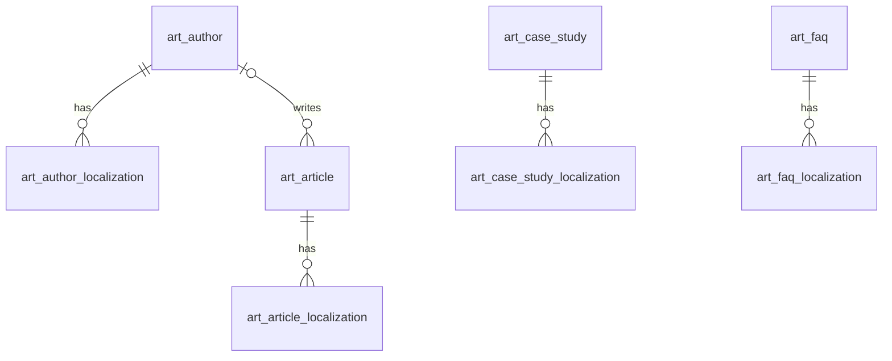

# 文章（article）模块设计

| 项 | 内容 |
|---|---|
| 模块 ID | `article` |
| 名称 | 文章 |
| 层 | L3 |
| 表前缀 | `art_` |
| API 前缀 | `article` |
| 可停用 | 是 |
| 模块版本 | 1.0.0（module.json 的 version） |
| 平台版本 | `>=1.0.0 <2.0.0`（module.json 的 platform） |
| 里程碑切片 | M1：<…>；M2：<…>；M3：<…>；M4：<…>（详见第 13 节） |
| 模块负责人 | 待定 |
| 文档版本 | V1.0 |
| 状态 | 草案 |
| 更新日期 | 2026-10-14 |
| 依据 | 系统设计 V1.4 第 <…> 章；平台框架设计 V1.<x> 第 4 章 <…> 节；ADR-<…> |

> 本文只引用《平台框架设计》第 4 章中的契约，不定义新的跨模块契约；需要新契约时按平台框架设计 2.3 提出契约变更请求。

## 1. 职责与边界

### 1.1 职责

> 一段概述 + 要点列表；与系统设计 3.2 的职责描述一致，并细化到本模块的功能清单。

### 1.2 不负责的事

| 事项 | 归属模块 | 说明 |
|---|---|---|

### 1.3 协作概览

> 用图或表说明本模块与哪些模块协作、通过哪种方式（服务接口 / 事件 / 扩展点）。只画契约，不画实现。

### 1.4 适用的架构约束

> 列出与本模块直接相关的原则（P1–P8）、ADR 规则与 CLAUDE.md 禁止项，以及本模块如何满足。

## 2. 依赖与契约

### 2.1 module.json

```json
{
  "id": "<id>",
  "name": "<中文名称>",
  "version": "1.0.0",
  "layer": "L3",
  "platform": ">=1.0.0 <2.0.0",
  "requires": {},
  "optional": {},
  "disableable": true,
  "tablePrefix": "<前缀>_",
  "apiPrefix": "<id>",
  "permissions": [],
  "menus": [],
  "settings": null,
  "components": [],
  "events": { "publishes": [], "subscribes": [] }
}
```

> 完整描述符，须通过平台框架设计附录 A 的 Schema 与 A.3 的校验规则。

### 2.2 使用的服务接口

| 接口（平台框架设计小节） | 方法 | 用途 | 调用位置与时机（事务内 / 外） | 测试替身 |
|---|---|---|---|---|

### 2.3 提供的服务接口

| 接口（平台框架设计小节） | 方法 | 实现类 | 契约测试 | 说明（幂等、权限、性能目标） |
|---|---|---|---|---|

### 2.4 实现的扩展点

| 扩展点（平台框架设计小节） | 实现类 | 适用范围（内容类型 / 资源类型） | order | 收集方 |
|---|---|---|---|---|

### 2.5 收集的扩展点

| 扩展点 | 调用时机 | 过滤（站点启用状态、内容类型等） | 实现缺失或抛出异常时的行为 | 测试用示例实现 |
|---|---|---|---|---|

### 2.6 发布与订阅的事件

发布：

| 事件 | 触发时机（所在事务） | 关键字段 | 主要订阅方 |
|---|---|---|---|

订阅：

| 事件 | 处理 | 幂等方式 | 过期判断 | 失败与重试 |
|---|---|---|---|---|

### 2.7 使用的端口

| 端口 | 用途 | 测试替身 |
|---|---|---|

## 3. 领域模型

### 3.1 聚合、实体与值对象

| 类型 | 名称 | 说明 |
|---|---|---|
| 聚合根 | Article（`art_article`） | 文章的语言无关字段：作者、主栏目、封面。与 `cnt_content`（type = ARTICLE）1:1，主键即 `content_id` |
| 实体 | ArticleLocalization（`art_article_localization`） | 文章在一种语言下的草稿字段：标题、摘要、正文（ProseMirror JSON）、阅读时长 |
| 聚合根 | CaseStudy（`art_case_study`） | 案例的语言无关字段：封面、客户是否匿名、客户 Logo、客户所在国家。与 `cnt_content`（type = CASE_STUDY）1:1 |
| 实体 | CaseStudyLocalization（`art_case_study_localization`） | 标题、摘要、客户名称、挑战、方案、成果指标 |
| 聚合根 | Faq（`art_faq`） | FAQ 的语言无关字段：默认顺序。与 `cnt_content`（type = FAQ，不可路由）1:1 |
| 实体 | FaqLocalization（`art_faq_localization`） | 问题、答案（富文本） |
| 聚合根 | Author（`art_author`） | 作者（站点资源）：姓名、头像、社交链接；用于 Article 结构化数据中的 author（E-E-A-T） |
| 实体 | AuthorLocalization（`art_author_localization`） | 作者的职务与简介（站点资源，带 `translation_state`、`source_fingerprint`） |
| 值对象 | RichText | ProseMirror JSON：节点白名单；正文从 H2 开始；内部链接存为 `content://{id}`（系统设计 9 章） |
| 值对象 | ResultMetric | 案例成果指标 `{value, label}` |
| 值对象 | SocialLink | 作者社交链接 `{type, url}` |

在系统设计之外补充的字段：

| 补充 | 理由 |
|---|---|
| `art_article.primary_category_term_id` | 系统设计 9 章的“文章栏目”是 `article_category` 词汇表的分类指派；冗余主栏目用于后台按栏目筛选与下线 `REDIRECT_PARENT` 解析到栏目页，与 `prd_product.primary_category_term_id` 一致 |
| `art_article.cover_media_id`、`art_case_study.cover_media_id` | 系统设计 9 章的“封面”；媒体是非文本数据，所有语言沿用，故放在主表 |
| `art_article_localization.reading_minutes` | “阅读时长自动计算”（系统设计 9 章）；各语言正文长度不同，按语言保存 |
| `art_case_study.customer_anonymous`、`customer_logo_media_id`、`customer_country` | “客户（可匿名）”拆为匿名开关 + 本地化的客户显示名称；Logo 与国家是案例卡片的常见展示项，匿名时不显示 Logo |
| `art_case_study_localization`、`art_faq_localization` | 25.8 只列出 `art_article_localization`；案例与 FAQ 同为内容类型，草稿业务字段按语言保存，需要各自的本地化表（系统设计 6.1）。25.8 需同步修订 |
| `art_faq.sort_order` | FAQ 组件与 `faq-by-context` 数据源（系统设计 10.5）的默认顺序 |
| `art_author.sort_order`、`deleted_at` | 后台选择顺序；作者被文章引用，软删除保留 ID（本文 2.5） |
| `art_author_localization.job_title` | Schema.org `Person.jobTitle`，与简介一起体现 E-E-A-T |
| 作者姓名放在主表、不翻译 | 人名按本人对外署名录入，所有语言相同；可翻译的是职务与简介 |
| 各表的 `version` | 编辑页整体保存，乐观锁防止并发覆盖 |

### 3.2 不变量

| # | 规则 | 保证方式 |
|---|---|---|
| 1 | `art_article`、`art_case_study`、`art_faq` 分别与 `cnt_content`（ARTICLE / CASE_STUDY / FAQ）1:1；`content_id` 由 `ContentApi.create()` 在同一事务中返回 | 应用层 |
| 2 | 内容的每个 `cnt_localization` 恰有一条同语言的本地化行；每种语言最多一条 | 数据库：`uk_aloc_article_locale`、`uk_csloc_case_locale`、`uk_floc_faq_locale`；应用层 |
| 3 | `art_article.primary_category_term_id` 等于 `tx_assignment` 中 `article_category` 词汇表的主分类 | 应用层（文章编辑页的分类由 article 接口保存，同一事务中经 `TaxonomyApi` 写入指派并同步本列） |
| 4 | 作者属于同一站点；已删除的作者不能被新选择；被文章引用的作者只能软删除 | 数据库：`fk_art_article_author`（RESTRICT，针对物理删除）；应用层 |
| 5 | 匿名案例没有客户 Logo；客户名称此时为匿名化描述 | 数据库：`ck_art_case_anonymous`；应用层 |
| 6 | `reading_minutes` 由系统计算，不可手工编辑 | 应用层 |
| 7 | 富文本只含白名单节点；正文不含 H1；内部链接存为 `content://{id}`，不存 URL | 应用层（保存与发布校验） |
| 8 | 发布校验：ARTICLE 必须有标题与正文；CASE_STUDY 必须有标题；FAQ 必须有问题与答案 | 应用层（`PublishContributor.validate()` 报 ERROR） |
| 9 | 每个作者每种语言最多一条本地化；中文行 `translation_state = NONE`、`source_fingerprint` 为空 | 数据库：`uk_aul_author_locale`；应用层 |
| 10 | 子表的 `site_id` 与父表一致 | 应用层 |

### 3.3 状态机

<<FILL: 状态与转换；没有状态机时写“不适用：<原因>”>>

## 4. 数据模型

> 遵守平台框架设计第 7 章的数据库通用约定。DDL 已在 MySQL 8.4 上执行通过；表结构以本节为准，与迁移脚本保持一致。

### 4.1 表清单

| 表 | 说明 | 站点级 | 软删除 | 预估规模（单站，按系统设计假设 A4） |
|---|---|---|---|---|
| `art_author` | 作者（站点资源） | 是 | 是（`deleted_at`） | 10–50 行 |
| `art_author_localization` | 作者本地化（站点资源） | 是 | 否（随作者） | ≤ 500 行 |
| `art_article` | 文章（新闻、博客） | 是 | 否（随内容回收站） | ≤ 5 千行 |
| `art_article_localization` | 文章本地化（内容类草稿） | 是 | 否 | ≤ 5 万行（× 10 种语言）；正文平均 10–30 KB，约 0.5–1.5 GB |
| `art_case_study` | 案例 | 是 | 否（随内容回收站） | 100–500 行 |
| `art_case_study_localization` | 案例本地化（内容类草稿） | 是 | 否 | ≤ 5 千行 |
| `art_faq` | FAQ | 是 | 否（随内容回收站） | 200–2 千行 |
| `art_faq_localization` | FAQ 本地化（内容类草稿） | 是 | 否 | ≤ 2 万行 |

### 4.2 ER 图



### 4.3 表结构

#### 4.3.1 `art_author`：作者

| 字段 | 类型 | 可空 | 默认 | 说明 |
|---|---|---|---|---|
| `id` | BIGINT | 否 | — | 主键（TSID） |
| `site_id` | BIGINT | 否 | — | 站点 ID（sys_site.id） |
| `name` | VARCHAR(100) | 否 | — | 姓名（对外署名，所有语言相同，不翻译）；Schema.org Person.name |
| `avatar_media_id` | BIGINT | 是 | — | 头像媒体 ID（mda_media.id，类型 IMAGE） |
| `social_links` | JSON | 否 | `(JSON_ARRAY())` | 社交链接：[{"type": "LINKEDIN", "url": "https://…"}]；Schema.org Person.sameAs |
| `sort_order` | INT | 否 | `0` | 后台选择列表中的顺序 |
| `deleted_at` | DATETIME(3) | 是 | — | 删除时间（软删除） |
| `version` | INT | 否 | `0` | 乐观锁版本号 |
| `created_at` | DATETIME(3) | 否 | `CURRENT_TIMESTAMP(3)` | 创建时间（UTC） |
| `created_by` | BIGINT | 否 | `0` | 创建人用户 ID（0 = 系统） |
| `updated_at` | DATETIME(3) | 否 | `CURRENT_TIMESTAMP(3) ON UPDATE CURRENT_TIMESTAMP(3)` | 更新时间（UTC） |
| `updated_by` | BIGINT | 否 | `0` | 更新人用户 ID（0 = 系统） |

索引与约束：
- `PRIMARY KEY (id)`
- `idx_author_name (site_id, name)`：后台作者列表与选择器按姓名搜索

```sql
CREATE TABLE art_author (
  id               BIGINT        NOT NULL COMMENT '主键（TSID）',
  site_id          BIGINT        NOT NULL COMMENT '站点 ID（sys_site.id）',
  name             VARCHAR(100)  NOT NULL COMMENT '姓名（对外署名，所有语言相同，不翻译）；Schema.org Person.name',
  avatar_media_id  BIGINT        NULL COMMENT '头像媒体 ID（mda_media.id，类型 IMAGE）',
  social_links     JSON          NOT NULL DEFAULT (JSON_ARRAY()) COMMENT '社交链接：[{"type": "LINKEDIN", "url": "https://…"}]；Schema.org Person.sameAs',
  sort_order       INT           NOT NULL DEFAULT 0 COMMENT '后台选择列表中的顺序',
  deleted_at       DATETIME(3)   NULL COMMENT '删除时间（软删除）',
  version          INT           NOT NULL DEFAULT 0 COMMENT '乐观锁版本号',
  created_at       DATETIME(3)   NOT NULL DEFAULT CURRENT_TIMESTAMP(3) COMMENT '创建时间（UTC）',
  created_by       BIGINT        NOT NULL DEFAULT 0 COMMENT '创建人用户 ID（0 = 系统）',
  updated_at       DATETIME(3)   NOT NULL DEFAULT CURRENT_TIMESTAMP(3) ON UPDATE CURRENT_TIMESTAMP(3) COMMENT '更新时间（UTC）',
  updated_by       BIGINT        NOT NULL DEFAULT 0 COMMENT '更新人用户 ID（0 = 系统）',
  PRIMARY KEY (id),
  KEY idx_author_name (site_id, name)
) ENGINE = InnoDB DEFAULT CHARSET = utf8mb4 COLLATE = utf8mb4_0900_ai_ci COMMENT = '作者（站点资源：姓名、头像、社交链接）';
```

要点：
- 作者是站点资源，保存即生效：头像由 article 经 `MediaApi` 记录 `PUBLISHED` 引用（`owner_type = 'article.author'`，见 media 模块设计 4.3.4）；作者软删除时删除其引用记录。
- 发布时 article 的 `PublishContributor` 把作者（姓名、本语言的职务与简介、头像、社交链接）写入快照，供页面与 Schema.org `Article.author`（Person）使用（系统设计 14.5）。作者资料变化后，已发布文章在下次发布时更新；需要立即生效时，可在后台对引用该作者的已发布文章批量重新发布（异步任务，经 `idx_article_author` 找到文章）。

#### 4.3.2 `art_author_localization`：作者本地化

| 字段 | 类型 | 可空 | 默认 | 说明 |
|---|---|---|---|---|
| `id` | BIGINT | 否 | — | 主键（TSID） |
| `site_id` | BIGINT | 否 | — | 站点 ID（sys_site.id） |
| `author_id` | BIGINT | 否 | — | 作者 ID（art_author.id） |
| `locale` | VARCHAR(16) | 否 | — | 语言（BCP 47） |
| `job_title` | VARCHAR(200) | 是 | — | 职务（站点资源：中文录入，其他语言由 translation 写入），如“储能系统高级工程师” |
| `bio` | VARCHAR(1000) | 是 | — | 简介（纯文本；站点资源：中文录入，其他语言由 translation 写入） |
| `translation_state` | VARCHAR(16) | 否 | `'NONE'` | 翻译状态：NONE / QUEUED / TRANSLATED / NEEDS_REVIEW / FAILED / OUTDATED |
| `source_fingerprint` | CHAR(64) bin | 是 | — | 生成本行译文时中文行的指纹（规范化 job_title 与 bio 拼接后的 SHA-256）；中文行为空；与当前中文指纹不同即为过期 |
| `version` | INT | 否 | `0` | 乐观锁版本号 |
| `created_at` | DATETIME(3) | 否 | `CURRENT_TIMESTAMP(3)` | 创建时间（UTC） |
| `created_by` | BIGINT | 否 | `0` | 创建人用户 ID（0 = 系统） |
| `updated_at` | DATETIME(3) | 否 | `CURRENT_TIMESTAMP(3) ON UPDATE CURRENT_TIMESTAMP(3)` | 更新时间（UTC） |
| `updated_by` | BIGINT | 否 | `0` | 更新人用户 ID（0 = 系统） |

索引与约束：
- `PRIMARY KEY (id)`
- `uk_aul_author_locale (author_id, locale)`：每种语言一条；发布时按作者取本语言的职务与简介；兼作 `fk_art_aul_author` 的索引
- `idx_aul_state (site_id, translation_state, locale)`：翻译中心列出待处理的作者资料
- `fk_art_aul_author`：组合关系，`ON DELETE CASCADE`

```sql
CREATE TABLE art_author_localization (
  id                  BIGINT         NOT NULL COMMENT '主键（TSID）',
  site_id             BIGINT         NOT NULL COMMENT '站点 ID（sys_site.id）',
  author_id           BIGINT         NOT NULL COMMENT '作者 ID（art_author.id）',
  locale              VARCHAR(16)    NOT NULL COMMENT '语言（BCP 47）',
  job_title           VARCHAR(200)   NULL COMMENT '职务（站点资源：中文录入，其他语言由 translation 写入），如“储能系统高级工程师”',
  bio                 VARCHAR(1000)  NULL COMMENT '简介（纯文本；站点资源：中文录入，其他语言由 translation 写入）',
  translation_state   VARCHAR(16)    NOT NULL DEFAULT 'NONE' COMMENT '翻译状态：NONE / QUEUED / TRANSLATED / NEEDS_REVIEW / FAILED / OUTDATED',
  source_fingerprint  CHAR(64)       COLLATE utf8mb4_0900_bin NULL COMMENT '生成本行译文时中文行的指纹（规范化 job_title 与 bio 拼接后的 SHA-256）；中文行为空；与当前中文指纹不同即为过期',
  version             INT            NOT NULL DEFAULT 0 COMMENT '乐观锁版本号',
  created_at          DATETIME(3)    NOT NULL DEFAULT CURRENT_TIMESTAMP(3) COMMENT '创建时间（UTC）',
  created_by          BIGINT         NOT NULL DEFAULT 0 COMMENT '创建人用户 ID（0 = 系统）',
  updated_at          DATETIME(3)    NOT NULL DEFAULT CURRENT_TIMESTAMP(3) ON UPDATE CURRENT_TIMESTAMP(3) COMMENT '更新时间（UTC）',
  updated_by          BIGINT         NOT NULL DEFAULT 0 COMMENT '更新人用户 ID（0 = 系统）',
  PRIMARY KEY (id),
  UNIQUE KEY uk_aul_author_locale (author_id, locale),
  KEY idx_aul_state (site_id, translation_state, locale),
  CONSTRAINT fk_art_aul_author FOREIGN KEY (author_id) REFERENCES art_author (id) ON DELETE CASCADE
) ENGINE = InnoDB DEFAULT CHARSET = utf8mb4 COLLATE = utf8mb4_0900_ai_ci COMMENT = '作者本地化（职务与简介为站点资源，带翻译状态与源指纹）';
```

要点：中文行的职务或简介变化时发布 `TranslatableResourceChangedEvent`（资源类型 `article.author`，ID 为 `author_id`）；translation 回写目标语言行并设置 `translation_state` 与 `source_fingerprint`（系统设计 5.7）。某语言没有本地化行时，该语言页面只显示姓名与头像，不回退到中文。

#### 4.3.3 `art_article`：文章

| 字段 | 类型 | 可空 | 默认 | 说明 |
|---|---|---|---|---|
| `content_id` | BIGINT | 否 | — | 内容 ID（cnt_content.id，类型 ARTICLE），即文章主键 |
| `site_id` | BIGINT | 否 | — | 站点 ID（sys_site.id） |
| `author_id` | BIGINT | 是 | — | 作者 ID（art_author.id）；空 = 不署名（结构化数据 author 使用 Organization） |
| `primary_category_term_id` | BIGINT | 是 | — | 主栏目 ID（tx_term.id，词汇表 article_category）；冗余 tx_assignment 中的主分类 |
| `cover_media_id` | BIGINT | 是 | — | 封面媒体 ID（mda_media.id，类型 IMAGE）；快照 card.coverMediaId |
| `version` | INT | 否 | `0` | 乐观锁版本号 |
| `created_at` | DATETIME(3) | 否 | `CURRENT_TIMESTAMP(3)` | 创建时间（UTC） |
| `created_by` | BIGINT | 否 | `0` | 创建人用户 ID（0 = 系统） |
| `updated_at` | DATETIME(3) | 否 | `CURRENT_TIMESTAMP(3) ON UPDATE CURRENT_TIMESTAMP(3)` | 更新时间（UTC） |
| `updated_by` | BIGINT | 否 | `0` | 更新人用户 ID（0 = 系统） |

索引与约束：
- `PRIMARY KEY (content_id)`
- `idx_article_author (author_id)`：作者的文章列表、删除作者前检查、按作者批量重新发布；兼作 `fk_art_article_author` 的索引
- `idx_article_category (site_id, primary_category_term_id)`：后台按栏目筛选文章；分类项删除时查找受影响文章
- `fk_art_article_author`：引用关系（RESTRICT）

```sql
CREATE TABLE art_article (
  content_id                BIGINT       NOT NULL COMMENT '内容 ID（cnt_content.id，类型 ARTICLE），即文章主键',
  site_id                   BIGINT       NOT NULL COMMENT '站点 ID（sys_site.id）',
  author_id                 BIGINT       NULL COMMENT '作者 ID（art_author.id）；空 = 不署名（结构化数据 author 使用 Organization）',
  primary_category_term_id  BIGINT       NULL COMMENT '主栏目 ID（tx_term.id，词汇表 article_category）；冗余 tx_assignment 中的主分类',
  cover_media_id            BIGINT       NULL COMMENT '封面媒体 ID（mda_media.id，类型 IMAGE）；快照 card.coverMediaId',
  version                   INT          NOT NULL DEFAULT 0 COMMENT '乐观锁版本号',
  created_at                DATETIME(3)  NOT NULL DEFAULT CURRENT_TIMESTAMP(3) COMMENT '创建时间（UTC）',
  created_by                BIGINT       NOT NULL DEFAULT 0 COMMENT '创建人用户 ID（0 = 系统）',
  updated_at                DATETIME(3)  NOT NULL DEFAULT CURRENT_TIMESTAMP(3) ON UPDATE CURRENT_TIMESTAMP(3) COMMENT '更新时间（UTC）',
  updated_by                BIGINT       NOT NULL DEFAULT 0 COMMENT '更新人用户 ID（0 = 系统）',
  PRIMARY KEY (content_id),
  KEY idx_article_author (author_id),
  KEY idx_article_category (site_id, primary_category_term_id),
  CONSTRAINT fk_art_article_author FOREIGN KEY (author_id) REFERENCES art_author (id)
) ENGINE = InnoDB DEFAULT CHARSET = utf8mb4 COLLATE = utf8mb4_0900_ai_ci COMMENT = '文章（新闻、博客；与 cnt_content 1:1 的语言无关字段：作者、主栏目、封面）';
```

要点：
- 栏目、标签、应用、行业是分类指派（`tx_assignment`），所有语言沿用；新闻与博客通过栏目区分（系统设计 6.2）。
- 下线选择 `REDIRECT_PARENT` 时，由 article 的下线目标解析返回主栏目的 TERM_PAGE；主栏目为空时按 `GONE` 处理（系统设计 13.6）。
- 前台展示的发布日期与更新日期取 `cnt_localization.first_published_at` 与 `content_modified_at`（系统设计 9 章），本模块不另存。

#### 4.3.4 `art_article_localization`：文章本地化

| 字段 | 类型 | 可空 | 默认 | 说明 |
|---|---|---|---|---|
| `id` | BIGINT | 否 | — | 主键（TSID） |
| `site_id` | BIGINT | 否 | — | 站点 ID（sys_site.id） |
| `article_id` | BIGINT | 否 | — | 文章 ID（art_article.content_id，即 cnt_content.id） |
| `locale` | VARCHAR(16) | 否 | — | 语言（BCP 47），与 cnt_localization.locale 一一对应 |
| `title` | VARCHAR(300) | 否 | — | 标题（页面 H1；同步为 cnt_localization.draft_title；快照 card.title） |
| `summary` | VARCHAR(1000) | 是 | — | 摘要（纯文本；快照 card.summary） |
| `body` | JSON | 是 | — | 正文（ProseMirror JSON，节点白名单；从 H2 开始；内部链接为 content://{id}） |
| `reading_minutes` | SMALLINT | 否 | `0` | 阅读时长（分钟，保存时按本语言正文自动计算；正文为空时为 0） |
| `version` | INT | 否 | `0` | 乐观锁版本号 |
| `created_at` | DATETIME(3) | 否 | `CURRENT_TIMESTAMP(3)` | 创建时间（UTC） |
| `created_by` | BIGINT | 否 | `0` | 创建人用户 ID（0 = 系统，如译文回写） |
| `updated_at` | DATETIME(3) | 否 | `CURRENT_TIMESTAMP(3) ON UPDATE CURRENT_TIMESTAMP(3)` | 更新时间（UTC） |
| `updated_by` | BIGINT | 否 | `0` | 更新人用户 ID（0 = 系统，如译文回写） |

索引与约束：
- `PRIMARY KEY (id)`
- `uk_aloc_article_locale (article_id, locale)`：每种语言一条；编辑页、发布组装快照、译文回写按（文章，语言）读写；兼作 `fk_art_aloc_article` 的索引
- `idx_aloc_title (site_id, locale, title)`：后台按标题搜索文章（内容选择器、内部链接选择）
- `fk_art_aloc_article`：组合关系，`ON DELETE CASCADE`

```sql
CREATE TABLE art_article_localization (
  id               BIGINT         NOT NULL COMMENT '主键（TSID）',
  site_id          BIGINT         NOT NULL COMMENT '站点 ID（sys_site.id）',
  article_id       BIGINT         NOT NULL COMMENT '文章 ID（art_article.content_id，即 cnt_content.id）',
  locale           VARCHAR(16)    NOT NULL COMMENT '语言（BCP 47），与 cnt_localization.locale 一一对应',
  title            VARCHAR(300)   NOT NULL COMMENT '标题（页面 H1；同步为 cnt_localization.draft_title；快照 card.title）',
  summary          VARCHAR(1000)  NULL COMMENT '摘要（纯文本；快照 card.summary）',
  body             JSON           NULL COMMENT '正文（ProseMirror JSON，节点白名单；从 H2 开始；内部链接为 content://{id}）',
  reading_minutes  SMALLINT       NOT NULL DEFAULT 0 COMMENT '阅读时长（分钟，保存时按本语言正文自动计算；正文为空时为 0）',
  version          INT            NOT NULL DEFAULT 0 COMMENT '乐观锁版本号',
  created_at       DATETIME(3)    NOT NULL DEFAULT CURRENT_TIMESTAMP(3) COMMENT '创建时间（UTC）',
  created_by       BIGINT         NOT NULL DEFAULT 0 COMMENT '创建人用户 ID（0 = 系统，如译文回写）',
  updated_at       DATETIME(3)    NOT NULL DEFAULT CURRENT_TIMESTAMP(3) ON UPDATE CURRENT_TIMESTAMP(3) COMMENT '更新时间（UTC）',
  updated_by       BIGINT         NOT NULL DEFAULT 0 COMMENT '更新人用户 ID（0 = 系统，如译文回写）',
  PRIMARY KEY (id),
  UNIQUE KEY uk_aloc_article_locale (article_id, locale),
  KEY idx_aloc_title (site_id, locale, title),
  CONSTRAINT fk_art_aloc_article FOREIGN KEY (article_id) REFERENCES art_article (content_id) ON DELETE CASCADE
) ENGINE = InnoDB DEFAULT CHARSET = utf8mb4 COLLATE = utf8mb4_0900_ai_ci COMMENT = '文章本地化（内容类草稿：标题、摘要、正文、阅读时长）';
```

要点：
- 内容类本地化表，不带翻译状态（本文 2.7）；保存时经 `ContentApi.updateDraftMeta()` 同步 `draft_title`。
- 阅读时长：按本语言正文的可见文本计算（中日韩文字按字数、其他语言按词数，除以每分钟阅读速度后向上取整）；译文回写后重新计算。
- 翻译（系统设计 5.6、9 章）：article 的 `TranslatableContentProvider` 提取 `title`、`summary` 与 `body`；正文按块级节点拆分为翻译单元，行内标记转为编号占位标签；图片、视频、产品卡片等非文本节点沿用源语言。`apply()` 写入目标语言行。
- 正文引用的媒体：保存时经 `MediaApi` 上报该语言的 `DRAFT` 引用；发布后由 article 的 `MediaReferenceCollector` 从快照收集 `PUBLISHED` 引用。内部链接 `content://{id}` 在读取时解析为同语言 URL，目标没有该语言版本或已下线时降级为纯文本。

#### 4.3.5 `art_case_study`：案例

| 字段 | 类型 | 可空 | 默认 | 说明 |
|---|---|---|---|---|
| `content_id` | BIGINT | 否 | — | 内容 ID（cnt_content.id，类型 CASE_STUDY），即案例主键 |
| `site_id` | BIGINT | 否 | — | 站点 ID（sys_site.id） |
| `cover_media_id` | BIGINT | 是 | — | 封面媒体 ID（mda_media.id，类型 IMAGE）；快照 card.coverMediaId |
| `customer_anonymous` | TINYINT(1) | 否 | `0` | 客户是否匿名：1 = 匿名（不显示客户 Logo，客户名称填写匿名化描述） |
| `customer_logo_media_id` | BIGINT | 是 | — | 客户 Logo 媒体 ID（mda_media.id）；匿名时必须为空 |
| `customer_country` | CHAR(2) | 是 | — | 客户所在国家（ISO 3166-1 alpha-2，大写）；前台按语言显示国家名 |
| `version` | INT | 否 | `0` | 乐观锁版本号 |
| `created_at` | DATETIME(3) | 否 | `CURRENT_TIMESTAMP(3)` | 创建时间（UTC） |
| `created_by` | BIGINT | 否 | `0` | 创建人用户 ID（0 = 系统） |
| `updated_at` | DATETIME(3) | 否 | `CURRENT_TIMESTAMP(3) ON UPDATE CURRENT_TIMESTAMP(3)` | 更新时间（UTC） |
| `updated_by` | BIGINT | 否 | `0` | 更新人用户 ID（0 = 系统） |

索引与约束：
- `PRIMARY KEY (content_id)`
- `ck_art_case_anonymous`：见 3.2 不变量 5

```sql
CREATE TABLE art_case_study (
  content_id              BIGINT       NOT NULL COMMENT '内容 ID（cnt_content.id，类型 CASE_STUDY），即案例主键',
  site_id                 BIGINT       NOT NULL COMMENT '站点 ID（sys_site.id）',
  cover_media_id          BIGINT       NULL COMMENT '封面媒体 ID（mda_media.id，类型 IMAGE）；快照 card.coverMediaId',
  customer_anonymous      TINYINT(1)   NOT NULL DEFAULT 0 COMMENT '客户是否匿名：1 = 匿名（不显示客户 Logo，客户名称填写匿名化描述）',
  customer_logo_media_id  BIGINT       NULL COMMENT '客户 Logo 媒体 ID（mda_media.id）；匿名时必须为空',
  customer_country        CHAR(2)      NULL COMMENT '客户所在国家（ISO 3166-1 alpha-2，大写）；前台按语言显示国家名',
  version                 INT          NOT NULL DEFAULT 0 COMMENT '乐观锁版本号',
  created_at              DATETIME(3)  NOT NULL DEFAULT CURRENT_TIMESTAMP(3) COMMENT '创建时间（UTC）',
  created_by              BIGINT       NOT NULL DEFAULT 0 COMMENT '创建人用户 ID（0 = 系统）',
  updated_at              DATETIME(3)  NOT NULL DEFAULT CURRENT_TIMESTAMP(3) ON UPDATE CURRENT_TIMESTAMP(3) COMMENT '更新时间（UTC）',
  updated_by              BIGINT       NOT NULL DEFAULT 0 COMMENT '更新人用户 ID（0 = 系统）',
  PRIMARY KEY (content_id),
  CONSTRAINT ck_art_case_anonymous CHECK (customer_anonymous = 0 OR customer_logo_media_id IS NULL)
) ENGINE = InnoDB DEFAULT CHARSET = utf8mb4 COLLATE = utf8mb4_0900_ai_ci COMMENT = '案例（与 cnt_content 1:1 的语言无关字段：封面、客户匿名、客户 Logo 与国家）';
```

要点：行业、应用是分类指派；使用的产品是内容关系 `USES`（系统设计 9 章、15.2），本表不保存。CASE_STUDY 输出 Schema.org `Article`（系统设计 14.5）。

#### 4.3.6 `art_case_study_localization`：案例本地化

| 字段 | 类型 | 可空 | 默认 | 说明 |
|---|---|---|---|---|
| `id` | BIGINT | 否 | — | 主键（TSID） |
| `site_id` | BIGINT | 否 | — | 站点 ID（sys_site.id） |
| `case_study_id` | BIGINT | 否 | — | 案例 ID（art_case_study.content_id，即 cnt_content.id） |
| `locale` | VARCHAR(16) | 否 | — | 语言（BCP 47），与 cnt_localization.locale 一一对应 |
| `title` | VARCHAR(300) | 否 | — | 标题（页面 H1；同步为 cnt_localization.draft_title；快照 card.title） |
| `summary` | VARCHAR(1000) | 是 | — | 摘要（纯文本；快照 card.summary） |
| `customer_name` | VARCHAR(200) | 是 | — | 客户显示名称；匿名时为匿名化描述，如“德国某储能系统集成商” |
| `challenge` | JSON | 是 | — | 挑战（ProseMirror JSON 富文本） |
| `solution` | JSON | 是 | — | 方案（ProseMirror JSON 富文本） |
| `results` | JSON | 否 | `(JSON_ARRAY())` | 成果指标列表：[{"value": "30%", "label": "运维成本降低"}]，按顺序显示 |
| `version` | INT | 否 | `0` | 乐观锁版本号 |
| `created_at` | DATETIME(3) | 否 | `CURRENT_TIMESTAMP(3)` | 创建时间（UTC） |
| `created_by` | BIGINT | 否 | `0` | 创建人用户 ID（0 = 系统，如译文回写） |
| `updated_at` | DATETIME(3) | 否 | `CURRENT_TIMESTAMP(3) ON UPDATE CURRENT_TIMESTAMP(3)` | 更新时间（UTC） |
| `updated_by` | BIGINT | 否 | `0` | 更新人用户 ID（0 = 系统，如译文回写） |

索引与约束：
- `PRIMARY KEY (id)`
- `uk_csloc_case_locale (case_study_id, locale)`：每种语言一条；兼作 `fk_art_csloc_case` 的索引
- `idx_csloc_title (site_id, locale, title)`：后台按标题搜索案例
- `fk_art_csloc_case`：组合关系，`ON DELETE CASCADE`

```sql
CREATE TABLE art_case_study_localization (
  id             BIGINT         NOT NULL COMMENT '主键（TSID）',
  site_id        BIGINT         NOT NULL COMMENT '站点 ID（sys_site.id）',
  case_study_id  BIGINT         NOT NULL COMMENT '案例 ID（art_case_study.content_id，即 cnt_content.id）',
  locale         VARCHAR(16)    NOT NULL COMMENT '语言（BCP 47），与 cnt_localization.locale 一一对应',
  title          VARCHAR(300)   NOT NULL COMMENT '标题（页面 H1；同步为 cnt_localization.draft_title；快照 card.title）',
  summary        VARCHAR(1000)  NULL COMMENT '摘要（纯文本；快照 card.summary）',
  customer_name  VARCHAR(200)   NULL COMMENT '客户显示名称；匿名时为匿名化描述，如“德国某储能系统集成商”',
  challenge      JSON           NULL COMMENT '挑战（ProseMirror JSON 富文本）',
  solution       JSON           NULL COMMENT '方案（ProseMirror JSON 富文本）',
  results        JSON           NOT NULL DEFAULT (JSON_ARRAY()) COMMENT '成果指标列表：[{"value": "30%", "label": "运维成本降低"}]，按顺序显示',
  version        INT            NOT NULL DEFAULT 0 COMMENT '乐观锁版本号',
  created_at     DATETIME(3)    NOT NULL DEFAULT CURRENT_TIMESTAMP(3) COMMENT '创建时间（UTC）',
  created_by     BIGINT         NOT NULL DEFAULT 0 COMMENT '创建人用户 ID（0 = 系统，如译文回写）',
  updated_at     DATETIME(3)    NOT NULL DEFAULT CURRENT_TIMESTAMP(3) ON UPDATE CURRENT_TIMESTAMP(3) COMMENT '更新时间（UTC）',
  updated_by     BIGINT         NOT NULL DEFAULT 0 COMMENT '更新人用户 ID（0 = 系统，如译文回写）',
  PRIMARY KEY (id),
  UNIQUE KEY uk_csloc_case_locale (case_study_id, locale),
  KEY idx_csloc_title (site_id, locale, title),
  CONSTRAINT fk_art_csloc_case FOREIGN KEY (case_study_id) REFERENCES art_case_study (content_id) ON DELETE CASCADE
) ENGINE = InnoDB DEFAULT CHARSET = utf8mb4 COLLATE = utf8mb4_0900_ai_ci COMMENT = '案例本地化（内容类草稿：标题、摘要、客户名称、挑战、方案、成果）';
```

要点：翻译单元为 `title`、`summary`、`customer_name`、`challenge`、`solution`（按块级节点）与 `results[].value`、`results[].label`；数字、单位与百分比按占位保护原样保留（系统设计 5.8），真实客户名可在术语表中标记“禁止翻译”。目标语言行的 `results` 元素个数与顺序与中文行一致（应用层）。

#### 4.3.7 `art_faq`：FAQ

| 字段 | 类型 | 可空 | 默认 | 说明 |
|---|---|---|---|---|
| `content_id` | BIGINT | 否 | — | 内容 ID（cnt_content.id，类型 FAQ），即 FAQ 主键 |
| `site_id` | BIGINT | 否 | — | 站点 ID（sys_site.id） |
| `sort_order` | INT | 否 | `0` | 默认顺序（越小越靠前；写入快照，供 FAQ 组件与 faq-by-context 数据源排序） |
| `version` | INT | 否 | `0` | 乐观锁版本号 |
| `created_at` | DATETIME(3) | 否 | `CURRENT_TIMESTAMP(3)` | 创建时间（UTC） |
| `created_by` | BIGINT | 否 | `0` | 创建人用户 ID（0 = 系统） |
| `updated_at` | DATETIME(3) | 否 | `CURRENT_TIMESTAMP(3) ON UPDATE CURRENT_TIMESTAMP(3)` | 更新时间（UTC） |
| `updated_by` | BIGINT | 否 | `0` | 更新人用户 ID（0 = 系统） |

索引与约束：
- `PRIMARY KEY (content_id)`

```sql
CREATE TABLE art_faq (
  content_id  BIGINT       NOT NULL COMMENT '内容 ID（cnt_content.id，类型 FAQ），即 FAQ 主键',
  site_id     BIGINT       NOT NULL COMMENT '站点 ID（sys_site.id）',
  sort_order  INT          NOT NULL DEFAULT 0 COMMENT '默认顺序（越小越靠前；写入快照，供 FAQ 组件与 faq-by-context 数据源排序）',
  version     INT          NOT NULL DEFAULT 0 COMMENT '乐观锁版本号',
  created_at  DATETIME(3)  NOT NULL DEFAULT CURRENT_TIMESTAMP(3) COMMENT '创建时间（UTC）',
  created_by  BIGINT       NOT NULL DEFAULT 0 COMMENT '创建人用户 ID（0 = 系统）',
  updated_at  DATETIME(3)  NOT NULL DEFAULT CURRENT_TIMESTAMP(3) ON UPDATE CURRENT_TIMESTAMP(3) COMMENT '更新时间（UTC）',
  updated_by  BIGINT       NOT NULL DEFAULT 0 COMMENT '更新人用户 ID（0 = 系统）',
  PRIMARY KEY (content_id)
) ENGINE = InnoDB DEFAULT CHARSET = utf8mb4 COLLATE = utf8mb4_0900_ai_ci COMMENT = 'FAQ（不可路由的可复用问答；与 cnt_content 1:1）';
```

要点：FAQ 不可路由（系统设计 6.2），通过组件或 `faq-by-context` 数据源展示；与产品、分类、页面的关联通过分类指派（`tx_assignment`）或内容关系（`grh_relation`），本表不保存。FAQ 组件输出 Schema.org `FAQPage`（系统设计 14.5）。

#### 4.3.8 `art_faq_localization`：FAQ 本地化

| 字段 | 类型 | 可空 | 默认 | 说明 |
|---|---|---|---|---|
| `id` | BIGINT | 否 | — | 主键（TSID） |
| `site_id` | BIGINT | 否 | — | 站点 ID（sys_site.id） |
| `faq_id` | BIGINT | 否 | — | FAQ ID（art_faq.content_id，即 cnt_content.id） |
| `locale` | VARCHAR(16) | 否 | — | 语言（BCP 47），与 cnt_localization.locale 一一对应 |
| `question` | VARCHAR(300) | 否 | — | 问题（纯文本；同步为 cnt_localization.draft_title；快照 card.title） |
| `answer` | JSON | 是 | — | 答案（ProseMirror JSON 富文本） |
| `version` | INT | 否 | `0` | 乐观锁版本号 |
| `created_at` | DATETIME(3) | 否 | `CURRENT_TIMESTAMP(3)` | 创建时间（UTC） |
| `created_by` | BIGINT | 否 | `0` | 创建人用户 ID（0 = 系统，如译文回写） |
| `updated_at` | DATETIME(3) | 否 | `CURRENT_TIMESTAMP(3) ON UPDATE CURRENT_TIMESTAMP(3)` | 更新时间（UTC） |
| `updated_by` | BIGINT | 否 | `0` | 更新人用户 ID（0 = 系统，如译文回写） |

索引与约束：
- `PRIMARY KEY (id)`
- `uk_floc_faq_locale (faq_id, locale)`：每种语言一条；兼作 `fk_art_floc_faq` 的索引
- `idx_floc_question (site_id, locale, question)`：后台按问题搜索 FAQ（FAQ 组件的条目选择器）
- `fk_art_floc_faq`：组合关系，`ON DELETE CASCADE`

```sql
CREATE TABLE art_faq_localization (
  id          BIGINT        NOT NULL COMMENT '主键（TSID）',
  site_id     BIGINT        NOT NULL COMMENT '站点 ID（sys_site.id）',
  faq_id      BIGINT        NOT NULL COMMENT 'FAQ ID（art_faq.content_id，即 cnt_content.id）',
  locale      VARCHAR(16)   NOT NULL COMMENT '语言（BCP 47），与 cnt_localization.locale 一一对应',
  question    VARCHAR(300)  NOT NULL COMMENT '问题（纯文本；同步为 cnt_localization.draft_title；快照 card.title）',
  answer      JSON          NULL COMMENT '答案（ProseMirror JSON 富文本）',
  version     INT           NOT NULL DEFAULT 0 COMMENT '乐观锁版本号',
  created_at  DATETIME(3)   NOT NULL DEFAULT CURRENT_TIMESTAMP(3) COMMENT '创建时间（UTC）',
  created_by  BIGINT        NOT NULL DEFAULT 0 COMMENT '创建人用户 ID（0 = 系统，如译文回写）',
  updated_at  DATETIME(3)   NOT NULL DEFAULT CURRENT_TIMESTAMP(3) ON UPDATE CURRENT_TIMESTAMP(3) COMMENT '更新时间（UTC）',
  updated_by  BIGINT        NOT NULL DEFAULT 0 COMMENT '更新人用户 ID（0 = 系统，如译文回写）',
  PRIMARY KEY (id),
  UNIQUE KEY uk_floc_faq_locale (faq_id, locale),
  KEY idx_floc_question (site_id, locale, question),
  CONSTRAINT fk_art_floc_faq FOREIGN KEY (faq_id) REFERENCES art_faq (content_id) ON DELETE CASCADE
) ENGINE = InnoDB DEFAULT CHARSET = utf8mb4 COLLATE = utf8mb4_0900_ai_ci COMMENT = 'FAQ 本地化（内容类草稿：问题、答案）';
```

要点：翻译单元为 `question` 与 `answer`（按块级节点拆分）；FAQ 某语言未发布时，该语言页面的 FAQ 组件不显示该条，不回退到中文。

### 4.4 枚举

| 字段 | 取值 | 说明 |
|---|---|---|
| 本模块的内容类型（`cnt_content.type`） | `ARTICLE` | 文章（新闻、博客），可路由，默认 URL 规则 `/blog/{slug}` |
| | `CASE_STUDY` | 案例，可路由，默认 URL 规则 `/case-studies/{slug}` |
| | `FAQ` | 可复用问答，不可路由 |
| `art_author.social_links[].type` | `LINKEDIN` / `X` / `FACEBOOK` / `YOUTUBE` / `WEBSITE` / `OTHER` | 社交平台；前台图标与无障碍名称按 type 取文案键 |
| `art_author_localization.translation_state` | `NONE` / `QUEUED` / `TRANSLATED` / `NEEDS_REVIEW` / `FAILED` / `OUTDATED` | 共享翻译状态枚举；中文行为 `NONE` |
| `art_case_study.customer_country` | ISO 3166-1 alpha-2 | 大写；前台用 `Intl.DisplayNames` 按语言显示国家名 |
| 富文本节点白名单（`body`、`challenge`、`solution`、`answer`） | 标题（从 H2 开始）、段落、列表、表格、图片、视频、引用、提示框、产品卡片、CTA | 系统设计 9 章；H1 保留给页面标题 |
| `TranslatableResourceChangedEvent` 资源类型 | `article.author` | 作者职务与简介（ID 为 `author_id`） |

### 4.5 站点过滤

<<FILL: | 表 | 行级拦截器（不豁免 / 豁免） | 访问方式与理由 |>>

### 4.6 跨模块引用与清理

**本模块引用其他模块的对象**：

| 本模块字段 | 引用对象（模块.表） | 被引用对象删除 / 下线时的处理 | 触发事件 |
|---|---|---|---|
| `art_article.content_id`、`art_case_study.content_id`、`art_faq.content_id` | content.`cnt_content` | 内容彻底删除：删除本行，级联删除本地化 | `ContentPurgedEvent` |
| `art_article_localization`、`art_case_study_localization`、`art_faq_localization`（主表 ID, `locale`） | content.`cnt_localization` | 本地化删除：删除该语言的行 | `LocalizationDeletedEvent` |
| `art_article.primary_category_term_id` | taxonomy.`tx_term` | 分类项删除：置空（已发布快照不变） | `TermChangedEvent`（DELETED） |
| `art_article.cover_media_id`、`art_case_study.cover_media_id`、`customer_logo_media_id`、富文本中的媒体节点 | media.`mda_media` | 有引用记录（`mda_usage`）的媒体不能删除；保存草稿时经 `MediaApi` 上报 `DRAFT` 引用；收到删除事件时防御性置空 | `MediaDeletedEvent` |
| `art_author.avatar_media_id` | media.`mda_media` | 作者保存时经 `MediaApi` 记录 `PUBLISHED` 引用（`owner_type = 'article.author'`）；作者删除时删除引用；收到删除事件时置空 | `MediaDeletedEvent` |
| 富文本中的 `content://{id}` | content.`cnt_content` | 读取时解析为同语言 URL；目标下线、彻底删除或没有该语言版本时降级为纯文本，并在 SEO 健康中报警（系统设计 9 章） | — |
| `*_localization.locale` | core.`sys_site_locale` | V1 不删除站点语言，无需清理 | `SiteSettingsChangedEvent` |
| 内容类型 `ARTICLE`、`CASE_STUDY`、`FAQ` | core.`sys_site_module` | 模块停用：数据全部保留，文章与案例路由返回 404，FAQ 组件不渲染（系统设计 3.8） | `ModuleDisabledEvent` |
| `created_by`、`updated_by` | core.`sys_user` | 不清理 | — |

**其他模块引用本模块的对象**：

| 被引用对象 | 引用方 | 本模块对象变化时的处理 | 事件 |
|---|---|---|---|
| `art_author.id` | media.`mda_usage.owner_id`（`owner_type = 'article.author'`） | 作者删除时由 article 经 `MediaApi` 删除其引用行 | — |
| 文章、案例、FAQ 的 `content_id` | graph `grh_relation`（`USES`、`CASE_OF` 等）、seo、page 布局文档的 `$content` | 均以 `content_id` 引用内容内核，按 content 的事件清理（第 5 章） | `ContentPurgedEvent` |

本模块发布的事件：`TranslatableResourceChangedEvent`（资源类型 `article.author`）。订阅：`ContentPurgedEvent`、`LocalizationDeletedEvent`、`TermChangedEvent`、`MediaDeletedEvent`。本模块实现的扩展点：`ContentTypeProvider`（ARTICLE、CASE_STUDY、FAQ）、`PublishContributor`、`TranslatableContentProvider`、`TranslatableResourceProvider`（作者）、`MediaReferenceCollector`、`SchemaOrgProvider`（Article / BlogPosting、FAQPage）；提供数据源 `faq-by-context`。

---

### 4.7 迁移脚本

| 文件 | 内容 | 里程碑 |
|---|---|---|
| `db/migration/article/V001__init.sql` | 4.3 中的全部表（8 张：`art_author`、`art_author_localization`、`art_article`、`art_article_localization`、`art_case_study`、`art_case_study_localization`、`art_faq`、`art_faq_localization`），按本节顺序创建 | <见第 13 节> |

## 5. 业务流程

### 5.1 <流程名称>

```text
<步骤；标出事务边界、调用的服务接口、发布的事件、异步部分>
```

| 步骤 | 说明 | 失败处理 |
|---|---|---|

## 6. 接口

### 6.1 Admin 端点

| 方法 | 路径（/api/admin/v1/<apiPrefix>/…） | 说明 | 权限码 | 并发控制 / 幂等 | 审计 |
|---|---|---|---|---|---|

### 6.2 Public 端点

| 方法 | 路径（/api/public/v1/<apiPrefix>/…） | 说明 | 限流 | 缓存 |
|---|---|---|---|---|

### 6.3 Internal 端点

| 方法 | 路径（/api/internal/v1/<apiPrefix>/…） | 说明 | 调用方 |
|---|---|---|---|

### 6.4 权限码

| 权限码 | 名称 | 数据范围 | 高危（sensitive） | 受语言范围限制（localeScoped） |
|---|---|---|---|---|

### 6.5 错误码

| 错误码 | HTTP 状态 | 后台中文信息 | 前台文案键（仅公开接口） |
|---|---|---|---|

## 7. 后台界面

### 7.1 菜单与路由

| 菜单 key | 名称 | 父菜单 | 路由 | 权限码 |
|---|---|---|---|---|

### 7.2 页面

| 页面 | 路由 | 主要功能 | 使用的 admin-kit 组件 |
|---|---|---|---|

### 7.3 注册到内容编辑外壳的标签

| key | 适用内容类型 | 权限码 | 组件 |
|---|---|---|---|

### 7.4 界面文案

> texts.ts 中的分组与关键文案；后台只用简体中文。

## 8. 前台组件与模板

> 没有前台组件时写“不适用”。

### 8.1 组件

| 组件类型 | 名称（label） | 变体 | 分类 | allowedIn | 数据源 | 是否水合 |
|---|---|---|---|---|---|---|

### 8.2 属性与翻译

| 组件 | 属性 | 类型 / x-editor | x-translatable | maxLength |
|---|---|---|---|---|

### 8.3 模板

| 模板 key | 内容类型 | 固定区域与插槽 |
|---|---|---|

### 8.4 数据源

| key | 参数 | 返回 | 缓存标签 |
|---|---|---|---|

### 8.5 文案键

| 文案键 | 默认中文文案 | 使用位置 |
|---|---|---|

## 9. 配置项

### 9.1 站点设置（settings.schema.json）

| 键 | 类型 | 默认值 | 说明 | 敏感（x-secret） |
|---|---|---|---|---|

### 9.2 部署配置（application.yml，前缀 b2bweb.<id>）

| 属性 | 默认值 | 说明 |
|---|---|---|

## 10. 定时与异步任务

> 没有时写“不适用”。定时任务实现 `ScheduledTask`，通用异步任务实现 `JobHandler`（平台框架设计 4.4.12）；锁名与任务类型按平台框架设计 3.7 命名。事件监听器已在 2.6 中列出，这里只补充耗时长、需要单独调度或重试的处理。`PER_SITE` 任务由 core 在站点上下文中逐站点执行，停用了本模块的站点自动跳过（系统设计 3.8）。外部服务（AI 引擎、邮件、CDN）只在事务提交后的异步处理中调用，失败不回滚已提交的业务数据（ADR-003、ADR-017）。

| 任务 | 类型（定时 / sys_job / 事件监听） | 触发 | 锁名 | 幂等与重试 | 模块停用时 |
|---|---|---|---|---|---|

> 每个任务另写：执行粒度（`PER_SITE` / 系统级）、单次处理量与分批方式、超时、能否取消、失败后的可见结果（`sys_job` 的失败报告、指标 `b2bweb.<id>.*` 或告警）。

## 11. 测试要点

> 测试层级、替身与契约测试的写法见平台框架设计第 9 章，门禁与覆盖率见第 10 章。“至少”后的用例为必测项；不适用的行写“不适用：<原因>”，不得删除。

| 层级 | 覆盖内容 | 关键用例 |
|---|---|---|
| 单元 | <领域对象、不变量（3.2）、状态机（3.3）、扩展点实现（2.4）> | 至少：3.2 每条不变量的违反用例；3.3 每个非法状态转换被拒绝 |
| 模块集成（Testcontainers + 替身） | <应用服务 + 本模块的表与迁移> | 至少：迁移脚本在空库（MySQL 8.4）上执行通过；6.1 中声明的并发控制与幂等；唯一约束冲突转为 6.5 的错误码 |
| 契约（作为提供方） | <2.3 中本模块提供的服务接口> | 继承 testkit 中的 `<接口名>ContractTest`，用真实实现运行；不提供服务接口时写“不适用” |
| 事件（Scenario API，含重复投递） | <2.6 中发布与订阅的事件> | 至少：事件在业务事务内发布、事务回滚时不发布；每个监听器重复投递只生效一次、过期事件被丢弃（ADR-003） |
| 停用行为（可停用模块） | <系统设计 3.8 的各项> | 至少：停用后写操作与公开接口返回 `CORE_MODULE_DISABLED`；扩展点实现不再被收集；定时任务跳过；`analyzeDisableImpact` 的结果正确；重新启用后数据完整（S10） |
| 站点隔离 | <6.1 的全部后台接口与 4.5 的全部站点级表> | 至少：站点 A 的用户不能读写站点 B 的数据（遍历全部后台端点，系统设计 28）；豁免表只在 4.5 列出的位置访问 |
| 翻译（如有可翻译字段） | <`TranslatableContentProvider` / `TranslatableResourceProvider` 实现> | 至少：提取 → 回写往返一致；`x-translatable = false` 的字段不被提取；`HUMAN` / `REVIEWED` 段不被机器译文覆盖；资源变化时发布 `TranslatableResourceChangedEvent` |
| 前端（组件、Admin） | <主题组件、Admin 页面> | 至少：组件 Schema 校验与画廊示例（视觉回归）；前台文字只来自文案键、后台文字只来自 `texts.ts`；无权限时操作不可见 |
| E2E（场景） | <13.2 中验证方式为 E2E 的验收项> | Playwright 用例名包含 13.2 的验收项编号 |

## 12. 独立开发说明

### 12.1 依赖的测试替身

> 2.2 使用的每个服务接口、2.7 使用的每个端口、2.5 收集的每个扩展点，都要在此列出 testkit 中对应的替身或示例实现（平台框架设计 2.4、第 9 章）。testkit 中缺少的替身向框架组提出需求（DoR 第 3 条，平台框架设计 2.7），不在本模块中另建一套代替其他模块的模拟实现；单元测试可以用 Mockito 模拟个别方法，但对其他模块行为的假设以替身与契约测试为准。

| 替身（platform-testkit） | 代替的模块 | 用途 | 需要预置的数据 |
|---|---|---|---|

### 12.2 本模块提供的替身

> 只有提供服务接口的模块填写（core、content、url、media、taxonomy、form、notification、translation，见平台框架设计 4.2）；其他模块写“不适用：不提供服务接口”。替身由框架组编写并维护，与真实实现通过同一套契约测试；本模块改变服务接口的行为时，在同一个 PR 中同步修改契约测试，并通知框架组修改替身（平台框架设计 2.3）。无法消除的差异（如不做病毒扫描、不生成真实缩略图）列入下表，并确认不影响使用方的测试结论。

| 服务接口 | testkit 中的替身 | 与真实实现的差异（应为零，或已在契约测试中声明） |
|---|---|---|

### 12.3 本地运行

> 启动方式、依赖的本地服务（平台框架设计第 11 章）、需要的配置。

### 12.4 演示数据

> tools/demo-data 中本模块的数据及其用途。

## 13. 验收标准

### 13.1 里程碑切片

> 与平台框架设计 13.5 中本模块的一行一致；调整切片按平台框架设计 12.5 处理。该里程碑没有切片时写“—”（不表示不能提前开发）。

| 里程碑 | 交付功能 | 验收场景 |
|---|---|---|
| M1 | <…> | <S1、S2、S4 中与本模块相关的部分，或“模块自身”> |
| M2 | <…> | <…> |
| M3 | <…> | <…> |
| M4 | <…> | <…> |

### 13.2 验收项

> 每条验收项写明输入、期望结果与度量（如“5 分钟内”“P95 ≤ 200 ms”）。场景验收项只写本模块负责的部分（如 S2 中 url 负责“旧 URL 301 到新 URL、不产生重定向链”），不复述整个场景；各里程碑的场景见平台框架设计 13.6。验证方式为单元 / 集成 / E2E 时写出测试类或用例名；人工检查写明检查人与方法。

| # | 验收项 | 对应场景（S1–S13）或模块自身 | 验证方式（单元 / 集成 / E2E / 人工） | 里程碑 |
|---|---|---|---|---|
| A1 | <…> | <S? / 模块自身> | <集成：`<测试类>`> | M? |

> 每个模块都要包含以下通用验收项（不适用时注明原因）：架构测试与 Modulith 验证通过，无跨模块 import 与表访问；站点隔离测试覆盖全部后台接口；后台写操作都有权限码与审计记录；可停用模块满足 S10；可翻译字段与资源已登记并通过往返测试（S11、S12）；系统设计 1.5 中与本模块相关的非功能指标；文档与代码一致（DoD，平台框架设计 2.8）。

## 14. 待定问题

> 记录评审与开发中尚未决定的事项。“阻塞开发”的问题必须在评审通过（DoR）前关闭；需要新契约或修改上层文档的问题，写明契约变更请求或 Issue 编号。已关闭的问题保留在表中，填写结论。

| # | 问题 | 影响 | 是否阻塞开发 | 负责人 | 最晚解决 | 结论 |
|---|---|---|---|---|---|---|

## 修订记录

| 版本 | 日期 | 变更 |
|---|---|---|
| V1.0 | 2026-10-14 | 初稿 |
