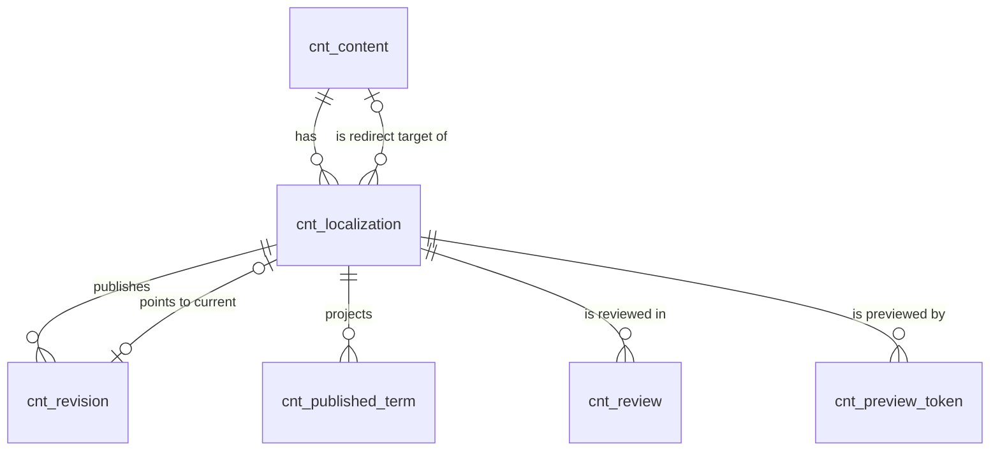

# 内容内核（content）模块设计

| 项 | 内容 |
|---|---|
| 模块 ID | `content` |
| 名称 | 内容内核 |
| 层 | L2 |
| 表前缀 | `cnt_` |
| API 前缀 | `content` |
| 可停用 | 否 |
| 模块版本 | 1.0.0（module.json 的 version） |
| 平台版本 | `>=1.0.0 <2.0.0`（module.json 的 platform） |
| 里程碑切片 | M1：<…>；M2：<…>；M3：<…>；M4：<…>（详见第 13 节） |
| 模块负责人 | 待定 |
| 文档版本 | V1.0 |
| 状态 | 草案 |
| 更新日期 | 2026-10-14 |
| 依据 | 系统设计 V1.4 第 <…> 章；平台框架设计 V1.<x> 第 4 章 <…> 节；ADR-<…> |

> 本文只引用《平台框架设计》第 4 章中的契约，不定义新的跨模块契约；需要新契约时按平台框架设计 2.3 提出契约变更请求。

## 1. 职责与边界

### 1.1 职责

> 一段概述 + 要点列表；与系统设计 3.2 的职责描述一致，并细化到本模块的功能清单。

### 1.2 不负责的事

| 事项 | 归属模块 | 说明 |
|---|---|---|

### 1.3 协作概览

> 用图或表说明本模块与哪些模块协作、通过哪种方式（服务接口 / 事件 / 扩展点）。只画契约，不画实现。

### 1.4 适用的架构约束

> 列出与本模块直接相关的原则（P1–P8）、ADR 规则与 CLAUDE.md 禁止项，以及本模块如何满足。

## 2. 依赖与契约

### 2.1 module.json

```json
{
  "id": "<id>",
  "name": "<中文名称>",
  "version": "1.0.0",
  "layer": "L3",
  "platform": ">=1.0.0 <2.0.0",
  "requires": {},
  "optional": {},
  "disableable": true,
  "tablePrefix": "<前缀>_",
  "apiPrefix": "<id>",
  "permissions": [],
  "menus": [],
  "settings": null,
  "components": [],
  "events": { "publishes": [], "subscribes": [] }
}
```

> 完整描述符，须通过平台框架设计附录 A 的 Schema 与 A.3 的校验规则。

### 2.2 使用的服务接口

| 接口（平台框架设计小节） | 方法 | 用途 | 调用位置与时机（事务内 / 外） | 测试替身 |
|---|---|---|---|---|

### 2.3 提供的服务接口

| 接口（平台框架设计小节） | 方法 | 实现类 | 契约测试 | 说明（幂等、权限、性能目标） |
|---|---|---|---|---|

### 2.4 实现的扩展点

| 扩展点（平台框架设计小节） | 实现类 | 适用范围（内容类型 / 资源类型） | order | 收集方 |
|---|---|---|---|---|

### 2.5 收集的扩展点

| 扩展点 | 调用时机 | 过滤（站点启用状态、内容类型等） | 实现缺失或抛出异常时的行为 | 测试用示例实现 |
|---|---|---|---|---|

### 2.6 发布与订阅的事件

发布：

| 事件 | 触发时机（所在事务） | 关键字段 | 主要订阅方 |
|---|---|---|---|

订阅：

| 事件 | 处理 | 幂等方式 | 过期判断 | 失败与重试 |
|---|---|---|---|---|

### 2.7 使用的端口

| 端口 | 用途 | 测试替身 |
|---|---|---|

## 3. 领域模型

### 3.1 聚合、实体与值对象

| 类型 | 名称 | 说明 |
|---|---|---|
| 聚合根 | Content（`cnt_content`） | 语言无关的内容身份：站点、类型、所属模块、是否可路由、源语言、回收站状态。业务模块经 `ContentApi.create(type, locale)` 创建 |
| 聚合根 | Localization（`cnt_localization`） | 内容在一种语言下的版本，是编辑、审核、发布、定时、翻译的单位，带乐观锁 `version`；生命周期从属于 Content（物理删除时级联） |
| 实体 | Revision（`cnt_revision`） | 一次发布生成的不可变修订，`payload` 为发布快照 |
| 实体（投影） | PublishedTerm（`cnt_published_term`） | 发布时从快照 `terms` 提取的分类指派，供列表、筛选、图谱读取 |
| 实体 | Review（`cnt_review`） | 一次提交审核及其结论 |
| 实体 | PreviewToken（`cnt_preview_token`） | 已签发的预览令牌，用于撤销、到期与分享链接管理 |
| 值对象 | DraftState、PublishState | 两个正交状态（系统设计 6.3） |
| 值对象 | TranslationMode、TranslationState | 翻译模式与状态（系统设计 5.5） |
| 值对象 | UnpublishStrategy | 下线策略 + 目标内容（`unpublish_strategy`、`unpublish_target_content_id`） |
| 值对象 | Snapshot | `payload` + `payload_hash` + `schema_version` |
| 值对象 | Projection | `pub_title`、`pub_summary`、`pub_cover_media_id`、`pub_path`、`pub_hash`、`content_modified_at` |
| 值对象 | ContentTypeDefinition | 由 `ContentTypeProvider` 在代码中注册（是否可路由、默认 URL 规则、模板、词汇表、是否参与审核），启动时进入扩展点注册表，不落表 |

在系统设计之外补充的字段：

| 补充 | 理由 |
|---|---|
| `cnt_content.translation_review_required` | 法律页面（`legal` 模板）的机器译文不得自动发布（系统设计 5.5、6.3）。模板属于 page 模块，content（L2）不能调用 page（L3），因此由所属模块在模板变化时经 `ContentApi` 设置该标记，内核自动发布译文前检查 |
| `cnt_content.trashed_by` | 回收站列表显示操作人 |
| `cnt_localization.content_type` | 冗余 `cnt_content.type`，前台列表、sitemap、`content-query` 数据源只用一个索引即可完成过滤与排序 |
| `cnt_localization.slug_locked` | 表达“slug 首次发布后固定”（系统设计 13.3）：为 1 后系统不再按标题自动改写 slug，只能手工修改 |
| `cnt_localization.draft_updated_at`、`draft_updated_by` | 发布会更新投影字段，`updated_at` 不能代表“最后编辑时间” |
| `cnt_localization.published_revision_no`、`unpublished_at`、`scheduled_by`、`translated_at` | 事件与幂等需要修订号（系统设计 4.1）；后台显示下线时间、定时设置人与译文时间，不必跨模块查询 |
| `cnt_localization.unpublish_strategy` 拆为枚举 + `unpublish_target_content_id` | 25.9 示例为 JSON；拆开后可用 CHECK 与外键校验，并能按目标内容反查（目标被彻底删除前修正引用方） |
| `cnt_revision.schema_version`、`publish_trigger`、`source_revision_no` | 快照结构升级时按版本扫描；审计“人工 / 定时 / 译文自动发布”；SEO 规则“翻译过期”需要知道修订依据的源语言修订号（系统设计 14.9） |
| `cnt_review.draft_hash`、`origin` | 审核结论只对提交时的草稿有效；区分编辑提交与译文自动进入审核（法律页面、站点要求审校） |
| `cnt_preview_token.purpose` | 区分后台预览（1 小时）、分享链接（≤ 7 天）、编辑器画布令牌（系统设计 10.8），有效期不同 |

### 3.2 不变量

| # | 规则 | 保证方式 |
|---|---|---|
| 1 | 每个内容在每种语言最多一个本地化 | 数据库：`uk_loc_content_locale` |
| 2 | 每个内容恰有一个 `translation_mode = SOURCE` 的本地化，其 `locale = primary_locale`（`zh-CN`）；该本地化不可删除、不可改模式 | 应用层（`ContentApi.create` 时同时创建） |
| 3 | `SOURCE` 本地化的 `source_locale`、`source_revision_no` 为空且 `translation_state = NONE`；`AUTO` / `MANUAL` 的 `source_locale` 非空 | 数据库：`ck_cnt_loc_translation` |
| 4 | `OUTDATED` 只出现在 `MANUAL` 模式（`AUTO` 模式在源语言更新后重新进入 `QUEUED`） | 数据库：`ck_cnt_loc_outdated` |
| 5 | `publish_state = PUBLISHED` 时 `published_revision_id` 非空，且 `pub_*`、`published_revision_no` 与该修订一致 | 数据库：`ck_cnt_loc_published`（非空）；应用层（发布事务内同时写入） |
| 6 | `publish_state = SCHEDULED` 时 `scheduled_publish_at` 非空。SCHEDULED 只用于当前不在线的本地化（NEVER / UNPUBLISHED → SCHEDULED）；已发布的本地化定时发布新修改时状态保持 PUBLISHED | 数据库：`ck_cnt_loc_scheduled`；应用层 |
| 7 | `unpublish_strategy = REDIRECT_CONTENT` 当且仅当 `unpublish_target_content_id` 非空；目标不是自身，属于同一站点且可路由 | 数据库：`ck_cnt_loc_unpublish`、`fk_cnt_loc_unpub_target`；应用层 |
| 8 | 移入回收站前，内容的所有本地化必须为 NEVER / UNPUBLISHED 且没有定时；回收站中的内容不能发布 | 应用层 |
| 9 | 修订不可修改；`revision_no` 在本地化内从 1 连续递增 | 数据库：`uk_rev_loc_no`；应用层（没有更新修订的代码路径） |
| 10 | `content_modified_at` 只在新修订的 `payload_hash` 与上一修订不同时更新 | 应用层 |
| 11 | “有未发布的修改” ⇔ `draft_hash ≠ pub_hash` | 派生规则 |
| 12 | 每个本地化最多一条 `PENDING` 审核；`draft_state = IN_REVIEW` ⇔ 存在 `PENDING` 审核 | 数据库：`uk_review_pending`；应用层 |
| 13 | `draft_state = APPROVED` 时草稿哈希等于通过时审核记录的 `draft_hash`；草稿再修改即回到 `EDITING` | 应用层 |
| 14 | `cnt_published_term` 只包含 `publish_state = PUBLISHED` 的本地化，内容与其当前发布修订快照的 `terms` 一致 | 应用层（发布、下线事务内维护） |
| 15 | 内容不跨语言回退：前台只读取 `publish_state = PUBLISHED` 的本地化及其修订 | 应用层（Delivery 查询条件） |
| 16 | 源语言本地化下线或内容进回收站时，`AUTO` 模式的目标语言本地化在同一事务中下线（沿用源语言的下线策略，目标解析为同语言本地化）；`MANUAL` 不受影响 | 应用层 |
| 17 | `slug_locked = 1` 后系统不再按标题改写 slug；首次发布时置 1，编辑手工修改 slug 时也置 1 | 应用层 |
| 18 | 预览令牌仅在未撤销且未过期时有效；PREVIEW ≤ 1 小时，SHARE ≤ 7 天，EDITOR ≤ 12 小时 | 应用层（验签后查表） |
| 19 | `cnt_localization.content_type = cnt_content.type`，二者创建后不可修改 | 应用层 |
| 20 | 保留策略不删除 `published_revision_id` 指向的修订 | 应用层（清理任务） |

### 3.3 状态机

<<FILL: 状态与转换；没有状态机时写“不适用：<原因>”>>

## 4. 数据模型

> 遵守平台框架设计第 7 章的数据库通用约定。DDL 已在 MySQL 8.4 上执行通过；表结构以本节为准，与迁移脚本保持一致。

### 4.1 表清单

| 表 | 说明 | 站点级 | 软删除 | 预估规模（单站，按系统设计假设 A4） |
|---|---|---|---|---|
| `cnt_content` | 内容（语言无关） | 是 | 否（回收站 `trashed_at`） | ≈ 2 万行（1 万产品、5 千文章，另有页面、分类落地页、FAQ、全局区块） |
| `cnt_localization` | 本地化与发布投影 | 是 | 否 | ≈ 20 万行（× 10 种语言） |
| `cnt_revision` | 不可变的发布修订（快照） | 是 | 否（按保留策略物理清理） | ≈ 150 万行；快照平均 10–30 KB，约 20–40 GB，是全库最大的表 |
| `cnt_published_term` | 发布态分类指派（投影） | 是 | 否 | ≈ 80 万行（已发布本地化 × 平均 4 个分类项） |
| `cnt_review` | 审核记录 | 是 | 否 | ≈ 每年 1–5 万行 |
| `cnt_preview_token` | 预览令牌 | 是 | 否（过期 30 天后物理删除） | < 1 万行 |

### 4.2 ER 图



### 4.3 表结构

类型列中的 `bin` 表示该列排序规则为 `utf8mb4_0900_bin`（本章 6、7 节同）。

#### 4.3.1 `cnt_content`：内容

| 字段 | 类型 | 可空 | 默认 | 说明 |
|---|---|---|---|---|
| `id` | BIGINT | 否 | — | 主键（TSID） |
| `site_id` | BIGINT | 否 | — | 站点 ID（sys_site.id） |
| `type` | VARCHAR(32) | 否 | — | 内容类型：PAGE / PRODUCT / ARTICLE / CASE_STUDY / FAQ / TERM_PAGE / GLOBAL_BLOCK；创建后不可修改 |
| `owner_module` | VARCHAR(32) | 否 | — | 所属模块 ID（sys_module.id），取自内容类型定义，如 product、article、page、taxonomy |
| `routable` | TINYINT(1) | 否 | `0` | 是否可路由（有独立 URL），创建时取自内容类型定义 |
| `primary_locale` | VARCHAR(16) | 否 | `'zh-CN'` | 源语言（BCP 47），固定为 zh-CN |
| `translation_review_required` | TINYINT(1) | 否 | `0` | 机器译文是否必须人工审校后发布：1 = 是（法律页面，由所属模块经 ContentApi 设置） |
| `trashed_at` | DATETIME(3) | 是 | — | 移入回收站时间；为空表示正常 |
| `trashed_by` | BIGINT | 是 | — | 移入回收站的用户 ID |
| `version` | INT | 否 | `0` | 乐观锁版本号（移入回收站、恢复） |
| `created_at` | DATETIME(3) | 否 | `CURRENT_TIMESTAMP(3)` | 创建时间（UTC） |
| `created_by` | BIGINT | 否 | `0` | 创建人用户 ID（0 = 系统） |
| `updated_at` | DATETIME(3) | 否 | `CURRENT_TIMESTAMP(3) ON UPDATE CURRENT_TIMESTAMP(3)` | 更新时间（UTC） |
| `updated_by` | BIGINT | 否 | `0` | 更新人用户 ID（0 = 系统） |

索引与约束：
- `PRIMARY KEY (id)`
- `idx_content_type (site_id, type, trashed_at)`：后台按类型列出内容；模块停用前的影响分析（统计某类型的内容数）
- `idx_content_trash (site_id, trashed_at)`：回收站列表；清理任务查找进入回收站满 30 天的内容

```sql
CREATE TABLE cnt_content (
  id                           BIGINT       NOT NULL COMMENT '主键（TSID）',
  site_id                      BIGINT       NOT NULL COMMENT '站点 ID（sys_site.id）',
  type                         VARCHAR(32)  NOT NULL COMMENT '内容类型：PAGE / PRODUCT / ARTICLE / CASE_STUDY / FAQ / TERM_PAGE / GLOBAL_BLOCK；创建后不可修改',
  owner_module                 VARCHAR(32)  NOT NULL COMMENT '所属模块 ID（sys_module.id），取自内容类型定义，如 product、article、page、taxonomy',
  routable                     TINYINT(1)   NOT NULL DEFAULT 0 COMMENT '是否可路由（有独立 URL），创建时取自内容类型定义',
  primary_locale               VARCHAR(16)  NOT NULL DEFAULT 'zh-CN' COMMENT '源语言（BCP 47），固定为 zh-CN',
  translation_review_required  TINYINT(1)   NOT NULL DEFAULT 0 COMMENT '机器译文是否必须人工审校后发布：1 = 是（法律页面，由所属模块经 ContentApi 设置）',
  trashed_at                   DATETIME(3)  NULL COMMENT '移入回收站时间；为空表示正常',
  trashed_by                   BIGINT       NULL COMMENT '移入回收站的用户 ID',
  version                      INT          NOT NULL DEFAULT 0 COMMENT '乐观锁版本号（移入回收站、恢复）',
  created_at                   DATETIME(3)  NOT NULL DEFAULT CURRENT_TIMESTAMP(3) COMMENT '创建时间（UTC）',
  created_by                   BIGINT       NOT NULL DEFAULT 0 COMMENT '创建人用户 ID（0 = 系统）',
  updated_at                   DATETIME(3)  NOT NULL DEFAULT CURRENT_TIMESTAMP(3) ON UPDATE CURRENT_TIMESTAMP(3) COMMENT '更新时间（UTC）',
  updated_by                   BIGINT       NOT NULL DEFAULT 0 COMMENT '更新人用户 ID（0 = 系统）',
  PRIMARY KEY (id),
  KEY idx_content_type (site_id, type, trashed_at),
  KEY idx_content_trash (site_id, trashed_at)
) ENGINE = InnoDB DEFAULT CHARSET = utf8mb4 COLLATE = utf8mb4_0900_ai_ci COMMENT = '内容（语言无关的身份、类型、源语言与回收站状态）';
```

要点：
- 回收站：`trashed_at` 非空即在回收站，恢复时清空。进入回收站满 30 天后可彻底删除（手动，或由第 22 章的清理任务执行）：物理删除本行，级联删除本地化、修订、投影、审核与令牌，并发布 `ContentPurgedEvent`。
- `owner_module` 所属模块被站点停用或从构建中移除（MISSING）时，数据全部保留，对应路由返回 404（系统设计 3.8）。

#### 4.3.2 `cnt_localization`：内容本地化与发布投影

| 字段 | 类型 | 可空 | 默认 | 说明 |
|---|---|---|---|---|
| `id` | BIGINT | 否 | — | 主键（TSID） |
| `site_id` | BIGINT | 否 | — | 站点 ID（sys_site.id） |
| `content_id` | BIGINT | 否 | — | 内容 ID（cnt_content.id） |
| `content_type` | VARCHAR(32) | 否 | — | 内容类型（冗余 cnt_content.type，不可修改）：PAGE / PRODUCT / ARTICLE / CASE_STUDY / FAQ / TERM_PAGE / GLOBAL_BLOCK |
| `locale` | VARCHAR(16) | 否 | — | 语言（BCP 47），如 zh-CN、en、de |
| `slug` | VARCHAR(160) bin | 是 | — | slug（按语言的音译规则生成，只含 a-z、0-9、-，或 NFC 本地文字）；不可路由类型为空 |
| `slug_locked` | TINYINT(1) | 否 | `0` | slug 是否已固定：0 = 随标题自动生成，1 = 已固定（首次发布后或手工修改后），系统不再自动改写 |
| `draft_title` | VARCHAR(300) | 否 | — | 草稿标题（后台列表用，由所属模块经 ContentApi.updateDraftMeta 同步） |
| `draft_state` | VARCHAR(16) | 否 | `'EDITING'` | 草稿状态：EDITING / IN_REVIEW / APPROVED |
| `draft_hash` | CHAR(64) bin | 是 | — | 草稿快照哈希（SHA-256，算法同 cnt_revision.payload_hash）；与 pub_hash 不同即有未发布的修改 |
| `draft_updated_at` | DATETIME(3) | 否 | `CURRENT_TIMESTAMP(3)` | 草稿最后修改时间（UTC） |
| `draft_updated_by` | BIGINT | 否 | `0` | 草稿最后修改人用户 ID（0 = 系统，如译文回写） |
| `publish_state` | VARCHAR(16) | 否 | `'NEVER'` | 发布状态：NEVER / SCHEDULED / PUBLISHED / UNPUBLISHED |
| `published_revision_id` | BIGINT | 是 | — | 最近一次发布的修订 ID（cnt_revision.id）；下线后保留，可见性只看 publish_state |
| `published_revision_no` | INT | 是 | — | 最近一次发布的修订号（冗余，用于事件与幂等） |
| `first_published_at` | DATETIME(3) | 是 | — | 首次发布时间（前台发布日期与列表默认排序） |
| `published_at` | DATETIME(3) | 是 | — | 最近一次发布时间 |
| `unpublished_at` | DATETIME(3) | 是 | — | 最近一次下线时间 |
| `scheduled_publish_at` | DATETIME(3) | 是 | — | 定时发布时间 |
| `scheduled_unpublish_at` | DATETIME(3) | 是 | — | 定时下线时间 |
| `scheduled_by` | BIGINT | 是 | — | 设置定时的用户 ID；定时任务以该用户身份执行，并记入修订的 published_by |
| `unpublish_strategy` | VARCHAR(20) | 否 | `'GONE'` | 下线策略：GONE（410）/ REDIRECT_CONTENT（301 到指定内容）/ REDIRECT_PARENT（301 到主分类页或父页面） |
| `unpublish_target_content_id` | BIGINT | 是 | — | REDIRECT_CONTENT 的目标内容 ID（cnt_content.id），下线时解析为同语言本地化 |
| `translation_mode` | VARCHAR(10) | 否 | — | 翻译模式：SOURCE（源语言）/ AUTO（AI 翻译生成）/ MANUAL（独立编辑） |
| `translation_state` | VARCHAR(16) | 否 | `'NONE'` | 翻译状态：NONE / QUEUED / TRANSLATED / NEEDS_REVIEW / FAILED / OUTDATED |
| `source_locale` | VARCHAR(16) | 是 | — | 译文依据的源语言（zh-CN）；SOURCE 为空 |
| `source_revision_no` | INT | 是 | — | 译文依据的源语言修订号；SOURCE 为空 |
| `translated_at` | DATETIME(3) | 是 | — | 最近一次译文回写时间 |
| `pub_title` | VARCHAR(300) | 是 | — | 投影：发布态标题（快照 card.title） |
| `pub_summary` | VARCHAR(1000) | 是 | — | 投影：发布态摘要（快照 card.summary） |
| `pub_cover_media_id` | BIGINT | 是 | — | 投影：发布态封面媒体 ID（mda_media.id，快照 card.coverMediaId） |
| `pub_path` | VARCHAR(500) bin | 是 | — | 投影：发布态完整路径（含语言前缀，与 url_route.path 一致）；不可路由为空 |
| `pub_hash` | CHAR(64) bin | 是 | — | 投影：最近发布修订的 payload_hash |
| `content_modified_at` | DATETIME(3) | 是 | — | 发布内容实际变化的时间（payload_hash 变化时更新），用作 sitemap lastmod |
| `version` | INT | 否 | `0` | 乐观锁版本号 |
| `created_at` | DATETIME(3) | 否 | `CURRENT_TIMESTAMP(3)` | 创建时间（UTC） |
| `created_by` | BIGINT | 否 | `0` | 创建人用户 ID（0 = 系统） |
| `updated_at` | DATETIME(3) | 否 | `CURRENT_TIMESTAMP(3) ON UPDATE CURRENT_TIMESTAMP(3)` | 更新时间（UTC） |
| `updated_by` | BIGINT | 否 | `0` | 更新人用户 ID（0 = 系统） |

索引与约束：
- `PRIMARY KEY (id)`
- `uk_loc_content_locale (content_id, locale)`：一种语言一条；按内容取全部语言版本（hreflang、语言切换器、翻译面板、卡片解析）；兼作 `fk_cnt_loc_content` 的索引
- `idx_loc_list (site_id, locale, content_type, publish_state, first_published_at)`：前台列表与 `content-query` 数据源（已发布、按类型、按首次发布时间倒序）；按类型、语言生成 sitemap
- `idx_loc_translation (site_id, translation_state, locale)`：翻译中心待处理列表（`NEEDS_REVIEW` / `FAILED` / `OUTDATED`）
- `idx_loc_schedule (scheduled_publish_at)`、`idx_loc_unschedule (scheduled_unpublish_at)`：每分钟的定时任务跨站点扫描到期项（系统任务，故不以 `site_id` 开头）
- `idx_loc_unpub_target (unpublish_target_content_id)`：目标内容彻底删除前，查找以它为下线目标的本地化；兼作 `fk_cnt_loc_unpub_target` 的索引
- `fk_cnt_loc_content`：组合关系，`ON DELETE CASCADE`；`fk_cnt_loc_unpub_target`：引用关系（RESTRICT）
- `ck_cnt_loc_translation`、`ck_cnt_loc_outdated`、`ck_cnt_loc_published`、`ck_cnt_loc_scheduled`、`ck_cnt_loc_unpublish`：见 3.2 不变量 3–7

```sql
CREATE TABLE cnt_localization (
  id                           BIGINT        NOT NULL COMMENT '主键（TSID）',
  site_id                      BIGINT        NOT NULL COMMENT '站点 ID（sys_site.id）',
  content_id                   BIGINT        NOT NULL COMMENT '内容 ID（cnt_content.id）',
  content_type                 VARCHAR(32)   NOT NULL COMMENT '内容类型（冗余 cnt_content.type，不可修改）：PAGE / PRODUCT / ARTICLE / CASE_STUDY / FAQ / TERM_PAGE / GLOBAL_BLOCK',
  locale                       VARCHAR(16)   NOT NULL COMMENT '语言（BCP 47），如 zh-CN、en、de',
  slug                         VARCHAR(160)  COLLATE utf8mb4_0900_bin NULL COMMENT 'slug（按语言的音译规则生成，只含 a-z、0-9、-，或 NFC 本地文字）；不可路由类型为空',
  slug_locked                  TINYINT(1)    NOT NULL DEFAULT 0 COMMENT 'slug 是否已固定：0 = 随标题自动生成，1 = 已固定（首次发布后或手工修改后），系统不再自动改写',
  draft_title                  VARCHAR(300)  NOT NULL COMMENT '草稿标题（后台列表用，由所属模块经 ContentApi.updateDraftMeta 同步）',
  draft_state                  VARCHAR(16)   NOT NULL DEFAULT 'EDITING' COMMENT '草稿状态：EDITING / IN_REVIEW / APPROVED',
  draft_hash                   CHAR(64)      COLLATE utf8mb4_0900_bin NULL COMMENT '草稿快照哈希（SHA-256，算法同 cnt_revision.payload_hash）；与 pub_hash 不同即有未发布的修改',
  draft_updated_at             DATETIME(3)   NOT NULL DEFAULT CURRENT_TIMESTAMP(3) COMMENT '草稿最后修改时间（UTC）',
  draft_updated_by             BIGINT        NOT NULL DEFAULT 0 COMMENT '草稿最后修改人用户 ID（0 = 系统，如译文回写）',
  publish_state                VARCHAR(16)   NOT NULL DEFAULT 'NEVER' COMMENT '发布状态：NEVER / SCHEDULED / PUBLISHED / UNPUBLISHED',
  published_revision_id        BIGINT        NULL COMMENT '最近一次发布的修订 ID（cnt_revision.id）；下线后保留，可见性只看 publish_state',
  published_revision_no        INT           NULL COMMENT '最近一次发布的修订号（冗余，用于事件与幂等）',
  first_published_at           DATETIME(3)   NULL COMMENT '首次发布时间（前台发布日期与列表默认排序）',
  published_at                 DATETIME(3)   NULL COMMENT '最近一次发布时间',
  unpublished_at               DATETIME(3)   NULL COMMENT '最近一次下线时间',
  scheduled_publish_at         DATETIME(3)   NULL COMMENT '定时发布时间',
  scheduled_unpublish_at       DATETIME(3)   NULL COMMENT '定时下线时间',
  scheduled_by                 BIGINT        NULL COMMENT '设置定时的用户 ID；定时任务以该用户身份执行，并记入修订的 published_by',
  unpublish_strategy           VARCHAR(20)   NOT NULL DEFAULT 'GONE' COMMENT '下线策略：GONE（410）/ REDIRECT_CONTENT（301 到指定内容）/ REDIRECT_PARENT（301 到主分类页或父页面）',
  unpublish_target_content_id  BIGINT        NULL COMMENT 'REDIRECT_CONTENT 的目标内容 ID（cnt_content.id），下线时解析为同语言本地化',
  translation_mode             VARCHAR(10)   NOT NULL COMMENT '翻译模式：SOURCE（源语言）/ AUTO（AI 翻译生成）/ MANUAL（独立编辑）',
  translation_state            VARCHAR(16)   NOT NULL DEFAULT 'NONE' COMMENT '翻译状态：NONE / QUEUED / TRANSLATED / NEEDS_REVIEW / FAILED / OUTDATED',
  source_locale                VARCHAR(16)   NULL COMMENT '译文依据的源语言（zh-CN）；SOURCE 为空',
  source_revision_no           INT           NULL COMMENT '译文依据的源语言修订号；SOURCE 为空',
  translated_at                DATETIME(3)   NULL COMMENT '最近一次译文回写时间',
  pub_title                    VARCHAR(300)  NULL COMMENT '投影：发布态标题（快照 card.title）',
  pub_summary                  VARCHAR(1000) NULL COMMENT '投影：发布态摘要（快照 card.summary）',
  pub_cover_media_id           BIGINT        NULL COMMENT '投影：发布态封面媒体 ID（mda_media.id，快照 card.coverMediaId）',
  pub_path                     VARCHAR(500)  COLLATE utf8mb4_0900_bin NULL COMMENT '投影：发布态完整路径（含语言前缀，与 url_route.path 一致）；不可路由为空',
  pub_hash                     CHAR(64)      COLLATE utf8mb4_0900_bin NULL COMMENT '投影：最近发布修订的 payload_hash',
  content_modified_at          DATETIME(3)   NULL COMMENT '发布内容实际变化的时间（payload_hash 变化时更新），用作 sitemap lastmod',
  version                      INT           NOT NULL DEFAULT 0 COMMENT '乐观锁版本号',
  created_at                   DATETIME(3)   NOT NULL DEFAULT CURRENT_TIMESTAMP(3) COMMENT '创建时间（UTC）',
  created_by                   BIGINT        NOT NULL DEFAULT 0 COMMENT '创建人用户 ID（0 = 系统）',
  updated_at                   DATETIME(3)   NOT NULL DEFAULT CURRENT_TIMESTAMP(3) ON UPDATE CURRENT_TIMESTAMP(3) COMMENT '更新时间（UTC）',
  updated_by                   BIGINT        NOT NULL DEFAULT 0 COMMENT '更新人用户 ID（0 = 系统）',
  PRIMARY KEY (id),
  UNIQUE KEY uk_loc_content_locale (content_id, locale),
  KEY idx_loc_list (site_id, locale, content_type, publish_state, first_published_at),
  KEY idx_loc_translation (site_id, translation_state, locale),
  KEY idx_loc_schedule (scheduled_publish_at),
  KEY idx_loc_unschedule (scheduled_unpublish_at),
  KEY idx_loc_unpub_target (unpublish_target_content_id),
  CONSTRAINT fk_cnt_loc_content FOREIGN KEY (content_id) REFERENCES cnt_content (id) ON DELETE CASCADE,
  CONSTRAINT fk_cnt_loc_unpub_target FOREIGN KEY (unpublish_target_content_id) REFERENCES cnt_content (id),
  CONSTRAINT ck_cnt_loc_translation CHECK ((translation_mode = 'SOURCE' AND source_locale IS NULL AND source_revision_no IS NULL AND translation_state = 'NONE') OR (translation_mode IN ('AUTO', 'MANUAL') AND source_locale IS NOT NULL)),
  CONSTRAINT ck_cnt_loc_outdated CHECK (translation_state <> 'OUTDATED' OR translation_mode = 'MANUAL'),
  CONSTRAINT ck_cnt_loc_published CHECK (publish_state <> 'PUBLISHED' OR published_revision_id IS NOT NULL),
  CONSTRAINT ck_cnt_loc_scheduled CHECK (publish_state <> 'SCHEDULED' OR scheduled_publish_at IS NOT NULL),
  CONSTRAINT ck_cnt_loc_unpublish CHECK ((unpublish_strategy = 'REDIRECT_CONTENT' AND unpublish_target_content_id IS NOT NULL) OR (unpublish_strategy IN ('GONE', 'REDIRECT_PARENT') AND unpublish_target_content_id IS NULL))
) ENGINE = InnoDB DEFAULT CHARSET = utf8mb4 COLLATE = utf8mb4_0900_ai_ci COMMENT = '内容本地化（每种语言一条）：slug、草稿与发布状态、定时、下线策略、翻译状态、发布投影';
```

要点：
- **与系统设计 25.9 的差异**：保留全部字段名；`unpublish_strategy` 由 JSON 改为枚举列 + `unpublish_target_content_id`；`translation_state` 增加默认值 `NONE`；索引名按本文 2.2（`idx_loc_list` 取代 `idx_cnt_loc_list`），列表索引增加 `content_type`，排序列改为 `first_published_at`（前台“发布日期”与默认排序用首次发布时间，重新发布不改变文章顺序；`published_at` 是最近一次发布时间）。系统设计 25.9 需同步修订。
- `published_revision_id` 不建外键：它与 `cnt_revision.localization_id` 互相引用，由发布事务保证一致。
- `draft_hash`：保存草稿后由内核调用各 `PublishContributor.contribute()` 组装草稿快照（与预览同一套代码）后计算，可去抖异步执行；后台据此显示“有未发布的修改”徽标。
- 定时：到期时按当前草稿执行发布，与人工发布同一流程；需要审核的类型若草稿已不是 `APPROVED`，则定时失败，清除定时，状态回到 NEVER / UNPUBLISHED（按 `first_published_at` 是否为空），并通知 `scheduled_by`。
- 下线：`REDIRECT_PARENT` 的目标在下线时经扩展点由所属模块解析（PAGE 为父页面，PRODUCT 为主分类的 TERM_PAGE，TERM_PAGE 为上级分类项的 TERM_PAGE）；解析结果交给 url 写入路由墓碑（见 url 模块设计 4.3.1）。
- 翻译：translation 经 `ContentApi` 更新 `translation_state`、`source_locale`、`source_revision_no`、`translated_at`（不直接写本表）；目标语言本地化不存在时由内核创建（`translation_mode = AUTO`，`translation_state = QUEUED`）。

#### 4.3.3 `cnt_revision`：发布修订（快照）

| 字段 | 类型 | 可空 | 默认 | 说明 |
|---|---|---|---|---|
| `id` | BIGINT | 否 | — | 主键（TSID） |
| `site_id` | BIGINT | 否 | — | 站点 ID（sys_site.id） |
| `localization_id` | BIGINT | 否 | — | 本地化 ID（cnt_localization.id） |
| `revision_no` | INT | 否 | — | 修订号：本地化内从 1 连续递增 |
| `schema_version` | SMALLINT | 否 | `1` | 快照结构版本（与 payload.schemaVersion 一致） |
| `payload` | JSON | 否 | — | 发布快照（不可变，不超过 1 MB）：schemaVersion、content、card、terms、parts |
| `payload_hash` | CHAR(64) bin | 否 | — | 快照哈希：规范化 JSON（键排序，排除 content.revisionNo 等发布元数据）的 SHA-256 |
| `publish_trigger` | VARCHAR(16) | 否 | `'MANUAL'` | 发布方式：MANUAL（人工）/ SCHEDULED（定时）/ TRANSLATION（译文自动发布） |
| `source_revision_no` | INT | 是 | — | 目标语言：本修订依据的源语言修订号；源语言为空 |
| `comment` | VARCHAR(500) | 是 | — | 发布说明 |
| `published_by` | BIGINT | 否 | `0` | 发布人用户 ID（0 = system，如译文自动发布） |
| `published_at` | DATETIME(3) | 否 | — | 发布时间（UTC） |
| `created_at` | DATETIME(3) | 否 | `CURRENT_TIMESTAMP(3)` | 创建时间（UTC） |

索引与约束：
- `PRIMARY KEY (id)`：Delivery 按 `published_revision_id` 读取快照
- `uk_rev_loc_no (localization_id, revision_no)`：修订号唯一；历史修订列表；回滚与 `revision:n` 预览按修订号读取；兼作 `fk_cnt_rev_loc` 的索引
- `idx_rev_retention (site_id, published_at)`：保留任务查找 90 天以前的修订
- `fk_cnt_rev_loc`：组合关系，`ON DELETE CASCADE`

```sql
CREATE TABLE cnt_revision (
  id                  BIGINT        NOT NULL COMMENT '主键（TSID）',
  site_id             BIGINT        NOT NULL COMMENT '站点 ID（sys_site.id）',
  localization_id     BIGINT        NOT NULL COMMENT '本地化 ID（cnt_localization.id）',
  revision_no         INT           NOT NULL COMMENT '修订号：本地化内从 1 连续递增',
  schema_version      SMALLINT      NOT NULL DEFAULT 1 COMMENT '快照结构版本（与 payload.schemaVersion 一致）',
  payload             JSON          NOT NULL COMMENT '发布快照（不可变，不超过 1 MB）：schemaVersion、content、card、terms、parts',
  payload_hash        CHAR(64)      COLLATE utf8mb4_0900_bin NOT NULL COMMENT '快照哈希：规范化 JSON（键排序，排除 content.revisionNo 等发布元数据）的 SHA-256',
  publish_trigger     VARCHAR(16)   NOT NULL DEFAULT 'MANUAL' COMMENT '发布方式：MANUAL（人工）/ SCHEDULED（定时）/ TRANSLATION（译文自动发布）',
  source_revision_no  INT           NULL COMMENT '目标语言：本修订依据的源语言修订号；源语言为空',
  comment             VARCHAR(500)  NULL COMMENT '发布说明',
  published_by        BIGINT        NOT NULL DEFAULT 0 COMMENT '发布人用户 ID（0 = system，如译文自动发布）',
  published_at        DATETIME(3)   NOT NULL COMMENT '发布时间（UTC）',
  created_at          DATETIME(3)   NOT NULL DEFAULT CURRENT_TIMESTAMP(3) COMMENT '创建时间（UTC）',
  PRIMARY KEY (id),
  UNIQUE KEY uk_rev_loc_no (localization_id, revision_no),
  KEY idx_rev_retention (site_id, published_at),
  CONSTRAINT fk_cnt_rev_loc FOREIGN KEY (localization_id) REFERENCES cnt_localization (id) ON DELETE CASCADE
) ENGINE = InnoDB DEFAULT CHARSET = utf8mb4 COLLATE = utf8mb4_0900_ai_ci COMMENT = '发布修订（不可变的发布快照，只追加）';
```

要点：
- 快照结构见系统设计 6.4；只包含本内容自身的数据，对其他内容、媒体、分类只保存 ID（`$content`、`$media`、`$term`），读取时解析。
- `payload_hash` 不受修订号影响，因此“只是重新发布”不会改变 `content_modified_at`。
- 保留：90 天内全部保留；之后每个本地化至少保留最近 20 个；当前发布修订永不清理（第 22 章）。
- 回滚：经各 `PublishContributor.restore()` 把历史快照恢复为草稿，不修改修订；再次发布生成新修订。

#### 4.3.4 `cnt_published_term`：发布态分类指派（投影）

| 字段 | 类型 | 可空 | 默认 | 说明 |
|---|---|---|---|---|
| `localization_id` | BIGINT | 否 | — | 本地化 ID（cnt_localization.id） |
| `term_id` | BIGINT | 否 | — | 分类项 ID（tx_term.id） |
| `site_id` | BIGINT | 否 | — | 站点 ID（sys_site.id） |
| `content_id` | BIGINT | 否 | — | 内容 ID（冗余 cnt_localization.content_id） |
| `locale` | VARCHAR(16) | 否 | — | 语言（冗余 cnt_localization.locale） |
| `content_type` | VARCHAR(32) | 否 | — | 内容类型（冗余）：PAGE / PRODUCT / ARTICLE / CASE_STUDY / FAQ / TERM_PAGE / GLOBAL_BLOCK |
| `vocabulary_key` | VARCHAR(64) bin | 否 | — | 词汇表 key（快照 terms[].vocabulary，如 product_category） |
| `is_primary` | TINYINT(1) | 否 | `0` | 是否该词汇表中的主分类（快照 terms[].primary） |
| `sort_order` | INT | 否 | `0` | 在快照 terms 中的顺序 |
| `created_at` | DATETIME(3) | 否 | `CURRENT_TIMESTAMP(3)` | 写入时间（UTC） |

索引与约束：
- `PRIMARY KEY (localization_id, term_id)`：兼作 `fk_cnt_pterm_loc` 的索引
- `idx_pterm_term (site_id, term_id, locale, content_type)`：某分类项下的已发布内容（`content-query` 按分类筛选、分类落地页在搜索降级时的列表）；图谱候选集与分类项稀有度统计
- `idx_pterm_content (content_id)`：读取内容的发布态分类（图谱评分）；按内容清理
- `fk_cnt_pterm_loc`：组合关系，`ON DELETE CASCADE`

```sql
CREATE TABLE cnt_published_term (
  localization_id  BIGINT       NOT NULL COMMENT '本地化 ID（cnt_localization.id）',
  term_id          BIGINT       NOT NULL COMMENT '分类项 ID（tx_term.id）',
  site_id          BIGINT       NOT NULL COMMENT '站点 ID（sys_site.id）',
  content_id       BIGINT       NOT NULL COMMENT '内容 ID（冗余 cnt_localization.content_id）',
  locale           VARCHAR(16)  NOT NULL COMMENT '语言（冗余 cnt_localization.locale）',
  content_type     VARCHAR(32)  NOT NULL COMMENT '内容类型（冗余）：PAGE / PRODUCT / ARTICLE / CASE_STUDY / FAQ / TERM_PAGE / GLOBAL_BLOCK',
  vocabulary_key   VARCHAR(64)  COLLATE utf8mb4_0900_bin NOT NULL COMMENT '词汇表 key（快照 terms[].vocabulary，如 product_category）',
  is_primary       TINYINT(1)   NOT NULL DEFAULT 0 COMMENT '是否该词汇表中的主分类（快照 terms[].primary）',
  sort_order       INT          NOT NULL DEFAULT 0 COMMENT '在快照 terms 中的顺序',
  created_at       DATETIME(3)  NOT NULL DEFAULT CURRENT_TIMESTAMP(3) COMMENT '写入时间（UTC）',
  PRIMARY KEY (localization_id, term_id),
  KEY idx_pterm_term (site_id, term_id, locale, content_type),
  KEY idx_pterm_content (content_id),
  CONSTRAINT fk_cnt_pterm_loc FOREIGN KEY (localization_id) REFERENCES cnt_localization (id) ON DELETE CASCADE
) ENGINE = InnoDB DEFAULT CHARSET = utf8mb4 COLLATE = utf8mb4_0900_ai_ci COMMENT = '发布态分类指派（投影，发布时从快照 terms 提取）';
```

要点：发布事务中先删除该本地化的旧行再写入新行；下线、移入回收站时删除；分类项被删除（`TermChangedEvent`）时删除对应行。分类指派是语言无关的，但各语言的发布时间不同，因此按本地化投影。

#### 4.3.5 `cnt_review`：审核记录

| 字段 | 类型 | 可空 | 默认 | 说明 |
|---|---|---|---|---|
| `id` | BIGINT | 否 | — | 主键（TSID） |
| `site_id` | BIGINT | 否 | — | 站点 ID（sys_site.id） |
| `localization_id` | BIGINT | 否 | — | 本地化 ID（cnt_localization.id） |
| `origin` | VARCHAR(16) | 否 | `'MANUAL'` | 提交来源：MANUAL（编辑提交）/ TRANSLATION（译文完成后按站点配置或法律页面规则自动提交） |
| `status` | VARCHAR(16) | 否 | `'PENDING'` | 审核状态：PENDING / APPROVED / REJECTED / CANCELED |
| `pending` | TINYINT | 是 | 生成列 `IF(status = 'PENDING', 1, NULL)` | 待审核标记（唯一索引用，保证每个本地化最多一条 PENDING） |
| `draft_hash` | CHAR(64) bin | 否 | — | 提交时的草稿哈希；通过后草稿再变化则结论失效 |
| `submit_note` | VARCHAR(500) | 是 | — | 提交说明 |
| `submitted_by` | BIGINT | 否 | `0` | 提交人用户 ID（0 = 系统） |
| `submitted_at` | DATETIME(3) | 否 | `CURRENT_TIMESTAMP(3)` | 提交时间（UTC） |
| `reviewed_by` | BIGINT | 是 | — | 审核人用户 ID |
| `reviewed_at` | DATETIME(3) | 是 | — | 审核时间（UTC） |
| `review_comment` | VARCHAR(2000) | 是 | — | 审核意见（驳回时必填） |
| `created_at` | DATETIME(3) | 否 | `CURRENT_TIMESTAMP(3)` | 创建时间（UTC） |
| `updated_at` | DATETIME(3) | 否 | `CURRENT_TIMESTAMP(3) ON UPDATE CURRENT_TIMESTAMP(3)` | 更新时间（UTC） |
| `updated_by` | BIGINT | 否 | `0` | 更新人用户 ID（0 = 系统） |

索引与约束：
- `PRIMARY KEY (id)`
- `uk_review_pending (localization_id, pending)`：每个本地化最多一条 `PENDING`；本地化的审核历史；兼作 `fk_cnt_review_loc` 的索引
- `idx_review_queue (site_id, status, submitted_at)`：待审核列表（审核人工作台）
- `fk_cnt_review_loc`：组合关系，`ON DELETE CASCADE`

```sql
CREATE TABLE cnt_review (
  id               BIGINT         NOT NULL COMMENT '主键（TSID）',
  site_id          BIGINT         NOT NULL COMMENT '站点 ID（sys_site.id）',
  localization_id  BIGINT         NOT NULL COMMENT '本地化 ID（cnt_localization.id）',
  origin           VARCHAR(16)    NOT NULL DEFAULT 'MANUAL' COMMENT '提交来源：MANUAL（编辑提交）/ TRANSLATION（译文完成后按站点配置或法律页面规则自动提交）',
  status           VARCHAR(16)    NOT NULL DEFAULT 'PENDING' COMMENT '审核状态：PENDING / APPROVED / REJECTED / CANCELED',
  pending          TINYINT        AS (IF(status = 'PENDING', 1, NULL)) STORED COMMENT '待审核标记（唯一索引用，保证每个本地化最多一条 PENDING）',
  draft_hash       CHAR(64)       COLLATE utf8mb4_0900_bin NOT NULL COMMENT '提交时的草稿哈希；通过后草稿再变化则结论失效',
  submit_note      VARCHAR(500)   NULL COMMENT '提交说明',
  submitted_by     BIGINT         NOT NULL DEFAULT 0 COMMENT '提交人用户 ID（0 = 系统）',
  submitted_at     DATETIME(3)    NOT NULL DEFAULT CURRENT_TIMESTAMP(3) COMMENT '提交时间（UTC）',
  reviewed_by      BIGINT         NULL COMMENT '审核人用户 ID',
  reviewed_at      DATETIME(3)    NULL COMMENT '审核时间（UTC）',
  review_comment   VARCHAR(2000)  NULL COMMENT '审核意见（驳回时必填）',
  created_at       DATETIME(3)    NOT NULL DEFAULT CURRENT_TIMESTAMP(3) COMMENT '创建时间（UTC）',
  updated_at       DATETIME(3)    NOT NULL DEFAULT CURRENT_TIMESTAMP(3) ON UPDATE CURRENT_TIMESTAMP(3) COMMENT '更新时间（UTC）',
  updated_by       BIGINT         NOT NULL DEFAULT 0 COMMENT '更新人用户 ID（0 = 系统）',
  PRIMARY KEY (id),
  UNIQUE KEY uk_review_pending (localization_id, pending),
  KEY idx_review_queue (site_id, status, submitted_at),
  CONSTRAINT fk_cnt_review_loc FOREIGN KEY (localization_id) REFERENCES cnt_localization (id) ON DELETE CASCADE
) ENGINE = InnoDB DEFAULT CHARSET = utf8mb4 COLLATE = utf8mb4_0900_ai_ci COMMENT = '审核记录（单级审核：提交、通过、驳回）';
```

要点：提交审核写入 `PENDING` 并把 `draft_state` 置为 `IN_REVIEW`（发布 `ReviewRequestedEvent`）；通过 → `APPROVED`，驳回 → `REJECTED` 且 `draft_state` 回到 `EDITING`（发布 `ReviewCompletedEvent`）；提交人撤回或审核中草稿被修改 → `CANCELED`。

#### 4.3.6 `cnt_preview_token`：预览令牌

| 字段 | 类型 | 可空 | 默认 | 说明 |
|---|---|---|---|---|
| `id` | BIGINT | 否 | — | 主键（TSID），同时是写入签名令牌的令牌 ID（jti） |
| `site_id` | BIGINT | 否 | — | 站点 ID（sys_site.id） |
| `localization_id` | BIGINT | 否 | — | 本地化 ID（cnt_localization.id） |
| `purpose` | VARCHAR(16) | 否 | `'PREVIEW'` | 用途：PREVIEW（后台预览，1 小时）/ SHARE（分享链接，最长 7 天）/ EDITOR（页面编辑器画布，最长 12 小时） |
| `mode` | VARCHAR(16) | 否 | `'DRAFT'` | 预览模式：DRAFT（草稿）/ REVISION（指定修订） |
| `revision_no` | INT | 是 | — | REVISION 模式的修订号 |
| `note` | VARCHAR(200) | 是 | — | 分享链接备注（如接收人） |
| `expires_at` | DATETIME(3) | 否 | — | 过期时间（UTC） |
| `revoked_at` | DATETIME(3) | 是 | — | 撤销时间；为空表示未撤销 |
| `revoked_by` | BIGINT | 是 | — | 撤销人用户 ID |
| `last_used_at` | DATETIME(3) | 是 | — | 最近使用时间（节流更新，每分钟最多一次） |
| `created_at` | DATETIME(3) | 否 | `CURRENT_TIMESTAMP(3)` | 签发时间（UTC） |
| `created_by` | BIGINT | 否 | `0` | 签发人用户 ID |
| `updated_at` | DATETIME(3) | 否 | `CURRENT_TIMESTAMP(3) ON UPDATE CURRENT_TIMESTAMP(3)` | 更新时间（UTC） |

索引与约束：
- `PRIMARY KEY (id)`：验签后按令牌 ID 查询是否撤销、过期
- `idx_ptoken_loc (localization_id, created_at)`：本地化的分享链接列表、一键撤销；兼作 `fk_cnt_ptoken_loc` 的索引
- `idx_ptoken_expire (expires_at)`：清理任务删除过期 30 天的记录
- `fk_cnt_ptoken_loc`：组合关系，`ON DELETE CASCADE`
- `ck_cnt_ptoken_mode`：`REVISION` 模式必须有修订号，`DRAFT` 模式没有

```sql
CREATE TABLE cnt_preview_token (
  id               BIGINT        NOT NULL COMMENT '主键（TSID），同时是写入签名令牌的令牌 ID（jti）',
  site_id          BIGINT        NOT NULL COMMENT '站点 ID（sys_site.id）',
  localization_id  BIGINT        NOT NULL COMMENT '本地化 ID（cnt_localization.id）',
  purpose          VARCHAR(16)   NOT NULL DEFAULT 'PREVIEW' COMMENT '用途：PREVIEW（后台预览，1 小时）/ SHARE（分享链接，最长 7 天）/ EDITOR（页面编辑器画布，最长 12 小时）',
  mode             VARCHAR(16)   NOT NULL DEFAULT 'DRAFT' COMMENT '预览模式：DRAFT（草稿）/ REVISION（指定修订）',
  revision_no      INT           NULL COMMENT 'REVISION 模式的修订号',
  note             VARCHAR(200)  NULL COMMENT '分享链接备注（如接收人）',
  expires_at       DATETIME(3)   NOT NULL COMMENT '过期时间（UTC）',
  revoked_at       DATETIME(3)   NULL COMMENT '撤销时间；为空表示未撤销',
  revoked_by       BIGINT        NULL COMMENT '撤销人用户 ID',
  last_used_at     DATETIME(3)   NULL COMMENT '最近使用时间（节流更新，每分钟最多一次）',
  created_at       DATETIME(3)   NOT NULL DEFAULT CURRENT_TIMESTAMP(3) COMMENT '签发时间（UTC）',
  created_by       BIGINT        NOT NULL DEFAULT 0 COMMENT '签发人用户 ID',
  updated_at       DATETIME(3)   NOT NULL DEFAULT CURRENT_TIMESTAMP(3) ON UPDATE CURRENT_TIMESTAMP(3) COMMENT '更新时间（UTC）',
  PRIMARY KEY (id),
  KEY idx_ptoken_loc (localization_id, created_at),
  KEY idx_ptoken_expire (expires_at),
  CONSTRAINT fk_cnt_ptoken_loc FOREIGN KEY (localization_id) REFERENCES cnt_localization (id) ON DELETE CASCADE,
  CONSTRAINT ck_cnt_ptoken_mode CHECK ((mode = 'DRAFT' AND revision_no IS NULL) OR (mode = 'REVISION' AND revision_no IS NOT NULL))
) ENGINE = InnoDB DEFAULT CHARSET = utf8mb4 COLLATE = utf8mb4_0900_ai_ci COMMENT = '预览令牌（签名令牌的签发记录，可撤销）';
```

要点：令牌本身是签名串（HMAC，密钥来自环境变量），包含令牌 ID、站点、本地化、模式与过期时间；表中不保存令牌原文。校验顺序：验签 → 行存在 → 未撤销 → 未过期。预览响应带 `X-Robots-Tag: noindex, nofollow` 与 `Cache-Control: no-store`（系统设计 6.5）。

### 4.4 枚举

| 字段 | 取值 | 说明 |
|---|---|---|
| `cnt_content.type`、`cnt_localization.content_type`、`cnt_published_term.content_type` | `PAGE` / `PRODUCT` / `ARTICLE` / `CASE_STUDY` / `FAQ` / `TERM_PAGE` / `GLOBAL_BLOCK` | 共享枚举；可路由：PAGE、PRODUCT、ARTICLE、CASE_STUDY、TERM_PAGE |
| `draft_state` | `EDITING` | 编辑中（默认） |
| | `IN_REVIEW` | 已提交审核 |
| | `APPROVED` | 审核通过，可以发布 |
| `publish_state` | `NEVER` | 从未发布（默认） |
| | `SCHEDULED` | 已设置定时发布，尚未上线 |
| | `PUBLISHED` | 在线 |
| | `UNPUBLISHED` | 已下线 |
| `unpublish_strategy` | `GONE` | 410（默认） |
| | `REDIRECT_CONTENT` | 301 到 `unpublish_target_content_id` 的同语言版本 |
| | `REDIRECT_PARENT` | 301 到主分类页或父页面 |
| `translation_mode` | `SOURCE` / `AUTO` / `MANUAL` | 源语言 / AI 翻译生成（目标语言默认）/ 独立编辑 |
| `translation_state` | `NONE` | 源语言本身（默认） |
| | `QUEUED` | 排队或翻译中 |
| | `TRANSLATED` | 全部段落已生成并通过校验 |
| | `NEEDS_REVIEW` | 有段落未通过校验，或要求人工审校 |
| | `FAILED` | 引擎错误且重试耗尽 |
| | `OUTDATED` | MANUAL 模式下源语言已更新 |
| `cnt_revision.publish_trigger` | `MANUAL` / `SCHEDULED` / `TRANSLATION` | 人工发布 / 定时任务发布 / 译文自动发布 |
| `cnt_review.origin` | `MANUAL` / `TRANSLATION` | 编辑提交 / 译文自动进入审核 |
| `cnt_review.status` | `PENDING` / `APPROVED` / `REJECTED` / `CANCELED` | 待审核 / 通过 / 驳回 / 撤回或失效 |
| `cnt_preview_token.purpose` | `PREVIEW` / `SHARE` / `EDITOR` | 后台预览 / 分享链接 / 编辑器画布 |
| `cnt_preview_token.mode` | `DRAFT` / `REVISION` | 草稿 / 指定修订 |

### 4.5 站点过滤

<<FILL: | 表 | 行级拦截器（不豁免 / 豁免） | 访问方式与理由 |>>

### 4.6 跨模块引用与清理

| 本模块字段 | 引用对象（模块.表） | 被引用对象删除 / 下线时的处理 | 触发事件 |
|---|---|---|---|
| 各表 `site_id` | core.`sys_site` | V1 不删除站点；站点停用时数据保留 | — |
| `created_by`、`updated_by`、`draft_updated_by`、`trashed_by`、`scheduled_by`、`published_by`、`submitted_by`、`reviewed_by`、`revoked_by` | core.`sys_user` | 不清理（用户只停用不删除；0 表示系统） | — |
| `cnt_content.owner_module` | core.`sys_module` | 模块停用或 MISSING：数据保留，路由 404，sitemap、搜索、图谱排除（由订阅方处理） | `ModuleDisabledEvent` |
| `cnt_localization.locale`、`source_locale` | core.`sys_site_locale` | 站点删除某语言前，先删除该语言的非源语言本地化（级联修订、投影、审核、令牌） | 本模块发布 `LocalizationDeletedEvent` |
| `cnt_localization.pub_cover_media_id` | media.`mda_media` | 仍被引用的媒体不允许删除（`mda_usage`），无需清理；发布后由 media 登记引用 | `ContentPublishedEvent` → media |
| `cnt_published_term.term_id`、`vocabulary_key` | taxonomy.`tx_term`、`tx_vocabulary` | 分类项删除：删除对应投影行；快照中残留的 termId 在读取时跳过 | `TermChangedEvent`（DELETED） |
| `cnt_revision.payload` 中的 `$content`、`$media`、`$term` | content、media、taxonomy | 读取时解析；目标不存在或未发布时降级（不渲染卡片，链接降级为纯文本） | — |

本模块发布的事件：`ContentCreatedEvent`、`ContentPublishedEvent`、`ContentUnpublishedEvent`、`ContentTrashedEvent` / `ContentRestoredEvent`、`ContentPurgedEvent`、`LocalizationCreatedEvent` / `LocalizationDeletedEvent`、`TranslationOutdatedEvent`、`ReviewRequestedEvent` / `ReviewCompletedEvent`。订阅：`TranslationCompletedEvent`（译文自动发布）、`TermChangedEvent`（清理投影）。

其他模块以 `content_id` / `localization_id` 引用本模块（prd_、art_、pg_、`tx_term.content_id`、`tx_assignment`、`seo_meta`、`grh_relation`、`mda_usage`、`url_route` 等），在收到 `ContentPurgedEvent` / `LocalizationDeletedEvent` 后各自清理。

---

### 4.7 迁移脚本

| 文件 | 内容 | 里程碑 |
|---|---|---|
| `db/migration/content/V001__init.sql` | 4.3 中的全部表（6 张：`cnt_content`、`cnt_localization`、`cnt_revision`、`cnt_published_term`、`cnt_review`、`cnt_preview_token`），按本节顺序创建 | <见第 13 节> |

## 5. 业务流程

### 5.1 <流程名称>

```text
<步骤；标出事务边界、调用的服务接口、发布的事件、异步部分>
```

| 步骤 | 说明 | 失败处理 |
|---|---|---|

## 6. 接口

### 6.1 Admin 端点

| 方法 | 路径（/api/admin/v1/<apiPrefix>/…） | 说明 | 权限码 | 并发控制 / 幂等 | 审计 |
|---|---|---|---|---|---|

### 6.2 Public 端点

| 方法 | 路径（/api/public/v1/<apiPrefix>/…） | 说明 | 限流 | 缓存 |
|---|---|---|---|---|

### 6.3 Internal 端点

| 方法 | 路径（/api/internal/v1/<apiPrefix>/…） | 说明 | 调用方 |
|---|---|---|---|

### 6.4 权限码

| 权限码 | 名称 | 数据范围 | 高危（sensitive） | 受语言范围限制（localeScoped） |
|---|---|---|---|---|

### 6.5 错误码

| 错误码 | HTTP 状态 | 后台中文信息 | 前台文案键（仅公开接口） |
|---|---|---|---|

## 7. 后台界面

### 7.1 菜单与路由

| 菜单 key | 名称 | 父菜单 | 路由 | 权限码 |
|---|---|---|---|---|

### 7.2 页面

| 页面 | 路由 | 主要功能 | 使用的 admin-kit 组件 |
|---|---|---|---|

### 7.3 注册到内容编辑外壳的标签

| key | 适用内容类型 | 权限码 | 组件 |
|---|---|---|---|

### 7.4 界面文案

> texts.ts 中的分组与关键文案；后台只用简体中文。

## 8. 前台组件与模板

> 没有前台组件时写“不适用”。

### 8.1 组件

| 组件类型 | 名称（label） | 变体 | 分类 | allowedIn | 数据源 | 是否水合 |
|---|---|---|---|---|---|---|

### 8.2 属性与翻译

| 组件 | 属性 | 类型 / x-editor | x-translatable | maxLength |
|---|---|---|---|---|

### 8.3 模板

| 模板 key | 内容类型 | 固定区域与插槽 |
|---|---|---|

### 8.4 数据源

| key | 参数 | 返回 | 缓存标签 |
|---|---|---|---|

### 8.5 文案键

| 文案键 | 默认中文文案 | 使用位置 |
|---|---|---|

## 9. 配置项

### 9.1 站点设置（settings.schema.json）

| 键 | 类型 | 默认值 | 说明 | 敏感（x-secret） |
|---|---|---|---|---|

### 9.2 部署配置（application.yml，前缀 b2bweb.<id>）

| 属性 | 默认值 | 说明 |
|---|---|---|

## 10. 定时与异步任务

> 没有时写“不适用”。定时任务实现 `ScheduledTask`，通用异步任务实现 `JobHandler`（平台框架设计 4.4.12）；锁名与任务类型按平台框架设计 3.7 命名。事件监听器已在 2.6 中列出，这里只补充耗时长、需要单独调度或重试的处理。`PER_SITE` 任务由 core 在站点上下文中逐站点执行，停用了本模块的站点自动跳过（系统设计 3.8）。外部服务（AI 引擎、邮件、CDN）只在事务提交后的异步处理中调用，失败不回滚已提交的业务数据（ADR-003、ADR-017）。

| 任务 | 类型（定时 / sys_job / 事件监听） | 触发 | 锁名 | 幂等与重试 | 模块停用时 |
|---|---|---|---|---|---|

> 每个任务另写：执行粒度（`PER_SITE` / 系统级）、单次处理量与分批方式、超时、能否取消、失败后的可见结果（`sys_job` 的失败报告、指标 `b2bweb.<id>.*` 或告警）。

## 11. 测试要点

> 测试层级、替身与契约测试的写法见平台框架设计第 9 章，门禁与覆盖率见第 10 章。“至少”后的用例为必测项；不适用的行写“不适用：<原因>”，不得删除。

| 层级 | 覆盖内容 | 关键用例 |
|---|---|---|
| 单元 | <领域对象、不变量（3.2）、状态机（3.3）、扩展点实现（2.4）> | 至少：3.2 每条不变量的违反用例；3.3 每个非法状态转换被拒绝 |
| 模块集成（Testcontainers + 替身） | <应用服务 + 本模块的表与迁移> | 至少：迁移脚本在空库（MySQL 8.4）上执行通过；6.1 中声明的并发控制与幂等；唯一约束冲突转为 6.5 的错误码 |
| 契约（作为提供方） | <2.3 中本模块提供的服务接口> | 继承 testkit 中的 `<接口名>ContractTest`，用真实实现运行；不提供服务接口时写“不适用” |
| 事件（Scenario API，含重复投递） | <2.6 中发布与订阅的事件> | 至少：事件在业务事务内发布、事务回滚时不发布；每个监听器重复投递只生效一次、过期事件被丢弃（ADR-003） |
| 停用行为（可停用模块） | <系统设计 3.8 的各项> | 至少：停用后写操作与公开接口返回 `CORE_MODULE_DISABLED`；扩展点实现不再被收集；定时任务跳过；`analyzeDisableImpact` 的结果正确；重新启用后数据完整（S10） |
| 站点隔离 | <6.1 的全部后台接口与 4.5 的全部站点级表> | 至少：站点 A 的用户不能读写站点 B 的数据（遍历全部后台端点，系统设计 28）；豁免表只在 4.5 列出的位置访问 |
| 翻译（如有可翻译字段） | <`TranslatableContentProvider` / `TranslatableResourceProvider` 实现> | 至少：提取 → 回写往返一致；`x-translatable = false` 的字段不被提取；`HUMAN` / `REVIEWED` 段不被机器译文覆盖；资源变化时发布 `TranslatableResourceChangedEvent` |
| 前端（组件、Admin） | <主题组件、Admin 页面> | 至少：组件 Schema 校验与画廊示例（视觉回归）；前台文字只来自文案键、后台文字只来自 `texts.ts`；无权限时操作不可见 |
| E2E（场景） | <13.2 中验证方式为 E2E 的验收项> | Playwright 用例名包含 13.2 的验收项编号 |

## 12. 独立开发说明

### 12.1 依赖的测试替身

> 2.2 使用的每个服务接口、2.7 使用的每个端口、2.5 收集的每个扩展点，都要在此列出 testkit 中对应的替身或示例实现（平台框架设计 2.4、第 9 章）。testkit 中缺少的替身向框架组提出需求（DoR 第 3 条，平台框架设计 2.7），不在本模块中另建一套代替其他模块的模拟实现；单元测试可以用 Mockito 模拟个别方法，但对其他模块行为的假设以替身与契约测试为准。

| 替身（platform-testkit） | 代替的模块 | 用途 | 需要预置的数据 |
|---|---|---|---|

### 12.2 本模块提供的替身

> 只有提供服务接口的模块填写（core、content、url、media、taxonomy、form、notification、translation，见平台框架设计 4.2）；其他模块写“不适用：不提供服务接口”。替身由框架组编写并维护，与真实实现通过同一套契约测试；本模块改变服务接口的行为时，在同一个 PR 中同步修改契约测试，并通知框架组修改替身（平台框架设计 2.3）。无法消除的差异（如不做病毒扫描、不生成真实缩略图）列入下表，并确认不影响使用方的测试结论。

| 服务接口 | testkit 中的替身 | 与真实实现的差异（应为零，或已在契约测试中声明） |
|---|---|---|

### 12.3 本地运行

> 启动方式、依赖的本地服务（平台框架设计第 11 章）、需要的配置。

### 12.4 演示数据

> tools/demo-data 中本模块的数据及其用途。

## 13. 验收标准

### 13.1 里程碑切片

> 与平台框架设计 13.5 中本模块的一行一致；调整切片按平台框架设计 12.5 处理。该里程碑没有切片时写“—”（不表示不能提前开发）。

| 里程碑 | 交付功能 | 验收场景 |
|---|---|---|
| M1 | <…> | <S1、S2、S4 中与本模块相关的部分，或“模块自身”> |
| M2 | <…> | <…> |
| M3 | <…> | <…> |
| M4 | <…> | <…> |

### 13.2 验收项

> 每条验收项写明输入、期望结果与度量（如“5 分钟内”“P95 ≤ 200 ms”）。场景验收项只写本模块负责的部分（如 S2 中 url 负责“旧 URL 301 到新 URL、不产生重定向链”），不复述整个场景；各里程碑的场景见平台框架设计 13.6。验证方式为单元 / 集成 / E2E 时写出测试类或用例名；人工检查写明检查人与方法。

| # | 验收项 | 对应场景（S1–S13）或模块自身 | 验证方式（单元 / 集成 / E2E / 人工） | 里程碑 |
|---|---|---|---|---|
| A1 | <…> | <S? / 模块自身> | <集成：`<测试类>`> | M? |

> 每个模块都要包含以下通用验收项（不适用时注明原因）：架构测试与 Modulith 验证通过，无跨模块 import 与表访问；站点隔离测试覆盖全部后台接口；后台写操作都有权限码与审计记录；可停用模块满足 S10；可翻译字段与资源已登记并通过往返测试（S11、S12）；系统设计 1.5 中与本模块相关的非功能指标；文档与代码一致（DoD，平台框架设计 2.8）。

## 14. 待定问题

> 记录评审与开发中尚未决定的事项。“阻塞开发”的问题必须在评审通过（DoR）前关闭；需要新契约或修改上层文档的问题，写明契约变更请求或 Issue 编号。已关闭的问题保留在表中，填写结论。

| # | 问题 | 影响 | 是否阻塞开发 | 负责人 | 最晚解决 | 结论 |
|---|---|---|---|---|---|---|

## 修订记录

| 版本 | 日期 | 变更 |
|---|---|---|
| V1.0 | 2026-10-14 | 初稿 |
