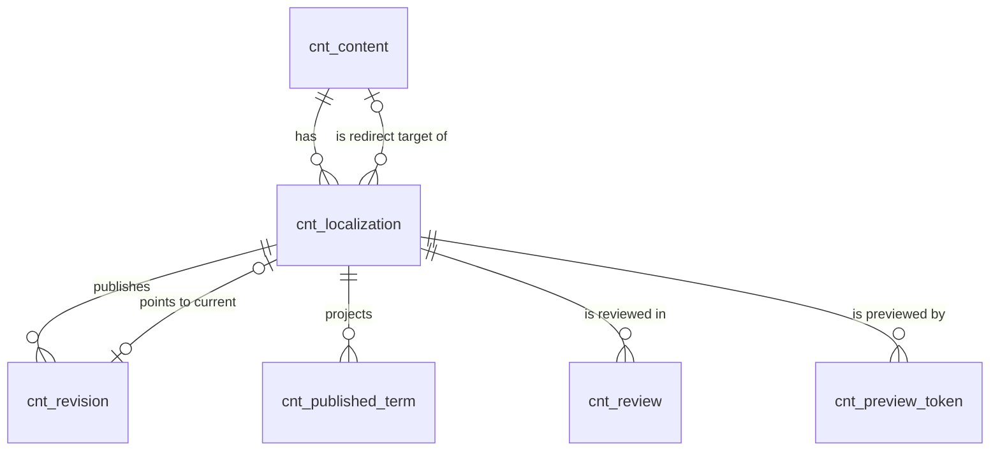

# 内容内核（content）模块设计

| 项 | 内容 |
|---|---|
| 模块 ID | `content` |
| 名称 | 内容内核 |
| 层 | L2 |
| 表前缀 | `cnt_` |
| API 前缀 | `content` |
| 可停用 | 否 |
| 模块版本 | 1.0.0（module.json 的 version） |
| 平台版本 | `>=1.0.0 <2.0.0`（module.json 的 platform） |
| 里程碑切片 | M1：本地化、修订、发布、预览；翻译模式与状态字段就绪；M2：审核、定时发布、回滚、回收站；M3：AUTO 本地化的自动发布与跟随下线，`OUTDATED` 检测；M4：—（详见第 13 节） |
| 模块负责人 | 待定 |
| 文档版本 | V1.7 |
| 状态 | 草案 |
| 更新日期 | 2026-10-20 |
| 依据 | 系统设计 V1.9 第 4.4、5.5–5.7、6、10.5、13.6、22.3 节；平台框架设计 V1.7 第 4 章 4.4.16、4.5.2–4.5.4、4.5.6、4.5.19、4.6.2 节；ADR-003、ADR-004、ADR-005、ADR-017、ADR-018 |

本文只引用《平台框架设计》第 4 章中的契约，不定义新的跨模块契约；需要新契约时按平台框架设计 2.3 提出契约变更请求（见第 14 节）。

## 1. 职责与边界

### 1.1 职责

内容内核是全部内容类型共用的“身份 + 本地化 + 修订”层（系统设计 3.2、6；ADR-004）：类型注册、本地化、修订、发布状态机、快照、投影、预览、回收站、审核。业务字段（草稿态）由内容类型的所属模块保存在自己的表中，内核只保存身份、状态、修订与投影，并在发布事务中编排各模块的快照贡献与 url 的路由（系统设计 4.4）。

| # | 功能 | 要点 | 里程碑 |
|---|---|---|---|
| F1 | 内容类型注册 | 收集 `ContentTypeProvider`；按站点的模块启用状态返回可用类型 | M1 |
| F2 | 内容与本地化 | `create`（源语言 `zh-CN`）、`createLocalization`（MANUAL）、`ensureTargetLocalization`（AUTO）、`deleteLocalization` | M1 |
| F3 | 草稿元数据 | 本地化的共同乐观锁 `version`、`draft_title`、slug、`draft_hash`（“有未发布的修改”） | M1 |
| F4 | 发布 | 发布事务：校验 → 组装快照 → 修订 → 投影 → 路由 → 事件（5.3） | M1 |
| F5 | 下线 | 三种下线策略（系统设计 13.6）；AUTO 本地化跟随源语言下线 | M1；跟随下线 M3 |
| F6 | 预览 | 预览令牌（后台预览、分享链接、编辑器画布）、`assemblePreview` | M1；分享链接管理 M2 |
| F7 | 审核 | 单级审核，站点按类型开启（系统设计 6.7）；译文进入审核 | M2；译文审核 M3 |
| F8 | 定时 | 定时发布、定时下线（每分钟任务） | M2 |
| F9 | 修订与回滚 | 修订历史、回滚为草稿、保留策略 | M2 |
| F10 | 回收站 | 移入、恢复、彻底删除；满 30 天自动清理 | M2 |
| F11 | 翻译协作 | 翻译模式与状态字段（M1 就绪）；译文自动发布；`OUTDATED` 检测 | M3 |
| F12 | 读模型 | 快照、卡片、语言版本、已发布查询与扫描、发布态分类、图谱候选（`ContentApi` 读方法） | M1 |
| F13 | `content-query` 数据源 | 按类型、分类、手选列表查询已发布卡片（系统设计 10.5） | M2 |
| F14 | 后台 | 内容编辑外壳的后端接口；待审核、定时发布、回收站三个列表 | M1–M2 |

### 1.2 不负责的事

| 事项 | 归属模块 | 说明 |
|---|---|---|
| 业务字段与编辑表单（“main”标签） | product、article、page、taxonomy | 各自的表；保存后经 `updateDraftMeta` 同步标题与 slug |
| 路径计算、slug 音译与唯一性、重定向、请求解析 | url | 内核在事务中调用 `UrlApi` |
| 快照各部分的内容（`card`、`terms`、`layout`、`seo`、业务部分） | 各 `PublishContributor` 实现方 | 内核只组装、校验大小、计算哈希 |
| 翻译任务、翻译记忆、目标语言草稿回写 | translation | 内核提供本地化与翻译状态，执行译文自动发布 |
| 渲染、引用解析、缓存失效 | delivery | 读取快照与卡片 |
| SEO 元数据、sitemap、IndexNow、链接索引 | seo | 订阅内容事件 |
| 审核、过期通知的发送 | notification | 内核注册模板（4.5.19）并发布事件 |
| 影响分析条目（引用、菜单、人工关系） | seo、navigation、graph | `ContentImpactProvider` |
| 媒体引用登记 | media | 订阅 `ContentPublishedEvent`、`ContentDraftChangedEvent` |
| 内容编辑外壳的界面 | 框架（admin-kit `ContentEditorShell`，平台框架设计 8.2.9） | 内核提供 6.1 的后台接口 |

### 1.3 协作概览

| 协作方 | 方式 | 契约（平台框架设计） | 方向与时机 |
|---|---|---|---|
| url | 服务接口 | `UrlApi`（4.4.17） | content → url：发布事务内 `reservePath` / `applyRoute`；下线 `retireRoute`；彻底删除 `releaseRoutes` |
| url | 事件 | `ContentPathChangedEvent`（4.6.3） | url → content：`PARENT_MOVED` 时同步投影 `pub_path` |
| product、article、page、taxonomy | 服务接口 | `ContentApi`（4.4.16） | 调用 content：创建、保存草稿、生命周期 |
| product、article、page、taxonomy、seo | 扩展点 | `ContentTypeProvider`、`PublishContributor`（4.5.2、4.5.3） | content 收集：类型、路由提示、快照部分 |
| seo、navigation、graph | 扩展点 | `ContentImpactProvider`（4.5.4） | content 收集：下线、移入回收站、彻底删除前 |
| translation | 服务接口 + 事件 | `ContentApi`；`TranslationCompletedEvent`（4.6.11） | translation 调用翻译方法；content 订阅译文完成事件 |
| delivery、seo、graph、search、media、navigation、inquiry | 服务接口 | `ContentApi` 读方法 | 只读发布态（快照与投影） |
| delivery | 扩展点 | `DataSourceProvider`（4.5.6） | delivery 收集 `content-query` |
| notification | 扩展点 + 事件 | `NotificationTemplateProvider`（4.5.19）；审核与过期事件（4.6.2） | notification 收集模板、订阅事件 |
| taxonomy | 事件 | `TermChangedEvent`（4.6.4） | taxonomy → content：`DELETED` 时清理投影 |
| 全部下游 | 事件 | 2.6 中发布的 13 个事件 | 事务提交后异步投递（ADR-003） |
| core | 服务接口 | 2.2 中的平台服务 | content 调用 |

### 1.4 适用的架构约束

| 约束 | 本模块的做法 |
|---|---|
| P2、禁止 2 | 只访问 `cnt_` 表；业务字段经 `PublishContributor` 由所属模块读取；`cnt_published_term` 是本模块的投影，其他模块只经 `ContentApi` 读取 |
| P3 | 发布后的下游工作全部经事件；需要其他模块的能力用扩展点（类型、快照部分、影响分析） |
| P4、禁止 17 | 读方法只读 `cnt_revision` 与投影；草稿只在预览、草稿哈希、校验中经贡献方组装；按语言查询不跨语言回退；`pub_path` 含语言前缀 |
| P6 | 路径变化、下线、彻底删除都经 `UrlApi` 留下 301 或 410，没有“只删不留”的代码路径 |
| P8、ADR-004 | 快照 + 投影模型、修订不可变；调整先写 ADR |
| ADR-003 | 事件在业务事务内登记；监听器幂等并丢弃过期事件（2.6） |
| 4.1.3（R2） | 只同步调用 url（content → url）；不调用 taxonomy、translation 等（禁止方向），所需信息来自扩展点或事件 |
| ADR-017、禁止 15、16 | 发布事务不调用 AI；法律页面的译文不自动发布（`humanReviewRequired` 与 `translation_review_required` 任一为真即进入审核） |
| 禁止 10 | 6 张表都带 `site_id` 并经行级拦截器过滤；跨站点访问只在 4.5 列出的系统级任务中 |
| 禁止 14 | 审核意见、提交说明、发布说明按纯文本保存与显示 |
| 语言规则 1、2 | 后台文案只在 `texts.ts`；错误信息中文，错误码 `CONTENT_*` |

## 2. 依赖与契约

### 2.1 module.json

```json
{
  "id": "content",
  "name": "内容内核",
  "version": "1.0.0",
  "layer": "L2",
  "platform": ">=1.0.0 <2.0.0",
  "requires": {
    "url": "^1.0"
  },
  "optional": {},
  "disableable": false,
  "tablePrefix": "cnt_",
  "apiPrefix": "content",
  "permissions": [
    {
      "code": "content:content:view",
      "name": "查看内容摘要",
      "description": "内容选择器、内容类型列表与跨类型的内容摘要；不含草稿正文"
    },
    {
      "code": "content:review-queue:view",
      "name": "查看待审核内容",
      "description": "列表只显示拥有对应类型审核权限的条目"
    },
    {
      "code": "content:schedule:view",
      "name": "查看定时发布",
      "description": "列表只显示拥有对应类型发布权限的条目"
    },
    {
      "code": "content:trash:view",
      "name": "查看回收站",
      "description": "列表只显示拥有对应类型删除权限的条目"
    }
  ],
  "menus": [
    {
      "key": "content",
      "name": "待审核",
      "parent": "editorial",
      "route": "/content/reviews",
      "permission": "content:review-queue:view",
      "order": 80
    },
    {
      "key": "content-schedules",
      "name": "定时发布",
      "parent": "editorial",
      "route": "/content/schedules",
      "permission": "content:schedule:view",
      "order": 85
    },
    {
      "key": "content-trash",
      "name": "回收站",
      "parent": "editorial",
      "route": "/content/trash",
      "permission": "content:trash:view",
      "order": 90
    }
  ],
  "settings": "settings.schema.json",
  "components": [],
  "events": {
    "publishes": [
      "ContentCreatedEvent",
      "ContentDraftChangedEvent",
      "ContentPublishedEvent",
      "ContentUnpublishedEvent",
      "ContentTrashedEvent",
      "ContentRestoredEvent",
      "ContentPurgedEvent",
      "LocalizationCreatedEvent",
      "LocalizationDeletedEvent",
      "TranslationModeChangedEvent",
      "TranslationOutdatedEvent",
      "ReviewRequestedEvent",
      "ReviewCompletedEvent"
    ],
    "subscribes": [
      "ContentPathChangedEvent",
      "TermChangedEvent",
      "TranslationCompletedEvent",
      "SiteResourceChangedEvent",
      "SiteSettingsChangedEvent"
    ]
  }
}
```

| 要点 | 说明 |
|---|---|
| 依赖 | `requires` 只有 url（4.1.3 的 content → url）；content 与 url 都不可停用（A.3 第 10 条） |
| 权限 | 内容生命周期权限 `content:{类型}:{edit\|review\|publish\|delete}` 由类型所属模块声明（A.3 第 11 条），内核用 `Permissions.forContent` 动态校验；本模块只声明跨类型的只读列表权限，资源段不与任何内容类型的小写连字符形式重名 |
| 菜单 | 挂在 core 的一级分组 `editorial`（A.5）；主入口 key 为模块 ID |
| 设置与组件 | 设置见 9.1；没有前台组件（第 8 节） |
| 事件 | `publishes` 与 4.2.4 中发布方为 content 的 13 个事件一一对应；`subscribes` 与 4.2.4 中订阅方含 content 的 3 个事件一一对应 |

### 2.2 使用的服务接口

| 接口（平台框架设计小节） | 方法 | 用途 | 调用位置与时机（事务内 / 外） | 测试替身 |
|---|---|---|---|---|
| `UrlApi`（4.4.17） | `reservePath`、`applyRoute` | 预留路径；写入路由，路径变化时生成 301 | 发布事务内（5.3 第 3、8 步） | `InMemoryUrlApi` |
| `UrlApi` | `retireRoute` | 下线（含定时下线、跟随下线） | 下线事务内 | `InMemoryUrlApi` |
| `UrlApi` | `releaseRoutes` | 彻底删除前释放全部路由 | `purge` 事务内，先于删除内核数据 | `InMemoryUrlApi` |
| `UrlApi` | `generateSlug`、`validateSlug`、`suggestAvailableSlug` | 创建时生成 slug；保存时校验；冲突时给出建议 | `create`、`updateDraftMeta`、`publish` 事务内 | `InMemoryUrlApi` |
| `UrlApi` | `pathOf` | `PARENT_MOVED` 后同步 `pub_path` | 监听器事务内 | `InMemoryUrlApi` |
| `SiteApi`（4.4.1） | `locale`、`locales` | 校验语言已启用；本地化按 `sortOrder` 排序 | 事务内只读 | `InMemorySiteApi` |
| `SiteContextProvider`（4.4.2） | `runAs`、`requireSiteId` | 系统级定时任务逐条切换站点；预览令牌的站点比对 | 事务外 | `FakeSiteContextProvider` |
| `SettingsApi`（4.4.3） | `get("content.reviewRequiredTypes", …)` | 判断类型是否需要审核 | 事务内只读 | `InMemorySettingsApi` |
| `CurrentUserProvider`（4.4.6） | `actor` | 操作人、`published_by`、`submitted_by` | 事务内 | `FakeCurrentUserProvider` |
| `PermissionChecker`（4.4.7） | `check`、`has` | 按 `Permissions.forContent(type, action)` 校验生命周期与后台读接口 | 事务内 | `FakePermissionChecker` |
| `UserDirectory`（4.4.8） | `findAll` | 列表中显示提交人、审核人、定时设置人、移入回收站的人 | 只读 | `InMemoryUserDirectory` |
| `AuditApi`（4.4.9） | `record`、`recordIndependently` | 生命周期写操作；定时执行失败（独立事务） | 事务内 / 独立事务 | `InMemoryAuditApi` |
| `IdGenerator`（4.4.11） | `nextId` | TSID（持久化基类填充）；预览令牌 ID | 事务内 | `FakeIdGenerator` |
| `EventMetaFactory`（4.4.14） | `next`、`next(siteId, ActorRef.SYSTEM)` | 事件元数据；定时与译文发布以 system 身份 | 事务内 | `FakeEventMetaFactory` |
| `ExtensionRegistry`（4.4.15） | `all`、`forContentType`、`allForSite` | 收集 2.5 的扩展点 | 事务内 | `InMemoryExtensionRegistry` |
| `ReferenceWriteApi`（4.10，Proposed） | replaceMedia | 原保存事务内协调，失败回滚，站点隔离 | MANDATORY；不得afterCommit补写 | 框架4.10对应协议替身 |
| `ProjectionChangeApi`（4.10，Proposed） | searchChanged | 原保存事务内协调，失败回滚，站点隔离 | MANDATORY；不得afterCommit补写 | 框架4.10对应协议替身 |
| `TransactionMutexApi`（4.10，Proposed） | lock、advance | 原保存事务内协调，失败回滚，站点隔离 | MANDATORY；不得afterCommit补写 | 框架4.10对应协议替身 |


### 2.3 提供的服务接口

| 接口（平台框架设计小节） | 方法 | 实现类 | 契约测试 | 说明（幂等、权限、性能目标） |
|---|---|---|---|---|
| `ContentApi`（4.4.16）：创建与草稿 | `lockDraftForWrite`、`create`、`createLocalization`、`updateDraftMeta`、`markDraftChanged` | `ContentApiImpl` | `ContentApiContractTest`（继承 `ContentApiContract`） | 加入调用方事务；`version` 为本地化全部草稿数据的共同版本；草稿哈希在同一调用中同步计算（5.2） |
| `ContentApi`：生命周期 | `submitForReview`、`approve`、`reject`、`publish`、`schedule`、`cancelSchedule`、`unpublish`、`unpublishAll`、`rollback`、`trash`、`restore`、`purge`、`deleteLocalization`、`validateForPublish`、`analyzeImpact` | `ContentApiImpl` | 同上 | 有当前用户时按类型校验权限，system 跳过；写审计；事件见 2.6；`publish` 不调用 AI；`purge` 幂等（已删除时无操作） |
| `ContentApi`：翻译 | `setTranslationReviewRequirement`、`ensureTargetLocalization`、`updateTranslationState`、`changeTranslationMode` | `ContentApiImpl` | 同上 | `ensureTargetLocalization` 幂等；`updateTranslationState` 对过期的 `sourceRevisionNo` 返回 false，不改变 `version` |
| `ContentApi`：读取 | `findContent(s)`、`findLocalization(s)`、`localizations`、`contentTypes`、`contentType`、`findPublishedSnapshot`、`findRevision`、`revisions`、`findPublishedCards`、`publishedVersions`、`queryPublished`、`scanPublished`、`publishedTerms`、`contentIdsByPublishedTerms`、`countPublished` | `ContentApiImpl`（查询由 `ContentQueryService` 实现） | 同上 | 只读发布态；不跨语言回退；批量 ≤ 500 个 ID；Delivery 热路径 `findPublishedSnapshot`、`findPublishedCards`、`publishedVersions` P95 ≤ 20 ms（缓存未命中，4.1.3） |
| `ContentApi`：预览 | `createPreviewToken`、`resolvePreviewToken`、`assemblePreview` | `ContentApiImpl` | 同上 | 令牌用途按 `ttl` 取 `PREVIEW`（≤ 1 小时）或 `SHARE`（≤ 7 天）；`assemblePreview` 不持久化、不发布事件 |

### 2.4 实现的扩展点

| 扩展点（平台框架设计小节） | 实现类 | 适用范围（内容类型 / 资源类型） | order | 收集方 |
|---|---|---|---|---|
| `DataSourceProvider`（4.5.6） | `ContentQueryDataSourceProvider` | key `content-query`；全部已启用的内容类型 | `DEFAULT` | delivery |
| `NotificationTemplateProvider`（4.5.19） | `ContentNotificationTemplateProvider` | `content.review.staff`、`content.reviewed.staff`、`content.outdated.staff` | — | notification |
| `ScheduledTask`（4.4.12） | `PublishDueJob`、`TrashPurgeJob`、`RevisionPruneJob`、`PreviewTokenCleanupJob` | 见第 10 节 | — | core（调度器） |
| `PlatformModule`（4.5.22） | `ContentModule` | 模块生命周期；`onInstall` 无默认数据；不可停用，`analyzeDisableImpact` 不适用 | — | core（模块管理器） |

### 2.5 收集的扩展点

| 扩展点 | 调用时机 | 过滤（站点启用状态、内容类型等） | 实现缺失或抛出异常时的行为 | 测试用示例实现 |
|---|---|---|---|---|
| `ContentTypeProvider.contentTypes`（4.5.2） | 启动时建立类型索引；`contentTypes()`、`create` 时按站点过滤 | `ExtensionRegistry.all`（所属模块在当前站点启用） | 定义错误启动失败；类型未注册或所属模块停用 → `CONTENT_TYPE_UNKNOWN` | `SampleContentTypeProvider` |
| `ContentTypeProvider.routeHints` | 发布（`reservePath` 前）、预览校验、下线（`REDIRECT_PARENT` 取 `fallbackParentContentId`） | `forContentType`；只对 routable 类型 | 发布或下线中抛出 → 整个事务回滚（4.5 调用约定）；预览中记为 ERROR 问题 | `SampleContentTypeProvider` |
| `PublishContributor`（4.5.3） | `PUBLISH`、`VALIDATE`、`PREVIEW`、`DRAFT_HASH`、`RESTORE` | `forContentType`，按 `order` | 缺 `card` → ERROR `CONTENT_CARD_MISSING`；`PUBLISH` 中抛出 → 回滚；`PREVIEW` 中抛出 → 该部分记 ERROR；`DRAFT_HASH` 中抛出 → `draft_hash` 置空（显示为“有未发布的修改”）并计指标 `b2bweb.content.draft_hash.error`，不回滚保存 | `SampleCardPublishContributor` |
| `ContentImpactProvider`（4.5.4） | `analyzeImpact`（`UNPUBLISH` / `TRASH` / `PURGE`），后台确认对话框之前 | `ExtensionRegistry.all` | 抛出 → 一条来源为该模块的 ERROR 影响项，阻止操作 | `SampleContentImpactProvider` |

### 2.6 发布与订阅的事件

全部经 `EventMetaFactory` 生成元数据，在改变状态的同一事务中发布（4.6 发布规则）；system 身份的处理（定时、译文发布、清理任务）用 `next(siteId, ActorRef.SYSTEM)`，定时发布的 `actor` 为 `scheduled_by`。

发布：

| 事件 | 触发时机（所在事务） | 关键字段 | 主要订阅方 |
|---|---|---|---|
| `ContentCreatedEvent` | `create`（调用方事务） | `contentId`、`contentType`、`ownerModule`、`sourceLocalizationId` | graph |
| `ContentDraftChangedEvent` | `updateDraftMeta`、`markDraftChanged`、`rollback`（每个受影响的本地化一条） | `localizationId`、`locale`、`version`、`sharedDataChanged` | media |
| `ContentPublishedEvent` | `publish`（人工、定时、译文自动发布） | `localizationId`、`revisionNo`、`path`、`previousPath`、`firstPublish`、`contentChanged`、`trigger` | seo、graph、search、media、delivery、translation |
| `ContentUnpublishedEvent` | `unpublish`、`unpublishAll`、定时下线、跟随下线（每个本地化一条） | `lastRevisionNo`、`previousPath`、`strategy`、`redirectContentId`、`followedSource` | seo、graph、search、media、delivery |
| `ContentTrashedEvent` / `ContentRestoredEvent` | `trash` / `restore` | `contentId`、`localizationIds` | graph、search、delivery |
| `ContentPurgedEvent` | `purge`（含 `content.purgeTrash`） | `contentId`、`ownerModule`、`localizationIds` | 所有以 `content_id` 保存数据的模块 |
| `LocalizationCreatedEvent` / `LocalizationDeletedEvent` | `create`、`createLocalization`、`ensureTargetLocalization` / `deleteLocalization` | `localizationId`、`locale`、`translationMode` | seo、delivery、translation |
| `TranslationModeChangedEvent` | `changeTranslationMode` | `previousMode`、`translationMode` | translation |
| `TranslationOutdatedEvent` | 源语言 `publish` 事务内，每个被标记 `OUTDATED` 的 MANUAL 本地化一条 | `sourceTitle`、`sourceRevisionNo`、`basedOnSourceRevisionNo` | notification |
| `ReviewRequestedEvent` / `ReviewCompletedEvent` | `submitForReview`、译文进入审核 / `approve`、`reject` | `title`、`version`、`submittedBy`、`decision`、`reviewedBy` | notification |

4.6 末尾的事件列表未列出 `ContentDraftChangedEvent`、`TranslationModeChangedEvent` 与订阅的 `ContentPathChangedEvent`，以本节与 `module.json` 为准（第 14 节 #11）。

订阅：

| 事件 | 处理 | 幂等方式 | 过期判断 | 失败与重试 |
|---|---|---|---|---|
| `ContentPathChangedEvent` | `ContentPathListener#onContentPathChanged`：`reason` 不是 `PUBLISHED`、`RETIRED` 时（V1 为 `PARENT_MOVED`），`pub_path` ← `UrlApi.pathOf(localizationId)`；`PUBLISHED`、`RETIRED` 已在发布、下线事务内同步，忽略 | 按当前状态覆盖 | 不信任载荷，读 `pathOf`；本地化不是 `PUBLISHED` 时跳过 | 异常重投；本地化已删除时记录日志后正常返回 |
| `TermChangedEvent` | `PublishedTermListener#onTermChanged`：`DELETED` 时删除 `term_id` ∈ {`termId`} ∪ `descendantTermIds` 的投影行；其他变化忽略（快照不变，下次发布时自然更新） | 删除天然幂等 | 不需要（分类项删除不可逆） | 异常重投 |
| `TranslationCompletedEvent` | `TranslationCompletionListener#onTranslationCompleted`：只处理 `content` 非空的事件。`autoPublish = true` → 新事务中以 system 身份、`PublishTrigger.TRANSLATION` 发布目标本地化；`autoPublish = false` 且 `state = TRANSLATED` → 自动提交审核（`cnt_review.origin = TRANSLATION`）；`NEEDS_REVIEW` → 不处理（翻译中心处理） | 发布：该本地化当前修订的 `source_revision_no` ≥ 事件的 `sourceRevisionNo` 时跳过；审核：已有 PENDING（`uk_review_pending`）时跳过 | 持父先子后写锁重新确认当前version等于事件targetVersion，本地化仍为 AUTO、`translationState = TRANSLATED`、事件的 `sourceRevisionNo` 等于源语言当前 `published_revision_no`，否则丢弃；`humanReviewRequired` 或 `cnt_content.translation_review_required = 1` 时改为进入审核（禁止 15） | 发布校验失败 → `updateTranslationState(NEEDS_REVIEW)` 并写失败审计，正常返回；其他异常重投 |

content 不可停用，监听器在所有站点执行。

SiteResourceChangedEvent（框架4.10.2，Proposed）：订阅：url.pattern变化提交当前树重算任务；SiteSettingsChangedEvent的URL_PREFIX_CHANGED同样调度。字段meta/resourceType/resourceId/change，原事务登记，重复处理安全。

### 2.7 使用的端口

不适用：content 不直接使用基础设施端口。预览令牌用 JDK 的 HMAC-SHA256 签名，密钥来自部署配置（9.2）；快照读取直接查库（主键读取），Delivery 结果的缓存与失效由 delivery 负责（系统设计 23）。

## 3. 领域模型

### 3.1 聚合、实体与值对象

| 类型 | 名称 | 说明 |
|---|---|---|
| 聚合根 | Content（`cnt_content`） | 语言无关的内容身份：站点、类型、所属模块、是否可路由、源语言、回收站状态。业务模块经 `ContentApi.create(CreateContentCommand)` 创建 |
| 聚合根 | Localization（`cnt_localization`） | 内容在一种语言下的版本，是编辑、审核、发布、定时、翻译的单位，带乐观锁 `version`；生命周期从属于 Content（物理删除时级联） |
| 实体 | Revision（`cnt_revision`） | 一次发布生成的不可变修订，`payload` 为发布快照 |
| 实体（投影） | PublishedTerm（`cnt_published_term`） | 发布时从快照 `terms` 提取的分类指派，供列表、筛选、图谱读取 |
| 实体 | Review（`cnt_review`） | 一次提交审核及其结论 |
| 实体 | PreviewToken（`cnt_preview_token`） | 已签发的预览令牌，用于撤销、到期与分享链接管理 |
| 值对象 | DraftState、PublishState | 两个正交状态（系统设计 6.3） |
| 值对象 | TranslationMode、TranslationState | 翻译模式与状态（系统设计 5.5） |
| 值对象 | UnpublishStrategy | 下线策略 + 目标内容（`unpublish_strategy`、`unpublish_target_content_id`） |
| 值对象 | Snapshot | `payload` + `payload_hash` + `schema_version` |
| 值对象 | Projection | `pub_title`、`pub_summary`、`pub_cover_media_id`、`pub_path`、`pub_hash`、`content_modified_at` |
| 值对象 | ContentTypeDefinition | 由 `ContentTypeProvider` 在代码中注册（是否可路由、默认 URL 规则、模板、词汇表、是否参与审核），启动时进入扩展点注册表，不落表 |

在系统设计之外补充的字段：

| 补充 | 理由 |
|---|---|
| `cnt_content.translation_review_required` | 法律页面（`legal` 模板）的机器译文不得自动发布（系统设计 5.5、6.3）。模板属于 page 模块，content（L2）不能调用 page（L3），因此由所属模块在模板变化的同一事务经ContentApi.setTranslationReviewRequirement按内容ID/内容version设置；只有cnt_content存储，读取模型只投影，内核自动发布译文前检查 |
| `cnt_content.trashed_by` | 回收站列表显示操作人 |
| `cnt_localization.content_type` | 冗余 `cnt_content.type`，前台列表、sitemap、`content-query` 数据源只用一个索引即可完成过滤与排序 |
| `cnt_localization.slug_locked` | 表达“slug 首次发布后固定”（系统设计 13.3）：为 1 后系统不再按标题自动改写 slug，只能手工修改 |
| `cnt_localization.draft_updated_at`、`draft_updated_by` | 发布会更新投影字段，`updated_at` 不能代表“最后编辑时间” |
| `cnt_localization.published_revision_no`、`unpublished_at`、`scheduled_by`、`translated_at` | 事件与幂等需要修订号（系统设计 4.1）；后台显示下线时间、定时设置人与译文时间，不必跨模块查询 |
| `cnt_localization.unpublish_strategy` 拆为枚举 + `unpublish_target_content_id` | 25.9 示例为 JSON；拆开后可用 CHECK 与外键校验，并能按目标内容反查（目标被彻底删除前修正引用方） |
| `cnt_revision.schema_version`、`publish_trigger`、`source_revision_no` | 快照结构升级时按版本扫描；审计“人工 / 定时 / 译文自动发布”；SEO 规则“翻译过期”需要知道修订依据的源语言修订号（系统设计 14.9） |
| `cnt_review.draft_hash`、`origin` | 审核结论只对提交时的草稿有效；区分编辑提交与译文自动进入审核（法律页面、站点要求审校） |
| `cnt_preview_token.purpose` | 区分后台预览（1 小时）、分享链接（≤ 7 天）、编辑器画布令牌（系统设计 10.8），有效期不同 |

### 3.2 不变量

| # | 规则 | 保证方式 |
|---|---|---|
| 1 | 每个内容在每种语言最多一个本地化 | 数据库：`uk_loc_content_locale` |
| 2 | 每个内容恰有一个 `translation_mode = SOURCE` 的本地化，其 `locale = primary_locale`（`zh-CN`）；该本地化不可删除、不可改模式 | 应用层（`ContentApi.create` 时同时创建） |
| 3 | `SOURCE` 本地化的 `source_locale`、`source_revision_no` 为空且 `translation_state = NONE`；`AUTO` / `MANUAL` 的 `source_locale` 非空 | 数据库：`ck_cnt_loc_translation` |
| 4 | `OUTDATED` 只出现在 `MANUAL` 模式（`AUTO` 模式在源语言更新后重新进入 `QUEUED`） | 数据库：`ck_cnt_loc_outdated` |
| 5 | `publish_state = PUBLISHED` 时 `published_revision_id` 非空，且 `pub_*`、`published_revision_no` 与该修订一致 | 数据库：`ck_cnt_loc_published`（非空）；应用层（发布事务内同时写入） |
| 6 | `publish_state = SCHEDULED` 时 `scheduled_publish_at` 非空。SCHEDULED 只用于当前不在线的本地化（NEVER / UNPUBLISHED → SCHEDULED）；已发布的本地化定时发布新修改时状态保持 PUBLISHED | 数据库：`ck_cnt_loc_scheduled`；应用层 |
| 7 | `unpublish_strategy = REDIRECT_CONTENT` 当且仅当 `unpublish_target_content_id` 非空；目标不是自身，属于同一站点且可路由 | 数据库：`ck_cnt_loc_unpublish`、`fk_cnt_loc_unpub_target`；应用层 |
| 8 | 移入回收站前，内容的所有本地化必须为 NEVER / UNPUBLISHED 且没有定时；回收站中的内容不能发布 | 应用层 |
| 9 | 修订不可修改；`revision_no` 在本地化内从 1 连续递增 | 数据库：`uk_rev_loc_no`；应用层（没有更新修订的代码路径） |
| 10 | `content_modified_at` 只在新修订的 `payload_hash` 与上一修订不同时更新 | 应用层 |
| 11 | “有未发布的修改” ⇔ `draft_hash ≠ pub_hash` | 派生规则 |
| 12 | 每个本地化最多一条 `PENDING` 审核；`draft_state = IN_REVIEW` ⇔ 存在 `PENDING` 审核 | 数据库：`uk_review_pending`；应用层 |
| 13 | `draft_state = APPROVED` 时草稿哈希等于通过时审核记录的 `draft_hash`；草稿再修改即回到 `EDITING` | 应用层 |
| 14 | `cnt_published_term` 只包含 `publish_state = PUBLISHED` 的本地化，内容与其当前发布修订快照的 `terms` 一致 | 应用层（发布、下线事务内维护） |
| 15 | 内容不跨语言回退：前台只读取 `publish_state = PUBLISHED` 的本地化及其修订 | 应用层（Delivery 查询条件） |
| 16 | 源语言本地化下线或内容进回收站时，`AUTO` 模式的目标语言本地化在同一事务中下线（沿用源语言的下线策略，目标解析为同语言本地化）；`MANUAL` 不受影响 | 应用层 |
| 17 | `slug_locked = 1` 后系统不再按标题改写 slug；首次发布时置 1，编辑手工修改 slug 时也置 1 | 应用层 |
| 18 | 预览令牌仅在未撤销且未过期时有效；PREVIEW ≤ 1 小时，SHARE ≤ 7 天，EDITOR ≤ 12 小时 | 应用层（验签后查表） |
| 19 | `cnt_localization.content_type = cnt_content.type`，二者创建后不可修改 | 应用层 |
| 20 | 保留策略不删除 `published_revision_id` 指向的修订 | 应用层（清理任务） |

### 3.3 状态机

在系统设计 6.3 的基础上细化。本地化`version`在草稿数据或内容级审校策略变化时递增（`updateDraftMeta`、`markDraftChanged`、`rollback`）；状态转换（审核、发布、定时、下线、模式切换）只校验 `expectedVersion`，并以本地化行锁（`SELECT … FOR UPDATE`）串行化，不递增 `version`。

```text
draft_state（每个本地化）
  EDITING ──submitForReview（类型需要审核）──▶ IN_REVIEW ──approve──▶ APPROVED
  IN_REVIEW ──reject（意见必填）/ 撤回 / 草稿被修改──▶ EDITING        （cnt_review：REJECTED / CANCELED）
  APPROVED  ──草稿被修改 / 发布成功──▶ EDITING                        （审核结论只对 draft_hash 相同的草稿有效）
  EDITING ──TranslationCompletedEvent（TRANSLATED，不自动发布）──▶ IN_REVIEW（origin = TRANSLATION，system 提交）

publish_state（每个本地化）
  NEVER / UNPUBLISHED ──publish──▶ PUBLISHED
  NEVER / UNPUBLISHED ──schedule(publishAt)──▶ SCHEDULED ──到期 publish 成功──▶ PUBLISHED
  SCHEDULED ──cancelSchedule / 到期校验失败──▶ NEVER（first_published_at 为空）或 UNPUBLISHED
  PUBLISHED ──publish（新修订）──▶ PUBLISHED
  PUBLISHED ──schedule(publishAt)──▶ PUBLISHED（只记录 scheduled_publish_at，到期发布当前草稿）
  PUBLISHED ──unpublish / 定时下线 / 源语言下线（AUTO 跟随）──▶ UNPUBLISHED

内容级（cnt_content.trashed_at）
  正常 ──trash（所有本地化为 NEVER / UNPUBLISHED 且无定时）──▶ TRASHED ──restore──▶ 正常
  TRASHED ──purge（手动确认，或满 30 天由 content.purgeTrash）──▶ 物理删除

translation_state（目标语言本地化，由 translation 经 updateTranslationState 写入，OUTDATED 由内核写入）
  AUTO：   NONE ──▶ QUEUED ──▶ TRANSLATED / NEEDS_REVIEW / FAILED；源语言再次发布 ──▶ QUEUED
  MANUAL： 任意 ──源语言发布（publish 事务内）──▶ OUTDATED；人工更新后由 translation 置 TRANSLATED
  AUTO ⇄ MANUAL：changeTranslationMode（MANUAL → AUTO 后由 translation 重新排队；OUTDATED 不得出现在 AUTO）
```

被拒绝的转换（单元测试逐条覆盖）：

| 操作 | 前置条件不满足时 |
|---|---|
| `submitForReview` | 类型不需要审核 → `CONTENT_REVIEW_NOT_ENABLED`；不是 `EDITING` → `CONTENT_STATE_INVALID` |
| `approve` / `reject` | 不是 `IN_REVIEW` → `CONTENT_STATE_INVALID`；`reject` 缺少意见 → `CORE_VALIDATION_FAILED` |
| `publish` / `schedule` | 在回收站 → `CONTENT_TRASHED`；需要审核而未通过 → `CONTENT_REVIEW_REQUIRED` |
| `unpublish` | 不是 `PUBLISHED` → `CONTENT_STATE_INVALID`；`REDIRECT_CONTENT` 目标不存在、是自身或不可路由 → `CONTENT_REDIRECT_TARGET_INVALID` |
| `cancelSchedule` | 没有定时 → `CONTENT_STATE_INVALID` |
| `trash` | 有已发布的本地化 → `CONTENT_HAS_PUBLISHED_LOCALIZATION`；有定时 → `CONTENT_STATE_INVALID` |
| `restore` / `purge` | 不在回收站 → `CONTENT_NOT_TRASHED` |
| `deleteLocalization` | 源语言 → `CONTENT_LOCALE_IS_SOURCE`；不是 NEVER / UNPUBLISHED → `CONTENT_STATE_INVALID` |
| `changeTranslationMode` | 源语言或目标模式等于当前模式 → `CONTENT_TRANSLATION_MODE_INVALID` |

## 4. 数据模型

遵守平台框架设计第 7 章的数据库通用约定。本节给出待实现 DDL；本次文档审查未重跑 MySQL，不能据此认定 DDL 已验证。M0 后按第 11 章在 MySQL 8.4 空库验证，并使实际迁移脚本与本节一致。

### 4.1 表清单

| 表 | 说明 | 站点级 | 软删除 | 预估规模（单站，按系统设计假设 A4） |
|---|---|---|---|---|
| `cnt_content` | 内容（语言无关） | 是 | 否（回收站 `trashed_at`） | ≈ 2 万行（1 万产品、5 千文章，另有页面、分类落地页、FAQ、全局区块） |
| `cnt_localization` | 本地化与发布投影 | 是 | 否 | ≈ 20 万行（× 10 种语言） |
| `cnt_revision` | 不可变的发布修订（快照） | 是 | 否（按保留策略物理清理） | ≈ 150 万行；快照平均 10–30 KB，约 20–40 GB，是全库最大的表 |
| `cnt_published_term` | 发布态分类指派（投影） | 是 | 否 | ≈ 80 万行（已发布本地化 × 平均 4 个分类项） |
| `cnt_review` | 审核记录 | 是 | 否 | ≈ 每年 1–5 万行 |
| `cnt_preview_token` | 预览令牌 | 是 | 否（过期 30 天后物理删除） | < 1 万行 |

### 4.2 ER 图



### 4.3 表结构

类型列中的 `bin` 表示该列排序规则为 `utf8mb4_0900_bin`（平台框架设计 7.1、7.3）。

#### 4.3.1 `cnt_content`：内容

| 字段 | 类型 | 可空 | 默认 | 说明 |
|---|---|---|---|---|
| `id` | BIGINT | 否 | — | 主键（TSID） |
| `site_id` | BIGINT | 否 | — | 站点 ID（sys_site.id） |
| `type` | VARCHAR(32) | 否 | — | 内容类型：PAGE / PRODUCT / ARTICLE / CASE_STUDY / FAQ / TERM_PAGE / GLOBAL_BLOCK；创建后不可修改 |
| `owner_module` | VARCHAR(32) | 否 | — | 所属模块 ID（sys_module.id），取自内容类型定义，如 product、article、page、taxonomy |
| `routable` | TINYINT(1) | 否 | `0` | 是否可路由（有独立 URL），创建时取自内容类型定义 |
| `primary_locale` | VARCHAR(16) | 否 | `'zh-CN'` | 源语言（BCP 47），固定为 zh-CN |
| `translation_review_required` | TINYINT(1) | 否 | `0` | 机器译文是否必须人工审校后发布：1 = 是（法律页面，由所属模块经 ContentApi 设置） |
| `trashed_at` | DATETIME(3) | 是 | — | 移入回收站时间；为空表示正常 |
| `trashed_by` | BIGINT | 是 | — | 移入回收站的用户 ID |
| `version` | INT | 否 | `0` | 内容级乐观锁版本号（回收/恢复及审校策略修改）；不是本地化草稿version |
| `created_at` | DATETIME(3) | 否 | `CURRENT_TIMESTAMP(3)` | 创建时间（UTC） |
| `created_by` | BIGINT | 否 | `0` | 创建人用户 ID（0 = 系统） |
| `updated_at` | DATETIME(3) | 否 | `CURRENT_TIMESTAMP(3) ON UPDATE CURRENT_TIMESTAMP(3)` | 更新时间（UTC） |
| `updated_by` | BIGINT | 否 | `0` | 更新人用户 ID（0 = 系统） |

索引与约束：
- `PRIMARY KEY (id)`
- `idx_content_type (site_id, type, trashed_at)`：后台按类型列出内容；模块停用前的影响分析（统计某类型的内容数）
- `idx_content_trash (site_id, trashed_at)`：回收站列表；清理任务查找进入回收站满 30 天的内容

```sql
CREATE TABLE cnt_content (
  id                           BIGINT       NOT NULL COMMENT '主键（TSID）',
  site_id                      BIGINT       NOT NULL COMMENT '站点 ID（sys_site.id）',
  type                         VARCHAR(32)  NOT NULL COMMENT '内容类型：PAGE / PRODUCT / ARTICLE / CASE_STUDY / FAQ / TERM_PAGE / GLOBAL_BLOCK；创建后不可修改',
  owner_module                 VARCHAR(32)  NOT NULL COMMENT '所属模块 ID（sys_module.id），取自内容类型定义，如 product、article、page、taxonomy',
  routable                     TINYINT(1)   NOT NULL DEFAULT 0 COMMENT '是否可路由（有独立 URL），创建时取自内容类型定义',
  primary_locale               VARCHAR(16)  NOT NULL DEFAULT 'zh-CN' COMMENT '源语言（BCP 47），固定为 zh-CN',
  translation_review_required  TINYINT(1)   NOT NULL DEFAULT 0 COMMENT '机器译文是否必须人工审校后发布：1 = 是（法律页面，由所属模块经 ContentApi 设置）',
  trashed_at                   DATETIME(3)  NULL COMMENT '移入回收站时间；为空表示正常',
  trashed_by                   BIGINT       NULL COMMENT '移入回收站的用户 ID',
  version                      INT          NOT NULL DEFAULT 0 COMMENT '乐观锁版本号（移入回收站、恢复）',
  created_at                   DATETIME(3)  NOT NULL DEFAULT CURRENT_TIMESTAMP(3) COMMENT '创建时间（UTC）',
  created_by                   BIGINT       NOT NULL DEFAULT 0 COMMENT '创建人用户 ID（0 = 系统）',
  updated_at                   DATETIME(3)  NOT NULL DEFAULT CURRENT_TIMESTAMP(3) ON UPDATE CURRENT_TIMESTAMP(3) COMMENT '更新时间（UTC）',
  updated_by                   BIGINT       NOT NULL DEFAULT 0 COMMENT '更新人用户 ID（0 = 系统）',
  PRIMARY KEY (id),
  KEY idx_content_type (site_id, type, trashed_at),
  KEY idx_content_trash (site_id, trashed_at)
) ENGINE = InnoDB DEFAULT CHARSET = utf8mb4 COLLATE = utf8mb4_0900_ai_ci COMMENT = '内容（语言无关的身份、类型、源语言与回收站状态）';
```

要点：
- 回收站：`trashed_at` 非空即在回收站，恢复时清空。进入回收站满 30 天后可彻底删除（手动，或由第 10 节的清理任务 `content.purgeTrash` 执行）：物理删除本行，级联删除本地化、修订、投影、审核与令牌，并发布 `ContentPurgedEvent`。
- `owner_module` 所属模块被站点停用或从构建中移除（MISSING）时，数据全部保留，对应路由返回 404（系统设计 3.8）。

#### 4.3.2 `cnt_localization`：内容本地化与发布投影

| 字段 | 类型 | 可空 | 默认 | 说明 |
|---|---|---|---|---|
| `id` | BIGINT | 否 | — | 主键（TSID） |
| `site_id` | BIGINT | 否 | — | 站点 ID（sys_site.id） |
| `content_id` | BIGINT | 否 | — | 内容 ID（cnt_content.id） |
| `content_type` | VARCHAR(32) | 否 | — | 内容类型（冗余 cnt_content.type，不可修改）：PAGE / PRODUCT / ARTICLE / CASE_STUDY / FAQ / TERM_PAGE / GLOBAL_BLOCK |
| `locale` | VARCHAR(16) | 否 | — | 语言（BCP 47），如 zh-CN、en、de |
| `slug` | VARCHAR(160) bin | 是 | — | slug（按语言的音译规则生成，只含 a-z、0-9、-，或 NFC 本地文字）；不可路由类型为空 |
| `slug_locked` | TINYINT(1) | 否 | `0` | slug 是否已固定：0 = 随标题自动生成，1 = 已固定（首次发布后或手工修改后），系统不再自动改写 |
| `draft_title` | VARCHAR(300) | 否 | — | 草稿标题（后台列表用，由所属模块经 ContentApi.updateDraftMeta 同步） |
| `draft_state` | VARCHAR(16) | 否 | `'EDITING'` | 草稿状态：EDITING / IN_REVIEW / APPROVED |
| `draft_hash` | CHAR(64) bin | 是 | — | 草稿快照哈希（SHA-256，算法同 cnt_revision.payload_hash）；与 pub_hash 不同即有未发布的修改 |
| `draft_updated_at` | DATETIME(3) | 否 | `CURRENT_TIMESTAMP(3)` | 草稿最后修改时间（UTC） |
| `draft_updated_by` | BIGINT | 否 | `0` | 草稿最后修改人用户 ID（0 = 系统，如译文回写） |
| `publish_state` | VARCHAR(16) | 否 | `'NEVER'` | 发布状态：NEVER / SCHEDULED / PUBLISHED / UNPUBLISHED |
| `published_revision_id` | BIGINT | 是 | — | 最近一次发布的修订 ID（cnt_revision.id）；下线后保留，可见性只看 publish_state |
| `published_revision_no` | INT | 是 | — | 最近一次发布的修订号（冗余，用于事件与幂等） |
| `first_published_at` | DATETIME(3) | 是 | — | 首次发布时间（前台发布日期与列表默认排序） |
| `published_at` | DATETIME(3) | 是 | — | 最近一次发布时间 |
| `unpublished_at` | DATETIME(3) | 是 | — | 最近一次下线时间 |
| `scheduled_publish_at` | DATETIME(3) | 是 | — | 定时发布时间 |
| `scheduled_unpublish_at` | DATETIME(3) | 是 | — | 定时下线时间 |
| `scheduled_by` | BIGINT | 是 | — | 设置定时的用户 ID；定时任务以该用户身份执行，并记入修订的 published_by |
| `unpublish_strategy` | VARCHAR(20) | 否 | `'GONE'` | 下线策略：GONE（410）/ REDIRECT_CONTENT（301 到指定内容）/ REDIRECT_PARENT（301 到主分类页或父页面） |
| `unpublish_target_content_id` | BIGINT | 是 | — | REDIRECT_CONTENT 的目标内容 ID（cnt_content.id），下线时解析为同语言本地化 |
| `translation_mode` | VARCHAR(10) | 否 | — | 翻译模式：SOURCE（源语言）/ AUTO（AI 翻译生成）/ MANUAL（独立编辑） |
| `translation_state` | VARCHAR(16) | 否 | `'NONE'` | 翻译状态：NONE / QUEUED / TRANSLATED / NEEDS_REVIEW / FAILED / OUTDATED |
| `source_locale` | VARCHAR(16) | 是 | — | 译文依据的源语言（zh-CN）；SOURCE 为空 |
| `source_revision_no` | INT | 是 | — | 译文依据的源语言修订号；SOURCE 为空 |
| `translated_at` | DATETIME(3) | 是 | — | 最近一次译文回写时间 |
| `pub_title` | VARCHAR(300) | 是 | — | 投影：发布态标题（快照 card.title） |
| `pub_summary` | VARCHAR(1000) | 是 | — | 投影：发布态摘要（快照 card.summary） |
| `pub_cover_media_id` | BIGINT | 是 | — | 投影：发布态封面媒体 ID（mda_media.id，快照 card.coverMediaId） |
| `pub_path` | VARCHAR(500) bin | 是 | — | 投影：发布态完整路径（含语言前缀，与 url_route.path 一致）；不可路由为空 |
| `pub_hash` | CHAR(64) bin | 是 | — | 投影：最近发布修订的 payload_hash |
| `content_modified_at` | DATETIME(3) | 是 | — | 发布内容实际变化的时间（payload_hash 变化时更新），用作 sitemap lastmod |
| `version` | INT | 否 | `0` | 乐观锁版本号 |
| `created_at` | DATETIME(3) | 否 | `CURRENT_TIMESTAMP(3)` | 创建时间（UTC） |
| `created_by` | BIGINT | 否 | `0` | 创建人用户 ID（0 = 系统） |
| `updated_at` | DATETIME(3) | 否 | `CURRENT_TIMESTAMP(3) ON UPDATE CURRENT_TIMESTAMP(3)` | 更新时间（UTC） |
| `updated_by` | BIGINT | 否 | `0` | 更新人用户 ID（0 = 系统） |

索引与约束：
- `PRIMARY KEY (id)`
- `uk_loc_content_locale (content_id, locale)`：一种语言一条；按内容取全部语言版本（hreflang、语言切换器、翻译面板、卡片解析）；兼作 `fk_cnt_loc_content` 的索引
- `idx_loc_list (site_id, locale, content_type, publish_state, first_published_at)`：前台列表与 `content-query` 数据源（已发布、按类型、按首次发布时间倒序）；按类型、语言生成 sitemap
- `idx_loc_translation (site_id, translation_state, locale)`：翻译中心待处理列表（`NEEDS_REVIEW` / `FAILED` / `OUTDATED`）
- `idx_loc_schedule (scheduled_publish_at)`、`idx_loc_unschedule (scheduled_unpublish_at)`：每分钟的定时任务跨站点扫描到期项（系统任务，故不以 `site_id` 开头）
- `idx_loc_unpub_target (unpublish_target_content_id)`：目标内容彻底删除前，查找以它为下线目标的本地化；兼作 `fk_cnt_loc_unpub_target` 的索引
- `fk_cnt_loc_content`：组合关系，`ON DELETE CASCADE`；`fk_cnt_loc_unpub_target`：引用关系（RESTRICT）
- `ck_cnt_loc_translation`、`ck_cnt_loc_outdated`、`ck_cnt_loc_published`、`ck_cnt_loc_scheduled`、`ck_cnt_loc_unpublish`：见 3.2 不变量 3–7

```sql
CREATE TABLE cnt_localization (
  id                           BIGINT        NOT NULL COMMENT '主键（TSID）',
  site_id                      BIGINT        NOT NULL COMMENT '站点 ID（sys_site.id）',
  content_id                   BIGINT        NOT NULL COMMENT '内容 ID（cnt_content.id）',
  content_type                 VARCHAR(32)   NOT NULL COMMENT '内容类型（冗余 cnt_content.type，不可修改）：PAGE / PRODUCT / ARTICLE / CASE_STUDY / FAQ / TERM_PAGE / GLOBAL_BLOCK',
  locale                       VARCHAR(16)   NOT NULL COMMENT '语言（BCP 47），如 zh-CN、en、de',
  slug                         VARCHAR(160)  COLLATE utf8mb4_0900_bin NULL COMMENT 'slug（按语言的音译规则生成，只含 a-z、0-9、-，或 NFC 本地文字）；不可路由类型为空',
  slug_locked                  TINYINT(1)    NOT NULL DEFAULT 0 COMMENT 'slug 是否已固定：0 = 随标题自动生成，1 = 已固定（首次发布后或手工修改后），系统不再自动改写',
  draft_title                  VARCHAR(300)  NOT NULL COMMENT '草稿标题（后台列表用，由所属模块经 ContentApi.updateDraftMeta 同步）',
  draft_state                  VARCHAR(16)   NOT NULL DEFAULT 'EDITING' COMMENT '草稿状态：EDITING / IN_REVIEW / APPROVED',
  draft_hash                   CHAR(64)      COLLATE utf8mb4_0900_bin NULL COMMENT '草稿快照哈希（SHA-256，算法同 cnt_revision.payload_hash）；与 pub_hash 不同即有未发布的修改',
  draft_updated_at             DATETIME(3)   NOT NULL DEFAULT CURRENT_TIMESTAMP(3) COMMENT '草稿最后修改时间（UTC）',
  draft_updated_by             BIGINT        NOT NULL DEFAULT 0 COMMENT '草稿最后修改人用户 ID（0 = 系统，如译文回写）',
  publish_state                VARCHAR(16)   NOT NULL DEFAULT 'NEVER' COMMENT '发布状态：NEVER / SCHEDULED / PUBLISHED / UNPUBLISHED',
  published_revision_id        BIGINT        NULL COMMENT '最近一次发布的修订 ID（cnt_revision.id）；下线后保留，可见性只看 publish_state',
  published_revision_no        INT           NULL COMMENT '最近一次发布的修订号（冗余，用于事件与幂等）',
  first_published_at           DATETIME(3)   NULL COMMENT '首次发布时间（前台发布日期与列表默认排序）',
  published_at                 DATETIME(3)   NULL COMMENT '最近一次发布时间',
  unpublished_at               DATETIME(3)   NULL COMMENT '最近一次下线时间',
  scheduled_publish_at         DATETIME(3)   NULL COMMENT '定时发布时间',
  scheduled_unpublish_at       DATETIME(3)   NULL COMMENT '定时下线时间',
  scheduled_by                 BIGINT        NULL COMMENT '设置定时的用户 ID；定时任务以该用户身份执行，并记入修订的 published_by',
  unpublish_strategy           VARCHAR(20)   NOT NULL DEFAULT 'GONE' COMMENT '下线策略：GONE（410）/ REDIRECT_CONTENT（301 到指定内容）/ REDIRECT_PARENT（301 到主分类页或父页面）',
  unpublish_target_content_id  BIGINT        NULL COMMENT 'REDIRECT_CONTENT 的目标内容 ID（cnt_content.id），下线时解析为同语言本地化',
  translation_mode             VARCHAR(10)   NOT NULL COMMENT '翻译模式：SOURCE（源语言）/ AUTO（AI 翻译生成）/ MANUAL（独立编辑）',
  translation_state            VARCHAR(16)   NOT NULL DEFAULT 'NONE' COMMENT '翻译状态：NONE / QUEUED / TRANSLATED / NEEDS_REVIEW / FAILED / OUTDATED',
  source_locale                VARCHAR(16)   NULL COMMENT '译文依据的源语言（zh-CN）；SOURCE 为空',
  source_revision_no           INT           NULL COMMENT '译文依据的源语言修订号；SOURCE 为空',
  translated_at                DATETIME(3)   NULL COMMENT '最近一次译文回写时间',
  pub_title                    VARCHAR(300)  NULL COMMENT '投影：发布态标题（快照 card.title）',
  pub_summary                  VARCHAR(1000) NULL COMMENT '投影：发布态摘要（快照 card.summary）',
  pub_cover_media_id           BIGINT        NULL COMMENT '投影：发布态封面媒体 ID（mda_media.id，快照 card.coverMediaId）',
  pub_path                     VARCHAR(500)  COLLATE utf8mb4_0900_bin NULL COMMENT '投影：发布态完整路径（含语言前缀，与 url_route.path 一致）；不可路由为空',
  pub_hash                     CHAR(64)      COLLATE utf8mb4_0900_bin NULL COMMENT '投影：最近发布修订的 payload_hash',
  content_modified_at          DATETIME(3)   NULL COMMENT '发布内容实际变化的时间（payload_hash 变化时更新），用作 sitemap lastmod',
  version                      INT           NOT NULL DEFAULT 0 COMMENT '乐观锁版本号',
  created_at                   DATETIME(3)   NOT NULL DEFAULT CURRENT_TIMESTAMP(3) COMMENT '创建时间（UTC）',
  created_by                   BIGINT        NOT NULL DEFAULT 0 COMMENT '创建人用户 ID（0 = 系统）',
  updated_at                   DATETIME(3)   NOT NULL DEFAULT CURRENT_TIMESTAMP(3) ON UPDATE CURRENT_TIMESTAMP(3) COMMENT '更新时间（UTC）',
  updated_by                   BIGINT        NOT NULL DEFAULT 0 COMMENT '更新人用户 ID（0 = 系统）',
  PRIMARY KEY (id),
  UNIQUE KEY uk_loc_content_locale (content_id, locale),
  KEY idx_loc_list (site_id, locale, content_type, publish_state, first_published_at),
  KEY idx_loc_translation (site_id, translation_state, locale),
  KEY idx_loc_schedule (scheduled_publish_at),
  KEY idx_loc_unschedule (scheduled_unpublish_at),
  KEY idx_loc_unpub_target (unpublish_target_content_id),
  CONSTRAINT fk_cnt_loc_content FOREIGN KEY (content_id) REFERENCES cnt_content (id) ON DELETE CASCADE,
  CONSTRAINT fk_cnt_loc_unpub_target FOREIGN KEY (unpublish_target_content_id) REFERENCES cnt_content (id),
  CONSTRAINT ck_cnt_loc_translation CHECK ((translation_mode = 'SOURCE' AND source_locale IS NULL AND source_revision_no IS NULL AND translation_state = 'NONE') OR (translation_mode IN ('AUTO', 'MANUAL') AND source_locale IS NOT NULL)),
  CONSTRAINT ck_cnt_loc_outdated CHECK (translation_state <> 'OUTDATED' OR translation_mode = 'MANUAL'),
  CONSTRAINT ck_cnt_loc_published CHECK (publish_state <> 'PUBLISHED' OR published_revision_id IS NOT NULL),
  CONSTRAINT ck_cnt_loc_scheduled CHECK (publish_state <> 'SCHEDULED' OR scheduled_publish_at IS NOT NULL),
  CONSTRAINT ck_cnt_loc_unpublish CHECK ((unpublish_strategy = 'REDIRECT_CONTENT' AND unpublish_target_content_id IS NOT NULL) OR (unpublish_strategy IN ('GONE', 'REDIRECT_PARENT') AND unpublish_target_content_id IS NULL))
) ENGINE = InnoDB DEFAULT CHARSET = utf8mb4 COLLATE = utf8mb4_0900_ai_ci COMMENT = '内容本地化（每种语言一条）：slug、草稿与发布状态、定时、下线策略、翻译状态、发布投影';
```

要点：
- **与系统设计 25.9 的差异**：保留全部字段名；`unpublish_strategy` 由 JSON 改为枚举列 + `unpublish_target_content_id`；`translation_state` 增加默认值 `NONE`；索引名按平台框架设计 7.2（`idx_loc_list` 取代 `idx_cnt_loc_list`），列表索引增加 `content_type`，排序列改为 `first_published_at`（前台“发布日期”与默认排序用首次发布时间，重新发布不改变文章顺序；`published_at` 是最近一次发布时间）。系统设计 25.9 需同步修订。
- `published_revision_id` 不建外键：它与 `cnt_revision.localization_id` 互相引用，由发布事务保证一致。
- `draft_hash`：保存草稿后由内核调用各 `PublishContributor.contribute()` 组装草稿快照（与预览同一套代码）后在保存事务内同步计算（V1不去抖）；后台据此显示“有未发布的修改”徽标。
- 定时：到期时按当前草稿执行发布，与人工发布同一流程；需要审核的类型若草稿已不是 `APPROVED`，则定时失败，清除定时，状态回到 NEVER / UNPUBLISHED（按 `first_published_at` 是否为空），并通知 `scheduled_by`。
- 下线：`REDIRECT_PARENT` 的目标在下线时经扩展点由所属模块解析（PAGE 为父页面，PRODUCT 为主分类的 TERM_PAGE，TERM_PAGE 为上级分类项的 TERM_PAGE）；解析结果交给 url 写入路由墓碑（见 url 模块设计 4.3.1）。
- 翻译：translation 经 `ContentApi` 更新 `translation_state`、`source_locale`、`source_revision_no`、`translated_at`（不直接写本表）；目标语言本地化不存在时由内核创建（`translation_mode = AUTO`，`translation_state = QUEUED`）。

#### 4.3.3 `cnt_revision`：发布修订（快照）

| 字段 | 类型 | 可空 | 默认 | 说明 |
|---|---|---|---|---|
| `id` | BIGINT | 否 | — | 主键（TSID） |
| `site_id` | BIGINT | 否 | — | 站点 ID（sys_site.id） |
| `localization_id` | BIGINT | 否 | — | 本地化 ID（cnt_localization.id） |
| `revision_no` | INT | 否 | — | 修订号：本地化内从 1 连续递增 |
| `schema_version` | SMALLINT | 否 | `1` | 快照结构版本（与 payload.schemaVersion 一致） |
| `payload` | JSON | 否 | — | 发布快照（不可变，不超过 1 MB）：schemaVersion、content、card、terms、parts |
| `payload_hash` | CHAR(64) bin | 否 | — | 快照哈希：规范化 JSON（键排序，排除 content.revisionNo 等发布元数据）的 SHA-256 |
| `publish_trigger` | VARCHAR(16) | 否 | `'MANUAL'` | 发布方式：MANUAL（人工）/ SCHEDULED（定时）/ TRANSLATION（译文自动发布） |
| `source_revision_no` | INT | 是 | — | 目标语言：本修订依据的源语言修订号；源语言为空 |
| `comment` | VARCHAR(500) | 是 | — | 发布说明 |
| `published_by` | BIGINT | 否 | `0` | 发布人用户 ID（0 = system，如译文自动发布） |
| `published_at` | DATETIME(3) | 否 | — | 发布时间（UTC） |
| `created_at` | DATETIME(3) | 否 | `CURRENT_TIMESTAMP(3)` | 创建时间（UTC） |

索引与约束：
- `PRIMARY KEY (id)`：Delivery 按 `published_revision_id` 读取快照
- `uk_rev_loc_no (localization_id, revision_no)`：修订号唯一；历史修订列表；回滚与 `revision:n` 预览按修订号读取；兼作 `fk_cnt_rev_loc` 的索引
- `idx_rev_retention (site_id, published_at)`：保留任务查找 90 天以前的修订
- `fk_cnt_rev_loc`：组合关系，`ON DELETE CASCADE`

```sql
CREATE TABLE cnt_revision (
  id                  BIGINT        NOT NULL COMMENT '主键（TSID）',
  site_id             BIGINT        NOT NULL COMMENT '站点 ID（sys_site.id）',
  localization_id     BIGINT        NOT NULL COMMENT '本地化 ID（cnt_localization.id）',
  revision_no         INT           NOT NULL COMMENT '修订号：本地化内从 1 连续递增',
  schema_version      SMALLINT      NOT NULL DEFAULT 1 COMMENT '快照结构版本（与 payload.schemaVersion 一致）',
  payload             JSON          NOT NULL COMMENT '发布快照（不可变，不超过 1 MB）：schemaVersion、content、card、terms、parts',
  payload_hash        CHAR(64)      COLLATE utf8mb4_0900_bin NOT NULL COMMENT '快照哈希：规范化 JSON（键排序，排除 content.revisionNo 等发布元数据）的 SHA-256',
  publish_trigger     VARCHAR(16)   NOT NULL DEFAULT 'MANUAL' COMMENT '发布方式：MANUAL（人工）/ SCHEDULED（定时）/ TRANSLATION（译文自动发布）',
  source_revision_no  INT           NULL COMMENT '目标语言：本修订依据的源语言修订号；源语言为空',
  comment             VARCHAR(500)  NULL COMMENT '发布说明',
  published_by        BIGINT        NOT NULL DEFAULT 0 COMMENT '发布人用户 ID（0 = system，如译文自动发布）',
  published_at        DATETIME(3)   NOT NULL COMMENT '发布时间（UTC）',
  created_at          DATETIME(3)   NOT NULL DEFAULT CURRENT_TIMESTAMP(3) COMMENT '创建时间（UTC）',
  PRIMARY KEY (id),
  UNIQUE KEY uk_rev_loc_no (localization_id, revision_no),
  KEY idx_rev_retention (site_id, published_at),
  CONSTRAINT fk_cnt_rev_loc FOREIGN KEY (localization_id) REFERENCES cnt_localization (id) ON DELETE CASCADE
) ENGINE = InnoDB DEFAULT CHARSET = utf8mb4 COLLATE = utf8mb4_0900_ai_ci COMMENT = '发布修订（不可变的发布快照，只追加）';
```

要点：
- 快照结构见系统设计 6.4；只包含本内容自身的数据，对其他内容、媒体、分类只保存 ID（`$content`、`$media`、`$term`），读取时解析。
- `payload_hash` 不受修订号影响，因此“只是重新发布”不会改变 `content_modified_at`。
- 保留：90 天内全部保留；之后每个本地化至少保留最近 20 个；当前发布修订永不清理（系统设计 6.4；清理任务见第 10 节）。
- 回滚：经各 `PublishContributor.restore()` 把历史快照恢复为草稿，不修改修订；再次发布生成新修订。

#### 4.3.4 `cnt_published_term`：发布态分类指派（投影）

| 字段 | 类型 | 可空 | 默认 | 说明 |
|---|---|---|---|---|
| `localization_id` | BIGINT | 否 | — | 本地化 ID（cnt_localization.id） |
| `term_id` | BIGINT | 否 | — | 分类项 ID（tx_term.id） |
| `site_id` | BIGINT | 否 | — | 站点 ID（sys_site.id） |
| `content_id` | BIGINT | 否 | — | 内容 ID（冗余 cnt_localization.content_id） |
| `locale` | VARCHAR(16) | 否 | — | 语言（冗余 cnt_localization.locale） |
| `content_type` | VARCHAR(32) | 否 | — | 内容类型（冗余）：PAGE / PRODUCT / ARTICLE / CASE_STUDY / FAQ / TERM_PAGE / GLOBAL_BLOCK |
| `vocabulary_key` | VARCHAR(64) bin | 否 | — | 词汇表 key（快照 terms[].vocabulary，如 product_category） |
| `is_primary` | TINYINT(1) | 否 | `0` | 是否该词汇表中的主分类（快照 terms[].primary） |
| `sort_order` | INT | 否 | `0` | 在快照 terms 中的顺序 |
| `created_at` | DATETIME(3) | 否 | `CURRENT_TIMESTAMP(3)` | 写入时间（UTC） |

索引与约束：
- `PRIMARY KEY (localization_id, term_id)`：兼作 `fk_cnt_pterm_loc` 的索引
- `idx_pterm_term (site_id, term_id, locale, content_type)`：某分类项下的已发布内容（`content-query` 按分类筛选、分类落地页在搜索降级时的列表）；图谱候选集与分类项稀有度统计
- `idx_pterm_content (content_id)`：读取内容的发布态分类（图谱评分）；按内容清理
- `fk_cnt_pterm_loc`：组合关系，`ON DELETE CASCADE`

```sql
CREATE TABLE cnt_published_term (
  localization_id  BIGINT       NOT NULL COMMENT '本地化 ID（cnt_localization.id）',
  term_id          BIGINT       NOT NULL COMMENT '分类项 ID（tx_term.id）',
  site_id          BIGINT       NOT NULL COMMENT '站点 ID（sys_site.id）',
  content_id       BIGINT       NOT NULL COMMENT '内容 ID（冗余 cnt_localization.content_id）',
  locale           VARCHAR(16)  NOT NULL COMMENT '语言（冗余 cnt_localization.locale）',
  content_type     VARCHAR(32)  NOT NULL COMMENT '内容类型（冗余）：PAGE / PRODUCT / ARTICLE / CASE_STUDY / FAQ / TERM_PAGE / GLOBAL_BLOCK',
  vocabulary_key   VARCHAR(64)  COLLATE utf8mb4_0900_bin NOT NULL COMMENT '词汇表 key（快照 terms[].vocabulary，如 product_category）',
  is_primary       TINYINT(1)   NOT NULL DEFAULT 0 COMMENT '是否该词汇表中的主分类（快照 terms[].primary）',
  sort_order       INT          NOT NULL DEFAULT 0 COMMENT '在快照 terms 中的顺序',
  created_at       DATETIME(3)  NOT NULL DEFAULT CURRENT_TIMESTAMP(3) COMMENT '写入时间（UTC）',
  PRIMARY KEY (localization_id, term_id),
  KEY idx_pterm_term (site_id, term_id, locale, content_type),
  KEY idx_pterm_content (content_id),
  CONSTRAINT fk_cnt_pterm_loc FOREIGN KEY (localization_id) REFERENCES cnt_localization (id) ON DELETE CASCADE
) ENGINE = InnoDB DEFAULT CHARSET = utf8mb4 COLLATE = utf8mb4_0900_ai_ci COMMENT = '发布态分类指派（投影，发布时从快照 terms 提取）';
```

要点：发布事务中先删除该本地化的旧行再写入新行；下线、移入回收站时删除；分类项被删除（`TermChangedEvent`）时删除对应行。分类指派是语言无关的，但各语言的发布时间不同，因此按本地化投影。

#### 4.3.5 `cnt_review`：审核记录

| 字段 | 类型 | 可空 | 默认 | 说明 |
|---|---|---|---|---|
| `id` | BIGINT | 否 | — | 主键（TSID） |
| `site_id` | BIGINT | 否 | — | 站点 ID（sys_site.id） |
| `localization_id` | BIGINT | 否 | — | 本地化 ID（cnt_localization.id） |
| `origin` | VARCHAR(16) | 否 | `'MANUAL'` | 提交来源：MANUAL（编辑提交）/ TRANSLATION（译文完成后按站点配置或法律页面规则自动提交） |
| `status` | VARCHAR(16) | 否 | `'PENDING'` | 审核状态：PENDING / APPROVED / REJECTED / CANCELED |
| `pending` | TINYINT | 是 | 生成列 `IF(status = 'PENDING', 1, NULL)` | 待审核标记（唯一索引用，保证每个本地化最多一条 PENDING） |
| `draft_hash` | CHAR(64) bin | 否 | — | 提交时的草稿哈希；通过后草稿再变化则结论失效 |
| `submit_note` | VARCHAR(500) | 是 | — | 提交说明 |
| `submitted_by` | BIGINT | 否 | `0` | 提交人用户 ID（0 = 系统） |
| `submitted_at` | DATETIME(3) | 否 | `CURRENT_TIMESTAMP(3)` | 提交时间（UTC） |
| `reviewed_by` | BIGINT | 是 | — | 审核人用户 ID |
| `reviewed_at` | DATETIME(3) | 是 | — | 审核时间（UTC） |
| `review_comment` | VARCHAR(2000) | 是 | — | 审核意见（驳回时必填） |
| `created_at` | DATETIME(3) | 否 | `CURRENT_TIMESTAMP(3)` | 创建时间（UTC） |
| `updated_at` | DATETIME(3) | 否 | `CURRENT_TIMESTAMP(3) ON UPDATE CURRENT_TIMESTAMP(3)` | 更新时间（UTC） |
| `updated_by` | BIGINT | 否 | `0` | 更新人用户 ID（0 = 系统） |

索引与约束：
- `PRIMARY KEY (id)`
- `uk_review_pending (localization_id, pending)`：每个本地化最多一条 `PENDING`；本地化的审核历史；兼作 `fk_cnt_review_loc` 的索引
- `idx_review_queue (site_id, status, submitted_at)`：待审核列表（审核人工作台）
- `fk_cnt_review_loc`：组合关系，`ON DELETE CASCADE`

```sql
CREATE TABLE cnt_review (
  id               BIGINT         NOT NULL COMMENT '主键（TSID）',
  site_id          BIGINT         NOT NULL COMMENT '站点 ID（sys_site.id）',
  localization_id  BIGINT         NOT NULL COMMENT '本地化 ID（cnt_localization.id）',
  origin           VARCHAR(16)    NOT NULL DEFAULT 'MANUAL' COMMENT '提交来源：MANUAL（编辑提交）/ TRANSLATION（译文完成后按站点配置或法律页面规则自动提交）',
  status           VARCHAR(16)    NOT NULL DEFAULT 'PENDING' COMMENT '审核状态：PENDING / APPROVED / REJECTED / CANCELED',
  pending          TINYINT        AS (IF(status = 'PENDING', 1, NULL)) STORED COMMENT '待审核标记（唯一索引用，保证每个本地化最多一条 PENDING）',
  draft_hash       CHAR(64)       COLLATE utf8mb4_0900_bin NOT NULL COMMENT '提交时的草稿哈希；通过后草稿再变化则结论失效',
  submit_note      VARCHAR(500)   NULL COMMENT '提交说明',
  submitted_by     BIGINT         NOT NULL DEFAULT 0 COMMENT '提交人用户 ID（0 = 系统）',
  submitted_at     DATETIME(3)    NOT NULL DEFAULT CURRENT_TIMESTAMP(3) COMMENT '提交时间（UTC）',
  reviewed_by      BIGINT         NULL COMMENT '审核人用户 ID',
  reviewed_at      DATETIME(3)    NULL COMMENT '审核时间（UTC）',
  review_comment   VARCHAR(2000)  NULL COMMENT '审核意见（驳回时必填）',
  created_at       DATETIME(3)    NOT NULL DEFAULT CURRENT_TIMESTAMP(3) COMMENT '创建时间（UTC）',
  updated_at       DATETIME(3)    NOT NULL DEFAULT CURRENT_TIMESTAMP(3) ON UPDATE CURRENT_TIMESTAMP(3) COMMENT '更新时间（UTC）',
  updated_by       BIGINT         NOT NULL DEFAULT 0 COMMENT '更新人用户 ID（0 = 系统）',
  PRIMARY KEY (id),
  UNIQUE KEY uk_review_pending (localization_id, pending),
  KEY idx_review_queue (site_id, status, submitted_at),
  CONSTRAINT fk_cnt_review_loc FOREIGN KEY (localization_id) REFERENCES cnt_localization (id) ON DELETE CASCADE
) ENGINE = InnoDB DEFAULT CHARSET = utf8mb4 COLLATE = utf8mb4_0900_ai_ci COMMENT = '审核记录（单级审核：提交、通过、驳回）';
```

要点：提交审核写入 `PENDING` 并把 `draft_state` 置为 `IN_REVIEW`（发布 `ReviewRequestedEvent`）；通过 → `APPROVED`，驳回 → `REJECTED` 且 `draft_state` 回到 `EDITING`（发布 `ReviewCompletedEvent`）；提交人撤回或审核中草稿被修改 → `CANCELED`。

#### 4.3.6 `cnt_preview_token`：预览令牌

| 字段 | 类型 | 可空 | 默认 | 说明 |
|---|---|---|---|---|
| `id` | BIGINT | 否 | — | 主键（TSID），同时是写入签名令牌的令牌 ID（jti） |
| `site_id` | BIGINT | 否 | — | 站点 ID（sys_site.id） |
| `localization_id` | BIGINT | 否 | — | 本地化 ID（cnt_localization.id） |
| `purpose` | VARCHAR(16) | 否 | `'PREVIEW'` | 用途：PREVIEW（后台预览，1 小时）/ SHARE（分享链接，最长 7 天）/ EDITOR（页面编辑器画布，最长 12 小时） |
| `mode` | VARCHAR(16) | 否 | `'DRAFT'` | 预览模式：DRAFT（草稿）/ REVISION（指定修订） |
| `revision_no` | INT | 是 | — | REVISION 模式的修订号 |
| `note` | VARCHAR(200) | 是 | — | 分享链接备注（如接收人） |
| `expires_at` | DATETIME(3) | 否 | — | 过期时间（UTC） |
| `revoked_at` | DATETIME(3) | 是 | — | 撤销时间；为空表示未撤销 |
| `revoked_by` | BIGINT | 是 | — | 撤销人用户 ID |
| `last_used_at` | DATETIME(3) | 是 | — | 最近使用时间（节流更新，每分钟最多一次） |
| `created_at` | DATETIME(3) | 否 | `CURRENT_TIMESTAMP(3)` | 签发时间（UTC） |
| `created_by` | BIGINT | 否 | `0` | 签发人用户 ID |
| `updated_at` | DATETIME(3) | 否 | `CURRENT_TIMESTAMP(3) ON UPDATE CURRENT_TIMESTAMP(3)` | 更新时间（UTC） |

索引与约束：
- `PRIMARY KEY (id)`：验签后按令牌 ID 查询是否撤销、过期
- `idx_ptoken_loc (localization_id, created_at)`：本地化的分享链接列表、一键撤销；兼作 `fk_cnt_ptoken_loc` 的索引
- `idx_ptoken_expire (expires_at)`：清理任务删除过期 30 天的记录
- `fk_cnt_ptoken_loc`：组合关系，`ON DELETE CASCADE`
- `ck_cnt_ptoken_mode`：`REVISION` 模式必须有修订号，`DRAFT` 模式没有

```sql
CREATE TABLE cnt_preview_token (
  id               BIGINT        NOT NULL COMMENT '主键（TSID），同时是写入签名令牌的令牌 ID（jti）',
  site_id          BIGINT        NOT NULL COMMENT '站点 ID（sys_site.id）',
  localization_id  BIGINT        NOT NULL COMMENT '本地化 ID（cnt_localization.id）',
  purpose          VARCHAR(16)   NOT NULL DEFAULT 'PREVIEW' COMMENT '用途：PREVIEW（后台预览，1 小时）/ SHARE（分享链接，最长 7 天）/ EDITOR（页面编辑器画布，最长 12 小时）',
  mode             VARCHAR(16)   NOT NULL DEFAULT 'DRAFT' COMMENT '预览模式：DRAFT（草稿）/ REVISION（指定修订）',
  revision_no      INT           NULL COMMENT 'REVISION 模式的修订号',
  note             VARCHAR(200)  NULL COMMENT '分享链接备注（如接收人）',
  expires_at       DATETIME(3)   NOT NULL COMMENT '过期时间（UTC）',
  revoked_at       DATETIME(3)   NULL COMMENT '撤销时间；为空表示未撤销',
  revoked_by       BIGINT        NULL COMMENT '撤销人用户 ID',
  last_used_at     DATETIME(3)   NULL COMMENT '最近使用时间（节流更新，每分钟最多一次）',
  created_at       DATETIME(3)   NOT NULL DEFAULT CURRENT_TIMESTAMP(3) COMMENT '签发时间（UTC）',
  created_by       BIGINT        NOT NULL DEFAULT 0 COMMENT '签发人用户 ID',
  updated_at       DATETIME(3)   NOT NULL DEFAULT CURRENT_TIMESTAMP(3) ON UPDATE CURRENT_TIMESTAMP(3) COMMENT '更新时间（UTC）',
  PRIMARY KEY (id),
  KEY idx_ptoken_loc (localization_id, created_at),
  KEY idx_ptoken_expire (expires_at),
  CONSTRAINT fk_cnt_ptoken_loc FOREIGN KEY (localization_id) REFERENCES cnt_localization (id) ON DELETE CASCADE,
  CONSTRAINT ck_cnt_ptoken_mode CHECK ((mode = 'DRAFT' AND revision_no IS NULL) OR (mode = 'REVISION' AND revision_no IS NOT NULL))
) ENGINE = InnoDB DEFAULT CHARSET = utf8mb4 COLLATE = utf8mb4_0900_ai_ci COMMENT = '预览令牌（签名令牌的签发记录，可撤销）';
```

要点：令牌本身是签名串（HMAC，密钥来自环境变量），包含令牌 ID、站点、本地化、模式与过期时间；表中不保存令牌原文。校验顺序：验签 → 行存在 → 未撤销 → 未过期。预览响应带 `X-Robots-Tag: noindex, nofollow` 与 `Cache-Control: no-store`（系统设计 6.5）。

### 4.4 枚举

| 字段 | 取值 | 说明 |
|---|---|---|
| `cnt_content.type`、`cnt_localization.content_type`、`cnt_published_term.content_type` | `PAGE` / `PRODUCT` / `ARTICLE` / `CASE_STUDY` / `FAQ` / `TERM_PAGE` / `GLOBAL_BLOCK` | 共享枚举；可路由：PAGE、PRODUCT、ARTICLE、CASE_STUDY、TERM_PAGE |
| `draft_state` | `EDITING` | 编辑中（默认） |
| | `IN_REVIEW` | 已提交审核 |
| | `APPROVED` | 审核通过，可以发布 |
| `publish_state` | `NEVER` | 从未发布（默认） |
| | `SCHEDULED` | 已设置定时发布，尚未上线 |
| | `PUBLISHED` | 在线 |
| | `UNPUBLISHED` | 已下线 |
| `unpublish_strategy` | `GONE` | 410（默认） |
| | `REDIRECT_CONTENT` | 301 到 `unpublish_target_content_id` 的同语言版本 |
| | `REDIRECT_PARENT` | 301 到主分类页或父页面 |
| `translation_mode` | `SOURCE` / `AUTO` / `MANUAL` | 源语言 / AI 翻译生成（目标语言默认）/ 独立编辑 |
| `translation_state` | `NONE` | 源语言本身（默认） |
| | `QUEUED` | 排队或翻译中 |
| | `TRANSLATED` | 全部段落已生成并通过校验 |
| | `NEEDS_REVIEW` | 有段落未通过校验，或要求人工审校 |
| | `FAILED` | 引擎错误且重试耗尽 |
| | `OUTDATED` | MANUAL 模式下源语言已更新 |
| `cnt_revision.publish_trigger` | `MANUAL` / `SCHEDULED` / `TRANSLATION` | 人工发布 / 定时任务发布 / 译文自动发布 |
| `cnt_review.origin` | `MANUAL` / `TRANSLATION` | 编辑提交 / 译文自动进入审核 |
| `cnt_review.status` | `PENDING` / `APPROVED` / `REJECTED` / `CANCELED` | 待审核 / 通过 / 驳回 / 撤回或失效 |
| `cnt_preview_token.purpose` | `PREVIEW` / `SHARE` / `EDITOR` | 后台预览 / 分享链接 / 编辑器画布 |
| `cnt_preview_token.mode` | `DRAFT` / `REVISION` | 草稿 / 指定修订 |

### 4.5 站点过滤

| 表 | 行级拦截器（不豁免 / 豁免） | 访问方式与理由 |
|---|---|---|
| `cnt_content` | 不豁免 | 全部访问在站点上下文中经拦截器过滤；`content.purgeTrash` 为 `PER_SITE` 任务 |
| `cnt_localization` | 不豁免 | 同上。唯一例外：`content.publishDue`（`SYSTEM` 任务）用 `LocalizationScheduleMapper.findDueAcrossSites`（`@InterceptorIgnore`，登记到 `interceptor-ignore-allowlist.txt`，平台框架设计 5.7.2）跨站点读取到期项的 `(site_id, id)`，每条再在 `SiteContextProvider.runAs(siteId)` 中经拦截器重新读取并处理；该方法只读、只返回 ID |
| `cnt_revision` | 不豁免 | `content.pruneRevisions` 为 `PER_SITE` 任务，使用 `idx_rev_retention` |
| `cnt_published_term` | 不豁免 | 发布、下线事务与 `TermChangedEvent` 监听器都在站点上下文中 |
| `cnt_review` | 不豁免 | — |
| `cnt_preview_token` | 不豁免 | `resolvePreviewToken` 在 delivery 按 Host 建立的站点上下文中执行：验签后令牌中的站点必须等于当前站点，再经拦截器按 ID 查询。例外：`content.cleanupPreviewTokens`（`SYSTEM` 任务）用 `PreviewTokenMapper.deleteExpiredAcrossSites`（`@InterceptorIgnore`，登记到允许清单）按 `expires_at` 分批删除过期 30 天的行 |

没有全局表，不需要豁免清单条目。

### 4.6 跨模块引用与清理

| 本模块字段 | 引用对象（模块.表） | 被引用对象删除 / 下线时的处理 | 触发事件 |
|---|---|---|---|
| 各表 `site_id` | core.`sys_site` | V1 不删除站点；站点停用时数据保留 | — |
| `created_by`、`updated_by`、`draft_updated_by`、`trashed_by`、`scheduled_by`、`published_by`、`submitted_by`、`reviewed_by`、`revoked_by` | core.`sys_user` | 不清理（用户只停用不删除；0 表示系统） | — |
| `cnt_content.owner_module` | core.`sys_module` | 模块停用或 MISSING：数据保留，路由 404，sitemap、搜索、图谱排除（由订阅方处理） | `ModuleDisabledEvent` |
| `cnt_localization.locale`、`source_locale` | core.`sys_site_locale` | 站点删除某语言前，先删除该语言的非源语言本地化（级联修订、投影、审核、令牌） | 本模块发布 `LocalizationDeletedEvent` |
| `cnt_localization.pub_cover_media_id` | media.`mda_media` | 仍被引用的媒体不允许删除（`mda_usage`），无需清理；发布后由 media 登记引用 | `ContentPublishedEvent` → media |
| `cnt_published_term.term_id`、`vocabulary_key` | taxonomy.`tx_term`、`tx_vocabulary` | 分类项删除：删除对应投影行；快照中残留的 termId 在读取时跳过 | `TermChangedEvent`（DELETED） |
| `cnt_revision.payload` 中的 `$content`、`$media`、`$term` | content、media、taxonomy | 读取时解析；目标不存在或未发布时降级（不渲染卡片，链接降级为纯文本） | — |

本模块发布的事件：`ContentCreatedEvent`、`ContentPublishedEvent`、`ContentUnpublishedEvent`、`ContentTrashedEvent` / `ContentRestoredEvent`、`ContentPurgedEvent`、`LocalizationCreatedEvent` / `LocalizationDeletedEvent`、`TranslationOutdatedEvent`、`ReviewRequestedEvent` / `ReviewCompletedEvent`。订阅：`TranslationCompletedEvent`（译文自动发布）、`TermChangedEvent`（清理投影）。

其他模块以 `content_id` / `localization_id` 引用本模块（prd_、art_、pg_、`tx_term.content_id`、`tx_assignment`、`seo_meta`、`grh_relation`、`mda_usage`、`url_route` 等），在收到 `ContentPurgedEvent` / `LocalizationDeletedEvent` 后各自清理。

---

### 4.7 迁移脚本

| 文件 | 内容 | 里程碑 |
|---|---|---|
| `db/migration/content/V001__init.sql` | 4.3 中的全部表（6 张：`cnt_content`、`cnt_localization`、`cnt_revision`、`cnt_published_term`、`cnt_review`、`cnt_preview_token`），按本节顺序创建 | M1 |

## 5. 业务流程

### 5.1 创建内容与本地化

```text
业务模块的事务（如 product 的 ProductService.create）
  ├─ ContentApi.create(CreateContentCommand(type, zh-CN, title, slug?))
  │    1. 类型已注册且所属模块在当前站点启用（ContentTypeProvider）
  │    2. 可路由：slug 为空 → UrlApi.generateSlug(title, zh-CN)；非空 → UrlApi.validateSlug
  │    3. 写 cnt_content（owner_module、routable 取自类型定义）与源语言 cnt_localization
  │       （SOURCE / NONE / EDITING / NEVER，slug_locked = 是否手工指定）
  │    4. 组装 DRAFT_HASH → draft_hash
  │    5. 发布 ContentCreatedEvent、LocalizationCreatedEvent
  ├─ 用返回的 contentId/localizationId 写所属模块业务行
  └─ 同事务 updateDraftMeta(expectedVersion=返回版本) 重算完整草稿哈希
提交
```

| 步骤 | 说明 | 失败处理 |
|---|---|---|
| `createLocalization` | MANUAL 目标语言（为某市场独立编辑）；语言须已在站点启用 | `CONTENT_LOCALE_NOT_ENABLED`、`CONTENT_LOCALE_EXISTS` |
| `ensureTargetLocalization` | 只由 translation 调用；不存在时创建 AUTO、`NONE`、slug 为空（首次发布时由译文标题生成，系统设计 13.3）；已存在原样返回 | `CONTENT_LOCALE_IS_SOURCE`、`CONTENT_TRASHED` |
| 第 2 步 | slug 为空串（标题全为符号）时保存为空，发布校验报 ERROR | `CONTENT_SLUG_INVALID`（`errors[]` 来自 `UrlApi.validateSlug`） |

create 的初始化 DRAFT_HASH 允许所属业务行尚不存在（既有 DRAFT_HASH 降级规则）；调用方写完业务行后必须完成上面的最终重算，不能在两个事务中先提交身份再补业务行。

### 5.2 保存草稿与草稿哈希

```text
先ContentApi.lockDraftForWrite取得内容父/本地化锁 → 所属模块保存自己的表 → ContentApi.updateDraftMeta(localizationId, expectedVersion, title?, slug?, sharedDataChanged)
  1. expectedVersion 非空时校验（不符 → CONTENT_VERSION_CONFLICT，properties.currentVersion）；回收站中 → CONTENT_TRASHED
  2. title 变化 → draft_title；slug 非空 → validateSlug 后写入并置 slug_locked = 1；
     slug 为空、slug_locked = 0、可路由且标题变化 → 按新标题重新生成 slug（首次发布后 slug_locked = 1，不再改写）
  3. version + 1；IN_REVIEW → 取消 PENDING 审核（CANCELED）→ EDITING；APPROVED → EDITING
  4. DRAFT_HASH 组装（与发布同一套贡献方）→ draft_hash；hasUnpublishedChanges = draft_hash ≠ pub_hash
  5. sharedDataChanged：同一内容的其他本地化同样执行 3、4
  6. 每个受影响的本地化发布一条 ContentDraftChangedEvent
```

| 步骤 | 说明 | 失败处理 |
|---|---|---|
| 4 | 在调用方事务中同步计算，读取到调用方刚写入的草稿；V1 不做去抖（单次组装为毫秒级，≤ 10 种语言） | 贡献方抛出 → `draft_hash` 置空并计指标（2.5），保存照常提交 |
| `markDraftChanged` | 语言无关数据被非编辑器途径修改（分类指派、导入）：对全部本地化执行 3–6，不做乐观锁检查 | — |
| 翻译回写 | 非空ctx.expectedTargetVersion，由引擎调用前捕获；回写先lockDraftForWrite，非拥有者provider先apply，拥有者最后且仅一次updateDraftMeta；冲突整笔回滚，旧项SUPERSEDED | 禁止null版本或恢复时刷新旧输出的目标版本 |

### 5.3 发布（系统设计 4.4 的细化）

```text
ContentApi.publish(localizationId, expectedVersion, comment) ── 调用方事务（人工）或独立事务（定时、译文发布）──┐
  1. 路由类型先取得content.route_tree互斥锁，再锁内容父行和本地化行；未进回收站；expectedVersion 匹配；权限 content:{type}:publish（system 跳过）             │
  2. 审核：类型 reviewable 且在 content.reviewRequiredTypes 中时，要求 draft_state = APPROVED 且审核记录的      │
     draft_hash = 当前 draft_hash，或 draft_hash = pub_hash（没有新修改）                                    │
  3. 可路由：routeHints → slug（AUTO 首次发布且 slug 为空时由 draft_title 生成）→ UrlApi.reservePath          │
  4. PublishContributor.validate（全部）+ 内核校验（card.title、slug、路径）                                 │
  5. contribute → 组装 payload（revisionNo = 上一修订号 + 1）→ 大小 ≤ 1 MB → payload_hash                    │
  6. 写 cnt_revision（publish_trigger、source_revision_no、published_by）；更新 cnt_localization：            │
     PUBLISHED、published_revision_*、published_at、first_published_at（首次）、pub_*、                     │
     content_modified_at（payload_hash 变化时）、slug_locked = 1、draft_state = EDITING、清除已到期的定时     │
  7. cnt_published_term：删除该本地化的旧行，按快照 terms 写入                                               │
  8. 可路由：UrlApi.applyRoute(path, parentContentId) → RouteChange.previousPath                              │
  9. 源语言：MANUAL 目标本地化 → OUTDATED，各发布 TranslationOutdatedEvent                                   │
 10. AuditApi.record("localization.publish")；发布 ContentPublishedEvent                                     │
提交 ─────────────────────────────────────────────────────────────────────────────────────────────────────┘
  下游异步：delivery、seo、graph、search、media、translation（系统设计 4.4）
```

| 步骤 | 说明 | 失败处理 |
|---|---|---|
| 1 | 并发发布按行锁串行；`version` 不递增（草稿未变，`PublishResult` 不返回版本） | `CONTENT_VERSION_CONFLICT`、`CONTENT_TRASHED`、`CORE_FORBIDDEN` |
| 2 | system 身份的译文发布按 2.6 的规则，不要求 APPROVED | `CONTENT_REVIEW_REQUIRED` |
| 3 | `PathReservation.Conflict` / `Invalid` | `CONTENT_SLUG_CONFLICT`（`conflictContentId`、`suggestedSlug`）；Invalid 记为 ERROR 问题 |
| 4 | WARNING / INFO 随 `PublishResult.warnings` 返回 | 有 ERROR → `CONTENT_PUBLISH_VALIDATION_FAILED`（`errors[]` 带来源模块与字段路径） |
| 5 | 规范 JSON（键排序）计算哈希，`content.revisionNo` 不参与 | `CONTENT_SNAPSHOT_TOO_LARGE` |
| 5–8 | 任一贡献方或 url 抛出 | 整个事务回滚：无修订、无投影、无路由、无事件 |
| 8 | 并发占用同一路径 | url 抛出 `URL_PATH_CONFLICT` → 转为 `CONTENT_SLUG_CONFLICT` |

### 5.4 定时发布与定时下线

```text
schedule(publishAt?, unpublishAt?, strategy?)：前置条件同发布（第 1、2 步）；时间须晚于当前时间
  → 写 scheduled_*、scheduled_by、下线策略；NEVER / UNPUBLISHED 且有 publishAt → SCHEDULED
PublishDueJob（content.publishDue，SYSTEM，每分钟）
  findDueAcrossSites(now, 200) → 逐条：runAs(siteId) + 新事务 → 重新锁定并确认仍到期
    到期发布：publish 流程（trigger = SCHEDULED，published_by = scheduled_by，权限在设置时已校验）
    到期下线：unpublish 流程（使用记录的下线策略）
```

| 步骤 | 说明 | 失败处理 |
|---|---|---|
| 到期发布校验失败（审核未通过、ERROR 问题、路径冲突） | 清除定时；SCHEDULED 回到 NEVER / UNPUBLISHED；已发布的保持 PUBLISHED | `AuditApi.recordIndependently`（FAILURE，摘要含原因）+ 指标 `b2bweb.content.schedule.failed`；通知设置人待契约（第 14 节 #2） |
| 内容类型所属模块已停用 | 跳过并保留定时，重新启用后补执行 | — |
| 单条异常 | 只回滚该条，下一分钟重试；连续 3 次失败按上一行处理 | — |

### 5.5 下线

```text
unpublish(localizationId, expectedVersion, strategy, redirectContentId?)    ── 调用方事务 ──
  1. PUBLISHED；权限 content:{type}:publish（影响分析已在后台确认对话框中完成，不重复执行）
  2. 目标解析：GONE → RetireMode.GONE
     REDIRECT_CONTENT → 目标内容同站点、可路由、不是自身；取其同语言本地化
     REDIRECT_PARENT  → routeHints.fallbackParentContentId 的同语言本地化
     目标在该语言未发布 → 退化为 GONE（结果中给出 WARNING）
  3. UrlApi.retireRoute(localizationId, mode, targetLocalizationId)
  4. UNPUBLISHED、unpublished_at、保存策略、清除定时下线；删除 cnt_published_term 行
  5. 审计 localization.unpublish；发布 ContentUnpublishedEvent
  6. 源语言：每个已发布的 AUTO 本地化按同一策略执行 2–5（目标解析为各自语言），followedSource = true
```

| 步骤 | 说明 | 失败处理 |
|---|---|---|
| 2 | `REDIRECT_CONTENT` 目标不存在、在回收站、是自身或不可路由 | `CONTENT_REDIRECT_TARGET_INVALID` |
| `unpublishAll` | 内容的全部已发布本地化逐个执行（源语言最后，避免重复跟随）；返回下线数量 | 同上 |

### 5.6 审核

| 操作 | 处理 | 事件 / 审计 |
|---|---|---|
| 提交 | 写 `cnt_review`（PENDING，`draft_hash`、`submit_note`）；`IN_REVIEW` | `ReviewRequestedEvent`；`review.submit` |
| 通过 | `APPROVED`、`reviewed_by`、`review_comment`；`draft_state = APPROVED` | `ReviewCompletedEvent(APPROVED)`；`review.approve` |
| 驳回 | 意见必填；`REJECTED`；`EDITING` | `ReviewCompletedEvent(REJECTED)`；`review.reject` |
| 撤回 | 提交人或拥有 review 权限者；`CANCELED`；`EDITING` | 无事件；`review.withdraw` |
| 草稿被修改 | `CANCELED`；`EDITING`（5.2） | 无事件 |
| 译文进入审核 | `origin = TRANSLATION`、`submitted_by = 0` | `ReviewRequestedEvent`（`submittedBy = 0`） |

V1 只有单级审核，提交人可以审核自己的提交（只要拥有 review 权限）；审核人收件人由 notification 按 `usersWithPermission(content:{type}:review, locale)` 计算（4.6.2）。

### 5.7 回滚

`rollback(localizationId, revisionNo, expectedVersion)`：权限 publish；读取修订 `payload`，以 `AssemblyPurpose.RESTORE` 对快照中存在的每个部分调用对应 `PublishContributor.restore`；内核按 `card.title` 更新 `draft_title`（slug 不随回滚变化）；`version + 1`、`EDITING`、重算 `draft_hash`；发布 `ContentDraftChangedEvent`；审计 `localization.rollback`。不新增修订，需要再次发布；修订的 `schemaVersion` 较旧时由各贡献方迁移（4.5.3）。

### 5.8 回收站与彻底删除

```text
trash(contentId)：全部本地化为 NEVER / UNPUBLISHED 且无定时 → trashed_at、trashed_by → ContentTrashedEvent
restore(contentId)：清空 trashed_* → ContentRestoredEvent（本地化保持未发布）
purge(contentId)：在回收站中（手动确认，或满 30 天由 content.purgeTrash）
  1. UrlApi.releaseRoutes(contentId)：路由释放，原路径与指向它的重定向改为 410
  2. 记下 localizationIds 与 owner_module → DELETE cnt_content（级联本地化、修订、投影、审核、令牌）
  3. 审计 content.purge（sensitive）；发布 ContentPurgedEvent（各模块清理自己的表，停用模块同样投递）
```

| 步骤 | 说明 | 失败处理 |
|---|---|---|
| purge 前 | 若有其他内容以本内容为 `unpublish_target_content_id`（`fk_cnt_loc_unpub_target`），先把这些本地化的策略改为 `GONE` | — |
| 手动彻底删除 | 未满 30 天时要求在确认对话框中输入内容标题（`ConfirmDangerDialog`） | 不一致 → `CONTENT_PURGE_CONFIRM_MISMATCH` |

### 5.9 预览

| 操作 | 处理 |
|---|---|
| 签发 | 后台接口按 `purpose` 签发：`PREVIEW`（1 小时）、`SHARE`（≤ 7 天，可写备注）、`EDITOR`（≤ 12 小时，页面编辑器画布）；`ContentApi.createPreviewToken` 按 `ttl` 取 `PREVIEW` 或 `SHARE`。令牌 = Base64URL(`{jti, siteId, localizationId, mode, revisionNo, exp}`) + HMAC-SHA256 签名；表中只存 `jti` 行 |
| 校验 | `resolvePreviewToken`：验签（轮换期内接受旧密钥）→ 站点等于当前站点 → 行存在 → 未撤销 → 未过期；`last_used_at` 每分钟最多更新一次 |
| 组装 | `assemblePreview`：以 `AssemblyPurpose.PREVIEW` 调用全部贡献方，`partOverrides` 只用于编辑器画布（限制方式见第 14 节 #4）；`REVISION` 模式直接读取修订 `payload` |
| 撤销 | 单个撤销或“撤销该本地化全部分享链接”；立即生效（校验时查表） |

### 5.10 翻译协作

| 场景 | 处理 |
|---|---|
| 源语言发布 | 发布事务内把 MANUAL 目标本地化标记 `OUTDATED`（`TranslationOutdatedEvent`）；AUTO 由 translation 监听 `ContentPublishedEvent` 后经 `ensureTargetLocalization`、`updateTranslationState(QUEUED)` 处理（系统设计 5.7） |
| 译文完成 | 2.6 的 `TranslationCompletedEvent` 处理：自动发布（`publish_trigger = TRANSLATION`、`published_by = 0`、`source_revision_no` 记录依据的源语言修订号）或进入审核 |
| 源语言下线 / 进回收站 | AUTO 跟随下线（5.5 第 6 步）；进回收站前源语言必须已下线，因此 AUTO 已随之下线 |
| 模式切换 | `changeTranslationMode`：AUTO → MANUAL 保留草稿；MANUAL → AUTO 清除 `OUTDATED`（置 `NONE`），由 translation 按源语言当前修订重新排队 |
| 法律页面 | `TranslationCompletedEvent.humanReviewRequired` 或 `translation_review_required = 1` 时一律进入审核（禁止 15）；字段唯一归属cnt_content，按框架4.10.7的父先子后锁与版本传播写入（第14节#1） |

### 5.11 一致性、失败与恢复约束

| 场景 | 必须满足的行为 | 可验证结果 |
|---|---|---|
| 身份与业务草稿初始化 | 同事务先调用 create 获取 contentId/localizationId，再写所属模块业务行，最后 updateDraftMeta 计算完整草稿哈希；初始 create 不得要求不存在的业务行。任何一步失败，身份/本地化/业务行与事件全部回滚。 | 故意令业务行写入失败，事务提交后各表与事件均无孤立记录；成功后 draft_hash 对应完整业务数据。 |
| 普通保存与系统标记分开 | 编辑器保存调用 updateDraftMeta(expectedVersion=页面读取版本)，不能先无条件写库再单独提交版本。markDraftChanged 仅用于既有契约允许的系统/共享数据变化；所有步骤在同一事务。 | 两个编辑器用同一 version 保存不同布局/业务字段，只成功一次；失败方的业务行也回滚，待审记录按内容状态机取消。 |
| 预览输入与历史修订 | GET 预览不接受 partOverrides；画布 POST 仅允许 EDITOR 用途令牌覆盖 layout，并走 PublishContributor 校验。SHARE 令牌不能写草稿，撤销/到期后立即拒绝。 | 跨站点、过期、已撤销、SHARE 携带覆盖的四类请求均拒绝；响应 no-store，不出现公开缓存条目。 |
| 修订保留与清理 | 裁剪保留当前 published_revision_id 及有效修订预览令牌引用；purge 按影响报告和路由退役协议执行，停用的业务模块仍接收内容物理删除清理。 | 保留期任务重复运行，当前线上修订与未过期令牌所指修订仍可读；ContentPurgedEvent 在停用模块重复投递不报错。 |

### 5.12 实现前统一方案与接入要求

依据[平台框架 4.10.1、4.10.4、4.10.5、4.10.7](../framework/platform-framework.md)及[设计问题处理说明](../reviews/design-issue-resolution-2026-10-20.md)。新增契约相关ADR仍为Proposed；下列方案已具体化，待评审冻结后同批实现，不能据此声明运行问题已验证。涉及本节的旧异步引用、原地索引写入或待定措辞按此方案替代。

- 草稿/发布快照中的媒体引用在原事务经 ReferenceWriteApi 登记；删除/下线同步清除对应阶段，异步事件不再写权威 mda_usage。
- 所有公开事实变更经 ProjectionChangeApi 在原事务登记搜索变更；该服务在 beforeCommit 合并并调用捕获SPI，异常使源事务回滚。
- content 拥有 content.recalculate_routes 任务；页面树、URL模式和前缀输入变化使用 TransactionMutexApi 的 content.route_tree 事务锁与generation，恢复读取当前routeHints；检查点按语言及拓扑序定位后继，不能按ID大小过滤；每批路由/投影/检查点/搜索捕获原子提交。
- 审校标记只在cnt_content持久化，ContentInfo/LocalizationInfo投影读取；策略变化使所有本地化旧版本/审批失效；TranslationCompletedEvent携带targetVersion，旧草稿/旧源修订不自动发布，legal始终人工审校。


M0-07实施检查：M0-07实测父/子锁竞争与版本失效；同步草稿哈希和发布父先子后锁说明，原型不代替正式ContentApi验收。验证范围与复现方式见[事务协议复审](../reviews/m0-transaction-protocol-review-2026-10-20.md)。

## 6. 接口

### 6.1 Admin 端点

路径前缀 `/api/admin/v1/content`。`{type}` 表示按目标内容的类型动态校验 `Permissions.forContent(type, action)`；并发控制列中的“版本”指 `If-Match` 或请求体 `expectedVersion`（系统设计 6.6，`@IfMatchVersion`）。主要供内容编辑外壳（平台框架设计 8.2.9）与共享选择器（8.2.11）调用。

| 方法 | 路径（/api/admin/v1/content/…） | 说明 | 权限码 | 并发控制 / 幂等 | 审计 |
|---|---|---|---|---|---|
| GET | `/content-types` | 当前站点可用的内容类型（`ContentTypeDefinition`） | `content:content:view` | — | 否 |
| GET | `/localizations` | 检索（`ContentPicker`）：`q`、`contentTypes`、`locale`、`publishState`、`ids`（≤ 500）；分页 ≤ 100；排序白名单 `draftUpdatedAt`、`publishedAt`、`title` | `content:content:view` | — | 否 |
| GET | `/contents/{contentId}` | 内容与全部本地化（外壳顶栏、语言切换、各本地化 `version`） | `content:{type}:edit` | — | 否 |
| POST | `/contents/{contentId}/localizations` | 创建 MANUAL 本地化 | `content:{type}:edit` | `CONTENT_LOCALE_EXISTS` | `localization.create` |
| DELETE | `/localizations/{id}` | 删除未发布的非源语言本地化 | `content:{type}:delete` | 版本 | `localization.delete` |
| GET | `/localizations/{id}/validation` | 发布前校验（编辑器侧栏） | `content:{type}:edit` | — | 否 |
| POST | `/localizations/{id}/submit-review` | 提交审核 | `content:{type}:edit` | 版本 | `review.submit` |
| POST | `/localizations/{id}/withdraw-review` | 撤回审核 | `content:{type}:edit` | 版本 | `review.withdraw` |
| POST | `/localizations/{id}/approve` | 审核通过 | `content:{type}:review` | 版本 | `review.approve` |
| POST | `/localizations/{id}/reject` | 驳回（意见必填） | `content:{type}:review` | 版本 | `review.reject` |
| POST | `/localizations/{id}/publish` | 发布 | `content:{type}:publish` | 版本；`Idempotency-Key`（`@Idempotent`） | `localization.publish` |
| PUT | `/localizations/{id}/schedule` | 设置定时发布 / 定时下线 | `content:{type}:publish` | 版本 | `localization.schedule` |
| DELETE | `/localizations/{id}/schedule` | 取消定时 | `content:{type}:publish` | 版本 | `localization.unschedule` |
| POST | `/localizations/{id}/unpublish` | 下线（策略、目标内容） | `content:{type}:publish` | 版本 | `localization.unpublish` |
| POST | `/localizations/{id}/translation-mode` | 脱离 / 恢复自动翻译 | `content:{type}:edit` | 版本 | `localization.translation_mode` |
| GET | `/localizations/{id}/revisions` | 修订列表（`revisionNo` 倒序） | `content:{type}:edit` | — | 否 |
| GET | `/localizations/{id}/revisions/{revisionNo}` | 修订快照（对比、预览） | `content:{type}:edit` | — | 否 |
| POST | `/localizations/{id}/rollback` | 回滚为草稿 | `content:{type}:publish` | 版本 | `localization.rollback` |
| POST | `/localizations/{id}/preview-tokens` | 签发预览令牌（`purpose`、`mode`、`revisionNo`、`ttl`、`note`） | `content:{type}:edit` | — | `SHARE`：`preview_token.share` |
| GET | `/localizations/{id}/preview-tokens` | 分享链接列表（不含令牌原文） | `content:{type}:edit` | — | 否 |
| POST | `/preview-tokens/{tokenId}/revoke` | 撤销令牌 | `content:{type}:edit` | 幂等 | `preview_token.revoke` |
| GET | `/contents/{contentId}/impact` | 影响分析（`action`、`locale`） | 与 `action` 对应：`UNPUBLISH` 为 publish，`TRASH` / `PURGE` 为 delete | — | 否 |
| POST | `/contents/{contentId}/trash` | 移入回收站 | `content:{type}:delete` | 行锁 | `content.trash` |
| POST | `/contents/{contentId}/restore` | 从回收站恢复 | `content:{type}:delete` | 行锁 | `content.restore` |
| DELETE | `/contents/{contentId}` | 彻底删除（`confirmTitle`） | `content:{type}:delete` | 幂等（已删除 → 404） | `content.purge`（sensitive） |
| GET | `/reviews` | 待审核列表（类型、语言、来源筛选） | `content:review-queue:view`；行按 `content:{type}:review` 过滤 | — | 否 |
| GET | `/schedules` | 定时发布 / 下线列表 | `content:schedule:view`；行按 `content:{type}:publish` 过滤 | — | 否 |
| GET | `/trash` | 回收站列表 | `content:trash:view`；行按 `content:{type}:delete` 过滤 | — | 否 |

全部接口经 `ModuleGuardFilter` 与行级拦截器；内容类型所属模块在当前站点停用时，涉及该类型的写接口返回 `CONTENT_TYPE_UNKNOWN`，读接口照常（数据保留，系统设计 3.8）。

### 6.2 Public 端点

不适用：前台只经 delivery 读取（预览由 delivery 的 `GET /api/public/v1/delivery/preview` 调用 `resolvePreviewToken`、`assemblePreview`，平台框架设计 8.3.13）。

### 6.3 Internal 端点

不适用：没有内部接口。

### 6.4 权限码

| 权限码 | 名称 | 数据范围 | 高危（sensitive） | 受语言范围限制（localeScoped） |
|---|---|---|---|---|
| `content:content:view` | 查看内容摘要 | 不区分 | 否 | 否 |
| `content:review-queue:view` | 查看待审核内容 | 不区分（行按类型权限过滤） | 否 | 否 |
| `content:schedule:view` | 查看定时发布 | 不区分（行按类型权限过滤） | 否 | 否 |
| `content:trash:view` | 查看回收站 | 不区分（行按类型权限过滤） | 否 | 否 |
| `content:{类型}:edit` / `review` / `publish` / `delete` | 由类型所属模块声明（A.3 第 11 条），内核校验 | 不区分 | 否（彻底删除的审计记录标记为敏感） | 否 |

### 6.5 错误码

| 错误码 | HTTP 状态 | 后台中文信息 | 前台文案键（仅公开接口） |
|---|---|---|---|
| `CONTENT_NOT_FOUND` | 404 | 内容不存在 | — |
| `CONTENT_LOCALIZATION_NOT_FOUND` | 404 | 本地化不存在 | — |
| `CONTENT_REVISION_NOT_FOUND` | 404 | 修订不存在 | — |
| `CONTENT_TYPE_UNKNOWN` | 422 | 未注册或已停用的内容类型 | — |
| `CONTENT_LOCALE_NOT_SOURCE` | 422 | 新建内容必须使用源语言 | — |
| `CONTENT_LOCALE_IS_SOURCE` | 422 | 目标语言不能是源语言 | — |
| `CONTENT_LOCALE_NOT_ENABLED` | 422 | 站点未启用该语言 | — |
| `CONTENT_LOCALE_EXISTS` | 409 | 该语言的本地化已存在 | — |
| `CONTENT_VERSION_CONFLICT` | 409 | 内容已被他人修改 | — |
| `CONTENT_STATE_INVALID` | 409 | 当前状态不允许该操作 | — |
| `CONTENT_REVIEW_NOT_ENABLED` | 409 | 该内容类型未启用审核 | — |
| `CONTENT_REVIEW_REQUIRED` | 409 | 需要审核通过后才能发布 | — |
| `CONTENT_PUBLISH_VALIDATION_FAILED` | 422 | 发布校验未通过 | — |
| `CONTENT_CARD_MISSING` | 422 | 缺少卡片信息（标题） | — |
| `CONTENT_SLUG_INVALID` | 422 | slug 格式不正确 | — |
| `CONTENT_SLUG_CONFLICT` | 409 | 路径已被其他内容占用 | — |
| `CONTENT_SNAPSHOT_TOO_LARGE` | 422 | 快照超过 1 MB | — |
| `CONTENT_REDIRECT_TARGET_INVALID` | 422 | 下线跳转目标无效 | — |
| `CONTENT_TRASHED` | 409 | 内容在回收站中 | — |
| `CONTENT_NOT_TRASHED` | 409 | 内容不在回收站中 | — |
| `CONTENT_HAS_PUBLISHED_LOCALIZATION` | 409 | 仍有已发布的语言版本，请先下线 | — |
| `CONTENT_IMPACT_BLOCKED` | 409 | 影响分析存在阻止项 | — |
| `CONTENT_PREVIEW_TTL_INVALID` | 422 | 预览链接有效期超出上限 | — |
| `CONTENT_TRANSLATION_MODE_INVALID` | 422 | 不允许的翻译模式切换 | — |
| `CONTENT_PREVIEW_TOKEN_NOT_FOUND` | 404 | 预览链接不存在或已删除 | — |
| `CONTENT_SCHEDULE_TIME_INVALID` | 422 | 定时时间必须晚于当前时间 | — |
| `CONTENT_PURGE_CONFIRM_MISMATCH` | 422 | 确认内容与标题不一致 | — |

前 24 项除 `CONTENT_CARD_MISSING` 外定义在 `ContentErrors`（平台框架设计 4.4.16）；`CONTENT_CARD_MISSING` 已在 4.5.3 使用但未登记（第 14 节 #5）；最后 3 项是本模块后台接口专用的错误码，放在 `messages/content.properties`。全部为后台错误，没有前台文案键。

## 7. 后台界面

### 7.1 菜单与路由

| 菜单 key | 名称 | 父菜单 | 路由 | 权限码 |
|---|---|---|---|---|
| content | 待审核 | editorial | /content/reviews | content:review-queue:view |
| content-schedules | 定时发布 | editorial | /content/schedules | content:schedule:view |
| content-trash | 回收站 | editorial | /content/trash | content:trash:view |

### 7.2 页面

| 页面 | 路由 | 主要功能 | 共享组件 |
|---|---|---|---|
| 待审核 | /content/reviews | 按第 6 章端点完成列表、筛选、详情与授权操作；失败保留编辑上下文 | 复用框架 8.2 的 SchemaForm 与通用选择器 |
| 定时发布 | /content/schedules | 按第 6 章端点完成列表、筛选、详情与授权操作；失败保留编辑上下文 | 复用框架 8.2 的 SchemaForm 与通用选择器 |
| 回收站 | /content/trash | 按第 6 章端点完成列表、筛选、详情与授权操作；失败保留编辑上下文 | 复用框架 8.2 的 SchemaForm 与通用选择器 |

### 7.3 注册到内容编辑外壳的标签

不适用：不向内容编辑外壳注册业务标签；公共生命周期控件由 content 外壳负责。

### 7.4 界面文案

| texts.ts 分组 | 中文文案 | 使用场景 |
|---|---|---|
| content.title | 内容内核 | 页面标题 |
| content.save | 保存成功 | 保存反馈 |
| content.conflict | 内容已被修改，请刷新后重试 | 并发冲突 |
| content.confirm | 确认执行此操作？ | 有副作用操作确认 |

字段名、枚举标签、按钮、空状态、错误与任务进度统一集中在本模块 texts.ts；后台不引入 vue-i18n。无权限时隐藏操作，服务端仍再次校验。

## 8. 前台组件与模板

> 没有前台组件时写“不适用”。

### 8.1 组件

不适用：不拥有可拖入布局的组件类型。运行时 UI 或主题固定区域见第 5、6 章。

### 8.2 属性与翻译

不适用：无本模块组件属性；可翻译内容及资源按第 3、4 章登记的提供方处理。

### 8.3 模板

不适用：模板元数据由 page 的 TemplateProvider 提供；本模块只提供所属组件或数据。

### 8.4 数据源

| key | 参数 | 返回 | 缓存标签 |
|---|---|---|---|
| content-query | contentType、termIds、page、size、sort | 当前语言发布卡片与分页 | list 标签、分类标签及返回内容标签 |

参数必须按 paramsSchema 校验，批量读取避免 N+1；单个数据源预算遵守 DataSourceLimits（500ms），超时返回可诊断的空区域。

布局数据源最多 24 条，500ms 预算；引用通过 delivery 解析，不能直接把内部草稿实体返回前台。

### 8.5 文案键

不适用：本模块不直接显示前台 UI；公开错误文案键见 6.5。

## 9. 配置项

### 9.1 站点设置（settings.schema.json）

| 键 | 类型 | 默认值 | 说明 | x-secret |
|---|---|---|---|---|
| content.reviewRequiredTypes | object | {"schemaVersion":1,"types":[]} | 需要审核的内容类型；法律页审校约束仍单独生效 | 否 |

回收站/修订保留策略与预览令牌期限依照第 3–6 章及框架 5.9；不可由前端覆盖安全上限。

### 9.2 部署配置（application.yml）

本模块不另设连接地址或凭据前缀；数据库、Redis、对象存储及远程服务配置采用平台框架 5.12、5.14 的 `b2bweb.infra.*` 和环境变量。第 2.7 节列出的端口由 application 装配。部署地址、TLS 与密钥不写入仓库或响应。

执行批量任务时使用第 10 章的处理量与取消点；这些是初始运行预算，不能覆盖接口安全上限。任何新增可调参数先在本节明确类型、默认值及边界后再实现。

## 10. 定时与异步任务

| 任务 | 类型 | 触发 | 处理粒度与批量 | 锁与幂等 | 停用行为 |
|---|---|---|---|---|---|
| 定时发布与下线 | 定时 | 每分钟 | 逐本地化锁定；检查 scheduled_by 权限与最新状态 | `content.publish_due`；按站点和对象/版本认领，幂等完成 | 不可停用 |
| 路由重算 | sys_job | 页面树/URL模式/语言前缀及候选集合变化 | ≤100路由/批；RC及父先子后；冲突回滚暂停 | `content.recalculate_routes`；互斥后复核租约，generation+语言集合去重，拓扑检查点同事务 | 不可停用 |
| 回收站清理 | 定时 | 每日 | 100 内容/批；先影响分析再 purge | `content.purge_trash`；按站点和对象/版本认领，幂等完成 | 不可停用 |
| 修订裁剪 | 定时 | 每日 | 100 内容/批；保留当前发布与需保留修订 | `content.prune_revisions`；按站点和对象/版本认领，幂等完成 | 不可停用 |
| 预览令牌清理 | 定时 | 每日 | 500 条/批；只清理到期或已撤销令牌 | `content.cleanup_preview`；按站点和对象/版本认领，幂等完成 | 不可停用 |

普通任务为 PER_SITE；全局引擎或跨站点认领仅在 4.5 允许的位置执行。每批完成后更新进度与心跳，检查取消；短事务不得包裹外部调用。单次工作预算 60 秒，到预算即保存游标并续跑，外部端口超时用框架 4.7 的各端口上限。可重试失败指数退避；永久失败写 sys_job 报告或领域任务状态并输出 `b2bweb.content.task.errors` 指标，不记录敏感载荷。

上述标识为本模块任务/锁的稳定名称；定时任务仅该任务互斥，不用一个 content.task 串行阻塞全部维护。core 已负责站点命名空间，不重复手工添加 s{siteId}。sys_job 进度写入后在安全批次边界响应取消；任务超时/租约丢失须停止提交新结果。

## 11. 测试要点

| 层级 | 覆盖内容 | 必测用例 |
|---|---|---|
| 单元 | 第 3.2 全部不变量、3.3 状态与纯计算 | 逐条构造非法输入；合法及非法转换均断言；业务用例见 13.2 |
| 模块集成（Testcontainers + 替身） | 第 6.1 全部端点、唯一约束和版本控制 | MySQL 8.4 空库迁移；跨站点 ID 拒绝；并发保存只成功一份；幂等重放不重复写入 |
| 契约（提供方） | ContentApi | ContentApiContractTest 使用真实实现继承 ContentApiContract，并与 InMemory 实现运行同一套夹具 |
| 事件（Scenario API） | 2.6 的发布与订阅 | 事务回滚无事件；重复投递不重复副作用；新修订后再投旧事件不回退 |
| 停用行为 | 系统设计 3.8 | 不适用：不可停用；验证停用其可选依赖后仍能降级 |
| 站点隔离 | 6.1 全部端点、4.5 全部站点表或缓存索引 | A/B 两站同构数据互不可见；全局豁免表只在显式系统权限处访问 |
| 翻译 | 可翻译内容/资源与人工保护 | 不适用：不持有翻译单元；读取不跨语言回退 |
| 前端 | Admin、Schema、主题及权限 | Vitest 校验字段/权限/错误；组件画廊视觉回归、Token 及文案键检查；未授权操作不可见 |
| E2E | 13.2 用例 | Playwright 用例名包含模块及 A 编号；不得把未实现测试写成已通过 |

本章是实现后的测试要求；当前仓库没有应用或测试工程，本次只验证文档及契约引用，未执行上述应用测试。

## 12. 独立开发说明

### 12.1 依赖的测试替身

| 替身或夹具（platform-testkit） | 替代能力 | 用途 | 预置数据 |
|---|---|---|---|
| TestPlatform / TestSites / TestUsers | core 公共服务与站点身份 | 按框架 9.2 装配替身、ManualClock | A/B 站、不同角色/语言范围、停用模块 |
| InMemoryUrlApi | UrlApi | 替代 core 公共服务；实现以框架 9.2 为准 | 当前站点、不同角色及成功/拒绝分支 |
| InMemoryUrlApi | UrlApi | 替代 core 公共服务；实现以框架 9.2 为准 | 当前站点、不同角色及成功/拒绝分支 |
| InMemoryUrlApi | UrlApi | 替代 core 公共服务；实现以框架 9.2 为准 | 当前站点、不同角色及成功/拒绝分支 |
| InMemoryUrlApi | UrlApi | 替代 core 公共服务；实现以框架 9.2 为准 | 当前站点、不同角色及成功/拒绝分支 |
| InMemoryUrlApi | UrlApi | 替代 core 公共服务；实现以框架 9.2 为准 | 当前站点、不同角色及成功/拒绝分支 |
| InMemorySiteApi | SiteApi | 替代 core 公共服务；实现以框架 9.2 为准 | 当前站点、不同角色及成功/拒绝分支 |
| FakeSiteContextProvider | SiteContextProvider | 替代 core 公共服务；实现以框架 9.2 为准 | 当前站点、不同角色及成功/拒绝分支 |
| InMemorySettingsApi | SettingsApi | 替代 core 公共服务；实现以框架 9.2 为准 | 当前站点、不同角色及成功/拒绝分支 |
| FakeCurrentUserProvider | CurrentUserProvider | 替代 core 公共服务；实现以框架 9.2 为准 | 当前站点、不同角色及成功/拒绝分支 |
| FakePermissionChecker | PermissionChecker | 替代 core 公共服务；实现以框架 9.2 为准 | 当前站点、不同角色及成功/拒绝分支 |
| InMemoryUserDirectory | UserDirectory | 替代 core 公共服务；实现以框架 9.2 为准 | 当前站点、不同角色及成功/拒绝分支 |
| InMemoryAuditApi | AuditApi | 替代 core 公共服务；实现以框架 9.2 为准 | 当前站点、不同角色及成功/拒绝分支 |
| FakeIdGenerator | IdGenerator | 替代 core 公共服务；实现以框架 9.2 为准 | 当前站点、不同角色及成功/拒绝分支 |
| FakeEventMetaFactory | EventMetaFactory | 替代 core 公共服务；实现以框架 9.2 为准 | 当前站点、不同角色及成功/拒绝分支 |
| InMemoryExtensionRegistry | ExtensionRegistry | 替代 core 公共服务；实现以框架 9.2 为准 | 当前站点、不同角色及成功/拒绝分支 |

类名是平台框架已定义的 testkit 交付要求，仓库尚无实现。发现缺少夹具或行为时向框架组提出 DoR 阻塞，不在模块中建立另一套跨模块模拟。

### 12.2 本模块提供的替身

| 服务接口 | 替身 | 差异与约束 |
|---|---|---|
| ContentApi | InMemoryContentApi | 完整行为以 ContentApiContract 为准；远程传输由端口假实现代替，真实端到端另测 |

### 12.3 本地运行

当前仅文档，尚无可运行的 `content` 工程。M0 完成后，在仓库根目录按平台框架第 11 章启动 MySQL 8.4、Redis 及本模块 2.7 需要的本地服务；通过 application 的 dev/test profile 装配本模块及 TestPlatform，不能直接依赖其他业务模块的实现。

后端执行框架规定的 Maven 模块集成/契约测试，前端执行 pnpm lint、typecheck、test；演示环境再用 dev 装配执行第 13 章 E2E。具体命令以 M0 实际建立的 wrapper、脚本和锁文件为准，本文不虚构当前可运行命令。

### 12.4 演示数据

计划在框架规定的 `tools/demo-data` 中提供 `content` 的演示数据（该目录尚未建立）：两站相同业务 key、中文源内容、已发布英语与未公开语言、一个草稿/缺失语言对象、一个越权用户和一个故障服务场景。模块特有数据按 13.2 的四个输入构造；不得使用真实联系人或凭据。

## 13. 验收标准

### 13.1 里程碑切片

| 里程碑 | 交付功能 | 验收场景 |
|---|---|---|
| M1 | 本地化、修订、发布、预览；翻译模式与状态字段就绪 | S1、S2、S4（不含翻译/GA4） |
| M2 | 审核、定时发布、回滚、回收站 | S3、S10 |
| M3 | AUTO 本地化的自动发布与跟随下线；`OUTDATED` 检测 | S5、S7–S9、S11–S13；S4 的同意/分配增强 |
| M4 | — | — |

切片逐字沿用平台框架 13.5；“—”表示没有该阶段集成要求，不表示不能提前实现。

### 13.2 验收项

| # | 输入与期望结果 | 场景 | 验证方式（计划用例名） | 里程碑 |
|---|---|---|---|---|
| A1 | 发布校验失败时快照、路由、投影与事件全部回滚 | S1 | 集成：`ContentA1IT`；涉及界面时 E2E：`content-A1` | M1 |
| A2 | 旧 version 保存和发布返回冲突，已发布修订不可变 | S3 | 集成：`ContentA2IT`；涉及界面时 E2E：`content-A2` | M1 |
| A3 | 源语言下线后 AUTO 跟随下线，MANUAL 保留并标记过期 | S11 | 集成：`ContentA3IT`；涉及界面时 E2E：`content-A3` | M3 |
| A4 | 预览令牌撤销后不可访问，定时发布与回收站清理幂等 | S3 / 模块自身 | 集成：`ContentA4IT`；涉及界面时 E2E：`content-A4` | M2 |
| A5 | ArchUnit 与 Modulith verify 通过；零业务模块编译依赖、跨表 JOIN/外键 | 模块自身 | 架构：`ContentArchitectureTest` | M1 |
| A6 | 第 6.1 当前切片已交付后台端点覆盖 A/B 站隔离、权限拒绝；全部成功写操作有脱敏审计 | 模块自身 | 集成：`ContentIsolationIT`、`ContentAuditIT` | M1 |
| A7 | 自身不可停用；必需 url 不可缺失，装配缺失应明确失败，不能跳过路由后发布 | 模块自身 | 集成：`ContentModuleLifecycleIT` | M2 |
| A8 | 不自行提取业务翻译单元；验证 AUTO/MANUAL 生命周期、法律页审校保护、源下线与过期完成事件不会错误发布 | S11、S12 | 集成：`ContentLocaleIT` | M3 |
| A9 | 后台常规 API P95≤500ms（50并发用户）；标注为 Delivery 热路径的读方法 P95≤20ms；本模块公开数据变更在≤60s缓存预算内可见，记录数据规模及冷热缓存条件 | 模块自身 | 性能报告：`ContentPerformanceIT`；架构负责人核对适用指标 | M1 |
| A10 | 实现与本文件、描述符、OpenAPI、Schema 和迁移保持一致；第 14 章阻塞项在开工前关闭 | 模块自身 | 人工：模块负责人逐项按框架 12.4 检查并附评审记录 | M1 |
| A11 | 故意令业务行写入失败，事务提交后各表与事件均无孤立记录；成功后 draft_hash 对应完整业务数据。 | 模块自身 / 5.11 | 集成：`ContentA11IT`；涉及界面 E2E：`content-A11` | M1 |
| A12 | 两个编辑器用同一 version 保存不同布局/业务字段，只成功一次；失败方的业务行也回滚，待审记录按内容状态机取消。 | 模块自身 / 5.11 | 集成：`ContentA12IT`；涉及界面 E2E：`content-A12` | M1 |
| A13 | 跨站点、过期、已撤销、SHARE 携带覆盖的四类请求均拒绝；响应 no-store，不出现公开缓存条目。 | 模块自身 / 5.11 | 集成：`ContentA13IT`；涉及界面 E2E：`content-A13` | M2 |
| A14 | 保留期任务重复运行，当前线上修订与未过期令牌所指修订仍可读；ContentPurgedEvent 在停用模块重复投递不报错。 | 模块自身 / 5.11 | 集成：`ContentA14IT`；涉及界面 E2E：`content-A14` | M2 |

用例名为后续实现要求，不表示已有测试。性能测试需记录数据规模、并发、冷/热缓存与结果分位数；不以单次请求代替验收。

## 14. 待定问题

| # | 问题 | 影响 | 是否阻塞开发 | 负责人 | 最晚解决 | 结论/处理要求 |
|---|---|---|---|---|---|---|
| #1 | translation_review_required 的写入途径未在 ContentApi 明确 | 法律页机器译文审校 | 方案已补齐，待评审冻结 | 框架负责人 | M3 开工前 | 统一方案：可信元数据方法、初始化继承、事件targetVersion和当前政策复检；ADR-024。详见框架4.10.7及本模块第5章；保留原编号追踪评审与实施，不宣称已实现。 |
| #2 | 定时发布失败通知设置人的模板与事件尚无契约 | 失败反馈 | 否 | 框架负责人 | M2 开工前 | 先保留 AuditApi.recordIndependently 与失败指标；通知需通过框架 4.9 补充后实现 |
| #4 | assemblePreview 的 partOverrides 缺少用途/字段限制 | 编辑器授权边界 | 否（已澄清） | 框架负责人 | M2 开工前 | 已按框架 4.4.16 的 PreviewRequest 与 8.3.13 澄清：仅 EDITOR 可以覆盖 layout；delivery POST 做用途、站点、大小、Schema 校验，SHARE/PREVIEW 不接受覆盖，无需新签名。 |
| #5 | CONTENT_CARD_MISSING统一登记 | 错误目录一致性 | 否（已登记） | 框架负责人 | M1 开工前 | 已在框架4.4.16 ContentErrors登记CARD_MISSING(422)，仍由框架维护唯一错误目录 |
| #11 | 4.6 事件摘要与 4.2.4 总表不完全一致 | 事件声明和测试 | 否 | 框架负责人 | M1 开工前 | 以框架完整事件定义和本模块 2.6 为准；同步末尾摘要，不增加新事件 |
| CONTENT-M0 | 骨架、冻结契约与 testkit 尚无实现 | 实际运行测试 | 是 | 框架负责人 | M0 | 文档不等于 DoR 或实现验收通过 |

## 修订记录

| 版本 | 日期 | 变更 |
|---|---|---|
| V1.0 | 2026-10-14 | 初稿 |
| V1.1 | 2026-10-20 | 依据现有系统设计、框架契约与数据模型补齐职责、描述符、流程、接口、界面、测试及验收；保留未解决的上层契约问题，未声称运行测试通过 |
| V1.2 | 2026-10-20 | 全量复审：统一资源聚合标识、并发/失败恢复、接口闭环与验收里程碑；补充模块专项约束和审查记录，保留既有 SQL |
| V1.3 | 2026-10-20 | 补齐实现前统一方案与事务/恢复接入要求；关联ADR待评审，未执行应用测试 |
| V1.4 | 2026-10-20 | 整改正式评审DR-01～04的字段/锁/失败与缓存语义，同步框架V1.3；运行及ADR状态单独跟踪 |
| V1.5 | 2026-10-20 | M0-07实测父/子锁竞争与版本失效；同步草稿哈希和发布父先子后锁说明，原型不代替正式ContentApi验收 |
| V1.6 | 2026-10-20 | M0-07B路由原型19项通过；登记content.recalculate_routes任务及拓扑检查点、租约与原子捕获要求；详见路由协议复审，未代替正式服务验收 |
| V1.7 | 2026-10-20 | 同步框架V1.7和ADR-027的schemaVersion设置对象与默认值；仍为待评审设计，完整业务提供方未实现 |
