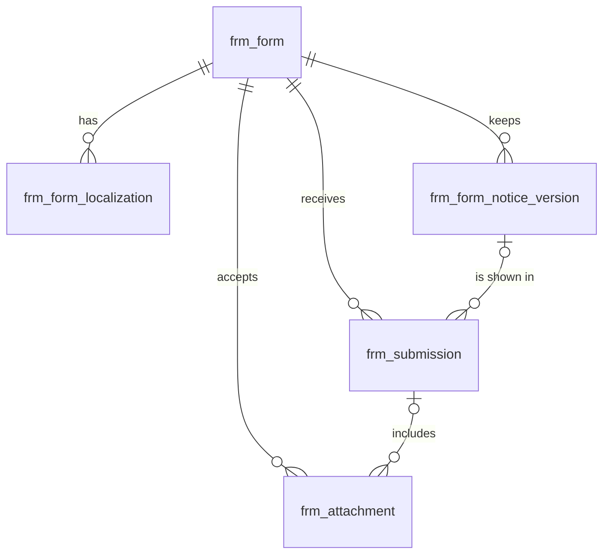

# 表单（form）模块设计

| 项 | 内容 |
|---|---|
| 模块 ID | `form` |
| 名称 | 表单 |
| 层 | L2 |
| 表前缀 | `frm_` |
| API 前缀 | `form` |
| 可停用 | 是 |
| 模块版本 | 1.0.0（module.json 的 version） |
| 平台版本 | `>=1.0.0 <2.0.0`（module.json 的 platform） |
| 里程碑切片 | M1：表单定义、提交、Turnstile、反垃圾、附件；M2：—；M3：下载留资；表单文本作为可翻译资源；M4：—（详见第 13 节） |
| 模块负责人 | 待定 |
| 文档版本 | V1.6 |
| 状态 | 草案 |
| 更新日期 | 2026-10-20 |
| 依据 | 系统设计 V1.8 第 17 章及 3.2、3.8、24–29 章；平台框架设计 V1.6 第 4、7–13 章；ADR-002、ADR-003、ADR-005、ADR-009、ADR-018 |

> 本文只引用《平台框架设计》第 4 章中的契约，不定义新的跨模块契约；需要新契约时按平台框架设计 2.3 提出契约变更请求。

## 1. 职责与边界

### 1.1 职责

提供可配置表单、公开定义、附件、隐私告知版本与提交记录；完成人机验证、限流、反垃圾及留资下载，不承担销售跟进。

功能交付范围按第 13 章分为 M1–M4；表结构、约束与枚举以第 3、4 章为准。

### 1.2 不负责的事

| 事项 | 归属模块 | 边界 |
|---|---|---|
| 内容生命周期与路由 | content / url | 本模块只承担自身职责；不直接修改 cnt_、url_ 表 |
| 身份、权限、设置、任务及审计 | platform-core | 复用平台公共服务 |
| 第三方客户端与网络传输 | infrastructure | 仅经既有端口或 L2 服务使用，不在业务模块引入客户端 |

### 1.3 协作概览

| 协作方式 | 对象 | 本模块行为 |
|---|---|---|
| 服务接口 | MediaApi | 方法与事务边界见 2.2；无跨模块表访问 |
| 扩展点 | DeliveryContributor、NotificationTemplateProvider、TranslatableResourceProvider、PersonalDataProvider | 实现/收集清单见 2.4、2.5 |
| 领域事件 | 见 2.6 | 与本地事务一起登记，提交后异步投递；重复与过期处理独立验证 |

### 1.4 适用的架构约束

遵守 P2、P3 与 ADR-018：编译依赖只到 platform-core/platform-api，跨模块协作只用第 2 章登记契约；只访问自己的表，禁止跨模块 JOIN/外键。遵守 ADR-003：事务内登记、提交后投递、监听器幂等并检查过期。遵守 ADR-009：每次请求/任务明确站点上下文，站点表默认过滤。

公开读取只用当前语言发布态，不跨语言回退（ADR-005）；预览与公开缓存隔离。后台中文文案与错误集中管理，前台文案经 UiTextApi，样式只用 Design Token。远程端口在数据库事务外调用，密钥经 SecretCipher，不写日志。

## 2. 依赖与契约

### 2.1 module.json

```json
{
  "id": "form",
  "name": "表单",
  "version": "1.0.0",
  "layer": "L2",
  "platform": ">=1.0.0 <2.0.0",
  "requires": {
    "media": "^1.0",
    "notification": "^1.0"
  },
  "optional": {},
  "disableable": true,
  "tablePrefix": "frm_",
  "apiPrefix": "form",
  "permissions": [
    {
      "code": "form:form:view",
      "name": "查看表单"
    },
    {
      "code": "form:form:manage",
      "name": "管理表单"
    },
    {
      "code": "form:submission:view",
      "name": "查看提交记录"
    },
    {
      "code": "form:blocklist:manage",
      "name": "管理黑名单"
    }
  ],
  "menus": [
    {
      "key": "form",
      "name": "表单",
      "parent": "settings",
      "route": "/form/forms",
      "permission": "form:form:view",
      "order": 100
    }
  ],
  "settings": "settings.schema.json",
  "components": [],
  "events": {
    "publishes": [
      "FormSubmittedEvent",
      "FormChangedEvent",
      "TranslatableResourceChangedEvent"
    ],
    "subscribes": [
      "ContentUnpublishedEvent",
      "ContentPurgedEvent",
      "SiteSettingsChangedEvent"
    ]
  }
}
```

描述符为 M0 工程建立后的实现要求；目前尚无实际控制器、Schema 或组件包。依赖只声明运行能力；Maven 仍只依赖 platform-api/core。组件清单是本模块负责的类型，运行时 UI 不登记成可拖入布局的组件。

### 2.2 使用的服务接口

| 接口（平台框架设计小节） | 方法 | 用途 | 调用位置与时机 | 测试替身 |
|---|---|---|---|---|
| `MediaApi`（4.4.18） | upload、privateDownloadUrl、issueGatedDownload | 媒体视图、图片源与授权下载；不读取媒体表 | 读接口在查询阶段调用；写方法加入业务事务，远程文本翻译必须在事务外 | `InMemoryMediaApi` |
| `SiteApi`（4.4.1） | 按该契约声明的方法 | 语言、站点模块开关 | 业务事务内；站点切换由任务入口完成 | `InMemorySiteApi` |
| `SiteContextProvider`（4.4.2） | 按该契约声明的方法 | 当前站点；异步与任务由 core 恢复 | 业务事务内；站点切换由任务入口完成 | `FakeSiteContextProvider` |
| `PermissionChecker`（4.4.7） | 按该契约声明的方法 | 后台权限与数据范围 | 业务事务内；站点切换由任务入口完成 | `FakePermissionChecker` |
| `AuditApi`（4.4.9） | 按该契约声明的方法 | 同事务写审计，密钥与个人数据脱敏 | 业务事务内；站点切换由任务入口完成 | `InMemoryAuditApi` |
| `EventMetaFactory`（4.4.14） | 按该契约声明的方法 | 事件 ID、版本、站点与操作人 | 业务事务内；站点切换由任务入口完成 | `FakeEventMetaFactory` |
| `JobApi`（4.4.12） | 按该契约声明的方法 | 耗时任务提交、取消、进度与结果 | 业务事务内；站点切换由任务入口完成 | `InMemoryJobApi` |
| `SettingsApi`（4.4.3） | get；设置写入沿用 core 控制器 | 读取 9.1 的 Schema 默认与站点覆盖 | 事务内本地调用；明文只在事务外传入远程端口 | `InMemorySettingsApi` |
| `SecretCipher`（4.4.10） | encrypt、decrypt、mask | 凭据加解密及掩码，不记录明文 | 事务内本地调用；明文只在事务外传入远程端口 | `FakeSecretCipher` |

所有 L2/L3/L4 读写隐式使用当前站点；按 ID 查询单批最多 500。可选服务用 ObjectProvider 注入并检查当前站点启用状态，缺失时降级，不通过业务表绕过服务。

### 2.3 提供的服务接口

| 接口（平台框架设计小节） | 方法 | 实现类 | 契约测试 | 语义 |
|---|---|---|---|---|
| `FormApi`（4.4.20） | findForm、forms、findSubmission | `FormApiImpl` | `FormApiContractTest` 继承 `FormApiContract` | 完整遵守框架签名、站点隔离、事务及异常语义；远程调用按第 5 章拆分短事务；标注的交付热路径 P95 ≤ 20ms |

### 2.4 实现的扩展点

| 扩展点（平台框架设计小节） | 计划实现类 | 适用范围 | order | 收集方 |
|---|---|---|---|---|
| `DeliveryContributor`（4.5.7） | `FormDeliveryContributor` | sectionKey=forms；按布局中的 formKey 提供当前语言定义 | DEFAULT=1000 | delivery |
| `NotificationTemplateProvider`（4.5.19） | `FormNotificationTemplateProvider` | form.download.customer | DEFAULT=1000 | notification |
| `TranslatableResourceProvider`（4.5.21） | `FormTranslatableResourceProvider` | form.form：标签、选项、提示、成功动作与告知文案 | DEFAULT=1000 | translation |
| `PersonalDataProvider`（4.5.18） | `FormPersonalDataProvider` | 提交 payload、IP、user agent、附件与营销选择 | DEFAULT=1000 | core |
| `PlatformModule`（4.5.22） | `FormModule` | 本模块安装/升级；可停用模块提供影响报告与停用后保留数据规则 | DEFAULT=1000 | core |

以上类名为待实现名称。PublishContributor 不调用调用方的写方法，不访问外部服务；翻译提供方只写本模块草稿/资源，先校验源指纹与共同 version。停用时 analyzeDisableImpact 返回本模块内容、组件及外部引用的影响，数据保留。

### 2.5 收集的扩展点

不适用：不收集业务扩展点；PlatformModule 与任务 SPI 由 core 收集。

### 2.6 发布与订阅的事件

发布：

| 事件 | 触发事务 | 现有 payload 字段 | 订阅方 |
|---|---|---|---|
| `FormSubmittedEvent` | 提交、附件绑定与告知版本关联全部保存成功的同事务；每个提交只登记一次 | meta、submissionId、formId、formKey、purpose、locale、spamVerdict、test | 框架 4.2.4；未登记发布方的差异在第 14 章列出 |
| `FormChangedEvent` | 影响公开定义的字段/启用状态/文案/告知版本变化同事务 | meta、formId、formKey、change | 框架 4.2.4；未登记发布方的差异在第 14 章列出 |
| `TranslatableResourceChangedEvent` | 源语言可翻译文本实际变化时 UPSERTED，资源整体删除时 DELETED；非文本变化与目标语言 apply 不发布此事件 | meta、resourceType、resourceId、change | 框架 4.2.4；未登记发布方的差异在第 14 章列出 |

订阅：

| 事件 | 处理 | 幂等 | 过期与删除 | 失败与重试 |
|---|---|---|---|---|
| `ContentUnpublishedEvent` | 成功跳转目标下线后退化为提示消息；不改写历史提交 | 本模块事务内的幂等标记与数据变更一起提交；缓存重复失效安全 | 读取当前状态/指纹；只有匹配的当前结果才更新；不以 occurredAt 单独当全序 | 失败抛出保留未完成投递；业务副作用转入已有任务/队列后重试 |
| `ContentPurgedEvent` | 清除成功跳转与告知链接目标，保留提交历史快照及法定告知版本 | 本模块事务内的幂等标记与数据变更一起提交；缓存重复失效安全 | 清理使用事件中的 ID；查不到父对象仍须清理 | 失败抛出保留未完成投递；业务副作用转入已有任务/队列后重试 |
| `SiteSettingsChangedEvent` | 按 scopes、settingKeys、localeChanges 筛选 4.6 的相关变化；不对无关设置做全量重建 | 本模块事务内的幂等标记与数据变更一起提交；缓存重复失效安全 | 读取当前状态/指纹；只有匹配的当前结果才更新；不以 occurredAt 单独当全序 | 失败抛出保留未完成投递；业务副作用转入已有任务/队列后重试 |

监听器按框架 5.8 建立站点/system 上下文；`ContentPurgedEvent` 在模块停用时仍必须清理（deliverWhenModuleDisabled）。其他停用期间跳过并完成的事件，重新启用后通过扫描当前状态补偿，不能假定还会重投。数据库幂等标记与本模块数据在同一事务提交；外部发送、下载、搜索与 CDN 调用不得被数据库长事务包裹，使用已声明的任务/端口和业务幂等键。事件 payload 仅引用框架现有字段，本文不扩展签名。

### 2.7 使用的端口

| 端口（平台框架小节） | 用途 | 测试替身 |
|---|---|---|
| `CaptchaVerifier`（4.7.10） | 第 5 章外部能力；只通过端口调用基础设施 | `FakeCaptchaVerifier` |
| `GeoIpResolver`（4.7.11） | 第 5 章外部能力；只通过端口调用基础设施 | `FakeGeoIpResolver` |
| `MxRecordChecker`（4.7.12） | 第 5 章外部能力；只通过端口调用基础设施 | `FakeMxRecordChecker` |
| `RateLimiter`（4.7.15） | 第 5 章外部能力；只通过端口调用基础设施 | `InMemoryRateLimiter` |

## 3. 领域模型

### 3.1 聚合、实体与值对象

| 类型 | 名称 | 说明 |
|---|---|---|
| 聚合根 | Form（`frm_form`） | 表单定义：key、用途、状态、字段定义（语言无关）、设置 |
| 实体 | FormLocalization（`frm_form_localization`） | 表单在一种语言下的文本：标签、提示语、选项名、成功提示语、隐私告知、营销同意文本、当前告知版本（站点资源本地化） |
| 实体 | NoticeVersion（`frm_form_notice_version`） | 某语言隐私告知与营销同意文本的一个版本（只追加），用于追溯访客当时看到的文本 |
| 聚合根 | Submission（`frm_submission`） | 一次提交：字段值、附件、归因、隐私字段（告知版本、营销同意、GPC、退出“出售 / 共享”）、反垃圾结果、IP 与 UA |
| 实体 | Attachment（`frm_attachment`） | 访客预上传的附件：临时 → 关联到提交；病毒扫描状态 |
| 聚合根 | BlocklistEntry（`frm_blocklist`） | 反垃圾黑名单条目：IP / 邮箱 / 域名 / 关键词 / 国家 |
| 值对象 | FieldDefinition | `{key, type, required, width, options, validation, defaultFrom}`；标准字段 key 映射到询盘（系统设计 17.1） |
| 值对象 | FormToken | 签名令牌（formKey、渲染时间、站点、会话随机数），不落库；附件以其会话随机数的哈希绑定会话 |
| 值对象 | SpamVerdict | `ACCEPT` / `QUARANTINE` / `REJECT` + 得分 + 命中规则 |
| 值对象 | Attribution | 落地页、referrer、UTM、点击 ID、首次与末次触达、浏览记录、设备（系统设计 17.9） |

在系统设计之外补充的字段：

| 补充 | 理由 |
|---|---|
| `frm_form.form_key`、`name`、`builtin`、`deleted_at` | 系统设计的 `key` 是 MySQL 关键字，改名 `form_key`（平台框架设计 7.2）；后台需要中文名称；模块安装时创建的默认表单不可删除；配置类实体软删除（平台框架设计 7.5） |
| `frm_form_localization.notice_hash` | 判断告知与营销同意文本是否真的变化：只有变化时才递增 `privacy_notice_version` 并追加历史，避免“保存但未修改”或译文回写相同文本时产生新版本 |
| `frm_form_notice_version.notice_version` | 系统设计 17.1 写作 `version`；本文中 `version` 统一表示乐观锁，因此改名 |
| `frm_submission.email_normalized` | 邮箱在 `payload` 中，数据主体请求“按邮箱跨站点查找”（系统设计 17.11）与同邮箱限流需要可索引的规范化列 |
| `frm_submission.content_id`、`download_media_id` | 提交所在页面（询盘明细与报表“按产品”）；DOWNLOAD 表单请求的文档（签发下载链接与 `download.link` 邮件，系统设计 8.4） |
| `frm_submission.spam_signals`、`is_test` | 命中的反垃圾规则与得分（复核与调参）；合成监控的测试提交（系统设计 27.4），inquiry 据此设置 `is_test` |
| `frm_submission.anonymized_at`、`updated_at`、`updated_by` | 提交在保留期满或数据主体删除请求后匿名化（系统设计 17.11），IP 30 天后置空，需要记录修改时间与操作人 |
| `frm_attachment` 的全部字段 | 系统设计只给出表名与“临时附件、扫描状态、过期时间”：补充存储键、文件信息、`upload_token_hash`（“校验附件属于本次会话”，系统设计 17.2）与扫描结果 |
| `frm_blocklist.expires_at`、`hits`、`last_hit_at`、`note` | 临时屏蔽、命中统计与备注，便于维护黑名单 |
| 告知版本外键 | `frm_submission (form_id, locale, privacy_notice_version)` 以复合外键指向 `frm_form_notice_version`：在数据库层保证每条提交都能追溯到当时展示的告知文本 |

### 3.2 不变量

| # | 规则 | 保证方式 |
|---|---|---|
| 1 | 站点内未删除表单的 `form_key` 唯一；创建后不可修改（布局文档、公开接口按 key 引用） | 数据库：`uk_form_key`；应用层 |
| 2 | 内置表单（`builtin = 1`）不能删除，可以停用；`DISABLED` 或已删除的表单不渲染、不接受提交与附件上传 | 应用层 |
| 3 | `fields` 中字段 key 唯一，格式 `^[a-z][a-z0-9_]{0,63}$`；用途为 INQUIRY / SAMPLE / DOWNLOAD / CONTACT 的表单必须包含必填的 `email` 字段；附件字段的数量与大小不超过设置（≤ 5 个、单个 ≤ 20 MB） | 应用层（保存时按 Schema 校验） |
| 4 | 每个表单每种语言最多一条本地化；中文行由编辑录入（`translation_state = 'NONE'`），其他语言行只由 translation 写入或在翻译编辑器中修订；某语言没有本地化行时，该语言下不渲染此表单（不跨语言回退） | 数据库：`uk_fl_form_locale`；应用层 |
| 5 | 同一（表单，语言）的告知或营销同意文本变化（`notice_hash` 不同）时，`privacy_notice_version` + 1，并在同一事务中追加一条 `frm_form_notice_version`；当前版本也有历史行；历史行只追加，不修改、不删除 | 数据库：`uk_fnv_version`、`fk_frm_fnv_form`（RESTRICT）；应用层 + 数据库账号授权 |
| 6 | 提交记录的（`form_id`，`locale`，`privacy_notice_version`）必须存在于告知版本历史中（表单没有告知文本时版本为空） | 数据库：`fk_frm_sub_notice` |
| 7 | `marketing_consent = 1` 当且仅当 `marketing_consent_at` 非空；营销同意框默认不勾选，不设强制勾选的同意框 | 数据库：`ck_frm_sub_consent`；应用层 |
| 8 | 提交写入后，字段值与判定结果不再修改；只允许：IP 30 天后置空、数据主体请求的更正与匿名化、附件删除 | 应用层 |
| 9 | `idempotency_key` 在站点内唯一；重复提交返回首次的结果 | 数据库：`uk_sub_idem` |
| 10 | 判定结果由得分与阈值决定（< 30 ACCEPT；30–70 QUARANTINE；> 70 REJECT，阈值可在设置中调整）；REJECT 也向访客返回成功；只有非 REJECT 的 DOWNLOAD 提交返回下载链接 | 应用层 |
| 11 | 附件：`TEMP` 有过期时间（上传后 24 小时）且未关联提交；`LINKED` 已关联提交且无过期时间；只能关联到同一表单、同一会话（`upload_token_hash` 一致）的提交；扫描结果为 `CLEAN` 之前员工不能下载 | 数据库：`ck_frm_att_status`；应用层 |
| 12 | 黑名单条目在（站点，类型）内按规范化值唯一 | 数据库：`uk_block_value`；应用层（规范化） |

### 3.3 状态机

表单 ACTIVE ⇄ DISABLED；删除非内置表单前校验引用。附件 TEMP → LINKED 仅在同会话提交事务中发生，过期 TEMP 由任务清除。扫描 PENDING → CLEAN / INFECTED / ERROR，ERROR 可重试；CLEAN 之前不得下载。提交的 ACCEPT / QUARANTINE / REJECT 是判定结果，不作为可随意编辑的状态。

## 4. 数据模型

> 遵守平台框架设计第 7 章的数据库通用约定。本节给出待实现 DDL；本次文档审查未重跑 MySQL，不能据此认定 DDL 已验证。M0 后按第 11 章在 MySQL 8.4 空库验证，并使实际迁移脚本与本节一致。

### 4.1 表清单

| 表 | 说明 | 站点级 | 软删除 | 预估规模（单站，按系统设计假设 A4） |
|---|---|---|---|---|
| `frm_form` | 表单定义 | 是 | 是（`deleted_at`） | ≤ 50 行 |
| `frm_form_localization` | 表单文本（站点资源本地化） | 是 | 否（随表单） | ≤ 500 行（× 10 种语言） |
| `frm_form_notice_version` | 告知与营销同意文本的版本历史 | 是 | 否（只追加） | ≤ 5 千行 |
| `frm_submission` | 提交记录 | 是 | 否（保留期满匿名化；REJECT 30 天后物理删除） | ≤ 110 万行（≤ 1 千条 / 天 × 3 年） |
| `frm_attachment` | 表单附件 | 是 | 否 | ≈ 20 万行 |
| `frm_blocklist` | 反垃圾黑名单 | 是 | 否 | ≤ 5 千行 |

### 4.2 ER 图



`frm_blocklist` 与其他表无关系（按站点整体加载到内存使用），未画出。

### 4.3 表结构

#### 4.3.1 `frm_form`：表单定义

| 字段 | 类型 | 可空 | 默认 | 说明 |
|---|---|---|---|---|
| `id` | BIGINT | 否 | — | 主键（TSID） |
| `site_id` | BIGINT | 否 | — | 站点 ID（sys_site.id） |
| `form_key` | VARCHAR(64) bin | 否 | — | 表单 key（小写字母、数字、连字符；创建后不可修改；布局文档与公开接口按 key 引用），如 default-inquiry |
| `name` | VARCHAR(100) | 否 | — | 名称（中文，只在后台显示） |
| `purpose` | VARCHAR(16) | 否 | — | 用途：INQUIRY / SAMPLE / DOWNLOAD / CONTACT / CUSTOM（【V2+】NEWSLETTER） |
| `status` | VARCHAR(16) | 否 | `'ACTIVE'` | 状态：ACTIVE（接受提交）/ DISABLED（停用：前台不渲染，提交返回 404） |
| `fields` | JSON | 否 | `(JSON_ARRAY())` | 字段定义数组（语言无关）：[{key, type, required, width, options:[{value}], validation, defaultFrom}]；标签与提示语在本地化表 |
| `settings` | JSON | 否 | `(JSON_OBJECT('schemaVersion', 1))` | 设置（JSON，顶层带 schemaVersion）：反垃圾、附件、成功动作、是否显示营销同意框、常用国家、Turnstile |
| `builtin` | TINYINT(1) | 否 | `0` | 是否内置（模块安装时创建，不可删除，可停用） |
| `deleted_at` | DATETIME(3) | 是 | — | 删除时间（软删除） |
| `alive` | TINYINT | 是 | 生成列 `IF(deleted_at IS NULL, 1, NULL)` | 未删除标记（唯一索引用） |
| `version` | INT | 否 | `0` | 乐观锁版本号 |
| `created_at` | DATETIME(3) | 否 | `CURRENT_TIMESTAMP(3)` | 创建时间（UTC） |
| `created_by` | BIGINT | 否 | `0` | 创建人用户 ID（0 = 系统） |
| `updated_at` | DATETIME(3) | 否 | `CURRENT_TIMESTAMP(3) ON UPDATE CURRENT_TIMESTAMP(3)` | 更新时间（UTC） |
| `updated_by` | BIGINT | 否 | `0` | 更新人用户 ID（0 = 系统） |

索引与约束：
- `PRIMARY KEY (id)`
- `uk_form_key (site_id, form_key, alive)`：未删除的 key 唯一；公开接口与 Delivery 按 key 查找表单；站点的表单列表

```sql
CREATE TABLE frm_form (
  id          BIGINT        NOT NULL COMMENT '主键（TSID）',
  site_id     BIGINT        NOT NULL COMMENT '站点 ID（sys_site.id）',
  form_key    VARCHAR(64)   COLLATE utf8mb4_0900_bin NOT NULL COMMENT '表单 key（小写字母、数字、连字符；创建后不可修改；布局文档与公开接口按 key 引用），如 default-inquiry',
  name        VARCHAR(100)  NOT NULL COMMENT '名称（中文，只在后台显示）',
  purpose     VARCHAR(16)   NOT NULL COMMENT '用途：INQUIRY / SAMPLE / DOWNLOAD / CONTACT / CUSTOM（【V2+】NEWSLETTER）',
  status      VARCHAR(16)   NOT NULL DEFAULT 'ACTIVE' COMMENT '状态：ACTIVE（接受提交）/ DISABLED（停用：前台不渲染，提交返回 404）',
  fields      JSON          NOT NULL DEFAULT (JSON_ARRAY()) COMMENT '字段定义数组（语言无关）：[{key, type, required, width, options:[{value}], validation, defaultFrom}]；标签与提示语在本地化表',
  settings    JSON          NOT NULL DEFAULT (JSON_OBJECT('schemaVersion', 1)) COMMENT '设置（JSON，顶层带 schemaVersion）：反垃圾、附件、成功动作、是否显示营销同意框、常用国家、Turnstile',
  builtin     TINYINT(1)    NOT NULL DEFAULT 0 COMMENT '是否内置（模块安装时创建，不可删除，可停用）',
  deleted_at  DATETIME(3)   NULL COMMENT '删除时间（软删除）',
  alive       TINYINT       AS (IF(deleted_at IS NULL, 1, NULL)) STORED COMMENT '未删除标记（唯一索引用）',
  version     INT           NOT NULL DEFAULT 0 COMMENT '乐观锁版本号',
  created_at  DATETIME(3)   NOT NULL DEFAULT CURRENT_TIMESTAMP(3) COMMENT '创建时间（UTC）',
  created_by  BIGINT        NOT NULL DEFAULT 0 COMMENT '创建人用户 ID（0 = 系统）',
  updated_at  DATETIME(3)   NOT NULL DEFAULT CURRENT_TIMESTAMP(3) ON UPDATE CURRENT_TIMESTAMP(3) COMMENT '更新时间（UTC）',
  updated_by  BIGINT        NOT NULL DEFAULT 0 COMMENT '更新人用户 ID（0 = 系统）',
  PRIMARY KEY (id),
  UNIQUE KEY uk_form_key (site_id, form_key, alive)
) ENGINE = InnoDB DEFAULT CHARSET = utf8mb4 COLLATE = utf8mb4_0900_ai_ci COMMENT = '表单定义（字段与设置，语言无关）';
```

`fields` 示例（标签不在这里）：

```json
[
  { "key": "name",     "type": "TEXT",           "required": true,  "width": "half", "validation": { "maxLength": 100 } },
  { "key": "email",    "type": "EMAIL",          "required": true,  "width": "half" },
  { "key": "phone",    "type": "PHONE",          "required": false, "width": "half" },
  { "key": "country",  "type": "COUNTRY",        "required": true,  "width": "half", "defaultFrom": "IP_COUNTRY" },
  { "key": "products", "type": "PRODUCT_SELECT", "required": false },
  { "key": "message",  "type": "TEXTAREA",       "required": true,  "validation": { "maxLength": 5000 } },
  { "key": "files",    "type": "ATTACHMENT",     "required": false },
  { "key": "interest", "type": "SELECT",         "required": false, "options": [ { "value": "battery" }, { "value": "charger" } ] }
]
```

`settings` 示例：

```json
{
  "schemaVersion": 1,
  "antiSpam": { "turnstile": true, "honeypot": true, "minFillSeconds": 3, "quarantineScore": 30, "rejectScore": 70 },
  "attachments": { "maxFiles": 5, "maxSizeMb": 20, "allowedTypes": ["pdf", "jpg", "png", "dwg", "dxf", "step", "stp", "igs", "zip"] },
  "successAction": { "type": "REDIRECT", "contentId": "7201893453912345" },
  "showMarketingConsent": true,
  "preferredCountries": ["DE", "US", "GB", "FR"]
}
```

要点：
- 成功动作为 `REDIRECT` 时跳转到感谢页（`$content` 引用，`noindex`），不保存 URL；为 `MESSAGE` 时显示本地化的 `success_message`。
- 修改 `fields`、`settings` 或任一语言的文本后，需要失效嵌入该表单的页面缓存（见 4.6 的跨模块事项）。

#### 4.3.2 `frm_form_localization`：表单本地化

| 字段 | 类型 | 可空 | 默认 | 说明 |
|---|---|---|---|---|
| `id` | BIGINT | 否 | — | 主键（TSID） |
| `site_id` | BIGINT | 否 | — | 站点 ID（sys_site.id） |
| `form_id` | BIGINT | 否 | — | 表单 ID（frm_form.id） |
| `locale` | VARCHAR(16) | 否 | — | 语言（BCP 47） |
| `labels` | JSON | 否 | `(JSON_OBJECT())` | 界面文本：{"fields":{"<key>":{"label","placeholder","help","options":{"<value>":"…"}}},"submit":"…"} |
| `success_message` | VARCHAR(1000) | 是 | — | 成功提示语（成功动作为显示提示语时使用） |
| `privacy_notice_text` | JSON | 是 | — | 隐私告知（ProseMirror 行内 JSON；隐私政策链接为 content://{id}） |
| `marketing_consent_text` | JSON | 是 | — | 营销同意框文本（ProseMirror 行内 JSON）；表单不显示营销同意框时可为空 |
| `privacy_notice_version` | INT | 否 | `0` | 告知版本：告知或营销同意文本任一变化时 + 1；0 = 尚无告知文本 |
| `notice_hash` | CHAR(64) bin | 是 | — | 当前告知与营销同意文本规范化后拼接的 SHA-256；用于判断文本是否真的变化 |
| `translation_state` | VARCHAR(16) | 否 | `'NONE'` | 翻译状态：NONE / QUEUED / TRANSLATED / NEEDS_REVIEW / FAILED / OUTDATED |
| `source_fingerprint` | CHAR(64) bin | 是 | — | 生成本行译文时中文行的指纹（全部可翻译文本规范化后拼接的 SHA-256）；中文行为空；与当前中文指纹不同即为过期 |
| `version` | INT | 否 | `0` | 乐观锁版本号 |
| `created_at` | DATETIME(3) | 否 | `CURRENT_TIMESTAMP(3)` | 创建时间（UTC） |
| `created_by` | BIGINT | 否 | `0` | 创建人用户 ID（0 = 系统，如翻译回写） |
| `updated_at` | DATETIME(3) | 否 | `CURRENT_TIMESTAMP(3) ON UPDATE CURRENT_TIMESTAMP(3)` | 更新时间（UTC） |
| `updated_by` | BIGINT | 否 | `0` | 更新人用户 ID（0 = 系统） |

索引与约束：
- `PRIMARY KEY (id)`
- `uk_fl_form_locale (form_id, locale)`：每种语言一条；按（表单，语言）取前台渲染文本；兼作 `fk_frm_fl_form` 的索引
- `idx_fl_state (site_id, translation_state, locale)`：翻译中心列出待处理的表单文本
- `fk_frm_fl_form`：组合关系，`ON DELETE CASCADE`

```sql
CREATE TABLE frm_form_localization (
  id                      BIGINT         NOT NULL COMMENT '主键（TSID）',
  site_id                 BIGINT         NOT NULL COMMENT '站点 ID（sys_site.id）',
  form_id                 BIGINT         NOT NULL COMMENT '表单 ID（frm_form.id）',
  locale                  VARCHAR(16)    NOT NULL COMMENT '语言（BCP 47）',
  labels                  JSON           NOT NULL DEFAULT (JSON_OBJECT()) COMMENT '界面文本：{"fields":{"<key>":{"label","placeholder","help","options":{"<value>":"…"}}},"submit":"…"}',
  success_message         VARCHAR(1000)  NULL COMMENT '成功提示语（成功动作为显示提示语时使用）',
  privacy_notice_text     JSON           NULL COMMENT '隐私告知（ProseMirror 行内 JSON；隐私政策链接为 content://{id}）',
  marketing_consent_text  JSON           NULL COMMENT '营销同意框文本（ProseMirror 行内 JSON）；表单不显示营销同意框时可为空',
  privacy_notice_version  INT            NOT NULL DEFAULT 0 COMMENT '告知版本：告知或营销同意文本任一变化时 + 1；0 = 尚无告知文本',
  notice_hash             CHAR(64)       COLLATE utf8mb4_0900_bin NULL COMMENT '当前告知与营销同意文本规范化后拼接的 SHA-256；用于判断文本是否真的变化',
  translation_state       VARCHAR(16)    NOT NULL DEFAULT 'NONE' COMMENT '翻译状态：NONE / QUEUED / TRANSLATED / NEEDS_REVIEW / FAILED / OUTDATED',
  source_fingerprint      CHAR(64)       COLLATE utf8mb4_0900_bin NULL COMMENT '生成本行译文时中文行的指纹（全部可翻译文本规范化后拼接的 SHA-256）；中文行为空；与当前中文指纹不同即为过期',
  version                 INT            NOT NULL DEFAULT 0 COMMENT '乐观锁版本号',
  created_at              DATETIME(3)    NOT NULL DEFAULT CURRENT_TIMESTAMP(3) COMMENT '创建时间（UTC）',
  created_by              BIGINT         NOT NULL DEFAULT 0 COMMENT '创建人用户 ID（0 = 系统，如翻译回写）',
  updated_at              DATETIME(3)    NOT NULL DEFAULT CURRENT_TIMESTAMP(3) ON UPDATE CURRENT_TIMESTAMP(3) COMMENT '更新时间（UTC）',
  updated_by              BIGINT         NOT NULL DEFAULT 0 COMMENT '更新人用户 ID（0 = 系统）',
  PRIMARY KEY (id),
  UNIQUE KEY uk_fl_form_locale (form_id, locale),
  KEY idx_fl_state (site_id, translation_state, locale),
  CONSTRAINT fk_frm_fl_form FOREIGN KEY (form_id) REFERENCES frm_form (id) ON DELETE CASCADE
) ENGINE = InnoDB DEFAULT CHARSET = utf8mb4 COLLATE = utf8mb4_0900_ai_ci COMMENT = '表单文本的多语言版本（站点资源，带翻译状态与源指纹）';
```

要点：
- 翻译单元（资源类型 `form.form`，ID 为 `form_id`）：`labels` 中的每个字符串、`success_message`、`privacy_notice_text` 与 `marketing_consent_text`（`RICH_INLINE`，链接转为编号占位标签）。字段 key、选项 value、国家代码不翻译；国家名称由前台按语言用 ISO 列表显示。
- 中文行的文本变化时发布 `TranslatableResourceChangedEvent`；translation 回写目标语言行时，若告知或营销同意文本的译文变化，同样递增该语言的 `privacy_notice_version` 并追加历史（系统设计 17.1）。

#### 4.3.3 `frm_form_notice_version`：告知与营销同意文本版本

| 字段 | 类型 | 可空 | 默认 | 说明 |
|---|---|---|---|---|
| `id` | BIGINT | 否 | — | 主键（TSID） |
| `site_id` | BIGINT | 否 | — | 站点 ID（sys_site.id） |
| `form_id` | BIGINT | 否 | — | 表单 ID（frm_form.id） |
| `locale` | VARCHAR(16) | 否 | — | 语言（BCP 47） |
| `notice_version` | INT | 否 | — | 告知版本号（与 frm_form_localization.privacy_notice_version 对应，从 1 开始） |
| `privacy_notice_text` | JSON | 是 | — | 该版本的隐私告知（ProseMirror 行内 JSON） |
| `marketing_consent_text` | JSON | 是 | — | 该版本的营销同意框文本（ProseMirror 行内 JSON） |
| `notice_hash` | CHAR(64) bin | 否 | — | 两段文本规范化后拼接的 SHA-256 |
| `created_at` | DATETIME(3) | 否 | `CURRENT_TIMESTAMP(3)` | 版本生效时间（UTC） |
| `created_by` | BIGINT | 否 | `0` | 修改人用户 ID（0 = 系统，即机器译文回写） |

索引与约束：
- `PRIMARY KEY (id)`
- `uk_fnv_version (form_id, locale, notice_version)`：每个版本一行；追溯“提交时展示的文本”；被 `fk_frm_sub_notice` 引用；兼作 `fk_frm_fnv_form` 的索引
- `fk_frm_fnv_form`：引用关系（RESTRICT）：版本历史是同意证明，不随父行级联删除

```sql
CREATE TABLE frm_form_notice_version (
  id                      BIGINT       NOT NULL COMMENT '主键（TSID）',
  site_id                 BIGINT       NOT NULL COMMENT '站点 ID（sys_site.id）',
  form_id                 BIGINT       NOT NULL COMMENT '表单 ID（frm_form.id）',
  locale                  VARCHAR(16)  NOT NULL COMMENT '语言（BCP 47）',
  notice_version          INT          NOT NULL COMMENT '告知版本号（与 frm_form_localization.privacy_notice_version 对应，从 1 开始）',
  privacy_notice_text     JSON         NULL COMMENT '该版本的隐私告知（ProseMirror 行内 JSON）',
  marketing_consent_text  JSON         NULL COMMENT '该版本的营销同意框文本（ProseMirror 行内 JSON）',
  notice_hash             CHAR(64)     COLLATE utf8mb4_0900_bin NOT NULL COMMENT '两段文本规范化后拼接的 SHA-256',
  created_at              DATETIME(3)  NOT NULL DEFAULT CURRENT_TIMESTAMP(3) COMMENT '版本生效时间（UTC）',
  created_by              BIGINT       NOT NULL DEFAULT 0 COMMENT '修改人用户 ID（0 = 系统，即机器译文回写）',
  PRIMARY KEY (id),
  UNIQUE KEY uk_fnv_version (form_id, locale, notice_version),
  CONSTRAINT fk_frm_fnv_form FOREIGN KEY (form_id) REFERENCES frm_form (id)
) ENGINE = InnoDB DEFAULT CHARSET = utf8mb4 COLLATE = utf8mb4_0900_ai_ci COMMENT = '隐私告知与营销同意文本的版本历史（只追加，用于追溯同意文本）';
```

要点：只追加；保留到引用该版本的最后一条提交与询盘被清理之后（由保留期任务检查，见本模块第 10 章）。

#### 4.3.4 `frm_submission`：提交记录

| 字段 | 类型 | 可空 | 默认 | 说明 |
|---|---|---|---|---|
| `id` | BIGINT | 否 | — | 主键（TSID） |
| `site_id` | BIGINT | 否 | — | 站点 ID（sys_site.id） |
| `form_id` | BIGINT | 否 | — | 表单 ID（frm_form.id） |
| `locale` | VARCHAR(16) | 否 | — | 提交时页面的语言（客户自动回复使用该语言） |
| `payload` | JSON | 否 | — | 字段值：{"<fieldKey>": 值}；电话为 E.164，国家为 ISO 3166-1 alpha-2，产品选择为 [{"contentId","modelId","quantity"}] |
| `email_normalized` | VARCHAR(254) | 是 | — | 标准字段 email 的小写规范化值（数据主体请求查找、同邮箱限流与去重） |
| `attachment_ids` | JSON | 否 | `(JSON_ARRAY())` | 附件 ID 数组（frm_attachment.id，字符串），按上传顺序 |
| `attribution` | JSON | 是 | — | 来源归因：landingUrl、referrer、utm、clickIds、firstTouch、lastTouch、viewedContentIds、device（已校验与截断） |
| `content_id` | BIGINT | 是 | — | 提交所在页面的内容 ID（cnt_content.id）；无法确定时为空 |
| `download_media_id` | BIGINT | 是 | — | DOWNLOAD 表单请求下载的文档（mda_media.id） |
| `privacy_notice_version` | INT | 是 | — | 提交时展示的告知版本（与 form_id、locale 一起指向 frm_form_notice_version）；表单没有告知文本时为空 |
| `marketing_consent` | TINYINT(1) | 否 | `0` | 是否勾选营销同意（默认不勾选） |
| `marketing_consent_at` | DATETIME(3) | 是 | — | 营销同意时间（勾选时为服务器接收时间） |
| `gpc` | TINYINT(1) | 否 | `0` | 提交时浏览器是否发出 Global Privacy Control 信号 |
| `opt_out_sale_share` | TINYINT(1) | 否 | `0` | 访客是否已退出“出售 / 共享”（含 GPC） |
| `spam_score` | SMALLINT | 否 | `0` | 反垃圾加权得分（< 30 ACCEPT；30–70 QUARANTINE；> 70 REJECT，阈值可配置） |
| `spam_verdict` | VARCHAR(16) | 否 | — | 判定：ACCEPT / QUARANTINE / REJECT |
| `spam_signals` | JSON | 是 | — | 命中的反垃圾规则与得分，如 [{"rule":"LINK_COUNT","score":20}] |
| `is_test` | TINYINT(1) | 否 | `0` | 是否测试提交（合成监控；不计入报表，通知发到运维邮箱） |
| `ip` | VARCHAR(45) | 是 | — | 客户端 IP（反欺诈；30 天后置空） |
| `ip_country` | CHAR(2) | 是 | — | IP 所在国家（本地 GeoIP 解析，ISO 3166-1 alpha-2） |
| `user_agent` | VARCHAR(500) | 是 | — | User-Agent（截断到 500 个字符） |
| `idempotency_key` | VARCHAR(64) bin | 是 | — | 请求头 Idempotency-Key（站点内唯一；重复提交返回首次结果） |
| `anonymized_at` | DATETIME(3) | 是 | — | 匿名化时间（保留期满或数据主体删除请求） |
| `created_at` | DATETIME(3) | 否 | `CURRENT_TIMESTAMP(3)` | 提交时间（UTC，服务器接收时间） |
| `updated_at` | DATETIME(3) | 否 | `CURRENT_TIMESTAMP(3) ON UPDATE CURRENT_TIMESTAMP(3)` | 更新时间（UTC；IP 置空、更正、匿名化） |
| `updated_by` | BIGINT | 否 | `0` | 更新人用户 ID（0 = 系统） |

索引与约束：
- `PRIMARY KEY (id)`：inquiry 收到 `FormSubmittedEvent` 后按 ID 读取
- `uk_sub_idem (site_id, idempotency_key)`：幂等提交
- `idx_sub_form (form_id, created_at)`：某表单的提交列表（后台，按时间倒序）；兼作 `fk_frm_sub_form` 的索引
- `idx_sub_notice (form_id, locale, privacy_notice_version)`：`fk_frm_sub_notice` 的索引；查找使用某告知版本的提交（版本历史清理前检查）
- `idx_sub_list (site_id, created_at)`：站点全部提交列表；保留期任务（IP 30 天置空、保留期满匿名化）
- `idx_sub_verdict (site_id, spam_verdict, created_at)`：待审（QUARANTINE）列表；REJECT 30 天后清除
- `idx_sub_email (email_normalized)`：数据主体请求按邮箱跨站点查找（系统管理接口）；同邮箱去重
- `fk_frm_sub_form`：引用关系（RESTRICT）
- `fk_frm_sub_notice`：引用关系（RESTRICT），见 3.2 不变量 6
- `ck_frm_sub_consent`：见 3.2 不变量 7

```sql
CREATE TABLE frm_submission (
  id                      BIGINT         NOT NULL COMMENT '主键（TSID）',
  site_id                 BIGINT         NOT NULL COMMENT '站点 ID（sys_site.id）',
  form_id                 BIGINT         NOT NULL COMMENT '表单 ID（frm_form.id）',
  locale                  VARCHAR(16)    NOT NULL COMMENT '提交时页面的语言（客户自动回复使用该语言）',
  payload                 JSON           NOT NULL COMMENT '字段值：{"<fieldKey>": 值}；电话为 E.164，国家为 ISO 3166-1 alpha-2，产品选择为 [{"contentId","modelId","quantity"}]',
  email_normalized        VARCHAR(254)   NULL COMMENT '标准字段 email 的小写规范化值（数据主体请求查找、同邮箱限流与去重）',
  attachment_ids          JSON           NOT NULL DEFAULT (JSON_ARRAY()) COMMENT '附件 ID 数组（frm_attachment.id，字符串），按上传顺序',
  attribution             JSON           NULL COMMENT '来源归因：landingUrl、referrer、utm、clickIds、firstTouch、lastTouch、viewedContentIds、device（已校验与截断）',
  content_id              BIGINT         NULL COMMENT '提交所在页面的内容 ID（cnt_content.id）；无法确定时为空',
  download_media_id       BIGINT         NULL COMMENT 'DOWNLOAD 表单请求下载的文档（mda_media.id）',
  privacy_notice_version  INT            NULL COMMENT '提交时展示的告知版本（与 form_id、locale 一起指向 frm_form_notice_version）；表单没有告知文本时为空',
  marketing_consent       TINYINT(1)     NOT NULL DEFAULT 0 COMMENT '是否勾选营销同意（默认不勾选）',
  marketing_consent_at    DATETIME(3)    NULL COMMENT '营销同意时间（勾选时为服务器接收时间）',
  gpc                     TINYINT(1)     NOT NULL DEFAULT 0 COMMENT '提交时浏览器是否发出 Global Privacy Control 信号',
  opt_out_sale_share      TINYINT(1)     NOT NULL DEFAULT 0 COMMENT '访客是否已退出“出售 / 共享”（含 GPC）',
  spam_score              SMALLINT       NOT NULL DEFAULT 0 COMMENT '反垃圾加权得分（< 30 ACCEPT；30–70 QUARANTINE；> 70 REJECT，阈值可配置）',
  spam_verdict            VARCHAR(16)    NOT NULL COMMENT '判定：ACCEPT / QUARANTINE / REJECT',
  spam_signals            JSON           NULL COMMENT '命中的反垃圾规则与得分，如 [{"rule":"LINK_COUNT","score":20}]',
  is_test                 TINYINT(1)     NOT NULL DEFAULT 0 COMMENT '是否测试提交（合成监控；不计入报表，通知发到运维邮箱）',
  ip                      VARCHAR(45)    NULL COMMENT '客户端 IP（反欺诈；30 天后置空）',
  ip_country              CHAR(2)        NULL COMMENT 'IP 所在国家（本地 GeoIP 解析，ISO 3166-1 alpha-2）',
  user_agent              VARCHAR(500)   NULL COMMENT 'User-Agent（截断到 500 个字符）',
  idempotency_key         VARCHAR(64)    COLLATE utf8mb4_0900_bin NULL COMMENT '请求头 Idempotency-Key（站点内唯一；重复提交返回首次结果）',
  anonymized_at           DATETIME(3)    NULL COMMENT '匿名化时间（保留期满或数据主体删除请求）',
  created_at              DATETIME(3)    NOT NULL DEFAULT CURRENT_TIMESTAMP(3) COMMENT '提交时间（UTC，服务器接收时间）',
  updated_at              DATETIME(3)    NOT NULL DEFAULT CURRENT_TIMESTAMP(3) ON UPDATE CURRENT_TIMESTAMP(3) COMMENT '更新时间（UTC；IP 置空、更正、匿名化）',
  updated_by              BIGINT         NOT NULL DEFAULT 0 COMMENT '更新人用户 ID（0 = 系统）',
  PRIMARY KEY (id),
  UNIQUE KEY uk_sub_idem (site_id, idempotency_key),
  KEY idx_sub_form (form_id, created_at),
  KEY idx_sub_notice (form_id, locale, privacy_notice_version),
  KEY idx_sub_list (site_id, created_at),
  KEY idx_sub_verdict (site_id, spam_verdict, created_at),
  KEY idx_sub_email (email_normalized),
  CONSTRAINT fk_frm_sub_form FOREIGN KEY (form_id) REFERENCES frm_form (id),
  CONSTRAINT fk_frm_sub_notice FOREIGN KEY (form_id, locale, privacy_notice_version) REFERENCES frm_form_notice_version (form_id, locale, notice_version),
  CONSTRAINT ck_frm_sub_consent CHECK ((marketing_consent = 0 AND marketing_consent_at IS NULL) OR (marketing_consent = 1 AND marketing_consent_at IS NOT NULL))
) ENGINE = InnoDB DEFAULT CHARSET = utf8mb4 COLLATE = utf8mb4_0900_ai_ci COMMENT = '表单提交记录（含隐私字段与反垃圾结果）';
```

要点：
- 提交流程见系统设计 17.2：限流 → Turnstile、formToken、honeypot、最短填写时间 → 字段校验与附件归属校验 → 反垃圾评分 → 在同一事务中写入本表、把附件改为 `LINKED`、发布 `FormSubmittedEvent`。
- `payload` 只保存表单定义中的字段（honeypot 与 Turnstile 令牌不保存）；字段之后被删除时，后台按 key 显示旧值。
- inquiry 创建线索时从本表复制联系字段、归因与隐私字段（`privacy_notice_version`、`marketing_consent`、`marketing_consent_at`、`gpc`、`opt_out_sale_share`、`ip_country`、`is_test`）到 `inq_inquiry`。
- 保留期（系统设计 17.11）：REJECT 30 天后物理删除（附件随之删除）；`ip` 30 天后置空；其余与询盘一致（默认 3 年）后匿名化：`payload` 中的联系字段替换为占位值、`email_normalized`、`ip`、`user_agent` 置空、附件删除，记录 `anonymized_at`。

#### 4.3.5 `frm_attachment`：表单附件

| 字段 | 类型 | 可空 | 默认 | 说明 |
|---|---|---|---|---|
| `id` | BIGINT | 否 | — | 主键（TSID） |
| `site_id` | BIGINT | 否 | — | 站点 ID（sys_site.id） |
| `form_id` | BIGINT | 否 | — | 表单 ID（frm_form.id；上传时 formToken 中的表单） |
| `submission_id` | BIGINT | 是 | — | 所属提交（frm_submission.id）；临时附件为空 |
| `status` | VARCHAR(16) | 否 | `'TEMP'` | 状态：TEMP（已上传，未关联提交）/ LINKED（已关联提交） |
| `storage_key` | VARCHAR(500) bin | 否 | — | 私有桶对象键：{siteId}/form/{yyyy}/{mm}/{id}.{ext} |
| `original_name` | VARCHAR(255) | 否 | — | 原文件名（下载时用于 Content-Disposition） |
| `mime` | VARCHAR(127) | 否 | — | MIME 类型（Tika 按文件头识别，小写） |
| `size` | BIGINT | 否 | — | 文件大小（字节，≤ 20 MB） |
| `sha256` | CHAR(64) bin | 否 | — | 文件内容 SHA-256（十六进制小写） |
| `upload_token_hash` | CHAR(64) bin | 否 | — | 上传时 formToken 中会话随机数的 SHA-256；提交时校验附件属于本次会话 |
| `scan_status` | VARCHAR(16) | 否 | `'PENDING'` | 病毒扫描状态：PENDING / CLEAN / INFECTED / ERROR |
| `scan_result` | VARCHAR(200) | 是 | — | 扫描结果：INFECTED 时为病毒特征名，ERROR 时为错误摘要 |
| `scanned_at` | DATETIME(3) | 是 | — | 扫描完成时间 |
| `expires_at` | DATETIME(3) | 是 | — | 过期时间：TEMP 为上传后 24 小时，到期未关联则删除；LINKED 为空（随提交保留） |
| `created_at` | DATETIME(3) | 否 | `CURRENT_TIMESTAMP(3)` | 上传时间（UTC） |
| `updated_at` | DATETIME(3) | 否 | `CURRENT_TIMESTAMP(3) ON UPDATE CURRENT_TIMESTAMP(3)` | 更新时间（UTC） |

索引与约束：
- `PRIMARY KEY (id)`
- `uk_att_storage_key (storage_key)`：存储键唯一
- `idx_att_form (form_id)`：`fk_frm_att_form` 的索引
- `idx_att_submission (submission_id)`：提交详情的附件列表；兼作 `fk_frm_att_sub` 的索引
- `idx_att_expire (status, expires_at)`：清理任务删除过期的 `TEMP` 附件（`TEMP` 行很少，选择性高）
- `idx_att_scan (scan_status, created_at)`：扫描任务重试 `PENDING` / `ERROR` 的附件
- `fk_frm_att_form`：引用关系（RESTRICT）
- `fk_frm_att_sub`：组合关系，`ON DELETE CASCADE`（应用层先删除对象存储中的文件）
- `ck_frm_att_status`：见 3.2 不变量 11（`submission_id` 与状态的一致性由应用层保证：MySQL 不允许 CHECK 引用带级联动作的外键列）

```sql
CREATE TABLE frm_attachment (
  id                 BIGINT        NOT NULL COMMENT '主键（TSID）',
  site_id            BIGINT        NOT NULL COMMENT '站点 ID（sys_site.id）',
  form_id            BIGINT        NOT NULL COMMENT '表单 ID（frm_form.id；上传时 formToken 中的表单）',
  submission_id      BIGINT        NULL COMMENT '所属提交（frm_submission.id）；临时附件为空',
  status             VARCHAR(16)   NOT NULL DEFAULT 'TEMP' COMMENT '状态：TEMP（已上传，未关联提交）/ LINKED（已关联提交）',
  storage_key        VARCHAR(500)  COLLATE utf8mb4_0900_bin NOT NULL COMMENT '私有桶对象键：{siteId}/form/{yyyy}/{mm}/{id}.{ext}',
  original_name      VARCHAR(255)  NOT NULL COMMENT '原文件名（下载时用于 Content-Disposition）',
  mime               VARCHAR(127)  NOT NULL COMMENT 'MIME 类型（Tika 按文件头识别，小写）',
  size               BIGINT        NOT NULL COMMENT '文件大小（字节，≤ 20 MB）',
  sha256             CHAR(64)      COLLATE utf8mb4_0900_bin NOT NULL COMMENT '文件内容 SHA-256（十六进制小写）',
  upload_token_hash  CHAR(64)      COLLATE utf8mb4_0900_bin NOT NULL COMMENT '上传时 formToken 中会话随机数的 SHA-256；提交时校验附件属于本次会话',
  scan_status        VARCHAR(16)   NOT NULL DEFAULT 'PENDING' COMMENT '病毒扫描状态：PENDING / CLEAN / INFECTED / ERROR',
  scan_result        VARCHAR(200)  NULL COMMENT '扫描结果：INFECTED 时为病毒特征名，ERROR 时为错误摘要',
  scanned_at         DATETIME(3)   NULL COMMENT '扫描完成时间',
  expires_at         DATETIME(3)   NULL COMMENT '过期时间：TEMP 为上传后 24 小时，到期未关联则删除；LINKED 为空（随提交保留）',
  created_at         DATETIME(3)   NOT NULL DEFAULT CURRENT_TIMESTAMP(3) COMMENT '上传时间（UTC）',
  updated_at         DATETIME(3)   NOT NULL DEFAULT CURRENT_TIMESTAMP(3) ON UPDATE CURRENT_TIMESTAMP(3) COMMENT '更新时间（UTC）',
  PRIMARY KEY (id),
  UNIQUE KEY uk_att_storage_key (storage_key),
  KEY idx_att_form (form_id),
  KEY idx_att_submission (submission_id),
  KEY idx_att_expire (status, expires_at),
  KEY idx_att_scan (scan_status, created_at),
  CONSTRAINT fk_frm_att_form FOREIGN KEY (form_id) REFERENCES frm_form (id),
  CONSTRAINT fk_frm_att_sub FOREIGN KEY (submission_id) REFERENCES frm_submission (id) ON DELETE CASCADE,
  CONSTRAINT ck_frm_att_status CHECK ((status = 'TEMP' AND expires_at IS NOT NULL) OR (status = 'LINKED' AND expires_at IS NULL))
) ENGINE = InnoDB DEFAULT CHARSET = utf8mb4 COLLATE = utf8mb4_0900_ai_ci COMMENT = '表单附件（私有桶；临时附件 24 小时未关联则清除）';
```

要点：
- 附件不进入媒体库：它们是访客上传的个人数据，随提交保留与删除。inquiry 通过 `FormApi` 按 `submission_id` 读取附件清单与预签名下载链接（员工下载记录审计日志），不复制文件。
- 扫描结果为 `INFECTED` 的附件：提交照常保存，附件不可下载，后台标记“已隔离”；`spam_signals` 记录该情况。

#### 4.3.6 `frm_blocklist`：反垃圾黑名单

| 字段 | 类型 | 可空 | 默认 | 说明 |
|---|---|---|---|---|
| `id` | BIGINT | 否 | — | 主键（TSID） |
| `site_id` | BIGINT | 否 | — | 站点 ID（sys_site.id） |
| `type` | VARCHAR(16) | 否 | — | 类型：IP / EMAIL / DOMAIN / KEYWORD / COUNTRY |
| `value` | VARCHAR(255) bin | 否 | — | 规范化后的值：IP 或 CIDR（如 203.0.113.0/24）；小写邮箱；小写域名（含子域名）；小写关键词；大写国家代码（ISO 3166-1 alpha-2） |
| `note` | VARCHAR(500) | 是 | — | 备注（加入原因） |
| `expires_at` | DATETIME(3) | 是 | — | 到期时间（临时屏蔽）；空 = 长期有效 |
| `hits` | BIGINT | 否 | `0` | 命中次数 |
| `last_hit_at` | DATETIME(3) | 是 | — | 最近命中时间 |
| `version` | INT | 否 | `0` | 乐观锁版本号 |
| `created_at` | DATETIME(3) | 否 | `CURRENT_TIMESTAMP(3)` | 创建时间（UTC） |
| `created_by` | BIGINT | 否 | `0` | 创建人用户 ID（0 = 系统） |
| `updated_at` | DATETIME(3) | 否 | `CURRENT_TIMESTAMP(3) ON UPDATE CURRENT_TIMESTAMP(3)` | 更新时间（UTC） |
| `updated_by` | BIGINT | 否 | `0` | 更新人用户 ID（0 = 系统） |

索引与约束：
- `PRIMARY KEY (id)`
- `uk_block_value (site_id, type, value)`：同类条目不重复；按类型列出与加载站点的全部条目

```sql
CREATE TABLE frm_blocklist (
  id           BIGINT        NOT NULL COMMENT '主键（TSID）',
  site_id      BIGINT        NOT NULL COMMENT '站点 ID（sys_site.id）',
  type         VARCHAR(16)   NOT NULL COMMENT '类型：IP / EMAIL / DOMAIN / KEYWORD / COUNTRY',
  value        VARCHAR(255)  COLLATE utf8mb4_0900_bin NOT NULL COMMENT '规范化后的值：IP 或 CIDR（如 203.0.113.0/24）；小写邮箱；小写域名（含子域名）；小写关键词；大写国家代码（ISO 3166-1 alpha-2）',
  note         VARCHAR(500)  NULL COMMENT '备注（加入原因）',
  expires_at   DATETIME(3)   NULL COMMENT '到期时间（临时屏蔽）；空 = 长期有效',
  hits         BIGINT        NOT NULL DEFAULT 0 COMMENT '命中次数',
  last_hit_at  DATETIME(3)   NULL COMMENT '最近命中时间',
  version      INT           NOT NULL DEFAULT 0 COMMENT '乐观锁版本号',
  created_at   DATETIME(3)   NOT NULL DEFAULT CURRENT_TIMESTAMP(3) COMMENT '创建时间（UTC）',
  created_by   BIGINT        NOT NULL DEFAULT 0 COMMENT '创建人用户 ID（0 = 系统）',
  updated_at   DATETIME(3)   NOT NULL DEFAULT CURRENT_TIMESTAMP(3) ON UPDATE CURRENT_TIMESTAMP(3) COMMENT '更新时间（UTC）',
  updated_by   BIGINT        NOT NULL DEFAULT 0 COMMENT '更新人用户 ID（0 = 系统）',
  PRIMARY KEY (id),
  UNIQUE KEY uk_block_value (site_id, type, value)
) ENGINE = InnoDB DEFAULT CHARSET = utf8mb4 COLLATE = utf8mb4_0900_ai_ci COMMENT = '反垃圾黑名单（IP / 邮箱 / 域名 / 关键词 / 国家）';
```

要点：条目数量小，按站点整体加载到应用缓存中匹配（CIDR、子域名、关键词不适合在 SQL 中匹配），修改后广播失效；命中计数异步批量累加。垃圾词库与一次性邮箱域名库是随版本发布的资源文件，不在本表中。

#### 4.3.7 下载幂等结果补丁

download_grant由服务器填写，客户端不能在fields/payload中提交。保存首个已提交下载结果的URL、expiresAt和门控上下文，供相同幂等键重放；它是访问能力，不得写日志或向无权限后台用户导出。URL不含个人信息，访问仍须media重验门控版本及发布引用。

```sql
ALTER TABLE frm_submission
  ADD COLUMN download_grant JSON NULL COMMENT '服务端固定下载结果：url/expiresAt/contentId/locale；幂等重放不续期',
  ADD CONSTRAINT ck_sub_download_grant CHECK (
    download_grant IS NULL OR
    (spam_verdict = 'ACCEPT' AND is_test = 0 AND download_media_id IS NOT NULL)
  );
```

补丁随M3留资功能启用前迁移。它不增加新业务表；保留期匿名化/删除按既有提交策略同时清理grant。

### 4.4 枚举

| 字段 | 取值 | 说明 |
|---|---|---|
| `frm_form.purpose` | `INQUIRY` / `SAMPLE` / `DOWNLOAD` / `CONTACT` / `CUSTOM` | 共享枚举（【V2+】`NEWSLETTER`）；前四种由 inquiry 转为同名询盘类型，`CUSTOM` 只保存提交 |
| `frm_form.status` | `ACTIVE` / `DISABLED` | 接受提交 / 停用 |
| `frm_form.fields[].type` | `TEXT` / `EMAIL` / `PHONE` / `TEXTAREA` / `SELECT` / `MULTI_SELECT` / `COUNTRY` / `NUMBER` / `CHECKBOX` / `ATTACHMENT` / `HIDDEN` / `PRODUCT_SELECT` | 文本、邮箱、电话（libphonenumber 校验，E.164）、多行文本、单选、多选、国家、数字、勾选、附件、隐藏字段（上下文）、产品选择（系统设计 17.1） |
| `frm_form.fields[].key`（标准字段） | `name` / `email` / `phone` / `company` / `country` / `job_title` / `message` / `quantity` / `website` | 映射到询盘联系字段（系统设计 17.1） |
| `frm_form.fields[].defaultFrom` | `IP_COUNTRY` / `CONTEXT` / `INQUIRY_CART` | 国家按 IP 预选 / 隐藏字段取页面上下文 / 产品选择取询价篮 |
| `frm_form.settings.successAction.type` | `MESSAGE` / `REDIRECT` | 显示提示语 / 跳转到感谢页（`noindex`） |
| `frm_*_localization.translation_state` | `NONE` / `QUEUED` / `TRANSLATED` / `NEEDS_REVIEW` / `FAILED` / `OUTDATED` | 共享翻译状态枚举；中文行为 `NONE` |
| `frm_submission.spam_verdict` | `ACCEPT` / `QUARANTINE` / `REJECT` | 共享枚举：接受 / 待审（不发通知）/ 拒绝（仍返回成功，30 天后清除） |
| `frm_attachment.status` | `TEMP` / `LINKED` | 临时 / 已关联提交 |
| `frm_attachment.scan_status` | `PENDING` / `CLEAN` / `INFECTED` / `ERROR` | 待扫描 / 通过 / 发现威胁（不可下载）/ 扫描出错（任务重试） |
| `frm_blocklist.type` | `IP` / `EMAIL` / `DOMAIN` / `KEYWORD` / `COUNTRY` | IP 或网段 / 邮箱 / 邮箱域名（含子域名）/ 内容关键词 / 国家屏蔽（可选） |

### 4.5 站点过滤

| 表 | 行级拦截器 | 访问方式与理由 |
|---|---|---|
| `frm_form` | 不豁免 | 请求和任务隐式使用当前站点；子表 site_id 与父表一致 |
| `frm_form_localization` | 不豁免 | 请求和任务隐式使用当前站点；子表 site_id 与父表一致 |
| `frm_form_notice_version` | 不豁免 | 请求和任务隐式使用当前站点；子表 site_id 与父表一致 |
| `frm_submission` | 不豁免 | 请求和任务隐式使用当前站点；子表 site_id 与父表一致 |
| `frm_attachment` | 不豁免 | 请求和任务隐式使用当前站点；子表 site_id 与父表一致 |
| `frm_blocklist` | 不豁免 | 请求和任务隐式使用当前站点；子表 site_id 与父表一致 |

### 4.6 跨模块引用与清理

**本模块引用其他模块的对象**：

| 本模块字段 | 引用对象（模块.表） | 被引用对象删除 / 下线时的处理 | 触发事件 |
|---|---|---|---|
| `frm_form.settings.successAction.contentId`、告知文本中的 `content://{id}` | content.`cnt_content`（感谢页、隐私政策页） | 目标下线：成功动作降级为显示提示语，链接降级为纯文本；彻底删除：清除设置中的 ID 并在后台提示 | `ContentUnpublishedEvent`、`ContentPurgedEvent` |
| `frm_submission.content_id`、`payload` 中产品选择的 `contentId` / `modelId` | content.`cnt_content`、product.`prd_model` | 历史记录，不清理（询盘明细保存快照） | — |
| `frm_submission.download_media_id` | media.`mda_media` | 历史记录，不清理 | — |
| `frm_*_localization.locale`、`frm_submission.locale` | core.`sys_site_locale` | V1 不删除站点语言，无需清理 | `SiteSettingsChangedEvent` |
| `created_by`、`updated_by` | core.`sys_user` | 不清理 | — |

**其他模块引用本模块的对象**（其他章节需配合）：

| 被引用对象 | 引用方 | 本模块对象变化时的处理 | 事件 |
|---|---|---|---|
| `frm_submission.id` | inquiry.`inq_inquiry.submission_id` | inquiry 收到事件后经 `FormApi` 读取提交与附件；提交的保留期与询盘一致，匿名化由各自的 `PersonalDataProvider` 执行 | `FormSubmittedEvent` |
| `frm_form.form_key` | page（布局文档中 `inquiry-form` 组件的 `formKey`）、product（留资文档指定的表单） | key 不可修改；表单停用或删除后组件不渲染；删除前列出引用位置（`pg_component_usage`） | — |
| `frm_submission`、`frm_attachment` 中的个人数据 | core（数据主体请求工具） | form 实现 `PersonalDataProvider`：按 `email_normalized` 查找、导出、更正、匿名化 | — |

本模块发布的事件：`FormSubmittedEvent`、`TranslatableResourceChangedEvent`（资源类型 `form.form`）。订阅：`ContentUnpublishedEvent`、`ContentPurgedEvent`（成功动作与告知链接的目标）。

---

### 4.7 迁移脚本

| 文件 | 内容 | 里程碑 |
|---|---|---|
| `db/migration/form/V001__init.sql` | 4.3 中的全部表（6 张：`frm_form`、`frm_form_localization`、`frm_form_notice_version`、`frm_submission`、`frm_attachment`、`frm_blocklist`），按本节顺序创建 | 按第 13.1 节分期启用，初始结构在首个有效切片建立 |
| `db/migration/form/V002__download_grant.sql` | 4.3.7追加字段；不改V001 | M3；启用依赖功能前 |


## 5. 业务流程

### 5.1 核心业务流程

| 步骤 | 事务及行为 | 失败处理 |
|---|---|---|
| 1 | 读取公开定义时校验站点启用、表单 ACTIVE 和当前语言本地化；返回字段、告知版本、公开验证配置，不返回密钥。中文告知变化时，在同一事务中追加不可变版本并发布 FormChangedEvent 和资源变化事件。 | 输入或状态非法返回 4xx；数据库事务回滚；提交后外部处理失败进入重试与可见失败记录 |
| 2 | 事务外执行 RateLimiter、CaptchaVerifier、MX 与垃圾评分；短事务按站点幂等键保存提交、关联同会话附件并发布 FormSubmittedEvent。REJECT 仍返回成功但不生成下载链接；QUARANTINE 不发客户或员工通知。 | 输入或状态非法返回 4xx；数据库事务回滚；提交后外部处理失败进入重试与可见失败记录 |
| 3 | DOWNLOAD 只在非 REJECT 且提交匹配的表单与私有媒体门控配置一致时经 MediaApi 签发票据；附件扫描未通过不可下载。 | 输入或状态非法返回 4xx；数据库事务回滚；提交后外部处理失败进入重试与可见失败记录 |

后台读写先校验权限与站点/语言范围；草稿写入和审计在同一事务。远程操作不能使用数据库长事务包裹。幂等重放返回既有结果；参数不同却复用同一幂等键时拒绝。

### 5.2 一致性、失败与恢复约束

| 场景 | 必须满足的行为 | 可验证结果 |
|---|---|---|
| 幂等重放先于一次性验证码 | 限流之后先按站点/表单/幂等键识别已完成请求，规范化业务内容一致时返回已有结果，不再次消耗 Turnstile token；不同业务请求复用同键 409。最终唯一约束处理并发首次提交。 | 同 payload 同键同时提交两次以及首次成功后网络重试，均只有一个提交和一次业务事件；修改邮箱复用同键 409。 |
| 告知历史与前端旧页面 | 提交保存实际展示过且存在的 locale/noticeVersion，不把收到请求时最新版冒充历史版本；字段定义已不兼容时返回字段错误并要求刷新。营销选择可选，服务端生成同意时间。 | 展示 v1 后服务端更新为 v2，再提交 v1，按已存在历史记录精确保存 v1 或明确拒绝重新展示，不自动换为 v2；不存在版本拒绝。 |
| 附件与垃圾判定 | 校验数量≤5、每个≤20MB、同表单/会话和临时有效期；关联与提交同事务。REJECT 仍返回普通成功，不产生下载票据；QUARANTINE 保存供复核但不通知。 | 附加其他会话文件、过期 TEMP、感染文件分别拒绝；回滚不留下 LINKED 孤立附件；垃圾回复不暴露判定分数。 |
| 门控票据和邮件边界 | DOWNLOAD仅在ACCEPT且非测试时，核对当前content/locale的PUBLISHED引用与门控后签发；提交、download_grant与发件箱同事务，任一步失败全部回滚。QUARANTINE/REJECT/测试不签发；幂等重放返回首次grant且不续期。 | 同一下载请求重复发送不重复创建线索；取消门控/移除发布引用后不能靠旧表单上下文签发新票据；过期链接不可用。 |

### 5.3 实现前统一方案与接入要求

依据[平台框架 4.10.6](../framework/platform-framework.md)及[设计问题处理说明](../reviews/design-issue-resolution-2026-10-20.md)。新增契约相关ADR仍为Proposed；下列方案已具体化，待评审冻结后同批实现，不能据此声明运行问题已验证。涉及本节的旧异步引用、原地索引写入或待定措辞按此方案替代。

- ADR-023提案新增唯一L2方向form→notification，requires声明notification；只允许NotificationApi.send在原提交事务入发件箱，notification不反查form。
- DOWNLOAD校验、提交、持久download_grant与通知入队同事务；无状态签名提交前不外泄；dedupKey固定download:{submissionId}:{mediaId}，effectiveLocale及票据有效期固定。
- QUARANTINE/REJECT/测试提交不发下载邮件。回滚无提交/票据/发件箱，重复提交命中已有结果；SMTP依旧事务外投递。


M0-07实施检查：M0-07实测下载原子回滚与固定grant重放；唯一键冲突后回滚并新事务读取赢家，不在旧RR快照里重新签发。验证范围与复现方式见[事务协议复审](../reviews/m0-transaction-protocol-review-2026-10-20.md)。

## 6. 接口

### 6.1 Admin 端点

| 方法 | 路径（相对 /api/admin/v1/form） | 说明 | 权限码 | 并发控制 / 幂等 | 审计 |
|---|---|---|---|---|---|
| GET | `/forms` | 表单列表 | `form:form:view` | 只读；不写入业务状态 | 否 |
| POST | `/forms` | 新建表单 | `form:form:manage` | 唯一键检查；重复创建返回 409（不覆盖已有资源） | form.forms.post |
| GET | `/forms/{id}` | 含各语言状态的定义 | `form:form:view` | 只读；不写入业务状态 | 否 |
| PUT | `/forms/{id}` | 保存字段、中文文案与告知版本 | `form:form:manage` | 聚合 version / If-Match；冲突 409 / 412，整笔回滚 | form.forms.{id}.put |
| POST | `/forms/{id}/disable` | 停用表单 | `form:form:manage` | 校验当前状态；按业务动作幂等，不重复生成外部副作用 | form.forms.{id}.disable.post |
| GET | `/submissions` | 按判定与时间检索 | `form:submission:view` | 只读；不写入业务状态 | 否 |
| GET | `/submissions/{id}` | 按权限读取提交 | `form:submission:view` | 只读；不写入业务状态 | 否 |
| GET | `/blocklist` | 黑名单 | `form:blocklist:manage` | 只读；不写入业务状态 | 否 |
| POST | `/blocklist` | 新增规范化规则 | `form:blocklist:manage` | 唯一键检查；重复创建返回 409（不覆盖已有资源） | form.blocklist.post |
| DELETE | `/blocklist/{id}` | 删除规则 | `form:blocklist:manage` | 校验聚合 version 与引用；已不存在返回 404，不能重复副作用 | form.blocklist.{id}.delete |
| POST | `/forms/{id}/enable` | 重新启用有有效中文定义的表单 | `form:form:manage` | 更新校验聚合 version；失败整笔回滚 | form.forms.post |
| DELETE | `/forms/{id}` | 检查引用后软删除非内置表单 | `form:form:manage` | 更新校验聚合 version；失败整笔回滚 | form.forms.delete |
| GET | `/submissions/{id}/attachments/{attachmentId}/download` | 校验授权并签发已扫描附件的短期下载链接 | `form:submission:view` | 只读 | form.attachment.download（不记签名 URL） |

ID 序列化为字符串，时间为 ISO-8601 UTC；列表 page/size（size ≤ 100），默认 size=20，排序字段白名单。版本化资源按框架 5.5.6 使用 ETag: "v{version}" 与 If-Match，不能用任意 JSON 摘要替代平台版本协议；无 version 的集合写入方式见本节补充约束。创建返回资源及标识；耗时 POST 返回 202 与 jobId；无跨站点 ID 访问。写操作审计不包含凭据、完整个人数据或任意脚本正文。

**请求与结果约束**：表单定义输入 key、purpose、fields、settings 及中文 labels/options/告知；提交输入字段 payload、locale、context、captchaToken、附件令牌和 privacyNoticeVersion。拒绝未声明字段和伪造的只读上下文；营销 consent 默认 false。服务端信任自己的时间与 IP 解析，不信任客户端国家或反垃圾分数。

### 6.2 Public 端点

公开接口见系统设计 24.4：GET /forms/{key}、POST /forms/{key}/submissions、POST /attachments（路径均以 /api/public/v1/form 开头）。提交要求 Idempotency-Key、服务端校验告知版本、字段白名单、附件所属会话。响应不暴露垃圾分数和内部判定。

公开 POST 响应和附件/门控短链接均 no-store；表单定义使用 f 标签随 FormChangedEvent 失效。附件下载的后台 GET 仅生成短链接、不改变业务数据，仍记录下载审计；不能把 URL 签名有效当成拥有所有提交的读取权限。

公开提交限流：站点/IP 5次/10分钟、规范化邮箱10次/天；附件上传站点/IP 10次/10分钟，超额429与 Retry-After。有效幂等重放不再次执行垃圾判定或重复消费一次性验证码；附件需要已验证的 formToken。

### 6.3 Internal 端点

不适用：不新增 internal HTTP 端点；跨模块使用进程内 platform-api 契约。Nuxt 所需公共读取使用 6.2 的既有入口及可信代理认证。

### 6.4 权限码

| 权限码 | 名称 | 数据范围 | 高危 | 语言范围 |
|---|---|---|---|---|
| `form:form:view` | 查看表单 | 当前站点 | 否 | 否 |
| `form:form:manage` | 管理表单 | 当前站点 | 否 | 否 |
| `form:submission:view` | 查看提交记录 | 当前站点 | 否 | 否 |
| `form:blocklist:manage` | 管理黑名单 | 当前站点 | 否 | 否 |

### 6.5 错误码

| 错误码 | HTTP 状态 | 后台中文信息 | 前台文案键 |
|---|---|---|---|
| `FORM_NOT_FOUND` | 404 | 表单不存在 | —（仅后台） |
| `FORM_SUBMISSION_NOT_FOUND` | 404 | 提交记录不存在 | —（仅后台） |
| `CORE_MODULE_DISABLED` | 404 | 站点已停用该模块 | errors.moduleDisabled |
| `FORM_VERSION_CONFLICT`（模块内部错误码） | 409 / 412 | 资源已被修改，请刷新后重试 | — |
| `FORM_VALIDATION_FAILED` | 422 | 表单字段不符合当前定义 | form.errors.validation |
| `FORM_NOTICE_VERSION_INVALID` | 409 | 告知版本不存在或与当前请求不一致 | form.errors.noticeVersion |
| `FORM_ATTACHMENT_INVALID` | 422 | 附件无效或不可关联 | form.errors.attachment |
| `FORM_CAPTCHA_FAILED` | 422 | 人机验证未通过 | form.errors.captcha |
| `FORM_CAPTCHA_UNAVAILABLE` | 503 | 验证服务暂时不可用 | form.errors.unavailable |
| `FORM_RATE_LIMITED` | 429 | 提交频率过高 | form.errors.rateLimit |

跨模块错误使用框架已声明常量；本模块专用 HTTP 校验错误保存在本模块错误目录，不增加 platform-api 常量。公开接口不直接展示 detail；错误文案键统一登记在 UiTextApi。

**重点业务失败**：FORM_VALIDATION_FAILED（本模块内部）、CORE_MODULE_DISABLED。模块内部错误不扩展 platform-api；HTTP 状态按本节与框架错误常量映射。

本模块内部错误补充：`FORM_VERSION_CONFLICT` 默认 409，经 If-Match 提交为 412；幂等键复用但规范化业务请求不同为 `FORM_IDEMPOTENCY_CONFLICT`（409）；状态操作不适用为 `FORM_STATE_INVALID`（409）。只有实际存在相应端点时才注册/使用，均不新增跨模块错误常量。跨站点或数据范围外 ID 返回不泄露对象存在性的结果，日志保留 traceId 和授权判定。

以上公开 HTTP 错误属于模块内部错误映射，不扩展 platform-api；跨模块透传同语义错误时保持既有错误码。

## 7. 后台界面

### 7.1 菜单与路由

| 菜单 key | 名称 | 父菜单 | 路由 | 权限码 |
|---|---|---|---|---|
| form | 表单 | settings | /form/forms | form:form:view |

### 7.2 页面

| 页面 | 路由 | 主要功能 | 共享组件 |
|---|---|---|---|
| 表单 | /form/forms | 按第 6 章端点完成列表、筛选、详情与授权操作；失败保留编辑上下文 | 复用框架 8.2 的 SchemaForm 与通用选择器 |

### 7.3 注册到内容编辑外壳的标签

不适用：不向内容编辑外壳注册业务标签；公共生命周期控件由 content 外壳负责。

### 7.4 界面文案

| texts.ts 分组 | 中文文案 | 使用场景 |
|---|---|---|
| form.title | 表单 | 页面标题 |
| form.save | 保存成功 | 保存反馈 |
| form.conflict | 内容已被修改，请刷新后重试 | 并发冲突 |
| form.confirm | 确认执行此操作？ | 有副作用操作确认 |

字段名、枚举标签、按钮、空状态、错误与任务进度统一集中在本模块 texts.ts；后台不引入 vue-i18n。无权限时隐藏操作，服务端仍再次校验。

## 8. 前台组件与模板

> 没有前台组件时写“不适用”。

### 8.1 组件

不适用：不拥有可拖入布局的组件类型。运行时 UI 或主题固定区域见第 5、6 章。

### 8.2 属性与翻译

不适用：无本模块组件属性；可翻译内容及资源按第 3、4 章登记的提供方处理。

### 8.3 模板

不适用：模板元数据由 page 的 TemplateProvider 提供；本模块只提供所属组件或数据。

### 8.4 数据源

不适用：不提供 DataSourceProvider；使用发布快照或既有贡献接口。

### 8.5 文案键

公开错误由前台共享错误组件按下表映射，不直接展示服务器 detail。

| 文案键 | 默认中文文案 | 用途 |
|---|---|---|
| form.errors.validation | 表单字段不符合当前定义 | 公开错误提示 |
| form.errors.noticeVersion | 告知版本不存在或与当前请求不一致 | 公开错误提示 |
| form.errors.attachment | 附件无效或不可关联 | 公开错误提示 |
| form.errors.captcha | 人机验证未通过 | 公开错误提示 |
| form.errors.unavailable | 验证服务暂时不可用 | 公开错误提示 |
| form.errors.rateLimit | 提交频率过高 | 公开错误提示 |

### 8.6 视觉方向与组件呈现

遵循[前台视觉设计方向与 UI 基线](../design/visual-direction.md)，Token 集中在 design-tokens 包定义，变体由主题实现；后台仍使用 Element Plus。

表单使用可见标签、足够触控尺寸、清楚的主 CTA、字段错误和提交结果。必填、隐私告知与实际展示版本保持可辨认；营销选项独立且默认未勾选。提交中保留输入并防重复操作，失败允许重试；不得为视觉简洁省略业务状态或改变幂等/门控校验。

视觉稿覆盖默认、加载、空、错误、成功及键盘焦点等适用状态；本节为呈现要求，未声称已有设计稿或组件实现。

## 9. 配置项

### 9.1 站点设置（settings.schema.json）

| 键 | 类型 | 默认值 | 说明 | x-secret |
|---|---|---|---|---|
| form.spamThresholds | object | {"acceptMax":29,"quarantineMax":70} | 与 3.2 判定边界一致，评分 30–70 待审 | 否 |

### 9.2 部署配置（application.yml）

本模块不另设连接地址或凭据前缀；数据库、Redis、对象存储及远程服务配置采用平台框架 5.12、5.14 的 `b2bweb.infra.*` 和环境变量。第 2.7 节列出的端口由 application 装配。部署地址、TLS 与密钥不写入仓库或响应。

执行批量任务时使用第 10 章的处理量与取消点；这些是初始运行预算，不能覆盖接口安全上限。任何新增可调参数先在本节明确类型、默认值及边界后再实现。

## 10. 定时与异步任务

| 任务 | 类型 | 触发 | 处理粒度与批量 | 锁与幂等 | 停用行为 |
|---|---|---|---|---|---|
| 临时附件清理 | 定时 | 每日 | 100 项/批；只删已过期 TEMP | `form.cleanup_temp`；按站点和对象/版本认领，幂等完成 | 跳过并保留待处理数据 |
| 保留期清理 | 定时 | 每日 | 100 提交/批；REJECT 30 天，关联询盘的保留期一致 | `form.retention`；按站点和对象/版本认领，幂等完成 | 跳过并保留待处理数据 |
| 附件扫描重试 | sys_job | 扫描错误 | 逐文件；CLEAN 前拒绝下载 | `form.retry_scan`；按站点和对象/版本认领，幂等完成 | 跳过并保留待处理数据 |

普通任务为 PER_SITE；全局引擎或跨站点认领仅在 4.5 允许的位置执行。每批完成后更新进度与心跳，检查取消；短事务不得包裹外部调用。单次工作预算 60 秒，到预算即保存游标并续跑，外部端口超时用框架 4.7 的各端口上限。可重试失败指数退避；永久失败写 sys_job 报告或领域任务状态并输出 `b2bweb.form.task.errors` 指标，不记录敏感载荷。

上述标识为本模块任务/锁的稳定名称；定时任务仅该任务互斥，不用一个 form.task 串行阻塞全部维护。core 已负责站点命名空间，不重复手工添加 s{siteId}。sys_job 进度写入后在安全批次边界响应取消；任务超时/租约丢失须停止提交新结果。

## 11. 测试要点

| 层级 | 覆盖内容 | 必测用例 |
|---|---|---|
| 单元 | 第 3.2 全部不变量、3.3 状态与纯计算 | 逐条构造非法输入；合法及非法转换均断言；业务用例见 13.2 |
| 模块集成（Testcontainers + 替身） | 第 6.1 全部端点、唯一约束和版本控制 | MySQL 8.4 空库迁移；跨站点 ID 拒绝；并发保存只成功一份；幂等重放不重复写入 |
| 契约（提供方） | FormApi | FormApiContractTest 使用真实实现继承 FormApiContract，并与 InMemory 实现运行同一套夹具 |
| 事件（Scenario API） | 2.6 的发布与订阅 | 事务回滚无事件；重复投递不重复副作用；新修订后再投旧事件不回退 |
| 停用行为 | 系统设计 3.8 | 写与公开接口 404/CORE_MODULE_DISABLED；只读历史允许；扩展点过滤、任务跳过，重启用数据保留；验证影响报告 |
| 站点隔离 | 6.1 全部端点、4.5 全部站点表或缓存索引 | A/B 两站同构数据互不可见；全局豁免表只在显式系统权限处访问 |
| 翻译 | 可翻译内容/资源与人工保护 | 提取回写往返一致，非文本不翻译，HUMAN/REVIEWED 不覆盖，源变化标记过期 |
| 前端 | Admin、Schema、主题及权限 | Vitest 校验字段/权限/错误；组件画廊视觉回归、Token 及文案键检查；未授权操作不可见 |
| E2E | 13.2 用例 | Playwright 用例名包含模块及 A 编号；不得把未实现测试写成已通过 |

本章是实现后的测试要求；当前仓库没有应用或测试工程，本次只验证文档及契约引用，未执行上述应用测试。

## 12. 独立开发说明

### 12.1 依赖的测试替身

| 替身或夹具（platform-testkit） | 替代能力 | 用途 | 预置数据 |
|---|---|---|---|
| InMemoryMediaApi | MediaApi | 替代对应 L2 模块 | 站点 A/B、公开与未公开语言、发布/草稿/下线对象 |
| FakeCaptchaVerifier | CaptchaVerifier | 替代远程服务或共享基础设施 | 成功、超时、临时错误、永久拒绝与重复请求 |
| FakeGeoIpResolver | GeoIpResolver | 替代远程服务或共享基础设施 | 成功、超时、临时错误、永久拒绝与重复请求 |
| FakeMxRecordChecker | MxRecordChecker | 替代远程服务或共享基础设施 | 成功、超时、临时错误、永久拒绝与重复请求 |
| InMemoryRateLimiter | RateLimiter | 替代远程服务或共享基础设施 | 成功、超时、临时错误、永久拒绝与重复请求 |
| TestPlatform / TestSites / TestUsers | core 公共服务与站点身份 | 按框架 9.2 装配替身、ManualClock | A/B 站、不同角色/语言范围、停用模块 |
| InMemorySiteApi | SiteApi | 替代 core 公共服务；实现以框架 9.2 为准 | 当前站点、不同角色及成功/拒绝分支 |
| FakeSiteContextProvider | SiteContextProvider | 替代 core 公共服务；实现以框架 9.2 为准 | 当前站点、不同角色及成功/拒绝分支 |
| FakePermissionChecker | PermissionChecker | 替代 core 公共服务；实现以框架 9.2 为准 | 当前站点、不同角色及成功/拒绝分支 |
| InMemoryAuditApi | AuditApi | 替代 core 公共服务；实现以框架 9.2 为准 | 当前站点、不同角色及成功/拒绝分支 |
| FakeEventMetaFactory | EventMetaFactory | 替代 core 公共服务；实现以框架 9.2 为准 | 当前站点、不同角色及成功/拒绝分支 |
| InMemoryJobApi | JobApi | 替代 core 公共服务；实现以框架 9.2 为准 | 当前站点、不同角色及成功/拒绝分支 |
| InMemorySettingsApi | SettingsApi | 替代 core 公共服务；实现以框架 9.2 为准 | 当前站点、不同角色及成功/拒绝分支 |
| FakeSecretCipher | SecretCipher | 替代 core 公共服务；实现以框架 9.2 为准 | 当前站点、不同角色及成功/拒绝分支 |

类名是平台框架已定义的 testkit 交付要求，仓库尚无实现。发现缺少夹具或行为时向框架组提出 DoR 阻塞，不在模块中建立另一套跨模块模拟。

### 12.2 本模块提供的替身

| 服务接口 | 替身 | 差异与约束 |
|---|---|---|
| FormApi | InMemoryFormApi | 完整行为以 FormApiContract 为准；远程传输由端口假实现代替，真实端到端另测 |

### 12.3 本地运行

当前仅文档，尚无可运行的 `form` 工程。M0 完成后，在仓库根目录按平台框架第 11 章启动 MySQL 8.4、Redis 及本模块 2.7 需要的本地服务；通过 application 的 dev/test profile 装配本模块及 TestPlatform，不能直接依赖其他业务模块的实现。

后端执行框架规定的 Maven 模块集成/契约测试，前端执行 pnpm lint、typecheck、test；演示环境再用 dev 装配执行第 13 章 E2E。具体命令以 M0 实际建立的 wrapper、脚本和锁文件为准，本文不虚构当前可运行命令。

### 12.4 演示数据

计划在框架规定的 `tools/demo-data` 中提供 `form` 的演示数据（该目录尚未建立）：两站相同业务 key、中文源内容、已发布英语与未公开语言、一个草稿/缺失语言对象、一个越权用户和一个故障服务场景。模块特有数据按 13.2 的四个输入构造；不得使用真实联系人或凭据。

加载器只经已授权后台接口录入中文源数据，不直接写数据库；目标语言通过翻译流程及假引擎生成。按自然键重复加载幂等，仅补缺；不实际建立此目录直到 M0 任务要求实现。

## 13. 验收标准

### 13.1 里程碑切片

| 里程碑 | 交付功能 | 验收场景 |
|---|---|---|
| M1 | 表单定义、提交、Turnstile、反垃圾、附件 | S1、S2、S4（不含翻译/GA4） |
| M2 | — | — |
| M3 | 下载留资；表单文本作为可翻译资源 | S5、S7–S9、S11–S13；S4 的同意/分配增强 |
| M4 | — | — |

切片逐字沿用平台框架 13.5；“—”表示没有该阶段集成要求，不表示不能提前实现。

### 13.2 验收项

| # | 输入与期望结果 | 场景 | 验证方式（计划用例名） | 里程碑 |
|---|---|---|---|---|
| A1 | 同幂等键重复提交只产生一条提交与一次事件 | S4 | 集成：`FormA1IT`；涉及界面时 E2E：`form-A1` | M1 |
| A2 | REJECT 返回成功且不创建询盘、不签发下载票据 | S4 | 集成：`FormA2IT`；涉及界面时 E2E：`form-A2` | M1 |
| A3 | 伪造附件会话、过期附件与未通过扫描的下载被拒绝 | S4 / 模块自身 | 集成：`FormA3IT`；涉及界面时 E2E：`form-A3` | M1 |
| A4 | 告知变更保留旧版本，历史提交能还原当时告知文本，营销同意默认未勾选 | S4 | 集成：`FormA4IT`；涉及界面时 E2E：`form-A4` | M1 |
| A5 | ArchUnit 与 Modulith verify 通过；零业务模块编译依赖、跨表 JOIN/外键 | 模块自身 | 架构：`FormArchitectureTest` | M1 |
| A6 | 第 6.1 当前切片已交付后台端点覆盖 A/B 站隔离、权限拒绝；全部成功写操作有脱敏审计 | 模块自身 | 集成：`FormIsolationIT`、`FormAuditIT` | M1 |
| A7 | 停用与重新启用满足 S10，影响报告可列出内容与组件引用 | S10 | 集成：`FormModuleLifecycleIT` | M2 |
| A8 | 可翻译字段/资源登记并通过往返及人工保护测试 | S11、S12 | 集成：`FormLocaleIT` | M3 |
| A9 | 后台常规 API P95≤500ms（50并发用户）；标注为 Delivery 热路径的读方法 P95≤20ms；本模块公开数据变更在≤60s缓存预算内可见，记录数据规模及冷热缓存条件 | 模块自身 | 性能报告：`FormPerformanceIT`；架构负责人核对适用指标 | M1 |
| A10 | 实现与本文件、描述符、OpenAPI、Schema 和迁移保持一致；第 14 章阻塞项在开工前关闭 | 模块自身 | 人工：模块负责人逐项按框架 12.4 检查并附评审记录 | M1 |
| A11 | 同 payload 同键同时提交两次以及首次成功后网络重试，均只有一个提交和一次业务事件；修改邮箱复用同键 409。 | 模块自身 / 5.2 | 集成：`FormA11IT`；涉及界面 E2E：`form-A11` | M1 |
| A12 | 展示 v1 后服务端更新为 v2，再提交 v1，按已存在历史记录精确保存 v1 或明确拒绝重新展示，不自动换为 v2；不存在版本拒绝。 | 模块自身 / 5.2 | 集成：`FormA12IT`；涉及界面 E2E：`form-A12` | M1 |
| A13 | 附加其他会话文件、过期 TEMP、感染文件分别拒绝；回滚不留下 LINKED 孤立附件；垃圾回复不暴露判定分数。 | 模块自身 / 5.2 | 集成：`FormA13IT`；涉及界面 E2E：`form-A13` | M1 |
| A14 | 同一下载请求重复发送不重复创建线索；取消门控/移除发布引用后不能靠旧表单上下文签发新票据；过期链接不可用。 | 模块自身 / 5.2 | 集成：`FormA14IT`；涉及界面 E2E：`form-A14` | M3 |

用例名为后续实现要求，不表示已有测试。性能测试需记录数据规模、并发、冷/热缓存与结果分位数；不以单次请求代替验收。

## 14. 待定问题

| # | 问题 | 影响 | 是否阻塞开发 | 负责人 | 最晚解决 | 结论/处理要求 |
|---|---|---|---|---|---|---|
| FORM-M0 | 工程骨架、冻结契约与 testkit 尚未建立 | 所有运行和测试用例 | 是 | 框架负责人 | M0 完成 | 按 ADR-018 与框架 13.1 交付后才满足模块开工前提；文档补齐不等于 DoR 已通过。 |
| FORM-01 | 框架 NotificationApi 将 form 列为使用方，但 L2 调用白名单只允许 form→media；下载链接邮件未有一致调用方向 | DOWNLOAD 邮件发送边界 | 方案已补齐，待评审冻结 | 框架负责人 / 模块负责人 | M3 留资邮件开工前 | 统一方案：明确新增form→notification与requires，下载提交/票据/发件箱同事务；ADR-023。详见框架4.10.6及本模块第5章；保留原编号追踪评审与实施，不宣称已实现。 |

## 修订记录

| 版本 | 日期 | 变更 |
|---|---|---|
| V1.0 | 2026-10-14 | 初稿 |
| V1.1 | 2026-10-20 | 依据现有系统设计、框架契约与数据模型补齐职责、描述符、流程、接口、界面、测试及验收；保留未解决的上层契约问题，未声称运行测试通过 |
| V1.2 | 2026-10-20 | 全量复审：统一资源聚合标识、并发/失败恢复、接口闭环与验收里程碑；补充模块专项约束和审查记录，保留既有 SQL |
| V1.3 | 2026-10-20 | 补充 Tesla 参考下的前台视觉、响应式与交互状态要求，引用统一视觉基线；业务模型、接口与组件类型保持不变 |
| V1.4 | 2026-10-20 | 补齐实现前统一方案与事务/恢复接入要求；关联ADR待评审，未执行应用测试 |
| V1.5 | 2026-10-20 | 整改正式评审DR-01～04的字段/锁/失败与缓存语义，同步框架V1.3；运行及ADR状态单独跟踪 |
| V1.6 | 2026-10-20 | M0-07实测下载原子回滚与固定grant重放；唯一键冲突后回滚并新事务读取赢家，不在旧RR快照里重新签发 |
