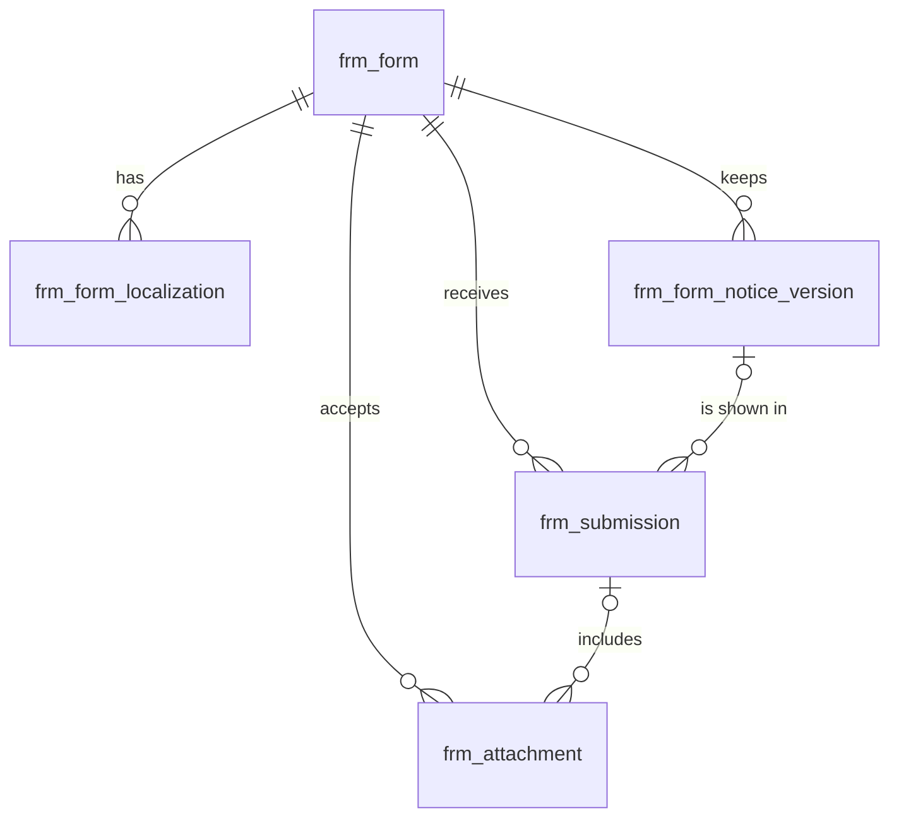

# 表单（form）模块设计

| 项 | 内容 |
|---|---|
| 模块 ID | `form` |
| 名称 | 表单 |
| 层 | L2 |
| 表前缀 | `frm_` |
| API 前缀 | `form` |
| 可停用 | 是 |
| 模块版本 | 1.0.0（module.json 的 version） |
| 平台版本 | `>=1.0.0 <2.0.0`（module.json 的 platform） |
| 里程碑切片 | M1：<…>；M2：<…>；M3：<…>；M4：<…>（详见第 13 节） |
| 模块负责人 | 待定 |
| 文档版本 | V1.0 |
| 状态 | 草案 |
| 更新日期 | 2026-10-14 |
| 依据 | 系统设计 V1.4 第 <…> 章；平台框架设计 V1.<x> 第 4 章 <…> 节；ADR-<…> |

> 本文只引用《平台框架设计》第 4 章中的契约，不定义新的跨模块契约；需要新契约时按平台框架设计 2.3 提出契约变更请求。

## 1. 职责与边界

### 1.1 职责

> 一段概述 + 要点列表；与系统设计 3.2 的职责描述一致，并细化到本模块的功能清单。

### 1.2 不负责的事

| 事项 | 归属模块 | 说明 |
|---|---|---|

### 1.3 协作概览

> 用图或表说明本模块与哪些模块协作、通过哪种方式（服务接口 / 事件 / 扩展点）。只画契约，不画实现。

### 1.4 适用的架构约束

> 列出与本模块直接相关的原则（P1–P8）、ADR 规则与 CLAUDE.md 禁止项，以及本模块如何满足。

## 2. 依赖与契约

### 2.1 module.json

```json
{
  "id": "<id>",
  "name": "<中文名称>",
  "version": "1.0.0",
  "layer": "L3",
  "platform": ">=1.0.0 <2.0.0",
  "requires": {},
  "optional": {},
  "disableable": true,
  "tablePrefix": "<前缀>_",
  "apiPrefix": "<id>",
  "permissions": [],
  "menus": [],
  "settings": null,
  "components": [],
  "events": { "publishes": [], "subscribes": [] }
}
```

> 完整描述符，须通过平台框架设计附录 A 的 Schema 与 A.3 的校验规则。

### 2.2 使用的服务接口

| 接口（平台框架设计小节） | 方法 | 用途 | 调用位置与时机（事务内 / 外） | 测试替身 |
|---|---|---|---|---|

### 2.3 提供的服务接口

| 接口（平台框架设计小节） | 方法 | 实现类 | 契约测试 | 说明（幂等、权限、性能目标） |
|---|---|---|---|---|

### 2.4 实现的扩展点

| 扩展点（平台框架设计小节） | 实现类 | 适用范围（内容类型 / 资源类型） | order | 收集方 |
|---|---|---|---|---|

### 2.5 收集的扩展点

| 扩展点 | 调用时机 | 过滤（站点启用状态、内容类型等） | 实现缺失或抛出异常时的行为 | 测试用示例实现 |
|---|---|---|---|---|

### 2.6 发布与订阅的事件

发布：

| 事件 | 触发时机（所在事务） | 关键字段 | 主要订阅方 |
|---|---|---|---|

订阅：

| 事件 | 处理 | 幂等方式 | 过期判断 | 失败与重试 |
|---|---|---|---|---|

### 2.7 使用的端口

| 端口 | 用途 | 测试替身 |
|---|---|---|

## 3. 领域模型

### 3.1 聚合、实体与值对象

| 类型 | 名称 | 说明 |
|---|---|---|
| 聚合根 | Form（`frm_form`） | 表单定义：key、用途、状态、字段定义（语言无关）、设置 |
| 实体 | FormLocalization（`frm_form_localization`） | 表单在一种语言下的文本：标签、提示语、选项名、成功提示语、隐私告知、营销同意文本、当前告知版本（站点资源本地化） |
| 实体 | NoticeVersion（`frm_form_notice_version`） | 某语言隐私告知与营销同意文本的一个版本（只追加），用于追溯访客当时看到的文本 |
| 聚合根 | Submission（`frm_submission`） | 一次提交：字段值、附件、归因、隐私字段（告知版本、营销同意、GPC、退出“出售 / 共享”）、反垃圾结果、IP 与 UA |
| 实体 | Attachment（`frm_attachment`） | 访客预上传的附件：临时 → 关联到提交；病毒扫描状态 |
| 聚合根 | BlocklistEntry（`frm_blocklist`） | 反垃圾黑名单条目：IP / 邮箱 / 域名 / 关键词 / 国家 |
| 值对象 | FieldDefinition | `{key, type, required, width, options, validation, defaultFrom}`；标准字段 key 映射到询盘（系统设计 17.1） |
| 值对象 | FormToken | 签名令牌（formKey、渲染时间、站点、会话随机数），不落库；附件以其会话随机数的哈希绑定会话 |
| 值对象 | SpamVerdict | `ACCEPT` / `QUARANTINE` / `REJECT` + 得分 + 命中规则 |
| 值对象 | Attribution | 落地页、referrer、UTM、点击 ID、首次与末次触达、浏览记录、设备（系统设计 17.9） |

在系统设计之外补充的字段：

| 补充 | 理由 |
|---|---|
| `frm_form.form_key`、`name`、`builtin`、`deleted_at` | 系统设计的 `key` 是 MySQL 关键字，改名 `form_key`（本文 2.2）；后台需要中文名称；模块安装时创建的默认表单不可删除；配置类实体软删除（本文 2.5） |
| `frm_form_localization.notice_hash` | 判断告知与营销同意文本是否真的变化：只有变化时才递增 `privacy_notice_version` 并追加历史，避免“保存但未修改”或译文回写相同文本时产生新版本 |
| `frm_form_notice_version.notice_version` | 系统设计 17.1 写作 `version`；本文中 `version` 统一表示乐观锁，因此改名 |
| `frm_submission.email_normalized` | 邮箱在 `payload` 中，数据主体请求“按邮箱跨站点查找”（系统设计 17.11）与同邮箱限流需要可索引的规范化列 |
| `frm_submission.content_id`、`download_media_id` | 提交所在页面（询盘明细与报表“按产品”）；DOWNLOAD 表单请求的文档（签发下载链接与 `download.link` 邮件，系统设计 8.4） |
| `frm_submission.spam_signals`、`is_test` | 命中的反垃圾规则与得分（复核与调参）；合成监控的测试提交（系统设计 27.4），inquiry 据此设置 `is_test` |
| `frm_submission.anonymized_at`、`updated_at`、`updated_by` | 提交在保留期满或数据主体删除请求后匿名化（系统设计 17.11），IP 30 天后置空，需要记录修改时间与操作人 |
| `frm_attachment` 的全部字段 | 系统设计只给出表名与“临时附件、扫描状态、过期时间”：补充存储键、文件信息、`upload_token_hash`（“校验附件属于本次会话”，系统设计 17.2）与扫描结果 |
| `frm_blocklist.expires_at`、`hits`、`last_hit_at`、`note` | 临时屏蔽、命中统计与备注，便于维护黑名单 |
| 告知版本外键 | `frm_submission (form_id, locale, privacy_notice_version)` 以复合外键指向 `frm_form_notice_version`：在数据库层保证每条提交都能追溯到当时展示的告知文本 |

### 3.2 不变量

| # | 规则 | 保证方式 |
|---|---|---|
| 1 | 站点内未删除表单的 `form_key` 唯一；创建后不可修改（布局文档、公开接口按 key 引用） | 数据库：`uk_form_key`；应用层 |
| 2 | 内置表单（`builtin = 1`）不能删除，可以停用；`DISABLED` 或已删除的表单不渲染、不接受提交与附件上传 | 应用层 |
| 3 | `fields` 中字段 key 唯一，格式 `^[a-z][a-z0-9_]{0,63}$`；用途为 INQUIRY / SAMPLE / DOWNLOAD / CONTACT 的表单必须包含必填的 `email` 字段；附件字段的数量与大小不超过设置（≤ 5 个、单个 ≤ 20 MB） | 应用层（保存时按 Schema 校验） |
| 4 | 每个表单每种语言最多一条本地化；中文行由编辑录入（`translation_state = 'NONE'`），其他语言行只由 translation 写入或在翻译编辑器中修订；某语言没有本地化行时，该语言下不渲染此表单（不跨语言回退） | 数据库：`uk_fl_form_locale`；应用层 |
| 5 | 同一（表单，语言）的告知或营销同意文本变化（`notice_hash` 不同）时，`privacy_notice_version` + 1，并在同一事务中追加一条 `frm_form_notice_version`；当前版本也有历史行；历史行只追加，不修改、不删除 | 数据库：`uk_fnv_version`、`fk_frm_fnv_form`（RESTRICT）；应用层 + 数据库账号授权 |
| 6 | 提交记录的（`form_id`，`locale`，`privacy_notice_version`）必须存在于告知版本历史中（表单没有告知文本时版本为空） | 数据库：`fk_frm_sub_notice` |
| 7 | `marketing_consent = 1` 当且仅当 `marketing_consent_at` 非空；营销同意框默认不勾选，不设强制勾选的同意框 | 数据库：`ck_frm_sub_consent`；应用层 |
| 8 | 提交写入后，字段值与判定结果不再修改；只允许：IP 30 天后置空、数据主体请求的更正与匿名化、附件删除 | 应用层 |
| 9 | `idempotency_key` 在站点内唯一；重复提交返回首次的结果 | 数据库：`uk_sub_idem` |
| 10 | 判定结果由得分与阈值决定（< 30 ACCEPT；30–70 QUARANTINE；> 70 REJECT，阈值可在设置中调整）；REJECT 也向访客返回成功；只有非 REJECT 的 DOWNLOAD 提交返回下载链接 | 应用层 |
| 11 | 附件：`TEMP` 有过期时间（上传后 24 小时）且未关联提交；`LINKED` 已关联提交且无过期时间；只能关联到同一表单、同一会话（`upload_token_hash` 一致）的提交；扫描结果为 `CLEAN` 之前员工不能下载 | 数据库：`ck_frm_att_status`；应用层 |
| 12 | 黑名单条目在（站点，类型）内按规范化值唯一 | 数据库：`uk_block_value`；应用层（规范化） |

### 3.3 状态机

<<FILL: 状态与转换；没有状态机时写“不适用：<原因>”>>

## 4. 数据模型

> 遵守平台框架设计第 7 章的数据库通用约定。DDL 已在 MySQL 8.4 上执行通过；表结构以本节为准，与迁移脚本保持一致。

### 4.1 表清单

| 表 | 说明 | 站点级 | 软删除 | 预估规模（单站，按系统设计假设 A4） |
|---|---|---|---|---|
| `frm_form` | 表单定义 | 是 | 是（`deleted_at`） | ≤ 50 行 |
| `frm_form_localization` | 表单文本（站点资源本地化） | 是 | 否（随表单） | ≤ 500 行（× 10 种语言） |
| `frm_form_notice_version` | 告知与营销同意文本的版本历史 | 是 | 否（只追加） | ≤ 5 千行 |
| `frm_submission` | 提交记录 | 是 | 否（保留期满匿名化；REJECT 30 天后物理删除） | ≤ 110 万行（≤ 1 千条 / 天 × 3 年） |
| `frm_attachment` | 表单附件 | 是 | 否 | ≈ 20 万行 |
| `frm_blocklist` | 反垃圾黑名单 | 是 | 否 | ≤ 5 千行 |

### 4.2 ER 图



`frm_blocklist` 与其他表无关系（按站点整体加载到内存使用），未画出。

### 4.3 表结构

#### 4.3.1 `frm_form`：表单定义

| 字段 | 类型 | 可空 | 默认 | 说明 |
|---|---|---|---|---|
| `id` | BIGINT | 否 | — | 主键（TSID） |
| `site_id` | BIGINT | 否 | — | 站点 ID（sys_site.id） |
| `form_key` | VARCHAR(64) bin | 否 | — | 表单 key（小写字母、数字、连字符；创建后不可修改；布局文档与公开接口按 key 引用），如 default-inquiry |
| `name` | VARCHAR(100) | 否 | — | 名称（中文，只在后台显示） |
| `purpose` | VARCHAR(16) | 否 | — | 用途：INQUIRY / SAMPLE / DOWNLOAD / CONTACT / CUSTOM（【V2+】NEWSLETTER） |
| `status` | VARCHAR(16) | 否 | `'ACTIVE'` | 状态：ACTIVE（接受提交）/ DISABLED（停用：前台不渲染，提交返回 404） |
| `fields` | JSON | 否 | `(JSON_ARRAY())` | 字段定义数组（语言无关）：[{key, type, required, width, options:[{value}], validation, defaultFrom}]；标签与提示语在本地化表 |
| `settings` | JSON | 否 | `(JSON_OBJECT('schemaVersion', 1))` | 设置（JSON，顶层带 schemaVersion）：反垃圾、附件、成功动作、是否显示营销同意框、常用国家、Turnstile |
| `builtin` | TINYINT(1) | 否 | `0` | 是否内置（模块安装时创建，不可删除，可停用） |
| `deleted_at` | DATETIME(3) | 是 | — | 删除时间（软删除） |
| `alive` | TINYINT | 是 | 生成列 `IF(deleted_at IS NULL, 1, NULL)` | 未删除标记（唯一索引用） |
| `version` | INT | 否 | `0` | 乐观锁版本号 |
| `created_at` | DATETIME(3) | 否 | `CURRENT_TIMESTAMP(3)` | 创建时间（UTC） |
| `created_by` | BIGINT | 否 | `0` | 创建人用户 ID（0 = 系统） |
| `updated_at` | DATETIME(3) | 否 | `CURRENT_TIMESTAMP(3) ON UPDATE CURRENT_TIMESTAMP(3)` | 更新时间（UTC） |
| `updated_by` | BIGINT | 否 | `0` | 更新人用户 ID（0 = 系统） |

索引与约束：
- `PRIMARY KEY (id)`
- `uk_form_key (site_id, form_key, alive)`：未删除的 key 唯一；公开接口与 Delivery 按 key 查找表单；站点的表单列表

```sql
CREATE TABLE frm_form (
  id          BIGINT        NOT NULL COMMENT '主键（TSID）',
  site_id     BIGINT        NOT NULL COMMENT '站点 ID（sys_site.id）',
  form_key    VARCHAR(64)   COLLATE utf8mb4_0900_bin NOT NULL COMMENT '表单 key（小写字母、数字、连字符；创建后不可修改；布局文档与公开接口按 key 引用），如 default-inquiry',
  name        VARCHAR(100)  NOT NULL COMMENT '名称（中文，只在后台显示）',
  purpose     VARCHAR(16)   NOT NULL COMMENT '用途：INQUIRY / SAMPLE / DOWNLOAD / CONTACT / CUSTOM（【V2+】NEWSLETTER）',
  status      VARCHAR(16)   NOT NULL DEFAULT 'ACTIVE' COMMENT '状态：ACTIVE（接受提交）/ DISABLED（停用：前台不渲染，提交返回 404）',
  fields      JSON          NOT NULL DEFAULT (JSON_ARRAY()) COMMENT '字段定义数组（语言无关）：[{key, type, required, width, options:[{value}], validation, defaultFrom}]；标签与提示语在本地化表',
  settings    JSON          NOT NULL DEFAULT (JSON_OBJECT('schemaVersion', 1)) COMMENT '设置（JSON，顶层带 schemaVersion）：反垃圾、附件、成功动作、是否显示营销同意框、常用国家、Turnstile',
  builtin     TINYINT(1)    NOT NULL DEFAULT 0 COMMENT '是否内置（模块安装时创建，不可删除，可停用）',
  deleted_at  DATETIME(3)   NULL COMMENT '删除时间（软删除）',
  alive       TINYINT       AS (IF(deleted_at IS NULL, 1, NULL)) STORED COMMENT '未删除标记（唯一索引用）',
  version     INT           NOT NULL DEFAULT 0 COMMENT '乐观锁版本号',
  created_at  DATETIME(3)   NOT NULL DEFAULT CURRENT_TIMESTAMP(3) COMMENT '创建时间（UTC）',
  created_by  BIGINT        NOT NULL DEFAULT 0 COMMENT '创建人用户 ID（0 = 系统）',
  updated_at  DATETIME(3)   NOT NULL DEFAULT CURRENT_TIMESTAMP(3) ON UPDATE CURRENT_TIMESTAMP(3) COMMENT '更新时间（UTC）',
  updated_by  BIGINT        NOT NULL DEFAULT 0 COMMENT '更新人用户 ID（0 = 系统）',
  PRIMARY KEY (id),
  UNIQUE KEY uk_form_key (site_id, form_key, alive)
) ENGINE = InnoDB DEFAULT CHARSET = utf8mb4 COLLATE = utf8mb4_0900_ai_ci COMMENT = '表单定义（字段与设置，语言无关）';
```

`fields` 示例（标签不在这里）：

```json
[
  { "key": "name",     "type": "TEXT",           "required": true,  "width": "half", "validation": { "maxLength": 100 } },
  { "key": "email",    "type": "EMAIL",          "required": true,  "width": "half" },
  { "key": "phone",    "type": "PHONE",          "required": false, "width": "half" },
  { "key": "country",  "type": "COUNTRY",        "required": true,  "width": "half", "defaultFrom": "IP_COUNTRY" },
  { "key": "products", "type": "PRODUCT_SELECT", "required": false },
  { "key": "message",  "type": "TEXTAREA",       "required": true,  "validation": { "maxLength": 5000 } },
  { "key": "files",    "type": "ATTACHMENT",     "required": false },
  { "key": "interest", "type": "SELECT",         "required": false, "options": [ { "value": "battery" }, { "value": "charger" } ] }
]
```

`settings` 示例：

```json
{
  "schemaVersion": 1,
  "antiSpam": { "turnstile": true, "honeypot": true, "minFillSeconds": 3, "quarantineScore": 30, "rejectScore": 70 },
  "attachments": { "maxFiles": 5, "maxSizeMb": 20, "allowedTypes": ["pdf", "jpg", "png", "dwg", "dxf", "step", "stp", "igs", "zip"] },
  "successAction": { "type": "REDIRECT", "contentId": "7201893453912345" },
  "showMarketingConsent": true,
  "preferredCountries": ["DE", "US", "GB", "FR"]
}
```

要点：
- 成功动作为 `REDIRECT` 时跳转到感谢页（`$content` 引用，`noindex`），不保存 URL；为 `MESSAGE` 时显示本地化的 `success_message`。
- 修改 `fields`、`settings` 或任一语言的文本后，需要失效嵌入该表单的页面缓存（见 4.6 的跨模块事项）。

#### 4.3.2 `frm_form_localization`：表单本地化

| 字段 | 类型 | 可空 | 默认 | 说明 |
|---|---|---|---|---|
| `id` | BIGINT | 否 | — | 主键（TSID） |
| `site_id` | BIGINT | 否 | — | 站点 ID（sys_site.id） |
| `form_id` | BIGINT | 否 | — | 表单 ID（frm_form.id） |
| `locale` | VARCHAR(16) | 否 | — | 语言（BCP 47） |
| `labels` | JSON | 否 | `(JSON_OBJECT())` | 界面文本：{"fields":{"<key>":{"label","placeholder","help","options":{"<value>":"…"}}},"submit":"…"} |
| `success_message` | VARCHAR(1000) | 是 | — | 成功提示语（成功动作为显示提示语时使用） |
| `privacy_notice_text` | JSON | 是 | — | 隐私告知（ProseMirror 行内 JSON；隐私政策链接为 content://{id}） |
| `marketing_consent_text` | JSON | 是 | — | 营销同意框文本（ProseMirror 行内 JSON）；表单不显示营销同意框时可为空 |
| `privacy_notice_version` | INT | 否 | `0` | 告知版本：告知或营销同意文本任一变化时 + 1；0 = 尚无告知文本 |
| `notice_hash` | CHAR(64) bin | 是 | — | 当前告知与营销同意文本规范化后拼接的 SHA-256；用于判断文本是否真的变化 |
| `translation_state` | VARCHAR(16) | 否 | `'NONE'` | 翻译状态：NONE / QUEUED / TRANSLATED / NEEDS_REVIEW / FAILED / OUTDATED |
| `source_fingerprint` | CHAR(64) bin | 是 | — | 生成本行译文时中文行的指纹（全部可翻译文本规范化后拼接的 SHA-256）；中文行为空；与当前中文指纹不同即为过期 |
| `version` | INT | 否 | `0` | 乐观锁版本号 |
| `created_at` | DATETIME(3) | 否 | `CURRENT_TIMESTAMP(3)` | 创建时间（UTC） |
| `created_by` | BIGINT | 否 | `0` | 创建人用户 ID（0 = 系统，如翻译回写） |
| `updated_at` | DATETIME(3) | 否 | `CURRENT_TIMESTAMP(3) ON UPDATE CURRENT_TIMESTAMP(3)` | 更新时间（UTC） |
| `updated_by` | BIGINT | 否 | `0` | 更新人用户 ID（0 = 系统） |

索引与约束：
- `PRIMARY KEY (id)`
- `uk_fl_form_locale (form_id, locale)`：每种语言一条；按（表单，语言）取前台渲染文本；兼作 `fk_frm_fl_form` 的索引
- `idx_fl_state (site_id, translation_state, locale)`：翻译中心列出待处理的表单文本
- `fk_frm_fl_form`：组合关系，`ON DELETE CASCADE`

```sql
CREATE TABLE frm_form_localization (
  id                      BIGINT         NOT NULL COMMENT '主键（TSID）',
  site_id                 BIGINT         NOT NULL COMMENT '站点 ID（sys_site.id）',
  form_id                 BIGINT         NOT NULL COMMENT '表单 ID（frm_form.id）',
  locale                  VARCHAR(16)    NOT NULL COMMENT '语言（BCP 47）',
  labels                  JSON           NOT NULL DEFAULT (JSON_OBJECT()) COMMENT '界面文本：{"fields":{"<key>":{"label","placeholder","help","options":{"<value>":"…"}}},"submit":"…"}',
  success_message         VARCHAR(1000)  NULL COMMENT '成功提示语（成功动作为显示提示语时使用）',
  privacy_notice_text     JSON           NULL COMMENT '隐私告知（ProseMirror 行内 JSON；隐私政策链接为 content://{id}）',
  marketing_consent_text  JSON           NULL COMMENT '营销同意框文本（ProseMirror 行内 JSON）；表单不显示营销同意框时可为空',
  privacy_notice_version  INT            NOT NULL DEFAULT 0 COMMENT '告知版本：告知或营销同意文本任一变化时 + 1；0 = 尚无告知文本',
  notice_hash             CHAR(64)       COLLATE utf8mb4_0900_bin NULL COMMENT '当前告知与营销同意文本规范化后拼接的 SHA-256；用于判断文本是否真的变化',
  translation_state       VARCHAR(16)    NOT NULL DEFAULT 'NONE' COMMENT '翻译状态：NONE / QUEUED / TRANSLATED / NEEDS_REVIEW / FAILED / OUTDATED',
  source_fingerprint      CHAR(64)       COLLATE utf8mb4_0900_bin NULL COMMENT '生成本行译文时中文行的指纹（全部可翻译文本规范化后拼接的 SHA-256）；中文行为空；与当前中文指纹不同即为过期',
  version                 INT            NOT NULL DEFAULT 0 COMMENT '乐观锁版本号',
  created_at              DATETIME(3)    NOT NULL DEFAULT CURRENT_TIMESTAMP(3) COMMENT '创建时间（UTC）',
  created_by              BIGINT         NOT NULL DEFAULT 0 COMMENT '创建人用户 ID（0 = 系统，如翻译回写）',
  updated_at              DATETIME(3)    NOT NULL DEFAULT CURRENT_TIMESTAMP(3) ON UPDATE CURRENT_TIMESTAMP(3) COMMENT '更新时间（UTC）',
  updated_by              BIGINT         NOT NULL DEFAULT 0 COMMENT '更新人用户 ID（0 = 系统）',
  PRIMARY KEY (id),
  UNIQUE KEY uk_fl_form_locale (form_id, locale),
  KEY idx_fl_state (site_id, translation_state, locale),
  CONSTRAINT fk_frm_fl_form FOREIGN KEY (form_id) REFERENCES frm_form (id) ON DELETE CASCADE
) ENGINE = InnoDB DEFAULT CHARSET = utf8mb4 COLLATE = utf8mb4_0900_ai_ci COMMENT = '表单文本的多语言版本（站点资源，带翻译状态与源指纹）';
```

要点：
- 翻译单元（资源类型 `form.form`，ID 为 `form_id`）：`labels` 中的每个字符串、`success_message`、`privacy_notice_text` 与 `marketing_consent_text`（`RICH_INLINE`，链接转为编号占位标签）。字段 key、选项 value、国家代码不翻译；国家名称由前台按语言用 ISO 列表显示。
- 中文行的文本变化时发布 `TranslatableResourceChangedEvent`；translation 回写目标语言行时，若告知或营销同意文本的译文变化，同样递增该语言的 `privacy_notice_version` 并追加历史（系统设计 17.1）。

#### 4.3.3 `frm_form_notice_version`：告知与营销同意文本版本

| 字段 | 类型 | 可空 | 默认 | 说明 |
|---|---|---|---|---|
| `id` | BIGINT | 否 | — | 主键（TSID） |
| `site_id` | BIGINT | 否 | — | 站点 ID（sys_site.id） |
| `form_id` | BIGINT | 否 | — | 表单 ID（frm_form.id） |
| `locale` | VARCHAR(16) | 否 | — | 语言（BCP 47） |
| `notice_version` | INT | 否 | — | 告知版本号（与 frm_form_localization.privacy_notice_version 对应，从 1 开始） |
| `privacy_notice_text` | JSON | 是 | — | 该版本的隐私告知（ProseMirror 行内 JSON） |
| `marketing_consent_text` | JSON | 是 | — | 该版本的营销同意框文本（ProseMirror 行内 JSON） |
| `notice_hash` | CHAR(64) bin | 否 | — | 两段文本规范化后拼接的 SHA-256 |
| `created_at` | DATETIME(3) | 否 | `CURRENT_TIMESTAMP(3)` | 版本生效时间（UTC） |
| `created_by` | BIGINT | 否 | `0` | 修改人用户 ID（0 = 系统，即机器译文回写） |

索引与约束：
- `PRIMARY KEY (id)`
- `uk_fnv_version (form_id, locale, notice_version)`：每个版本一行；追溯“提交时展示的文本”；被 `fk_frm_sub_notice` 引用；兼作 `fk_frm_fnv_form` 的索引
- `fk_frm_fnv_form`：引用关系（RESTRICT）：版本历史是同意证明，不随父行级联删除

```sql
CREATE TABLE frm_form_notice_version (
  id                      BIGINT       NOT NULL COMMENT '主键（TSID）',
  site_id                 BIGINT       NOT NULL COMMENT '站点 ID（sys_site.id）',
  form_id                 BIGINT       NOT NULL COMMENT '表单 ID（frm_form.id）',
  locale                  VARCHAR(16)  NOT NULL COMMENT '语言（BCP 47）',
  notice_version          INT          NOT NULL COMMENT '告知版本号（与 frm_form_localization.privacy_notice_version 对应，从 1 开始）',
  privacy_notice_text     JSON         NULL COMMENT '该版本的隐私告知（ProseMirror 行内 JSON）',
  marketing_consent_text  JSON         NULL COMMENT '该版本的营销同意框文本（ProseMirror 行内 JSON）',
  notice_hash             CHAR(64)     COLLATE utf8mb4_0900_bin NOT NULL COMMENT '两段文本规范化后拼接的 SHA-256',
  created_at              DATETIME(3)  NOT NULL DEFAULT CURRENT_TIMESTAMP(3) COMMENT '版本生效时间（UTC）',
  created_by              BIGINT       NOT NULL DEFAULT 0 COMMENT '修改人用户 ID（0 = 系统，即机器译文回写）',
  PRIMARY KEY (id),
  UNIQUE KEY uk_fnv_version (form_id, locale, notice_version),
  CONSTRAINT fk_frm_fnv_form FOREIGN KEY (form_id) REFERENCES frm_form (id)
) ENGINE = InnoDB DEFAULT CHARSET = utf8mb4 COLLATE = utf8mb4_0900_ai_ci COMMENT = '隐私告知与营销同意文本的版本历史（只追加，用于追溯同意文本）';
```

要点：只追加；保留到引用该版本的最后一条提交与询盘被清理之后（由保留期任务检查，见第 22 章）。

#### 4.3.4 `frm_submission`：提交记录

| 字段 | 类型 | 可空 | 默认 | 说明 |
|---|---|---|---|---|
| `id` | BIGINT | 否 | — | 主键（TSID） |
| `site_id` | BIGINT | 否 | — | 站点 ID（sys_site.id） |
| `form_id` | BIGINT | 否 | — | 表单 ID（frm_form.id） |
| `locale` | VARCHAR(16) | 否 | — | 提交时页面的语言（客户自动回复使用该语言） |
| `payload` | JSON | 否 | — | 字段值：{"<fieldKey>": 值}；电话为 E.164，国家为 ISO 3166-1 alpha-2，产品选择为 [{"contentId","modelId","quantity"}] |
| `email_normalized` | VARCHAR(254) | 是 | — | 标准字段 email 的小写规范化值（数据主体请求查找、同邮箱限流与去重） |
| `attachment_ids` | JSON | 否 | `(JSON_ARRAY())` | 附件 ID 数组（frm_attachment.id，字符串），按上传顺序 |
| `attribution` | JSON | 是 | — | 来源归因：landingUrl、referrer、utm、clickIds、firstTouch、lastTouch、viewedContentIds、device（已校验与截断） |
| `content_id` | BIGINT | 是 | — | 提交所在页面的内容 ID（cnt_content.id）；无法确定时为空 |
| `download_media_id` | BIGINT | 是 | — | DOWNLOAD 表单请求下载的文档（mda_media.id） |
| `privacy_notice_version` | INT | 是 | — | 提交时展示的告知版本（与 form_id、locale 一起指向 frm_form_notice_version）；表单没有告知文本时为空 |
| `marketing_consent` | TINYINT(1) | 否 | `0` | 是否勾选营销同意（默认不勾选） |
| `marketing_consent_at` | DATETIME(3) | 是 | — | 营销同意时间（勾选时为服务器接收时间） |
| `gpc` | TINYINT(1) | 否 | `0` | 提交时浏览器是否发出 Global Privacy Control 信号 |
| `opt_out_sale_share` | TINYINT(1) | 否 | `0` | 访客是否已退出“出售 / 共享”（含 GPC） |
| `spam_score` | SMALLINT | 否 | `0` | 反垃圾加权得分（< 30 ACCEPT；30–70 QUARANTINE；> 70 REJECT，阈值可配置） |
| `spam_verdict` | VARCHAR(16) | 否 | — | 判定：ACCEPT / QUARANTINE / REJECT |
| `spam_signals` | JSON | 是 | — | 命中的反垃圾规则与得分，如 [{"rule":"LINK_COUNT","score":20}] |
| `is_test` | TINYINT(1) | 否 | `0` | 是否测试提交（合成监控；不计入报表，通知发到运维邮箱） |
| `ip` | VARCHAR(45) | 是 | — | 客户端 IP（反欺诈；30 天后置空） |
| `ip_country` | CHAR(2) | 是 | — | IP 所在国家（本地 GeoIP 解析，ISO 3166-1 alpha-2） |
| `user_agent` | VARCHAR(500) | 是 | — | User-Agent（截断到 500 个字符） |
| `idempotency_key` | VARCHAR(64) bin | 是 | — | 请求头 Idempotency-Key（站点内唯一；重复提交返回首次结果） |
| `anonymized_at` | DATETIME(3) | 是 | — | 匿名化时间（保留期满或数据主体删除请求） |
| `created_at` | DATETIME(3) | 否 | `CURRENT_TIMESTAMP(3)` | 提交时间（UTC，服务器接收时间） |
| `updated_at` | DATETIME(3) | 否 | `CURRENT_TIMESTAMP(3) ON UPDATE CURRENT_TIMESTAMP(3)` | 更新时间（UTC；IP 置空、更正、匿名化） |
| `updated_by` | BIGINT | 否 | `0` | 更新人用户 ID（0 = 系统） |

索引与约束：
- `PRIMARY KEY (id)`：inquiry 收到 `FormSubmittedEvent` 后按 ID 读取
- `uk_sub_idem (site_id, idempotency_key)`：幂等提交
- `idx_sub_form (form_id, created_at)`：某表单的提交列表（后台，按时间倒序）；兼作 `fk_frm_sub_form` 的索引
- `idx_sub_notice (form_id, locale, privacy_notice_version)`：`fk_frm_sub_notice` 的索引；查找使用某告知版本的提交（版本历史清理前检查）
- `idx_sub_list (site_id, created_at)`：站点全部提交列表；保留期任务（IP 30 天置空、保留期满匿名化）
- `idx_sub_verdict (site_id, spam_verdict, created_at)`：待审（QUARANTINE）列表；REJECT 30 天后清除
- `idx_sub_email (email_normalized)`：数据主体请求按邮箱跨站点查找（系统管理接口）；同邮箱去重
- `fk_frm_sub_form`：引用关系（RESTRICT）
- `fk_frm_sub_notice`：引用关系（RESTRICT），见 3.2 不变量 6
- `ck_frm_sub_consent`：见 3.2 不变量 7

```sql
CREATE TABLE frm_submission (
  id                      BIGINT         NOT NULL COMMENT '主键（TSID）',
  site_id                 BIGINT         NOT NULL COMMENT '站点 ID（sys_site.id）',
  form_id                 BIGINT         NOT NULL COMMENT '表单 ID（frm_form.id）',
  locale                  VARCHAR(16)    NOT NULL COMMENT '提交时页面的语言（客户自动回复使用该语言）',
  payload                 JSON           NOT NULL COMMENT '字段值：{"<fieldKey>": 值}；电话为 E.164，国家为 ISO 3166-1 alpha-2，产品选择为 [{"contentId","modelId","quantity"}]',
  email_normalized        VARCHAR(254)   NULL COMMENT '标准字段 email 的小写规范化值（数据主体请求查找、同邮箱限流与去重）',
  attachment_ids          JSON           NOT NULL DEFAULT (JSON_ARRAY()) COMMENT '附件 ID 数组（frm_attachment.id，字符串），按上传顺序',
  attribution             JSON           NULL COMMENT '来源归因：landingUrl、referrer、utm、clickIds、firstTouch、lastTouch、viewedContentIds、device（已校验与截断）',
  content_id              BIGINT         NULL COMMENT '提交所在页面的内容 ID（cnt_content.id）；无法确定时为空',
  download_media_id       BIGINT         NULL COMMENT 'DOWNLOAD 表单请求下载的文档（mda_media.id）',
  privacy_notice_version  INT            NULL COMMENT '提交时展示的告知版本（与 form_id、locale 一起指向 frm_form_notice_version）；表单没有告知文本时为空',
  marketing_consent       TINYINT(1)     NOT NULL DEFAULT 0 COMMENT '是否勾选营销同意（默认不勾选）',
  marketing_consent_at    DATETIME(3)    NULL COMMENT '营销同意时间（勾选时为服务器接收时间）',
  gpc                     TINYINT(1)     NOT NULL DEFAULT 0 COMMENT '提交时浏览器是否发出 Global Privacy Control 信号',
  opt_out_sale_share      TINYINT(1)     NOT NULL DEFAULT 0 COMMENT '访客是否已退出“出售 / 共享”（含 GPC）',
  spam_score              SMALLINT       NOT NULL DEFAULT 0 COMMENT '反垃圾加权得分（< 30 ACCEPT；30–70 QUARANTINE；> 70 REJECT，阈值可配置）',
  spam_verdict            VARCHAR(16)    NOT NULL COMMENT '判定：ACCEPT / QUARANTINE / REJECT',
  spam_signals            JSON           NULL COMMENT '命中的反垃圾规则与得分，如 [{"rule":"LINK_COUNT","score":20}]',
  is_test                 TINYINT(1)     NOT NULL DEFAULT 0 COMMENT '是否测试提交（合成监控；不计入报表，通知发到运维邮箱）',
  ip                      VARCHAR(45)    NULL COMMENT '客户端 IP（反欺诈；30 天后置空）',
  ip_country              CHAR(2)        NULL COMMENT 'IP 所在国家（本地 GeoIP 解析，ISO 3166-1 alpha-2）',
  user_agent              VARCHAR(500)   NULL COMMENT 'User-Agent（截断到 500 个字符）',
  idempotency_key         VARCHAR(64)    COLLATE utf8mb4_0900_bin NULL COMMENT '请求头 Idempotency-Key（站点内唯一；重复提交返回首次结果）',
  anonymized_at           DATETIME(3)    NULL COMMENT '匿名化时间（保留期满或数据主体删除请求）',
  created_at              DATETIME(3)    NOT NULL DEFAULT CURRENT_TIMESTAMP(3) COMMENT '提交时间（UTC，服务器接收时间）',
  updated_at              DATETIME(3)    NOT NULL DEFAULT CURRENT_TIMESTAMP(3) ON UPDATE CURRENT_TIMESTAMP(3) COMMENT '更新时间（UTC；IP 置空、更正、匿名化）',
  updated_by              BIGINT         NOT NULL DEFAULT 0 COMMENT '更新人用户 ID（0 = 系统）',
  PRIMARY KEY (id),
  UNIQUE KEY uk_sub_idem (site_id, idempotency_key),
  KEY idx_sub_form (form_id, created_at),
  KEY idx_sub_notice (form_id, locale, privacy_notice_version),
  KEY idx_sub_list (site_id, created_at),
  KEY idx_sub_verdict (site_id, spam_verdict, created_at),
  KEY idx_sub_email (email_normalized),
  CONSTRAINT fk_frm_sub_form FOREIGN KEY (form_id) REFERENCES frm_form (id),
  CONSTRAINT fk_frm_sub_notice FOREIGN KEY (form_id, locale, privacy_notice_version) REFERENCES frm_form_notice_version (form_id, locale, notice_version),
  CONSTRAINT ck_frm_sub_consent CHECK ((marketing_consent = 0 AND marketing_consent_at IS NULL) OR (marketing_consent = 1 AND marketing_consent_at IS NOT NULL))
) ENGINE = InnoDB DEFAULT CHARSET = utf8mb4 COLLATE = utf8mb4_0900_ai_ci COMMENT = '表单提交记录（含隐私字段与反垃圾结果）';
```

要点：
- 提交流程见系统设计 17.2：限流 → Turnstile、formToken、honeypot、最短填写时间 → 字段校验与附件归属校验 → 反垃圾评分 → 在同一事务中写入本表、把附件改为 `LINKED`、发布 `FormSubmittedEvent`。
- `payload` 只保存表单定义中的字段（honeypot 与 Turnstile 令牌不保存）；字段之后被删除时，后台按 key 显示旧值。
- inquiry 创建线索时从本表复制联系字段、归因与隐私字段（`privacy_notice_version`、`marketing_consent`、`marketing_consent_at`、`gpc`、`opt_out_sale_share`、`ip_country`、`is_test`）到 `inq_inquiry`。
- 保留期（系统设计 17.11）：REJECT 30 天后物理删除（附件随之删除）；`ip` 30 天后置空；其余与询盘一致（默认 3 年）后匿名化：`payload` 中的联系字段替换为占位值、`email_normalized`、`ip`、`user_agent` 置空、附件删除，记录 `anonymized_at`。

#### 4.3.5 `frm_attachment`：表单附件

| 字段 | 类型 | 可空 | 默认 | 说明 |
|---|---|---|---|---|
| `id` | BIGINT | 否 | — | 主键（TSID） |
| `site_id` | BIGINT | 否 | — | 站点 ID（sys_site.id） |
| `form_id` | BIGINT | 否 | — | 表单 ID（frm_form.id；上传时 formToken 中的表单） |
| `submission_id` | BIGINT | 是 | — | 所属提交（frm_submission.id）；临时附件为空 |
| `status` | VARCHAR(16) | 否 | `'TEMP'` | 状态：TEMP（已上传，未关联提交）/ LINKED（已关联提交） |
| `storage_key` | VARCHAR(500) bin | 否 | — | 私有桶对象键：{siteId}/form/{yyyy}/{mm}/{id}.{ext} |
| `original_name` | VARCHAR(255) | 否 | — | 原文件名（下载时用于 Content-Disposition） |
| `mime` | VARCHAR(127) | 否 | — | MIME 类型（Tika 按文件头识别，小写） |
| `size` | BIGINT | 否 | — | 文件大小（字节，≤ 20 MB） |
| `sha256` | CHAR(64) bin | 否 | — | 文件内容 SHA-256（十六进制小写） |
| `upload_token_hash` | CHAR(64) bin | 否 | — | 上传时 formToken 中会话随机数的 SHA-256；提交时校验附件属于本次会话 |
| `scan_status` | VARCHAR(16) | 否 | `'PENDING'` | 病毒扫描状态：PENDING / CLEAN / INFECTED / ERROR |
| `scan_result` | VARCHAR(200) | 是 | — | 扫描结果：INFECTED 时为病毒特征名，ERROR 时为错误摘要 |
| `scanned_at` | DATETIME(3) | 是 | — | 扫描完成时间 |
| `expires_at` | DATETIME(3) | 是 | — | 过期时间：TEMP 为上传后 24 小时，到期未关联则删除；LINKED 为空（随提交保留） |
| `created_at` | DATETIME(3) | 否 | `CURRENT_TIMESTAMP(3)` | 上传时间（UTC） |
| `updated_at` | DATETIME(3) | 否 | `CURRENT_TIMESTAMP(3) ON UPDATE CURRENT_TIMESTAMP(3)` | 更新时间（UTC） |

索引与约束：
- `PRIMARY KEY (id)`
- `uk_att_storage_key (storage_key)`：存储键唯一
- `idx_att_form (form_id)`：`fk_frm_att_form` 的索引
- `idx_att_submission (submission_id)`：提交详情的附件列表；兼作 `fk_frm_att_sub` 的索引
- `idx_att_expire (status, expires_at)`：清理任务删除过期的 `TEMP` 附件（`TEMP` 行很少，选择性高）
- `idx_att_scan (scan_status, created_at)`：扫描任务重试 `PENDING` / `ERROR` 的附件
- `fk_frm_att_form`：引用关系（RESTRICT）
- `fk_frm_att_sub`：组合关系，`ON DELETE CASCADE`（应用层先删除对象存储中的文件）
- `ck_frm_att_status`：见 3.2 不变量 11（`submission_id` 与状态的一致性由应用层保证：MySQL 不允许 CHECK 引用带级联动作的外键列）

```sql
CREATE TABLE frm_attachment (
  id                 BIGINT        NOT NULL COMMENT '主键（TSID）',
  site_id            BIGINT        NOT NULL COMMENT '站点 ID（sys_site.id）',
  form_id            BIGINT        NOT NULL COMMENT '表单 ID（frm_form.id；上传时 formToken 中的表单）',
  submission_id      BIGINT        NULL COMMENT '所属提交（frm_submission.id）；临时附件为空',
  status             VARCHAR(16)   NOT NULL DEFAULT 'TEMP' COMMENT '状态：TEMP（已上传，未关联提交）/ LINKED（已关联提交）',
  storage_key        VARCHAR(500)  COLLATE utf8mb4_0900_bin NOT NULL COMMENT '私有桶对象键：{siteId}/form/{yyyy}/{mm}/{id}.{ext}',
  original_name      VARCHAR(255)  NOT NULL COMMENT '原文件名（下载时用于 Content-Disposition）',
  mime               VARCHAR(127)  NOT NULL COMMENT 'MIME 类型（Tika 按文件头识别，小写）',
  size               BIGINT        NOT NULL COMMENT '文件大小（字节，≤ 20 MB）',
  sha256             CHAR(64)      COLLATE utf8mb4_0900_bin NOT NULL COMMENT '文件内容 SHA-256（十六进制小写）',
  upload_token_hash  CHAR(64)      COLLATE utf8mb4_0900_bin NOT NULL COMMENT '上传时 formToken 中会话随机数的 SHA-256；提交时校验附件属于本次会话',
  scan_status        VARCHAR(16)   NOT NULL DEFAULT 'PENDING' COMMENT '病毒扫描状态：PENDING / CLEAN / INFECTED / ERROR',
  scan_result        VARCHAR(200)  NULL COMMENT '扫描结果：INFECTED 时为病毒特征名，ERROR 时为错误摘要',
  scanned_at         DATETIME(3)   NULL COMMENT '扫描完成时间',
  expires_at         DATETIME(3)   NULL COMMENT '过期时间：TEMP 为上传后 24 小时，到期未关联则删除；LINKED 为空（随提交保留）',
  created_at         DATETIME(3)   NOT NULL DEFAULT CURRENT_TIMESTAMP(3) COMMENT '上传时间（UTC）',
  updated_at         DATETIME(3)   NOT NULL DEFAULT CURRENT_TIMESTAMP(3) ON UPDATE CURRENT_TIMESTAMP(3) COMMENT '更新时间（UTC）',
  PRIMARY KEY (id),
  UNIQUE KEY uk_att_storage_key (storage_key),
  KEY idx_att_form (form_id),
  KEY idx_att_submission (submission_id),
  KEY idx_att_expire (status, expires_at),
  KEY idx_att_scan (scan_status, created_at),
  CONSTRAINT fk_frm_att_form FOREIGN KEY (form_id) REFERENCES frm_form (id),
  CONSTRAINT fk_frm_att_sub FOREIGN KEY (submission_id) REFERENCES frm_submission (id) ON DELETE CASCADE,
  CONSTRAINT ck_frm_att_status CHECK ((status = 'TEMP' AND expires_at IS NOT NULL) OR (status = 'LINKED' AND expires_at IS NULL))
) ENGINE = InnoDB DEFAULT CHARSET = utf8mb4 COLLATE = utf8mb4_0900_ai_ci COMMENT = '表单附件（私有桶；临时附件 24 小时未关联则清除）';
```

要点：
- 附件不进入媒体库：它们是访客上传的个人数据，随提交保留与删除。inquiry 通过 `FormApi` 按 `submission_id` 读取附件清单与预签名下载链接（员工下载记录审计日志），不复制文件。
- 扫描结果为 `INFECTED` 的附件：提交照常保存，附件不可下载，后台标记“已隔离”；`spam_signals` 记录该情况。

#### 4.3.6 `frm_blocklist`：反垃圾黑名单

| 字段 | 类型 | 可空 | 默认 | 说明 |
|---|---|---|---|---|
| `id` | BIGINT | 否 | — | 主键（TSID） |
| `site_id` | BIGINT | 否 | — | 站点 ID（sys_site.id） |
| `type` | VARCHAR(16) | 否 | — | 类型：IP / EMAIL / DOMAIN / KEYWORD / COUNTRY |
| `value` | VARCHAR(255) bin | 否 | — | 规范化后的值：IP 或 CIDR（如 203.0.113.0/24）；小写邮箱；小写域名（含子域名）；小写关键词；大写国家代码（ISO 3166-1 alpha-2） |
| `note` | VARCHAR(500) | 是 | — | 备注（加入原因） |
| `expires_at` | DATETIME(3) | 是 | — | 到期时间（临时屏蔽）；空 = 长期有效 |
| `hits` | BIGINT | 否 | `0` | 命中次数 |
| `last_hit_at` | DATETIME(3) | 是 | — | 最近命中时间 |
| `version` | INT | 否 | `0` | 乐观锁版本号 |
| `created_at` | DATETIME(3) | 否 | `CURRENT_TIMESTAMP(3)` | 创建时间（UTC） |
| `created_by` | BIGINT | 否 | `0` | 创建人用户 ID（0 = 系统） |
| `updated_at` | DATETIME(3) | 否 | `CURRENT_TIMESTAMP(3) ON UPDATE CURRENT_TIMESTAMP(3)` | 更新时间（UTC） |
| `updated_by` | BIGINT | 否 | `0` | 更新人用户 ID（0 = 系统） |

索引与约束：
- `PRIMARY KEY (id)`
- `uk_block_value (site_id, type, value)`：同类条目不重复；按类型列出与加载站点的全部条目

```sql
CREATE TABLE frm_blocklist (
  id           BIGINT        NOT NULL COMMENT '主键（TSID）',
  site_id      BIGINT        NOT NULL COMMENT '站点 ID（sys_site.id）',
  type         VARCHAR(16)   NOT NULL COMMENT '类型：IP / EMAIL / DOMAIN / KEYWORD / COUNTRY',
  value        VARCHAR(255)  COLLATE utf8mb4_0900_bin NOT NULL COMMENT '规范化后的值：IP 或 CIDR（如 203.0.113.0/24）；小写邮箱；小写域名（含子域名）；小写关键词；大写国家代码（ISO 3166-1 alpha-2）',
  note         VARCHAR(500)  NULL COMMENT '备注（加入原因）',
  expires_at   DATETIME(3)   NULL COMMENT '到期时间（临时屏蔽）；空 = 长期有效',
  hits         BIGINT        NOT NULL DEFAULT 0 COMMENT '命中次数',
  last_hit_at  DATETIME(3)   NULL COMMENT '最近命中时间',
  version      INT           NOT NULL DEFAULT 0 COMMENT '乐观锁版本号',
  created_at   DATETIME(3)   NOT NULL DEFAULT CURRENT_TIMESTAMP(3) COMMENT '创建时间（UTC）',
  created_by   BIGINT        NOT NULL DEFAULT 0 COMMENT '创建人用户 ID（0 = 系统）',
  updated_at   DATETIME(3)   NOT NULL DEFAULT CURRENT_TIMESTAMP(3) ON UPDATE CURRENT_TIMESTAMP(3) COMMENT '更新时间（UTC）',
  updated_by   BIGINT        NOT NULL DEFAULT 0 COMMENT '更新人用户 ID（0 = 系统）',
  PRIMARY KEY (id),
  UNIQUE KEY uk_block_value (site_id, type, value)
) ENGINE = InnoDB DEFAULT CHARSET = utf8mb4 COLLATE = utf8mb4_0900_ai_ci COMMENT = '反垃圾黑名单（IP / 邮箱 / 域名 / 关键词 / 国家）';
```

要点：条目数量小，按站点整体加载到应用缓存中匹配（CIDR、子域名、关键词不适合在 SQL 中匹配），修改后广播失效；命中计数异步批量累加。垃圾词库与一次性邮箱域名库是随版本发布的资源文件，不在本表中。

### 4.4 枚举

| 字段 | 取值 | 说明 |
|---|---|---|
| `frm_form.purpose` | `INQUIRY` / `SAMPLE` / `DOWNLOAD` / `CONTACT` / `CUSTOM` | 共享枚举（【V2+】`NEWSLETTER`）；前四种由 inquiry 转为同名询盘类型，`CUSTOM` 只保存提交 |
| `frm_form.status` | `ACTIVE` / `DISABLED` | 接受提交 / 停用 |
| `frm_form.fields[].type` | `TEXT` / `EMAIL` / `PHONE` / `TEXTAREA` / `SELECT` / `MULTI_SELECT` / `COUNTRY` / `NUMBER` / `CHECKBOX` / `ATTACHMENT` / `HIDDEN` / `PRODUCT_SELECT` | 文本、邮箱、电话（libphonenumber 校验，E.164）、多行文本、单选、多选、国家、数字、勾选、附件、隐藏字段（上下文）、产品选择（系统设计 17.1） |
| `frm_form.fields[].key`（标准字段） | `name` / `email` / `phone` / `company` / `country` / `job_title` / `message` / `quantity` / `website` | 映射到询盘联系字段（系统设计 17.1） |
| `frm_form.fields[].defaultFrom` | `IP_COUNTRY` / `CONTEXT` / `INQUIRY_CART` | 国家按 IP 预选 / 隐藏字段取页面上下文 / 产品选择取询价篮 |
| `frm_form.settings.successAction.type` | `MESSAGE` / `REDIRECT` | 显示提示语 / 跳转到感谢页（`noindex`） |
| `frm_*_localization.translation_state` | `NONE` / `QUEUED` / `TRANSLATED` / `NEEDS_REVIEW` / `FAILED` / `OUTDATED` | 共享翻译状态枚举；中文行为 `NONE` |
| `frm_submission.spam_verdict` | `ACCEPT` / `QUARANTINE` / `REJECT` | 共享枚举：接受 / 待审（不发通知）/ 拒绝（仍返回成功，30 天后清除） |
| `frm_attachment.status` | `TEMP` / `LINKED` | 临时 / 已关联提交 |
| `frm_attachment.scan_status` | `PENDING` / `CLEAN` / `INFECTED` / `ERROR` | 待扫描 / 通过 / 发现威胁（不可下载）/ 扫描出错（任务重试） |
| `frm_blocklist.type` | `IP` / `EMAIL` / `DOMAIN` / `KEYWORD` / `COUNTRY` | IP 或网段 / 邮箱 / 邮箱域名（含子域名）/ 内容关键词 / 国家屏蔽（可选） |

### 4.5 站点过滤

<<FILL: | 表 | 行级拦截器（不豁免 / 豁免） | 访问方式与理由 |>>

### 4.6 跨模块引用与清理

**本模块引用其他模块的对象**：

| 本模块字段 | 引用对象（模块.表） | 被引用对象删除 / 下线时的处理 | 触发事件 |
|---|---|---|---|
| `frm_form.settings.successAction.contentId`、告知文本中的 `content://{id}` | content.`cnt_content`（感谢页、隐私政策页） | 目标下线：成功动作降级为显示提示语，链接降级为纯文本；彻底删除：清除设置中的 ID 并在后台提示 | `ContentUnpublishedEvent`、`ContentPurgedEvent` |
| `frm_submission.content_id`、`payload` 中产品选择的 `contentId` / `modelId` | content.`cnt_content`、product.`prd_model` | 历史记录，不清理（询盘明细保存快照） | — |
| `frm_submission.download_media_id` | media.`mda_media` | 历史记录，不清理 | — |
| `frm_*_localization.locale`、`frm_submission.locale` | core.`sys_site_locale` | V1 不删除站点语言，无需清理 | `SiteSettingsChangedEvent` |
| `created_by`、`updated_by` | core.`sys_user` | 不清理 | — |

**其他模块引用本模块的对象**（其他章节需配合）：

| 被引用对象 | 引用方 | 本模块对象变化时的处理 | 事件 |
|---|---|---|---|
| `frm_submission.id` | inquiry.`inq_inquiry.submission_id` | inquiry 收到事件后经 `FormApi` 读取提交与附件；提交的保留期与询盘一致，匿名化由各自的 `PersonalDataProvider` 执行 | `FormSubmittedEvent` |
| `frm_form.form_key` | page（布局文档中 `inquiry-form` 组件的 `formKey`）、product（留资文档指定的表单） | key 不可修改；表单停用或删除后组件不渲染；删除前列出引用位置（`pg_component_usage`） | — |
| `frm_submission`、`frm_attachment` 中的个人数据 | core（数据主体请求工具） | form 实现 `PersonalDataProvider`：按 `email_normalized` 查找、导出、更正、匿名化 | — |

本模块发布的事件：`FormSubmittedEvent`、`TranslatableResourceChangedEvent`（资源类型 `form.form`）。订阅：`ContentUnpublishedEvent`、`ContentPurgedEvent`（成功动作与告知链接的目标）。

---

### 4.7 迁移脚本

| 文件 | 内容 | 里程碑 |
|---|---|---|
| `db/migration/form/V001__init.sql` | 4.3 中的全部表（6 张：`frm_form`、`frm_form_localization`、`frm_form_notice_version`、`frm_submission`、`frm_attachment`、`frm_blocklist`），按本节顺序创建 | <见第 13 节> |

## 5. 业务流程

### 5.1 <流程名称>

```text
<步骤；标出事务边界、调用的服务接口、发布的事件、异步部分>
```

| 步骤 | 说明 | 失败处理 |
|---|---|---|

## 6. 接口

### 6.1 Admin 端点

| 方法 | 路径（/api/admin/v1/<apiPrefix>/…） | 说明 | 权限码 | 并发控制 / 幂等 | 审计 |
|---|---|---|---|---|---|

### 6.2 Public 端点

| 方法 | 路径（/api/public/v1/<apiPrefix>/…） | 说明 | 限流 | 缓存 |
|---|---|---|---|---|

### 6.3 Internal 端点

| 方法 | 路径（/api/internal/v1/<apiPrefix>/…） | 说明 | 调用方 |
|---|---|---|---|

### 6.4 权限码

| 权限码 | 名称 | 数据范围 | 高危（sensitive） | 受语言范围限制（localeScoped） |
|---|---|---|---|---|

### 6.5 错误码

| 错误码 | HTTP 状态 | 后台中文信息 | 前台文案键（仅公开接口） |
|---|---|---|---|

## 7. 后台界面

### 7.1 菜单与路由

| 菜单 key | 名称 | 父菜单 | 路由 | 权限码 |
|---|---|---|---|---|

### 7.2 页面

| 页面 | 路由 | 主要功能 | 使用的 admin-kit 组件 |
|---|---|---|---|

### 7.3 注册到内容编辑外壳的标签

| key | 适用内容类型 | 权限码 | 组件 |
|---|---|---|---|

### 7.4 界面文案

> texts.ts 中的分组与关键文案；后台只用简体中文。

## 8. 前台组件与模板

> 没有前台组件时写“不适用”。

### 8.1 组件

| 组件类型 | 名称（label） | 变体 | 分类 | allowedIn | 数据源 | 是否水合 |
|---|---|---|---|---|---|---|

### 8.2 属性与翻译

| 组件 | 属性 | 类型 / x-editor | x-translatable | maxLength |
|---|---|---|---|---|

### 8.3 模板

| 模板 key | 内容类型 | 固定区域与插槽 |
|---|---|---|

### 8.4 数据源

| key | 参数 | 返回 | 缓存标签 |
|---|---|---|---|

### 8.5 文案键

| 文案键 | 默认中文文案 | 使用位置 |
|---|---|---|

## 9. 配置项

### 9.1 站点设置（settings.schema.json）

| 键 | 类型 | 默认值 | 说明 | 敏感（x-secret） |
|---|---|---|---|---|

### 9.2 部署配置（application.yml，前缀 b2bweb.<id>）

| 属性 | 默认值 | 说明 |
|---|---|---|

## 10. 定时与异步任务

> 没有时写“不适用”。定时任务实现 `ScheduledTask`，通用异步任务实现 `JobHandler`（平台框架设计 4.4.12）；锁名与任务类型按平台框架设计 3.7 命名。事件监听器已在 2.6 中列出，这里只补充耗时长、需要单独调度或重试的处理。`PER_SITE` 任务由 core 在站点上下文中逐站点执行，停用了本模块的站点自动跳过（系统设计 3.8）。外部服务（AI 引擎、邮件、CDN）只在事务提交后的异步处理中调用，失败不回滚已提交的业务数据（ADR-003、ADR-017）。

| 任务 | 类型（定时 / sys_job / 事件监听） | 触发 | 锁名 | 幂等与重试 | 模块停用时 |
|---|---|---|---|---|---|

> 每个任务另写：执行粒度（`PER_SITE` / 系统级）、单次处理量与分批方式、超时、能否取消、失败后的可见结果（`sys_job` 的失败报告、指标 `b2bweb.<id>.*` 或告警）。

## 11. 测试要点

> 测试层级、替身与契约测试的写法见平台框架设计第 9 章，门禁与覆盖率见第 10 章。“至少”后的用例为必测项；不适用的行写“不适用：<原因>”，不得删除。

| 层级 | 覆盖内容 | 关键用例 |
|---|---|---|
| 单元 | <领域对象、不变量（3.2）、状态机（3.3）、扩展点实现（2.4）> | 至少：3.2 每条不变量的违反用例；3.3 每个非法状态转换被拒绝 |
| 模块集成（Testcontainers + 替身） | <应用服务 + 本模块的表与迁移> | 至少：迁移脚本在空库（MySQL 8.4）上执行通过；6.1 中声明的并发控制与幂等；唯一约束冲突转为 6.5 的错误码 |
| 契约（作为提供方） | <2.3 中本模块提供的服务接口> | 继承 testkit 中的 `<接口名>ContractTest`，用真实实现运行；不提供服务接口时写“不适用” |
| 事件（Scenario API，含重复投递） | <2.6 中发布与订阅的事件> | 至少：事件在业务事务内发布、事务回滚时不发布；每个监听器重复投递只生效一次、过期事件被丢弃（ADR-003） |
| 停用行为（可停用模块） | <系统设计 3.8 的各项> | 至少：停用后写操作与公开接口返回 `CORE_MODULE_DISABLED`；扩展点实现不再被收集；定时任务跳过；`analyzeDisableImpact` 的结果正确；重新启用后数据完整（S10） |
| 站点隔离 | <6.1 的全部后台接口与 4.5 的全部站点级表> | 至少：站点 A 的用户不能读写站点 B 的数据（遍历全部后台端点，系统设计 28）；豁免表只在 4.5 列出的位置访问 |
| 翻译（如有可翻译字段） | <`TranslatableContentProvider` / `TranslatableResourceProvider` 实现> | 至少：提取 → 回写往返一致；`x-translatable = false` 的字段不被提取；`HUMAN` / `REVIEWED` 段不被机器译文覆盖；资源变化时发布 `TranslatableResourceChangedEvent` |
| 前端（组件、Admin） | <主题组件、Admin 页面> | 至少：组件 Schema 校验与画廊示例（视觉回归）；前台文字只来自文案键、后台文字只来自 `texts.ts`；无权限时操作不可见 |
| E2E（场景） | <13.2 中验证方式为 E2E 的验收项> | Playwright 用例名包含 13.2 的验收项编号 |

## 12. 独立开发说明

### 12.1 依赖的测试替身

> 2.2 使用的每个服务接口、2.7 使用的每个端口、2.5 收集的每个扩展点，都要在此列出 testkit 中对应的替身或示例实现（平台框架设计 2.4、第 9 章）。testkit 中缺少的替身向框架组提出需求（DoR 第 3 条，平台框架设计 2.7），不在本模块中另建一套代替其他模块的模拟实现；单元测试可以用 Mockito 模拟个别方法，但对其他模块行为的假设以替身与契约测试为准。

| 替身（platform-testkit） | 代替的模块 | 用途 | 需要预置的数据 |
|---|---|---|---|

### 12.2 本模块提供的替身

> 只有提供服务接口的模块填写（core、content、url、media、taxonomy、form、notification、translation，见平台框架设计 4.2）；其他模块写“不适用：不提供服务接口”。替身由框架组编写并维护，与真实实现通过同一套契约测试；本模块改变服务接口的行为时，在同一个 PR 中同步修改契约测试，并通知框架组修改替身（平台框架设计 2.3）。无法消除的差异（如不做病毒扫描、不生成真实缩略图）列入下表，并确认不影响使用方的测试结论。

| 服务接口 | testkit 中的替身 | 与真实实现的差异（应为零，或已在契约测试中声明） |
|---|---|---|

### 12.3 本地运行

> 启动方式、依赖的本地服务（平台框架设计第 11 章）、需要的配置。

### 12.4 演示数据

> tools/demo-data 中本模块的数据及其用途。

## 13. 验收标准

### 13.1 里程碑切片

> 与平台框架设计 13.5 中本模块的一行一致；调整切片按平台框架设计 12.5 处理。该里程碑没有切片时写“—”（不表示不能提前开发）。

| 里程碑 | 交付功能 | 验收场景 |
|---|---|---|
| M1 | <…> | <S1、S2、S4 中与本模块相关的部分，或“模块自身”> |
| M2 | <…> | <…> |
| M3 | <…> | <…> |
| M4 | <…> | <…> |

### 13.2 验收项

> 每条验收项写明输入、期望结果与度量（如“5 分钟内”“P95 ≤ 200 ms”）。场景验收项只写本模块负责的部分（如 S2 中 url 负责“旧 URL 301 到新 URL、不产生重定向链”），不复述整个场景；各里程碑的场景见平台框架设计 13.6。验证方式为单元 / 集成 / E2E 时写出测试类或用例名；人工检查写明检查人与方法。

| # | 验收项 | 对应场景（S1–S13）或模块自身 | 验证方式（单元 / 集成 / E2E / 人工） | 里程碑 |
|---|---|---|---|---|
| A1 | <…> | <S? / 模块自身> | <集成：`<测试类>`> | M? |

> 每个模块都要包含以下通用验收项（不适用时注明原因）：架构测试与 Modulith 验证通过，无跨模块 import 与表访问；站点隔离测试覆盖全部后台接口；后台写操作都有权限码与审计记录；可停用模块满足 S10；可翻译字段与资源已登记并通过往返测试（S11、S12）；系统设计 1.5 中与本模块相关的非功能指标；文档与代码一致（DoD，平台框架设计 2.8）。

## 14. 待定问题

> 记录评审与开发中尚未决定的事项。“阻塞开发”的问题必须在评审通过（DoR）前关闭；需要新契约或修改上层文档的问题，写明契约变更请求或 Issue 编号。已关闭的问题保留在表中，填写结论。

| # | 问题 | 影响 | 是否阻塞开发 | 负责人 | 最晚解决 | 结论 |
|---|---|---|---|---|---|---|

## 修订记录

| 版本 | 日期 | 变更 |
|---|---|---|
| V1.0 | 2026-10-14 | 初稿 |
