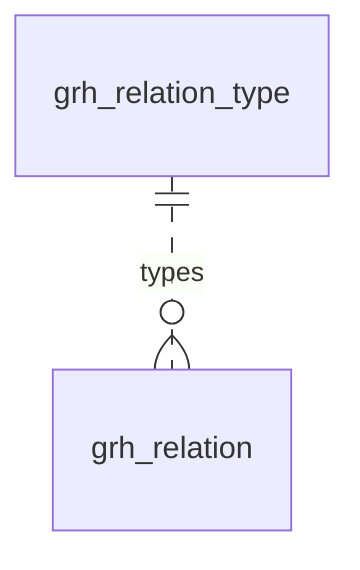

# 内容关系图谱（graph）模块设计

| 项 | 内容 |
|---|---|
| 模块 ID | `graph` |
| 名称 | 内容关系图谱 |
| 层 | L4 |
| 表前缀 | `grh_` |
| API 前缀 | `graph` |
| 可停用 | 否 |
| 模块版本 | 1.0.0（module.json 的 version） |
| 平台版本 | `>=1.0.0 <2.0.0`（module.json 的 platform） |
| 里程碑切片 | M1：—；M2：—；M3：关系、评分、相关内容；M4：—（详见第 13 节） |
| 模块负责人 | 待定 |
| 文档版本 | V1.4 |
| 状态 | 草案 |
| 更新日期 | 2026-10-20 |
| 依据 | 系统设计 V1.7 第 15 章及 3.2、3.8、24–29 章；平台框架设计 V1.4 第 4、7–13 章；ADR-002、ADR-003、ADR-005、ADR-009、ADR-018 |

> 本文只引用《平台框架设计》第 4 章中的契约，不定义新的跨模块契约；需要新契约时按平台框架设计 2.3 提出契约变更请求。

## 1. 职责与边界

### 1.1 职责

管理内容间人工及自动关系、关系类型与评分规则；根据发布态分类投影进行增量重算，提供带理由的相关内容数据源。

功能交付范围按第 13 章分为 M1–M4；表结构、约束与枚举以第 3、4 章为准。

### 1.2 不负责的事

| 事项 | 归属模块 | 边界 |
|---|---|---|
| 内容生命周期与路由 | content / url | 本模块只承担自身职责；不直接修改 cnt_、url_ 表 |
| 身份、权限、设置、任务及审计 | platform-core | 复用平台公共服务 |
| 第三方客户端与网络传输 | infrastructure | 仅经既有端口或 L2 服务使用，不在业务模块引入客户端 |

### 1.3 协作概览

| 协作方式 | 对象 | 本模块行为 |
|---|---|---|
| 服务接口 | ContentApi、TaxonomyApi | 方法与事务边界见 2.2；无跨模块表访问 |
| 扩展点 | RelationTypeProvider、DataSourceProvider、ContentImpactProvider、RelationTypeProvider | 实现/收集清单见 2.4、2.5 |
| 领域事件 | 见 2.6 | 与本地事务一起登记，提交后异步投递；重复与过期处理独立验证 |

### 1.4 适用的架构约束

遵守 P2、P3 与 ADR-018：编译依赖只到 platform-core/platform-api，跨模块协作只用第 2 章登记契约；只访问自己的表，禁止跨模块 JOIN/外键。遵守 ADR-003：事务内登记、提交后投递、监听器幂等并检查过期。遵守 ADR-009：每次请求/任务明确站点上下文，站点表默认过滤。

公开读取只用当前语言发布态，不跨语言回退（ADR-005）；预览与公开缓存隔离。后台中文文案与错误集中管理，前台文案经 UiTextApi，样式只用 Design Token。远程端口在数据库事务外调用，密钥经 SecretCipher，不写日志。

## 2. 依赖与契约

### 2.1 module.json

```json
{
  "id": "graph",
  "name": "内容关系图谱",
  "version": "1.0.0",
  "layer": "L4",
  "platform": ">=1.0.0 <2.0.0",
  "requires": {
    "content": "^1.0",
    "taxonomy": "^1.0"
  },
  "optional": {},
  "disableable": false,
  "tablePrefix": "grh_",
  "apiPrefix": "graph",
  "permissions": [
    {
      "code": "graph:relation:view",
      "name": "查看内容关系"
    },
    {
      "code": "graph:relation:manage",
      "name": "管理内容关系"
    },
    {
      "code": "graph:config:manage",
      "name": "管理评分配置"
    }
  ],
  "menus": [
    {
      "key": "graph",
      "name": "内容关系图谱",
      "parent": "settings",
      "route": "/graph/contents",
      "permission": "graph:relation:view",
      "order": 100
    }
  ],
  "settings": null,
  "components": [
    "related-content"
  ],
  "events": {
    "publishes": [
      "RelationChangedEvent"
    ],
    "subscribes": [
      "ContentCreatedEvent",
      "ContentPublishedEvent",
      "ContentUnpublishedEvent",
      "ContentTrashedEvent",
      "ContentRestoredEvent",
      "TermChangedEvent",
      "ModuleEnabledEvent",
      "ModuleDisabledEvent",
      "ContentPurgedEvent"
    ]
  }
}
```

描述符为 M0 工程建立后的实现要求；目前尚无实际控制器、Schema 或组件包。依赖只声明运行能力；Maven 仍只依赖 platform-api/core。组件清单是本模块负责的类型，运行时 UI 不登记成可拖入布局的组件。

### 2.2 使用的服务接口

| 接口（平台框架设计小节） | 方法 | 用途 | 调用位置与时机 | 测试替身 |
|---|---|---|---|---|
| `ContentApi`（4.4.16） | findPublishedCards、publishedTerms、contentIdsByPublishedTerms、scanPublished | 读当前发布快照与卡片；内容类型所属模块创建身份并标记草稿变化 | 读接口在查询阶段调用；写方法加入业务事务，远程文本翻译必须在事务外 | `InMemoryContentApi` |
| `TaxonomyApi`（4.4.19） | findTerms、termViews、assignmentsOf | 词汇表、分类视图与内容指派；不读取分类表 | 读接口在查询阶段调用；写方法加入业务事务，远程文本翻译必须在事务外 | `InMemoryTaxonomyApi` |
| `SiteApi`（4.4.1） | 按该契约声明的方法 | 语言、站点模块开关 | 业务事务内；站点切换由任务入口完成 | `InMemorySiteApi` |
| `SiteContextProvider`（4.4.2） | 按该契约声明的方法 | 当前站点；异步与任务由 core 恢复 | 业务事务内；站点切换由任务入口完成 | `FakeSiteContextProvider` |
| `PermissionChecker`（4.4.7） | 按该契约声明的方法 | 后台权限与数据范围 | 业务事务内；站点切换由任务入口完成 | `FakePermissionChecker` |
| `AuditApi`（4.4.9） | 按该契约声明的方法 | 同事务写审计，密钥与个人数据脱敏 | 业务事务内；站点切换由任务入口完成 | `InMemoryAuditApi` |
| `EventMetaFactory`（4.4.14） | 按该契约声明的方法 | 事件 ID、版本、站点与操作人 | 业务事务内；站点切换由任务入口完成 | `FakeEventMetaFactory` |
| `ExtensionRegistry`（4.4.15） | 按该契约声明的方法 | 按启用模块收集 2.5 的扩展点 | 业务事务内；站点切换由任务入口完成 | `InMemoryExtensionRegistry` |
| `JobApi`（4.4.12） | 按该契约声明的方法 | 耗时任务提交、取消、进度与结果 | 业务事务内；站点切换由任务入口完成 | `InMemoryJobApi` |

所有 L2/L3/L4 读写隐式使用当前站点；按 ID 查询单批最多 500。可选服务用 ObjectProvider 注入并检查当前站点启用状态，缺失时降级，不通过业务表绕过服务。

### 2.3 提供的服务接口

不适用：本模块不提供跨模块服务接口；其他模块通过 2.4 的既有扩展点或领域事件协作。

### 2.4 实现的扩展点

| 扩展点（平台框架设计小节） | 计划实现类 | 适用范围 | order | 收集方 |
|---|---|---|---|---|
| `RelationTypeProvider`（4.5.15） | `GraphRelationTypeProvider` | 内置 RELATED / RECOMMENDED / USES / USED_IN / CASE_OF / HAS_CASE / EXCLUDED | DEFAULT=1000 | graph |
| `DataSourceProvider`（4.5.6） | `GraphDataSourceProvider` | related（组件类型为 related-content，二者不同） | DEFAULT=1000 | delivery |
| `ContentImpactProvider`（4.5.4） | `GraphContentImpactProvider` | 按本模块职责及 3、4 章登记的内容/资源类型 | DEFAULT=1000 | content / core |
| `PlatformModule`（4.5.22） | `GraphModule` | 本模块安装/升级；可停用模块提供影响报告与停用后保留数据规则 | DEFAULT=1000 | core |

以上类名为待实现名称。PublishContributor 不调用调用方的写方法，不访问外部服务；翻译提供方只写本模块草稿/资源，先校验源指纹与共同 version。本模块不可站点级停用；对可选依赖缺失/停用仍须按框架约定降级。

### 2.5 收集的扩展点

| 扩展点 | 调用时机 | 过滤 | 失败行为 | 测试示例 |
|---|---|---|---|---|
| `RelationTypeProvider`（4.5.15） | 见第 5 章流程 | ExtensionRegistry 按站点启用状态、内容类型或 key 过滤 | 事务内校验/发布异常则回滚；只读可选部分失败记指标并降级，核心部分失败返回 503 | `SampleRelationTypeProvider` |

### 2.6 发布与订阅的事件

发布：

| 事件 | 触发事务 | 现有 payload 字段 | 订阅方 |
|---|---|---|---|
| `RelationChangedEvent` | 人工关系或重算后的可见结果实际变化同事务；没有变化不发布 | meta、contentIds、source | 框架 4.2.4；未登记发布方的差异在第 14 章列出 |

订阅：

| 事件 | 处理 | 幂等 | 过期与删除 | 失败与重试 |
|---|---|---|---|---|
| `ContentCreatedEvent` | 按第 4.6 节处理事件所标识的对象；副作用只发生在本模块数据范围 | 本模块事务内的幂等标记与数据变更一起提交；缓存重复失效安全 | 读取当前状态/指纹；只有匹配的当前结果才更新；不以 occurredAt 单独当全序 | 失败抛出保留未完成投递；业务副作用转入已有任务/队列后重试 |
| `ContentPublishedEvent` | 按内容归并 grh_dirty；contentChanged=false 也校验会影响候选的当前发布状态 | 本模块事务内的幂等标记与数据变更一起提交；缓存重复失效安全 | 读取当前状态/指纹；只有匹配的当前结果才更新；不以 occurredAt 单独当全序 | 失败抛出保留未完成投递；业务副作用转入已有任务/队列后重试 |
| `ContentUnpublishedEvent` | 移除该语言的公开投影/候选/缓存依赖，人工关系及历史快照按 4.6 保留 | 本模块事务内的幂等标记与数据变更一起提交；缓存重复失效安全 | 读取当前状态/指纹；只有匹配的当前结果才更新；不以 occurredAt 单独当全序 | 失败抛出保留未完成投递；业务副作用转入已有任务/队列后重试 |
| `ContentTrashedEvent` | 按当前回收站状态排除公开读取；不把进回收站等同物理删除 | 本模块事务内的幂等标记与数据变更一起提交；缓存重复失效安全 | 读取当前状态/指纹；只有匹配的当前结果才更新；不以 occurredAt 单独当全序 | 失败抛出保留未完成投递；业务副作用转入已有任务/队列后重试 |
| `ContentRestoredEvent` | 清理回收站过滤缓存；仍未发布时不恢复线上内容 | 本模块事务内的幂等标记与数据变更一起提交；缓存重复失效安全 | 读取当前状态/指纹；只有匹配的当前结果才更新；不以 occurredAt 单独当全序 | 失败抛出保留未完成投递；业务副作用转入已有任务/队列后重试 |
| `TermChangedEvent` | 按 change/termId 更新相关草稿引用或重算候选；草稿指派不冒充发布态指派 | 本模块事务内的幂等标记与数据变更一起提交；缓存重复失效安全 | 读取当前状态/指纹；只有匹配的当前结果才更新；不以 occurredAt 单独当全序 | 失败抛出保留未完成投递；业务副作用转入已有任务/队列后重试 |
| `ModuleEnabledEvent` | 重新扫描相关类型并重算，补回停用期间错过的关系变化 | 本模块事务内的幂等标记与数据变更一起提交；缓存重复失效安全 | 读取当前状态/指纹；只有匹配的当前结果才更新；不以 occurredAt 单独当全序 | 失败抛出保留未完成投递；业务副作用转入已有任务/队列后重试 |
| `ModuleDisabledEvent` | 当前站点隐藏该模块的公开能力，保留自身数据；处理事件.moduleId 而非假定是接收方自身 | 本模块事务内的幂等标记与数据变更一起提交；缓存重复失效安全 | 读取当前状态/指纹；只有匹配的当前结果才更新；不以 occurredAt 单独当全序 | 失败抛出保留未完成投递；业务副作用转入已有任务/队列后重试 |
| `ContentPurgedEvent` | 按事件 contentId/localizationIds 清理本模块外部引用或子行；历史业务快照按 4.6 保留；不回查已不存在的父内容 | 本模块事务内的幂等标记与数据变更一起提交；缓存重复失效安全 | 清理使用事件中的 ID；查不到父对象仍须清理 | 失败抛出保留未完成投递；业务副作用转入已有任务/队列后重试 |

监听器按框架 5.8 建立站点/system 上下文；`ContentPurgedEvent` 在模块停用时仍必须清理（deliverWhenModuleDisabled）。其他停用期间跳过并完成的事件，重新启用后通过扫描当前状态补偿，不能假定还会重投。数据库幂等标记与本模块数据在同一事务提交；外部发送、下载、搜索与 CDN 调用不得被数据库长事务包裹，使用已声明的任务/端口和业务幂等键。事件 payload 仅引用框架现有字段，本文不扩展签名。

### 2.7 使用的端口

| 端口（平台框架小节） | 用途 | 测试替身 |
|---|---|---|
| `DistributedLock`（4.7.16） | 第 5 章外部能力；只通过端口调用基础设施 | `InMemoryDistributedLock` |
| `BufferStore`（4.7.17） | 第 5 章外部能力；只通过端口调用基础设施 | `InMemoryBufferStore` |

## 3. 领域模型

### 3.1 聚合、实体与值对象

| 类型 | 名称 | 说明 |
|---|---|---|
| 聚合根 | RelationList（`grh_relation`，以源内容为单位） | 一个源内容的全部出向关系：人工关系（`MANUAL`，人工排序，始终置顶）与自动关系（`AUTO`，规则评分，按目标类型各保留前 `top_k` 条）；人工编辑按源内容整体保存，自动关系按源内容整体替换 |
| 实体 | Relation（`grh_relation` 的一行） | 源内容 → 目标内容 + 关系类型 + 来源 + 得分、排名、是否固定、得分原因 |
| 聚合根（全局） | RelationType（`grh_relation_type`） | 关系类型：key、是否对称、反向类型、允许的源与目标内容类型、中文名称、注册模块；由各模块的 `RelationTypeProvider` 在启动时同步 |
| 聚合根 | ScoringConfig（`grh_config`） | 站点 × 源内容类型的评分配置：权重、阈值、`top_k`、是否计算自动关系；没有行时使用内置默认值 |
| 聚合根 | ContentMode（`grh_content_mode`） | 某内容的相关推荐模式（`MANUAL` / `DISABLED`）；没有行即默认的 `AUTO` |
| 实体（队列） | DirtyEntry（`grh_dirty`） | 待增量重算的源内容：同一内容的触发合并去抖 30 秒 |
| 值对象 | Weights | 评分权重（`grh_config.weights`，见下） |
| 值对象 | ScoreReason | 得分原因：每个因子的分值与命中的分类项名称（`grh_relation.reason`），后台用于解释“为什么推荐” |
| 值对象 | RelatedItem | 读取结果（目标内容 ID、类型、来源、得分、卡片数据），不落库 |
| 值对象 | RelatedMode | `AUTO`（人工 + 自动）/ `MANUAL`（只有人工关系）/ `DISABLED`（不显示相关内容） |

**评分权重**（`grh_config.weights`，默认值即系统设计 15.3）：

```json
{
  "schemaVersion": 1,
  "primaryCategory": 30,
  "category": 15,
  "application": { "each": 25, "max": 50 },
  "industry": { "each": 20, "max": 40 },
  "tag": { "each": 10, "max": 30 },
  "certification": { "each": 5, "max": 10 },
  "typeAffinity": { "PRODUCT": 10, "ARTICLE": 3 },
  "freshness": { "max": 10, "days": 365 }
}
```

| 键 | 说明 |
|---|---|
| `primaryCategory` / `category` | 主产品分类相同 / 非主分类相同或同属一个父分类（词汇表 `product_category`；文章为 `article_category`） |
| `application`、`industry`、`tag`、`certification` | 每个相同分类项的分值与上限，键即词汇表 key（第 7 章） |
| `typeAffinity` | 目标内容类型 → 亲和分（0–10），如 CASE_STUDY → PRODUCT |
| `freshness` | 新鲜度（只用于目标为 ARTICLE）：`days` 天内从 `max` 线性衰减到 0 |

**补充与取舍**（系统设计之外的补充及理由）：

| 项 | 内容与理由 |
|---|---|
| `grh_relation.target_content_type` | 冗余目标内容类型：自动关系“按目标类型各保留前 20 条”，读取时按 `mix`（如 `{"PRODUCT": 4, "CASE_STUDY": 2}`）分类型取数，都不必跨模块查询 |
| `grh_relation.updated_at`、`updated_by` | 系统设计 25.9 的示例没有；人工排序与自动重算都会修改已有行 |
| `grh_relation.relation_type` 不建外键 | 引用全局表 `grh_relation_type.type_key`；类型由代码注册、只增不删，由应用层校验；避免在百万行级的表上为低选择性列建外键索引 |
| `grh_relation_type.type_key`、`module_id` | 系统设计的 `key`（MySQL 关键字，改名，见 平台框架设计 7.2）与 `module` |
| `grh_relation_type.auto_allowed`、`sort_order`、`available` | 哪些类型可以由评分生成（V1 只有 `RELATED`）；后台类型选择器的顺序；注册模块不再提供该类型时置 0 而不删除（已有关系仍可读取，不能新建） |
| `grh_config.auto_enabled` | 某类源内容可以整体关闭自动推荐（如 PAGE） |
| 新增 `grh_content_mode` | 系统设计 15.6 内容编辑页“设置模式（AUTO / MANUAL / DISABLED）”需要按内容保存 |
| 新增 `grh_dirty` | 系统设计 15.4 “同一内容的触发合并去抖 30 秒”：持久化的去抖队列，实例重启不丢失，多实例不重复计算 |

### 3.2 不变量

| # | 规则 | 保证方式 |
|---|---|---|
| 1 | 同一站点内（源，目标，类型）唯一；源与目标不能相同 | 数据库：`uk_grh_relation`、`ck_grh_rel_self` |
| 2 | 对称类型的人工关系成对存在（A→B 与 B→A 同类型）；互逆类型成对存在（A→B 为 T 时 B→A 为 T 的反向类型）；新增、删除在同一事务中写入两个方向，查询时只按源查询 | 应用层 |
| 3 | `AUTO` 行必须有得分与计算时间；`MANUAL` 行没有得分，`pinned` 为 0 | 数据库：`ck_grh_rel_origin` |
| 4 | 只有 `auto_allowed = 1` 的类型（V1：`RELATED`）可以有 `AUTO` 行；源与目标的内容类型必须在类型的允许列表内（空数组表示全部可路由类型） | 应用层 |
| 5 | 同一对（源，目标）已有任何人工关系（含 `EXCLUDED`）时不生成自动关系；人工新增与已有自动行相同的（源，目标，类型）时，把该行改为 `MANUAL` | 应用层 |
| 6 | 每个源内容每个目标类型最多 `top_k` 条自动关系（固定的行计入在内）；得分低于阈值的不保留（固定的行除外） | 应用层 |
| 7 | 自动关系按源内容整体替换：同一事务中删除该源未固定的 `AUTO` 行并插入新结果；固定的行只更新得分、排名与原因 | 应用层 |
| 8 | 关系建立在内容上，不区分语言；读取时只返回在请求语言已发布、可路由、未进回收站的目标，数量不足时按排名继续补足，不回退显示其他语言的内容 | 应用层 |
| 9 | 内容级模式与调用方传入的 `RelatedMode` 取较严格者（`DISABLED` > `MANUAL` > `AUTO`）；`MANUAL` 与 `DISABLED` 的内容不计算自身的自动关系 | 应用层 |
| 10 | 关系类型 key 全局唯一；对称类型没有反向类型；互逆类型双方互相指向 | 数据库：`uk_rtype_key`、`ck_grh_rtype_inverse`；应用层（启动同步时校验，冲突则启动失败） |
| 11 | 每站点每个源内容类型最多一行评分配置；每个内容最多一行模式；每个内容在队列中最多一行 | 数据库：`uk_cfg_type`、`uk_cmode_content`、`uk_dirty_content` |
| 12 | 某源内容的关系发生变化（人工编辑，或重算结果与原结果不同）后发布 `RelationChangedEvent`，delivery 清除 `s{site}:g:{contentId}` 标签 | 应用层 |

### 3.3 状态机

不适用：关系本身没有发布状态机。origin 区分 MANUAL/AUTO，MANUAL 不被重算覆盖；grh_dirty 的入队、认领、重算、删除是任务处理过程。内容级 AUTO/MANUAL/DISABLED 是读取与计算策略，可由有权限的操作修改。

## 4. 数据模型

> 遵守平台框架设计第 7 章的数据库通用约定。本节给出待实现 DDL；本次文档审查未重跑 MySQL，不能据此认定 DDL 已验证。M0 后按第 11 章在 MySQL 8.4 空库验证，并使实际迁移脚本与本节一致。

### 4.1 表清单

| 表 | 说明 | 站点级 | 软删除 | 预估规模（单站，按系统设计假设 A4） |
|---|---|---|---|---|
| `grh_relation` | 内容关系（人工 + 自动） | 是 | 否（人工删除即物理删除；自动关系重算时替换） | 单站≤50万条关系行（系统设计1.5）；1.5万源内容的 topK 须按总量预算调整 |
| `grh_relation_type` | 关系类型（代码注册） | 否（全局，列入豁免清单） | 否（不再提供时 `available = 0`） | ≈ 15 |
| `grh_config` | 评分配置 | 是 | 否（删除即回到内置默认值） | ≤ 5（每种可路由内容类型一行） |
| `grh_content_mode` | 内容的相关推荐模式 | 是 | 否（恢复为 `AUTO` 即删除行） | 只有非默认模式的内容有行：≤ 数千 |
| `grh_relation_set` | 人工/自动关系集合的共同版本；空集合保留 | 是 | 否（只在源内容purge时清理） | ≤源内容数量 |
| `grh_dirty` | 增量重算队列 | 是 | 否（处理完成后删除） | 常驻 < 1 千；批量导入时峰值约 1 万 |

**站点过滤**：`grh_relation_type` 是全局表，列入行级拦截器的豁免清单。其余为站点级表；例外：增量重算任务跨站点轮询 `grh_dirty` 的到期记录，使用标注 `@InterceptorIgnore` 的专用查询，取到记录后按其 `site_id` 设置站点上下文再计算；每晚的全量重建按站点逐个执行。

### 4.2 ER 图



虚线表示按 `type_key` 的逻辑关系（不建外键，见 3）。`grh_config`、`grh_content_mode`、`grh_dirty` 只以内容 ID 与内容类型关联内容（见 4.6），未画出。

### 4.3 表结构

类型列中的 `bin` 表示 `COLLATE utf8mb4_0900_bin`；通用字段的定义见第 2.4 节。

#### 4.3.1 `grh_relation`：内容关系

与系统设计 25.9 的 DDL 示例一致，补全了列注释、`target_content_type`、`updated_at` / `updated_by` 与检查约束。读取顺序：人工关系按 `rank_no` → 自动关系按 `rank_no` → 过滤出请求语言已发布的目标 → 从投影取卡片数据（系统设计 15.5）。

| 字段 | 类型 | 可空 | 默认 | 说明 |
|---|---|---|---|---|
| `id` | BIGINT | 否 | — | 主键（TSID） |
| `site_id` | BIGINT | 否 | — | 站点 |
| `source_content_id` | BIGINT | 否 | — | 源内容（`cnt_content.id`） |
| `target_content_id` | BIGINT | 否 | — | 目标内容（`cnt_content.id`） |
| `target_content_type` | VARCHAR(32) | 否 | — | 目标内容类型（冗余 `cnt_content.type`） |
| `relation_type` | VARCHAR(40) bin | 否 | — | 关系类型（`grh_relation_type.type_key`） |
| `origin` | VARCHAR(10) | 否 | — | 来源：`MANUAL` / `AUTO` |
| `score` | DECIMAL(7,2) | 是 | — | 得分（`AUTO`）；`MANUAL` 为空 |
| `rank_no` | INT | 否 | 0 | 排名：`MANUAL` 为人工排序；`AUTO` 为同一目标类型内按得分的名次 |
| `pinned` | TINYINT(1) | 否 | 0 | 固定（只用于 `AUTO`）：重算时保留 |
| `reason` | JSON | 是 | — | 得分原因（`AUTO`） |
| `computed_at` | DATETIME(3) | 是 | — | 计算时间（`AUTO`） |
| `created_at` | DATETIME(3) | 否 | CURRENT_TIMESTAMP(3) | 创建时间 |
| `created_by` | BIGINT | 否 | 0 | 创建人（`AUTO` 为 0） |
| `updated_at` | DATETIME(3) | 否 | CURRENT_TIMESTAMP(3)，更新时自动刷新 | 更新时间 |
| `updated_by` | BIGINT | 否 | 0 | 更新人 |

索引与约束：
- `PRIMARY KEY (id)`
- `uk_grh_relation (site_id, source_content_id, target_content_id, relation_type)`：（源，目标，类型）唯一；写入反向行、判断某对内容是否已有人工关系或 `EXCLUDED`
- `idx_grh_relation_source (site_id, source_content_id, origin, rank_no)`：读取某源内容的关系（人工在前、按排名）；按源整体替换自动关系
- `idx_grh_relation_target (site_id, target_content_id)`：内容下线、彻底删除时查找指向它的关系；后台“哪些内容推荐了这里”
- `ck_grh_rel_self`、`ck_grh_rel_origin`：见 3.2 不变量 1、3

```sql
CREATE TABLE grh_relation (
  id                   BIGINT         NOT NULL COMMENT '主键（TSID）',
  site_id              BIGINT         NOT NULL COMMENT '站点',
  source_content_id    BIGINT         NOT NULL COMMENT '源内容（cnt_content.id）',
  target_content_id    BIGINT         NOT NULL COMMENT '目标内容（cnt_content.id）',
  target_content_type  VARCHAR(32)    NOT NULL COMMENT '目标内容类型（冗余 cnt_content.type）：PAGE / PRODUCT / ARTICLE / CASE_STUDY / TERM_PAGE；自动关系按目标类型各保留前 top_k 条',
  relation_type        VARCHAR(40)    COLLATE utf8mb4_0900_bin NOT NULL COMMENT '关系类型（grh_relation_type.type_key）：RELATED / RECOMMENDED / USES / USED_IN / CASE_OF / HAS_CASE / ACCESSORY_OF / HAS_ACCESSORY / REPLACED_BY / REPLACES / EXCLUDED，或模块注册的其他类型',
  origin               VARCHAR(10)    NOT NULL COMMENT '来源：MANUAL（人工，始终置顶）/ AUTO（规则评分）',
  score                DECIMAL(7, 2)  NULL COMMENT '得分（AUTO）；MANUAL 为空',
  rank_no              INT            NOT NULL DEFAULT 0 COMMENT '排名：MANUAL 为同一源内容内的人工排序（从 1 开始）；AUTO 为同一目标类型内按得分的名次（从 1 开始）',
  pinned               TINYINT(1)     NOT NULL DEFAULT 0 COMMENT '固定（只用于 AUTO）：1 = 编辑固定了这条自动推荐，重算时保留并更新得分与原因；MANUAL 恒为 0',
  reason               JSON           NULL COMMENT '得分原因（AUTO）：{"primaryCategory":30,"application":{"score":25,"terms":["可穿戴设备"]},"tag":{"score":10,"terms":["低温"]}}',
  computed_at          DATETIME(3)    NULL COMMENT '计算时间（AUTO）',
  created_at           DATETIME(3)    NOT NULL DEFAULT CURRENT_TIMESTAMP(3) COMMENT '创建时间',
  created_by           BIGINT         NOT NULL DEFAULT 0 COMMENT '创建人（0 = 系统，即自动关系）',
  updated_at           DATETIME(3)    NOT NULL DEFAULT CURRENT_TIMESTAMP(3) ON UPDATE CURRENT_TIMESTAMP(3) COMMENT '更新时间',
  updated_by           BIGINT         NOT NULL DEFAULT 0 COMMENT '更新人（0 = 系统）',
  PRIMARY KEY (id),
  UNIQUE KEY uk_grh_relation (site_id, source_content_id, target_content_id, relation_type),
  KEY idx_grh_relation_source (site_id, source_content_id, origin, rank_no),
  KEY idx_grh_relation_target (site_id, target_content_id),
  CONSTRAINT ck_grh_rel_self CHECK (source_content_id <> target_content_id),
  CONSTRAINT ck_grh_rel_origin CHECK ((origin = 'AUTO' AND score IS NOT NULL AND computed_at IS NOT NULL) OR (origin = 'MANUAL' AND score IS NULL AND pinned = 0))
) ENGINE = InnoDB DEFAULT CHARSET = utf8mb4 COLLATE = utf8mb4_0900_ai_ci COMMENT = '内容关系（建立在语言无关的内容上；人工关系与规则评分的自动关系）';
```

要点：
- 人工编辑（内容编辑页“关联”标签：添加、删除、排序、排除某条自动推荐）以源内容为单位提交，需要 `content:<type>:edit` 权限（系统设计 15.6）；“排除”即写入一对 `EXCLUDED` 行（对称），并删除该对之间的 `AUTO` 行。
- 增量重算（见 4.3.5）与每晚全量重建都以源内容为单位替换自动关系；全量重建完成后与增量结果比对，差异数写入 `sys_job` 的结果作为校验（系统设计 15.4）。

#### 4.3.2 `grh_relation_type`：关系类型

全局表，由各模块的 `RelationTypeProvider` 在应用启动时幂等同步（新增或更新；代码中不再提供的类型置 `available = 0`）；后台只读。

| 字段 | 类型 | 可空 | 默认 | 说明 |
|---|---|---|---|---|
| `id` | BIGINT | 否 | — | 主键（TSID） |
| `type_key` | VARCHAR(40) bin | 否 | — | 类型 key（大写字母与下划线），如 `RELATED` |
| `module_id` | VARCHAR(32) | 否 | — | 注册模块 ID，如 `graph`、`product` |
| `label` | VARCHAR(50) | 否 | — | 名称（中文，后台显示） |
| `symmetric` | TINYINT(1) | 否 | 0 | 是否对称 |
| `inverse_key` | VARCHAR(40) bin | 是 | — | 反向类型 key；对称类型与单向类型为空 |
| `allowed_source_types` | JSON | 否 | `(JSON_ARRAY())` | 允许的源内容类型；空数组表示全部可路由类型 |
| `allowed_target_types` | JSON | 否 | `(JSON_ARRAY())` | 允许的目标内容类型；空数组表示全部可路由类型 |
| `auto_allowed` | TINYINT(1) | 否 | 0 | 是否可由规则评分生成自动关系 |
| `sort_order` | INT | 否 | 0 | 后台类型选择器中的顺序 |
| `available` | TINYINT(1) | 否 | 1 | 注册模块是否仍提供该类型 |
| `created_at` | DATETIME(3) | 否 | CURRENT_TIMESTAMP(3) | 创建时间 |
| `updated_at` | DATETIME(3) | 否 | CURRENT_TIMESTAMP(3)，更新时自动刷新 | 更新时间 |

索引与约束：
- `PRIMARY KEY (id)`
- `uk_rtype_key (type_key)`：类型 key 全局唯一；按 key 读取（类型很少，应用启动后整体缓存）
- `ck_grh_rtype_inverse`：对称类型没有反向类型

```sql
CREATE TABLE grh_relation_type (
  id                    BIGINT       NOT NULL COMMENT '主键（TSID）',
  type_key              VARCHAR(40)  COLLATE utf8mb4_0900_bin NOT NULL COMMENT '类型 key（大写字母与下划线，全局唯一），如 RELATED、USES；创建后不可改名',
  module_id             VARCHAR(32)  NOT NULL COMMENT '注册模块 ID（RelationTypeProvider 的实现模块）：graph / product 等',
  label                 VARCHAR(50)  NOT NULL COMMENT '名称（中文，后台显示），如“相关”“配件”',
  symmetric             TINYINT(1)   NOT NULL DEFAULT 0 COMMENT '是否对称：1 = A→B 即 B→A，人工关系成对写入同一类型',
  inverse_key           VARCHAR(40)  COLLATE utf8mb4_0900_bin NULL COMMENT '反向类型 key（互逆关系成对写入，如 USES ↔ USED_IN）；对称类型与单向类型为空',
  allowed_source_types  JSON         NOT NULL DEFAULT (JSON_ARRAY()) COMMENT '允许的源内容类型数组，如 ["CASE_STUDY","ARTICLE"]；空数组表示全部可路由类型',
  allowed_target_types  JSON         NOT NULL DEFAULT (JSON_ARRAY()) COMMENT '允许的目标内容类型数组，如 ["PRODUCT"]；空数组表示全部可路由类型',
  auto_allowed          TINYINT(1)   NOT NULL DEFAULT 0 COMMENT '是否可由规则评分生成自动关系（V1 只有 RELATED 为 1；其他类型只能人工建立）',
  sort_order            INT          NOT NULL DEFAULT 0 COMMENT '后台类型选择器中的顺序（小的在前）',
  available             TINYINT(1)   NOT NULL DEFAULT 1 COMMENT '注册模块是否仍提供该类型：0 = 代码中已不存在，已有关系保留并可读取，不能新建',
  created_at            DATETIME(3)  NOT NULL DEFAULT CURRENT_TIMESTAMP(3) COMMENT '创建时间（首次同步）',
  updated_at            DATETIME(3)  NOT NULL DEFAULT CURRENT_TIMESTAMP(3) ON UPDATE CURRENT_TIMESTAMP(3) COMMENT '更新时间（最近一次同步变化）',
  PRIMARY KEY (id),
  UNIQUE KEY uk_rtype_key (type_key),
  CONSTRAINT ck_grh_rtype_inverse CHECK (symmetric = 0 OR inverse_key IS NULL)
) ENGINE = InnoDB DEFAULT CHARSET = utf8mb4 COLLATE = utf8mb4_0900_ai_ci COMMENT = '关系类型（全局表，由 RelationTypeProvider 同步；列入站点过滤豁免清单）';
```

V1 内置类型见 4.4。

#### 4.3.3 `grh_config`：评分配置

| 字段 | 类型 | 可空 | 默认 | 说明 |
|---|---|---|---|---|
| `id` | BIGINT | 否 | — | 主键（TSID） |
| `site_id` | BIGINT | 否 | — | 站点 |
| `content_type` | VARCHAR(32) | 否 | — | 源内容类型（可路由类型） |
| `weights` | JSON | 否 | — | 评分权重（见 3） |
| `threshold` | DECIMAL(7,2) | 否 | 30.00 | 阈值：得分低于此值的候选不保留 |
| `top_k` | INT | 否 | 20 | 每个目标类型保留的自动关系条数 |
| `auto_enabled` | TINYINT(1) | 否 | 1 | 是否为该类型的源内容计算自动关系 |
| `version` | INT | 否 | 0 | 乐观锁 |
| `created_at` | DATETIME(3) | 否 | CURRENT_TIMESTAMP(3) | 创建时间 |
| `created_by` | BIGINT | 否 | 0 | 创建人 |
| `updated_at` | DATETIME(3) | 否 | CURRENT_TIMESTAMP(3)，更新时自动刷新 | 更新时间 |
| `updated_by` | BIGINT | 否 | 0 | 更新人 |

索引与约束：
- `PRIMARY KEY (id)`
- `uk_cfg_type (site_id, content_type)`：每站点每个源内容类型一行；计算时按源内容类型读取
- `ck_grh_cfg_range`：`top_k` 在 1–50 之间，阈值不为负

```sql
CREATE TABLE grh_config (
  id            BIGINT         NOT NULL COMMENT '主键（TSID）',
  site_id       BIGINT         NOT NULL COMMENT '站点',
  content_type  VARCHAR(32)    NOT NULL COMMENT '源内容类型：PAGE / PRODUCT / ARTICLE / CASE_STUDY / TERM_PAGE（可路由类型）',
  weights       JSON           NOT NULL COMMENT '评分权重：{"schemaVersion":1,"primaryCategory":30,"category":15,"application":{"each":25,"max":50},…,"typeAffinity":{"PRODUCT":10},"freshness":{"max":10,"days":365}}',
  threshold     DECIMAL(7, 2)  NOT NULL DEFAULT 30.00 COMMENT '阈值：得分低于此值的候选不保留（默认 30）',
  top_k         INT            NOT NULL DEFAULT 20 COMMENT '每个目标类型保留的自动关系条数（默认 20）',
  auto_enabled  TINYINT(1)     NOT NULL DEFAULT 1 COMMENT '是否为该类型的源内容计算自动关系：0 = 只显示人工关系',
  version       INT            NOT NULL DEFAULT 0 COMMENT '乐观锁版本号',
  created_at    DATETIME(3)    NOT NULL DEFAULT CURRENT_TIMESTAMP(3) COMMENT '创建时间',
  created_by    BIGINT         NOT NULL DEFAULT 0 COMMENT '创建人',
  updated_at    DATETIME(3)    NOT NULL DEFAULT CURRENT_TIMESTAMP(3) ON UPDATE CURRENT_TIMESTAMP(3) COMMENT '更新时间',
  updated_by    BIGINT         NOT NULL DEFAULT 0 COMMENT '更新人',
  PRIMARY KEY (id),
  UNIQUE KEY uk_cfg_type (site_id, content_type),
  CONSTRAINT ck_grh_cfg_range CHECK (top_k BETWEEN 1 AND 50 AND threshold >= 0)
) ENGINE = InnoDB DEFAULT CHARSET = utf8mb4 COLLATE = utf8mb4_0900_ai_ci COMMENT = '图谱评分配置（站点 × 源内容类型；没有行时使用内置默认值）';
```

要点：修改配置后为该站点创建一次全量重建任务（`sys_job`），不逐条入队；`weights` 按 Schema 校验（键只能是 14.1 列出的因子）。

#### 4.3.4 `grh_content_mode`：内容的相关推荐模式

| 字段 | 类型 | 可空 | 默认 | 说明 |
|---|---|---|---|---|
| `id` | BIGINT | 否 | — | 主键（TSID） |
| `site_id` | BIGINT | 否 | — | 站点 |
| `content_id` | BIGINT | 否 | — | 内容（`cnt_content.id`） |
| `mode` | VARCHAR(16) | 否 | — | 模式：`MANUAL` / `DISABLED` |
| `version` | INT | 否 | 0 | 乐观锁 |
| `created_at` | DATETIME(3) | 否 | CURRENT_TIMESTAMP(3) | 创建时间 |
| `created_by` | BIGINT | 否 | 0 | 创建人 |
| `updated_at` | DATETIME(3) | 否 | CURRENT_TIMESTAMP(3)，更新时自动刷新 | 更新时间 |
| `updated_by` | BIGINT | 否 | 0 | 更新人 |

索引与约束：
- `PRIMARY KEY (id)`
- `uk_cmode_content (content_id)`：每个内容最多一行；读取与计算时按内容查找
- `ck_grh_cmode_mode`：只保存非默认模式

```sql
CREATE TABLE grh_content_mode (
  id          BIGINT       NOT NULL COMMENT '主键（TSID）',
  site_id     BIGINT       NOT NULL COMMENT '站点',
  content_id  BIGINT       NOT NULL COMMENT '内容（cnt_content.id）',
  mode        VARCHAR(16)  NOT NULL COMMENT '相关推荐模式：MANUAL（只显示人工关系，不计算自身的自动关系）/ DISABLED（不显示相关内容）；默认的 AUTO 不保存行',
  version     INT          NOT NULL DEFAULT 0 COMMENT '乐观锁版本号',
  created_at  DATETIME(3)  NOT NULL DEFAULT CURRENT_TIMESTAMP(3) COMMENT '创建时间',
  created_by  BIGINT       NOT NULL DEFAULT 0 COMMENT '创建人',
  updated_at  DATETIME(3)  NOT NULL DEFAULT CURRENT_TIMESTAMP(3) ON UPDATE CURRENT_TIMESTAMP(3) COMMENT '更新时间',
  updated_by  BIGINT       NOT NULL DEFAULT 0 COMMENT '更新人',
  PRIMARY KEY (id),
  UNIQUE KEY uk_cmode_content (content_id),
  CONSTRAINT ck_grh_cmode_mode CHECK (mode IN ('MANUAL', 'DISABLED'))
) ENGINE = InnoDB DEFAULT CHARSET = utf8mb4 COLLATE = utf8mb4_0900_ai_ci COMMENT = '内容的相关推荐模式（只保存非默认的 MANUAL / DISABLED）';
```

要点：改为 `MANUAL` 或 `DISABLED` 时删除该内容自身的 `AUTO` 行（其他内容的自动关系仍可指向它）；恢复为 `AUTO` 时删除本行并把该内容入队重算。

#### 4.3.5 `grh_dirty`：增量重算队列

事件监听器（事务提交后）把受影响的源内容写入本表：`INSERT … ON DUPLICATE KEY UPDATE`，`due_at` 取 min(当前时间 + 30 秒, `created_at` + 5 分钟)，`trigger_count` 与 `version` + 1。重算任务每 10 秒跨站点取到期且未被租用的行（`due_at <= now AND (locked_until IS NULL OR locked_until < now)`），以条件更新设置租约后计算；完成后按 `version` 条件删除（处理期间有新触发时版本已变化，行保留，下一轮再算）；失败时 `attempts` + 1 并按退避推迟 `due_at`。

| 字段 | 类型 | 可空 | 默认 | 说明 |
|---|---|---|---|---|
| `id` | BIGINT | 否 | — | 主键（TSID） |
| `site_id` | BIGINT | 否 | — | 站点 |
| `content_id` | BIGINT | 否 | — | 待重算的源内容（`cnt_content.id`） |
| `reason` | VARCHAR(24) | 否 | — | 最近一次触发原因 |
| `trigger_count` | INT | 否 | 1 | 去抖期间合并的触发次数 |
| `due_at` | DATETIME(3) | 否 | — | 最早处理时间 |
| `locked_until` | DATETIME(3) | 是 | — | 处理租约到期时间 |
| `attempts` | INT | 否 | 0 | 失败次数 |
| `last_error` | VARCHAR(500) | 是 | — | 最近一次失败原因 |
| `version` | INT | 否 | 0 | 每次合并触发 + 1，用于条件删除 |
| `created_at` | DATETIME(3) | 否 | CURRENT_TIMESTAMP(3) | 首次触发时间 |
| `updated_at` | DATETIME(3) | 否 | CURRENT_TIMESTAMP(3)，更新时自动刷新 | 更新时间 |

索引与约束：
- `PRIMARY KEY (id)`
- `uk_dirty_content (site_id, content_id)`：每个内容最多一行（合并触发）
- `idx_dirty_due (due_at)`：重算任务跨站点取到期记录（专用豁免查询）；积压告警

```sql
CREATE TABLE grh_dirty (
  id             BIGINT        NOT NULL COMMENT '主键（TSID）',
  site_id        BIGINT        NOT NULL COMMENT '站点',
  content_id     BIGINT        NOT NULL COMMENT '待重算的源内容（cnt_content.id）',
  reason         VARCHAR(24)   NOT NULL COMMENT '最近一次触发原因：PUBLISHED / UNPUBLISHED / TRASHED / RESTORED / TERM_CHANGED / MANUAL_CHANGED / MODE_CHANGED',
  trigger_count  INT           NOT NULL DEFAULT 1 COMMENT '去抖期间合并的触发次数',
  due_at         DATETIME(3)   NOT NULL COMMENT '最早处理时间：最近一次触发 + 30 秒，且不晚于 created_at + 5 分钟（避免批量导入时一直推迟）',
  locked_until   DATETIME(3)   NULL COMMENT '处理租约到期时间：取件时设为当前时间 + 5 分钟，防止多实例重复计算',
  attempts       INT           NOT NULL DEFAULT 0 COMMENT '失败次数（超过 5 次告警，行保留到下次全量重建后删除）',
  last_error     VARCHAR(500)  NULL COMMENT '最近一次失败原因',
  version        INT           NOT NULL DEFAULT 0 COMMENT '每次合并触发 + 1；处理完成后按版本条件删除，处理期间的新触发不会丢失',
  created_at     DATETIME(3)   NOT NULL DEFAULT CURRENT_TIMESTAMP(3) COMMENT '首次触发时间',
  updated_at     DATETIME(3)   NOT NULL DEFAULT CURRENT_TIMESTAMP(3) ON UPDATE CURRENT_TIMESTAMP(3) COMMENT '更新时间',
  PRIMARY KEY (id),
  UNIQUE KEY uk_dirty_content (site_id, content_id),
  KEY idx_dirty_due (due_at)
) ENGINE = InnoDB DEFAULT CHARSET = utf8mb4 COLLATE = utf8mb4_0900_ai_ci COMMENT = '图谱增量重算队列（同一内容的触发合并去抖 30 秒）';
```

要点：
- 重算一个源内容：读取其发布态分类项 → 候选集（经 content 的服务接口查询 `cnt_published_term`，同站点、可路由、未进回收站，排除自身、已有人工关系与 `EXCLUDED` 的内容，按分类项稀有度截取 ≤ 2,000 个）→ 评分 → 按目标类型截取 → 整体替换该源的自动关系；分类重叠分是对称的，同时更新排名可能受影响的候选的列表（直接在同一次计算中更新，不再入队）（系统设计 15.3、15.4）。
- `TermChangedEvent`（分类移动或删除）影响的内容超过 1,000 个，或配置变化时，不逐条入队，改为创建该站点的全量重建任务。

#### 4.3.6 `grh_relation_set`：关系集合版本

GRAPH-01 的模块内部方案：GET 的完整关系集合与 ETag 由此状态行定界，不复用内容草稿版本。首次 GET 无状态行时视为 v0；首次写入创建状态行并锁定，成功后从 v1 返回；空集合也保留 version，防止 ABA。每种影响 GET 返回集合的修改都同事务递增，含 AUTO、双向关系、排除、pinned、模式切换和目标清理。多源修改按ID升序锁全部状态行，失败整笔回滚；详见框架4.10.8。

```sql
CREATE TABLE grh_relation_set (
  id                 BIGINT       NOT NULL COMMENT 'TSID',
  site_id            BIGINT       NOT NULL COMMENT '站点ID',
  source_content_id  BIGINT       NOT NULL COMMENT '源内容ID，逻辑引用',
  version            BIGINT       NOT NULL DEFAULT 0 COMMENT '集合版本；空集合也递增和保留',
  created_at         DATETIME(3)  NOT NULL DEFAULT CURRENT_TIMESTAMP(3),
  created_by         BIGINT       NOT NULL DEFAULT 0,
  updated_at         DATETIME(3)  NOT NULL DEFAULT CURRENT_TIMESTAMP(3) ON UPDATE CURRENT_TIMESTAMP(3),
  updated_by         BIGINT       NOT NULL DEFAULT 0,
  PRIMARY KEY (id),
  UNIQUE KEY uk_relation_set (site_id, source_content_id),
  CONSTRAINT ck_relation_set_version CHECK (version >= 0)
) ENGINE=InnoDB DEFAULT CHARSET=utf8mb4 COLLATE=utf8mb4_0900_ai_ci COMMENT='内容关系集合的共同版本';
```

不建立跨模块外键。既有关系的首次升级在维护窗口按源创建状态行，随后所有写入口都启用此协议；ContentPurgedEvent 清理状态行，停用期间仍清理。DDL 待后续 MySQL 实测。

### 4.4 枚举

| 字段 | 取值 | 说明 |
|---|---|---|
| `grh_relation.origin` | `MANUAL` / `AUTO` | 共享关系来源枚举：人工 / 规则评分 |
| `grh_relation.target_content_type`、`grh_config.content_type` | `PAGE` / `PRODUCT` / `ARTICLE` / `CASE_STUDY` / `TERM_PAGE` | 共享内容类型枚举中的可路由类型（FAQ、GLOBAL_BLOCK 不进入图谱） |
| `grh_content_mode.mode`（及读取参数 `RelatedMode`） | `AUTO` / `MANUAL` / `DISABLED` | 人工 + 自动（默认，不存行）/ 只有人工关系 / 不显示相关内容 |
| `grh_dirty.reason` | `PUBLISHED` / `UNPUBLISHED` / `TRASHED` / `RESTORED` | 内容发布（分类指派随发布生效）/ 下线 / 进回收站 / 恢复 |
| | `TERM_CHANGED` | 分类项移动或删除（影响“同属一个父分类”等因子） |
| | `MANUAL_CHANGED` / `MODE_CHANGED` | 人工关系变化（排除、新增）/ 模式恢复为 `AUTO` |
| `grh_relation.relation_type`、`grh_relation_type.type_key`（V1 内置） | 见下表 | 系统设计 15.2 |

**V1 内置关系类型**（`grh_relation_type` 的同步结果）：

| `type_key` | `label` | 对称 | `inverse_key` | 允许的源 → 目标 | 自动 | 注册模块 |
|---|---|---|---|---|---|---|
| `RELATED` | 相关 | 是 | — | 全部 → 全部 | 是 | graph |
| `RECOMMENDED` | 推荐 | 否 | — | 全部 → 全部（单向，排序优先） | 否 | graph |
| `USES` | 使用的产品 | 否 | `USED_IN` | CASE_STUDY、ARTICLE → PRODUCT | 否 | graph |
| `USED_IN` | 应用案例 | 否 | `USES` | PRODUCT → CASE_STUDY、ARTICLE | 否 | graph |
| `CASE_OF` | 所属产品或应用 | 否 | `HAS_CASE` | CASE_STUDY → PRODUCT、TERM_PAGE | 否 | graph |
| `HAS_CASE` | 客户案例 | 否 | `CASE_OF` | PRODUCT、TERM_PAGE → CASE_STUDY | 否 | graph |
| `ACCESSORY_OF` | 适配产品 | 否 | `HAS_ACCESSORY` | PRODUCT → PRODUCT | 否 | product |
| `HAS_ACCESSORY` | 配件 | 否 | `ACCESSORY_OF` | PRODUCT → PRODUCT | 否 | product |
| `REPLACED_BY` | 替代型号 | 否 | `REPLACES` | PRODUCT → PRODUCT | 否 | product |
| `REPLACES` | 替代的旧型号 | 否 | `REPLACED_BY` | PRODUCT → PRODUCT | 否 | product |
| `EXCLUDED` | 排除 | 是 | — | 全部 → 全部（人工排除，阻止自动关联；不在前台显示） | 否 | graph |

`USED_IN`、`HAS_CASE`、`HAS_ACCESSORY`、`REPLACES` 是系统设计 15.2 中的反向类型，单独登记为类型行；产品相关的四个类型由 product 经 `RelationTypeProvider` 注册（系统设计 3.7），名称与允许类型是本文的建议。

### 4.5 站点过滤

| 表 | 行级拦截器 | 访问方式与理由 |
|---|---|---|
| `grh_relation` | 不豁免 | 请求和任务隐式使用当前站点；子表 site_id 与父表一致 |
| `grh_relation_type` | 豁免 | 全局配置，系统级管理权限；站点仅可读允许的摘要 |
| `grh_config` | 不豁免 | 请求和任务隐式使用当前站点；子表 site_id 与父表一致 |
| `grh_content_mode` | 不豁免 | 请求和任务隐式使用当前站点；子表 site_id 与父表一致 |
| `grh_dirty` | 不豁免 | 请求和任务隐式使用当前站点；子表 site_id 与父表一致 |

系统调度器可用既有专用查询跨站点认领到期任务，认领后按记录 site_id 恢复上下文；业务处理不关闭拦截器。站点级全量任务使用 PER_SITE。

### 4.6 跨模块引用与清理

| 本模块字段 | 引用对象（模块.表） | 被引用对象删除 / 下线时的处理 | 触发事件 |
|---|---|---|---|
| 各表 `site_id` | core.`sys_site` | V1 不删除站点 | — |
| `grh_relation.source_content_id`、`target_content_id`、`target_content_type` | content.`cnt_content` | 下线、进回收站：人工关系保留（恢复后仍有效），读取时过滤；该内容作为源的自动关系删除，并将指向它的源内容入队重算；恢复：入队重算；彻底删除：按 `idx_grh_relation_source` 与 `idx_grh_relation_target` 删除两个方向的全部行 | `ContentUnpublishedEvent`、`ContentTrashedEvent`、`ContentRestoredEvent`、`ContentPurgedEvent` |
| `grh_content_mode.content_id`、`grh_dirty.content_id` | content.`cnt_content` | 彻底删除：删除对应行 | `ContentPurgedEvent` |
| 评分候选与 `grh_relation.reason` 中的分类项名称 | content.`cnt_published_term`（经 content 的服务接口）、taxonomy.`tx_term` | 发布：源内容入队；分类项移动或删除：受影响内容入队（超过 1,000 个时全量重建）；更名：`reason` 中的名称在下次重算时更新 | `ContentPublishedEvent`、`TermChangedEvent` |
| `grh_relation_type.module_id` 及该类型的关系 | core.`sys_module`、`sys_site_module` | 站点停用注册模块：关系保留，读取时跳过该模块的类型与该模块内容类型的目标（系统设计 3.8）；模块 PURGED：删除该模块类型的全部关系，类型行置 `available = 0` | `ModuleDisabledEvent`、`ModuleEnabledEvent`、`onPurge` |
| `grh_config.content_type`、`grh_relation.target_content_type` | 内容类型（代码注册） | 所属模块停用：保留配置与关系；候选集与读取排除该类型 | `ModuleDisabledEvent` |
| `created_by`、`updated_by` | core.`sys_user` | 不清理 | — |

**其他模块引用本模块的对象**（其他章节需配合）：

| 被引用对象 | 引用方 | 说明 | 事件 |
|---|---|---|---|
| `grh_relation`（经 `related()` 读取） | delivery（相关内容数据源，缓存标签 `s{site}:g:{contentId}`） | 关系变化后清除源内容的 `g` 标签 | `RelationChangedEvent` |
| `grh_relation` | seo（`seo_link` 的 `RELATED` 行，见 seo 模块设计 4.6） | 关系变化时重建相关来源页面的 `RELATED` 行 | `RelationChangedEvent` |
| `grh_relation_type.type_key` | product（经 `RelationTypeProvider` 注册产品相关类型） | key 由注册模块定义，不可改名（改名视为新类型） | — |

本模块发布的事件：`RelationChangedEvent`（源内容 ID）。订阅：`ContentPublishedEvent`、`ContentUnpublishedEvent`、`ContentTrashedEvent` / `ContentRestoredEvent`、`ContentPurgedEvent`、`TermChangedEvent`、`ModuleEnabledEvent` / `ModuleDisabledEvent`。本模块实现的扩展点：`RelationTypeProvider`（内置类型）。

### 4.7 迁移脚本

| 文件 | 内容 | 里程碑 |
|---|---|---|
| `db/migration/graph/V001__init.sql` | 4.3 中的全部表（5 张：`grh_relation`、`grh_relation_type`、`grh_config`、`grh_content_mode`、`grh_dirty`），按本节顺序创建 | 按第 13.1 节分期启用，初始结构在首个有效切片建立 |
| `db/migration/graph/V002__relation_set.sql` | 新增grh_relation_set及既有源状态初始化；不改V001 | M3 |

## 5. 业务流程

### 5.1 核心业务流程

| 步骤 | 事务及行为 | 失败处理 |
|---|---|---|
| 1 | 人工关系保存校验同站点、非自引用及类型允许范围，同一事务写对称/互逆双向行；人工排除阻止自动关系，并发布 RelationChangedEvent。 | 输入或状态非法返回 4xx；数据库事务回滚；提交后外部处理失败进入重试与可见失败记录 |
| 2 | 发布、下线、分类或模式变化将内容幂等写 grh_dirty；工作器按源加锁读取最新发布投影，计算候选与得分，只替换未固定 AUTO 行；结果变化才发事件。 | 输入或状态非法返回 4xx；数据库事务回滚；提交后外部处理失败进入重试与可见失败记录 |
| 3 | related 数据源查询取更严格 RelatedMode，先人工后自动，过滤当前语言未发布或模块已停用目标并继续补足，不跨语言回退。 | 输入或状态非法返回 4xx；数据库事务回滚；提交后外部处理失败进入重试与可见失败记录 |

后台读写先校验权限与站点/语言范围；草稿写入和审计在同一事务。远程操作不能使用数据库长事务包裹。幂等重放返回既有结果；参数不同却复用同一幂等键时拒绝。

### 5.2 一致性、失败与恢复约束

| 场景 | 必须满足的行为 | 可验证结果 |
|---|---|---|
| 关系规则与删除 | 人工对称/互逆行同事务写删；EXCLUDED 阻止自动关系，固定 AUTO 关系保留。下线只过滤可见目标，物理删除才清理相关行；停用模块的类型不参与新计算。 | 任一逆向写失败，两边都回滚；删除源/目标后的重复清理无悬空关系，人工历史不被普通重算覆盖。 |
| 脏队列并发 | 认领记录后保留 grh_dirty.version，计算外部阶段不持有长事务；写结果时检查版本，只有未变化才删除该版脏记录，计算中新增 dirty 不能被旧工作器删除。 | 重算中再次发布源内容，新 dirty 仍保留并最终按新投影计算；旧结果不能成为最终结果。 |
| 规模与容量 | 按系统设计 1.5 的单站≤50万关系行控制规模；topK 按内容类型组合估算总量，包含反向/人工/固定行。不得将表清单中旧 60–150万估算当作已获准容量。 | 用1万产品/5千文章基线压测，报告真实关系行数≤50万；配置超预算告警并要求调低自动候选，不静默删除人工关系。 |
| 推荐补足与语言 | 先按更严格 RelatedMode 取人工/自动候选，再批量过滤当前语言已发布可路由目标；EXCLUDED 不输出，数量不足继续取后续候选，最多 request.limit≤24。 | 前3个目标无当前语言但后续有合法目标时补足请求数量；模块停用后结果中无其卡片，不回退其他语言。 |

### 5.3 实现前统一方案与接入要求

依据[平台框架 4.10.8](../framework/platform-framework.md)及[设计问题处理说明](../reviews/design-issue-resolution-2026-10-20.md)。新增契约相关ADR仍为Proposed；下列方案已具体化，待评审冻结后同批实现，不能据此声明运行问题已验证。涉及本节的旧异步引用、原地索引写入或待定措辞按此方案替代。

- 新增4.3.6 grh_relation_set作为整个GET关系集合的版本来源；状态行在空集合时保留，版本不归零。
- PUT必须If-Match，缺失428、过期412。所有影响集合的写入（含AUTO重算、反向关系和清理）在同一事务排序锁定所有源集合、比较版本并递增。
- 计算在锁外，写回重验依赖版本；Redis租约只减少重复工作。两个编辑器、空集合ABA、反向边死锁/回滚必须验证。

## 6. 接口

### 6.1 Admin 端点

| 方法 | 路径（相对 /api/admin/v1/graph） | 说明 | 权限码 | 并发控制 / 幂等 | 审计 |
|---|---|---|---|---|---|
| GET | `/contents/{id}/relations` | 人工与自动关系及理由 | `graph:relation:view` | 只读；不写入业务状态 | 否 |
| PUT | `/contents/{id}/relations` | 保存人工关系与排除 | `graph:relation:manage` | 聚合 version / If-Match；冲突 409 / 412，整笔回滚 | graph.contents.{id}.relations.put |
| PUT | `/contents/{id}/mode` | 修改相关推荐模式 | `graph:relation:manage` | 聚合 version / If-Match；冲突 409 / 412，整笔回滚 | graph.contents.{id}.mode.put |
| POST | `/contents/{id}/recalculate` | 单内容重算 | `graph:relation:manage` | 校验当前状态；按业务动作幂等，不重复生成外部副作用 | graph.contents.{id}.recalculate.post |
| GET | `/config` | 评分配置 | `graph:config:manage` | 只读；不写入业务状态 | 否 |
| PUT | `/config/{contentType}` | 保存权重及 topK | `graph:config:manage` | 聚合 version / If-Match；冲突 409 / 412，整笔回滚 | graph.config.{contentType}.put |
| POST | `/rebuild` | 全量关系重建 | `graph:config:manage` | Idempotency-Key；同键同请求返回既有任务/结果 | graph.rebuild.post |

ID 序列化为字符串，时间为 ISO-8601 UTC；列表 page/size（size ≤ 100），默认 size=20，排序字段白名单。版本化资源按框架 5.5.6 使用 ETag: "v{version}" 与 If-Match，不能用任意 JSON 摘要替代平台版本协议；无 version 的集合写入方式见本节补充约束。创建返回资源及标识；耗时 POST 返回 202 与 jobId；无跨站点 ID 访问。写操作审计不包含凭据、完整个人数据或任意脚本正文。

**请求与结果约束**：人工关系输入 targetContentId、relationType、顺序及预期集合摘要；以 If-Match 原子替换，EXCLUDED 为独立显式选择。评分配置含允许的因子/权重、阈值、topK；拒绝负权重和未知因子。返回关系方向、来源、排名及计算理由；不向前台暴露草稿目标。

PUT /contents/{id}/relations 使用4.3.6的grh_relation_set.version；If-Match缺失428、版本不符412。GET在同一读事务中返回关系集合和对应ETag；所有相关写入口按框架4.10.8排序锁定集合状态并递增版本，原grh_relation行结构保持不变。

### 6.2 Public 端点

不适用：内容、菜单、媒体引用等由 delivery 返回；本模块不增加绕过发布态约束的公开读取接口。

### 6.3 Internal 端点

不适用：不新增 internal HTTP 端点；跨模块使用进程内 platform-api 契约。Nuxt 所需公共读取使用 6.2 的既有入口及可信代理认证。

### 6.4 权限码

| 权限码 | 名称 | 数据范围 | 高危 | 语言范围 |
|---|---|---|---|---|
| `graph:relation:view` | 查看内容关系 | 当前站点 | 否 | 否 |
| `graph:relation:manage` | 管理内容关系 | 当前站点 | 否 | 否 |
| `graph:config:manage` | 管理评分配置 | 当前站点 | 否 | 否 |

### 6.5 错误码

| 错误码 | HTTP 状态 | 后台中文信息 | 前台文案键 |
|---|---|---|---|
| `GRAPH_VALIDATION_FAILED` | 422 | 输入不符合本模块规则 | — |
| `GRAPH_NOT_FOUND` | 404 | 请求的资源不存在 | — |
| `CORE_MODULE_DISABLED` | 404 | 站点已停用该模块 | errors.moduleDisabled |
| `GRAPH_VERSION_CONFLICT`（模块内部错误码） | 409 / 412 | 资源已被修改，请刷新后重试 | — |

跨模块错误使用框架已声明常量；本模块专用 HTTP 校验错误保存在本模块错误目录，不增加 platform-api 常量。公开接口不直接展示 detail；错误文案键统一登记在 UiTextApi。

**重点业务失败**：GRAPH_VALIDATION_FAILED、GRAPH_VERSION_CONFLICT（本模块内部）。模块内部错误不扩展 platform-api；HTTP 状态按本节与框架错误常量映射。

本模块内部错误补充：`GRAPH_VERSION_CONFLICT` 默认 409，经 If-Match 提交为 412；幂等键复用但规范化业务请求不同为 `GRAPH_IDEMPOTENCY_CONFLICT`（409）；状态操作不适用为 `GRAPH_STATE_INVALID`（409）。只有实际存在相应端点时才注册/使用，均不新增跨模块错误常量。跨站点或数据范围外 ID 返回不泄露对象存在性的结果，日志保留 traceId 和授权判定。

## 7. 后台界面

### 7.1 菜单与路由

| 菜单 key | 名称 | 父菜单 | 路由 | 权限码 |
|---|---|---|---|---|
| graph | 内容关系图谱 | settings | /graph/contents | graph:relation:view |

### 7.2 页面

| 页面 | 路由 | 主要功能 | 共享组件 |
|---|---|---|---|
| 内容关系图谱 | /graph/contents | 按第 6 章端点完成列表、筛选、详情与授权操作；失败保留编辑上下文 | 复用框架 8.2 的 SchemaForm 与通用选择器 |

### 7.3 注册到内容编辑外壳的标签

| key | 适用内容类型 | 权限码 | 计划组件 |
|---|---|---|---|
| graph-panel | 已注册可路由类型 | graph:relation:manage | GraphPanel |

### 7.4 界面文案

| texts.ts 分组 | 中文文案 | 使用场景 |
|---|---|---|
| graph.title | 内容关系图谱 | 页面标题 |
| graph.save | 保存成功 | 保存反馈 |
| graph.conflict | 内容已被修改，请刷新后重试 | 并发冲突 |
| graph.confirm | 确认执行此操作？ | 有副作用操作确认 |

字段名、枚举标签、按钮、空状态、错误与任务进度统一集中在本模块 texts.ts；后台不引入 vue-i18n。无权限时隐藏操作，服务端仍再次校验。

## 8. 前台组件与模板

> 没有前台组件时写“不适用”。

### 8.1 组件

| 组件类型 | 名称 | 变体 | 分类 | allowedIn | 数据源 | 水合 |
|---|---|---|---|---|---|---|
| related-content | 相关内容 | 由主题声明的 2–3 个变体 | 业务 | page / slot；固定区由模板声明 | 发布快照、对象化引用或第 8.4 节 | 按交互需要；静态内容不水合 |

### 8.2 属性与翻译

| 组件 | 属性 | 类型 / x-editor | x-translatable | maxLength |
|---|---|---|---|---|
| related-content | source | 按 component-schemas 的 JSON Schema；对象引用用对应选择器 | false | — |

字符串/富文本逐内部字段标记可翻译，型号、ID、枚举、key、URL 与引用不可翻译。内容/媒体/分类/数据源使用 $content/$media/$term/$source，不存渲染 URL。样式只使用 Token。

### 8.3 模板

不适用：模板元数据由 page 的 TemplateProvider 提供；本模块只提供所属组件或数据。

### 8.4 数据源

| key | 参数 | 返回 | 缓存标签 |
|---|---|---|---|
| related | contentId、targetTypes、relationTypes、limit、mode | 卡片、关系类型、理由 | graph 标签及返回内容标签 |

参数必须按 paramsSchema 校验，批量读取避免 N+1；单个数据源预算遵守 DataSourceLimits（500ms），超时返回可诊断的空区域。

布局数据源每次最多 24 条（DataSourceRequest.limit），整体页面预算与并行度遵守框架 DataSourceLimits；HTTP 列表的 size≤100 不可直接用作布局数据源上限。

### 8.5 文案键

| 文案键 | 默认中文文案 | 位置 |
|---|---|---|
| graph.empty | 暂无内容 | 列表/组件空态 |
| graph.loading | 正在加载 | 交互等待 |
| graph.retry | 重试 | 可恢复错误 |

### 8.6 视觉方向与组件呈现

遵循[前台视觉设计方向与 UI 基线](../design/visual-direction.md)，Token 集中在 design-tokens 包定义，变体由主题实现；后台仍使用 Element Plus。

related-content 使用与产品/文章一致的低装饰卡片，保留标题、缩略图及必要关系说明。内容数量有限时自然收缩，不补虚构推荐；无结果不留下大块空白。发布态、语言隔离、停用回退继续按现有数据源与组件规则处理。

视觉稿覆盖默认、加载、空、错误、成功及键盘焦点等适用状态；本节为呈现要求，未声称已有设计稿或组件实现。

## 9. 配置项

### 9.1 站点设置（settings.schema.json）

不新增 sys_setting 键；第 4 章业务配置表、模板或布局字段沿用各自定义及默认值，不能重复存放同一配置。没有独立站点设置 Schema 时，描述符 settings 为 null。

### 9.2 部署配置（application.yml）

本模块不另设连接地址或凭据前缀；数据库、Redis、对象存储及远程服务配置采用平台框架 5.12、5.14 的 `b2bweb.infra.*` 和环境变量。第 2.7 节列出的端口由 application 装配。部署地址、TLS 与密钥不写入仓库或响应。

执行批量任务时使用第 10 章的处理量与取消点；这些是初始运行预算，不能覆盖接口安全上限。任何新增可调参数先在本节明确类型、默认值及边界后再实现。

## 10. 定时与异步任务

| 任务 | 类型 | 触发 | 处理粒度与批量 | 锁与幂等 | 停用行为 |
|---|---|---|---|---|---|
| 增量关系重算 | 定时 | 脏队列到期 | 100 源/批；每源独立锁与事务；错误保留重试 | `graph.recompute_dirty`；按站点和对象/版本认领，幂等完成 | 不可停用 |
| 全量关系重建 | sys_job | 夜间或人工 | 100 源/批；可取消；保留人工及固定行 | `graph.rebuild`；按站点和对象/版本认领，幂等完成 | 不可停用 |

普通任务为 PER_SITE；全局引擎或跨站点认领仅在 4.5 允许的位置执行。每批完成后更新进度与心跳，检查取消；短事务不得包裹外部调用。单次工作预算 60 秒，到预算即保存游标并续跑，外部端口超时用框架 4.7 的各端口上限。可重试失败指数退避；永久失败写 sys_job 报告或领域任务状态并输出 `b2bweb.graph.task.errors` 指标，不记录敏感载荷。

上述标识为本模块任务/锁的稳定名称；定时任务仅该任务互斥，不用一个 graph.task 串行阻塞全部维护。core 已负责站点命名空间，不重复手工添加 s{siteId}。sys_job 进度写入后在安全批次边界响应取消；任务超时/租约丢失须停止提交新结果。

## 11. 测试要点

| 层级 | 覆盖内容 | 必测用例 |
|---|---|---|
| 单元 | 第 3.2 全部不变量、3.3 状态与纯计算 | 逐条构造非法输入；合法及非法转换均断言；业务用例见 13.2 |
| 模块集成（Testcontainers + 替身） | 第 6.1 全部端点、唯一约束和版本控制 | MySQL 8.4 空库迁移；跨站点 ID 拒绝；并发保存只成功一份；幂等重放不重复写入 |
| 契约（提供方） | 不适用：不提供服务接口 | 扩展点实现运行框架 4.8.5 中对应 Conformance 套件 |
| 事件（Scenario API） | 2.6 的发布与订阅 | 事务回滚无事件；重复投递不重复副作用；新修订后再投旧事件不回退 |
| 停用行为 | 系统设计 3.8 | 不适用：不可停用；验证停用其可选依赖后仍能降级 |
| 站点隔离 | 6.1 全部端点、4.5 全部站点表或缓存索引 | A/B 两站同构数据互不可见；全局豁免表只在显式系统权限处访问 |
| 翻译 | 可翻译内容/资源与人工保护 | 不适用：不持有翻译单元；读取不跨语言回退 |
| 前端 | Admin、Schema、主题及权限 | Vitest 校验字段/权限/错误；组件画廊视觉回归、Token 及文案键检查；未授权操作不可见 |
| E2E | 13.2 用例 | Playwright 用例名包含模块及 A 编号；不得把未实现测试写成已通过 |

本章是实现后的测试要求；当前仓库没有应用或测试工程，本次只验证文档及契约引用，未执行上述应用测试。

## 12. 独立开发说明

### 12.1 依赖的测试替身

| 替身或夹具（platform-testkit） | 替代能力 | 用途 | 预置数据 |
|---|---|---|---|
| InMemoryContentApi | ContentApi | 替代对应 L2 模块 | 站点 A/B、公开与未公开语言、发布/草稿/下线对象 |
| InMemoryTaxonomyApi | TaxonomyApi | 替代对应 L2 模块 | 站点 A/B、公开与未公开语言、发布/草稿/下线对象 |
| InMemoryDistributedLock | DistributedLock | 替代远程服务或共享基础设施 | 成功、超时、临时错误、永久拒绝与重复请求 |
| InMemoryBufferStore | BufferStore | 替代远程服务或共享基础设施 | 成功、超时、临时错误、永久拒绝与重复请求 |
| SampleRelationTypeProvider | RelationTypeProvider | 验证收集过滤及缺省行为 | sample 类型、key、空输出与抛错实现 |
| TestPlatform / TestSites / TestUsers | core 公共服务与站点身份 | 按框架 9.2 装配替身、ManualClock | A/B 站、不同角色/语言范围、停用模块 |
| InMemorySiteApi | SiteApi | 替代 core 公共服务；实现以框架 9.2 为准 | 当前站点、不同角色及成功/拒绝分支 |
| FakeSiteContextProvider | SiteContextProvider | 替代 core 公共服务；实现以框架 9.2 为准 | 当前站点、不同角色及成功/拒绝分支 |
| FakePermissionChecker | PermissionChecker | 替代 core 公共服务；实现以框架 9.2 为准 | 当前站点、不同角色及成功/拒绝分支 |
| InMemoryAuditApi | AuditApi | 替代 core 公共服务；实现以框架 9.2 为准 | 当前站点、不同角色及成功/拒绝分支 |
| FakeEventMetaFactory | EventMetaFactory | 替代 core 公共服务；实现以框架 9.2 为准 | 当前站点、不同角色及成功/拒绝分支 |
| InMemoryExtensionRegistry | ExtensionRegistry | 替代 core 公共服务；实现以框架 9.2 为准 | 当前站点、不同角色及成功/拒绝分支 |
| InMemoryJobApi | JobApi | 替代 core 公共服务；实现以框架 9.2 为准 | 当前站点、不同角色及成功/拒绝分支 |

类名是平台框架已定义的 testkit 交付要求，仓库尚无实现。发现缺少夹具或行为时向框架组提出 DoR 阻塞，不在模块中建立另一套跨模块模拟。

### 12.2 本模块提供的替身

不适用：不提供服务接口。扩展点的 Sample 实现由 testkit 统一维护。

### 12.3 本地运行

当前仅文档，尚无可运行的 `graph` 工程。M0 完成后，在仓库根目录按平台框架第 11 章启动 MySQL 8.4、Redis 及本模块 2.7 需要的本地服务；通过 application 的 dev/test profile 装配本模块及 TestPlatform，不能直接依赖其他业务模块的实现。

后端执行框架规定的 Maven 模块集成/契约测试，前端执行 pnpm lint、typecheck、test；演示环境再用 dev 装配执行第 13 章 E2E。具体命令以 M0 实际建立的 wrapper、脚本和锁文件为准，本文不虚构当前可运行命令。

### 12.4 演示数据

计划在框架规定的 `tools/demo-data` 中提供 `graph` 的演示数据（该目录尚未建立）：两站相同业务 key、中文源内容、已发布英语与未公开语言、一个草稿/缺失语言对象、一个越权用户和一个故障服务场景。模块特有数据按 13.2 的四个输入构造；不得使用真实联系人或凭据。

加载器只经已授权后台接口录入中文源数据，不直接写数据库；目标语言通过翻译流程及假引擎生成。按自然键重复加载幂等，仅补缺；不实际建立此目录直到 M0 任务要求实现。

## 13. 验收标准

### 13.1 里程碑切片

| 里程碑 | 交付功能 | 验收场景 |
|---|---|---|
| M1 | — | — |
| M2 | — | — |
| M3 | 关系、评分、相关内容 | S5、S7–S9、S11–S13；S4 的同意/分配增强 |
| M4 | — | — |

切片逐字沿用平台框架 13.5；“—”表示没有该阶段集成要求，不表示不能提前实现。

### 13.2 验收项

| # | 输入与期望结果 | 场景 | 验证方式（计划用例名） | 里程碑 |
|---|---|---|---|---|
| A1 | 对称及互逆人工关系同时创建删除，事务回滚无单边记录 | S1 | 集成：`GraphA1IT`；涉及界面时 E2E：`graph-A1` | M3 |
| A2 | EXCLUDED 阻止自动关联，固定关系重算后仍保留 | S1 | 集成：`GraphA2IT`；涉及界面时 E2E：`graph-A2` | M3 |
| A3 | 同源重复脏队列处理幂等，旧计算不能覆盖较新结果 | S8 | 集成：`GraphA3IT`；涉及界面时 E2E：`graph-A3` | M3 |
| A4 | 候选下线或没有请求语言时不返回，返回数量可从后续候选补足 | S11 | 集成：`GraphA4IT`；涉及界面时 E2E：`graph-A4` | M3 |
| A5 | ArchUnit 与 Modulith verify 通过；零业务模块编译依赖、跨表 JOIN/外键 | 模块自身 | 架构：`GraphArchitectureTest` | M3 |
| A6 | 第 6.1 当前切片已交付后台端点覆盖 A/B 站隔离、权限拒绝；全部成功写操作有脱敏审计 | 模块自身 | 集成：`GraphIsolationIT`、`GraphAuditIT` | M3 |
| A7 | 自身停用被拒绝，可选依赖缺失不阻塞基础功能 | 模块自身 | 集成：`GraphModuleLifecycleIT` | M3 |
| A8 | 不适用：无翻译单元；验证公开读取不跨语言回退 | S11、S12 | 集成：`GraphLocaleIT` | M3 |
| A9 | 按单站1万产品、5千文章基线，Content Graph 总关系行数≤50万；记录增量/全量计算耗时、队列年龄和查询 P95，不把旧150万估算当验收规模 | 模块自身 | 性能报告：`GraphPerformanceIT`；架构负责人核对适用指标 | M3 |
| A10 | 实现与本文件、描述符、OpenAPI、Schema 和迁移保持一致；第 14 章阻塞项在开工前关闭 | 模块自身 | 人工：模块负责人逐项按框架 12.4 检查并附评审记录 | M3 |
| A11 | 任一逆向写失败，两边都回滚；删除源/目标后的重复清理无悬空关系，人工历史不被普通重算覆盖。 | 模块自身 / 5.2 | 集成：`GraphA11IT`；涉及界面 E2E：`graph-A11` | M3 |
| A12 | 重算中再次发布源内容，新 dirty 仍保留并最终按新投影计算；旧结果不能成为最终结果。 | 模块自身 / 5.2 | 集成：`GraphA12IT`；涉及界面 E2E：`graph-A12` | M3 |
| A13 | 用1万产品/5千文章基线压测，报告真实关系行数≤50万；配置超预算告警并要求调低自动候选，不静默删除人工关系。 | 模块自身 / 5.2 | 集成：`GraphA13IT`；涉及界面 E2E：`graph-A13` | M3 |
| A14 | 前3个目标无当前语言但后续有合法目标时补足请求数量；模块停用后结果中无其卡片，不回退其他语言。 | 模块自身 / 5.2 | 集成：`GraphA14IT`；涉及界面 E2E：`graph-A14` | M3 |

用例名为后续实现要求，不表示已有测试。性能测试需记录数据规模、并发、冷/热缓存与结果分位数；不以单次请求代替验收。

## 14. 待定问题

| # | 问题 | 影响 | 是否阻塞开发 | 负责人 | 最晚解决 | 结论/处理要求 |
|---|---|---|---|---|---|---|
| GRAPH-M0 | 工程骨架、冻结契约与 testkit 尚未建立 | 所有运行和测试用例 | 是 | 框架负责人 | M0 完成 | 按 ADR-018 与框架 13.1 交付后才满足模块开工前提；文档补齐不等于 DoR 已通过。 |
| GRAPH-01 | grh_relation 没有集合聚合 version，PUT relations 声称 If-Match 原子替换但现有数据模型未定义版本来源 | 人工关系并发替换 | 否（设计已明确；待实现验证） | 框架负责人 / 模块负责人 | M3 人工关系开工前 | 统一方案：新增grh_relation_set，空集合保留版本、排序行锁、If-Match原子替换。详见框架4.10.8及本模块第5章；保留原编号追踪评审与实施，不宣称已实现。 |

## 修订记录

| 版本 | 日期 | 变更 |
|---|---|---|
| V1.0 | 2026-10-14 | 初稿 |
| V1.1 | 2026-10-20 | 依据现有系统设计、框架契约与数据模型补齐职责、描述符、流程、接口、界面、测试及验收；保留未解决的上层契约问题，未声称运行测试通过 |
| V1.2 | 2026-10-20 | 全量复审：统一资源聚合标识、并发/失败恢复、接口闭环与验收里程碑；补充模块专项约束和审查记录，保留既有 SQL |
| V1.3 | 2026-10-20 | 补充 Tesla 参考下的前台视觉、响应式与交互状态要求，引用统一视觉基线；业务模型、接口与组件类型保持不变 |
| V1.4 | 2026-10-20 | 补齐实现前统一方案与事务/恢复接入要求；关联ADR待评审，未执行应用测试 |
