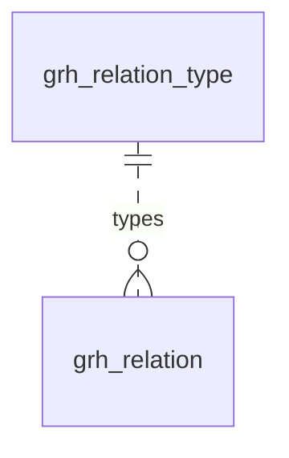

# 内容关系图谱（graph）模块设计

| 项 | 内容 |
|---|---|
| 模块 ID | `graph` |
| 名称 | 内容关系图谱 |
| 层 | L4 |
| 表前缀 | `grh_` |
| API 前缀 | `graph` |
| 可停用 | 否 |
| 模块版本 | 1.0.0（module.json 的 version） |
| 平台版本 | `>=1.0.0 <2.0.0`（module.json 的 platform） |
| 里程碑切片 | M1：<…>；M2：<…>；M3：<…>；M4：<…>（详见第 13 节） |
| 模块负责人 | 待定 |
| 文档版本 | V1.0 |
| 状态 | 草案 |
| 更新日期 | 2026-10-14 |
| 依据 | 系统设计 V1.4 第 <…> 章；平台框架设计 V1.<x> 第 4 章 <…> 节；ADR-<…> |

> 本文只引用《平台框架设计》第 4 章中的契约，不定义新的跨模块契约；需要新契约时按平台框架设计 2.3 提出契约变更请求。

## 1. 职责与边界

### 1.1 职责

> 一段概述 + 要点列表；与系统设计 3.2 的职责描述一致，并细化到本模块的功能清单。

### 1.2 不负责的事

| 事项 | 归属模块 | 说明 |
|---|---|---|

### 1.3 协作概览

> 用图或表说明本模块与哪些模块协作、通过哪种方式（服务接口 / 事件 / 扩展点）。只画契约，不画实现。

### 1.4 适用的架构约束

> 列出与本模块直接相关的原则（P1–P8）、ADR 规则与 CLAUDE.md 禁止项，以及本模块如何满足。

## 2. 依赖与契约

### 2.1 module.json

```json
{
  "id": "<id>",
  "name": "<中文名称>",
  "version": "1.0.0",
  "layer": "L3",
  "platform": ">=1.0.0 <2.0.0",
  "requires": {},
  "optional": {},
  "disableable": true,
  "tablePrefix": "<前缀>_",
  "apiPrefix": "<id>",
  "permissions": [],
  "menus": [],
  "settings": null,
  "components": [],
  "events": { "publishes": [], "subscribes": [] }
}
```

> 完整描述符，须通过平台框架设计附录 A 的 Schema 与 A.3 的校验规则。

### 2.2 使用的服务接口

| 接口（平台框架设计小节） | 方法 | 用途 | 调用位置与时机（事务内 / 外） | 测试替身 |
|---|---|---|---|---|

### 2.3 提供的服务接口

| 接口（平台框架设计小节） | 方法 | 实现类 | 契约测试 | 说明（幂等、权限、性能目标） |
|---|---|---|---|---|

### 2.4 实现的扩展点

| 扩展点（平台框架设计小节） | 实现类 | 适用范围（内容类型 / 资源类型） | order | 收集方 |
|---|---|---|---|---|

### 2.5 收集的扩展点

| 扩展点 | 调用时机 | 过滤（站点启用状态、内容类型等） | 实现缺失或抛出异常时的行为 | 测试用示例实现 |
|---|---|---|---|---|

### 2.6 发布与订阅的事件

发布：

| 事件 | 触发时机（所在事务） | 关键字段 | 主要订阅方 |
|---|---|---|---|

订阅：

| 事件 | 处理 | 幂等方式 | 过期判断 | 失败与重试 |
|---|---|---|---|---|

### 2.7 使用的端口

| 端口 | 用途 | 测试替身 |
|---|---|---|

## 3. 领域模型

### 3.1 聚合、实体与值对象

| 类型 | 名称 | 说明 |
|---|---|---|
| 聚合根 | RelationList（`grh_relation`，以源内容为单位） | 一个源内容的全部出向关系：人工关系（`MANUAL`，人工排序，始终置顶）与自动关系（`AUTO`，规则评分，按目标类型各保留前 `top_k` 条）；人工编辑按源内容整体保存，自动关系按源内容整体替换 |
| 实体 | Relation（`grh_relation` 的一行） | 源内容 → 目标内容 + 关系类型 + 来源 + 得分、排名、是否固定、得分原因 |
| 聚合根（全局） | RelationType（`grh_relation_type`） | 关系类型：key、是否对称、反向类型、允许的源与目标内容类型、中文名称、注册模块；由各模块的 `RelationTypeProvider` 在启动时同步 |
| 聚合根 | ScoringConfig（`grh_config`） | 站点 × 源内容类型的评分配置：权重、阈值、`top_k`、是否计算自动关系；没有行时使用内置默认值 |
| 聚合根 | ContentMode（`grh_content_mode`） | 某内容的相关推荐模式（`MANUAL` / `DISABLED`）；没有行即默认的 `AUTO` |
| 实体（队列） | DirtyEntry（`grh_dirty`） | 待增量重算的源内容：同一内容的触发合并去抖 30 秒 |
| 值对象 | Weights | 评分权重（`grh_config.weights`，见下） |
| 值对象 | ScoreReason | 得分原因：每个因子的分值与命中的分类项名称（`grh_relation.reason`），后台用于解释“为什么推荐” |
| 值对象 | RelatedItem | 读取结果（目标内容 ID、类型、来源、得分、卡片数据），不落库 |
| 值对象 | RelatedMode | `AUTO`（人工 + 自动）/ `MANUAL`（只有人工关系）/ `DISABLED`（不显示相关内容） |

**评分权重**（`grh_config.weights`，默认值即系统设计 15.3）：

```json
{
  "schemaVersion": 1,
  "primaryCategory": 30,
  "category": 15,
  "application": { "each": 25, "max": 50 },
  "industry": { "each": 20, "max": 40 },
  "tag": { "each": 10, "max": 30 },
  "certification": { "each": 5, "max": 10 },
  "typeAffinity": { "PRODUCT": 10, "ARTICLE": 3 },
  "freshness": { "max": 10, "days": 365 }
}
```

| 键 | 说明 |
|---|---|
| `primaryCategory` / `category` | 主产品分类相同 / 非主分类相同或同属一个父分类（词汇表 `product_category`；文章为 `article_category`） |
| `application`、`industry`、`tag`、`certification` | 每个相同分类项的分值与上限，键即词汇表 key（第 7 章） |
| `typeAffinity` | 目标内容类型 → 亲和分（0–10），如 CASE_STUDY → PRODUCT |
| `freshness` | 新鲜度（只用于目标为 ARTICLE）：`days` 天内从 `max` 线性衰减到 0 |

**补充与取舍**（系统设计之外的补充及理由）：

| 项 | 内容与理由 |
|---|---|
| `grh_relation.target_content_type` | 冗余目标内容类型：自动关系“按目标类型各保留前 20 条”，读取时按 `mix`（如 `{"PRODUCT": 4, "CASE_STUDY": 2}`）分类型取数，都不必跨模块查询 |
| `grh_relation.updated_at`、`updated_by` | 系统设计 25.9 的示例没有；人工排序与自动重算都会修改已有行 |
| `grh_relation.relation_type` 不建外键 | 引用全局表 `grh_relation_type.type_key`；类型由代码注册、只增不删，由应用层校验；避免在百万行级的表上为低选择性列建外键索引 |
| `grh_relation_type.type_key`、`module_id` | 系统设计的 `key`（MySQL 关键字，改名，见 平台框架设计 7.2）与 `module` |
| `grh_relation_type.auto_allowed`、`sort_order`、`available` | 哪些类型可以由评分生成（V1 只有 `RELATED`）；后台类型选择器的顺序；注册模块不再提供该类型时置 0 而不删除（已有关系仍可读取，不能新建） |
| `grh_config.auto_enabled` | 某类源内容可以整体关闭自动推荐（如 PAGE） |
| 新增 `grh_content_mode` | 系统设计 15.6 内容编辑页“设置模式（AUTO / MANUAL / DISABLED）”需要按内容保存 |
| 新增 `grh_dirty` | 系统设计 15.4 “同一内容的触发合并去抖 30 秒”：持久化的去抖队列，实例重启不丢失，多实例不重复计算 |

### 3.2 不变量

| # | 规则 | 保证方式 |
|---|---|---|
| 1 | 同一站点内（源，目标，类型）唯一；源与目标不能相同 | 数据库：`uk_grh_relation`、`ck_grh_rel_self` |
| 2 | 对称类型的人工关系成对存在（A→B 与 B→A 同类型）；互逆类型成对存在（A→B 为 T 时 B→A 为 T 的反向类型）；新增、删除在同一事务中写入两个方向，查询时只按源查询 | 应用层 |
| 3 | `AUTO` 行必须有得分与计算时间；`MANUAL` 行没有得分，`pinned` 为 0 | 数据库：`ck_grh_rel_origin` |
| 4 | 只有 `auto_allowed = 1` 的类型（V1：`RELATED`）可以有 `AUTO` 行；源与目标的内容类型必须在类型的允许列表内（空数组表示全部可路由类型） | 应用层 |
| 5 | 同一对（源，目标）已有任何人工关系（含 `EXCLUDED`）时不生成自动关系；人工新增与已有自动行相同的（源，目标，类型）时，把该行改为 `MANUAL` | 应用层 |
| 6 | 每个源内容每个目标类型最多 `top_k` 条自动关系（固定的行计入在内）；得分低于阈值的不保留（固定的行除外） | 应用层 |
| 7 | 自动关系按源内容整体替换：同一事务中删除该源未固定的 `AUTO` 行并插入新结果；固定的行只更新得分、排名与原因 | 应用层 |
| 8 | 关系建立在内容上，不区分语言；读取时只返回在请求语言已发布、可路由、未进回收站的目标，数量不足时按排名继续补足，不回退显示其他语言的内容 | 应用层 |
| 9 | 内容级模式与调用方传入的 `RelatedMode` 取较严格者（`DISABLED` > `MANUAL` > `AUTO`）；`MANUAL` 与 `DISABLED` 的内容不计算自身的自动关系 | 应用层 |
| 10 | 关系类型 key 全局唯一；对称类型没有反向类型；互逆类型双方互相指向 | 数据库：`uk_rtype_key`、`ck_grh_rtype_inverse`；应用层（启动同步时校验，冲突则启动失败） |
| 11 | 每站点每个源内容类型最多一行评分配置；每个内容最多一行模式；每个内容在队列中最多一行 | 数据库：`uk_cfg_type`、`uk_cmode_content`、`uk_dirty_content` |
| 12 | 某源内容的关系发生变化（人工编辑，或重算结果与原结果不同）后发布 `RelationChangedEvent`，delivery 清除 `s{site}:g:{contentId}` 标签 | 应用层 |

### 3.3 状态机

<<FILL: 状态与转换；没有状态机时写“不适用：<原因>”>>

## 4. 数据模型

> 遵守平台框架设计第 7 章的数据库通用约定。DDL 已在 MySQL 8.4 上执行通过；表结构以本节为准，与迁移脚本保持一致。

### 4.1 表清单

| 表 | 说明 | 站点级 | 软删除 | 预估规模（单站，按系统设计假设 A4） |
|---|---|---|---|---|
| `grh_relation` | 内容关系（人工 + 自动） | 是 | 否（人工删除即物理删除；自动关系重算时替换） | 1.5 万个源内容 × 平均 40–60 条 ≈ 60–90 万；上限 ≈ 150 万 |
| `grh_relation_type` | 关系类型（代码注册） | 否（全局，列入豁免清单） | 否（不再提供时 `available = 0`） | ≈ 15 |
| `grh_config` | 评分配置 | 是 | 否（删除即回到内置默认值） | ≤ 5（每种可路由内容类型一行） |
| `grh_content_mode` | 内容的相关推荐模式 | 是 | 否（恢复为 `AUTO` 即删除行） | 只有非默认模式的内容有行：≤ 数千 |
| `grh_dirty` | 增量重算队列 | 是 | 否（处理完成后删除） | 常驻 < 1 千；批量导入时峰值约 1 万 |

**站点过滤**：`grh_relation_type` 是全局表，列入行级拦截器的豁免清单。其余为站点级表；例外：增量重算任务跨站点轮询 `grh_dirty` 的到期记录，使用标注 `@InterceptorIgnore` 的专用查询，取到记录后按其 `site_id` 设置站点上下文再计算；每晚的全量重建按站点逐个执行。

### 4.2 ER 图



虚线表示按 `type_key` 的逻辑关系（不建外键，见 3）。`grh_config`、`grh_content_mode`、`grh_dirty` 只以内容 ID 与内容类型关联内容（见 4.6），未画出。

### 4.3 表结构

类型列中的 `bin` 表示 `COLLATE utf8mb4_0900_bin`；通用字段的定义见第 2.4 节。

#### 4.3.1 `grh_relation`：内容关系

与系统设计 25.9 的 DDL 示例一致，补全了列注释、`target_content_type`、`updated_at` / `updated_by` 与检查约束。读取顺序：人工关系按 `rank_no` → 自动关系按 `rank_no` → 过滤出请求语言已发布的目标 → 从投影取卡片数据（系统设计 15.5）。

| 字段 | 类型 | 可空 | 默认 | 说明 |
|---|---|---|---|---|
| `id` | BIGINT | 否 | — | 主键（TSID） |
| `site_id` | BIGINT | 否 | — | 站点 |
| `source_content_id` | BIGINT | 否 | — | 源内容（`cnt_content.id`） |
| `target_content_id` | BIGINT | 否 | — | 目标内容（`cnt_content.id`） |
| `target_content_type` | VARCHAR(32) | 否 | — | 目标内容类型（冗余 `cnt_content.type`） |
| `relation_type` | VARCHAR(40) bin | 否 | — | 关系类型（`grh_relation_type.type_key`） |
| `origin` | VARCHAR(10) | 否 | — | 来源：`MANUAL` / `AUTO` |
| `score` | DECIMAL(7,2) | 是 | — | 得分（`AUTO`）；`MANUAL` 为空 |
| `rank_no` | INT | 否 | 0 | 排名：`MANUAL` 为人工排序；`AUTO` 为同一目标类型内按得分的名次 |
| `pinned` | TINYINT(1) | 否 | 0 | 固定（只用于 `AUTO`）：重算时保留 |
| `reason` | JSON | 是 | — | 得分原因（`AUTO`） |
| `computed_at` | DATETIME(3) | 是 | — | 计算时间（`AUTO`） |
| `created_at` | DATETIME(3) | 否 | CURRENT_TIMESTAMP(3) | 创建时间 |
| `created_by` | BIGINT | 否 | 0 | 创建人（`AUTO` 为 0） |
| `updated_at` | DATETIME(3) | 否 | CURRENT_TIMESTAMP(3)，更新时自动刷新 | 更新时间 |
| `updated_by` | BIGINT | 否 | 0 | 更新人 |

索引与约束：
- `PRIMARY KEY (id)`
- `uk_grh_relation (site_id, source_content_id, target_content_id, relation_type)`：（源，目标，类型）唯一；写入反向行、判断某对内容是否已有人工关系或 `EXCLUDED`
- `idx_grh_relation_source (site_id, source_content_id, origin, rank_no)`：读取某源内容的关系（人工在前、按排名）；按源整体替换自动关系
- `idx_grh_relation_target (site_id, target_content_id)`：内容下线、彻底删除时查找指向它的关系；后台“哪些内容推荐了这里”
- `ck_grh_rel_self`、`ck_grh_rel_origin`：见 3.2 不变量 1、3

```sql
CREATE TABLE grh_relation (
  id                   BIGINT         NOT NULL COMMENT '主键（TSID）',
  site_id              BIGINT         NOT NULL COMMENT '站点',
  source_content_id    BIGINT         NOT NULL COMMENT '源内容（cnt_content.id）',
  target_content_id    BIGINT         NOT NULL COMMENT '目标内容（cnt_content.id）',
  target_content_type  VARCHAR(32)    NOT NULL COMMENT '目标内容类型（冗余 cnt_content.type）：PAGE / PRODUCT / ARTICLE / CASE_STUDY / TERM_PAGE；自动关系按目标类型各保留前 top_k 条',
  relation_type        VARCHAR(40)    COLLATE utf8mb4_0900_bin NOT NULL COMMENT '关系类型（grh_relation_type.type_key）：RELATED / RECOMMENDED / USES / USED_IN / CASE_OF / HAS_CASE / ACCESSORY_OF / HAS_ACCESSORY / REPLACED_BY / REPLACES / EXCLUDED，或模块注册的其他类型',
  origin               VARCHAR(10)    NOT NULL COMMENT '来源：MANUAL（人工，始终置顶）/ AUTO（规则评分）',
  score                DECIMAL(7, 2)  NULL COMMENT '得分（AUTO）；MANUAL 为空',
  rank_no              INT            NOT NULL DEFAULT 0 COMMENT '排名：MANUAL 为同一源内容内的人工排序（从 1 开始）；AUTO 为同一目标类型内按得分的名次（从 1 开始）',
  pinned               TINYINT(1)     NOT NULL DEFAULT 0 COMMENT '固定（只用于 AUTO）：1 = 编辑固定了这条自动推荐，重算时保留并更新得分与原因；MANUAL 恒为 0',
  reason               JSON           NULL COMMENT '得分原因（AUTO）：{"primaryCategory":30,"application":{"score":25,"terms":["可穿戴设备"]},"tag":{"score":10,"terms":["低温"]}}',
  computed_at          DATETIME(3)    NULL COMMENT '计算时间（AUTO）',
  created_at           DATETIME(3)    NOT NULL DEFAULT CURRENT_TIMESTAMP(3) COMMENT '创建时间',
  created_by           BIGINT         NOT NULL DEFAULT 0 COMMENT '创建人（0 = 系统，即自动关系）',
  updated_at           DATETIME(3)    NOT NULL DEFAULT CURRENT_TIMESTAMP(3) ON UPDATE CURRENT_TIMESTAMP(3) COMMENT '更新时间',
  updated_by           BIGINT         NOT NULL DEFAULT 0 COMMENT '更新人（0 = 系统）',
  PRIMARY KEY (id),
  UNIQUE KEY uk_grh_relation (site_id, source_content_id, target_content_id, relation_type),
  KEY idx_grh_relation_source (site_id, source_content_id, origin, rank_no),
  KEY idx_grh_relation_target (site_id, target_content_id),
  CONSTRAINT ck_grh_rel_self CHECK (source_content_id <> target_content_id),
  CONSTRAINT ck_grh_rel_origin CHECK ((origin = 'AUTO' AND score IS NOT NULL AND computed_at IS NOT NULL) OR (origin = 'MANUAL' AND score IS NULL AND pinned = 0))
) ENGINE = InnoDB DEFAULT CHARSET = utf8mb4 COLLATE = utf8mb4_0900_ai_ci COMMENT = '内容关系（建立在语言无关的内容上；人工关系与规则评分的自动关系）';
```

要点：
- 人工编辑（内容编辑页“关联”标签：添加、删除、排序、排除某条自动推荐）以源内容为单位提交，需要 `content:<type>:edit` 权限（系统设计 15.6）；“排除”即写入一对 `EXCLUDED` 行（对称），并删除该对之间的 `AUTO` 行。
- 增量重算（见 4.3.5）与每晚全量重建都以源内容为单位替换自动关系；全量重建完成后与增量结果比对，差异数写入 `sys_job` 的结果作为校验（系统设计 15.4）。

#### 4.3.2 `grh_relation_type`：关系类型

全局表，由各模块的 `RelationTypeProvider` 在应用启动时幂等同步（新增或更新；代码中不再提供的类型置 `available = 0`）；后台只读。

| 字段 | 类型 | 可空 | 默认 | 说明 |
|---|---|---|---|---|
| `id` | BIGINT | 否 | — | 主键（TSID） |
| `type_key` | VARCHAR(40) bin | 否 | — | 类型 key（大写字母与下划线），如 `RELATED` |
| `module_id` | VARCHAR(32) | 否 | — | 注册模块 ID，如 `graph`、`product` |
| `label` | VARCHAR(50) | 否 | — | 名称（中文，后台显示） |
| `symmetric` | TINYINT(1) | 否 | 0 | 是否对称 |
| `inverse_key` | VARCHAR(40) bin | 是 | — | 反向类型 key；对称类型与单向类型为空 |
| `allowed_source_types` | JSON | 否 | `(JSON_ARRAY())` | 允许的源内容类型；空数组表示全部可路由类型 |
| `allowed_target_types` | JSON | 否 | `(JSON_ARRAY())` | 允许的目标内容类型；空数组表示全部可路由类型 |
| `auto_allowed` | TINYINT(1) | 否 | 0 | 是否可由规则评分生成自动关系 |
| `sort_order` | INT | 否 | 0 | 后台类型选择器中的顺序 |
| `available` | TINYINT(1) | 否 | 1 | 注册模块是否仍提供该类型 |
| `created_at` | DATETIME(3) | 否 | CURRENT_TIMESTAMP(3) | 创建时间 |
| `updated_at` | DATETIME(3) | 否 | CURRENT_TIMESTAMP(3)，更新时自动刷新 | 更新时间 |

索引与约束：
- `PRIMARY KEY (id)`
- `uk_rtype_key (type_key)`：类型 key 全局唯一；按 key 读取（类型很少，应用启动后整体缓存）
- `ck_grh_rtype_inverse`：对称类型没有反向类型

```sql
CREATE TABLE grh_relation_type (
  id                    BIGINT       NOT NULL COMMENT '主键（TSID）',
  type_key              VARCHAR(40)  COLLATE utf8mb4_0900_bin NOT NULL COMMENT '类型 key（大写字母与下划线，全局唯一），如 RELATED、USES；创建后不可改名',
  module_id             VARCHAR(32)  NOT NULL COMMENT '注册模块 ID（RelationTypeProvider 的实现模块）：graph / product 等',
  label                 VARCHAR(50)  NOT NULL COMMENT '名称（中文，后台显示），如“相关”“配件”',
  symmetric             TINYINT(1)   NOT NULL DEFAULT 0 COMMENT '是否对称：1 = A→B 即 B→A，人工关系成对写入同一类型',
  inverse_key           VARCHAR(40)  COLLATE utf8mb4_0900_bin NULL COMMENT '反向类型 key（互逆关系成对写入，如 USES ↔ USED_IN）；对称类型与单向类型为空',
  allowed_source_types  JSON         NOT NULL DEFAULT (JSON_ARRAY()) COMMENT '允许的源内容类型数组，如 ["CASE_STUDY","ARTICLE"]；空数组表示全部可路由类型',
  allowed_target_types  JSON         NOT NULL DEFAULT (JSON_ARRAY()) COMMENT '允许的目标内容类型数组，如 ["PRODUCT"]；空数组表示全部可路由类型',
  auto_allowed          TINYINT(1)   NOT NULL DEFAULT 0 COMMENT '是否可由规则评分生成自动关系（V1 只有 RELATED 为 1；其他类型只能人工建立）',
  sort_order            INT          NOT NULL DEFAULT 0 COMMENT '后台类型选择器中的顺序（小的在前）',
  available             TINYINT(1)   NOT NULL DEFAULT 1 COMMENT '注册模块是否仍提供该类型：0 = 代码中已不存在，已有关系保留并可读取，不能新建',
  created_at            DATETIME(3)  NOT NULL DEFAULT CURRENT_TIMESTAMP(3) COMMENT '创建时间（首次同步）',
  updated_at            DATETIME(3)  NOT NULL DEFAULT CURRENT_TIMESTAMP(3) ON UPDATE CURRENT_TIMESTAMP(3) COMMENT '更新时间（最近一次同步变化）',
  PRIMARY KEY (id),
  UNIQUE KEY uk_rtype_key (type_key),
  CONSTRAINT ck_grh_rtype_inverse CHECK (symmetric = 0 OR inverse_key IS NULL)
) ENGINE = InnoDB DEFAULT CHARSET = utf8mb4 COLLATE = utf8mb4_0900_ai_ci COMMENT = '关系类型（全局表，由 RelationTypeProvider 同步；列入站点过滤豁免清单）';
```

V1 内置类型见 4.4。

#### 4.3.3 `grh_config`：评分配置

| 字段 | 类型 | 可空 | 默认 | 说明 |
|---|---|---|---|---|
| `id` | BIGINT | 否 | — | 主键（TSID） |
| `site_id` | BIGINT | 否 | — | 站点 |
| `content_type` | VARCHAR(32) | 否 | — | 源内容类型（可路由类型） |
| `weights` | JSON | 否 | — | 评分权重（见 3） |
| `threshold` | DECIMAL(7,2) | 否 | 30.00 | 阈值：得分低于此值的候选不保留 |
| `top_k` | INT | 否 | 20 | 每个目标类型保留的自动关系条数 |
| `auto_enabled` | TINYINT(1) | 否 | 1 | 是否为该类型的源内容计算自动关系 |
| `version` | INT | 否 | 0 | 乐观锁 |
| `created_at` | DATETIME(3) | 否 | CURRENT_TIMESTAMP(3) | 创建时间 |
| `created_by` | BIGINT | 否 | 0 | 创建人 |
| `updated_at` | DATETIME(3) | 否 | CURRENT_TIMESTAMP(3)，更新时自动刷新 | 更新时间 |
| `updated_by` | BIGINT | 否 | 0 | 更新人 |

索引与约束：
- `PRIMARY KEY (id)`
- `uk_cfg_type (site_id, content_type)`：每站点每个源内容类型一行；计算时按源内容类型读取
- `ck_grh_cfg_range`：`top_k` 在 1–50 之间，阈值不为负

```sql
CREATE TABLE grh_config (
  id            BIGINT         NOT NULL COMMENT '主键（TSID）',
  site_id       BIGINT         NOT NULL COMMENT '站点',
  content_type  VARCHAR(32)    NOT NULL COMMENT '源内容类型：PAGE / PRODUCT / ARTICLE / CASE_STUDY / TERM_PAGE（可路由类型）',
  weights       JSON           NOT NULL COMMENT '评分权重：{"schemaVersion":1,"primaryCategory":30,"category":15,"application":{"each":25,"max":50},…,"typeAffinity":{"PRODUCT":10},"freshness":{"max":10,"days":365}}',
  threshold     DECIMAL(7, 2)  NOT NULL DEFAULT 30.00 COMMENT '阈值：得分低于此值的候选不保留（默认 30）',
  top_k         INT            NOT NULL DEFAULT 20 COMMENT '每个目标类型保留的自动关系条数（默认 20）',
  auto_enabled  TINYINT(1)     NOT NULL DEFAULT 1 COMMENT '是否为该类型的源内容计算自动关系：0 = 只显示人工关系',
  version       INT            NOT NULL DEFAULT 0 COMMENT '乐观锁版本号',
  created_at    DATETIME(3)    NOT NULL DEFAULT CURRENT_TIMESTAMP(3) COMMENT '创建时间',
  created_by    BIGINT         NOT NULL DEFAULT 0 COMMENT '创建人',
  updated_at    DATETIME(3)    NOT NULL DEFAULT CURRENT_TIMESTAMP(3) ON UPDATE CURRENT_TIMESTAMP(3) COMMENT '更新时间',
  updated_by    BIGINT         NOT NULL DEFAULT 0 COMMENT '更新人',
  PRIMARY KEY (id),
  UNIQUE KEY uk_cfg_type (site_id, content_type),
  CONSTRAINT ck_grh_cfg_range CHECK (top_k BETWEEN 1 AND 50 AND threshold >= 0)
) ENGINE = InnoDB DEFAULT CHARSET = utf8mb4 COLLATE = utf8mb4_0900_ai_ci COMMENT = '图谱评分配置（站点 × 源内容类型；没有行时使用内置默认值）';
```

要点：修改配置后为该站点创建一次全量重建任务（`sys_job`），不逐条入队；`weights` 按 Schema 校验（键只能是 14.1 列出的因子）。

#### 4.3.4 `grh_content_mode`：内容的相关推荐模式

| 字段 | 类型 | 可空 | 默认 | 说明 |
|---|---|---|---|---|
| `id` | BIGINT | 否 | — | 主键（TSID） |
| `site_id` | BIGINT | 否 | — | 站点 |
| `content_id` | BIGINT | 否 | — | 内容（`cnt_content.id`） |
| `mode` | VARCHAR(16) | 否 | — | 模式：`MANUAL` / `DISABLED` |
| `version` | INT | 否 | 0 | 乐观锁 |
| `created_at` | DATETIME(3) | 否 | CURRENT_TIMESTAMP(3) | 创建时间 |
| `created_by` | BIGINT | 否 | 0 | 创建人 |
| `updated_at` | DATETIME(3) | 否 | CURRENT_TIMESTAMP(3)，更新时自动刷新 | 更新时间 |
| `updated_by` | BIGINT | 否 | 0 | 更新人 |

索引与约束：
- `PRIMARY KEY (id)`
- `uk_cmode_content (content_id)`：每个内容最多一行；读取与计算时按内容查找
- `ck_grh_cmode_mode`：只保存非默认模式

```sql
CREATE TABLE grh_content_mode (
  id          BIGINT       NOT NULL COMMENT '主键（TSID）',
  site_id     BIGINT       NOT NULL COMMENT '站点',
  content_id  BIGINT       NOT NULL COMMENT '内容（cnt_content.id）',
  mode        VARCHAR(16)  NOT NULL COMMENT '相关推荐模式：MANUAL（只显示人工关系，不计算自身的自动关系）/ DISABLED（不显示相关内容）；默认的 AUTO 不保存行',
  version     INT          NOT NULL DEFAULT 0 COMMENT '乐观锁版本号',
  created_at  DATETIME(3)  NOT NULL DEFAULT CURRENT_TIMESTAMP(3) COMMENT '创建时间',
  created_by  BIGINT       NOT NULL DEFAULT 0 COMMENT '创建人',
  updated_at  DATETIME(3)  NOT NULL DEFAULT CURRENT_TIMESTAMP(3) ON UPDATE CURRENT_TIMESTAMP(3) COMMENT '更新时间',
  updated_by  BIGINT       NOT NULL DEFAULT 0 COMMENT '更新人',
  PRIMARY KEY (id),
  UNIQUE KEY uk_cmode_content (content_id),
  CONSTRAINT ck_grh_cmode_mode CHECK (mode IN ('MANUAL', 'DISABLED'))
) ENGINE = InnoDB DEFAULT CHARSET = utf8mb4 COLLATE = utf8mb4_0900_ai_ci COMMENT = '内容的相关推荐模式（只保存非默认的 MANUAL / DISABLED）';
```

要点：改为 `MANUAL` 或 `DISABLED` 时删除该内容自身的 `AUTO` 行（其他内容的自动关系仍可指向它）；恢复为 `AUTO` 时删除本行并把该内容入队重算。

#### 4.3.5 `grh_dirty`：增量重算队列

事件监听器（事务提交后）把受影响的源内容写入本表：`INSERT … ON DUPLICATE KEY UPDATE`，`due_at` 取 min(当前时间 + 30 秒, `created_at` + 5 分钟)，`trigger_count` 与 `version` + 1。重算任务每 10 秒跨站点取到期且未被租用的行（`due_at <= now AND (locked_until IS NULL OR locked_until < now)`），以条件更新设置租约后计算；完成后按 `version` 条件删除（处理期间有新触发时版本已变化，行保留，下一轮再算）；失败时 `attempts` + 1 并按退避推迟 `due_at`。

| 字段 | 类型 | 可空 | 默认 | 说明 |
|---|---|---|---|---|
| `id` | BIGINT | 否 | — | 主键（TSID） |
| `site_id` | BIGINT | 否 | — | 站点 |
| `content_id` | BIGINT | 否 | — | 待重算的源内容（`cnt_content.id`） |
| `reason` | VARCHAR(24) | 否 | — | 最近一次触发原因 |
| `trigger_count` | INT | 否 | 1 | 去抖期间合并的触发次数 |
| `due_at` | DATETIME(3) | 否 | — | 最早处理时间 |
| `locked_until` | DATETIME(3) | 是 | — | 处理租约到期时间 |
| `attempts` | INT | 否 | 0 | 失败次数 |
| `last_error` | VARCHAR(500) | 是 | — | 最近一次失败原因 |
| `version` | INT | 否 | 0 | 每次合并触发 + 1，用于条件删除 |
| `created_at` | DATETIME(3) | 否 | CURRENT_TIMESTAMP(3) | 首次触发时间 |
| `updated_at` | DATETIME(3) | 否 | CURRENT_TIMESTAMP(3)，更新时自动刷新 | 更新时间 |

索引与约束：
- `PRIMARY KEY (id)`
- `uk_dirty_content (site_id, content_id)`：每个内容最多一行（合并触发）
- `idx_dirty_due (due_at)`：重算任务跨站点取到期记录（专用豁免查询）；积压告警

```sql
CREATE TABLE grh_dirty (
  id             BIGINT        NOT NULL COMMENT '主键（TSID）',
  site_id        BIGINT        NOT NULL COMMENT '站点',
  content_id     BIGINT        NOT NULL COMMENT '待重算的源内容（cnt_content.id）',
  reason         VARCHAR(24)   NOT NULL COMMENT '最近一次触发原因：PUBLISHED / UNPUBLISHED / TRASHED / RESTORED / TERM_CHANGED / MANUAL_CHANGED / MODE_CHANGED',
  trigger_count  INT           NOT NULL DEFAULT 1 COMMENT '去抖期间合并的触发次数',
  due_at         DATETIME(3)   NOT NULL COMMENT '最早处理时间：最近一次触发 + 30 秒，且不晚于 created_at + 5 分钟（避免批量导入时一直推迟）',
  locked_until   DATETIME(3)   NULL COMMENT '处理租约到期时间：取件时设为当前时间 + 5 分钟，防止多实例重复计算',
  attempts       INT           NOT NULL DEFAULT 0 COMMENT '失败次数（超过 5 次告警，行保留到下次全量重建后删除）',
  last_error     VARCHAR(500)  NULL COMMENT '最近一次失败原因',
  version        INT           NOT NULL DEFAULT 0 COMMENT '每次合并触发 + 1；处理完成后按版本条件删除，处理期间的新触发不会丢失',
  created_at     DATETIME(3)   NOT NULL DEFAULT CURRENT_TIMESTAMP(3) COMMENT '首次触发时间',
  updated_at     DATETIME(3)   NOT NULL DEFAULT CURRENT_TIMESTAMP(3) ON UPDATE CURRENT_TIMESTAMP(3) COMMENT '更新时间',
  PRIMARY KEY (id),
  UNIQUE KEY uk_dirty_content (site_id, content_id),
  KEY idx_dirty_due (due_at)
) ENGINE = InnoDB DEFAULT CHARSET = utf8mb4 COLLATE = utf8mb4_0900_ai_ci COMMENT = '图谱增量重算队列（同一内容的触发合并去抖 30 秒）';
```

要点：
- 重算一个源内容：读取其发布态分类项 → 候选集（经 content 的服务接口查询 `cnt_published_term`，同站点、可路由、未进回收站，排除自身、已有人工关系与 `EXCLUDED` 的内容，按分类项稀有度截取 ≤ 2,000 个）→ 评分 → 按目标类型截取 → 整体替换该源的自动关系；分类重叠分是对称的，同时更新排名可能受影响的候选的列表（直接在同一次计算中更新，不再入队）（系统设计 15.3、15.4）。
- `TermChangedEvent`（分类移动或删除）影响的内容超过 1,000 个，或配置变化时，不逐条入队，改为创建该站点的全量重建任务。

### 4.4 枚举

| 字段 | 取值 | 说明 |
|---|---|---|
| `grh_relation.origin` | `MANUAL` / `AUTO` | 共享关系来源枚举：人工 / 规则评分 |
| `grh_relation.target_content_type`、`grh_config.content_type` | `PAGE` / `PRODUCT` / `ARTICLE` / `CASE_STUDY` / `TERM_PAGE` | 共享内容类型枚举中的可路由类型（FAQ、GLOBAL_BLOCK 不进入图谱） |
| `grh_content_mode.mode`（及读取参数 `RelatedMode`） | `AUTO` / `MANUAL` / `DISABLED` | 人工 + 自动（默认，不存行）/ 只有人工关系 / 不显示相关内容 |
| `grh_dirty.reason` | `PUBLISHED` / `UNPUBLISHED` / `TRASHED` / `RESTORED` | 内容发布（分类指派随发布生效）/ 下线 / 进回收站 / 恢复 |
| | `TERM_CHANGED` | 分类项移动或删除（影响“同属一个父分类”等因子） |
| | `MANUAL_CHANGED` / `MODE_CHANGED` | 人工关系变化（排除、新增）/ 模式恢复为 `AUTO` |
| `grh_relation.relation_type`、`grh_relation_type.type_key`（V1 内置） | 见下表 | 系统设计 15.2 |

**V1 内置关系类型**（`grh_relation_type` 的同步结果）：

| `type_key` | `label` | 对称 | `inverse_key` | 允许的源 → 目标 | 自动 | 注册模块 |
|---|---|---|---|---|---|---|
| `RELATED` | 相关 | 是 | — | 全部 → 全部 | 是 | graph |
| `RECOMMENDED` | 推荐 | 否 | — | 全部 → 全部（单向，排序优先） | 否 | graph |
| `USES` | 使用的产品 | 否 | `USED_IN` | CASE_STUDY、ARTICLE → PRODUCT | 否 | graph |
| `USED_IN` | 应用案例 | 否 | `USES` | PRODUCT → CASE_STUDY、ARTICLE | 否 | graph |
| `CASE_OF` | 所属产品或应用 | 否 | `HAS_CASE` | CASE_STUDY → PRODUCT、TERM_PAGE | 否 | graph |
| `HAS_CASE` | 客户案例 | 否 | `CASE_OF` | PRODUCT、TERM_PAGE → CASE_STUDY | 否 | graph |
| `ACCESSORY_OF` | 适配产品 | 否 | `HAS_ACCESSORY` | PRODUCT → PRODUCT | 否 | product |
| `HAS_ACCESSORY` | 配件 | 否 | `ACCESSORY_OF` | PRODUCT → PRODUCT | 否 | product |
| `REPLACED_BY` | 替代型号 | 否 | `REPLACES` | PRODUCT → PRODUCT | 否 | product |
| `REPLACES` | 替代的旧型号 | 否 | `REPLACED_BY` | PRODUCT → PRODUCT | 否 | product |
| `EXCLUDED` | 排除 | 是 | — | 全部 → 全部（人工排除，阻止自动关联；不在前台显示） | 否 | graph |

`USED_IN`、`HAS_CASE`、`HAS_ACCESSORY`、`REPLACES` 是系统设计 15.2 中的反向类型，单独登记为类型行；产品相关的四个类型由 product 经 `RelationTypeProvider` 注册（系统设计 3.7），名称与允许类型是本文的建议。

### 4.5 站点过滤

<<FILL: | 表 | 行级拦截器（不豁免 / 豁免） | 访问方式与理由 |>>

### 4.6 跨模块引用与清理

| 本模块字段 | 引用对象（模块.表） | 被引用对象删除 / 下线时的处理 | 触发事件 |
|---|---|---|---|
| 各表 `site_id` | core.`sys_site` | V1 不删除站点 | — |
| `grh_relation.source_content_id`、`target_content_id`、`target_content_type` | content.`cnt_content` | 下线、进回收站：人工关系保留（恢复后仍有效），读取时过滤；该内容作为源的自动关系删除，并将指向它的源内容入队重算；恢复：入队重算；彻底删除：按 `idx_grh_relation_source` 与 `idx_grh_relation_target` 删除两个方向的全部行 | `ContentUnpublishedEvent`、`ContentTrashedEvent`、`ContentRestoredEvent`、`ContentPurgedEvent` |
| `grh_content_mode.content_id`、`grh_dirty.content_id` | content.`cnt_content` | 彻底删除：删除对应行 | `ContentPurgedEvent` |
| 评分候选与 `grh_relation.reason` 中的分类项名称 | content.`cnt_published_term`（经 content 的服务接口）、taxonomy.`tx_term` | 发布：源内容入队；分类项移动或删除：受影响内容入队（超过 1,000 个时全量重建）；更名：`reason` 中的名称在下次重算时更新 | `ContentPublishedEvent`、`TermChangedEvent` |
| `grh_relation_type.module_id` 及该类型的关系 | core.`sys_module`、`sys_site_module` | 站点停用注册模块：关系保留，读取时跳过该模块的类型与该模块内容类型的目标（系统设计 3.8）；模块 PURGED：删除该模块类型的全部关系，类型行置 `available = 0` | `ModuleDisabledEvent`、`ModuleEnabledEvent`、`onPurge` |
| `grh_config.content_type`、`grh_relation.target_content_type` | 内容类型（代码注册） | 所属模块停用：保留配置与关系；候选集与读取排除该类型 | `ModuleDisabledEvent` |
| `created_by`、`updated_by` | core.`sys_user` | 不清理 | — |

**其他模块引用本模块的对象**（其他章节需配合）：

| 被引用对象 | 引用方 | 说明 | 事件 |
|---|---|---|---|
| `grh_relation`（经 `related()` 读取） | delivery（相关内容数据源，缓存标签 `s{site}:g:{contentId}`） | 关系变化后清除源内容的 `g` 标签 | `RelationChangedEvent` |
| `grh_relation` | seo（`seo_link` 的 `RELATED` 行，见 seo 模块设计 4.6） | 关系变化时重建相关来源页面的 `RELATED` 行 | `RelationChangedEvent` |
| `grh_relation_type.type_key` | product（经 `RelationTypeProvider` 注册产品相关类型） | key 由注册模块定义，不可改名（改名视为新类型） | — |

本模块发布的事件：`RelationChangedEvent`（源内容 ID）。订阅：`ContentPublishedEvent`、`ContentUnpublishedEvent`、`ContentTrashedEvent` / `ContentRestoredEvent`、`ContentPurgedEvent`、`TermChangedEvent`、`ModuleEnabledEvent` / `ModuleDisabledEvent`。本模块实现的扩展点：`RelationTypeProvider`（内置类型）。

### 4.7 迁移脚本

| 文件 | 内容 | 里程碑 |
|---|---|---|
| `db/migration/graph/V001__init.sql` | 4.3 中的全部表（5 张：`grh_relation`、`grh_relation_type`、`grh_config`、`grh_content_mode`、`grh_dirty`），按本节顺序创建 | <见第 13 节> |

## 5. 业务流程

### 5.1 <流程名称>

```text
<步骤；标出事务边界、调用的服务接口、发布的事件、异步部分>
```

| 步骤 | 说明 | 失败处理 |
|---|---|---|

## 6. 接口

### 6.1 Admin 端点

| 方法 | 路径（/api/admin/v1/<apiPrefix>/…） | 说明 | 权限码 | 并发控制 / 幂等 | 审计 |
|---|---|---|---|---|---|

### 6.2 Public 端点

| 方法 | 路径（/api/public/v1/<apiPrefix>/…） | 说明 | 限流 | 缓存 |
|---|---|---|---|---|

### 6.3 Internal 端点

| 方法 | 路径（/api/internal/v1/<apiPrefix>/…） | 说明 | 调用方 |
|---|---|---|---|

### 6.4 权限码

| 权限码 | 名称 | 数据范围 | 高危（sensitive） | 受语言范围限制（localeScoped） |
|---|---|---|---|---|

### 6.5 错误码

| 错误码 | HTTP 状态 | 后台中文信息 | 前台文案键（仅公开接口） |
|---|---|---|---|

## 7. 后台界面

### 7.1 菜单与路由

| 菜单 key | 名称 | 父菜单 | 路由 | 权限码 |
|---|---|---|---|---|

### 7.2 页面

| 页面 | 路由 | 主要功能 | 使用的 admin-kit 组件 |
|---|---|---|---|

### 7.3 注册到内容编辑外壳的标签

| key | 适用内容类型 | 权限码 | 组件 |
|---|---|---|---|

### 7.4 界面文案

> texts.ts 中的分组与关键文案；后台只用简体中文。

## 8. 前台组件与模板

> 没有前台组件时写“不适用”。

### 8.1 组件

| 组件类型 | 名称（label） | 变体 | 分类 | allowedIn | 数据源 | 是否水合 |
|---|---|---|---|---|---|---|

### 8.2 属性与翻译

| 组件 | 属性 | 类型 / x-editor | x-translatable | maxLength |
|---|---|---|---|---|

### 8.3 模板

| 模板 key | 内容类型 | 固定区域与插槽 |
|---|---|---|

### 8.4 数据源

| key | 参数 | 返回 | 缓存标签 |
|---|---|---|---|

### 8.5 文案键

| 文案键 | 默认中文文案 | 使用位置 |
|---|---|---|

## 9. 配置项

### 9.1 站点设置（settings.schema.json）

| 键 | 类型 | 默认值 | 说明 | 敏感（x-secret） |
|---|---|---|---|---|

### 9.2 部署配置（application.yml，前缀 b2bweb.<id>）

| 属性 | 默认值 | 说明 |
|---|---|---|

## 10. 定时与异步任务

> 没有时写“不适用”。定时任务实现 `ScheduledTask`，通用异步任务实现 `JobHandler`（平台框架设计 4.4.12）；锁名与任务类型按平台框架设计 3.7 命名。事件监听器已在 2.6 中列出，这里只补充耗时长、需要单独调度或重试的处理。`PER_SITE` 任务由 core 在站点上下文中逐站点执行，停用了本模块的站点自动跳过（系统设计 3.8）。外部服务（AI 引擎、邮件、CDN）只在事务提交后的异步处理中调用，失败不回滚已提交的业务数据（ADR-003、ADR-017）。

| 任务 | 类型（定时 / sys_job / 事件监听） | 触发 | 锁名 | 幂等与重试 | 模块停用时 |
|---|---|---|---|---|---|

> 每个任务另写：执行粒度（`PER_SITE` / 系统级）、单次处理量与分批方式、超时、能否取消、失败后的可见结果（`sys_job` 的失败报告、指标 `b2bweb.<id>.*` 或告警）。

## 11. 测试要点

> 测试层级、替身与契约测试的写法见平台框架设计第 9 章，门禁与覆盖率见第 10 章。“至少”后的用例为必测项；不适用的行写“不适用：<原因>”，不得删除。

| 层级 | 覆盖内容 | 关键用例 |
|---|---|---|
| 单元 | <领域对象、不变量（3.2）、状态机（3.3）、扩展点实现（2.4）> | 至少：3.2 每条不变量的违反用例；3.3 每个非法状态转换被拒绝 |
| 模块集成（Testcontainers + 替身） | <应用服务 + 本模块的表与迁移> | 至少：迁移脚本在空库（MySQL 8.4）上执行通过；6.1 中声明的并发控制与幂等；唯一约束冲突转为 6.5 的错误码 |
| 契约（作为提供方） | <2.3 中本模块提供的服务接口> | 继承 testkit 中的 `<接口名>ContractTest`，用真实实现运行；不提供服务接口时写“不适用” |
| 事件（Scenario API，含重复投递） | <2.6 中发布与订阅的事件> | 至少：事件在业务事务内发布、事务回滚时不发布；每个监听器重复投递只生效一次、过期事件被丢弃（ADR-003） |
| 停用行为（可停用模块） | <系统设计 3.8 的各项> | 至少：停用后写操作与公开接口返回 `CORE_MODULE_DISABLED`；扩展点实现不再被收集；定时任务跳过；`analyzeDisableImpact` 的结果正确；重新启用后数据完整（S10） |
| 站点隔离 | <6.1 的全部后台接口与 4.5 的全部站点级表> | 至少：站点 A 的用户不能读写站点 B 的数据（遍历全部后台端点，系统设计 28）；豁免表只在 4.5 列出的位置访问 |
| 翻译（如有可翻译字段） | <`TranslatableContentProvider` / `TranslatableResourceProvider` 实现> | 至少：提取 → 回写往返一致；`x-translatable = false` 的字段不被提取；`HUMAN` / `REVIEWED` 段不被机器译文覆盖；资源变化时发布 `TranslatableResourceChangedEvent` |
| 前端（组件、Admin） | <主题组件、Admin 页面> | 至少：组件 Schema 校验与画廊示例（视觉回归）；前台文字只来自文案键、后台文字只来自 `texts.ts`；无权限时操作不可见 |
| E2E（场景） | <13.2 中验证方式为 E2E 的验收项> | Playwright 用例名包含 13.2 的验收项编号 |

## 12. 独立开发说明

### 12.1 依赖的测试替身

> 2.2 使用的每个服务接口、2.7 使用的每个端口、2.5 收集的每个扩展点，都要在此列出 testkit 中对应的替身或示例实现（平台框架设计 2.4、第 9 章）。testkit 中缺少的替身向框架组提出需求（DoR 第 3 条，平台框架设计 2.7），不在本模块中另建一套代替其他模块的模拟实现；单元测试可以用 Mockito 模拟个别方法，但对其他模块行为的假设以替身与契约测试为准。

| 替身（platform-testkit） | 代替的模块 | 用途 | 需要预置的数据 |
|---|---|---|---|

### 12.2 本模块提供的替身

> 只有提供服务接口的模块填写（core、content、url、media、taxonomy、form、notification、translation，见平台框架设计 4.2）；其他模块写“不适用：不提供服务接口”。替身由框架组编写并维护，与真实实现通过同一套契约测试；本模块改变服务接口的行为时，在同一个 PR 中同步修改契约测试，并通知框架组修改替身（平台框架设计 2.3）。无法消除的差异（如不做病毒扫描、不生成真实缩略图）列入下表，并确认不影响使用方的测试结论。

| 服务接口 | testkit 中的替身 | 与真实实现的差异（应为零，或已在契约测试中声明） |
|---|---|---|

### 12.3 本地运行

> 启动方式、依赖的本地服务（平台框架设计第 11 章）、需要的配置。

### 12.4 演示数据

> tools/demo-data 中本模块的数据及其用途。

## 13. 验收标准

### 13.1 里程碑切片

> 与平台框架设计 13.5 中本模块的一行一致；调整切片按平台框架设计 12.5 处理。该里程碑没有切片时写“—”（不表示不能提前开发）。

| 里程碑 | 交付功能 | 验收场景 |
|---|---|---|
| M1 | <…> | <S1、S2、S4 中与本模块相关的部分，或“模块自身”> |
| M2 | <…> | <…> |
| M3 | <…> | <…> |
| M4 | <…> | <…> |

### 13.2 验收项

> 每条验收项写明输入、期望结果与度量（如“5 分钟内”“P95 ≤ 200 ms”）。场景验收项只写本模块负责的部分（如 S2 中 url 负责“旧 URL 301 到新 URL、不产生重定向链”），不复述整个场景；各里程碑的场景见平台框架设计 13.6。验证方式为单元 / 集成 / E2E 时写出测试类或用例名；人工检查写明检查人与方法。

| # | 验收项 | 对应场景（S1–S13）或模块自身 | 验证方式（单元 / 集成 / E2E / 人工） | 里程碑 |
|---|---|---|---|---|
| A1 | <…> | <S? / 模块自身> | <集成：`<测试类>`> | M? |

> 每个模块都要包含以下通用验收项（不适用时注明原因）：架构测试与 Modulith 验证通过，无跨模块 import 与表访问；站点隔离测试覆盖全部后台接口；后台写操作都有权限码与审计记录；可停用模块满足 S10；可翻译字段与资源已登记并通过往返测试（S11、S12）；系统设计 1.5 中与本模块相关的非功能指标；文档与代码一致（DoD，平台框架设计 2.8）。

## 14. 待定问题

> 记录评审与开发中尚未决定的事项。“阻塞开发”的问题必须在评审通过（DoR）前关闭；需要新契约或修改上层文档的问题，写明契约变更请求或 Issue 编号。已关闭的问题保留在表中，填写结论。

| # | 问题 | 影响 | 是否阻塞开发 | 负责人 | 最晚解决 | 结论 |
|---|---|---|---|---|---|---|

## 修订记录

| 版本 | 日期 | 变更 |
|---|---|---|
| V1.0 | 2026-10-14 | 初稿 |
