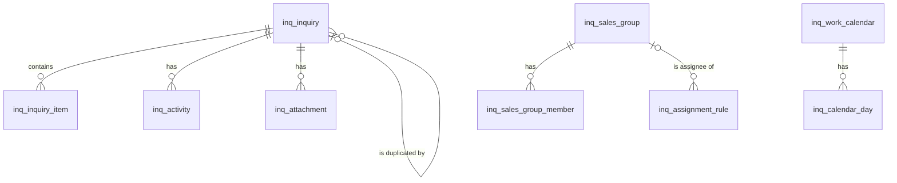

# 询盘（inquiry）模块设计

| 项 | 内容 |
|---|---|
| 模块 ID | `inquiry` |
| 名称 | 询盘 |
| 层 | L3 |
| 表前缀 | `inq_` |
| API 前缀 | `inquiry` |
| 可停用 | 是 |
| 模块版本 | 1.0.0（module.json 的 version） |
| 平台版本 | `>=1.0.0 <2.0.0`（module.json 的 platform） |
| 里程碑切片 | M1：询盘创建、归因、通知；M2：—；M3：分配规则、去重、SLA、报表、询价篮、询盘翻译；M4：数据范围完善（详见第 13 节） |
| 模块负责人 | 待定 |
| 文档版本 | V1.4 |
| 状态 | 草案 |
| 更新日期 | 2026-10-20 |
| 依据 | 系统设计 V1.9 第 17 章及 3.2、3.8、24–29 章；平台框架设计 V1.7 第 4、7–13 章；ADR-002、ADR-003、ADR-005、ADR-009、ADR-018 |

> 本文只引用《平台框架设计》第 4 章中的契约，不定义新的跨模块契约；需要新契约时按平台框架设计 2.3 提出契约变更请求。

## 1. 职责与边界

### 1.1 职责

将有效表单提交转为询盘，保存联系信息、产品快照和归因；负责去重、分配、销售跟进、工作时间 SLA、报表、询价篮与按需留言翻译。

功能交付范围按第 13 章分为 M1–M4；表结构、约束与枚举以第 3、4 章为准。

### 1.2 不负责的事

| 事项 | 归属模块 | 边界 |
|---|---|---|
| 内容生命周期与路由 | content / url | 本模块只承担自身职责；不直接修改 cnt_、url_ 表 |
| 身份、权限、设置、任务及审计 | platform-core | 复用平台公共服务 |
| 第三方客户端与网络传输 | infrastructure | 仅经既有端口或 L2 服务使用，不在业务模块引入客户端 |

### 1.3 协作概览

| 协作方式 | 对象 | 本模块行为 |
|---|---|---|
| 服务接口 | ContentApi、MediaApi、TaxonomyApi、FormApi、NotificationApi、TranslationApi | 方法与事务边界见 2.2；无跨模块表访问 |
| 扩展点 | PersonalDataProvider、NotificationTemplateProvider、ContentVariantProvider | 实现/收集清单见 2.4、2.5 |
| 领域事件 | 见 2.6 | 与本地事务一起登记，提交后异步投递；重复与过期处理独立验证 |

### 1.4 适用的架构约束

遵守 P2、P3 与 ADR-018：编译依赖只到 platform-core/platform-api，跨模块协作只用第 2 章登记契约；只访问自己的表，禁止跨模块 JOIN/外键。遵守 ADR-003：事务内登记、提交后投递、监听器幂等并检查过期。遵守 ADR-009：每次请求/任务明确站点上下文，站点表默认过滤。

公开读取只用当前语言发布态，不跨语言回退（ADR-005）；预览与公开缓存隔离。后台中文文案与错误集中管理，前台文案经 UiTextApi，样式只用 Design Token。远程端口在数据库事务外调用，密钥经 SecretCipher，不写日志。

## 2. 依赖与契约

### 2.1 module.json

```json
{
  "id": "inquiry",
  "name": "询盘",
  "version": "1.0.0",
  "layer": "L3",
  "platform": ">=1.0.0 <2.0.0",
  "requires": {
    "content": "^1.0",
    "media": "^1.0",
    "taxonomy": "^1.0",
    "form": "^1.0",
    "notification": "^1.0"
  },
  "optional": {
    "translation": "^1.0",
    "product": "^1.0"
  },
  "disableable": true,
  "tablePrefix": "inq_",
  "apiPrefix": "inquiry",
  "permissions": [
    {
      "code": "inquiry:inquiry:view",
      "name": "查看询盘",
      "dataScopes": [
        "ALL",
        "GROUP",
        "OWN"
      ]
    },
    {
      "code": "inquiry:inquiry:edit",
      "name": "编辑询盘",
      "dataScopes": [
        "ALL",
        "GROUP",
        "OWN"
      ]
    },
    {
      "code": "inquiry:inquiry:assign",
      "name": "分配询盘"
    },
    {
      "code": "inquiry:inquiry:export",
      "name": "导出询盘",
      "sensitive": true,
      "dataScopes": [
        "ALL",
        "GROUP",
        "OWN"
      ]
    },
    {
      "code": "inquiry:report:view",
      "name": "查看报表",
      "dataScopes": [
        "ALL",
        "GROUP",
        "OWN"
      ]
    },
    {
      "code": "inquiry:rule:manage",
      "name": "管理分配规则"
    }
  ],
  "menus": [
    {
      "key": "inquiry",
      "name": "询盘",
      "parent": "sales",
      "route": "/inquiry/inquiries",
      "permission": "inquiry:inquiry:view",
      "order": 100
    }
  ],
  "settings": "settings.schema.json",
  "components": [
    "inquiry-form",
    "add-to-inquiry-button",
    "inquiry-cart"
  ],
  "events": {
    "publishes": [
      "InquiryCreatedEvent",
      "InquiryAssignedEvent",
      "InquiryStatusChangedEvent"
    ],
    "subscribes": [
      "UserDeactivatedEvent",
      "FormSubmittedEvent",
      "TermChangedEvent"
    ]
  }
}
```

描述符为 M0 工程建立后的实现要求；目前尚无实际控制器、Schema 或组件包。依赖只声明运行能力；Maven 仍只依赖 platform-api/core。组件清单是本模块负责的类型，运行时 UI 不登记成可拖入布局的组件。

### 2.2 使用的服务接口

| 接口（平台框架设计小节） | 方法 | 用途 | 调用位置与时机 | 测试替身 |
|---|---|---|---|---|
| `ContentApi`（4.4.16） | findPublishedSnapshot、findPublishedCards、queryPublished | 读当前发布快照与卡片；内容类型所属模块创建身份并标记草稿变化 | 读接口在查询阶段调用；写方法加入业务事务，远程文本翻译必须在事务外 | `InMemoryContentApi` |
| `MediaApi`（4.4.18） | findAll、upload、privateDownloadUrl、delete | 媒体视图、图片源与授权下载；不读取媒体表 | 读接口在查询阶段调用；写方法加入业务事务，远程文本翻译必须在事务外 | `InMemoryMediaApi` |
| `TaxonomyApi`（4.4.19） | findTerms、termViews、assignmentsOf | 词汇表、分类视图与内容指派；不读取分类表 | 读接口在查询阶段调用；写方法加入业务事务，远程文本翻译必须在事务外 | `InMemoryTaxonomyApi` |
| `FormApi`（4.4.20） | findForm、findSubmission | 表单摘要与提交视图 | 读接口在查询阶段调用；写方法加入业务事务，远程文本翻译必须在事务外 | `InMemoryFormApi` |
| `NotificationApi`（4.4.21） | send、sendWebhookEvent | 事务内写幂等通知发件箱 | 读接口在查询阶段调用；写方法加入业务事务，远程文本翻译必须在事务外 | `InMemoryNotificationApi` |
| `TranslationApi`（4.4.22） | isTextTranslationAvailable、translateText | 事务外按需文本翻译或读取审校统计 | 读接口在查询阶段调用；写方法加入业务事务，远程文本翻译必须在事务外 | `InMemoryTranslationApi` |
| `SiteApi`（4.4.1） | 按该契约声明的方法 | 语言、站点模块开关 | 业务事务内；站点切换由任务入口完成 | `InMemorySiteApi` |
| `SiteContextProvider`（4.4.2） | 按该契约声明的方法 | 当前站点；异步与任务由 core 恢复 | 业务事务内；站点切换由任务入口完成 | `FakeSiteContextProvider` |
| `PermissionChecker`（4.4.7） | 按该契约声明的方法 | 后台权限与数据范围 | 业务事务内；站点切换由任务入口完成 | `FakePermissionChecker` |
| `AuditApi`（4.4.9） | 按该契约声明的方法 | 同事务写审计，密钥与个人数据脱敏 | 业务事务内；站点切换由任务入口完成 | `InMemoryAuditApi` |
| `EventMetaFactory`（4.4.14） | 按该契约声明的方法 | 事件 ID、版本、站点与操作人 | 业务事务内；站点切换由任务入口完成 | `FakeEventMetaFactory` |
| `ExtensionRegistry`（4.4.15） | 按该契约声明的方法 | 按启用模块收集 2.5 的扩展点 | 业务事务内；站点切换由任务入口完成 | `InMemoryExtensionRegistry` |
| `JobApi`（4.4.12） | 按该契约声明的方法 | 耗时任务提交、取消、进度与结果 | 业务事务内；站点切换由任务入口完成 | `InMemoryJobApi` |
| `SettingsApi`（4.4.3） | get；设置写入沿用 core 控制器 | 读取 9.1 的 Schema 默认与站点覆盖 | 事务内本地调用；明文只在事务外传入远程端口 | `InMemorySettingsApi` |
| `UserDirectory`（4.4.8） | findAll | 销售人员状态、轮询分配与负责人名称 | 事务内本地调用；明文只在事务外传入远程端口 | `InMemoryUserDirectory` |

所有 L2/L3/L4 读写隐式使用当前站点；按 ID 查询单批最多 500。可选服务用 ObjectProvider 注入并检查当前站点启用状态，缺失时降级，不通过业务表绕过服务。

### 2.3 提供的服务接口

不适用：本模块不提供跨模块服务接口；其他模块通过 2.4 的既有扩展点或领域事件协作。

### 2.4 实现的扩展点

| 扩展点（平台框架设计小节） | 计划实现类 | 适用范围 | order | 收集方 |
|---|---|---|---|---|
| `PersonalDataProvider`（4.5.18） | `InquiryPersonalDataProvider` | 联系人、留言及译文、归因、活动备注、附件与同意 | DEFAULT=1000 | core |
| `NotificationTemplateProvider`（4.5.19） | `InquiryNotificationTemplateProvider` | inquiry.assigned.staff / inquiry.autoreply.customer / inquiry.sla.staff | DEFAULT=1000 | notification |
| `PlatformModule`（4.5.22） | `InquiryModule` | 本模块安装/升级；可停用模块提供影响报告与停用后保留数据规则 | DEFAULT=1000 | core |

以上类名为待实现名称。PublishContributor 不调用调用方的写方法，不访问外部服务；翻译提供方只写本模块草稿/资源，先校验源指纹与共同 version。停用时 analyzeDisableImpact 返回本模块内容、组件及外部引用的影响，数据保留。

### 2.5 收集的扩展点

| 扩展点 | 调用时机 | 过滤 | 失败行为 | 测试示例 |
|---|---|---|---|---|
| `ContentVariantProvider`（4.5.17） | 见第 5 章流程 | ExtensionRegistry 按站点启用状态、内容类型或 key 过滤 | 事务内校验/发布异常则回滚；只读可选部分失败记指标并降级，核心部分失败返回 503 | `SampleContentVariantProvider` |

### 2.6 发布与订阅的事件

发布：

| 事件 | 触发事务 | 现有 payload 字段 | 订阅方 |
|---|---|---|---|
| `InquiryCreatedEvent` | submission_id 去重成功并创建询盘同事务 | meta、inquiryId、inquiryNo、type、submissionId、locale、spamVerdict、duplicateOfId、test | 框架 4.2.4；未登记发布方的差异在第 14 章列出 |
| `InquiryAssignedEvent` | 负责人实际变化、时间线及 SLA 截止时间保存同事务 | meta、inquiryId、inquiryNo、previousOwnerUserId、ownerUserId、method | 框架 4.2.4；未登记发布方的差异在第 14 章列出 |
| `InquiryStatusChangedEvent` | 合法状态转换与对应活动保存同事务 | meta、inquiryId、inquiryNo、previousStatus、status、closeReason | 框架 4.2.4；未登记发布方的差异在第 14 章列出 |

订阅：

| 事件 | 处理 | 幂等 | 过期与删除 | 失败与重试 |
|---|---|---|---|---|
| `UserDeactivatedEvent` | 按事件携带的 siteIds 逐站点移除有效轮询资格并重新分配相关询盘；不能仅处理当前站点 | 本模块事务内的幂等标记与数据变更一起提交；缓存重复失效安全 | 读取当前状态/指纹；只有匹配的当前结果才更新；不以 occurredAt 单独当全序 | 失败抛出保留未完成投递；业务副作用转入已有任务/队列后重试 |
| `FormSubmittedEvent` | 经 FormApi 读取不可变提交；按 submission_id 唯一键创建一次；CUSTOM/REJECT 跳过，QUARANTINE 保持 NEW 不通知 | 本模块事务内的幂等标记与数据变更一起提交；缓存重复失效安全 | 读取当前状态/指纹；只有匹配的当前结果才更新；不以 occurredAt 单独当全序 | 失败抛出保留未完成投递；业务副作用转入已有任务/队列后重试 |
| `TermChangedEvent` | 按 change/termId 更新相关草稿引用或重算候选；草稿指派不冒充发布态指派 | 本模块事务内的幂等标记与数据变更一起提交；缓存重复失效安全 | 读取当前状态/指纹；只有匹配的当前结果才更新；不以 occurredAt 单独当全序 | 失败抛出保留未完成投递；业务副作用转入已有任务/队列后重试 |

监听器按框架 5.8 建立站点/system 上下文；`ContentPurgedEvent` 在模块停用时仍必须清理（deliverWhenModuleDisabled）。其他停用期间跳过并完成的事件，重新启用后通过扫描当前状态补偿，不能假定还会重投。数据库幂等标记与本模块数据在同一事务提交；外部发送、下载、搜索与 CDN 调用不得被数据库长事务包裹，使用已声明的任务/端口和业务幂等键。事件 payload 仅引用框架现有字段，本文不扩展签名。

### 2.7 使用的端口

不适用：不直接使用基础设施端口；媒体、通知等外部操作经相应 L2 服务编排。

## 3. 领域模型

### 3.1 聚合、实体与值对象

| 类型 | 名称 | 说明 |
|---|---|---|
| 聚合根 | Inquiry（`inq_inquiry`） | 线索：编号、类型、状态、优先级、负责人、联系人、留言与中文译文、语言、来源归因、隐私字段、SLA 时间、去重关联 |
| 实体 | InquiryItem（`inq_inquiry_item`） | 询盘明细：内容、型号、数量，以及标题、型号、URL 的快照（产品之后可能改名或下线） |
| 实体 | Activity（`inq_activity`） | 时间线：备注、状态变更、分配、邮件跟进、电话 |
| 实体 | Attachment（`inq_attachment`） | 员工在后台上传的附件（媒体中 `owner_module = 'inquiry'` 的私有文件）；访客提交的附件仍属于 form |
| 聚合根 | AssignmentRule（`inq_assignment_rule`） | 分配规则：优先级、条件、负责人（指定用户或销售组轮询） |
| 聚合根 | SalesGroup（`inq_sales_group`） | 销售组；成员（`inq_sales_group_member`）含是否参与轮询、是否组长、最近分配时间 |
| 实体 | NoSequence（`inq_no_sequence`） | 询盘编号的按站点按日序号 |
| 聚合根 | WorkCalendar（`inq_work_calendar`） | SLA 工作日历：工作时区、工作日、工作时间、SLA 工作小时数；特殊日期（`inq_calendar_day`）：节假日与调休补班日 |
| 值对象 | Contact | `name`、`email`（+ `email_normalized`）、`phone`、`whatsapp`、`company`、`job_title`、`country`、`website` |
| 值对象 | Attribution | `landing_url`、`referrer`、`utm_*`、`gclid` / `msclkid` / `fbclid`、`first_touch`、`last_touch`、`viewed_content_ids`、`ip_country`、`device`（系统设计 17.9） |
| 值对象 | PrivacyRecord | `privacy_notice_version`、`marketing_consent`、`marketing_consent_at`、`gpc`、`opt_out_sale_share`（字段名与 `frm_submission` 一致） |
| 值对象 | RuleConditions | 国家或地区、询盘类型、产品分类、语言、来源（utm_source） |

在系统设计之外补充的字段：

| 补充 | 理由 |
|---|---|
| `inq_inquiry.no` 改名 `inquiry_no` | `NO` 是 MySQL 关键字（平台框架设计 7.2） |
| `inq_inquiry.email_normalized` | 同一邮箱 7 天内去重、数据主体请求按邮箱跨站点查找（本文 2.11） |
| `inq_inquiry.form_id`、`download_media_id` | 告知文本追溯（与 `locale`、`privacy_notice_version` 一起指向 `frm_form_notice_version`）；DOWNLOAD 线索显示请求的文档 |
| `inq_inquiry.spam_reviewed_by`、`spam_reviewed_at` | QUARANTINE 询盘经人工复核为有效后才分配与通知，记录复核人与时间 |
| `inq_inquiry.priority` 取值、`close_note` | 系统设计未给出优先级取值，本文定为 LOW / NORMAL / HIGH；关闭时的补充说明 |
| `inq_inquiry.sla_due_at`、`sla_reminded_at`、`first_response_minutes` | SLA 提醒任务按到期时间扫描且只提醒一次；报表“首次响应时间（按工作时间）”不必实时计算 |
| `inq_inquiry.marketing_consent_withdrawn_at` | 数据主体“反对”时撤销营销同意（系统设计 17.11），保留原同意时间并记录撤销时间 |
| `inq_inquiry.anonymized_at` | 保留期满或删除请求后匿名化，统计字段保留 |
| `inq_sales_group_member.is_leader`、`sort_order`、`last_assigned_at` | SLA 超时提醒“负责人与主管”：主管为负责人所在销售组的组长；轮询选择最久未分配的在岗成员 |
| `inq_assignment_rule.assignee_group_id`（生成列） | `assignee_ref` 按 `assignee_type` 指向用户或销售组；生成列只在组轮询时取值，用于外键 |
| `inq_activity.detail` | 状态与分配变更的结构化信息（原值、新值、命中规则），供时间线与审计使用 |
| `inq_no_sequence` | 编号 `INQ-20261006-0001` 需要按站点按日连续的序号（系统设计 17.5） |
| `inq_work_calendar`、`inq_calendar_day` | 系统设计 17.7 的“工作时区、工作日与节假日（含调休补班日）”；SLA 工作小时数（默认 8）与日历同表 |

站点级参数放在 `sys_setting`（第 4 章）：`inquiry.assignment`（默认负责人、负责人不在任何销售组时的 SLA 升级对象）、`inquiry.messageTranslation`（留言翻译开关，系统设计 17.10）、`inquiry.retention`（已关闭询盘的保留期，默认 3 年）。

### 3.2 不变量

| # | 规则 | 保证方式 |
|---|---|---|
| 1 | 每个表单提交最多创建一个询盘（事件重复投递时幂等）；用途为 `CUSTOM` 的表单与判定为 `REJECT` 的提交不创建询盘 | 数据库：`uk_inq_submission`；应用层 |
| 2 | 站点内 `inquiry_no` 唯一；格式 `INQ-{yyyyMMdd}-{序号}`，日期取站点工作时区的当天，序号按日从 1 递增，至少 4 位 | 数据库：`uk_inq_no`、`inq_no_sequence` 主键；应用层 |
| 3 | 状态只能按状态机迁移：NEW → ASSIGNED → CONTACTED → QUALIFIED → CONVERTED（V2 预留）；CLOSED 以外的状态都可以 → CLOSED；CLOSED → ASSIGNED（重新打开） | 应用层 |
| 4 | NEW 没有负责人；ASSIGNED / CONTACTED / QUALIFIED / CONVERTED 必须有负责人与分配时间 | 数据库：`ck_inq_inquiry_owner` |
| 5 | CLOSED ⇔ `closed_at`、`close_reason` 非空；重新打开时清空 | 数据库：`ck_inq_inquiry_closed` |
| 6 | QUARANTINE 询盘保持 NEW：不分配、不通知负责人、不发客户自动回复，直到人工复核为 ACCEPT（或以 SPAM 关闭） | 应用层 |
| 7 | 营销同意：勾选时 `marketing_consent_at` 非空；未勾选时为空；撤销后 `marketing_consent = 0` 且保留原同意时间与撤销时间 | 数据库：`ck_inq_inquiry_consent` |
| 8 | `message_translated` 与 `message_translated_at` 同时为空或同时非空；译文不写入翻译记忆；留言更正或匿名化时同时清空译文 | 数据库：`ck_inq_inquiry_translated`；应用层 |
| 9 | 去重：同站点同一 `email_normalized` 在 7 天内已有询盘（未以 SPAM 关闭）时，新询盘的 `duplicate_of_id` 指向最早一条（根询盘，不形成链），并分配给根询盘的负责人；不能指向自身 | 应用层（MySQL 不允许 CHECK 引用带 SET NULL 动作的外键列） |
| 10 | 联系字段、归因与隐私字段从 `frm_submission` 复制，之后只能经数据主体请求更正或匿名化 | 应用层 |
| 11 | 匿名化后联系字段、留言与译文、点击 ID、触达记录为空，`anonymized_at` 非空；类型、国家、来源、明细、时间等统计字段保留 | 应用层 |
| 12 | 规则 `assignee_type = USER` 时 `assignee_ref` 为用户 ID；`GROUP_ROUND_ROBIN` 时为存在且未删除的销售组 ID | 数据库：`fk_inq_rule_group`（存在性）；应用层 |
| 13 | 每个销售组每个用户一条成员记录；轮询只选择 `active = 1` 且账号未停用的成员 | 数据库：主键；应用层 |
| 14 | 每个站点一个工作日历；工作开始早于结束，午休在工作时间内；每个日期最多一条特殊日期 | 数据库：`uk_cal_site`、`ck_inq_cal_hours`、`uk_cday_date` |
| 15 | `sla_due_at` = `assigned_at` + SLA 工作小时（按工作日历）；改派、重新打开时重算并清空 `sla_reminded_at`；进入 CONTACTED 后不再提醒 | 应用层 |
| 16 | 数据范围：OWN 只看 `owner_user_id` = 本人；GROUP 看负责人与本人同属某个销售组的询盘；ALL 看站点全部；未分配的询盘只对 ALL 可见 | 应用层（查询条件） |
| 17 | 子表的 `site_id` 与询盘或父表一致 | 应用层 |

### 3.3 状态机

NEW → ASSIGNED（分配）→ CONTACTED（首次联系）→ QUALIFIED（确认有效）；上述状态可关闭为 CLOSED，必须给出 close_reason。CLOSED → ASSIGNED 重新打开，必须有有效负责人。CONVERTED 仅 V2 预留，V1 接口拒绝该转换。重新分配记录 ASSIGN 活动，不倒退已联系状态。QUARANTINE 须人工复核后才能自动通知。

## 4. 数据模型

> 遵守平台框架设计第 7 章的数据库通用约定。本节给出待实现 DDL；本次文档审查未重跑 MySQL，不能据此认定 DDL 已验证。M0 后按第 11 章在 MySQL 8.4 空库验证，并使实际迁移脚本与本节一致。

### 4.1 表清单

| 表 | 说明 | 站点级 | 软删除 | 预估规模（单站，按系统设计假设 A4） |
|---|---|---|---|---|
| `inq_sales_group` | 销售组 | 是 | 是（`deleted_at`） | 1–20 行 |
| `inq_sales_group_member` | 销售组成员 | 是 | 否 | 10–100 行 |
| `inq_assignment_rule` | 分配规则 | 是 | 是（`deleted_at`） | 10–50 行 |
| `inq_inquiry` | 询盘 | 是 | 否（保留期满匿名化；垃圾询盘 30 天后物理删除） | ≤ 110 万行（≤ 1 千条 / 天 × 3 年） |
| `inq_inquiry_item` | 询盘明细 | 是 | 否（随询盘） | ≤ 200 万行（平均 1–2 条） |
| `inq_activity` | 跟进活动 | 是 | 否（随询盘） | ≤ 550 万行（平均 5 条） |
| `inq_attachment` | 员工上传的询盘附件 | 是 | 否（随询盘） | < 1 万行 / 年 |
| `inq_no_sequence` | 编号按日序号 | 是 | 否 | 365 行 / 年 |
| `inq_work_calendar` | SLA 工作日历 | 是 | 否 | 1 行 |
| `inq_calendar_day` | 节假日与调休补班日 | 是 | 否 | 20–40 行 / 年 |

### 4.2 ER 图



`inq_no_sequence` 与其他表没有关系，未画出。

### 4.3 表结构

#### 4.3.1 `inq_sales_group`：销售组

| 字段 | 类型 | 可空 | 默认 | 说明 |
|---|---|---|---|---|
| `id` | BIGINT | 否 | — | 主键（TSID） |
| `site_id` | BIGINT | 否 | — | 站点 ID（sys_site.id） |
| `name` | VARCHAR(100) | 否 | — | 组名（中文，如“欧洲销售组”） |
| `description` | VARCHAR(500) | 是 | — | 说明（负责的市场或产品线） |
| `deleted_at` | DATETIME(3) | 是 | — | 删除时间（软删除） |
| `alive` | TINYINT | 是 | 生成列 `IF(deleted_at IS NULL, 1, NULL)` | 未删除标记（唯一索引用） |
| `version` | INT | 否 | `0` | 乐观锁版本号 |
| `created_at` | DATETIME(3) | 否 | `CURRENT_TIMESTAMP(3)` | 创建时间（UTC） |
| `created_by` | BIGINT | 否 | `0` | 创建人用户 ID（0 = 系统） |
| `updated_at` | DATETIME(3) | 否 | `CURRENT_TIMESTAMP(3) ON UPDATE CURRENT_TIMESTAMP(3)` | 更新时间（UTC） |
| `updated_by` | BIGINT | 否 | `0` | 更新人用户 ID（0 = 系统） |

索引与约束：
- `PRIMARY KEY (id)`
- `uk_sg_name (site_id, name, alive)`：未删除的组名唯一；站点的销售组列表

```sql
CREATE TABLE inq_sales_group (
  id           BIGINT        NOT NULL COMMENT '主键（TSID）',
  site_id      BIGINT        NOT NULL COMMENT '站点 ID（sys_site.id）',
  name         VARCHAR(100)  NOT NULL COMMENT '组名（中文，如“欧洲销售组”）',
  description  VARCHAR(500)  NULL COMMENT '说明（负责的市场或产品线）',
  deleted_at   DATETIME(3)   NULL COMMENT '删除时间（软删除）',
  alive        TINYINT       AS (IF(deleted_at IS NULL, 1, NULL)) STORED COMMENT '未删除标记（唯一索引用）',
  version      INT           NOT NULL DEFAULT 0 COMMENT '乐观锁版本号',
  created_at   DATETIME(3)   NOT NULL DEFAULT CURRENT_TIMESTAMP(3) COMMENT '创建时间（UTC）',
  created_by   BIGINT        NOT NULL DEFAULT 0 COMMENT '创建人用户 ID（0 = 系统）',
  updated_at   DATETIME(3)   NOT NULL DEFAULT CURRENT_TIMESTAMP(3) ON UPDATE CURRENT_TIMESTAMP(3) COMMENT '更新时间（UTC）',
  updated_by   BIGINT        NOT NULL DEFAULT 0 COMMENT '更新人用户 ID（0 = 系统）',
  PRIMARY KEY (id),
  UNIQUE KEY uk_sg_name (site_id, name, alive)
) ENGINE = InnoDB DEFAULT CHARSET = utf8mb4 COLLATE = utf8mb4_0900_ai_ci COMMENT = '销售组（分配规则轮询对象；数据范围 GROUP 的依据）';
```

要点：被未删除的分配规则引用的销售组不能删除（应用层，先改规则）；软删除时保留成员记录，供历史数据范围判断。

#### 4.3.2 `inq_sales_group_member`：销售组成员

| 字段 | 类型 | 可空 | 默认 | 说明 |
|---|---|---|---|---|
| `group_id` | BIGINT | 否 | — | 销售组 ID（inq_sales_group.id） |
| `user_id` | BIGINT | 否 | — | 用户 ID（sys_user.id） |
| `site_id` | BIGINT | 否 | — | 站点 ID（sys_site.id） |
| `active` | TINYINT(1) | 否 | `1` | 是否参与轮询（休假、暂停接单时置 0；仍属于该组，数据范围不变） |
| `is_leader` | TINYINT(1) | 否 | `0` | 是否组长（SLA 超时提醒的主管） |
| `sort_order` | INT | 否 | `0` | 轮询次序（最近分配时间相同时按此排序） |
| `last_assigned_at` | DATETIME(3) | 是 | — | 最近一次经轮询分配到询盘的时间；轮询选择最早者，空值优先 |
| `created_at` | DATETIME(3) | 否 | `CURRENT_TIMESTAMP(3)` | 加入时间（UTC） |
| `created_by` | BIGINT | 否 | `0` | 创建人用户 ID（0 = 系统） |
| `updated_at` | DATETIME(3) | 否 | `CURRENT_TIMESTAMP(3) ON UPDATE CURRENT_TIMESTAMP(3)` | 更新时间（UTC） |
| `updated_by` | BIGINT | 否 | `0` | 更新人用户 ID（0 = 系统） |

索引与约束：
- `PRIMARY KEY (group_id, user_id)`：组成员列表；轮询时按组读取在岗成员
- `idx_sgm_user (site_id, user_id)`：数据范围 GROUP——查找本人所在的组及同组成员；SLA 提醒查找负责人所在组的组长
- `fk_inq_sgm_group`：组合关系，`ON DELETE CASCADE`

```sql
CREATE TABLE inq_sales_group_member (
  group_id          BIGINT       NOT NULL COMMENT '销售组 ID（inq_sales_group.id）',
  user_id           BIGINT       NOT NULL COMMENT '用户 ID（sys_user.id）',
  site_id           BIGINT       NOT NULL COMMENT '站点 ID（sys_site.id）',
  active            TINYINT(1)   NOT NULL DEFAULT 1 COMMENT '是否参与轮询（休假、暂停接单时置 0；仍属于该组，数据范围不变）',
  is_leader         TINYINT(1)   NOT NULL DEFAULT 0 COMMENT '是否组长（SLA 超时提醒的主管）',
  sort_order        INT          NOT NULL DEFAULT 0 COMMENT '轮询次序（最近分配时间相同时按此排序）',
  last_assigned_at  DATETIME(3)  NULL COMMENT '最近一次经轮询分配到询盘的时间；轮询选择最早者，空值优先',
  created_at        DATETIME(3)  NOT NULL DEFAULT CURRENT_TIMESTAMP(3) COMMENT '加入时间（UTC）',
  created_by        BIGINT       NOT NULL DEFAULT 0 COMMENT '创建人用户 ID（0 = 系统）',
  updated_at        DATETIME(3)  NOT NULL DEFAULT CURRENT_TIMESTAMP(3) ON UPDATE CURRENT_TIMESTAMP(3) COMMENT '更新时间（UTC）',
  updated_by        BIGINT       NOT NULL DEFAULT 0 COMMENT '更新人用户 ID（0 = 系统）',
  PRIMARY KEY (group_id, user_id),
  KEY idx_sgm_user (site_id, user_id),
  CONSTRAINT fk_inq_sgm_group FOREIGN KEY (group_id) REFERENCES inq_sales_group (id) ON DELETE CASCADE
) ENGINE = InnoDB DEFAULT CHARSET = utf8mb4 COLLATE = utf8mb4_0900_ai_ci COMMENT = '销售组成员（是否参与轮询、是否组长、最近分配时间）';
```

要点：轮询在事务中先锁定销售组行（`SELECT … FOR UPDATE`），选出 `active = 1`、账号未停用、`last_assigned_at` 最早的成员并更新其 `last_assigned_at`，保证并发分配时依次轮换；一个用户可以属于多个组。

#### 4.3.3 `inq_assignment_rule`：分配规则

| 字段 | 类型 | 可空 | 默认 | 说明 |
|---|---|---|---|---|
| `id` | BIGINT | 否 | — | 主键（TSID） |
| `site_id` | BIGINT | 否 | — | 站点 ID（sys_site.id） |
| `name` | VARCHAR(100) | 否 | — | 规则名称（中文） |
| `priority` | INT | 否 | `100` | 优先级：数值越小越先匹配；相同时按 id |
| `conditions` | JSON | 否 | `(JSON_OBJECT())` | 匹配条件（条件之间为“且”，同一条件的多个取值为“或”，未设置的条件不限制）：{"countries":["DE","AT"],"types":["INQUIRY"],"categoryTermIds":["…"],"locales":["de"],"utmSources":["google"]} |
| `assignee_type` | VARCHAR(24) | 否 | — | 负责人类型：USER（指定用户）/ GROUP_ROUND_ROBIN（销售组内轮询） |
| `assignee_ref` | BIGINT | 否 | — | 负责人引用：USER 为用户 ID（sys_user.id）；GROUP_ROUND_ROBIN 为销售组 ID（inq_sales_group.id） |
| `assignee_group_id` | BIGINT | 是 | 生成列 `IF(assignee_type = 'GROUP_ROUND_ROBIN', assignee_ref, NULL)` | 销售组 ID（生成列：组轮询时等于 assignee_ref，用于外键） |
| `enabled` | TINYINT(1) | 否 | `1` | 是否启用 |
| `deleted_at` | DATETIME(3) | 是 | — | 删除时间（软删除） |
| `alive` | TINYINT | 是 | 生成列 `IF(deleted_at IS NULL, 1, NULL)` | 未删除标记（唯一索引用） |
| `version` | INT | 否 | `0` | 乐观锁版本号 |
| `created_at` | DATETIME(3) | 否 | `CURRENT_TIMESTAMP(3)` | 创建时间（UTC） |
| `created_by` | BIGINT | 否 | `0` | 创建人用户 ID（0 = 系统） |
| `updated_at` | DATETIME(3) | 否 | `CURRENT_TIMESTAMP(3) ON UPDATE CURRENT_TIMESTAMP(3)` | 更新时间（UTC） |
| `updated_by` | BIGINT | 否 | `0` | 更新人用户 ID（0 = 系统） |

索引与约束：
- `PRIMARY KEY (id)`
- `uk_rule_name (site_id, name, alive)`：未删除的规则名称唯一
- `idx_rule_match (site_id, enabled, priority)`：分配时按优先级读取启用的规则
- `idx_rule_group (assignee_group_id)`：`fk_inq_rule_group` 的索引；删除销售组前检查引用
- `fk_inq_rule_group`：引用关系（RESTRICT）
- `ck_inq_rule_assignee`：负责人类型取值

```sql
CREATE TABLE inq_assignment_rule (
  id                 BIGINT        NOT NULL COMMENT '主键（TSID）',
  site_id            BIGINT        NOT NULL COMMENT '站点 ID（sys_site.id）',
  name               VARCHAR(100)  NOT NULL COMMENT '规则名称（中文）',
  priority           INT           NOT NULL DEFAULT 100 COMMENT '优先级：数值越小越先匹配；相同时按 id',
  conditions         JSON          NOT NULL DEFAULT (JSON_OBJECT()) COMMENT '匹配条件（条件之间为“且”，同一条件的多个取值为“或”，未设置的条件不限制）：{"countries":["DE","AT"],"types":["INQUIRY"],"categoryTermIds":["…"],"locales":["de"],"utmSources":["google"]}',
  assignee_type      VARCHAR(24)   NOT NULL COMMENT '负责人类型：USER（指定用户）/ GROUP_ROUND_ROBIN（销售组内轮询）',
  assignee_ref       BIGINT        NOT NULL COMMENT '负责人引用：USER 为用户 ID（sys_user.id）；GROUP_ROUND_ROBIN 为销售组 ID（inq_sales_group.id）',
  assignee_group_id  BIGINT        AS (IF(assignee_type = 'GROUP_ROUND_ROBIN', assignee_ref, NULL)) STORED COMMENT '销售组 ID（生成列：组轮询时等于 assignee_ref，用于外键）',
  enabled            TINYINT(1)    NOT NULL DEFAULT 1 COMMENT '是否启用',
  deleted_at         DATETIME(3)   NULL COMMENT '删除时间（软删除）',
  alive              TINYINT       AS (IF(deleted_at IS NULL, 1, NULL)) STORED COMMENT '未删除标记（唯一索引用）',
  version            INT           NOT NULL DEFAULT 0 COMMENT '乐观锁版本号',
  created_at         DATETIME(3)   NOT NULL DEFAULT CURRENT_TIMESTAMP(3) COMMENT '创建时间（UTC）',
  created_by         BIGINT        NOT NULL DEFAULT 0 COMMENT '创建人用户 ID（0 = 系统）',
  updated_at         DATETIME(3)   NOT NULL DEFAULT CURRENT_TIMESTAMP(3) ON UPDATE CURRENT_TIMESTAMP(3) COMMENT '更新时间（UTC）',
  updated_by         BIGINT        NOT NULL DEFAULT 0 COMMENT '更新人用户 ID（0 = 系统）',
  PRIMARY KEY (id),
  UNIQUE KEY uk_rule_name (site_id, name, alive),
  KEY idx_rule_match (site_id, enabled, priority),
  KEY idx_rule_group (assignee_group_id),
  CONSTRAINT fk_inq_rule_group FOREIGN KEY (assignee_group_id) REFERENCES inq_sales_group (id),
  CONSTRAINT ck_inq_rule_assignee CHECK (assignee_type IN ('USER', 'GROUP_ROUND_ROBIN'))
) ENGINE = InnoDB DEFAULT CHARSET = utf8mb4 COLLATE = utf8mb4_0900_ai_ci COMMENT = '询盘分配规则（按优先级匹配；负责人为指定用户或销售组轮询）';
```

要点：
- 分配（系统设计 17.7）：询盘为 ACCEPT（或复核为 ACCEPT）且不是重复询盘时，按 `priority` 依次匹配启用的规则；产品分类条件经 `TaxonomyApi` 查询明细中内容的分类（含祖先分类）；都不匹配时使用 `inquiry.assignment` 中的默认负责人。重复询盘直接分配给根询盘的负责人。命中的规则 ID 记入 `inq_activity.detail`。
- 规则指向的用户停用或销售组没有可用成员时，跳过该规则继续匹配，并在后台提示。

#### 4.3.4 `inq_inquiry`：询盘

| 字段 | 类型 | 可空 | 默认 | 说明 |
|---|---|---|---|---|
| `id` | BIGINT | 否 | — | 主键（TSID） |
| `site_id` | BIGINT | 否 | — | 站点 ID（sys_site.id） |
| `inquiry_no` | VARCHAR(32) bin | 否 | — | 询盘编号，如 INQ-20261006-0001（日期取站点工作时区） |
| `type` | VARCHAR(16) | 否 | — | 询盘类型：INQUIRY / SAMPLE / DOWNLOAD / CONTACT（取自表单用途） |
| `status` | VARCHAR(16) | 否 | `'NEW'` | 状态：NEW / ASSIGNED / CONTACTED / QUALIFIED / CONVERTED（V2 预留）/ CLOSED |
| `priority` | VARCHAR(8) | 否 | `'NORMAL'` | 优先级：LOW / NORMAL / HIGH |
| `owner_user_id` | BIGINT | 是 | — | 负责人用户 ID（sys_user.id）；未分配为空 |
| `assigned_at` | DATETIME(3) | 是 | — | 最近一次分配时间（改派、重新打开时更新） |
| `first_contacted_at` | DATETIME(3) | 是 | — | 首次联系时间（首次进入 CONTACTED） |
| `first_response_minutes` | INT | 是 | — | 首次响应时长：创建到首次联系的工作分钟数（按工作日历计算，报表用） |
| `sla_due_at` | DATETIME(3) | 是 | — | SLA 到期时间：分配时间 + SLA 工作小时（按工作日历换算为 UTC） |
| `sla_reminded_at` | DATETIME(3) | 是 | — | 已发送 SLA 超时提醒的时间（每次分配只提醒一次） |
| `closed_at` | DATETIME(3) | 是 | — | 关闭时间 |
| `close_reason` | VARCHAR(32) | 是 | — | 关闭原因（字典 inquiry.close_reason）：INVALID / SPAM / DUPLICATE / NO_RESPONSE / OTHER |
| `close_note` | VARCHAR(500) | 是 | — | 关闭说明 |
| `name` | VARCHAR(200) | 是 | — | 联系人姓名 |
| `email` | VARCHAR(254) | 是 | — | 邮箱（原样） |
| `email_normalized` | VARCHAR(254) | 是 | — | 邮箱的小写规范化值（7 天去重、数据主体请求查找） |
| `phone` | VARCHAR(32) | 是 | — | 电话（E.164） |
| `whatsapp` | VARCHAR(32) | 是 | — | WhatsApp 号码（E.164） |
| `company` | VARCHAR(200) | 是 | — | 公司 |
| `job_title` | VARCHAR(200) | 是 | — | 职位 |
| `country` | CHAR(2) | 是 | — | 国家（访客填写，ISO 3166-1 alpha-2） |
| `website` | VARCHAR(2048) | 是 | — | 公司网站 |
| `message` | TEXT | 是 | — | 留言（纯文本，原语言；不作为指令处理） |
| `quantity_text` | VARCHAR(200) | 是 | — | 数量（访客填写的文本） |
| `locale` | VARCHAR(16) | 否 | — | 客户提交时的语言（提交表单所在页面的语言；自动回复使用该语言） |
| `message_translated` | TEXT | 是 | — | 留言的中文译文（经 TranslationApi.translateText 按需翻译；不写入翻译记忆） |
| `message_translated_at` | DATETIME(3) | 是 | — | 翻译时间 |
| `form_id` | BIGINT | 否 | — | 表单 ID（frm_form.id） |
| `submission_id` | BIGINT | 否 | — | 表单提交 ID（frm_submission.id；站点内唯一，事件幂等） |
| `download_media_id` | BIGINT | 是 | — | DOWNLOAD 线索请求的文档（mda_media.id） |
| `duplicate_of_id` | BIGINT | 是 | — | 重复询盘指向的根询盘 ID（inq_inquiry.id；同一邮箱 7 天内） |
| `spam_verdict` | VARCHAR(16) | 否 | — | 垃圾判定：ACCEPT / QUARANTINE（REJECT 的提交不创建询盘）；QUARANTINE 复核为有效后改为 ACCEPT |
| `spam_reviewed_by` | BIGINT | 是 | — | 复核 QUARANTINE 询盘的用户 ID |
| `spam_reviewed_at` | DATETIME(3) | 是 | — | 复核时间 |
| `is_test` | TINYINT(1) | 否 | `0` | 是否测试询盘（合成监控；不计入报表，通知发到运维邮箱） |
| `landing_url` | VARCHAR(2048) | 是 | — | 落地页 URL |
| `referrer` | VARCHAR(2048) | 是 | — | 来源页 URL（referrer） |
| `utm_source` | VARCHAR(200) | 是 | — | UTM 来源 |
| `utm_medium` | VARCHAR(200) | 是 | — | UTM 媒介 |
| `utm_campaign` | VARCHAR(200) | 是 | — | UTM 活动 |
| `utm_term` | VARCHAR(200) | 是 | — | UTM 关键词 |
| `utm_content` | VARCHAR(200) | 是 | — | UTM 内容 |
| `gclid` | VARCHAR(255) | 是 | — | Google Ads 点击 ID（营销类，按同意保存） |
| `msclkid` | VARCHAR(255) | 是 | — | Microsoft Ads 点击 ID（营销类，按同意保存） |
| `fbclid` | VARCHAR(255) | 是 | — | Meta 点击 ID（营销类，按同意保存） |
| `first_touch` | JSON | 是 | — | 首次触达：{landingUrl, referrer, utm, clickIds, at} |
| `last_touch` | JSON | 是 | — | 末次触达：{landingUrl, referrer, utm, clickIds, at} |
| `viewed_content_ids` | JSON | 否 | `(JSON_ARRAY())` | 会话内最近浏览的内容 ID 数组（最多 10 个，字符串） |
| `ip_country` | CHAR(2) | 是 | — | IP 所在国家（本地 GeoIP 解析，ISO 3166-1 alpha-2） |
| `device` | VARCHAR(16) | 是 | — | 设备类型：DESKTOP / TABLET / MOBILE |
| `privacy_notice_version` | INT | 是 | — | 提交时展示的告知版本（与 form_id、locale 一起指向 frm_form_notice_version）；表单没有告知文本时为空 |
| `marketing_consent` | TINYINT(1) | 否 | `0` | 是否同意营销（默认不勾选；撤销后为 0） |
| `marketing_consent_at` | DATETIME(3) | 是 | — | 营销同意时间（勾选时为服务器接收时间；撤销后保留） |
| `marketing_consent_withdrawn_at` | DATETIME(3) | 是 | — | 营销同意撤销时间（数据主体反对） |
| `gpc` | TINYINT(1) | 否 | `0` | 提交时浏览器是否发出 Global Privacy Control 信号 |
| `opt_out_sale_share` | TINYINT(1) | 否 | `0` | 是否已退出“出售 / 共享”（含 GPC 与数据主体请求） |
| `anonymized_at` | DATETIME(3) | 是 | — | 匿名化时间（保留期满或数据主体删除请求） |
| `version` | INT | 否 | `0` | 乐观锁版本号 |
| `created_at` | DATETIME(3) | 否 | `CURRENT_TIMESTAMP(3)` | 创建时间（UTC；收到 FormSubmittedEvent 后创建） |
| `created_by` | BIGINT | 否 | `0` | 创建人用户 ID（0 = 系统） |
| `updated_at` | DATETIME(3) | 否 | `CURRENT_TIMESTAMP(3) ON UPDATE CURRENT_TIMESTAMP(3)` | 更新时间（UTC） |
| `updated_by` | BIGINT | 否 | `0` | 更新人用户 ID（0 = 系统） |

索引与约束：
- `PRIMARY KEY (id)`
- `uk_inq_no (site_id, inquiry_no)`：编号唯一；按编号查找（邮件中的编号、后台搜索）
- `uk_inq_submission (submission_id)`：每个提交只创建一个询盘（事件幂等）
- `idx_inq_list (site_id, status, created_at)`：后台列表按状态筛选、按时间倒序；SLA 任务扫描 ASSIGNED 询盘；保留期任务按状态与时间查找已关闭询盘
- `idx_inq_owner (site_id, owner_user_id, status, created_at)`：“我的询盘”与数据范围 OWN / GROUP；负责人停用时查找未关闭询盘
- `idx_inq_email (email_normalized, site_id, created_at)`：7 天去重；数据主体请求按邮箱跨站点查找（系统管理接口）
- `idx_inq_dup (duplicate_of_id)`：详情页合并时间线；兼作 `fk_inq_inquiry_dup` 的索引
- `fk_inq_inquiry_dup`：引用关系，`ON DELETE SET NULL`（垃圾询盘物理删除时解除关联）
- `ck_inq_inquiry_owner`、`ck_inq_inquiry_closed`、`ck_inq_inquiry_consent`、`ck_inq_inquiry_translated`：见 3.2 不变量 4、5、7、8

```sql
CREATE TABLE inq_inquiry (
  id                              BIGINT         NOT NULL COMMENT '主键（TSID）',
  site_id                         BIGINT         NOT NULL COMMENT '站点 ID（sys_site.id）',
  inquiry_no                      VARCHAR(32)    COLLATE utf8mb4_0900_bin NOT NULL COMMENT '询盘编号，如 INQ-20261006-0001（日期取站点工作时区）',
  type                            VARCHAR(16)    NOT NULL COMMENT '询盘类型：INQUIRY / SAMPLE / DOWNLOAD / CONTACT（取自表单用途）',
  status                          VARCHAR(16)    NOT NULL DEFAULT 'NEW' COMMENT '状态：NEW / ASSIGNED / CONTACTED / QUALIFIED / CONVERTED（V2 预留）/ CLOSED',
  priority                        VARCHAR(8)     NOT NULL DEFAULT 'NORMAL' COMMENT '优先级：LOW / NORMAL / HIGH',
  owner_user_id                   BIGINT         NULL COMMENT '负责人用户 ID（sys_user.id）；未分配为空',
  assigned_at                     DATETIME(3)    NULL COMMENT '最近一次分配时间（改派、重新打开时更新）',
  first_contacted_at              DATETIME(3)    NULL COMMENT '首次联系时间（首次进入 CONTACTED）',
  first_response_minutes          INT            NULL COMMENT '首次响应时长：创建到首次联系的工作分钟数（按工作日历计算，报表用）',
  sla_due_at                      DATETIME(3)    NULL COMMENT 'SLA 到期时间：分配时间 + SLA 工作小时（按工作日历换算为 UTC）',
  sla_reminded_at                 DATETIME(3)    NULL COMMENT '已发送 SLA 超时提醒的时间（每次分配只提醒一次）',
  closed_at                       DATETIME(3)    NULL COMMENT '关闭时间',
  close_reason                    VARCHAR(32)    NULL COMMENT '关闭原因（字典 inquiry.close_reason）：INVALID / SPAM / DUPLICATE / NO_RESPONSE / OTHER',
  close_note                      VARCHAR(500)   NULL COMMENT '关闭说明',
  name                            VARCHAR(200)   NULL COMMENT '联系人姓名',
  email                           VARCHAR(254)   NULL COMMENT '邮箱（原样）',
  email_normalized                VARCHAR(254)   NULL COMMENT '邮箱的小写规范化值（7 天去重、数据主体请求查找）',
  phone                           VARCHAR(32)    NULL COMMENT '电话（E.164）',
  whatsapp                        VARCHAR(32)    NULL COMMENT 'WhatsApp 号码（E.164）',
  company                         VARCHAR(200)   NULL COMMENT '公司',
  job_title                       VARCHAR(200)   NULL COMMENT '职位',
  country                         CHAR(2)        NULL COMMENT '国家（访客填写，ISO 3166-1 alpha-2）',
  website                         VARCHAR(2048)  NULL COMMENT '公司网站',
  message                         TEXT           NULL COMMENT '留言（纯文本，原语言；不作为指令处理）',
  quantity_text                   VARCHAR(200)   NULL COMMENT '数量（访客填写的文本）',
  locale                          VARCHAR(16)    NOT NULL COMMENT '客户提交时的语言（提交表单所在页面的语言；自动回复使用该语言）',
  message_translated              TEXT           NULL COMMENT '留言的中文译文（经 TranslationApi.translateText 按需翻译；不写入翻译记忆）',
  message_translated_at           DATETIME(3)    NULL COMMENT '翻译时间',
  form_id                         BIGINT         NOT NULL COMMENT '表单 ID（frm_form.id）',
  submission_id                   BIGINT         NOT NULL COMMENT '表单提交 ID（frm_submission.id；事件幂等）',
  download_media_id               BIGINT         NULL COMMENT 'DOWNLOAD 线索请求的文档（mda_media.id）',
  duplicate_of_id                 BIGINT         NULL COMMENT '重复询盘指向的根询盘 ID（inq_inquiry.id；同一邮箱 7 天内）',
  spam_verdict                    VARCHAR(16)    NOT NULL COMMENT '垃圾判定：ACCEPT / QUARANTINE（REJECT 的提交不创建询盘）；QUARANTINE 复核为有效后改为 ACCEPT',
  spam_reviewed_by                BIGINT         NULL COMMENT '复核 QUARANTINE 询盘的用户 ID',
  spam_reviewed_at                DATETIME(3)    NULL COMMENT '复核时间',
  is_test                         TINYINT(1)     NOT NULL DEFAULT 0 COMMENT '是否测试询盘（合成监控；不计入报表，通知发到运维邮箱）',
  landing_url                     VARCHAR(2048)  NULL COMMENT '落地页 URL',
  referrer                        VARCHAR(2048)  NULL COMMENT '来源页 URL（referrer）',
  utm_source                      VARCHAR(200)   NULL COMMENT 'UTM 来源',
  utm_medium                      VARCHAR(200)   NULL COMMENT 'UTM 媒介',
  utm_campaign                    VARCHAR(200)   NULL COMMENT 'UTM 活动',
  utm_term                        VARCHAR(200)   NULL COMMENT 'UTM 关键词',
  utm_content                     VARCHAR(200)   NULL COMMENT 'UTM 内容',
  gclid                           VARCHAR(255)   NULL COMMENT 'Google Ads 点击 ID（营销类，按同意保存）',
  msclkid                         VARCHAR(255)   NULL COMMENT 'Microsoft Ads 点击 ID（营销类，按同意保存）',
  fbclid                          VARCHAR(255)   NULL COMMENT 'Meta 点击 ID（营销类，按同意保存）',
  first_touch                     JSON           NULL COMMENT '首次触达：{landingUrl, referrer, utm, clickIds, at}',
  last_touch                      JSON           NULL COMMENT '末次触达：{landingUrl, referrer, utm, clickIds, at}',
  viewed_content_ids              JSON           NOT NULL DEFAULT (JSON_ARRAY()) COMMENT '会话内最近浏览的内容 ID 数组（最多 10 个，字符串）',
  ip_country                      CHAR(2)        NULL COMMENT 'IP 所在国家（本地 GeoIP 解析，ISO 3166-1 alpha-2）',
  device                          VARCHAR(16)    NULL COMMENT '设备类型：DESKTOP / TABLET / MOBILE',
  privacy_notice_version          INT            NULL COMMENT '提交时展示的告知版本（与 form_id、locale 一起指向 frm_form_notice_version）；表单没有告知文本时为空',
  marketing_consent               TINYINT(1)     NOT NULL DEFAULT 0 COMMENT '是否同意营销（默认不勾选；撤销后为 0）',
  marketing_consent_at            DATETIME(3)    NULL COMMENT '营销同意时间（勾选时为服务器接收时间；撤销后保留）',
  marketing_consent_withdrawn_at  DATETIME(3)    NULL COMMENT '营销同意撤销时间（数据主体反对）',
  gpc                             TINYINT(1)     NOT NULL DEFAULT 0 COMMENT '提交时浏览器是否发出 Global Privacy Control 信号',
  opt_out_sale_share              TINYINT(1)     NOT NULL DEFAULT 0 COMMENT '是否已退出“出售 / 共享”（含 GPC 与数据主体请求）',
  anonymized_at                   DATETIME(3)    NULL COMMENT '匿名化时间（保留期满或数据主体删除请求）',
  version                         INT            NOT NULL DEFAULT 0 COMMENT '乐观锁版本号',
  created_at                      DATETIME(3)    NOT NULL DEFAULT CURRENT_TIMESTAMP(3) COMMENT '创建时间（UTC；收到 FormSubmittedEvent 后创建）',
  created_by                      BIGINT         NOT NULL DEFAULT 0 COMMENT '创建人用户 ID（0 = 系统）',
  updated_at                      DATETIME(3)    NOT NULL DEFAULT CURRENT_TIMESTAMP(3) ON UPDATE CURRENT_TIMESTAMP(3) COMMENT '更新时间（UTC）',
  updated_by                      BIGINT         NOT NULL DEFAULT 0 COMMENT '更新人用户 ID（0 = 系统）',
  PRIMARY KEY (id),
  UNIQUE KEY uk_inq_no (site_id, inquiry_no),
  UNIQUE KEY uk_inq_submission (submission_id),
  KEY idx_inq_list (site_id, status, created_at),
  KEY idx_inq_owner (site_id, owner_user_id, status, created_at),
  KEY idx_inq_email (email_normalized, site_id, created_at),
  KEY idx_inq_dup (duplicate_of_id),
  CONSTRAINT fk_inq_inquiry_dup FOREIGN KEY (duplicate_of_id) REFERENCES inq_inquiry (id) ON DELETE SET NULL,
  CONSTRAINT ck_inq_inquiry_owner CHECK ((status = 'NEW' AND owner_user_id IS NULL) OR (status IN ('ASSIGNED', 'CONTACTED', 'QUALIFIED', 'CONVERTED') AND owner_user_id IS NOT NULL AND assigned_at IS NOT NULL) OR status = 'CLOSED'),
  CONSTRAINT ck_inq_inquiry_closed CHECK ((status = 'CLOSED' AND closed_at IS NOT NULL AND close_reason IS NOT NULL) OR (status <> 'CLOSED' AND closed_at IS NULL AND close_reason IS NULL)),
  CONSTRAINT ck_inq_inquiry_consent CHECK ((marketing_consent = 1 AND marketing_consent_at IS NOT NULL AND marketing_consent_withdrawn_at IS NULL) OR (marketing_consent = 0 AND marketing_consent_at IS NULL AND marketing_consent_withdrawn_at IS NULL) OR (marketing_consent = 0 AND marketing_consent_at IS NOT NULL AND marketing_consent_withdrawn_at IS NOT NULL)),
  CONSTRAINT ck_inq_inquiry_translated CHECK ((message_translated IS NULL AND message_translated_at IS NULL) OR (message_translated IS NOT NULL AND message_translated_at IS NOT NULL))
) ENGINE = InnoDB DEFAULT CHARSET = utf8mb4 COLLATE = utf8mb4_0900_ai_ci COMMENT = '询盘（线索：联系人、留言与译文、来源归因、隐私字段、分配与 SLA）';
```

要点：
- 创建（系统设计 17.2）：收到 `FormSubmittedEvent` 后经 `FormApi` 读取提交，按标准字段 key（`name`、`email`、`phone`、`company`、`country`、`job_title`、`message`、`quantity`、`website`）映射联系字段，复制归因与隐私字段（`privacy_notice_version`、`marketing_consent`、`marketing_consent_at`、`gpc`、`opt_out_sale_share`、`ip_country`、`is_test`），产品选择字段生成明细；同一事务中取编号、去重、分配，经 `NotificationApi` 写入负责人通知与客户自动回复（仅 ACCEPT，按 `locale` 选择模板语言），事务提交后发布 `InquiryCreatedEvent`、`InquiryAssignedEvent`。
- 留言翻译（系统设计 17.10）：详情页“翻译为中文”经 `TranslationApi.translateText` 同步翻译，译文与时间写入本表；已有译文时直接显示，不重复调用；功能关闭或 translation 停用时不显示按钮。
- SLA（系统设计 17.7）：分配时按 `inq_work_calendar` 计算 `sla_due_at`；定时任务查找 `status = 'ASSIGNED'`、`sla_due_at` 已到且 `sla_reminded_at` 为空的询盘，经 `NotificationApi` 发送 `inquiry.sla.reminder` 给负责人与其所在组的组长（不在任何组时发给 `inquiry.assignment` 中的升级对象），写入 `sla_reminded_at`。
- 保留期（系统设计 17.11）：以 SPAM 关闭的询盘在关闭 30 天后物理删除（明细、活动、附件级联；附件文件先经 `MediaApi` 删除）；其他已关闭询盘在关闭满保留期（默认 3 年）后匿名化：联系字段、`email_normalized`、留言与译文、点击 ID、`first_touch`、`last_touch`、`landing_url`、`referrer` 置空，活动备注替换为占位文字，附件删除，记录 `anonymized_at`。
- 数据主体请求：inquiry 实现 `PersonalDataProvider`，按 `email_normalized` 跨站点查找、导出（含译文与活动备注）、更正联系字段（同时清空译文）、匿名化（同上）、反对（撤销营销同意）、退出“出售 / 共享”（置 `opt_out_sale_share = 1`）。

#### 4.3.5 `inq_inquiry_item`：询盘明细

| 字段 | 类型 | 可空 | 默认 | 说明 |
|---|---|---|---|---|
| `id` | BIGINT | 否 | — | 主键（TSID） |
| `site_id` | BIGINT | 否 | — | 站点 ID（sys_site.id） |
| `inquiry_id` | BIGINT | 否 | — | 询盘 ID（inq_inquiry.id） |
| `content_id` | BIGINT | 否 | — | 内容 ID（cnt_content.id，通常为 PRODUCT） |
| `model_id` | BIGINT | 是 | — | 型号 ID（prd_model.id，经 ContentVariantProvider 获取）；未精确到型号或 product 停用时为空 |
| `title_snapshot` | VARCHAR(300) | 否 | — | 提交时的标题快照（询盘语言的发布标题） |
| `model_no_snapshot` | VARCHAR(100) | 是 | — | 提交时的型号快照 |
| `url_snapshot` | VARCHAR(2048) | 是 | — | 提交时的页面 URL 快照（含语言前缀） |
| `quantity` | INT | 是 | — | 数量（询价篮或表单中填写） |
| `sort_order` | INT | 否 | `0` | 显示顺序（询价篮中的顺序） |
| `created_at` | DATETIME(3) | 否 | `CURRENT_TIMESTAMP(3)` | 创建时间（UTC） |

索引与约束：
- `PRIMARY KEY (id)`
- `idx_item_inquiry (inquiry_id, sort_order)`：询盘详情的明细列表；兼作 `fk_inq_item_inquiry` 的索引
- `idx_item_content (site_id, content_id)`：报表按产品统计询盘数；列表按产品筛选
- `fk_inq_item_inquiry`：组合关系，`ON DELETE CASCADE`
- `ck_inq_item_qty`：数量为正数

```sql
CREATE TABLE inq_inquiry_item (
  id                 BIGINT         NOT NULL COMMENT '主键（TSID）',
  site_id            BIGINT         NOT NULL COMMENT '站点 ID（sys_site.id）',
  inquiry_id         BIGINT         NOT NULL COMMENT '询盘 ID（inq_inquiry.id）',
  content_id         BIGINT         NOT NULL COMMENT '内容 ID（cnt_content.id，通常为 PRODUCT）',
  model_id           BIGINT         NULL COMMENT '型号 ID（prd_model.id，经 ContentVariantProvider 获取）；未精确到型号或 product 停用时为空',
  title_snapshot     VARCHAR(300)   NOT NULL COMMENT '提交时的标题快照（询盘语言的发布标题）',
  model_no_snapshot  VARCHAR(100)   NULL COMMENT '提交时的型号快照',
  url_snapshot       VARCHAR(2048)  NULL COMMENT '提交时的页面 URL 快照（含语言前缀）',
  quantity           INT            NULL COMMENT '数量（询价篮或表单中填写）',
  sort_order         INT            NOT NULL DEFAULT 0 COMMENT '显示顺序（询价篮中的顺序）',
  created_at         DATETIME(3)    NOT NULL DEFAULT CURRENT_TIMESTAMP(3) COMMENT '创建时间（UTC）',
  PRIMARY KEY (id),
  KEY idx_item_inquiry (inquiry_id, sort_order),
  KEY idx_item_content (site_id, content_id),
  CONSTRAINT fk_inq_item_inquiry FOREIGN KEY (inquiry_id) REFERENCES inq_inquiry (id) ON DELETE CASCADE,
  CONSTRAINT ck_inq_item_qty CHECK (quantity IS NULL OR quantity > 0)
) ENGINE = InnoDB DEFAULT CHARSET = utf8mb4 COLLATE = utf8mb4_0900_ai_ci COMMENT = '询盘明细（产品与型号，含标题、型号、URL 快照）';
```

要点：明细在询盘创建时写入，之后不修改；快照取自内容在询盘语言中的发布投影（`pub_title`、`pub_path`）与 `ContentVariantProvider` 返回的型号号码。后台同时经 `ContentApi` 显示内容的当前中文标题，内容已删除时只显示快照。

#### 4.3.6 `inq_activity`：跟进活动

| 字段 | 类型 | 可空 | 默认 | 说明 |
|---|---|---|---|---|
| `id` | BIGINT | 否 | — | 主键（TSID） |
| `site_id` | BIGINT | 否 | — | 站点 ID（sys_site.id） |
| `inquiry_id` | BIGINT | 否 | — | 询盘 ID（inq_inquiry.id） |
| `kind` | VARCHAR(16) | 否 | — | 类型：NOTE（备注）/ STATUS（状态变更）/ ASSIGN（分配）/ EMAIL_SENT（邮件跟进）/ CALL（电话） |
| `content` | TEXT | 是 | — | 文本：备注内容、电话摘要、邮件摘要（个人数据，匿名化时替换） |
| `detail` | JSON | 是 | — | 结构化信息：STATUS 为 {from, to, closeReason}；ASSIGN 为 {fromUserId, toUserId, mode: RULE / MANUAL / DEFAULT / DUPLICATE, ruleId} |
| `created_at` | DATETIME(3) | 否 | `CURRENT_TIMESTAMP(3)` | 发生时间（UTC） |
| `created_by` | BIGINT | 否 | `0` | 操作人用户 ID（0 = 系统，如自动分配） |
| `updated_at` | DATETIME(3) | 否 | `CURRENT_TIMESTAMP(3) ON UPDATE CURRENT_TIMESTAMP(3)` | 更新时间（UTC；只在匿名化时更新） |

索引与约束：
- `PRIMARY KEY (id)`
- `idx_act_inquiry (inquiry_id, created_at)`：详情页时间线（含重复询盘合并展示：`inquiry_id IN (根询盘, 重复询盘…)`）；兼作 `fk_inq_act_inquiry` 的索引
- `fk_inq_act_inquiry`：组合关系，`ON DELETE CASCADE`
- `ck_inq_act_note`：备注必须有内容

```sql
CREATE TABLE inq_activity (
  id          BIGINT        NOT NULL COMMENT '主键（TSID）',
  site_id     BIGINT        NOT NULL COMMENT '站点 ID（sys_site.id）',
  inquiry_id  BIGINT        NOT NULL COMMENT '询盘 ID（inq_inquiry.id）',
  kind        VARCHAR(16)   NOT NULL COMMENT '类型：NOTE（备注）/ STATUS（状态变更）/ ASSIGN（分配）/ EMAIL_SENT（邮件跟进）/ CALL（电话）',
  content     TEXT          NULL COMMENT '文本：备注内容、电话摘要、邮件摘要（个人数据，匿名化时替换）',
  detail      JSON          NULL COMMENT '结构化信息：STATUS 为 {from, to, closeReason}；ASSIGN 为 {fromUserId, toUserId, mode: RULE / MANUAL / DEFAULT / DUPLICATE, ruleId}',
  created_at  DATETIME(3)   NOT NULL DEFAULT CURRENT_TIMESTAMP(3) COMMENT '发生时间（UTC）',
  created_by  BIGINT        NOT NULL DEFAULT 0 COMMENT '操作人用户 ID（0 = 系统，如自动分配）',
  updated_at  DATETIME(3)   NOT NULL DEFAULT CURRENT_TIMESTAMP(3) ON UPDATE CURRENT_TIMESTAMP(3) COMMENT '更新时间（UTC；只在匿名化时更新）',
  PRIMARY KEY (id),
  KEY idx_act_inquiry (inquiry_id, created_at),
  CONSTRAINT fk_inq_act_inquiry FOREIGN KEY (inquiry_id) REFERENCES inq_inquiry (id) ON DELETE CASCADE,
  CONSTRAINT ck_inq_act_note CHECK (kind <> 'NOTE' OR content IS NOT NULL)
) ENGINE = InnoDB DEFAULT CHARSET = utf8mb4 COLLATE = utf8mb4_0900_ai_ci COMMENT = '询盘跟进活动（时间线：备注、状态、分配、邮件、电话；只追加）';
```

要点：只追加，员工不能修改或删除已记录的活动；状态变更与分配由系统在同一事务中写入。“复制邮箱 / mailto”后记录 `EMAIL_SENT`，首次 `EMAIL_SENT` 或 `CALL` 时提示把状态改为 CONTACTED（系统设计 17.10）。

#### 4.3.7 `inq_attachment`：询盘附件

| 字段 | 类型 | 可空 | 默认 | 说明 |
|---|---|---|---|---|
| `id` | BIGINT | 否 | — | 主键（TSID） |
| `site_id` | BIGINT | 否 | — | 站点 ID（sys_site.id） |
| `inquiry_id` | BIGINT | 否 | — | 询盘 ID（inq_inquiry.id） |
| `media_id` | BIGINT | 否 | — | 媒体 ID（mda_media.id；owner_module = inquiry 的私有文件） |
| `created_at` | DATETIME(3) | 否 | `CURRENT_TIMESTAMP(3)` | 上传时间（UTC） |
| `created_by` | BIGINT | 否 | `0` | 上传人用户 ID |

索引与约束：
- `PRIMARY KEY (id)`
- `uk_iatt_media (inquiry_id, media_id)`：同一文件在询盘中只出现一次；详情页附件列表；兼作 `fk_inq_att_inquiry` 的索引
- `fk_inq_att_inquiry`：组合关系，`ON DELETE CASCADE`（应用层先经 `MediaApi` 删除文件）

```sql
CREATE TABLE inq_attachment (
  id          BIGINT       NOT NULL COMMENT '主键（TSID）',
  site_id     BIGINT       NOT NULL COMMENT '站点 ID（sys_site.id）',
  inquiry_id  BIGINT       NOT NULL COMMENT '询盘 ID（inq_inquiry.id）',
  media_id    BIGINT       NOT NULL COMMENT '媒体 ID（mda_media.id；owner_module = inquiry 的私有文件）',
  created_at  DATETIME(3)  NOT NULL DEFAULT CURRENT_TIMESTAMP(3) COMMENT '上传时间（UTC）',
  created_by  BIGINT       NOT NULL DEFAULT 0 COMMENT '上传人用户 ID',
  PRIMARY KEY (id),
  UNIQUE KEY uk_iatt_media (inquiry_id, media_id),
  CONSTRAINT fk_inq_att_inquiry FOREIGN KEY (inquiry_id) REFERENCES inq_inquiry (id) ON DELETE CASCADE
) ENGINE = InnoDB DEFAULT CHARSET = utf8mb4 COLLATE = utf8mb4_0900_ai_ci COMMENT = '询盘附件（员工在后台上传；文件为媒体模块中 inquiry 管理的私有文件）';
```

要点：员工上传经 `MediaApi` 写入私有桶（`owner_module = 'inquiry'`、`visibility = 'PRIVATE'`），不出现在媒体库；下载走预签名链接并记审计日志，按询盘的数据范围鉴权。访客提交的附件在 `frm_attachment`，详情页经 `FormApi` 按 `submission_id` 读取清单与下载链接，两者合并显示。

#### 4.3.8 `inq_no_sequence`：询盘编号按日序号

| 字段 | 类型 | 可空 | 默认 | 说明 |
|---|---|---|---|---|
| `site_id` | BIGINT | 否 | — | 站点 ID（sys_site.id） |
| `seq_date` | DATE | 否 | — | 编号日期（站点工作时区的日期） |
| `last_no` | INT | 否 | `0` | 当日已分配的最大序号 |
| `created_at` | DATETIME(3) | 否 | `CURRENT_TIMESTAMP(3)` | 创建时间（UTC，当日首个询盘） |
| `updated_at` | DATETIME(3) | 否 | `CURRENT_TIMESTAMP(3) ON UPDATE CURRENT_TIMESTAMP(3)` | 更新时间（UTC） |

索引与约束：
- `PRIMARY KEY (site_id, seq_date)`：按站点按日取号

```sql
CREATE TABLE inq_no_sequence (
  site_id     BIGINT       NOT NULL COMMENT '站点 ID（sys_site.id）',
  seq_date    DATE         NOT NULL COMMENT '编号日期（站点工作时区的日期）',
  last_no     INT          NOT NULL DEFAULT 0 COMMENT '当日已分配的最大序号',
  created_at  DATETIME(3)  NOT NULL DEFAULT CURRENT_TIMESTAMP(3) COMMENT '创建时间（UTC，当日首个询盘）',
  updated_at  DATETIME(3)  NOT NULL DEFAULT CURRENT_TIMESTAMP(3) ON UPDATE CURRENT_TIMESTAMP(3) COMMENT '更新时间（UTC）',
  PRIMARY KEY (site_id, seq_date)
) ENGINE = InnoDB DEFAULT CHARSET = utf8mb4 COLLATE = utf8mb4_0900_ai_ci COMMENT = '询盘编号的按日序号（INQ-yyyyMMdd-NNNN）';
```

要点：在创建询盘的事务中执行 `INSERT INTO inq_no_sequence (site_id, seq_date, last_no) VALUES (?, ?, 1) ON DUPLICATE KEY UPDATE last_no = last_no + 1`，再在同一事务中读取 `last_no` 作为序号（行锁保证并发唯一，同站点同日的取号串行，≤ 1 千条 / 天无压力；事务回滚时序号一并回滚，不产生空号）。序号超过 9999 时自动扩展位数。列名不用 `last_value`（MySQL 8 的窗口函数保留字）。

#### 4.3.9 `inq_work_calendar`：SLA 工作日历

| 字段 | 类型 | 可空 | 默认 | 说明 |
|---|---|---|---|---|
| `id` | BIGINT | 否 | — | 主键（TSID） |
| `site_id` | BIGINT | 否 | — | 站点 ID（sys_site.id） |
| `time_zone` | VARCHAR(64) | 否 | `'Asia/Shanghai'` | 工作时区（IANA 时区名） |
| `work_days` | JSON | 否 | `(JSON_ARRAY(1, 2, 3, 4, 5))` | 每周工作日（ISO 星期：1 = 周一 … 7 = 周日） |
| `work_start` | TIME | 否 | `'09:00:00'` | 每日上班时间（工作时区） |
| `work_end` | TIME | 否 | `'18:00:00'` | 每日下班时间（工作时区） |
| `break_start` | TIME | 是 | `'12:00:00'` | 午休开始（不计入工作时间）；无午休为空 |
| `break_end` | TIME | 是 | `'13:00:00'` | 午休结束 |
| `sla_hours` | SMALLINT | 否 | `8` | 首次联系 SLA（工作小时；默认 8，即 1 个工作日） |
| `version` | INT | 否 | `0` | 乐观锁版本号 |
| `created_at` | DATETIME(3) | 否 | `CURRENT_TIMESTAMP(3)` | 创建时间（UTC） |
| `created_by` | BIGINT | 否 | `0` | 创建人用户 ID（0 = 系统） |
| `updated_at` | DATETIME(3) | 否 | `CURRENT_TIMESTAMP(3) ON UPDATE CURRENT_TIMESTAMP(3)` | 更新时间（UTC） |
| `updated_by` | BIGINT | 否 | `0` | 更新人用户 ID（0 = 系统） |

索引与约束：
- `PRIMARY KEY (id)`
- `uk_cal_site (site_id)`：每站一个日历
- `ck_inq_cal_hours`：上班早于下班；午休两端同时为空或同时非空且在工作时间内；SLA 1–240 个工作小时

```sql
CREATE TABLE inq_work_calendar (
  id           BIGINT       NOT NULL COMMENT '主键（TSID）',
  site_id      BIGINT       NOT NULL COMMENT '站点 ID（sys_site.id）',
  time_zone    VARCHAR(64)  NOT NULL DEFAULT 'Asia/Shanghai' COMMENT '工作时区（IANA 时区名）',
  work_days    JSON         NOT NULL DEFAULT (JSON_ARRAY(1, 2, 3, 4, 5)) COMMENT '每周工作日（ISO 星期：1 = 周一 … 7 = 周日）',
  work_start   TIME         NOT NULL DEFAULT '09:00:00' COMMENT '每日上班时间（工作时区）',
  work_end     TIME         NOT NULL DEFAULT '18:00:00' COMMENT '每日下班时间（工作时区）',
  break_start  TIME         NULL DEFAULT '12:00:00' COMMENT '午休开始（不计入工作时间）；无午休为空',
  break_end    TIME         NULL DEFAULT '13:00:00' COMMENT '午休结束',
  sla_hours    SMALLINT     NOT NULL DEFAULT 8 COMMENT '首次联系 SLA（工作小时；默认 8，即 1 个工作日）',
  version      INT          NOT NULL DEFAULT 0 COMMENT '乐观锁版本号',
  created_at   DATETIME(3)  NOT NULL DEFAULT CURRENT_TIMESTAMP(3) COMMENT '创建时间（UTC）',
  created_by   BIGINT       NOT NULL DEFAULT 0 COMMENT '创建人用户 ID（0 = 系统）',
  updated_at   DATETIME(3)  NOT NULL DEFAULT CURRENT_TIMESTAMP(3) ON UPDATE CURRENT_TIMESTAMP(3) COMMENT '更新时间（UTC）',
  updated_by   BIGINT       NOT NULL DEFAULT 0 COMMENT '更新人用户 ID（0 = 系统）',
  PRIMARY KEY (id),
  UNIQUE KEY uk_cal_site (site_id),
  CONSTRAINT ck_inq_cal_hours CHECK (work_start < work_end AND ((break_start IS NULL AND break_end IS NULL) OR (break_start IS NOT NULL AND break_end IS NOT NULL AND work_start < break_start AND break_start < break_end AND break_end < work_end)) AND sla_hours BETWEEN 1 AND 240)
) ENGINE = InnoDB DEFAULT CHARSET = utf8mb4 COLLATE = utf8mb4_0900_ai_ci COMMENT = 'SLA 工作日历（工作时区、工作日、工作时间、SLA 工作小时）';
```

要点：
- 工作时间计算：某日是工作日 ⇔（`work_days` 包含该日星期且不是 `HOLIDAY`）或该日是 `WORKDAY`（调休补班日）；每个工作日的工作时段为 `work_start`–`work_end` 扣除午休。按 `time_zone` 换算为 UTC 后得到 `sla_due_at`。
- 日历修改只影响之后计算的到期时间，已有询盘的 `sla_due_at` 不重算。数据主体请求的时限日历属于 core（`core.dsr`，系统级），与本表无关。
- inquiry 安装或站点创建时写入默认日历（平台框架设计 5.2、11.6）。

#### 4.3.10 `inq_calendar_day`：节假日与调休补班日

| 字段 | 类型 | 可空 | 默认 | 说明 |
|---|---|---|---|---|
| `id` | BIGINT | 否 | — | 主键（TSID） |
| `site_id` | BIGINT | 否 | — | 站点 ID（sys_site.id） |
| `calendar_id` | BIGINT | 否 | — | 工作日历 ID（inq_work_calendar.id） |
| `cal_date` | DATE | 否 | — | 日期（工作时区） |
| `day_type` | VARCHAR(16) | 否 | — | 类型：HOLIDAY（节假日，不上班）/ WORKDAY（调休补班日，按工作日计算） |
| `name` | VARCHAR(100) | 是 | — | 名称，如“国庆节”“国庆调休补班” |
| `created_at` | DATETIME(3) | 否 | `CURRENT_TIMESTAMP(3)` | 创建时间（UTC） |
| `created_by` | BIGINT | 否 | `0` | 创建人用户 ID（0 = 系统，如导入） |
| `updated_at` | DATETIME(3) | 否 | `CURRENT_TIMESTAMP(3) ON UPDATE CURRENT_TIMESTAMP(3)` | 更新时间（UTC） |
| `updated_by` | BIGINT | 否 | `0` | 更新人用户 ID（0 = 系统） |

索引与约束：
- `PRIMARY KEY (id)`
- `uk_cday_date (calendar_id, cal_date)`：每个日期最多一条；计算时按日期范围读取；兼作 `fk_inq_cday_calendar` 的索引
- `fk_inq_cday_calendar`：组合关系，`ON DELETE CASCADE`
- `ck_inq_cday_type`：类型取值

```sql
CREATE TABLE inq_calendar_day (
  id           BIGINT        NOT NULL COMMENT '主键（TSID）',
  site_id      BIGINT        NOT NULL COMMENT '站点 ID（sys_site.id）',
  calendar_id  BIGINT        NOT NULL COMMENT '工作日历 ID（inq_work_calendar.id）',
  cal_date     DATE          NOT NULL COMMENT '日期（工作时区）',
  day_type     VARCHAR(16)   NOT NULL COMMENT '类型：HOLIDAY（节假日，不上班）/ WORKDAY（调休补班日，按工作日计算）',
  name         VARCHAR(100)  NULL COMMENT '名称，如“国庆节”“国庆调休补班”',
  created_at   DATETIME(3)   NOT NULL DEFAULT CURRENT_TIMESTAMP(3) COMMENT '创建时间（UTC）',
  created_by   BIGINT        NOT NULL DEFAULT 0 COMMENT '创建人用户 ID（0 = 系统，如导入）',
  updated_at   DATETIME(3)   NOT NULL DEFAULT CURRENT_TIMESTAMP(3) ON UPDATE CURRENT_TIMESTAMP(3) COMMENT '更新时间（UTC）',
  updated_by   BIGINT        NOT NULL DEFAULT 0 COMMENT '更新人用户 ID（0 = 系统）',
  PRIMARY KEY (id),
  UNIQUE KEY uk_cday_date (calendar_id, cal_date),
  CONSTRAINT fk_inq_cday_calendar FOREIGN KEY (calendar_id) REFERENCES inq_work_calendar (id) ON DELETE CASCADE,
  CONSTRAINT ck_inq_cday_type CHECK (day_type IN ('HOLIDAY', 'WORKDAY'))
) ENGINE = InnoDB DEFAULT CHARSET = utf8mb4 COLLATE = utf8mb4_0900_ai_ci COMMENT = 'SLA 工作日历的特殊日期（节假日与调休补班日）';
```

要点：每年由管理员按国务院公布的节假日安排录入或导入（CSV：日期、类型、名称）；未录入下一年数据时后台提示。

### 4.4 枚举

| 字段 | 取值 | 说明 |
|---|---|---|
| `inq_inquiry.type` | `INQUIRY` / `SAMPLE` / `DOWNLOAD` / `CONTACT` | 共享询盘类型枚举：询价 / 索样 / 资料下载留资 / 一般联系（取自表单 `purpose`；`CUSTOM` 表单不创建询盘） |
| `inq_inquiry.status` | `NEW` | 新建，未分配（含待复核的 QUARANTINE） |
| | `ASSIGNED` | 已分配，等待首次联系（SLA 计时） |
| | `CONTACTED` | 已联系 |
| | `QUALIFIED` | 确认有效 |
| | `CONVERTED` | 已转为 CRM 商机（V2 预留） |
| | `CLOSED` | 已关闭（可重新打开为 ASSIGNED） |
| `inq_inquiry.priority` | `LOW` / `NORMAL` / `HIGH` | 低 / 普通 / 高 |
| `inq_inquiry.close_reason`（字典 `inquiry.close_reason`） | `INVALID` / `SPAM` / `DUPLICATE` / `NO_RESPONSE` / `OTHER` | 无效 / 垃圾（30 天后物理删除）/ 重复 / 无回复 / 其他 |
| `inq_inquiry.spam_verdict` | `ACCEPT` / `QUARANTINE` | 共享垃圾判定枚举（`REJECT` 的提交不创建询盘） |
| `inq_inquiry.device` | `DESKTOP` / `TABLET` / `MOBILE` | 设备类型 |
| `inq_activity.kind` | `NOTE` / `STATUS` / `ASSIGN` / `EMAIL_SENT` / `CALL` | 备注 / 状态变更 / 分配 / 邮件跟进 / 电话 |
| `inq_activity.detail.mode`（ASSIGN） | `RULE` / `MANUAL` / `DEFAULT` / `DUPLICATE` | 规则分配 / 手动改派 / 默认负责人 / 跟随根询盘 |
| `inq_assignment_rule.assignee_type` | `USER` / `GROUP_ROUND_ROBIN` | 指定用户 / 销售组内轮询 |
| `inq_calendar_day.day_type` | `HOLIDAY` / `WORKDAY` | 节假日 / 调休补班日 |

### 4.5 站点过滤

| 表 | 行级拦截器 | 访问方式与理由 |
|---|---|---|
| `inq_sales_group` | 不豁免 | 请求和任务隐式使用当前站点；子表 site_id 与父表一致 |
| `inq_sales_group_member` | 不豁免 | 请求和任务隐式使用当前站点；子表 site_id 与父表一致 |
| `inq_assignment_rule` | 不豁免 | 请求和任务隐式使用当前站点；子表 site_id 与父表一致 |
| `inq_inquiry` | 不豁免 | 请求和任务隐式使用当前站点；子表 site_id 与父表一致 |
| `inq_inquiry_item` | 不豁免 | 请求和任务隐式使用当前站点；子表 site_id 与父表一致 |
| `inq_activity` | 不豁免 | 请求和任务隐式使用当前站点；子表 site_id 与父表一致 |
| `inq_attachment` | 不豁免 | 请求和任务隐式使用当前站点；子表 site_id 与父表一致 |
| `inq_no_sequence` | 不豁免 | 请求和任务隐式使用当前站点；子表 site_id 与父表一致 |
| `inq_work_calendar` | 不豁免 | 请求和任务隐式使用当前站点；子表 site_id 与父表一致 |
| `inq_calendar_day` | 不豁免 | 请求和任务隐式使用当前站点；子表 site_id 与父表一致 |

### 4.6 跨模块引用与清理

| 本模块字段 | 引用对象（模块.表） | 被引用对象删除 / 下线时的处理 | 触发事件 |
|---|---|---|---|
| `inq_inquiry.submission_id`、`form_id` | form.`frm_submission`、`frm_form` | 创建时经 `FormApi` 读取并复制字段；提交的保留期与询盘一致，匿名化由各自的 `PersonalDataProvider` 执行；ID 不清理 | `FormSubmittedEvent` |
| `inq_inquiry.privacy_notice_version` | form.`frm_form_notice_version` | 告知版本只追加不修改，无需清理 | — |
| `inq_inquiry.owner_user_id`、`spam_reviewed_by`、`inq_sales_group_member.user_id`、`inq_assignment_rule.assignee_ref`（USER） | core.`sys_user` | 用户停用：名下未关闭的询盘按规则或默认负责人改派，轮询跳过该成员，指向该用户的规则在后台提示 | 建议新增 `UserDeactivatedEvent`（见第 4 章） |
| `inq_inquiry_item.content_id`、`model_id`、`inq_inquiry.viewed_content_ids` | content.`cnt_content`、product.`prd_model` | 不清理：明细保存快照，后台链接在目标不存在时降级为纯文本 | — |
| `inq_inquiry.download_media_id` | media.`mda_media` | 不清理：后台显示“文档已删除” | — |
| `inq_attachment.media_id` | media.`mda_media`（`owner_module = 'inquiry'`） | inquiry 经 `MediaApi` 上传与删除；删除附件、匿名化、数据主体删除请求时先删除文件 | — |
| `inq_inquiry.message_translated` | translation（`TranslationApi.translateText`） | 译文由 inquiry 保存；translation 只在 `trn_job_item` 记录状态与用量（资源类型 `inquiry.message`），不写本表 | — |
| `inq_assignment_rule.conditions.categoryTermIds` | taxonomy.`tx_term` | 分类项删除：匹配时忽略不存在的分类项，后台提示更新规则 | `TermChangedEvent`（DELETED） |
| `inq_inquiry.close_reason` | core.`sys_dict_item`（`inquiry.close_reason`） | 内置字典项不可删除；自定义项停用后历史值照常显示 | — |
| `inq_inquiry.locale`、`conditions.locales` | core.`sys_site_locale` | V1 不删除站点语言，无需清理 | — |
| `created_by`、`updated_by` | core.`sys_user` | 不清理 | — |

本模块发布的事件：`InquiryCreatedEvent`、`InquiryAssignedEvent`、`InquiryStatusChangedEvent`（V2 的 crm、analytics 订阅；Webhook 由 inquiry 经 `NotificationApi` 提交）。订阅：`FormSubmittedEvent`。实现的扩展点：`NotificationTemplateProvider`（`inquiry.assigned.staff`、`inquiry.autoreply.customer`、`inquiry.sla.reminder`）、`PersonalDataProvider`。调用：`FormApi`、`TaxonomyApi`、`TranslationApi`、`NotificationApi`、`MediaApi`、`ContentApi`，以及 product 实现的 `ContentVariantProvider`（product 停用时明细只记录内容）。

其他模块以询盘 ID 引用本模块（`ntf_message.source_id`、`trn_job_item.resource_id`），只用于追踪，不需要本模块通知清理。

---

### 4.7 迁移脚本

| 文件 | 内容 | 里程碑 |
|---|---|---|
| `db/migration/inquiry/V001__init.sql` | 4.3 中的全部表（10 张：`inq_sales_group`、`inq_sales_group_member`、`inq_assignment_rule`、`inq_inquiry`、`inq_inquiry_item`、`inq_activity`、`inq_attachment`、`inq_no_sequence`、`inq_work_calendar`、`inq_calendar_day`），按本节顺序创建 | 按第 13.1 节分期启用，初始结构在首个有效切片建立 |

## 5. 业务流程

### 5.1 核心业务流程

| 步骤 | 事务及行为 | 失败处理 |
|---|---|---|
| 1 | 收到 FormSubmittedEvent 后经 FormApi 读取提交，REJECT 与 CUSTOM 不创建询盘；以 submission_id 唯一键保证幂等。ACCEPT 按邮箱 7 天去重规则、分配规则和默认负责人确定归属；QUARANTINE 留待复核、不通知。 | 输入或状态非法返回 4xx；数据库事务回滚；提交后外部处理失败进入重试与可见失败记录 |
| 2 | 同一事务写询盘、产品/型号快照、时间线及 InquiryCreatedEvent 等事件，经 NotificationApi 建发件箱；提交后邮件独立发送，目标为销售 1 分钟内收到。 | 输入或状态非法返回 4xx；数据库事务回滚；提交后外部处理失败进入重试与可见失败记录 |
| 3 | 首次联系进入 CONTACTED 并计算站点工作日历下的响应时间；翻译先检查现有译文，事务外调用 TranslationApi.translateText，再校验留言未变化后保存，原文和译文均不写翻译记忆。 | 输入或状态非法返回 4xx；数据库事务回滚；提交后外部处理失败进入重试与可见失败记录 |

后台读写先校验权限与站点/语言范围；草稿写入和审计在同一事务。远程操作不能使用数据库长事务包裹。幂等重放返回既有结果；参数不同却复用同一幂等键时拒绝。

### 5.2 一致性、失败与恢复约束

| 场景 | 必须满足的行为 | 可验证结果 |
|---|---|---|
| 重复事件与垃圾隔离 | submission_id 唯一键是创建幂等边界；REJECT/CUSTOM 不建询盘，QUARANTINE 保存 NEW、无分配/自动回复，人工复核是一次受审计的状态动作。 | 重复同一提交事件 3 次只有一条询盘；并发 release-quarantine 只有一份分配与通知，拒绝复核不发客户邮件。 |
| 邮箱去重和分配 | M3 才启用 7 天同邮箱去重、规则优先级、销售组轮询；根指向最早有效询盘，不成链，停用用户不参与轮询。相同邮箱并发首次创建需验证串行化/死锁重试策略。 | 同邮箱两次不同提交仍有两条询盘但一个根，重复事件不推进轮询；负责人停用后转有效人或保持待分配并告警。 |
| 工作日历与 SLA | 按站点 IANA 时区、工作日/假期/补班及午休计算，再以 UTC 存 sla_due_at；改派/重开按规则重算，CONTACTED 后不继续首次联系提醒。 | 固定时钟跨周末、午休、补班日及夏令时切换逐项核对分钟数；同 SLA 事件重复轮询只一封提醒。 |
| 翻译、导出与个人数据竞态 | 留言翻译在事务外，回写时重查当前授权、留言指纹和匿名化状态；并发不同请求不得覆盖已匿名化内容。导出创建/执行/下载均校验申请人的当前站点及数据范围，结果文件有期限。 | 翻译返回前执行 DSR 匿名化，最终原文和译文都为空；撤销导出权限后任务或文件下载被拒绝，已有无权限记录不出现在结果。 |

## 6. 接口

### 6.1 Admin 端点

| 方法 | 路径（相对 /api/admin/v1/inquiry） | 说明 | 权限码 | 并发控制 / 幂等 | 审计 |
|---|---|---|---|---|---|
| GET | `/inquiries` | 按状态、来源、负责人和日期筛选 | `inquiry:inquiry:view` | 只读；不写入业务状态 | 否 |
| GET | `/inquiries/{id}` | 联系人、明细、附件与归因 | `inquiry:inquiry:view` | 只读；不写入业务状态 | 否 |
| POST | `/inquiries/{id}/activities` | 增加备注或联系活动 | `inquiry:inquiry:edit` | 校验当前状态；按业务动作幂等，不重复生成外部副作用 | inquiry.inquiries.{id}.activities.post |
| POST | `/inquiries/{id}/status` | 按状态机变更或重新打开 | `inquiry:inquiry:edit` | 校验当前状态；按业务动作幂等，不重复生成外部副作用 | inquiry.inquiries.{id}.status.post |
| POST | `/inquiries/{id}/assign` | 人工改派 | `inquiry:inquiry:assign` | 校验当前状态；按业务动作幂等，不重复生成外部副作用 | inquiry.inquiries.{id}.assign.post |
| POST | `/inquiries/{id}/translate` | 异步或限时翻译留言为中文 | `inquiry:inquiry:edit` | 校验当前状态；按业务动作幂等，不重复生成外部副作用 | inquiry.inquiries.{id}.translate.post |
| POST | `/inquiries/{id}/release-quarantine` | 人工复核并触发分配通知 | `inquiry:inquiry:edit` | 校验当前状态；按业务动作幂等，不重复生成外部副作用 | inquiry.inquiries.{id}.release-quarantine.post |
| POST | `/exports` | 按当前数据范围导出 xlsx | `inquiry:inquiry:export` | Idempotency-Key；同键同请求返回既有任务/结果 | inquiry.exports.post |
| GET | `/reports` | 按来源、产品、国家聚合 | `inquiry:report:view` | 只读；不写入业务状态 | 否 |
| GET | `/rules` | 分配规则 | `inquiry:rule:manage` | 只读；不写入业务状态 | 否 |
| PUT | `/rules/{id}` | 保存分配规则 | `inquiry:rule:manage` | 聚合 version / If-Match；冲突 409 / 412，整笔回滚 | inquiry.rules.{id}.put |
| PUT | `/sales-groups/{id}` | 维护销售组成员 | `inquiry:rule:manage` | 聚合 version / If-Match；冲突 409 / 412，整笔回滚 | inquiry.sales-groups.{id}.put |
| PUT | `/work-calendar` | 维护时区、假期及补班 | `inquiry:rule:manage` | 聚合 version / If-Match；冲突 409 / 412，整笔回滚 | inquiry.work-calendar.put |
| POST | `/rules` | 创建优先级分配规则 | `inquiry:rule:manage` | 更新校验聚合 version；失败整笔回滚 | inquiry.rules.post |
| DELETE | `/rules/{id}` | 删除不再需要的分配规则 | `inquiry:rule:manage` | 更新校验聚合 version；失败整笔回滚 | inquiry.rules.delete |
| GET | `/sales-groups` | 读取销售组和可用成员 | `inquiry:rule:manage` | 只读 | 否 |
| POST | `/sales-groups` | 创建销售组 | `inquiry:rule:manage` | 更新校验聚合 version；失败整笔回滚 | inquiry.sales-groups.post |
| DELETE | `/sales-groups/{id}` | 先解除分配规则引用再删除销售组 | `inquiry:rule:manage` | 更新校验聚合 version；失败整笔回滚 | inquiry.sales-groups.delete |
| GET | `/work-calendar` | 读取 SLA 工作日历及版本 | `inquiry:rule:manage` | 只读 | 否 |
| GET | `/inquiries/{id}/attachments/{attachmentId}/download` | 按询盘数据范围签发已扫描附件链接 | `inquiry:inquiry:view` | 只读 | inquiry.attachment.download（不记签名 URL） |
| POST | `/inquiries/{id}/attachments` | 按询盘数据范围上传员工私有附件 | `inquiry:inquiry:edit` | 先校验业务授权；事务外上传；短事务绑定；Idempotency-Key | inquiry.inquiries.post |
| POST | `/inquiries/batch-assign` | 最多100条，逐项校验与分配并返回结果 | `inquiry:inquiry:assign` | Idempotency-Key；每项独立事务，逐项成功/失败 | inquiry.inquiries.post |
| POST | `/inquiries/batch-close` | 最多100条，逐项合法关闭并返回结果 | `inquiry:inquiry:edit` | Idempotency-Key；校验每项 version，逐项报告 | inquiry.inquiries.post |

ID 序列化为字符串，时间为 ISO-8601 UTC；列表 page/size（size ≤ 100），默认 size=20，排序字段白名单。版本化资源按框架 5.5.6 使用 ETag: "v{version}" 与 If-Match，不能用任意 JSON 摘要替代平台版本协议；无 version 的集合写入方式见本节补充约束。创建返回资源及标识；耗时 POST 返回 202 与 jobId；无跨站点 ID 访问。写操作审计不包含凭据、完整个人数据或任意脚本正文。

**请求与结果约束**：状态请求含 targetStatus、closeReason 与 version；分配请求含用户/组及理由，接收用户必须有效；活动只允许白名单 kind 与纯文本备注。报表和导出过滤复用当前用户数据范围，不接受客户端扩大 scope。翻译以 inquiryId 为输入，不允许传任意文本充当公开翻译代理；结果仅含受授权询盘译文和保存时间。

员工附件归 owner_module=inquiry，PRIVATE；上传前校验当前申请人的数据范围，上传成功后的绑定短事务再次校验询盘未被匿名化/删除及权限未被撤销，失败则调用 MediaApi 清理孤立私有媒体。批量分配/关闭不共享一个大事务；部分失败不能描述为全部成功，响应逐 ID 给出结果，避免用一个越权项扩大其他项的可见性。

### 6.2 Public 端点

不适用：内容、菜单、媒体引用等由 delivery 返回；本模块不增加绕过发布态约束的公开读取接口。

### 6.3 Internal 端点

不适用：不新增 internal HTTP 端点；跨模块使用进程内 platform-api 契约。Nuxt 所需公共读取使用 6.2 的既有入口及可信代理认证。

### 6.4 权限码

| 权限码 | 名称 | 数据范围 | 高危 | 语言范围 |
|---|---|---|---|---|
| `inquiry:inquiry:view` | 查看询盘 | ALL / GROUP / OWN（销售组 / 当前负责人） | 否 | 否 |
| `inquiry:inquiry:edit` | 编辑询盘 | ALL / GROUP / OWN（销售组 / 当前负责人） | 否 | 否 |
| `inquiry:inquiry:assign` | 分配询盘 | 当前站点 | 否 | 否 |
| `inquiry:inquiry:export` | 导出询盘 | ALL / GROUP / OWN（销售组 / 当前负责人） | 是，敏感操作要求二次验证 | 否 |
| `inquiry:report:view` | 查看报表 | ALL / GROUP / OWN（销售组 / 当前负责人） | 否 | 否 |
| `inquiry:rule:manage` | 管理分配规则 | 当前站点 | 否 | 否 |

inquiry:inquiry:view/edit/export 与 inquiry:report:view 的 GROUP 均为销售组，OWN 为当前负责人；报表与导出结果范围不得超过当前读取范围。执行异步导出与下载结果时按申请人当前权限再次求交集，不因工作器以 system 身份而扩大范围。

### 6.5 错误码

| 错误码 | HTTP 状态 | 后台中文信息 | 前台文案键 |
|---|---|---|---|
| `INQUIRY_VALIDATION_FAILED` | 422 | 输入不符合本模块规则 | — |
| `INQUIRY_NOT_FOUND` | 404 | 请求的资源不存在 | — |
| `CORE_MODULE_DISABLED` | 404 | 站点已停用该模块 | errors.moduleDisabled |
| `INQUIRY_VERSION_CONFLICT`（模块内部错误码） | 409 / 412 | 资源已被修改，请刷新后重试 | — |

跨模块错误使用框架已声明常量；本模块专用 HTTP 校验错误保存在本模块错误目录，不增加 platform-api 常量。公开接口不直接展示 detail；错误文案键统一登记在 UiTextApi。

**重点业务失败**：INQUIRY_VALIDATION_FAILED（本模块内部）、TRANSLATION_FEATURE_DISABLED、TRANSLATION_ENGINE_UNAVAILABLE。模块内部错误不扩展 platform-api；HTTP 状态按本节与框架错误常量映射。

本模块内部错误补充：`INQUIRY_VERSION_CONFLICT` 默认 409，经 If-Match 提交为 412；幂等键复用但规范化业务请求不同为 `INQUIRY_IDEMPOTENCY_CONFLICT`（409）；状态操作不适用为 `INQUIRY_STATE_INVALID`（409）。只有实际存在相应端点时才注册/使用，均不新增跨模块错误常量。跨站点或数据范围外 ID 返回不泄露对象存在性的结果，日志保留 traceId 和授权判定。

## 7. 后台界面

### 7.1 菜单与路由

| 菜单 key | 名称 | 父菜单 | 路由 | 权限码 |
|---|---|---|---|---|
| inquiry | 询盘 | sales | /inquiry/inquiries | inquiry:inquiry:view |

### 7.2 页面

| 页面 | 路由 | 主要功能 | 共享组件 |
|---|---|---|---|
| 询盘 | /inquiry/inquiries | 按第 6 章端点完成列表、筛选、详情与授权操作；失败保留编辑上下文 | 复用框架 8.2 的 SchemaForm 与通用选择器 |
| 询盘详情 | /inquiry/inquiries/:id | 联系字段、明细快照、时间线、归因、附件与翻译；数据范围在服务端校验 | 通用详情、文件选择器 |

### 7.3 注册到内容编辑外壳的标签

不适用：不向内容编辑外壳注册业务标签；公共生命周期控件由 content 外壳负责。

### 7.4 界面文案

| texts.ts 分组 | 中文文案 | 使用场景 |
|---|---|---|
| inquiry.title | 询盘 | 页面标题 |
| inquiry.save | 保存成功 | 保存反馈 |
| inquiry.conflict | 内容已被修改，请刷新后重试 | 并发冲突 |
| inquiry.confirm | 确认执行此操作？ | 有副作用操作确认 |

字段名、枚举标签、按钮、空状态、错误与任务进度统一集中在本模块 texts.ts；后台不引入 vue-i18n。无权限时隐藏操作，服务端仍再次校验。

## 8. 前台组件与模板

> 没有前台组件时写“不适用”。

### 8.1 组件

| 组件类型 | 名称 | 变体 | 分类 | allowedIn | 数据源 | 水合 |
|---|---|---|---|---|---|---|
| inquiry-form | 询盘表单 | 由主题声明的 2–3 个变体 | 业务 | page / slot；固定区由模板声明 | 发布快照、对象化引用或第 8.4 节 | 按交互需要；静态内容不水合 |
| add-to-inquiry-button | 加入询价篮 | 由主题声明的 2–3 个变体 | 业务 | page / slot；固定区由模板声明 | 发布快照、对象化引用或第 8.4 节 | 按交互需要；静态内容不水合 |
| inquiry-cart | 询价篮 | 由主题声明的 2–3 个变体 | 业务 | page / slot；固定区由模板声明 | 发布快照、对象化引用或第 8.4 节 | 按交互需要；静态内容不水合 |

### 8.2 属性与翻译

| 组件 | 属性 | 类型 / x-editor | x-translatable | maxLength |
|---|---|---|---|---|
| inquiry-form | formKey | 按 component-schemas 的 JSON Schema；对象引用用对应选择器 | false | 64 |
| add-to-inquiry-button | contentId | 按 component-schemas 的 JSON Schema；对象引用用对应选择器 | false | — |
| inquiry-cart | title | 按 component-schemas 的 JSON Schema；对象引用用对应选择器 | true | 120 |

字符串/富文本逐内部字段标记可翻译，型号、ID、枚举、key、URL 与引用不可翻译。内容/媒体/分类/数据源使用 $content/$media/$term/$source，不存渲染 URL。样式只使用 Token。

### 8.3 模板

不适用：模板元数据由 page 的 TemplateProvider 提供；本模块只提供所属组件或数据。

### 8.4 数据源

不适用：不提供 DataSourceProvider；使用发布快照或既有贡献接口。

### 8.5 文案键

| 文案键 | 默认中文文案 | 位置 |
|---|---|---|
| inquiry.empty | 暂无内容 | 列表/组件空态 |
| inquiry.loading | 正在加载 | 交互等待 |
| inquiry.retry | 重试 | 可恢复错误 |

### 8.6 视觉方向与组件呈现

遵循[前台视觉设计方向与 UI 基线](../design/visual-direction.md)，Token 集中在 design-tokens 包定义，变体由主题实现；后台仍使用 Element Plus。

询盘入口、询价篮和表单沿用深色主按钮、轻边框与清楚的信息层级；产品摘要、数量、必要联系字段和告知可直接核对。移动固定询盘入口不得与软键盘、Cookie 横幅或提交按钮互相遮挡；失败保留输入，成功显示真实结果，不把请求发出等同于受理成功。

视觉稿覆盖默认、加载、空、错误、成功及键盘焦点等适用状态；本节为呈现要求，未声称已有设计稿或组件实现。

## 9. 配置项

### 9.1 站点设置（settings.schema.json）

| 键 | 类型 | 默认值 | 说明 | x-secret |
|---|---|---|---|---|
| inquiry.assignment | object | {"schemaVersion":1,"defaultUserId":null,"escalationUserId":null} | 无规则/有效轮询人时使用默认负责人；未配置时保持 NEW 并告警，不丢弃线索 | 否 |
| inquiry.messageTranslation | object | {"schemaVersion":1,"enabled":false} | 留言按需翻译功能开关；translation 不可用时隐藏按钮；旧 3.1 的 message_translation 按框架 camelCase 命名统一 | 否 |
| inquiry.retention | object | {"schemaVersion":1,"closedYears":3,"spamDays":30} | 已关闭匿名化与垃圾询盘清理；法务确认后配置 | 否 |

SLA 工作小时、时区、工作日与假期仅保存在 inq_work_calendar / inq_calendar_day，不另建 inquiry.slaHours，避免两个来源。所有阈值有上下限校验。

### 9.2 部署配置（application.yml）

本模块不另设连接地址或凭据前缀；数据库、Redis、对象存储及远程服务配置采用平台框架 5.12、5.14 的 `b2bweb.infra.*` 和环境变量。第 2.7 节列出的端口由 application 装配。部署地址、TLS 与密钥不写入仓库或响应。

执行批量任务时使用第 10 章的处理量与取消点；这些是初始运行预算，不能覆盖接口安全上限。任何新增可调参数先在本节明确类型、默认值及边界后再实现。

## 10. 定时与异步任务

| 任务 | 类型 | 触发 | 处理粒度与批量 | 锁与幂等 | 停用行为 |
|---|---|---|---|---|---|
| SLA 提醒 | 定时 | 每 5 分钟 | 100 询盘/批；按工作时区计算并按提醒键去重 | `inquiry.remind_sla`；按站点和对象/版本认领，幂等完成 | 跳过并保留待处理数据 |
| 隐私保留期 | 定时 | 每日 | 100 询盘/批；垃圾 30 天，已关闭默认 3 年后匿名化 | `inquiry.retention`；按站点和对象/版本认领，幂等完成 | 跳过并保留待处理数据 |
| 报表导出 | sys_job | 用户请求 | 500 行/批；重验数据范围；可取消 | `inquiry.export_report`；按站点和对象/版本认领，幂等完成 | 跳过并保留待处理数据 |

普通任务为 PER_SITE；全局引擎或跨站点认领仅在 4.5 允许的位置执行。每批完成后更新进度与心跳，检查取消；短事务不得包裹外部调用。单次工作预算 60 秒，到预算即保存游标并续跑，外部端口超时用框架 4.7 的各端口上限。可重试失败指数退避；永久失败写 sys_job 报告或领域任务状态并输出 `b2bweb.inquiry.task.errors` 指标，不记录敏感载荷。

上述标识为本模块任务/锁的稳定名称；定时任务仅该任务互斥，不用一个 inquiry.task 串行阻塞全部维护。core 已负责站点命名空间，不重复手工添加 s{siteId}。sys_job 进度写入后在安全批次边界响应取消；任务超时/租约丢失须停止提交新结果。

## 11. 测试要点

| 层级 | 覆盖内容 | 必测用例 |
|---|---|---|
| 单元 | 第 3.2 全部不变量、3.3 状态与纯计算 | 逐条构造非法输入；合法及非法转换均断言；业务用例见 13.2 |
| 模块集成（Testcontainers + 替身） | 第 6.1 全部端点、唯一约束和版本控制 | MySQL 8.4 空库迁移；跨站点 ID 拒绝；并发保存只成功一份；幂等重放不重复写入 |
| 契约（提供方） | 不适用：不提供服务接口 | 扩展点实现运行框架 4.8.5 中对应 Conformance 套件 |
| 事件（Scenario API） | 2.6 的发布与订阅 | 事务回滚无事件；重复投递不重复副作用；新修订后再投旧事件不回退 |
| 停用行为 | 系统设计 3.8 | 写与公开接口 404/CORE_MODULE_DISABLED；只读历史允许；扩展点过滤、任务跳过，重启用数据保留；验证影响报告 |
| 站点隔离 | 6.1 全部端点、4.5 全部站点表或缓存索引 | A/B 两站同构数据互不可见；全局豁免表只在显式系统权限处访问 |
| 翻译 | 可翻译内容/资源与人工保护 | 不适用：不持有翻译单元；读取不跨语言回退 |
| 前端 | Admin、Schema、主题及权限 | Vitest 校验字段/权限/错误；组件画廊视觉回归、Token 及文案键检查；未授权操作不可见 |
| E2E | 13.2 用例 | Playwright 用例名包含模块及 A 编号；不得把未实现测试写成已通过 |

本章是实现后的测试要求；当前仓库没有应用或测试工程，本次只验证文档及契约引用，未执行上述应用测试。

## 12. 独立开发说明

### 12.1 依赖的测试替身

| 替身或夹具（platform-testkit） | 替代能力 | 用途 | 预置数据 |
|---|---|---|---|
| InMemoryContentApi | ContentApi | 替代对应 L2 模块 | 站点 A/B、公开与未公开语言、发布/草稿/下线对象 |
| InMemoryMediaApi | MediaApi | 替代对应 L2 模块 | 站点 A/B、公开与未公开语言、发布/草稿/下线对象 |
| InMemoryTaxonomyApi | TaxonomyApi | 替代对应 L2 模块 | 站点 A/B、公开与未公开语言、发布/草稿/下线对象 |
| InMemoryFormApi | FormApi | 替代对应 L2 模块 | 站点 A/B、公开与未公开语言、发布/草稿/下线对象 |
| InMemoryNotificationApi | NotificationApi | 替代对应 L2 模块 | 站点 A/B、公开与未公开语言、发布/草稿/下线对象 |
| InMemoryTranslationApi | TranslationApi | 替代对应 L2 模块 | 站点 A/B、公开与未公开语言、发布/草稿/下线对象 |
| SampleContentVariantProvider | ContentVariantProvider | 验证收集过滤及缺省行为 | sample 类型、key、空输出与抛错实现 |
| TestPlatform / TestSites / TestUsers | core 公共服务与站点身份 | 按框架 9.2 装配替身、ManualClock | A/B 站、不同角色/语言范围、停用模块 |
| InMemorySiteApi | SiteApi | 替代 core 公共服务；实现以框架 9.2 为准 | 当前站点、不同角色及成功/拒绝分支 |
| FakeSiteContextProvider | SiteContextProvider | 替代 core 公共服务；实现以框架 9.2 为准 | 当前站点、不同角色及成功/拒绝分支 |
| FakePermissionChecker | PermissionChecker | 替代 core 公共服务；实现以框架 9.2 为准 | 当前站点、不同角色及成功/拒绝分支 |
| InMemoryAuditApi | AuditApi | 替代 core 公共服务；实现以框架 9.2 为准 | 当前站点、不同角色及成功/拒绝分支 |
| FakeEventMetaFactory | EventMetaFactory | 替代 core 公共服务；实现以框架 9.2 为准 | 当前站点、不同角色及成功/拒绝分支 |
| InMemoryExtensionRegistry | ExtensionRegistry | 替代 core 公共服务；实现以框架 9.2 为准 | 当前站点、不同角色及成功/拒绝分支 |
| InMemoryJobApi | JobApi | 替代 core 公共服务；实现以框架 9.2 为准 | 当前站点、不同角色及成功/拒绝分支 |
| InMemorySettingsApi | SettingsApi | 替代 core 公共服务；实现以框架 9.2 为准 | 当前站点、不同角色及成功/拒绝分支 |
| InMemoryUserDirectory | UserDirectory | 替代 core 公共服务；实现以框架 9.2 为准 | 当前站点、不同角色及成功/拒绝分支 |

类名是平台框架已定义的 testkit 交付要求，仓库尚无实现。发现缺少夹具或行为时向框架组提出 DoR 阻塞，不在模块中建立另一套跨模块模拟。

### 12.2 本模块提供的替身

不适用：不提供服务接口。扩展点的 Sample 实现由 testkit 统一维护。

### 12.3 本地运行

当前仅文档，尚无可运行的 `inquiry` 工程。M0 完成后，在仓库根目录按平台框架第 11 章启动 MySQL 8.4、Redis 及本模块 2.7 需要的本地服务；通过 application 的 dev/test profile 装配本模块及 TestPlatform，不能直接依赖其他业务模块的实现。

后端执行框架规定的 Maven 模块集成/契约测试，前端执行 pnpm lint、typecheck、test；演示环境再用 dev 装配执行第 13 章 E2E。具体命令以 M0 实际建立的 wrapper、脚本和锁文件为准，本文不虚构当前可运行命令。

### 12.4 演示数据

计划在框架规定的 `tools/demo-data` 中提供 `inquiry` 的演示数据（该目录尚未建立）：两站相同业务 key、中文源内容、已发布英语与未公开语言、一个草稿/缺失语言对象、一个越权用户和一个故障服务场景。模块特有数据按 13.2 的四个输入构造；不得使用真实联系人或凭据。

加载器只经已授权后台接口录入中文源数据，不直接写数据库；目标语言通过翻译流程及假引擎生成。按自然键重复加载幂等，仅补缺；不实际建立此目录直到 M0 任务要求实现。

## 13. 验收标准

### 13.1 里程碑切片

| 里程碑 | 交付功能 | 验收场景 |
|---|---|---|
| M1 | 询盘创建、归因、通知 | S1、S2、S4（不含翻译/GA4） |
| M2 | — | — |
| M3 | 分配规则、去重、SLA、报表、询价篮、询盘翻译 | S5、S7–S9、S11–S13；S4 的同意/分配增强 |
| M4 | 数据范围完善 | S6；搜索与数据范围验收 |

切片逐字沿用平台框架 13.5；“—”表示没有该阶段集成要求，不表示不能提前实现。

### 13.2 验收项

| # | 输入与期望结果 | 场景 | 验证方式（计划用例名） | 里程碑 |
|---|---|---|---|---|
| A1 | 重复 FormSubmittedEvent 只创建一条询盘和一组通知 | S4 | 集成：`InquiryA1IT`；涉及界面时 E2E：`inquiry-A1` | M1 |
| A2 | 7 天内同邮箱仍建新询盘，关联根询盘并跟随负责人 | S4 | 集成：`InquiryA2IT`；涉及界面时 E2E：`inquiry-A2` | M3 |
| A3 | SLA 跳过节假日并计入补班日；QUARANTINE 不触发自动通知 | S4 | 集成：`InquiryA3IT`；涉及界面时 E2E：`inquiry-A3` | M3 |
| A4 | 德语留言翻译为中文后再次查看不调用引擎；数据范围与导出撤权增强另见 A14（M4） | S13 | 集成：`InquiryA4IT`；涉及界面时 E2E：`inquiry-A4` | M3 |
| A5 | ArchUnit 与 Modulith verify 通过；零业务模块编译依赖、跨表 JOIN/外键 | 模块自身 | 架构：`InquiryArchitectureTest` | M1 |
| A6 | 第 6.1 当前切片已交付后台端点覆盖 A/B 站隔离、权限拒绝；全部成功写操作有脱敏审计 | 模块自身 | 集成：`InquiryIsolationIT`、`InquiryAuditIT` | M1 |
| A7 | 停用与重新启用满足 S10，影响报告可列出内容与组件引用 | S10 | 集成：`InquiryModuleLifecycleIT` | M2 |
| A8 | 不适用：无翻译单元；验证公开读取不跨语言回退 | S11、S12 | 集成：`InquiryLocaleIT` | M3 |
| A9 | 后台常规 API P95≤500ms（50并发用户）；邮件传输正常且任务队列正常时 ACCEPT 询盘销售通知≤1分钟；SLA 以站点工作时间单独计算 | 模块自身 | 性能报告：`InquiryPerformanceIT`；架构负责人核对适用指标 | M1 |
| A10 | 实现与本文件、描述符、OpenAPI、Schema 和迁移保持一致；第 14 章阻塞项在开工前关闭 | 模块自身 | 人工：模块负责人逐项按框架 12.4 检查并附评审记录 | M1 |
| A11 | 重复同一提交事件 3 次只有一条询盘；并发 release-quarantine 只有一份分配与通知，拒绝复核不发客户邮件。 | 模块自身 / 5.2 | 集成：`InquiryA11IT`；涉及界面 E2E：`inquiry-A11` | M1 |
| A12 | 同邮箱两次不同提交仍有两条询盘但一个根，重复事件不推进轮询；负责人停用后转有效人或保持待分配并告警。 | 模块自身 / 5.2 | 集成：`InquiryA12IT`；涉及界面 E2E：`inquiry-A12` | M3 |
| A13 | 固定时钟跨周末、午休、补班日及夏令时切换逐项核对分钟数；同 SLA 事件重复轮询只一封提醒。 | 模块自身 / 5.2 | 集成：`InquiryA13IT`；涉及界面 E2E：`inquiry-A13` | M3 |
| A14 | 翻译返回前执行 DSR 匿名化，最终原文和译文都为空；撤销导出权限后任务或文件下载被拒绝，已有无权限记录不出现在结果。 | 模块自身 / 5.2 | 集成：`InquiryA14IT`；涉及界面 E2E：`inquiry-A14` | M4 |

用例名为后续实现要求，不表示已有测试。性能测试需记录数据规模、并发、冷/热缓存与结果分位数；不以单次请求代替验收。

## 14. 待定问题

| # | 问题 | 影响 | 是否阻塞开发 | 负责人 | 最晚解决 | 结论/处理要求 |
|---|---|---|---|---|---|---|
| INQUIRY-M0 | 工程骨架、冻结契约与 testkit 尚未建立 | 所有运行和测试用例 | 是 | 框架负责人 | M0 完成 | 按 ADR-018 与框架 13.1 交付后才满足模块开工前提；文档补齐不等于 DoR 已通过。 |

## 修订记录

| 版本 | 日期 | 变更 |
|---|---|---|
| V1.0 | 2026-10-14 | 初稿 |
| V1.1 | 2026-10-20 | 依据现有系统设计、框架契约与数据模型补齐职责、描述符、流程、接口、界面、测试及验收；保留未解决的上层契约问题，未声称运行测试通过 |
| V1.2 | 2026-10-20 | 全量复审：统一资源聚合标识、并发/失败恢复、接口闭环与验收里程碑；补充模块专项约束和审查记录，保留既有 SQL |
| V1.3 | 2026-10-20 | 补充 Tesla 参考下的前台视觉、响应式与交互状态要求，引用统一视觉基线；业务模型、接口与组件类型保持不变 |
| V1.4 | 2026-10-20 | 同步框架V1.7和ADR-027的schemaVersion设置对象与默认值；仍为待评审设计，完整业务提供方未实现 |
