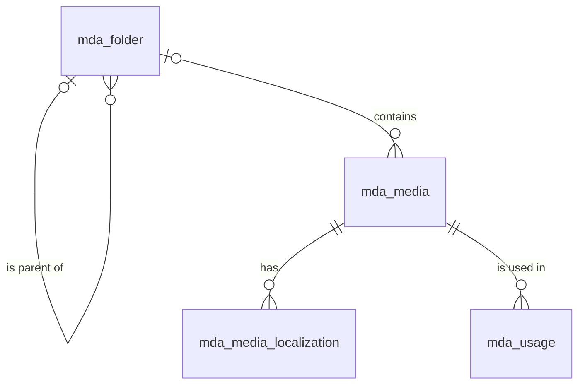

# 媒体（media）模块设计

| 项 | 内容 |
|---|---|
| 模块 ID | `media` |
| 名称 | 媒体 |
| 层 | L2 |
| 表前缀 | `mda_` |
| API 前缀 | `media` |
| 可停用 | 否 |
| 模块版本 | 1.0.0（module.json 的 version） |
| 平台版本 | `>=1.0.0 <2.0.0`（module.json 的 platform） |
| 里程碑切片 | M1：<…>；M2：<…>；M3：<…>；M4：<…>（详见第 13 节） |
| 模块负责人 | 待定 |
| 文档版本 | V1.0 |
| 状态 | 草案 |
| 更新日期 | 2026-10-14 |
| 依据 | 系统设计 V1.4 第 <…> 章；平台框架设计 V1.<x> 第 4 章 <…> 节；ADR-<…> |

> 本文只引用《平台框架设计》第 4 章中的契约，不定义新的跨模块契约；需要新契约时按平台框架设计 2.3 提出契约变更请求。

## 1. 职责与边界

### 1.1 职责

> 一段概述 + 要点列表；与系统设计 3.2 的职责描述一致，并细化到本模块的功能清单。

### 1.2 不负责的事

| 事项 | 归属模块 | 说明 |
|---|---|---|

### 1.3 协作概览

> 用图或表说明本模块与哪些模块协作、通过哪种方式（服务接口 / 事件 / 扩展点）。只画契约，不画实现。

### 1.4 适用的架构约束

> 列出与本模块直接相关的原则（P1–P8）、ADR 规则与 CLAUDE.md 禁止项，以及本模块如何满足。

## 2. 依赖与契约

### 2.1 module.json

```json
{
  "id": "<id>",
  "name": "<中文名称>",
  "version": "1.0.0",
  "layer": "L3",
  "platform": ">=1.0.0 <2.0.0",
  "requires": {},
  "optional": {},
  "disableable": true,
  "tablePrefix": "<前缀>_",
  "apiPrefix": "<id>",
  "permissions": [],
  "menus": [],
  "settings": null,
  "components": [],
  "events": { "publishes": [], "subscribes": [] }
}
```

> 完整描述符，须通过平台框架设计附录 A 的 Schema 与 A.3 的校验规则。

### 2.2 使用的服务接口

| 接口（平台框架设计小节） | 方法 | 用途 | 调用位置与时机（事务内 / 外） | 测试替身 |
|---|---|---|---|---|

### 2.3 提供的服务接口

| 接口（平台框架设计小节） | 方法 | 实现类 | 契约测试 | 说明（幂等、权限、性能目标） |
|---|---|---|---|---|

### 2.4 实现的扩展点

| 扩展点（平台框架设计小节） | 实现类 | 适用范围（内容类型 / 资源类型） | order | 收集方 |
|---|---|---|---|---|

### 2.5 收集的扩展点

| 扩展点 | 调用时机 | 过滤（站点启用状态、内容类型等） | 实现缺失或抛出异常时的行为 | 测试用示例实现 |
|---|---|---|---|---|

### 2.6 发布与订阅的事件

发布：

| 事件 | 触发时机（所在事务） | 关键字段 | 主要订阅方 |
|---|---|---|---|

订阅：

| 事件 | 处理 | 幂等方式 | 过期判断 | 失败与重试 |
|---|---|---|---|---|

### 2.7 使用的端口

| 端口 | 用途 | 测试替身 |
|---|---|---|

## 3. 领域模型

### 3.1 聚合、实体与值对象

| 类型 | 名称 | 说明 |
|---|---|---|
| 聚合根 | Media（`mda_media`） | 一个文件：类型、可见性、存储键、原文件名、MIME、大小、SHA-256、尺寸与时长、焦点、blurhash、主色、所在文件夹、处理状态 |
| 实体 | MediaLocalization（`mda_media_localization`） | alt、标题、说明在一种语言下的文本（站点资源本地化，第 2.7 节）；文件本身不翻译，各语言共用 |
| 聚合根 | Folder（`mda_folder`） | 文件夹树（物化路径）；只用于后台整理，不影响存储键与 URL |
| 实体（读模型） | Usage（`mda_usage`） | 引用记录：哪个内容或站点资源、在哪种语言、哪个阶段、哪个字段引用了该媒体；由 media 维护，编辑不能直接修改 |
| 值对象 | StorageKey | `{siteId}/{yyyy}/{mm}/{id}-{slug化的原文件名}.{ext}`（系统设计 12.2）；桶由可见性决定，键在两个桶中相同 |
| 值对象 | FocalPoint | `(focal_x, focal_y)`，取值 0–1，对应 imgproxy 的 `g:fp:x:y` |
| 值对象 | MediaRef | 其他模块对媒体的引用：布局文档中的 `{ "$media": "<id>" }`，表中的 `media_id` |
| 值对象 | UsageOwner | 引用方：`CONTENT` + 内容 ID，或站点资源类型（`{模块}.{资源}`）+ 资源 ID |

在系统设计之外补充的字段：

| 补充 | 理由 |
|---|---|
| `mda_media.owner_module` | 系统设计 17.5 的 `inq_attachment.media_id` 指向媒体，但询盘附件含个人数据：不能出现在媒体库列表、“未使用媒体”报告与 MediaPicker 中，访问须由所属模块按数据范围鉴权。非空表示“由该模块管理的私有文件” |
| `mda_media.scanned_at`、`scan_result` | 病毒扫描（ClamAV，异步）的完成时间与隔离原因（病毒特征名），供后台显示与排查 |
| `mda_media.deleted_at` | 回收站：删除后 30 天内可恢复，之后由清理任务连同对象存储中的文件物理删除；快照中可能仍有历史引用，软删除便于回滚时给出明确的校验错误 |
| `mda_folder.depth`、`sort_order`、`parent_key` | 层级深度上限、同级排序；`parent_key` 是生成列（根为 0），用于“同级名称唯一”的唯一索引（根文件夹的 `parent_id` 为 NULL，无法直接参与唯一约束） |
| `mda_usage.owner_type`、`owner_id`、`stage` | 系统设计 12.1 只列出 `content_id`，但 `MediaReferenceCollector` 的实现方包含 core（站点资料中的 Logo、favicon，非内容）；`stage` 区分草稿引用与发布引用，使“发布时刷新”不会冲掉草稿中的引用。`content_id` 保留为生成列，与系统设计字段一致 |
| 字段名 `size`、`duration` | 沿用系统设计 12.1 的命名（均非 MySQL 关键字），单位写在注释中：字节、秒 |

### 3.2 不变量

| # | 规则 | 保证方式 |
|---|---|---|
| 1 | `storage_key` 全局唯一，以 `{site_id}/` 开头；创建后不变（改变可见性时在两个桶之间移动对象，键不变） | 数据库：`uk_media_storage_key`；应用层 |
| 2 | 上传时扩展名在白名单内，且与 Tika 识别的真实 MIME 一致；`kind` 由 MIME 决定；单文件 ≤ 50 MB；SVG 经净化，非管理员角色不能上传 SVG | 应用层 |
| 3 | 图片（`kind = IMAGE`）必须有 `width`、`height`、`blurhash`、`dominant_color`；文档与压缩包上传后为 `PROCESSING`，扫描通过才变为 `READY` | 应用层 |
| 4 | 前台（Delivery）、MediaPicker、预签名下载只使用 `status = 'READY'` 且未删除的媒体；`QUARANTINED` 的文件永不对外提供 | 应用层 |
| 5 | `visibility = 'PRIVATE'` 的文件只在私有桶中，没有公开 URL；只能经预签名链接下载：员工下载记录审计日志；访客只能通过 DOWNLOAD 表单获得链接，且该媒体必须 `owner_module` 为空、处于 `READY`，并在提交上下文内容的发布引用中（`mda_usage.stage = 'PUBLISHED'`） | 应用层 |
| 6 | `owner_module` 非空的媒体不出现在媒体库列表、“未使用媒体”报告与 MediaPicker 中，不能被内容引用；只能由所属模块经 `MediaApi` 读取与删除 | 应用层 |
| 7 | 焦点坐标在 0–1 之间 | 数据库：`ck_mda_media_focal` |
| 8 | `mda_usage` 中仍有引用（任一阶段）的媒体不能删除（包括移入回收站），界面列出引用位置 | 应用层（软删除前检查）；数据库：`fk_mda_usage_media`（RESTRICT，针对物理删除） |
| 9 | 每个媒体每种语言最多一条本地化；中文行 `translation_state = 'NONE'`、`source_fingerprint` 为空；其他语言行只由 translation 经 `TranslatableResourceProvider` 写入，或在翻译编辑器中修订 | 数据库：`uk_ml_media_locale`；应用层 |
| 10 | 文件夹：同一父文件夹下名称唯一（不区分大小写与重音）；根 `depth = 1`，子文件夹 `depth` = 父 + 1，最大 10；`path` = 父 `path` + 自身 ID + `/`；非空文件夹（有子文件夹或媒体，含回收站中的媒体）不能删除 | 数据库：`uk_folder_name`、`ck_mda_folder_depth`、`fk_mda_folder_parent`、`fk_mda_media_folder`（RESTRICT）；应用层 |
| 11 | `mda_usage` 以（`owner_type`、`owner_id`、`locale`、`stage`、`part`）为单位整组替换；`PUBLISHED` 行与该本地化当前的发布修订一致（发布时重算，下线时删除） | 应用层（幂等：先删后插，同一事务） |
| 12 | `sha256` 不要求唯一：发现重复只提示复用已有文件，由用户决定 | 应用层 |

### 3.3 状态机

<<FILL: 状态与转换；没有状态机时写“不适用：<原因>”>>

## 4. 数据模型

> 遵守平台框架设计第 7 章的数据库通用约定。DDL 已在 MySQL 8.4 上执行通过；表结构以本节为准，与迁移脚本保持一致。

### 4.1 表清单

| 表 | 说明 | 站点级 | 软删除 | 预估规模（单站，按系统设计假设 A4） |
|---|---|---|---|---|
| `mda_folder` | 文件夹 | 是 | 否（只能删除空文件夹） | ≤ 500 行 |
| `mda_media` | 媒体资产 | 是 | 是（`deleted_at`，回收站 30 天） | ≈ 10 万行（1 万产品 × 约 6 张图 + 文档 + 5 千篇文章的配图） |
| `mda_media_localization` | 媒体 alt / 标题 / 说明（站点资源本地化） | 是 | 否（随媒体） | ≤ 100 万行（图片 × 10 种语言） |
| `mda_usage` | 媒体引用记录 | 是 | 否（整组替换） | ≈ 50–100 万行（发布引用按语言各一份） |

### 4.2 ER 图



### 4.3 表结构

#### 4.3.1 `mda_folder`：文件夹

| 字段 | 类型 | 可空 | 默认 | 说明 |
|---|---|---|---|---|
| `id` | BIGINT | 否 | — | 主键（TSID） |
| `site_id` | BIGINT | 否 | — | 站点 ID（sys_site.id） |
| `parent_id` | BIGINT | 是 | — | 父文件夹 ID；根文件夹为空 |
| `parent_key` | BIGINT | 否 | 生成列 `IFNULL(parent_id, 0)` | 父文件夹键（根为 0；同级名称唯一索引用） |
| `name` | VARCHAR(100) | 否 | — | 文件夹名称（中文，只在后台显示，不翻译） |
| `path` | VARCHAR(255) bin | 否 | — | 物化路径：祖先与自身的 ID，如 /1/5/9/ |
| `depth` | TINYINT | 否 | `1` | 层级深度：根为 1，最大 10 |
| `sort_order` | INT | 否 | `0` | 同级排序 |
| `version` | INT | 否 | `0` | 乐观锁版本号 |
| `created_at` | DATETIME(3) | 否 | `CURRENT_TIMESTAMP(3)` | 创建时间（UTC） |
| `created_by` | BIGINT | 否 | `0` | 创建人用户 ID（0 = 系统） |
| `updated_at` | DATETIME(3) | 否 | `CURRENT_TIMESTAMP(3) ON UPDATE CURRENT_TIMESTAMP(3)` | 更新时间（UTC） |
| `updated_by` | BIGINT | 否 | `0` | 更新人用户 ID（0 = 系统） |

索引与约束：
- `PRIMARY KEY (id)`
- `uk_folder_name (site_id, parent_key, name)`：同一父文件夹下名称唯一；兼作站点文件夹树的加载索引
- `idx_folder_parent (parent_id, sort_order)`：展开子文件夹；兼作 `fk_mda_folder_parent` 的索引
- `idx_folder_path (site_id, path)`：子树查询（`path LIKE '/1/5/%'`：移动文件夹时更新子树、按文件夹含子文件夹筛选媒体）
- `fk_mda_folder_parent`：引用关系（RESTRICT）
- `ck_mda_folder_depth`：见 3.2 不变量 10

```sql
CREATE TABLE mda_folder (
  id          BIGINT        NOT NULL COMMENT '主键（TSID）',
  site_id     BIGINT        NOT NULL COMMENT '站点 ID（sys_site.id）',
  parent_id   BIGINT        NULL COMMENT '父文件夹 ID；根文件夹为空',
  parent_key  BIGINT        AS (IFNULL(parent_id, 0)) STORED COMMENT '父文件夹键（根为 0；同级名称唯一索引用）',
  name        VARCHAR(100)  NOT NULL COMMENT '文件夹名称（中文，只在后台显示，不翻译）',
  path        VARCHAR(255)  COLLATE utf8mb4_0900_bin NOT NULL COMMENT '物化路径：祖先与自身的 ID，如 /1/5/9/',
  depth       TINYINT       NOT NULL DEFAULT 1 COMMENT '层级深度：根为 1，最大 10',
  sort_order  INT           NOT NULL DEFAULT 0 COMMENT '同级排序',
  version     INT           NOT NULL DEFAULT 0 COMMENT '乐观锁版本号',
  created_at  DATETIME(3)   NOT NULL DEFAULT CURRENT_TIMESTAMP(3) COMMENT '创建时间（UTC）',
  created_by  BIGINT        NOT NULL DEFAULT 0 COMMENT '创建人用户 ID（0 = 系统）',
  updated_at  DATETIME(3)   NOT NULL DEFAULT CURRENT_TIMESTAMP(3) ON UPDATE CURRENT_TIMESTAMP(3) COMMENT '更新时间（UTC）',
  updated_by  BIGINT        NOT NULL DEFAULT 0 COMMENT '更新人用户 ID（0 = 系统）',
  PRIMARY KEY (id),
  UNIQUE KEY uk_folder_name (site_id, parent_key, name),
  KEY idx_folder_parent (parent_id, sort_order),
  KEY idx_folder_path (site_id, path),
  CONSTRAINT fk_mda_folder_parent FOREIGN KEY (parent_id) REFERENCES mda_folder (id),
  CONSTRAINT ck_mda_folder_depth CHECK ((parent_id IS NULL AND depth = 1) OR (parent_id IS NOT NULL AND depth BETWEEN 2 AND 10))
) ENGINE = InnoDB DEFAULT CHARSET = utf8mb4 COLLATE = utf8mb4_0900_ai_ci COMMENT = '媒体文件夹（物化路径树，只用于后台整理）';
```

要点：
- 文件夹只是后台的组织方式，移动媒体不改变 `storage_key`，也不影响任何 URL 与引用。
- 删除文件夹前，应用层把回收站中仍属于该文件夹的媒体移到根目录（`folder_id` 置空），再检查是否为空。

#### 4.3.2 `mda_media`：媒体资产

| 字段 | 类型 | 可空 | 默认 | 说明 |
|---|---|---|---|---|
| `id` | BIGINT | 否 | — | 主键（TSID） |
| `site_id` | BIGINT | 否 | — | 站点 ID（sys_site.id） |
| `kind` | VARCHAR(16) | 否 | — | 媒体类型：IMAGE / VIDEO / DOCUMENT / ARCHIVE / OTHER（按 Tika 识别的真实 MIME 判定） |
| `visibility` | VARCHAR(16) | 否 | `'PUBLIC'` | 可见性：PUBLIC（公开桶，经 CDN 访问）/ PRIVATE（私有桶，只能经预签名链接下载） |
| `owner_module` | VARCHAR(32) | 是 | — | 所属模块 ID：空 = 媒体库资产；非空 = 由该模块管理的私有文件（如 inquiry 的询盘附件），不在媒体库中列出 |
| `folder_id` | BIGINT | 是 | — | 所在文件夹 ID（mda_folder.id）；空 = 根目录 |
| `storage_key` | VARCHAR(500) bin | 否 | — | 对象存储键：{siteId}/{yyyy}/{mm}/{id}-{slug化的原文件名}.{ext}；桶由 visibility 决定 |
| `original_name` | VARCHAR(255) | 否 | — | 上传时的原文件名（含扩展名） |
| `mime` | VARCHAR(127) | 否 | — | MIME 类型（Tika 按文件头识别，小写），如 image/webp、application/pdf |
| `size` | BIGINT | 否 | — | 文件大小（字节） |
| `sha256` | CHAR(64) bin | 否 | — | 文件内容 SHA-256（十六进制小写），用于重复文件提示 |
| `width` | INT | 是 | — | 宽度（像素；图片、视频） |
| `height` | INT | 是 | — | 高度（像素；图片、视频） |
| `duration` | DECIMAL(10,3) | 是 | — | 时长（秒；视频） |
| `focal_x` | DECIMAL(4,3) | 否 | `0.500` | 焦点横坐标（0–1，左边为 0），用于 imgproxy 裁剪 g:fp |
| `focal_y` | DECIMAL(4,3) | 否 | `0.500` | 焦点纵坐标（0–1，上边为 0） |
| `blurhash` | VARCHAR(64) bin | 是 | — | BlurHash 占位图编码（图片） |
| `dominant_color` | CHAR(7) | 是 | — | 主色（#RRGGBB；图片） |
| `status` | VARCHAR(16) | 否 | `'PROCESSING'` | 处理状态：PROCESSING（处理或病毒扫描中）/ READY（可用）/ QUARANTINED（扫描发现威胁，已隔离） |
| `scanned_at` | DATETIME(3) | 是 | — | 病毒扫描完成时间（文档、压缩包） |
| `scan_result` | VARCHAR(200) | 是 | — | 扫描结果：隔离时为病毒特征名 |
| `deleted_at` | DATETIME(3) | 是 | — | 删除时间（移入回收站；30 天后连同文件物理删除） |
| `version` | INT | 否 | `0` | 乐观锁版本号 |
| `created_at` | DATETIME(3) | 否 | `CURRENT_TIMESTAMP(3)` | 上传时间（UTC） |
| `created_by` | BIGINT | 否 | `0` | 上传人用户 ID（0 = 系统，如导入） |
| `updated_at` | DATETIME(3) | 否 | `CURRENT_TIMESTAMP(3) ON UPDATE CURRENT_TIMESTAMP(3)` | 更新时间（UTC） |
| `updated_by` | BIGINT | 否 | `0` | 更新人用户 ID（0 = 系统） |

索引与约束：
- `PRIMARY KEY (id)`：Delivery 按 ID 批量解析 `refs.media`
- `uk_media_storage_key (storage_key)`：存储键全局唯一；按存储键反查（imgproxy 回源日志排查）
- `idx_media_folder (folder_id, created_at)`：文件夹内媒体列表（按上传时间倒序）；兼作 `fk_mda_media_folder` 的索引
- `idx_media_list (site_id, kind, created_at)`：媒体库“全部 / 按类型”列表；MediaPicker 按 `x-media.kinds` 过滤
- `idx_media_sha (site_id, sha256)`：上传时查找重复文件
- `idx_media_status (status, created_at)`：扫描任务查找长时间停留在 `PROCESSING` 的媒体（重试与告警；该状态的行很少，选择性高）
- `idx_media_deleted (deleted_at)`：回收站列表与 30 天后的物理清理
- `fk_mda_media_folder`：引用关系（RESTRICT）
- `ck_mda_media_focal`：见 3.2 不变量 7

```sql
CREATE TABLE mda_media (
  id              BIGINT         NOT NULL COMMENT '主键（TSID）',
  site_id         BIGINT         NOT NULL COMMENT '站点 ID（sys_site.id）',
  kind            VARCHAR(16)    NOT NULL COMMENT '媒体类型：IMAGE / VIDEO / DOCUMENT / ARCHIVE / OTHER（按 Tika 识别的真实 MIME 判定）',
  visibility      VARCHAR(16)    NOT NULL DEFAULT 'PUBLIC' COMMENT '可见性：PUBLIC（公开桶，经 CDN 访问）/ PRIVATE（私有桶，只能经预签名链接下载）',
  owner_module    VARCHAR(32)    NULL COMMENT '所属模块 ID：空 = 媒体库资产；非空 = 由该模块管理的私有文件（如 inquiry 的询盘附件），不在媒体库中列出',
  folder_id       BIGINT         NULL COMMENT '所在文件夹 ID（mda_folder.id）；空 = 根目录',
  storage_key     VARCHAR(500)   COLLATE utf8mb4_0900_bin NOT NULL COMMENT '对象存储键：{siteId}/{yyyy}/{mm}/{id}-{slug化的原文件名}.{ext}；桶由 visibility 决定',
  original_name   VARCHAR(255)   NOT NULL COMMENT '上传时的原文件名（含扩展名）',
  mime            VARCHAR(127)   NOT NULL COMMENT 'MIME 类型（Tika 按文件头识别，小写），如 image/webp、application/pdf',
  size            BIGINT         NOT NULL COMMENT '文件大小（字节）',
  sha256          CHAR(64)       COLLATE utf8mb4_0900_bin NOT NULL COMMENT '文件内容 SHA-256（十六进制小写），用于重复文件提示',
  width           INT            NULL COMMENT '宽度（像素；图片、视频）',
  height          INT            NULL COMMENT '高度（像素；图片、视频）',
  duration        DECIMAL(10,3)  NULL COMMENT '时长（秒；视频）',
  focal_x         DECIMAL(4,3)   NOT NULL DEFAULT 0.500 COMMENT '焦点横坐标（0–1，左边为 0），用于 imgproxy 裁剪 g:fp',
  focal_y         DECIMAL(4,3)   NOT NULL DEFAULT 0.500 COMMENT '焦点纵坐标（0–1，上边为 0）',
  blurhash        VARCHAR(64)    COLLATE utf8mb4_0900_bin NULL COMMENT 'BlurHash 占位图编码（图片）',
  dominant_color  CHAR(7)        NULL COMMENT '主色（#RRGGBB；图片）',
  status          VARCHAR(16)    NOT NULL DEFAULT 'PROCESSING' COMMENT '处理状态：PROCESSING（处理或病毒扫描中）/ READY（可用）/ QUARANTINED（扫描发现威胁，已隔离）',
  scanned_at      DATETIME(3)    NULL COMMENT '病毒扫描完成时间（文档、压缩包）',
  scan_result     VARCHAR(200)   NULL COMMENT '扫描结果：隔离时为病毒特征名',
  deleted_at      DATETIME(3)    NULL COMMENT '删除时间（移入回收站；30 天后连同文件物理删除）',
  version         INT            NOT NULL DEFAULT 0 COMMENT '乐观锁版本号',
  created_at      DATETIME(3)    NOT NULL DEFAULT CURRENT_TIMESTAMP(3) COMMENT '上传时间（UTC）',
  created_by      BIGINT         NOT NULL DEFAULT 0 COMMENT '上传人用户 ID（0 = 系统，如导入）',
  updated_at      DATETIME(3)    NOT NULL DEFAULT CURRENT_TIMESTAMP(3) ON UPDATE CURRENT_TIMESTAMP(3) COMMENT '更新时间（UTC）',
  updated_by      BIGINT         NOT NULL DEFAULT 0 COMMENT '更新人用户 ID（0 = 系统）',
  PRIMARY KEY (id),
  UNIQUE KEY uk_media_storage_key (storage_key),
  KEY idx_media_folder (folder_id, created_at),
  KEY idx_media_list (site_id, kind, created_at),
  KEY idx_media_sha (site_id, sha256),
  KEY idx_media_status (status, created_at),
  KEY idx_media_deleted (deleted_at),
  CONSTRAINT fk_mda_media_folder FOREIGN KEY (folder_id) REFERENCES mda_folder (id),
  CONSTRAINT ck_mda_media_focal CHECK (focal_x BETWEEN 0 AND 1 AND focal_y BETWEEN 0 AND 1)
) ENGINE = InnoDB DEFAULT CHARSET = utf8mb4 COLLATE = utf8mb4_0900_ai_ci COMMENT = '媒体资产（文件元数据；文件在对象存储中）';
```

要点：
- 上传流程见系统设计 12.2：校验 → Tika → SHA-256 → 图片读取尺寸、生成 blurhash 与主色（同步，完成即 `READY`）→ 文档与压缩包异步病毒扫描（`PROCESSING` → `READY` / `QUARANTINED`）→ 发布 `MediaUploadedEvent`。扫描完成前文件先放在私有桶，`READY` 后再按 `visibility` 放入对应的桶，避免未扫描的文件出现在公开桶。
- 修改焦点、可见性、文件夹发布 `MediaUpdatedEvent`（delivery 按 `s{site}:m:{mediaId}` 失效缓存）；移入回收站发布 `MediaDeletedEvent`。
- 图片前台 URL 由 delivery 按 `storage_key`、焦点与预设拼出 imgproxy 签名地址（系统设计 12.3），不保存在任何表中。
- `owner_module` 非空的文件由所属模块经 `MediaApi` 上传（`visibility = 'PRIVATE'`）、下载（预签名链接 + 审计）与删除；所属模块被 PURGED 时一并删除。

#### 4.3.3 `mda_media_localization`：媒体本地化

| 字段 | 类型 | 可空 | 默认 | 说明 |
|---|---|---|---|---|
| `id` | BIGINT | 否 | — | 主键（TSID） |
| `site_id` | BIGINT | 否 | — | 站点 ID（sys_site.id） |
| `media_id` | BIGINT | 否 | — | 媒体 ID（mda_media.id） |
| `locale` | VARCHAR(16) | 否 | — | 语言（BCP 47） |
| `alt` | VARCHAR(500) | 是 | — | 替代文本（图片；装饰性图片为空） |
| `title` | VARCHAR(300) | 是 | — | 标题（媒体库显示；文档下载列表的显示名） |
| `caption` | VARCHAR(1000) | 是 | — | 说明文字（图注） |
| `translation_state` | VARCHAR(16) | 否 | `'NONE'` | 翻译状态：NONE / QUEUED / TRANSLATED / NEEDS_REVIEW / FAILED / OUTDATED |
| `source_fingerprint` | CHAR(64) bin | 是 | — | 生成本行译文时中文行的指纹（规范化 alt、title、caption 拼接后的 SHA-256）；中文行为空；与当前中文指纹不同即为过期 |
| `version` | INT | 否 | `0` | 乐观锁版本号 |
| `created_at` | DATETIME(3) | 否 | `CURRENT_TIMESTAMP(3)` | 创建时间（UTC） |
| `created_by` | BIGINT | 否 | `0` | 创建人用户 ID（0 = 系统，如翻译回写） |
| `updated_at` | DATETIME(3) | 否 | `CURRENT_TIMESTAMP(3) ON UPDATE CURRENT_TIMESTAMP(3)` | 更新时间（UTC） |
| `updated_by` | BIGINT | 否 | `0` | 更新人用户 ID（0 = 系统） |

索引与约束：
- `PRIMARY KEY (id)`
- `uk_ml_media_locale (media_id, locale)`：每种语言一条；Delivery 按（媒体 ID 列表，语言）取 alt；兼作 `fk_mda_ml_media` 的索引
- `idx_ml_state (site_id, translation_state, locale)`：翻译中心列出待处理的媒体文本
- `fk_mda_ml_media`：组合关系，`ON DELETE CASCADE`

```sql
CREATE TABLE mda_media_localization (
  id                  BIGINT         NOT NULL COMMENT '主键（TSID）',
  site_id             BIGINT         NOT NULL COMMENT '站点 ID（sys_site.id）',
  media_id            BIGINT         NOT NULL COMMENT '媒体 ID（mda_media.id）',
  locale              VARCHAR(16)    NOT NULL COMMENT '语言（BCP 47）',
  alt                 VARCHAR(500)   NULL COMMENT '替代文本（图片；装饰性图片为空）',
  title               VARCHAR(300)   NULL COMMENT '标题（媒体库显示；文档下载列表的显示名）',
  caption             VARCHAR(1000)  NULL COMMENT '说明文字（图注）',
  translation_state   VARCHAR(16)    NOT NULL DEFAULT 'NONE' COMMENT '翻译状态：NONE / QUEUED / TRANSLATED / NEEDS_REVIEW / FAILED / OUTDATED',
  source_fingerprint  CHAR(64)       COLLATE utf8mb4_0900_bin NULL COMMENT '生成本行译文时中文行的指纹（规范化 alt、title、caption 拼接后的 SHA-256）；中文行为空；与当前中文指纹不同即为过期',
  version             INT            NOT NULL DEFAULT 0 COMMENT '乐观锁版本号',
  created_at          DATETIME(3)    NOT NULL DEFAULT CURRENT_TIMESTAMP(3) COMMENT '创建时间（UTC）',
  created_by          BIGINT         NOT NULL DEFAULT 0 COMMENT '创建人用户 ID（0 = 系统，如翻译回写）',
  updated_at          DATETIME(3)    NOT NULL DEFAULT CURRENT_TIMESTAMP(3) ON UPDATE CURRENT_TIMESTAMP(3) COMMENT '更新时间（UTC）',
  updated_by          BIGINT         NOT NULL DEFAULT 0 COMMENT '更新人用户 ID（0 = 系统）',
  PRIMARY KEY (id),
  UNIQUE KEY uk_ml_media_locale (media_id, locale),
  KEY idx_ml_state (site_id, translation_state, locale),
  CONSTRAINT fk_mda_ml_media FOREIGN KEY (media_id) REFERENCES mda_media (id) ON DELETE CASCADE
) ENGINE = InnoDB DEFAULT CHARSET = utf8mb4 COLLATE = utf8mb4_0900_ai_ci COMMENT = '媒体 alt / 标题 / 说明的多语言文本（站点资源，带翻译状态与源指纹）';
```

要点：
- 中文行的 alt、标题、说明变化时发布 `MediaUpdatedEvent` 与 `TranslatableResourceChangedEvent`（资源类型 `media.media`，ID 为 `media_id`）；translation 回写目标语言行并设置 `translation_state` 与 `source_fingerprint`（系统设计 5.7）。
- 某语言没有本地化行（译文尚未生成）时，Delivery 在该语言输出空的 alt，不回退到中文（不跨语言回退，系统设计 5.4）；SEO 健康检查据此提示缺失的 alt。

#### 4.3.4 `mda_usage`：媒体引用记录

| 字段 | 类型 | 可空 | 默认 | 说明 |
|---|---|---|---|---|
| `id` | BIGINT | 否 | — | 主键（TSID） |
| `site_id` | BIGINT | 否 | — | 站点 ID（sys_site.id） |
| `media_id` | BIGINT | 否 | — | 媒体 ID（mda_media.id） |
| `owner_type` | VARCHAR(40) bin | 否 | — | 引用方类型：CONTENT（内容）或站点资源类型 {模块}.{资源}，如 core.site_profile、article.author |
| `owner_id` | BIGINT | 否 | — | 引用方 ID：CONTENT 时为 cnt_content.id，否则为该资源的 ID |
| `content_id` | BIGINT | 是 | 生成列 `IF(owner_type = 'CONTENT', owner_id, NULL)` | 内容 ID（cnt_content.id）；引用方不是内容时为空 |
| `locale` | VARCHAR(16) | 是 | — | 语言；空 = 与语言无关（如产品图集的草稿、站点 Logo） |
| `stage` | VARCHAR(16) | 否 | — | 阶段：DRAFT（草稿中的引用）/ PUBLISHED（当前发布修订或已生效资源中的引用） |
| `part` | VARCHAR(32) bin | 否 | — | 来源部分：快照 part key（product、layout、seo、card 等）或资源内的分组，由上报引用的 Collector 决定 |
| `field_path` | VARCHAR(255) bin | 否 | — | 字段路径，如 gallery[2]、sections[sec_01J9X4K2].props.image、og.image |
| `created_at` | DATETIME(3) | 否 | `CURRENT_TIMESTAMP(3)` | 记录时间（UTC） |

索引与约束：
- `PRIMARY KEY (id)`
- `idx_usage_owner (site_id, owner_type, owner_id, stage, locale)`：整组替换（先删后插）；内容彻底删除、下线时清理；“该内容引用了哪些媒体”
- `idx_usage_media (media_id, stage)`：媒体详情页的引用位置列表、删除前检查、“未使用媒体”报告（`NOT EXISTS`）；兼作 `fk_mda_usage_media` 的索引
- `fk_mda_usage_media`：引用关系（RESTRICT）：有引用记录的媒体不能被物理删除

```sql
CREATE TABLE mda_usage (
  id          BIGINT        NOT NULL COMMENT '主键（TSID）',
  site_id     BIGINT        NOT NULL COMMENT '站点 ID（sys_site.id）',
  media_id    BIGINT        NOT NULL COMMENT '媒体 ID（mda_media.id）',
  owner_type  VARCHAR(40)   COLLATE utf8mb4_0900_bin NOT NULL COMMENT '引用方类型：CONTENT（内容）或站点资源类型 {模块}.{资源}，如 core.site_profile、article.author',
  owner_id    BIGINT        NOT NULL COMMENT '引用方 ID：CONTENT 时为 cnt_content.id，否则为该资源的 ID',
  content_id  BIGINT        AS (IF(owner_type = 'CONTENT', owner_id, NULL)) STORED COMMENT '内容 ID（cnt_content.id）；引用方不是内容时为空',
  locale      VARCHAR(16)   NULL COMMENT '语言；空 = 与语言无关（如产品图集的草稿、站点 Logo）',
  stage       VARCHAR(16)   NOT NULL COMMENT '阶段：DRAFT（草稿中的引用）/ PUBLISHED（当前发布修订或已生效资源中的引用）',
  part        VARCHAR(32)   COLLATE utf8mb4_0900_bin NOT NULL COMMENT '来源部分：快照 part key（product、layout、seo、card 等）或资源内的分组，由上报引用的 Collector 决定',
  field_path  VARCHAR(255)  COLLATE utf8mb4_0900_bin NOT NULL COMMENT '字段路径，如 gallery[2]、sections[sec_01J9X4K2].props.image、og.image',
  created_at  DATETIME(3)   NOT NULL DEFAULT CURRENT_TIMESTAMP(3) COMMENT '记录时间（UTC）',
  PRIMARY KEY (id),
  KEY idx_usage_owner (site_id, owner_type, owner_id, stage, locale),
  KEY idx_usage_media (media_id, stage),
  CONSTRAINT fk_mda_usage_media FOREIGN KEY (media_id) REFERENCES mda_media (id)
) ENGINE = InnoDB DEFAULT CHARSET = utf8mb4 COLLATE = utf8mb4_0900_ai_ci COMMENT = '媒体引用记录（由 MediaReferenceCollector 与 MediaApi 维护的读模型）';
```

要点（维护方式）：

| 阶段 | 触发 | 处理 |
|---|---|---|
| `PUBLISHED`（内容） | `ContentPublishedEvent`（事务提交后，异步） | media 调用该内容类型的全部 `MediaReferenceCollector`，从新修订的快照中收集引用，按（内容，语言）整组替换 `PUBLISHED` 行 |
| `PUBLISHED`（内容） | `ContentUnpublishedEvent` | 删除该（内容，语言）的 `PUBLISHED` 行 |
| `DRAFT`（内容） | 业务模块保存草稿 | 业务模块在自己的事务中调用 `MediaApi` 替换该 part 的草稿引用（L3 / L4 调用 L2，符合系统设计 3.3 R2）；与语言无关的草稿字段 `locale` 为空 |
| `PUBLISHED`（站点资源） | 资源保存（如站点资料的 Logo、作者头像、SEO 默认分享图） | 资源所属模块调用 `MediaApi` 替换，或由 media 在其变更事件后调用该模块的 Collector；站点资源保存即生效，只记 `PUBLISHED` |
| 全部 | `ContentPurgedEvent` | 删除该内容的全部行 |

历史修订中的引用不记录：回滚到旧修订后再次发布时，发布校验（“引用的媒体存在”，系统设计 6.3）会拦截已删除的媒体。

### 4.4 枚举

| 字段 | 取值 | 说明 |
|---|---|---|
| `mda_media.kind` | `IMAGE` | 图片（jpg、png、webp、avif、gif、svg）：有尺寸、焦点、blurhash、主色 |
| | `VIDEO` | 视频（mp4，≤ 50 MB，只用于静音循环的背景视频，必须另配封面图，系统设计 12.4） |
| | `DOCUMENT` | 文档（pdf、dwg、dxf、step / stp、igs、xlsx 等）：异步病毒扫描 |
| | `ARCHIVE` | 压缩包（zip）：异步病毒扫描 |
| | `OTHER` | 其他白名单类型 |
| `mda_media.visibility` | `PUBLIC` / `PRIVATE` | 共享枚举：公开桶 / 私有桶（留资文档、询盘附件） |
| `mda_media.status` | `PROCESSING` | 处理或病毒扫描中；不能被前台使用与下载 |
| | `READY` | 可用 |
| | `QUARANTINED` | 扫描发现威胁，已隔离；只能删除 |
| `mda_media.owner_module` | 空 / 模块 ID（如 `inquiry`） | 媒体库资产 / 由该模块管理的私有文件 |
| `mda_media_localization.translation_state` | `NONE` / `QUEUED` / `TRANSLATED` / `NEEDS_REVIEW` / `FAILED` / `OUTDATED` | 共享翻译状态枚举；中文行为 `NONE` |
| `mda_usage.owner_type` | `CONTENT` | 内容（`owner_id` = `cnt_content.id`） |
| | `{模块}.{资源}` | 站点资源，如 `core.site_profile`、`article.author`、`seo.template`（由实现 Collector 的模块登记） |
| `mda_usage.stage` | `DRAFT` / `PUBLISHED` | 草稿引用 / 发布引用 |

### 4.5 站点过滤

<<FILL: | 表 | 行级拦截器（不豁免 / 豁免） | 访问方式与理由 |>>

### 4.6 跨模块引用与清理

**本模块引用其他模块的对象**：

| 本模块字段 | 引用对象（模块.表） | 被引用对象删除 / 下线时的处理 | 触发事件 |
|---|---|---|---|
| `mda_usage.owner_id`（`owner_type = 'CONTENT'`）、`content_id` | content.`cnt_content` | 下线：删除该语言的 `PUBLISHED` 行；彻底删除：删除该内容的全部行 | `ContentUnpublishedEvent`、`ContentPurgedEvent` |
| `mda_usage.owner_id`（站点资源） | 资源所属模块的表（如 core.`sys_site_profile`、article.`art_author`） | 资源删除时由所属模块调用 `MediaApi` 删除其引用行 | 所属模块的删除操作 |
| `mda_media.owner_module` | core.`sys_module` | 所属模块停用：文件保留；被 PURGED：删除该模块的文件与行 | `onPurge` |
| `mda_media_localization.locale` | core.`sys_site_locale` | V1 不删除站点语言，无需清理 | `SiteSettingsChangedEvent` |
| `created_by`、`updated_by` | core.`sys_user` | 不清理 | — |

**其他模块引用本模块的对象**（其他章节需配合）：

| 被引用对象 | 引用方 | 本模块对象变化时的处理 | 事件 |
|---|---|---|---|
| `mda_media.id` | 布局文档 `$media`（page）、`prd_product_media`、`prd_product_document`（product）、`cnt_localization.pub_cover_media_id`（content）、`art_author`（article）、SEO 分享图（seo）、`sys_site_profile` 的 Logo 等（core） | 有引用记录时不能删除；引用方须经 `MediaReferenceCollector` / `MediaApi` 上报引用；修改 alt、焦点等只需按 `m:{mediaId}` 失效缓存，引用方无需重新发布 | `MediaUpdatedEvent`、`MediaDeletedEvent` |
| `mda_media.id`（`owner_module = 'inquiry'`） | inquiry.`inq_attachment.media_id`（员工在后台上传的询盘附件） | 由 inquiry 经 `MediaApi` 删除（询盘匿名化、数据主体删除请求） | — |
| `mda_media.id`（留资文档） | form.`frm_submission.download_media_id` | 历史记录，不清理；签发下载链接时按 3.2 不变量 5 校验 | — |

本模块发布的事件：`MediaUploadedEvent`、`MediaUpdatedEvent`、`MediaDeletedEvent`、`TranslatableResourceChangedEvent`（资源类型 `media.media`）。订阅：`ContentPublishedEvent`、`ContentUnpublishedEvent`、`ContentPurgedEvent`。

---

### 4.7 迁移脚本

| 文件 | 内容 | 里程碑 |
|---|---|---|
| `db/migration/media/V001__init.sql` | 4.3 中的全部表（4 张：`mda_folder`、`mda_media`、`mda_media_localization`、`mda_usage`），按本节顺序创建 | <见第 13 节> |

## 5. 业务流程

### 5.1 <流程名称>

```text
<步骤；标出事务边界、调用的服务接口、发布的事件、异步部分>
```

| 步骤 | 说明 | 失败处理 |
|---|---|---|

## 6. 接口

### 6.1 Admin 端点

| 方法 | 路径（/api/admin/v1/<apiPrefix>/…） | 说明 | 权限码 | 并发控制 / 幂等 | 审计 |
|---|---|---|---|---|---|

### 6.2 Public 端点

| 方法 | 路径（/api/public/v1/<apiPrefix>/…） | 说明 | 限流 | 缓存 |
|---|---|---|---|---|

### 6.3 Internal 端点

| 方法 | 路径（/api/internal/v1/<apiPrefix>/…） | 说明 | 调用方 |
|---|---|---|---|

### 6.4 权限码

| 权限码 | 名称 | 数据范围 | 高危（sensitive） | 受语言范围限制（localeScoped） |
|---|---|---|---|---|

### 6.5 错误码

| 错误码 | HTTP 状态 | 后台中文信息 | 前台文案键（仅公开接口） |
|---|---|---|---|

## 7. 后台界面

### 7.1 菜单与路由

| 菜单 key | 名称 | 父菜单 | 路由 | 权限码 |
|---|---|---|---|---|

### 7.2 页面

| 页面 | 路由 | 主要功能 | 使用的 admin-kit 组件 |
|---|---|---|---|

### 7.3 注册到内容编辑外壳的标签

| key | 适用内容类型 | 权限码 | 组件 |
|---|---|---|---|

### 7.4 界面文案

> texts.ts 中的分组与关键文案；后台只用简体中文。

## 8. 前台组件与模板

> 没有前台组件时写“不适用”。

### 8.1 组件

| 组件类型 | 名称（label） | 变体 | 分类 | allowedIn | 数据源 | 是否水合 |
|---|---|---|---|---|---|---|

### 8.2 属性与翻译

| 组件 | 属性 | 类型 / x-editor | x-translatable | maxLength |
|---|---|---|---|---|

### 8.3 模板

| 模板 key | 内容类型 | 固定区域与插槽 |
|---|---|---|

### 8.4 数据源

| key | 参数 | 返回 | 缓存标签 |
|---|---|---|---|

### 8.5 文案键

| 文案键 | 默认中文文案 | 使用位置 |
|---|---|---|

## 9. 配置项

### 9.1 站点设置（settings.schema.json）

| 键 | 类型 | 默认值 | 说明 | 敏感（x-secret） |
|---|---|---|---|---|

### 9.2 部署配置（application.yml，前缀 b2bweb.<id>）

| 属性 | 默认值 | 说明 |
|---|---|---|

## 10. 定时与异步任务

> 没有时写“不适用”。定时任务实现 `ScheduledTask`，通用异步任务实现 `JobHandler`（平台框架设计 4.4.12）；锁名与任务类型按平台框架设计 3.7 命名。事件监听器已在 2.6 中列出，这里只补充耗时长、需要单独调度或重试的处理。`PER_SITE` 任务由 core 在站点上下文中逐站点执行，停用了本模块的站点自动跳过（系统设计 3.8）。外部服务（AI 引擎、邮件、CDN）只在事务提交后的异步处理中调用，失败不回滚已提交的业务数据（ADR-003、ADR-017）。

| 任务 | 类型（定时 / sys_job / 事件监听） | 触发 | 锁名 | 幂等与重试 | 模块停用时 |
|---|---|---|---|---|---|

> 每个任务另写：执行粒度（`PER_SITE` / 系统级）、单次处理量与分批方式、超时、能否取消、失败后的可见结果（`sys_job` 的失败报告、指标 `b2bweb.<id>.*` 或告警）。

## 11. 测试要点

> 测试层级、替身与契约测试的写法见平台框架设计第 9 章，门禁与覆盖率见第 10 章。“至少”后的用例为必测项；不适用的行写“不适用：<原因>”，不得删除。

| 层级 | 覆盖内容 | 关键用例 |
|---|---|---|
| 单元 | <领域对象、不变量（3.2）、状态机（3.3）、扩展点实现（2.4）> | 至少：3.2 每条不变量的违反用例；3.3 每个非法状态转换被拒绝 |
| 模块集成（Testcontainers + 替身） | <应用服务 + 本模块的表与迁移> | 至少：迁移脚本在空库（MySQL 8.4）上执行通过；6.1 中声明的并发控制与幂等；唯一约束冲突转为 6.5 的错误码 |
| 契约（作为提供方） | <2.3 中本模块提供的服务接口> | 继承 testkit 中的 `<接口名>ContractTest`，用真实实现运行；不提供服务接口时写“不适用” |
| 事件（Scenario API，含重复投递） | <2.6 中发布与订阅的事件> | 至少：事件在业务事务内发布、事务回滚时不发布；每个监听器重复投递只生效一次、过期事件被丢弃（ADR-003） |
| 停用行为（可停用模块） | <系统设计 3.8 的各项> | 至少：停用后写操作与公开接口返回 `CORE_MODULE_DISABLED`；扩展点实现不再被收集；定时任务跳过；`analyzeDisableImpact` 的结果正确；重新启用后数据完整（S10） |
| 站点隔离 | <6.1 的全部后台接口与 4.5 的全部站点级表> | 至少：站点 A 的用户不能读写站点 B 的数据（遍历全部后台端点，系统设计 28）；豁免表只在 4.5 列出的位置访问 |
| 翻译（如有可翻译字段） | <`TranslatableContentProvider` / `TranslatableResourceProvider` 实现> | 至少：提取 → 回写往返一致；`x-translatable = false` 的字段不被提取；`HUMAN` / `REVIEWED` 段不被机器译文覆盖；资源变化时发布 `TranslatableResourceChangedEvent` |
| 前端（组件、Admin） | <主题组件、Admin 页面> | 至少：组件 Schema 校验与画廊示例（视觉回归）；前台文字只来自文案键、后台文字只来自 `texts.ts`；无权限时操作不可见 |
| E2E（场景） | <13.2 中验证方式为 E2E 的验收项> | Playwright 用例名包含 13.2 的验收项编号 |

## 12. 独立开发说明

### 12.1 依赖的测试替身

> 2.2 使用的每个服务接口、2.7 使用的每个端口、2.5 收集的每个扩展点，都要在此列出 testkit 中对应的替身或示例实现（平台框架设计 2.4、第 9 章）。testkit 中缺少的替身向框架组提出需求（DoR 第 3 条，平台框架设计 2.7），不在本模块中另建一套代替其他模块的模拟实现；单元测试可以用 Mockito 模拟个别方法，但对其他模块行为的假设以替身与契约测试为准。

| 替身（platform-testkit） | 代替的模块 | 用途 | 需要预置的数据 |
|---|---|---|---|

### 12.2 本模块提供的替身

> 只有提供服务接口的模块填写（core、content、url、media、taxonomy、form、notification、translation，见平台框架设计 4.2）；其他模块写“不适用：不提供服务接口”。替身由框架组编写并维护，与真实实现通过同一套契约测试；本模块改变服务接口的行为时，在同一个 PR 中同步修改契约测试，并通知框架组修改替身（平台框架设计 2.3）。无法消除的差异（如不做病毒扫描、不生成真实缩略图）列入下表，并确认不影响使用方的测试结论。

| 服务接口 | testkit 中的替身 | 与真实实现的差异（应为零，或已在契约测试中声明） |
|---|---|---|

### 12.3 本地运行

> 启动方式、依赖的本地服务（平台框架设计第 11 章）、需要的配置。

### 12.4 演示数据

> tools/demo-data 中本模块的数据及其用途。

## 13. 验收标准

### 13.1 里程碑切片

> 与平台框架设计 13.5 中本模块的一行一致；调整切片按平台框架设计 12.5 处理。该里程碑没有切片时写“—”（不表示不能提前开发）。

| 里程碑 | 交付功能 | 验收场景 |
|---|---|---|
| M1 | <…> | <S1、S2、S4 中与本模块相关的部分，或“模块自身”> |
| M2 | <…> | <…> |
| M3 | <…> | <…> |
| M4 | <…> | <…> |

### 13.2 验收项

> 每条验收项写明输入、期望结果与度量（如“5 分钟内”“P95 ≤ 200 ms”）。场景验收项只写本模块负责的部分（如 S2 中 url 负责“旧 URL 301 到新 URL、不产生重定向链”），不复述整个场景；各里程碑的场景见平台框架设计 13.6。验证方式为单元 / 集成 / E2E 时写出测试类或用例名；人工检查写明检查人与方法。

| # | 验收项 | 对应场景（S1–S13）或模块自身 | 验证方式（单元 / 集成 / E2E / 人工） | 里程碑 |
|---|---|---|---|---|
| A1 | <…> | <S? / 模块自身> | <集成：`<测试类>`> | M? |

> 每个模块都要包含以下通用验收项（不适用时注明原因）：架构测试与 Modulith 验证通过，无跨模块 import 与表访问；站点隔离测试覆盖全部后台接口；后台写操作都有权限码与审计记录；可停用模块满足 S10；可翻译字段与资源已登记并通过往返测试（S11、S12）；系统设计 1.5 中与本模块相关的非功能指标；文档与代码一致（DoD，平台框架设计 2.8）。

## 14. 待定问题

> 记录评审与开发中尚未决定的事项。“阻塞开发”的问题必须在评审通过（DoR）前关闭；需要新契约或修改上层文档的问题，写明契约变更请求或 Issue 编号。已关闭的问题保留在表中，填写结论。

| # | 问题 | 影响 | 是否阻塞开发 | 负责人 | 最晚解决 | 结论 |
|---|---|---|---|---|---|---|

## 修订记录

| 版本 | 日期 | 变更 |
|---|---|---|
| V1.0 | 2026-10-14 | 初稿 |
