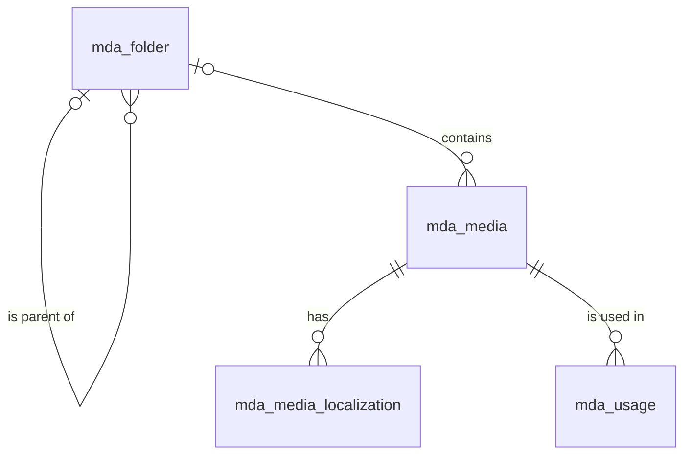

# 媒体（media）模块设计

| 项 | 内容 |
|---|---|
| 模块 ID | `media` |
| 名称 | 媒体 |
| 层 | L2 |
| 表前缀 | `mda_` |
| API 前缀 | `media` |
| 可停用 | 否 |
| 模块版本 | 1.0.0（module.json 的 version） |
| 平台版本 | `>=1.0.0 <2.0.0`（module.json 的 platform） |
| 里程碑切片 | M1：上传、图片变换、引用追踪；M2：文件夹；M3：alt / 标题作为可翻译资源；私有文件（留资文档）；M4：—（详见第 13 节） |
| 模块负责人 | 待定 |
| 文档版本 | V1.2 |
| 状态 | 草案 |
| 更新日期 | 2026-10-20 |
| 依据 | 系统设计 V1.4 第 12 章及 3.2、3.8、24–29 章；平台框架设计 V1.0 第 4、7–13 章；ADR-002、ADR-003、ADR-005、ADR-009、ADR-018 |

> 本文只引用《平台框架设计》第 4 章中的契约，不定义新的跨模块契约；需要新契约时按平台框架设计 2.3 提出契约变更请求。

## 1. 职责与边界

### 1.1 职责

管理媒体上传、类型校验、扫描、图片签名、文件夹与引用索引；提供公开媒体视图与私有文件授权下载；维护 alt、标题和说明的本地化。

功能交付范围按第 13 章分为 M1–M4；表结构、约束与枚举以第 3、4 章为准。

### 1.2 不负责的事

| 事项 | 归属模块 | 边界 |
|---|---|---|
| 上层产品、文章、询盘业务 | 对应 L3 模块 | 不反向调用上层服务或访问其表 |
| 身份、权限、设置、任务及审计 | platform-core | 复用平台公共服务 |
| 第三方客户端与网络传输 | infrastructure | 仅经既有端口或 L2 服务使用，不在业务模块引入客户端 |

### 1.3 协作概览

| 协作方式 | 对象 | 本模块行为 |
|---|---|---|
| 服务接口 | 仅 core 公共服务 | 方法与事务边界见 2.2；无跨模块表访问 |
| 扩展点 | TranslatableResourceProvider、MediaReferenceCollector | 实现/收集清单见 2.4、2.5 |
| 领域事件 | 见 2.6 | 与本地事务一起登记，提交后异步投递；重复与过期处理独立验证 |

### 1.4 适用的架构约束

遵守 P2、P3 与 ADR-018：编译依赖只到 platform-core/platform-api，跨模块协作只用第 2 章登记契约；只访问自己的表，禁止跨模块 JOIN/外键。遵守 ADR-003：事务内登记、提交后投递、监听器幂等并检查过期。遵守 ADR-009：每次请求/任务明确站点上下文，站点表默认过滤。

公开读取只用当前语言发布态，不跨语言回退（ADR-005）；预览与公开缓存隔离。后台中文文案与错误集中管理，前台文案经 UiTextApi，样式只用 Design Token。远程端口在数据库事务外调用，密钥经 SecretCipher，不写日志。

## 2. 依赖与契约

### 2.1 module.json

```json
{
  "id": "media",
  "name": "媒体",
  "version": "1.0.0",
  "layer": "L2",
  "platform": ">=1.0.0 <2.0.0",
  "requires": {},
  "optional": {},
  "disableable": false,
  "tablePrefix": "mda_",
  "apiPrefix": "media",
  "permissions": [
    {
      "code": "media:asset:view",
      "name": "查看媒体"
    },
    {
      "code": "media:asset:upload",
      "name": "上传媒体"
    },
    {
      "code": "media:asset:edit",
      "name": "编辑媒体"
    },
    {
      "code": "media:asset:delete",
      "name": "删除媒体"
    },
    {
      "code": "media:folder:manage",
      "name": "管理文件夹"
    }
  ],
  "menus": [
    {
      "key": "media",
      "name": "媒体",
      "parent": "editorial",
      "route": "/media/assets",
      "permission": "media:asset:view",
      "order": 100
    }
  ],
  "settings": null,
  "components": [],
  "events": {
    "publishes": [
      "MediaUploadedEvent",
      "MediaUpdatedEvent",
      "MediaDeletedEvent",
      "TranslatableResourceChangedEvent"
    ],
    "subscribes": [
      "ContentDraftChangedEvent",
      "ContentPublishedEvent",
      "ContentUnpublishedEvent",
      "NavigationChangedEvent",
      "SiteSettingsChangedEvent",
      "ContentPurgedEvent"
    ]
  }
}
```

描述符为 M0 工程建立后的实现要求；目前尚无实际控制器、Schema 或组件包。依赖只声明运行能力；Maven 仍只依赖 platform-api/core。组件清单是本模块负责的类型，运行时 UI 不登记成可拖入布局的组件。

### 2.2 使用的服务接口

| 接口（平台框架设计小节） | 方法 | 用途 | 调用位置与时机 | 测试替身 |
|---|---|---|---|---|
| `SiteApi`（4.4.1） | 按该契约声明的方法 | 语言、站点模块开关 | 业务事务内；站点切换由任务入口完成 | `InMemorySiteApi` |
| `SiteContextProvider`（4.4.2） | 按该契约声明的方法 | 当前站点；异步与任务由 core 恢复 | 业务事务内；站点切换由任务入口完成 | `FakeSiteContextProvider` |
| `PermissionChecker`（4.4.7） | 按该契约声明的方法 | 后台权限与数据范围 | 业务事务内；站点切换由任务入口完成 | `FakePermissionChecker` |
| `AuditApi`（4.4.9） | 按该契约声明的方法 | 同事务写审计，密钥与个人数据脱敏 | 业务事务内；站点切换由任务入口完成 | `InMemoryAuditApi` |
| `EventMetaFactory`（4.4.14） | 按该契约声明的方法 | 事件 ID、版本、站点与操作人 | 业务事务内；站点切换由任务入口完成 | `FakeEventMetaFactory` |
| `ExtensionRegistry`（4.4.15） | 按该契约声明的方法 | 按启用模块收集 2.5 的扩展点 | 业务事务内；站点切换由任务入口完成 | `InMemoryExtensionRegistry` |
| `JobApi`（4.4.12） | 按该契约声明的方法 | 耗时任务提交、取消、进度与结果 | 业务事务内；站点切换由任务入口完成 | `InMemoryJobApi` |

所有 L2/L3/L4 读写隐式使用当前站点；按 ID 查询单批最多 500。可选服务用 ObjectProvider 注入并检查当前站点启用状态，缺失时降级，不通过业务表绕过服务。

### 2.3 提供的服务接口

| 接口（平台框架设计小节） | 方法 | 实现类 | 契约测试 | 语义 |
|---|---|---|---|---|
| `MediaApi`（4.4.18） | upload、uploadFromUrl、find、findAll、views、imageSources、imageUrl、publicFileUrl、privateDownloadUrl、setDownloadGate、issueGatedDownload、usages、delete | `MediaApiImpl` | `MediaApiContractTest` 继承 `MediaApiContract` | 完整遵守框架签名、站点隔离、事务及异常语义；远程调用按第 5 章拆分短事务；标注的交付热路径 P95 ≤ 20ms |

### 2.4 实现的扩展点

| 扩展点（平台框架设计小节） | 计划实现类 | 适用范围 | order | 收集方 |
|---|---|---|---|---|
| `TranslatableResourceProvider`（4.5.21） | `MediaTranslatableResourceProvider` | 媒体 alt、标题与说明；文件路径、hash、尺寸不翻译 | DEFAULT=1000 | translation |
| `PlatformModule`（4.5.22） | `MediaModule` | 本模块安装/升级；可停用模块提供影响报告与停用后保留数据规则 | DEFAULT=1000 | core |

以上类名为待实现名称。PublishContributor 不调用调用方的写方法，不访问外部服务；翻译提供方只写本模块草稿/资源，先校验源指纹与共同 version。本模块不可站点级停用；对可选依赖缺失/停用仍须按框架约定降级。

### 2.5 收集的扩展点

| 扩展点 | 调用时机 | 过滤 | 失败行为 | 测试示例 |
|---|---|---|---|---|
| `MediaReferenceCollector`（4.5.16） | 见第 5 章流程 | ExtensionRegistry 按站点启用状态、内容类型或 key 过滤 | 事务内校验/发布异常则回滚；只读可选部分失败记指标并降级，核心部分失败返回 503 | `SampleMediaReferenceCollector` |

引用收集是只读扫描：收集器输出媒体 ID、用途和 owner，不自行修改其他模块表。短事务按 owner/stage/part 整组替换 mda_usage；收集失败保留旧集合并报告，不能清空后当成功。

### 2.6 发布与订阅的事件

发布：

| 事件 | 触发事务 | 现有 payload 字段 | 订阅方 |
|---|---|---|---|
| `MediaUploadedEvent` | 媒体文件登记完成的事务；可下载性仍由 status 决定 | meta、mediaId、kind、visibility、status、source | 框架 4.2.4；未登记发布方的差异在第 14 章列出 |
| `MediaUpdatedEvent` | 媒体可用状态或公开元数据实际变化同事务 | meta、mediaId、kind、visibility、status、changes | 框架 4.2.4；未登记发布方的差异在第 14 章列出 |
| `MediaDeletedEvent` | 软删除/最终清理按事件定义发布；先完成引用保护检查 | meta、mediaId、kind、visibility、source、forced | 框架 4.2.4；未登记发布方的差异在第 14 章列出 |
| `TranslatableResourceChangedEvent` | 源语言可翻译文本实际变化时 UPSERTED，资源整体删除时 DELETED；非文本变化与目标语言 apply 不发布此事件 | meta、resourceType、resourceId、change | 框架 4.2.4；未登记发布方的差异在第 14 章列出 |

订阅：

| 事件 | 处理 | 幂等 | 过期与删除 | 失败与重试 |
|---|---|---|---|---|
| `ContentDraftChangedEvent` | 经 MediaReferenceCollector.collectDraft 读取当前草稿引用，按 owner/locale/stage/part 整组替换 | 本模块事务内的幂等标记与数据变更一起提交；缓存重复失效安全 | 读取当前状态/指纹；只有匹配的当前结果才更新；不以 occurredAt 单独当全序 | 失败抛出保留未完成投递；业务副作用转入已有任务/队列后重试 |
| `ContentPublishedEvent` | 从当前发布快照 ReferenceSet.scan 收集 PUBLISHED 引用；不得把 collectDraft 的结果当成发布态 | 本模块事务内的幂等标记与数据变更一起提交；缓存重复失效安全 | 读取当前状态/指纹；只有匹配的当前结果才更新；不以 occurredAt 单独当全序 | 失败抛出保留未完成投递；业务副作用转入已有任务/队列后重试 |
| `ContentUnpublishedEvent` | 移除该语言的公开投影/候选/缓存依赖，人工关系及历史快照按 4.6 保留 | 本模块事务内的幂等标记与数据变更一起提交；缓存重复失效安全 | 读取当前状态/指纹；只有匹配的当前结果才更新；不以 occurredAt 单独当全序 | 失败抛出保留未完成投递；业务副作用转入已有任务/队列后重试 |
| `NavigationChangedEvent` | 按 menuId 调用 collectResource(navigation.menu, menuId) 替换该菜单的资源引用；删除菜单时空集合清理 | 本模块事务内的幂等标记与数据变更一起提交；缓存重复失效安全 | 读取当前状态/指纹；只有匹配的当前结果才更新；不以 occurredAt 单独当全序 | 失败抛出保留未完成投递；业务副作用转入已有任务/队列后重试 |
| `SiteSettingsChangedEvent` | 仅 PROFILE 等相关 scope 触发对应资源 Collector，其他 settings 变化忽略 | 本模块事务内的幂等标记与数据变更一起提交；缓存重复失效安全 | 读取当前状态/指纹；只有匹配的当前结果才更新；不以 occurredAt 单独当全序 | 失败抛出保留未完成投递；业务副作用转入已有任务/队列后重试 |
| `ContentPurgedEvent` | 按事件 contentId/localizationIds 清理本模块外部引用或子行；历史业务快照按 4.6 保留；不回查已不存在的父内容 | 本模块事务内的幂等标记与数据变更一起提交；缓存重复失效安全 | 清理使用事件中的 ID；查不到父对象仍须清理 | 失败抛出保留未完成投递；业务副作用转入已有任务/队列后重试 |

监听器按框架 5.8 建立站点/system 上下文；`ContentPurgedEvent` 在模块停用时仍必须清理（deliverWhenModuleDisabled）。其他停用期间跳过并完成的事件，重新启用后通过扫描当前状态补偿，不能假定还会重投。数据库幂等标记与本模块数据在同一事务提交；外部发送、下载、搜索与 CDN 调用不得被数据库长事务包裹，使用已声明的任务/端口和业务幂等键。事件 payload 仅引用框架现有字段，本文不扩展签名。

### 2.7 使用的端口

| 端口（平台框架小节） | 用途 | 测试替身 |
|---|---|---|
| `ObjectStorage`（4.7.1） | 第 5 章外部能力；只通过端口调用基础设施 | `InMemoryObjectStorage` |
| `ImageUrlSigner`（4.7.2） | 第 5 章外部能力；只通过端口调用基础设施 | `FakeImageUrlSigner` |
| `VirusScanner`（4.7.3） | 第 5 章外部能力；只通过端口调用基础设施 | `FakeVirusScanner` |
| `RemoteFileFetcher`（4.7.13） | 第 5 章外部能力；只通过端口调用基础设施 | `FakeRemoteFileFetcher` |

## 3. 领域模型

### 3.1 聚合、实体与值对象

| 类型 | 名称 | 说明 |
|---|---|---|
| 聚合根 | Media（`mda_media`） | 一个文件：类型、可见性、存储键、原文件名、MIME、大小、SHA-256、尺寸与时长、焦点、blurhash、主色、所在文件夹、处理状态 |
| 实体 | MediaLocalization（`mda_media_localization`） | alt、标题、说明在一种语言下的文本（站点资源本地化，第 2.7 节）；文件本身不翻译，各语言共用 |
| 聚合根 | Folder（`mda_folder`） | 文件夹树（物化路径）；只用于后台整理，不影响存储键与 URL |
| 实体（读模型） | Usage（`mda_usage`） | 引用记录：哪个内容或站点资源、在哪种语言、哪个阶段、哪个字段引用了该媒体；由 media 维护，编辑不能直接修改 |
| 值对象 | StorageKey | `{siteId}/{yyyy}/{mm}/{id}-{slug化的原文件名}.{ext}`（系统设计 12.2）；桶由可见性决定，键在两个桶中相同 |
| 值对象 | FocalPoint | `(focal_x, focal_y)`，取值 0–1，对应 imgproxy 的 `g:fp:x:y` |
| 值对象 | MediaRef | 其他模块对媒体的引用：布局文档中的 `{ "$media": "<id>" }`，表中的 `media_id` |
| 值对象 | UsageOwner | 引用方：`CONTENT` + 内容 ID，或站点资源类型（`{模块}.{资源}`）+ 资源 ID |

在系统设计之外补充的字段：

| 补充 | 理由 |
|---|---|
| `mda_media.owner_module` | 系统设计 17.5 的 `inq_attachment.media_id` 指向媒体，但询盘附件含个人数据：不能出现在媒体库列表、“未使用媒体”报告与 MediaPicker 中，访问须由所属模块按数据范围鉴权。非空表示“由该模块管理的私有文件” |
| `mda_media.scanned_at`、`scan_result` | 病毒扫描（ClamAV，异步）的完成时间与隔离原因（病毒特征名），供后台显示与排查 |
| `mda_media.deleted_at` | 回收站：删除后 30 天内可恢复，之后由清理任务连同对象存储中的文件物理删除；快照中可能仍有历史引用，软删除便于回滚时给出明确的校验错误 |
| `mda_folder.depth`、`sort_order`、`parent_key` | 层级深度上限、同级排序；`parent_key` 是生成列（根为 0），用于“同级名称唯一”的唯一索引（根文件夹的 `parent_id` 为 NULL，无法直接参与唯一约束） |
| `mda_usage.owner_type`、`owner_id`、`stage` | 系统设计 12.1 只列出 `content_id`，但 `MediaReferenceCollector` 的实现方包含 core（站点资料中的 Logo、favicon，非内容）；`stage` 区分草稿引用与发布引用，使“发布时刷新”不会冲掉草稿中的引用。`content_id` 保留为生成列，与系统设计字段一致 |
| 字段名 `size`、`duration` | 沿用系统设计 12.1 的命名（均非 MySQL 关键字），单位写在注释中：字节、秒 |

### 3.2 不变量

| # | 规则 | 保证方式 |
|---|---|---|
| 1 | `storage_key` 全局唯一，以 `{site_id}/` 开头；创建后不变（改变可见性时在两个桶之间移动对象，键不变） | 数据库：`uk_media_storage_key`；应用层 |
| 2 | 上传时扩展名在白名单内，且与 Tika 识别的真实 MIME 一致；`kind` 由 MIME 决定；单文件 ≤ 50 MB；SVG 经净化，非管理员角色不能上传 SVG | 应用层 |
| 3 | 图片（`kind = IMAGE`）必须有 `width`、`height`、`blurhash`、`dominant_color`；文档与压缩包上传后为 `PROCESSING`，扫描通过才变为 `READY` | 应用层 |
| 4 | 前台（Delivery）、MediaPicker、预签名下载只使用 `status = 'READY'` 且未删除的媒体；`QUARANTINED` 的文件永不对外提供 | 应用层 |
| 5 | `visibility = 'PRIVATE'` 的文件只在私有桶中，没有公开 URL；只能经预签名链接下载：员工下载记录审计日志；访客只能通过 DOWNLOAD 表单获得链接，且该媒体必须 `owner_module` 为空、处于 `READY`，并在提交上下文内容的发布引用中（`mda_usage.stage = 'PUBLISHED'`） | 应用层 |
| 6 | `owner_module` 非空的媒体不出现在媒体库列表、“未使用媒体”报告与 MediaPicker 中，不能被内容引用；只能由所属模块经 `MediaApi` 读取与删除 | 应用层 |
| 7 | 焦点坐标在 0–1 之间 | 数据库：`ck_mda_media_focal` |
| 8 | `mda_usage` 中仍有引用（任一阶段）的媒体不能删除（包括移入回收站），界面列出引用位置 | 应用层（软删除前检查）；数据库：`fk_mda_usage_media`（RESTRICT，针对物理删除） |
| 9 | 每个媒体每种语言最多一条本地化；中文行 `translation_state = 'NONE'`、`source_fingerprint` 为空；其他语言行只由 translation 经 `TranslatableResourceProvider` 写入，或在翻译编辑器中修订 | 数据库：`uk_ml_media_locale`；应用层 |
| 10 | 文件夹：同一父文件夹下名称唯一（不区分大小写与重音）；根 `depth = 1`，子文件夹 `depth` = 父 + 1，最大 10；`path` = 父 `path` + 自身 ID + `/`；非空文件夹（有子文件夹或媒体，含回收站中的媒体）不能删除 | 数据库：`uk_folder_name`、`ck_mda_folder_depth`、`fk_mda_folder_parent`、`fk_mda_media_folder`（RESTRICT）；应用层 |
| 11 | `mda_usage` 以（`owner_type`、`owner_id`、`locale`、`stage`、`part`）为单位整组替换；`PUBLISHED` 行与该本地化当前的发布修订一致（发布时重算，下线时删除） | 应用层（幂等：先删后插，同一事务） |
| 12 | `sha256` 不要求唯一：发现重复只提示复用已有文件，由用户决定 | 应用层 |

### 3.3 状态机

PROCESSING → READY（扫描与元数据处理全部成功）；PROCESSING → QUARANTINED（感染）。处理错误保持 PROCESSING 并重试，不能当 READY 使用；QUARANTINED 不对外提供下载。软删除与恢复独立于扫描状态，恢复仍需符合 READY 及引用规则。

## 4. 数据模型

> 遵守平台框架设计第 7 章的数据库通用约定。本节给出待实现 DDL；本次文档审查未重跑 MySQL，不能据此认定 DDL 已验证。M0 后按第 11 章在 MySQL 8.4 空库验证，并使实际迁移脚本与本节一致。

### 4.1 表清单

| 表 | 说明 | 站点级 | 软删除 | 预估规模（单站，按系统设计假设 A4） |
|---|---|---|---|---|
| `mda_folder` | 文件夹 | 是 | 否（只能删除空文件夹） | ≤ 500 行 |
| `mda_media` | 媒体资产 | 是 | 是（`deleted_at`，回收站 30 天） | ≈ 10 万行（1 万产品 × 约 6 张图 + 文档 + 5 千篇文章的配图） |
| `mda_media_localization` | 媒体 alt / 标题 / 说明（站点资源本地化） | 是 | 否（随媒体） | ≤ 100 万行（图片 × 10 种语言） |
| `mda_usage` | 媒体引用记录 | 是 | 否（整组替换） | ≈ 50–100 万行（发布引用按语言各一份） |

### 4.2 ER 图



### 4.3 表结构

#### 4.3.1 `mda_folder`：文件夹

| 字段 | 类型 | 可空 | 默认 | 说明 |
|---|---|---|---|---|
| `id` | BIGINT | 否 | — | 主键（TSID） |
| `site_id` | BIGINT | 否 | — | 站点 ID（sys_site.id） |
| `parent_id` | BIGINT | 是 | — | 父文件夹 ID；根文件夹为空 |
| `parent_key` | BIGINT | 否 | 生成列 `IFNULL(parent_id, 0)` | 父文件夹键（根为 0；同级名称唯一索引用） |
| `name` | VARCHAR(100) | 否 | — | 文件夹名称（中文，只在后台显示，不翻译） |
| `path` | VARCHAR(255) bin | 否 | — | 物化路径：祖先与自身的 ID，如 /1/5/9/ |
| `depth` | TINYINT | 否 | `1` | 层级深度：根为 1，最大 10 |
| `sort_order` | INT | 否 | `0` | 同级排序 |
| `version` | INT | 否 | `0` | 乐观锁版本号 |
| `created_at` | DATETIME(3) | 否 | `CURRENT_TIMESTAMP(3)` | 创建时间（UTC） |
| `created_by` | BIGINT | 否 | `0` | 创建人用户 ID（0 = 系统） |
| `updated_at` | DATETIME(3) | 否 | `CURRENT_TIMESTAMP(3) ON UPDATE CURRENT_TIMESTAMP(3)` | 更新时间（UTC） |
| `updated_by` | BIGINT | 否 | `0` | 更新人用户 ID（0 = 系统） |

索引与约束：
- `PRIMARY KEY (id)`
- `uk_folder_name (site_id, parent_key, name)`：同一父文件夹下名称唯一；兼作站点文件夹树的加载索引
- `idx_folder_parent (parent_id, sort_order)`：展开子文件夹；兼作 `fk_mda_folder_parent` 的索引
- `idx_folder_path (site_id, path)`：子树查询（`path LIKE '/1/5/%'`：移动文件夹时更新子树、按文件夹含子文件夹筛选媒体）
- `fk_mda_folder_parent`：引用关系（RESTRICT）
- `ck_mda_folder_depth`：见 3.2 不变量 10

```sql
CREATE TABLE mda_folder (
  id          BIGINT        NOT NULL COMMENT '主键（TSID）',
  site_id     BIGINT        NOT NULL COMMENT '站点 ID（sys_site.id）',
  parent_id   BIGINT        NULL COMMENT '父文件夹 ID；根文件夹为空',
  parent_key  BIGINT        AS (IFNULL(parent_id, 0)) STORED COMMENT '父文件夹键（根为 0；同级名称唯一索引用）',
  name        VARCHAR(100)  NOT NULL COMMENT '文件夹名称（中文，只在后台显示，不翻译）',
  path        VARCHAR(255)  COLLATE utf8mb4_0900_bin NOT NULL COMMENT '物化路径：祖先与自身的 ID，如 /1/5/9/',
  depth       TINYINT       NOT NULL DEFAULT 1 COMMENT '层级深度：根为 1，最大 10',
  sort_order  INT           NOT NULL DEFAULT 0 COMMENT '同级排序',
  version     INT           NOT NULL DEFAULT 0 COMMENT '乐观锁版本号',
  created_at  DATETIME(3)   NOT NULL DEFAULT CURRENT_TIMESTAMP(3) COMMENT '创建时间（UTC）',
  created_by  BIGINT        NOT NULL DEFAULT 0 COMMENT '创建人用户 ID（0 = 系统）',
  updated_at  DATETIME(3)   NOT NULL DEFAULT CURRENT_TIMESTAMP(3) ON UPDATE CURRENT_TIMESTAMP(3) COMMENT '更新时间（UTC）',
  updated_by  BIGINT        NOT NULL DEFAULT 0 COMMENT '更新人用户 ID（0 = 系统）',
  PRIMARY KEY (id),
  UNIQUE KEY uk_folder_name (site_id, parent_key, name),
  KEY idx_folder_parent (parent_id, sort_order),
  KEY idx_folder_path (site_id, path),
  CONSTRAINT fk_mda_folder_parent FOREIGN KEY (parent_id) REFERENCES mda_folder (id),
  CONSTRAINT ck_mda_folder_depth CHECK ((parent_id IS NULL AND depth = 1) OR (parent_id IS NOT NULL AND depth BETWEEN 2 AND 10))
) ENGINE = InnoDB DEFAULT CHARSET = utf8mb4 COLLATE = utf8mb4_0900_ai_ci COMMENT = '媒体文件夹（物化路径树，只用于后台整理）';
```

要点：
- 文件夹只是后台的组织方式，移动媒体不改变 `storage_key`，也不影响任何 URL 与引用。
- 删除文件夹前，应用层把回收站中仍属于该文件夹的媒体移到根目录（`folder_id` 置空），再检查是否为空。

#### 4.3.2 `mda_media`：媒体资产

| 字段 | 类型 | 可空 | 默认 | 说明 |
|---|---|---|---|---|
| `id` | BIGINT | 否 | — | 主键（TSID） |
| `site_id` | BIGINT | 否 | — | 站点 ID（sys_site.id） |
| `kind` | VARCHAR(16) | 否 | — | 媒体类型：IMAGE / VIDEO / DOCUMENT / ARCHIVE / OTHER（按 Tika 识别的真实 MIME 判定） |
| `visibility` | VARCHAR(16) | 否 | `'PUBLIC'` | 可见性：PUBLIC（公开桶，经 CDN 访问）/ PRIVATE（私有桶，只能经预签名链接下载） |
| `owner_module` | VARCHAR(32) | 是 | — | 所属模块 ID：空 = 媒体库资产；非空 = 由该模块管理的私有文件（如 inquiry 的询盘附件），不在媒体库中列出 |
| `folder_id` | BIGINT | 是 | — | 所在文件夹 ID（mda_folder.id）；空 = 根目录 |
| `storage_key` | VARCHAR(500) bin | 否 | — | 对象存储键：{siteId}/{yyyy}/{mm}/{id}-{slug化的原文件名}.{ext}；桶由 visibility 决定 |
| `original_name` | VARCHAR(255) | 否 | — | 上传时的原文件名（含扩展名） |
| `mime` | VARCHAR(127) | 否 | — | MIME 类型（Tika 按文件头识别，小写），如 image/webp、application/pdf |
| `size` | BIGINT | 否 | — | 文件大小（字节） |
| `sha256` | CHAR(64) bin | 否 | — | 文件内容 SHA-256（十六进制小写），用于重复文件提示 |
| `width` | INT | 是 | — | 宽度（像素；图片、视频） |
| `height` | INT | 是 | — | 高度（像素；图片、视频） |
| `duration` | DECIMAL(10,3) | 是 | — | 时长（秒；视频） |
| `focal_x` | DECIMAL(4,3) | 否 | `0.500` | 焦点横坐标（0–1，左边为 0），用于 imgproxy 裁剪 g:fp |
| `focal_y` | DECIMAL(4,3) | 否 | `0.500` | 焦点纵坐标（0–1，上边为 0） |
| `blurhash` | VARCHAR(64) bin | 是 | — | BlurHash 占位图编码（图片） |
| `dominant_color` | CHAR(7) | 是 | — | 主色（#RRGGBB；图片） |
| `status` | VARCHAR(16) | 否 | `'PROCESSING'` | 处理状态：PROCESSING（处理或病毒扫描中）/ READY（可用）/ QUARANTINED（扫描发现威胁，已隔离） |
| `scanned_at` | DATETIME(3) | 是 | — | 病毒扫描完成时间（文档、压缩包） |
| `scan_result` | VARCHAR(200) | 是 | — | 扫描结果：隔离时为病毒特征名 |
| `deleted_at` | DATETIME(3) | 是 | — | 删除时间（移入回收站；30 天后连同文件物理删除） |
| `version` | INT | 否 | `0` | 乐观锁版本号 |
| `created_at` | DATETIME(3) | 否 | `CURRENT_TIMESTAMP(3)` | 上传时间（UTC） |
| `created_by` | BIGINT | 否 | `0` | 上传人用户 ID（0 = 系统，如导入） |
| `updated_at` | DATETIME(3) | 否 | `CURRENT_TIMESTAMP(3) ON UPDATE CURRENT_TIMESTAMP(3)` | 更新时间（UTC） |
| `updated_by` | BIGINT | 否 | `0` | 更新人用户 ID（0 = 系统） |

索引与约束：
- `PRIMARY KEY (id)`：Delivery 按 ID 批量解析 `refs.media`
- `uk_media_storage_key (storage_key)`：存储键全局唯一；按存储键反查（imgproxy 回源日志排查）
- `idx_media_folder (folder_id, created_at)`：文件夹内媒体列表（按上传时间倒序）；兼作 `fk_mda_media_folder` 的索引
- `idx_media_list (site_id, kind, created_at)`：媒体库“全部 / 按类型”列表；MediaPicker 按 `x-media.kinds` 过滤
- `idx_media_sha (site_id, sha256)`：上传时查找重复文件
- `idx_media_status (status, created_at)`：扫描任务查找长时间停留在 `PROCESSING` 的媒体（重试与告警；该状态的行很少，选择性高）
- `idx_media_deleted (deleted_at)`：回收站列表与 30 天后的物理清理
- `fk_mda_media_folder`：引用关系（RESTRICT）
- `ck_mda_media_focal`：见 3.2 不变量 7

```sql
CREATE TABLE mda_media (
  id              BIGINT         NOT NULL COMMENT '主键（TSID）',
  site_id         BIGINT         NOT NULL COMMENT '站点 ID（sys_site.id）',
  kind            VARCHAR(16)    NOT NULL COMMENT '媒体类型：IMAGE / VIDEO / DOCUMENT / ARCHIVE / OTHER（按 Tika 识别的真实 MIME 判定）',
  visibility      VARCHAR(16)    NOT NULL DEFAULT 'PUBLIC' COMMENT '可见性：PUBLIC（公开桶，经 CDN 访问）/ PRIVATE（私有桶，只能经预签名链接下载）',
  owner_module    VARCHAR(32)    NULL COMMENT '所属模块 ID：空 = 媒体库资产；非空 = 由该模块管理的私有文件（如 inquiry 的询盘附件），不在媒体库中列出',
  folder_id       BIGINT         NULL COMMENT '所在文件夹 ID（mda_folder.id）；空 = 根目录',
  storage_key     VARCHAR(500)   COLLATE utf8mb4_0900_bin NOT NULL COMMENT '对象存储键：{siteId}/{yyyy}/{mm}/{id}-{slug化的原文件名}.{ext}；桶由 visibility 决定',
  original_name   VARCHAR(255)   NOT NULL COMMENT '上传时的原文件名（含扩展名）',
  mime            VARCHAR(127)   NOT NULL COMMENT 'MIME 类型（Tika 按文件头识别，小写），如 image/webp、application/pdf',
  size            BIGINT         NOT NULL COMMENT '文件大小（字节）',
  sha256          CHAR(64)       COLLATE utf8mb4_0900_bin NOT NULL COMMENT '文件内容 SHA-256（十六进制小写），用于重复文件提示',
  width           INT            NULL COMMENT '宽度（像素；图片、视频）',
  height          INT            NULL COMMENT '高度（像素；图片、视频）',
  duration        DECIMAL(10,3)  NULL COMMENT '时长（秒；视频）',
  focal_x         DECIMAL(4,3)   NOT NULL DEFAULT 0.500 COMMENT '焦点横坐标（0–1，左边为 0），用于 imgproxy 裁剪 g:fp',
  focal_y         DECIMAL(4,3)   NOT NULL DEFAULT 0.500 COMMENT '焦点纵坐标（0–1，上边为 0）',
  blurhash        VARCHAR(64)    COLLATE utf8mb4_0900_bin NULL COMMENT 'BlurHash 占位图编码（图片）',
  dominant_color  CHAR(7)        NULL COMMENT '主色（#RRGGBB；图片）',
  status          VARCHAR(16)    NOT NULL DEFAULT 'PROCESSING' COMMENT '处理状态：PROCESSING（处理或病毒扫描中）/ READY（可用）/ QUARANTINED（扫描发现威胁，已隔离）',
  scanned_at      DATETIME(3)    NULL COMMENT '病毒扫描完成时间（文档、压缩包）',
  scan_result     VARCHAR(200)   NULL COMMENT '扫描结果：隔离时为病毒特征名',
  deleted_at      DATETIME(3)    NULL COMMENT '删除时间（移入回收站；30 天后连同文件物理删除）',
  version         INT            NOT NULL DEFAULT 0 COMMENT '乐观锁版本号',
  created_at      DATETIME(3)    NOT NULL DEFAULT CURRENT_TIMESTAMP(3) COMMENT '上传时间（UTC）',
  created_by      BIGINT         NOT NULL DEFAULT 0 COMMENT '上传人用户 ID（0 = 系统，如导入）',
  updated_at      DATETIME(3)    NOT NULL DEFAULT CURRENT_TIMESTAMP(3) ON UPDATE CURRENT_TIMESTAMP(3) COMMENT '更新时间（UTC）',
  updated_by      BIGINT         NOT NULL DEFAULT 0 COMMENT '更新人用户 ID（0 = 系统）',
  PRIMARY KEY (id),
  UNIQUE KEY uk_media_storage_key (storage_key),
  KEY idx_media_folder (folder_id, created_at),
  KEY idx_media_list (site_id, kind, created_at),
  KEY idx_media_sha (site_id, sha256),
  KEY idx_media_status (status, created_at),
  KEY idx_media_deleted (deleted_at),
  CONSTRAINT fk_mda_media_folder FOREIGN KEY (folder_id) REFERENCES mda_folder (id),
  CONSTRAINT ck_mda_media_focal CHECK (focal_x BETWEEN 0 AND 1 AND focal_y BETWEEN 0 AND 1)
) ENGINE = InnoDB DEFAULT CHARSET = utf8mb4 COLLATE = utf8mb4_0900_ai_ci COMMENT = '媒体资产（文件元数据；文件在对象存储中）';
```

要点：
- 上传流程见系统设计 12.2：校验 → Tika → SHA-256 → 图片读取尺寸、生成 blurhash 与主色（同步，完成即 `READY`）→ 文档与压缩包异步病毒扫描（`PROCESSING` → `READY` / `QUARANTINED`）→ 发布 `MediaUploadedEvent`。扫描完成前文件先放在私有桶，`READY` 后再按 `visibility` 放入对应的桶，避免未扫描的文件出现在公开桶。
- 修改焦点、可见性、文件夹发布 `MediaUpdatedEvent`（delivery 按 `s{site}:m:{mediaId}` 失效缓存）；移入回收站发布 `MediaDeletedEvent`。
- 图片前台 URL 由 delivery 按 `storage_key`、焦点与预设拼出 imgproxy 签名地址（系统设计 12.3），不保存在任何表中。
- `owner_module` 非空的文件由所属模块经 `MediaApi` 上传（`visibility = 'PRIVATE'`）、下载（预签名链接 + 审计）与删除；所属模块被 PURGED 时一并删除。

#### 4.3.3 `mda_media_localization`：媒体本地化

| 字段 | 类型 | 可空 | 默认 | 说明 |
|---|---|---|---|---|
| `id` | BIGINT | 否 | — | 主键（TSID） |
| `site_id` | BIGINT | 否 | — | 站点 ID（sys_site.id） |
| `media_id` | BIGINT | 否 | — | 媒体 ID（mda_media.id） |
| `locale` | VARCHAR(16) | 否 | — | 语言（BCP 47） |
| `alt` | VARCHAR(500) | 是 | — | 替代文本（图片；装饰性图片为空） |
| `title` | VARCHAR(300) | 是 | — | 标题（媒体库显示；文档下载列表的显示名） |
| `caption` | VARCHAR(1000) | 是 | — | 说明文字（图注） |
| `translation_state` | VARCHAR(16) | 否 | `'NONE'` | 翻译状态：NONE / QUEUED / TRANSLATED / NEEDS_REVIEW / FAILED / OUTDATED |
| `source_fingerprint` | CHAR(64) bin | 是 | — | 生成本行译文时中文行的指纹（规范化 alt、title、caption 拼接后的 SHA-256）；中文行为空；与当前中文指纹不同即为过期 |
| `version` | INT | 否 | `0` | 乐观锁版本号 |
| `created_at` | DATETIME(3) | 否 | `CURRENT_TIMESTAMP(3)` | 创建时间（UTC） |
| `created_by` | BIGINT | 否 | `0` | 创建人用户 ID（0 = 系统，如翻译回写） |
| `updated_at` | DATETIME(3) | 否 | `CURRENT_TIMESTAMP(3) ON UPDATE CURRENT_TIMESTAMP(3)` | 更新时间（UTC） |
| `updated_by` | BIGINT | 否 | `0` | 更新人用户 ID（0 = 系统） |

索引与约束：
- `PRIMARY KEY (id)`
- `uk_ml_media_locale (media_id, locale)`：每种语言一条；Delivery 按（媒体 ID 列表，语言）取 alt；兼作 `fk_mda_ml_media` 的索引
- `idx_ml_state (site_id, translation_state, locale)`：翻译中心列出待处理的媒体文本
- `fk_mda_ml_media`：组合关系，`ON DELETE CASCADE`

```sql
CREATE TABLE mda_media_localization (
  id                  BIGINT         NOT NULL COMMENT '主键（TSID）',
  site_id             BIGINT         NOT NULL COMMENT '站点 ID（sys_site.id）',
  media_id            BIGINT         NOT NULL COMMENT '媒体 ID（mda_media.id）',
  locale              VARCHAR(16)    NOT NULL COMMENT '语言（BCP 47）',
  alt                 VARCHAR(500)   NULL COMMENT '替代文本（图片；装饰性图片为空）',
  title               VARCHAR(300)   NULL COMMENT '标题（媒体库显示；文档下载列表的显示名）',
  caption             VARCHAR(1000)  NULL COMMENT '说明文字（图注）',
  translation_state   VARCHAR(16)    NOT NULL DEFAULT 'NONE' COMMENT '翻译状态：NONE / QUEUED / TRANSLATED / NEEDS_REVIEW / FAILED / OUTDATED',
  source_fingerprint  CHAR(64)       COLLATE utf8mb4_0900_bin NULL COMMENT '生成本行译文时中文行的指纹（规范化 alt、title、caption 拼接后的 SHA-256）；中文行为空；与当前中文指纹不同即为过期',
  version             INT            NOT NULL DEFAULT 0 COMMENT '乐观锁版本号',
  created_at          DATETIME(3)    NOT NULL DEFAULT CURRENT_TIMESTAMP(3) COMMENT '创建时间（UTC）',
  created_by          BIGINT         NOT NULL DEFAULT 0 COMMENT '创建人用户 ID（0 = 系统，如翻译回写）',
  updated_at          DATETIME(3)    NOT NULL DEFAULT CURRENT_TIMESTAMP(3) ON UPDATE CURRENT_TIMESTAMP(3) COMMENT '更新时间（UTC）',
  updated_by          BIGINT         NOT NULL DEFAULT 0 COMMENT '更新人用户 ID（0 = 系统）',
  PRIMARY KEY (id),
  UNIQUE KEY uk_ml_media_locale (media_id, locale),
  KEY idx_ml_state (site_id, translation_state, locale),
  CONSTRAINT fk_mda_ml_media FOREIGN KEY (media_id) REFERENCES mda_media (id) ON DELETE CASCADE
) ENGINE = InnoDB DEFAULT CHARSET = utf8mb4 COLLATE = utf8mb4_0900_ai_ci COMMENT = '媒体 alt / 标题 / 说明的多语言文本（站点资源，带翻译状态与源指纹）';
```

要点：
- 中文行的 alt、标题、说明变化时发布 `MediaUpdatedEvent` 与 `TranslatableResourceChangedEvent`（资源类型 `media.media`，ID 为 `media_id`）；translation 回写目标语言行并设置 `translation_state` 与 `source_fingerprint`（系统设计 5.7）。
- 某语言没有本地化行（译文尚未生成）时，Delivery 在该语言输出空的 alt，不回退到中文（不跨语言回退，系统设计 5.4）；SEO 健康检查据此提示缺失的 alt。

#### 4.3.4 `mda_usage`：媒体引用记录

| 字段 | 类型 | 可空 | 默认 | 说明 |
|---|---|---|---|---|
| `id` | BIGINT | 否 | — | 主键（TSID） |
| `site_id` | BIGINT | 否 | — | 站点 ID（sys_site.id） |
| `media_id` | BIGINT | 否 | — | 媒体 ID（mda_media.id） |
| `owner_type` | VARCHAR(40) bin | 否 | — | 引用方类型：CONTENT（内容）或站点资源类型 {模块}.{资源}，如 core.site_profile、article.author |
| `owner_id` | BIGINT | 否 | — | 引用方 ID：CONTENT 时为 cnt_content.id，否则为该资源的 ID |
| `content_id` | BIGINT | 是 | 生成列 `IF(owner_type = 'CONTENT', owner_id, NULL)` | 内容 ID（cnt_content.id）；引用方不是内容时为空 |
| `locale` | VARCHAR(16) | 是 | — | 语言；空 = 与语言无关（如产品图集的草稿、站点 Logo） |
| `stage` | VARCHAR(16) | 否 | — | 阶段：DRAFT（草稿中的引用）/ PUBLISHED（当前发布修订或已生效资源中的引用） |
| `part` | VARCHAR(32) bin | 否 | — | 来源部分：快照 part key（product、layout、seo、card 等）或资源内的分组，由上报引用的 Collector 决定 |
| `field_path` | VARCHAR(255) bin | 否 | — | 字段路径，如 gallery[2]、sections[sec_01J9X4K2].props.image、og.image |
| `created_at` | DATETIME(3) | 否 | `CURRENT_TIMESTAMP(3)` | 记录时间（UTC） |

索引与约束：
- `PRIMARY KEY (id)`
- `idx_usage_owner (site_id, owner_type, owner_id, stage, locale)`：整组替换（先删后插）；内容彻底删除、下线时清理；“该内容引用了哪些媒体”
- `idx_usage_media (media_id, stage)`：媒体详情页的引用位置列表、删除前检查、“未使用媒体”报告（`NOT EXISTS`）；兼作 `fk_mda_usage_media` 的索引
- `fk_mda_usage_media`：引用关系（RESTRICT）：有引用记录的媒体不能被物理删除

```sql
CREATE TABLE mda_usage (
  id          BIGINT        NOT NULL COMMENT '主键（TSID）',
  site_id     BIGINT        NOT NULL COMMENT '站点 ID（sys_site.id）',
  media_id    BIGINT        NOT NULL COMMENT '媒体 ID（mda_media.id）',
  owner_type  VARCHAR(40)   COLLATE utf8mb4_0900_bin NOT NULL COMMENT '引用方类型：CONTENT（内容）或站点资源类型 {模块}.{资源}，如 core.site_profile、article.author',
  owner_id    BIGINT        NOT NULL COMMENT '引用方 ID：CONTENT 时为 cnt_content.id，否则为该资源的 ID',
  content_id  BIGINT        AS (IF(owner_type = 'CONTENT', owner_id, NULL)) STORED COMMENT '内容 ID（cnt_content.id）；引用方不是内容时为空',
  locale      VARCHAR(16)   NULL COMMENT '语言；空 = 与语言无关（如产品图集的草稿、站点 Logo）',
  stage       VARCHAR(16)   NOT NULL COMMENT '阶段：DRAFT（草稿中的引用）/ PUBLISHED（当前发布修订或已生效资源中的引用）',
  part        VARCHAR(32)   COLLATE utf8mb4_0900_bin NOT NULL COMMENT '来源部分：快照 part key（product、layout、seo、card 等）或资源内的分组，由上报引用的 Collector 决定',
  field_path  VARCHAR(255)  COLLATE utf8mb4_0900_bin NOT NULL COMMENT '字段路径，如 gallery[2]、sections[sec_01J9X4K2].props.image、og.image',
  created_at  DATETIME(3)   NOT NULL DEFAULT CURRENT_TIMESTAMP(3) COMMENT '记录时间（UTC）',
  PRIMARY KEY (id),
  KEY idx_usage_owner (site_id, owner_type, owner_id, stage, locale),
  KEY idx_usage_media (media_id, stage),
  CONSTRAINT fk_mda_usage_media FOREIGN KEY (media_id) REFERENCES mda_media (id)
) ENGINE = InnoDB DEFAULT CHARSET = utf8mb4 COLLATE = utf8mb4_0900_ai_ci COMMENT = '媒体引用记录（由 MediaReferenceCollector 与 MediaApi 维护的读模型）';
```

要点（维护方式）：

| 阶段 | 触发 | 处理 |
|---|---|---|
| `PUBLISHED`（内容） | `ContentPublishedEvent`（事务提交后，异步） | media 用 ReferenceSet.scan 扫描当前发布快照，不调用草稿 Collector 作为发布态来源，按（内容，语言）整组替换 `PUBLISHED` 行 |
| `PUBLISHED`（内容） | `ContentUnpublishedEvent` | 删除该（内容，语言）的 `PUBLISHED` 行 |
| `DRAFT`（内容） | 业务模块保存草稿 | 业务模块同事务调用 ContentApi.updateDraftMeta 产生 ContentDraftChangedEvent，media 再 collectDraft 并按 part 整组替换；语言无关字段仍按 Collector 和事件上下文处理 |
| `PUBLISHED`（站点资源） | 资源保存（如站点资料的 Logo、作者头像、SEO 默认分享图） | 只经已登记资源变更事件，由 media 调用 collectResource 整组替换；未登记作者资源见 ARTICLE-01；站点资源保存即生效，只记 `PUBLISHED` |
| 全部 | `ContentPurgedEvent` | 删除该内容的全部行 |

历史修订中的引用不记录：回滚到旧修订后再次发布时，发布校验（“引用的媒体存在”，系统设计 6.3）会拦截已删除的媒体。

### 4.4 枚举

| 字段 | 取值 | 说明 |
|---|---|---|
| `mda_media.kind` | `IMAGE` | 图片（jpg、png、webp、avif、gif、svg）：有尺寸、焦点、blurhash、主色 |
| | `VIDEO` | 视频（mp4，≤ 50 MB，只用于静音循环的背景视频，必须另配封面图，系统设计 12.4） |
| | `DOCUMENT` | 文档（pdf、dwg、dxf、step / stp、igs、xlsx 等）：异步病毒扫描 |
| | `ARCHIVE` | 压缩包（zip）：异步病毒扫描 |
| | `OTHER` | 其他白名单类型 |
| `mda_media.visibility` | `PUBLIC` / `PRIVATE` | 共享枚举：公开桶 / 私有桶（留资文档、询盘附件） |
| `mda_media.status` | `PROCESSING` | 处理或病毒扫描中；不能被前台使用与下载 |
| | `READY` | 可用 |
| | `QUARANTINED` | 扫描发现威胁，已隔离；只能删除 |
| `mda_media.owner_module` | 空 / 模块 ID（如 `inquiry`） | 媒体库资产 / 由该模块管理的私有文件 |
| `mda_media_localization.translation_state` | `NONE` / `QUEUED` / `TRANSLATED` / `NEEDS_REVIEW` / `FAILED` / `OUTDATED` | 共享翻译状态枚举；中文行为 `NONE` |
| `mda_usage.owner_type` | `CONTENT` | 内容（`owner_id` = `cnt_content.id`） |
| | `{模块}.{资源}` | 站点资源，如 `core.site_profile`、`article.author`、`seo.template`（由实现 Collector 的模块登记） |
| `mda_usage.stage` | `DRAFT` / `PUBLISHED` | 草稿引用 / 发布引用 |

### 4.5 站点过滤

| 表 | 行级拦截器 | 访问方式与理由 |
|---|---|---|
| `mda_folder` | 不豁免 | 请求和任务隐式使用当前站点；子表 site_id 与父表一致 |
| `mda_media` | 不豁免 | 请求和任务隐式使用当前站点；子表 site_id 与父表一致 |
| `mda_media_localization` | 不豁免 | 请求和任务隐式使用当前站点；子表 site_id 与父表一致 |
| `mda_usage` | 不豁免 | 请求和任务隐式使用当前站点；子表 site_id 与父表一致 |

### 4.6 跨模块引用与清理

**本模块引用其他模块的对象**：

| 本模块字段 | 引用对象（模块.表） | 被引用对象删除 / 下线时的处理 | 触发事件 |
|---|---|---|---|
| `mda_usage.owner_id`（`owner_type = 'CONTENT'`）、`content_id` | content.`cnt_content` | 下线：删除该语言的 `PUBLISHED` 行；彻底删除：删除该内容的全部行 | `ContentUnpublishedEvent`、`ContentPurgedEvent` |
| `mda_usage.owner_id`（站点资源） | 资源所属模块的表（如 core.`sys_site_profile`、article.`art_author`） | 已登记资源按对应变更事件 → collectResource 返回当前集合（删除为空）清理；未登记的 article.author 通道见 ARTICLE-01，不能调用未定义写方法 | 所属模块的删除操作 |
| `mda_media.owner_module` | core.`sys_module` | 所属模块停用：文件保留；被 PURGED：删除该模块的文件与行 | `onPurge` |
| `mda_media_localization.locale` | core.`sys_site_locale` | V1 不删除站点语言，无需清理 | `SiteSettingsChangedEvent` |
| `created_by`、`updated_by` | core.`sys_user` | 不清理 | — |

**其他模块引用本模块的对象**（其他章节需配合）：

| 被引用对象 | 引用方 | 本模块对象变化时的处理 | 事件 |
|---|---|---|---|
| `mda_media.id` | 布局文档 `$media`（page）、`prd_product_media`、`prd_product_document`（product）、`cnt_localization.pub_cover_media_id`（content）、`art_author`（article）、SEO 分享图（seo）、`sys_site_profile` 的 Logo 等（core） | 有引用记录时不能删除；引用方实现 MediaReferenceCollector 并通过已登记草稿/资源事件触发收集；MediaApi 不含引用写方法；修改 alt、焦点等只需按 `m:{mediaId}` 失效缓存，引用方无需重新发布 | `MediaUpdatedEvent`、`MediaDeletedEvent` |
| `mda_media.id`（`owner_module = 'inquiry'`） | inquiry.`inq_attachment.media_id`（员工在后台上传的询盘附件） | 由 inquiry 经 `MediaApi` 删除（询盘匿名化、数据主体删除请求） | — |
| `mda_media.id`（留资文档） | form.`frm_submission.download_media_id` | 历史记录，不清理；签发下载链接时按 3.2 不变量 5 校验 | — |

本模块发布的事件：`MediaUploadedEvent`、`MediaUpdatedEvent`、`MediaDeletedEvent`、`TranslatableResourceChangedEvent`（资源类型 `media.media`）。订阅：`ContentPublishedEvent`、`ContentUnpublishedEvent`、`ContentPurgedEvent`。

---

### 4.7 迁移脚本

| 文件 | 内容 | 里程碑 |
|---|---|---|
| `db/migration/media/V001__init.sql` | 4.3 中的全部表（4 张：`mda_folder`、`mda_media`、`mda_media_localization`、`mda_usage`），按本节顺序创建 | 按第 13.1 节分期启用，初始结构在首个有效切片建立 |

## 5. 业务流程

### 5.1 核心业务流程

| 步骤 | 事务及行为 | 失败处理 |
|---|---|---|
| 1 | 上传流在事务外执行魔数、MIME、扩展名、大小检查和 ObjectStorage 写入；短事务登记 PROCESSING；提交后扫描及提取元数据，成功置 READY，感染置 QUARANTINED，异常保持不可下载并重试。 | 输入或状态非法返回 4xx；数据库事务回滚；提交后外部处理失败进入重试与可见失败记录 |
| 2 | 媒体被内容草稿或已发布快照引用时，草稿经 MediaReferenceCollector.collectDraft、发布态经 ReferenceSet.scan 重算对应 owner/stage/part 的引用集合，整组替换；读取当前修订，丢弃旧事件。 | 输入或状态非法返回 4xx；数据库事务回滚；提交后外部处理失败进入重试与可见失败记录 |
| 3 | 删除前查询引用并拒绝仍使用的文件；清理任务在保留期满后删对象与元数据。私有文件只有授权后才能签发短期 URL，留资文件经下载票据访问。 | 输入或状态非法返回 4xx；数据库事务回滚；提交后外部处理失败进入重试与可见失败记录 |

后台读写先校验权限与站点/语言范围；草稿写入和审计在同一事务。远程操作不能使用数据库长事务包裹。幂等重放返回既有结果；参数不同却复用同一幂等键时拒绝。

### 5.2 一致性、失败与恢复约束

| 场景 | 必须满足的行为 | 可验证结果 |
|---|---|---|
| 对象存储与数据库部分失败 | 校验后事务外写对象，短事务登记 PROCESSING；登记失败时用相同 storageKey 补偿删除对象，补偿失败进入可见的孤立对象清理。处理中的文件不生成可用公开链接。 | 注入写对象成功但登记失败、登记成功但扫描超时两种故障；无 READY 假成功，补偿任务可重复执行。 |
| 草稿引用与发布引用来源 | DRAFT 走 collectDraft；PUBLISHED 走当前发布快照 ReferenceSet.scan，不能把正在编辑的草稿当成发布态。资源按完整聚合替换，失败保留旧集合。 | 同内容草稿换图但尚未发布，旧线上图仍有 PUBLISHED 引用，新图只有 DRAFT 引用；旧事件重投不回退集合。 |
| 异步引用与删除竞争 | 仅查询到 mda_usage 为空不足以证明刚保存的草稿没有引用；删除前需覆盖事件未处理窗口与删除/保存并发，不能强制删除来绕过此约束。具体闭环见 MEDIA-02。 | 暂停草稿事件消费者，保存带新图片的内容后立即删图；删除必须拒绝或等待核对，不得产生可发布的悬空引用。 |
| 私有文件与签名期限 | 先核验站点、owner_module、READY、业务授权或 DOWNLOAD 票据，才生成短期链接；URL 与文件名不包含令牌、个人信息或客户端目录。公开媒体读取也不自动暴露原始私有对象路径。 | 对 A/B 站、非所属业务、未扫描、过期票据逐一请求均失败；员工授权下载成功且有脱敏审计，响应 no-store。 |

## 6. 接口

### 6.1 Admin 端点

| 方法 | 路径（相对 /api/admin/v1/media） | 说明 | 权限码 | 并发控制 / 幂等 | 审计 |
|---|---|---|---|---|---|
| GET | `/assets` | 按类型、文件夹、名称筛选 | `media:asset:view` | 只读；不写入业务状态 | 否 |
| POST | `/assets` | 流式上传并返回处理状态 | `media:asset:upload` | 唯一键检查；重复创建返回 409（不覆盖已有资源） | media.assets.post |
| GET | `/assets/{id}` | 读取元数据及语言资源 | `media:asset:view` | 只读；不写入业务状态 | 否 |
| PUT | `/assets/{id}` | 修改中文描述与文件夹 | `media:asset:edit` | 聚合 version / If-Match；冲突 409 / 412，整笔回滚 | media.assets.{id}.put |
| GET | `/assets/{id}/usages` | 显示引用位置 | `media:asset:view` | 只读；不写入业务状态 | 否 |
| DELETE | `/assets/{id}` | 检查引用后移入回收站 | `media:asset:delete` | 校验聚合 version 与引用；已不存在返回 404，不能重复副作用 | media.assets.{id}.delete |
| POST | `/assets/{id}/download` | 校验权限后签发私有下载 URL | `media:asset:view` | 校验当前状态；按业务动作幂等，不重复生成外部副作用 | media.assets.{id}.download.post |
| GET | `/folders` | 读取文件夹树 | `media:asset:view` | 只读；不写入业务状态 | 否 |
| POST | `/folders` | 新建文件夹 | `media:folder:manage` | 唯一键检查；重复创建返回 409（不覆盖已有资源） | media.folders.post |
| PUT | `/folders/{id}` | 重命名或移动文件夹 | `media:folder:manage` | 聚合 version / If-Match；冲突 409 / 412，整笔回滚 | media.folders.{id}.put |
| DELETE | `/folders/{id}` | 只删除空文件夹 | `media:folder:manage` | 校验聚合 version 与引用；已不存在返回 404，不能重复副作用 | media.folders.{id}.delete |
| POST | `/assets/{id}/restore` | 恢复已删除且未被清理的媒体 | `media:asset:delete` | 更新校验聚合 version；失败整笔回滚 | media.assets.post |
| GET | `/assets/{id}/processing` | 读取处理与扫描状态（不泄露扫描正文） | `media:asset:view` | 只读 | 否 |

ID 序列化为字符串，时间为 ISO-8601 UTC；列表 page/size（size ≤ 100），默认 size=20，排序字段白名单。版本化资源按框架 5.5.6 使用 ETag: "v{version}" 与 If-Match，不能用任意 JSON 摘要替代平台版本协议；无 version 的集合写入方式见本节补充约束。创建返回资源及标识；耗时 POST 返回 202 与 jobId；无跨站点 ID 访问。写操作审计不包含凭据、完整个人数据或任意脚本正文。

**请求与结果约束**：上传使用 multipart 文件流与 folderId/visibility；不能信任客户端 MIME。响应含 mediaId、status、kind、width/height 与处理结果。编辑仅允许本地化文本、文件夹等元数据，不允许改写 sha256/大小/扫描结果。私有下载请求只返回短期签名 URL 与 expiresAt。

### 6.2 Public 端点

不适用：内容、菜单、媒体引用等由 delivery 返回；本模块不增加绕过发布态约束的公开读取接口。

### 6.3 Internal 端点

不适用：不新增 internal HTTP 端点；跨模块使用进程内 platform-api 契约。Nuxt 所需公共读取使用 6.2 的既有入口及可信代理认证。

### 6.4 权限码

| 权限码 | 名称 | 数据范围 | 高危 | 语言范围 |
|---|---|---|---|---|
| `media:asset:view` | 查看媒体 | 当前站点 | 否 | 否 |
| `media:asset:upload` | 上传媒体 | 当前站点 | 否 | 否 |
| `media:asset:edit` | 编辑媒体 | 当前站点 | 否 | 否 |
| `media:asset:delete` | 删除媒体 | 当前站点 | 否 | 否 |
| `media:folder:manage` | 管理文件夹 | 当前站点 | 否 | 否 |

### 6.5 错误码

| 错误码 | HTTP 状态 | 后台中文信息 | 前台文案键 |
|---|---|---|---|
| `MEDIA_NOT_FOUND` | 404 | 媒体不存在 | —（仅后台） |
| `MEDIA_TYPE_NOT_ALLOWED` | 422 | 不允许的文件类型 | —（仅后台） |
| `MEDIA_TOO_LARGE` | 413 | 文件过大 | —（仅后台） |
| `MEDIA_MIME_MISMATCH` | 422 | 文件内容与扩展名不符 | —（仅后台） |
| `MEDIA_SVG_FORBIDDEN` | 403 | 当前角色不允许上传 SVG | —（仅后台） |
| `MEDIA_NOT_READY` | 409 | 文件仍在处理中 | —（仅后台） |
| `MEDIA_QUARANTINED` | 409 | 文件未通过病毒扫描 | —（仅后台） |
| `MEDIA_NOT_PRIVATE` | 422 | 该操作只适用于私有文件 | —（仅后台） |
| `MEDIA_NOT_IMAGE` | 422 | 媒体不是图片 | —（仅后台） |
| `MEDIA_IN_USE` | 409 | 媒体仍被引用 | —（仅后台） |
| `MEDIA_DOWNLOAD_NOT_ALLOWED` | 403 | 不允许下载该文件 | —（仅后台） |
| `MEDIA_REMOTE_FETCH_FAILED` | 422 | 远程文件下载失败 | —（仅后台） |
| `CORE_MODULE_DISABLED` | 404 | 站点已停用该模块 | errors.moduleDisabled |
| `MEDIA_VERSION_CONFLICT`（模块内部错误码） | 409 / 412 | 资源已被修改，请刷新后重试 | — |

跨模块错误使用框架已声明常量；本模块专用 HTTP 校验错误保存在本模块错误目录，不增加 platform-api 常量。公开接口不直接展示 detail；错误文案键统一登记在 UiTextApi。

**重点业务失败**：MEDIA_MIME_MISMATCH、MEDIA_TOO_LARGE、MEDIA_IN_USE、MEDIA_QUARANTINED。模块内部错误不扩展 platform-api；HTTP 状态按本节与框架错误常量映射。

本模块内部错误补充：`MEDIA_VERSION_CONFLICT` 默认 409，经 If-Match 提交为 412；幂等键复用但规范化业务请求不同为 `MEDIA_IDEMPOTENCY_CONFLICT`（409）；状态操作不适用为 `MEDIA_STATE_INVALID`（409）。只有实际存在相应端点时才注册/使用，均不新增跨模块错误常量。跨站点或数据范围外 ID 返回不泄露对象存在性的结果，日志保留 traceId 和授权判定。

## 7. 后台界面

### 7.1 菜单与路由

| 菜单 key | 名称 | 父菜单 | 路由 | 权限码 |
|---|---|---|---|---|
| media | 媒体 | editorial | /media/assets | media:asset:view |

### 7.2 页面

| 页面 | 路由 | 主要功能 | 共享组件 |
|---|---|---|---|
| 媒体 | /media/assets | 按第 6 章端点完成列表、筛选、详情与授权操作；失败保留编辑上下文 | 复用框架 8.2 的 SchemaForm 与通用选择器 |

### 7.3 注册到内容编辑外壳的标签

不适用：不向内容编辑外壳注册业务标签；公共生命周期控件由 content 外壳负责。

### 7.4 界面文案

| texts.ts 分组 | 中文文案 | 使用场景 |
|---|---|---|
| media.title | 媒体 | 页面标题 |
| media.save | 保存成功 | 保存反馈 |
| media.conflict | 内容已被修改，请刷新后重试 | 并发冲突 |
| media.confirm | 确认执行此操作？ | 有副作用操作确认 |

字段名、枚举标签、按钮、空状态、错误与任务进度统一集中在本模块 texts.ts；后台不引入 vue-i18n。无权限时隐藏操作，服务端仍再次校验。

## 8. 前台组件与模板

> 没有前台组件时写“不适用”。

### 8.1 组件

不适用：不拥有可拖入布局的组件类型。运行时 UI 或主题固定区域见第 5、6 章。

### 8.2 属性与翻译

不适用：无本模块组件属性；可翻译内容及资源按第 3、4 章登记的提供方处理。

### 8.3 模板

不适用：模板元数据由 page 的 TemplateProvider 提供；本模块只提供所属组件或数据。

### 8.4 数据源

不适用：不提供 DataSourceProvider；使用发布快照或既有贡献接口。

### 8.5 文案键

不适用：本模块不直接显示前台 UI；公开错误文案键见 6.5。

## 9. 配置项

### 9.1 站点设置（settings.schema.json）

不新增 sys_setting 键；第 4 章业务配置表、模板或布局字段沿用各自定义及默认值，不能重复存放同一配置。没有独立站点设置 Schema 时，描述符 settings 为 null。

### 9.2 部署配置（application.yml）

本模块不另设连接地址或凭据前缀；数据库、Redis、对象存储及远程服务配置采用平台框架 5.12、5.14 的 `b2bweb.infra.*` 和环境变量。第 2.7 节列出的端口由 application 装配。部署地址、TLS 与密钥不写入仓库或响应。

执行批量任务时使用第 10 章的处理量与取消点；这些是初始运行预算，不能覆盖接口安全上限。任何新增可调参数先在本节明确类型、默认值及边界后再实现。

## 10. 定时与异步任务

| 任务 | 类型 | 触发 | 处理粒度与批量 | 锁与幂等 | 停用行为 |
|---|---|---|---|---|---|
| 媒体处理与扫描 | sys_job | 上传提交后 | 逐文件处理；外部扫描有超时；未完成保持 PROCESSING | `media.process`；按站点和对象/版本认领，幂等完成 | 不可停用 |
| 回收站清理 | 定时 | 每日 | 100 文件/批；重查引用；对象删除可重复执行 | `media.purge_trash`；按站点和对象/版本认领，幂等完成 | 不可停用 |
| 引用核对 | sys_job | 管理员修复 | 按 owner 游标批量核对发布态引用 | `media.reconcile_usage`；按站点和对象/版本认领，幂等完成 | 不可停用 |

普通任务为 PER_SITE；全局引擎或跨站点认领仅在 4.5 允许的位置执行。每批完成后更新进度与心跳，检查取消；短事务不得包裹外部调用。单次工作预算 60 秒，到预算即保存游标并续跑，外部端口超时用框架 4.7 的各端口上限。可重试失败指数退避；永久失败写 sys_job 报告或领域任务状态并输出 `b2bweb.media.task.errors` 指标，不记录敏感载荷。

上述标识为本模块任务/锁的稳定名称；定时任务仅该任务互斥，不用一个 media.task 串行阻塞全部维护。core 已负责站点命名空间，不重复手工添加 s{siteId}。sys_job 进度写入后在安全批次边界响应取消；任务超时/租约丢失须停止提交新结果。

## 11. 测试要点

| 层级 | 覆盖内容 | 必测用例 |
|---|---|---|
| 单元 | 第 3.2 全部不变量、3.3 状态与纯计算 | 逐条构造非法输入；合法及非法转换均断言；业务用例见 13.2 |
| 模块集成（Testcontainers + 替身） | 第 6.1 全部端点、唯一约束和版本控制 | MySQL 8.4 空库迁移；跨站点 ID 拒绝；并发保存只成功一份；幂等重放不重复写入 |
| 契约（提供方） | MediaApi | MediaApiContractTest 使用真实实现继承 MediaApiContract，并与 InMemory 实现运行同一套夹具 |
| 事件（Scenario API） | 2.6 的发布与订阅 | 事务回滚无事件；重复投递不重复副作用；新修订后再投旧事件不回退 |
| 停用行为 | 系统设计 3.8 | 不适用：不可停用；验证停用其可选依赖后仍能降级 |
| 站点隔离 | 6.1 全部端点、4.5 全部站点表或缓存索引 | A/B 两站同构数据互不可见；全局豁免表只在显式系统权限处访问 |
| 翻译 | 可翻译内容/资源与人工保护 | 提取回写往返一致，非文本不翻译，HUMAN/REVIEWED 不覆盖，源变化标记过期 |
| 前端 | Admin、Schema、主题及权限 | Vitest 校验字段/权限/错误；组件画廊视觉回归、Token 及文案键检查；未授权操作不可见 |
| E2E | 13.2 用例 | Playwright 用例名包含模块及 A 编号；不得把未实现测试写成已通过 |

本章是实现后的测试要求；当前仓库没有应用或测试工程，本次只验证文档及契约引用，未执行上述应用测试。

## 12. 独立开发说明

### 12.1 依赖的测试替身

| 替身或夹具（platform-testkit） | 替代能力 | 用途 | 预置数据 |
|---|---|---|---|
| InMemoryObjectStorage | ObjectStorage | 替代远程服务或共享基础设施 | 成功、超时、临时错误、永久拒绝与重复请求 |
| FakeImageUrlSigner | ImageUrlSigner | 替代远程服务或共享基础设施 | 成功、超时、临时错误、永久拒绝与重复请求 |
| FakeVirusScanner | VirusScanner | 替代远程服务或共享基础设施 | 成功、超时、临时错误、永久拒绝与重复请求 |
| FakeRemoteFileFetcher | RemoteFileFetcher | 替代远程服务或共享基础设施 | 成功、超时、临时错误、永久拒绝与重复请求 |
| SampleMediaReferenceCollector | MediaReferenceCollector | 验证收集过滤及缺省行为 | sample 类型、key、空输出与抛错实现 |
| TestPlatform / TestSites / TestUsers | core 公共服务与站点身份 | 按框架 9.2 装配替身、ManualClock | A/B 站、不同角色/语言范围、停用模块 |
| InMemorySiteApi | SiteApi | 替代 core 公共服务；实现以框架 9.2 为准 | 当前站点、不同角色及成功/拒绝分支 |
| FakeSiteContextProvider | SiteContextProvider | 替代 core 公共服务；实现以框架 9.2 为准 | 当前站点、不同角色及成功/拒绝分支 |
| FakePermissionChecker | PermissionChecker | 替代 core 公共服务；实现以框架 9.2 为准 | 当前站点、不同角色及成功/拒绝分支 |
| InMemoryAuditApi | AuditApi | 替代 core 公共服务；实现以框架 9.2 为准 | 当前站点、不同角色及成功/拒绝分支 |
| FakeEventMetaFactory | EventMetaFactory | 替代 core 公共服务；实现以框架 9.2 为准 | 当前站点、不同角色及成功/拒绝分支 |
| InMemoryExtensionRegistry | ExtensionRegistry | 替代 core 公共服务；实现以框架 9.2 为准 | 当前站点、不同角色及成功/拒绝分支 |
| InMemoryJobApi | JobApi | 替代 core 公共服务；实现以框架 9.2 为准 | 当前站点、不同角色及成功/拒绝分支 |

类名是平台框架已定义的 testkit 交付要求，仓库尚无实现。发现缺少夹具或行为时向框架组提出 DoR 阻塞，不在模块中建立另一套跨模块模拟。

### 12.2 本模块提供的替身

| 服务接口 | 替身 | 差异与约束 |
|---|---|---|
| MediaApi | InMemoryMediaApi | 完整行为以 MediaApiContract 为准；远程传输由端口假实现代替，真实端到端另测 |

### 12.3 本地运行

当前仅文档，尚无可运行的 `media` 工程。M0 完成后，在仓库根目录按平台框架第 11 章启动 MySQL 8.4、Redis 及本模块 2.7 需要的本地服务；通过 application 的 dev/test profile 装配本模块及 TestPlatform，不能直接依赖其他业务模块的实现。

后端执行框架规定的 Maven 模块集成/契约测试，前端执行 pnpm lint、typecheck、test；演示环境再用 dev 装配执行第 13 章 E2E。具体命令以 M0 实际建立的 wrapper、脚本和锁文件为准，本文不虚构当前可运行命令。

### 12.4 演示数据

计划在框架规定的 `tools/demo-data` 中提供 `media` 的演示数据（该目录尚未建立）：两站相同业务 key、中文源内容、已发布英语与未公开语言、一个草稿/缺失语言对象、一个越权用户和一个故障服务场景。模块特有数据按 13.2 的四个输入构造；不得使用真实联系人或凭据。

加载器只经已授权后台接口录入中文源数据，不直接写数据库；目标语言通过翻译流程及假引擎生成。按自然键重复加载幂等，仅补缺；不实际建立此目录直到 M0 任务要求实现。

## 13. 验收标准

### 13.1 里程碑切片

| 里程碑 | 交付功能 | 验收场景 |
|---|---|---|
| M1 | 上传、图片变换、引用追踪 | S1、S2、S4（不含翻译/GA4） |
| M2 | 文件夹 | S3、S10 |
| M3 | alt / 标题作为可翻译资源；私有文件（留资文档） | S5、S7–S9、S11–S13；S4 的同意/分配增强 |
| M4 | — | — |

切片逐字沿用平台框架 13.5；“—”表示没有该阶段集成要求，不表示不能提前实现。

### 13.2 验收项

| # | 输入与期望结果 | 场景 | 验证方式（计划用例名） | 里程碑 |
|---|---|---|---|---|
| A1 | 伪造 MIME、超限文件与无权限 SVG 上传被拒绝 | S1 | 集成：`MediaA1IT`；涉及界面时 E2E：`media-A1` | M1 |
| A2 | 扫描中及感染文件不能下载，重复扫描不重复创建媒体 | S4 | 集成：`MediaA2IT`；涉及界面时 E2E：`media-A2` | M1 |
| A3 | 有 DRAFT 或 PUBLISHED 引用时删除被阻止 | S1 | 集成：`MediaA3IT`；涉及界面时 E2E：`media-A3` | M1 |
| A4 | 私有文件不泄露公开 URL，过期票据无法下载，alt 翻译不改变文件标识 | S5 | 集成：`MediaA4IT`；涉及界面时 E2E：`media-A4` | M3 |
| A5 | ArchUnit 与 Modulith verify 通过；零业务模块编译依赖、跨表 JOIN/外键 | 模块自身 | 架构：`MediaArchitectureTest` | M1 |
| A6 | 第 6.1 当前切片已交付后台端点覆盖 A/B 站隔离、权限拒绝；全部成功写操作有脱敏审计 | 模块自身 | 集成：`MediaIsolationIT`、`MediaAuditIT` | M1 |
| A7 | 自身停用被拒绝，可选依赖缺失不阻塞基础功能 | 模块自身 | 集成：`MediaModuleLifecycleIT` | M2 |
| A8 | 可翻译字段/资源登记并通过往返及人工保护测试 | S11、S12 | 集成：`MediaLocaleIT` | M3 |
| A9 | 后台常规 API P95≤500ms（50并发用户）；标注为 Delivery 热路径的读方法 P95≤20ms；本模块公开数据变更在≤60s缓存预算内可见，记录数据规模及冷热缓存条件 | 模块自身 | 性能报告：`MediaPerformanceIT`；架构负责人核对适用指标 | M1 |
| A10 | 实现与本文件、描述符、OpenAPI、Schema 和迁移保持一致；第 14 章阻塞项在开工前关闭 | 模块自身 | 人工：模块负责人逐项按框架 12.4 检查并附评审记录 | M1 |
| A11 | 注入写对象成功但登记失败、登记成功但扫描超时两种故障；无 READY 假成功，补偿任务可重复执行。 | 模块自身 / 5.2 | 集成：`MediaA11IT`；涉及界面 E2E：`media-A11` | M1 |
| A12 | 同内容草稿换图但尚未发布，旧线上图仍有 PUBLISHED 引用，新图只有 DRAFT 引用；旧事件重投不回退集合。 | 模块自身 / 5.2 | 集成：`MediaA12IT`；涉及界面 E2E：`media-A12` | M1 |
| A13 | 暂停草稿事件消费者，保存带新图片的内容后立即删图；删除必须拒绝或等待核对，不得产生可发布的悬空引用。 | 模块自身 / 5.2 | 集成：`MediaA13IT`；涉及界面 E2E：`media-A13` | M1 |
| A14 | 对 A/B 站、非所属业务、未扫描、过期票据逐一请求均失败；员工授权下载成功且有脱敏审计，响应 no-store。 | 模块自身 / 5.2 | 集成：`MediaA14IT`；涉及界面 E2E：`media-A14` | M3 |

用例名为后续实现要求，不表示已有测试。性能测试需记录数据规模、并发、冷/热缓存与结果分位数；不以单次请求代替验收。

## 14. 待定问题

| # | 问题 | 影响 | 是否阻塞开发 | 负责人 | 最晚解决 | 结论/处理要求 |
|---|---|---|---|---|---|---|
| MEDIA-M0 | 工程骨架、冻结契约与 testkit 尚未建立 | 所有运行和测试用例 | 是 | 框架负责人 | M0 完成 | 按 ADR-018 与框架 13.1 交付后才满足模块开工前提；文档补齐不等于 DoR 已通过。 |
| MEDIA-01 | 框架 4.4.16 将 media 列为 ContentApi 读取方，但 4.1.3 明确禁止 media→任何 L2；发布态扫描与最新版本读取的调用方向不一致 | 引用追踪的调用边界 | 是 | 框架负责人 / 模块负责人 | M1 引用追踪开工前 | 由框架按 ADR/4.9 统一合法快照输入或调用规则；模块文档不擅自新增 requires(content)，也不读取 cnt_ 表。 |
| MEDIA-02 | mda_usage 异步更新与媒体删除存在空窗，现有空引用查询不是完整安全证明 | 防止内容新引用与删除并发形成悬空媒体 | 是 | 框架负责人 / 模块负责人 | M1 引用追踪开工前 | 冻结删除前校验/事件积压/并发保存协议并补故障注入用例；未覆盖窗口时不能承诺“无引用即可安全删除”。 |

## 修订记录

| 版本 | 日期 | 变更 |
|---|---|---|
| V1.0 | 2026-10-14 | 初稿 |
| V1.1 | 2026-10-20 | 依据现有系统设计、框架契约与数据模型补齐职责、描述符、流程、接口、界面、测试及验收；保留未解决的上层契约问题，未声称运行测试通过 |
| V1.2 | 2026-10-20 | 全量复审：统一资源聚合标识、并发/失败恢复、接口闭环与验收里程碑；补充模块专项约束和审查记录，保留既有 SQL |
