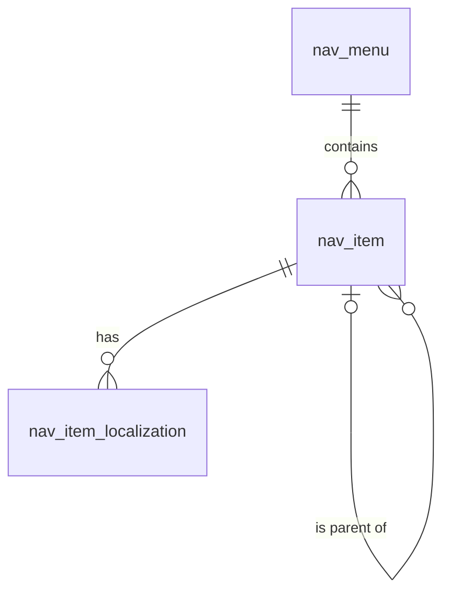

# 导航（navigation）模块设计

| 项 | 内容 |
|---|---|
| 模块 ID | `navigation` |
| 名称 | 导航 |
| 层 | L3 |
| 表前缀 | `nav_` |
| API 前缀 | `navigation` |
| 可停用 | 否 |
| 模块版本 | 1.0.0（module.json 的 version） |
| 平台版本 | `>=1.0.0 <2.0.0`（module.json 的 platform） |
| 里程碑切片 | M1：—；M2：菜单、面包屑；M3：菜单标签作为可翻译资源；M4：—（详见第 13 节） |
| 模块负责人 | 待定 |
| 文档版本 | V1.2 |
| 状态 | 草案 |
| 更新日期 | 2026-10-20 |
| 依据 | 系统设计 V1.4 第 16 章及 3.2、3.8、24–29 章；平台框架设计 V1.0 第 4、7–13 章；ADR-002、ADR-003、ADR-005、ADR-009、ADR-018 |

> 本文只引用《平台框架设计》第 4 章中的契约，不定义新的跨模块契约；需要新契约时按平台框架设计 2.3 提出契约变更请求。

## 1. 职责与边界

### 1.1 职责

维护站点菜单树、菜单项链接、语言标签与可见性；向站点引导提供已解析导航，配合内容影响分析；面包屑中间段由各内容类型提供。

功能交付范围按第 13 章分为 M1–M4；表结构、约束与枚举以第 3、4 章为准。

### 1.2 不负责的事

| 事项 | 归属模块 | 边界 |
|---|---|---|
| 内容生命周期与路由 | content / url | 本模块只承担自身职责；不直接修改 cnt_、url_ 表 |
| 身份、权限、设置、任务及审计 | platform-core | 复用平台公共服务 |
| 第三方客户端与网络传输 | infrastructure | 仅经既有端口或 L2 服务使用，不在业务模块引入客户端 |

### 1.3 协作概览

| 协作方式 | 对象 | 本模块行为 |
|---|---|---|
| 服务接口 | ContentApi、UrlApi、MediaApi、TaxonomyApi | 方法与事务边界见 2.2；无跨模块表访问 |
| 扩展点 | SiteBootstrapContributor、ContentImpactProvider、MediaReferenceCollector、TranslatableResourceProvider | 实现/收集清单见 2.4、2.5 |
| 领域事件 | 见 2.6 | 与本地事务一起登记，提交后异步投递；重复与过期处理独立验证 |

### 1.4 适用的架构约束

遵守 P2、P3 与 ADR-018：编译依赖只到 platform-core/platform-api，跨模块协作只用第 2 章登记契约；只访问自己的表，禁止跨模块 JOIN/外键。遵守 ADR-003：事务内登记、提交后投递、监听器幂等并检查过期。遵守 ADR-009：每次请求/任务明确站点上下文，站点表默认过滤。

公开读取只用当前语言发布态，不跨语言回退（ADR-005）；预览与公开缓存隔离。后台中文文案与错误集中管理，前台文案经 UiTextApi，样式只用 Design Token。远程端口在数据库事务外调用，密钥经 SecretCipher，不写日志。

## 2. 依赖与契约

### 2.1 module.json

```json
{
  "id": "navigation",
  "name": "导航",
  "version": "1.0.0",
  "layer": "L3",
  "platform": ">=1.0.0 <2.0.0",
  "requires": {
    "content": "^1.0",
    "url": "^1.0",
    "media": "^1.0",
    "taxonomy": "^1.0"
  },
  "optional": {},
  "disableable": false,
  "tablePrefix": "nav_",
  "apiPrefix": "navigation",
  "permissions": [
    {
      "code": "navigation:menu:view",
      "name": "查看菜单"
    },
    {
      "code": "navigation:menu:manage",
      "name": "管理菜单"
    }
  ],
  "menus": [
    {
      "key": "navigation",
      "name": "导航",
      "parent": "editorial",
      "route": "/navigation/menus",
      "permission": "navigation:menu:view",
      "order": 100
    }
  ],
  "settings": null,
  "components": [],
  "events": {
    "publishes": [
      "NavigationChangedEvent",
      "TranslatableResourceChangedEvent"
    ],
    "subscribes": [
      "TermChangedEvent",
      "ContentPurgedEvent",
      "MediaDeletedEvent"
    ]
  }
}
```

描述符为 M0 工程建立后的实现要求；目前尚无实际控制器、Schema 或组件包。依赖只声明运行能力；Maven 仍只依赖 platform-api/core。组件清单是本模块负责的类型，运行时 UI 不登记成可拖入布局的组件。

### 2.2 使用的服务接口

| 接口（平台框架设计小节） | 方法 | 用途 | 调用位置与时机 | 测试替身 |
|---|---|---|---|---|
| `ContentApi`（4.4.16） | findPublishedCards、findContents | 读当前发布快照与卡片；内容类型所属模块创建身份并标记草稿变化 | 读接口在查询阶段调用；写方法加入业务事务，远程文本翻译必须在事务外 | `InMemoryContentApi` |
| `UrlApi`（4.4.17） | pathsOf | 解析当前路径、生成 slug 或规范地址；不读取 url 表 | 读接口在查询阶段调用；写方法加入业务事务，远程文本翻译必须在事务外 | `InMemoryUrlApi` |
| `MediaApi`（4.4.18） | findAll、views、imageSources | 媒体视图、图片源与授权下载；不读取媒体表 | 读接口在查询阶段调用；写方法加入业务事务，远程文本翻译必须在事务外 | `InMemoryMediaApi` |
| `TaxonomyApi`（4.4.19） | findTerms、termViews、assignmentsOf | 词汇表、分类视图与内容指派；不读取分类表 | 读接口在查询阶段调用；写方法加入业务事务，远程文本翻译必须在事务外 | `InMemoryTaxonomyApi` |
| `SiteApi`（4.4.1） | 按该契约声明的方法 | 语言、站点模块开关 | 业务事务内；站点切换由任务入口完成 | `InMemorySiteApi` |
| `SiteContextProvider`（4.4.2） | 按该契约声明的方法 | 当前站点；异步与任务由 core 恢复 | 业务事务内；站点切换由任务入口完成 | `FakeSiteContextProvider` |
| `PermissionChecker`（4.4.7） | 按该契约声明的方法 | 后台权限与数据范围 | 业务事务内；站点切换由任务入口完成 | `FakePermissionChecker` |
| `AuditApi`（4.4.9） | 按该契约声明的方法 | 同事务写审计，密钥与个人数据脱敏 | 业务事务内；站点切换由任务入口完成 | `InMemoryAuditApi` |
| `EventMetaFactory`（4.4.14） | 按该契约声明的方法 | 事件 ID、版本、站点与操作人 | 业务事务内；站点切换由任务入口完成 | `FakeEventMetaFactory` |

所有 L2/L3/L4 读写隐式使用当前站点；按 ID 查询单批最多 500。可选服务用 ObjectProvider 注入并检查当前站点启用状态，缺失时降级，不通过业务表绕过服务。

### 2.3 提供的服务接口

不适用：本模块不提供跨模块服务接口；其他模块通过 2.4 的既有扩展点或领域事件协作。

### 2.4 实现的扩展点

| 扩展点（平台框架设计小节） | 计划实现类 | 适用范围 | order | 收集方 |
|---|---|---|---|---|
| `SiteBootstrapContributor`（4.5.8） | `NavigationSiteBootstrapContributor` | sectionKey=navigation；菜单树与当前语言链接 | DEFAULT=1000 | delivery |
| `ContentImpactProvider`（4.5.4） | `NavigationContentImpactProvider` | 按本模块职责及 3、4 章登记的内容/资源类型 | DEFAULT=1000 | content / core |
| `MediaReferenceCollector`（4.5.16） | `NavigationMediaReferenceCollector` | navigation 菜单资源中 mega.featuredImage | DEFAULT=1000 | media |
| `TranslatableResourceProvider`（4.5.21） | `NavigationTranslatableResourceProvider` | navigation.menu（resourceId=menuId）：items.{itemId}.label 与可见性锁定规则 | DEFAULT=1000 | translation |
| `PlatformModule`（4.5.22） | `NavigationModule` | 本模块安装/升级；可停用模块提供影响报告与停用后保留数据规则 | DEFAULT=1000 | core |

以上类名为待实现名称。PublishContributor 不调用调用方的写方法，不访问外部服务；翻译提供方只写本模块草稿/资源，先校验源指纹与共同 version。本模块不可站点级停用；对可选依赖缺失/停用仍须按框架约定降级。

### 2.5 收集的扩展点

不适用：不收集业务扩展点；PlatformModule 与任务 SPI 由 core 收集。

### 2.6 发布与订阅的事件

发布：

| 事件 | 触发事务 | 现有 payload 字段 | 订阅方 |
|---|---|---|---|
| `NavigationChangedEvent` | 菜单新增、整树保存、删除及目标语言实际回写的同一事务；携带 menuId/menuKey/change | meta、menuId、menuKey、change | 框架 4.2.4；未登记发布方的差异在第 14 章列出 |
| `TranslatableResourceChangedEvent` | 源语言可翻译文本实际变化时 UPSERTED，资源整体删除时 DELETED；非文本变化与目标语言 apply 不发布此事件 | meta、resourceType、resourceId、change | 框架 4.2.4；未登记发布方的差异在第 14 章列出 |

订阅：

| 事件 | 处理 | 幂等 | 过期与删除 | 失败与重试 |
|---|---|---|---|---|
| `TermChangedEvent` | DELETED 清除对应 TERM 目标；MOVED/RENAMED 重解析链接，不改人工菜单标签 | 本模块事务内的幂等标记与数据变更一起提交；缓存重复失效安全 | 读取当前状态/指纹；只有匹配的当前结果才更新；不以 occurredAt 单独当全序 | 失败抛出保留未完成投递；业务副作用转入已有任务/队列后重试 |
| `ContentPurgedEvent` | 按事件 contentId/localizationIds 清理本模块外部引用或子行；历史业务快照按 4.6 保留；不回查已不存在的父内容 | 本模块事务内的幂等标记与数据变更一起提交；缓存重复失效安全 | 清理使用事件中的 ID；查不到父对象仍须清理 | 失败抛出保留未完成投递；业务副作用转入已有任务/队列后重试 |
| `MediaDeletedEvent` | 仅处理被引用媒体：更新当前媒体视图或按 4.6 防御性清理；仍有有效引用的媒体不能被主动删除 | 本模块事务内的幂等标记与数据变更一起提交；缓存重复失效安全 | 清理使用事件中的 ID；查不到父对象仍须清理 | 失败抛出保留未完成投递；业务副作用转入已有任务/队列后重试 |

监听器按框架 5.8 建立站点/system 上下文；`ContentPurgedEvent` 在模块停用时仍必须清理（deliverWhenModuleDisabled）。其他停用期间跳过并完成的事件，重新启用后通过扫描当前状态补偿，不能假定还会重投。数据库幂等标记与本模块数据在同一事务提交；外部发送、下载、搜索与 CDN 调用不得被数据库长事务包裹，使用已声明的任务/端口和业务幂等键。事件 payload 仅引用框架现有字段，本文不扩展签名。

### 2.7 使用的端口

不适用：不直接使用基础设施端口；媒体、通知等外部操作经相应 L2 服务编排。

## 3. 领域模型

### 3.1 聚合、实体与值对象

| 类型 | 名称 | 说明 |
|---|---|---|
| 聚合根 | Menu（`nav_menu`） | 菜单：key（`header`、`footer-1`、`footer-2`…）、后台名称；整个菜单树一次保存，`version` 乐观锁 |
| 实体 | MenuItem（`nav_item`） | 菜单项：父项、深度、同级排序、链接（CONTENT / TERM / URL / NONE）、是否新窗口打开、Mega 配置；结构在各语言之间共享 |
| 实体 | MenuItemLocalization（`nav_item_localization`） | 菜单项在一种语言下的标签与可见性（站点资源：中文录入，其他语言由 translation 生成，带翻译状态与源指纹） |
| 值对象 | Link | `link_type` + `link_ref`（内容或分类项 ID）或 `link_url`；渲染时解析为当前语言的路径 |
| 值对象 | MegaConfig | 列数、推荐图片 `$media`、推荐链接 `$content`（取决于 Header 变体） |

在系统设计之外补充的字段：

| 补充 | 理由 |
|---|---|
| `nav_menu.key` 改名 `menu_key`；`nav_item.sort` 改名 `sort_order` | `key` 是 MySQL 关键字（平台框架设计 7.2）；与全库排序列命名一致 |
| `nav_menu.name`、`description`、`builtin`、`deleted_at`、`version` | 后台显示；主题使用的内置菜单不可删除；配置类实体软删除（平台框架设计 7.5）；菜单整体保存的乐观锁 |
| `nav_item.link_url` | 系统设计的 `link_ref` 保存 CONTENT / TERM 的 ID（第 7 章以 `nav_item.link_ref` 引用分类项）；URL 类型的地址另存一列 |
| `link_type = NONE` | Mega 菜单的列标题、分组标题只有文字，没有链接 |
| `nav_item.depth` | 限制层级（最大 3）并便于按层渲染 |
| `nav_item_localization.visible_locked` | 目标语言的可见性默认随源语言自动生成；人工设置后译文回写不再覆盖 |
| `nav_item_localization.translation_state`、`source_fingerprint` | 站点资源本地化表的统一字段（平台框架设计 7.7） |

### 3.2 不变量

| # | 规则 | 保证方式 |
|---|---|---|
| 1 | 站点内未删除菜单的 `menu_key` 唯一；key 创建后不可修改（主题按 key 读取）；内置菜单不可删除 | 数据库：`uk_menu_key`；应用层 |
| 2 | 菜单项与父项属于同一菜单；不能移动到自身子树下；根项 `parent_id` 为空且 `depth = 1`，子项 `depth` = 父项 `depth` + 1，最大 3 | 数据库：`ck_nav_item_depth`（范围）；应用层（与父项的关系：MySQL 不允许 CHECK 引用带级联动作的外键列） |
| 3 | 链接与类型一致：CONTENT / TERM 时 `link_ref` 非空且 `link_url` 为空；URL 时 `link_url` 非空且 `link_ref` 为空；NONE 时两者都为空 | 数据库：`ck_nav_item_link` |
| 4 | CONTENT 的目标是可路由内容（不能是 FAQ、GLOBAL_BLOCK）；TERM 的目标是可路由词汇表的分类项 | 应用层 |
| 5 | URL 只能是 `https://` 绝对地址，或以 `/` 开头、不含语言前缀的站内路径（渲染时加当前语言前缀）；不允许 `javascript:` 等协议 | 应用层 |
| 6 | 每个菜单项每种语言最多一条本地化；中文行必须存在且标签非空；中文行 `translation_state = NONE`、`source_fingerprint` 为空 | 数据库：`uk_nil_item_locale`；应用层 |
| 7 | 菜单项在某语言没有本地化或 `visible = 0` 时不显示；CONTENT / TERM 链接的目标在该语言未发布时自动隐藏（渲染时判断，不写库）；父项隐藏时子项一并隐藏 | 应用层（Delivery） |
| 8 | 子表的 `site_id` 与菜单一致 | 应用层 |

### 3.3 状态机

不适用：菜单是保存即生效的站点资源，没有内容发布状态。菜单软删除、语言可见性与资源 translation_state 是独立维度；visible_locked 控制人工可见性不被翻译覆盖，资源翻译状态沿用平台共享枚举。

## 4. 数据模型

> 遵守平台框架设计第 7 章的数据库通用约定。本节给出待实现 DDL；本次文档审查未重跑 MySQL，不能据此认定 DDL 已验证。M0 后按第 11 章在 MySQL 8.4 空库验证，并使实际迁移脚本与本节一致。

### 4.1 表清单

| 表 | 说明 | 站点级 | 软删除 | 预估规模（单站，按系统设计假设 A4） |
|---|---|---|---|---|
| `nav_menu` | 菜单 | 是 | 是（`deleted_at`） | 3–10 行 |
| `nav_item` | 菜单项 | 是 | 否（随菜单保存物理删除） | 50–300 行 |
| `nav_item_localization` | 菜单项本地化（站点资源） | 是 | 否（随菜单项） | 500–3 千行（× 10 种语言） |

### 4.2 ER 图



### 4.3 表结构

#### 4.3.1 `nav_menu`：菜单

| 字段 | 类型 | 可空 | 默认 | 说明 |
|---|---|---|---|---|
| `id` | BIGINT | 否 | — | 主键（TSID） |
| `site_id` | BIGINT | 否 | — | 站点 ID（sys_site.id） |
| `menu_key` | VARCHAR(64) bin | 否 | — | 菜单 key（小写字母、数字、连字符；创建后不可修改；主题按 key 读取），如 header、footer-1 |
| `name` | VARCHAR(100) | 否 | — | 名称（中文，只在后台显示） |
| `description` | VARCHAR(500) | 是 | — | 说明（显示位置，如“页脚第一列”） |
| `builtin` | TINYINT(1) | 否 | `0` | 是否内置（主题使用的菜单，不可删除） |
| `deleted_at` | DATETIME(3) | 是 | — | 删除时间（软删除） |
| `alive` | TINYINT | 是 | 生成列 `IF(deleted_at IS NULL, 1, NULL)` | 未删除标记（唯一索引用） |
| `version` | INT | 否 | `0` | 乐观锁版本号（整个菜单树一次保存） |
| `created_at` | DATETIME(3) | 否 | `CURRENT_TIMESTAMP(3)` | 创建时间（UTC） |
| `created_by` | BIGINT | 否 | `0` | 创建人用户 ID（0 = 系统） |
| `updated_at` | DATETIME(3) | 否 | `CURRENT_TIMESTAMP(3) ON UPDATE CURRENT_TIMESTAMP(3)` | 更新时间（UTC） |
| `updated_by` | BIGINT | 否 | `0` | 更新人用户 ID（0 = 系统） |

索引与约束：
- `PRIMARY KEY (id)`
- `uk_menu_key (site_id, menu_key, alive)`：未删除的 key 唯一；按 key 读取（站点引导数据、主题）；站点的菜单列表

```sql
CREATE TABLE nav_menu (
  id           BIGINT        NOT NULL COMMENT '主键（TSID）',
  site_id      BIGINT        NOT NULL COMMENT '站点 ID（sys_site.id）',
  menu_key     VARCHAR(64)   COLLATE utf8mb4_0900_bin NOT NULL COMMENT '菜单 key（小写字母、数字、连字符；创建后不可修改；主题按 key 读取），如 header、footer-1',
  name         VARCHAR(100)  NOT NULL COMMENT '名称（中文，只在后台显示）',
  description  VARCHAR(500)  NULL COMMENT '说明（显示位置，如“页脚第一列”）',
  builtin      TINYINT(1)    NOT NULL DEFAULT 0 COMMENT '是否内置（主题使用的菜单，不可删除）',
  deleted_at   DATETIME(3)   NULL COMMENT '删除时间（软删除）',
  alive        TINYINT       AS (IF(deleted_at IS NULL, 1, NULL)) STORED COMMENT '未删除标记（唯一索引用）',
  version      INT           NOT NULL DEFAULT 0 COMMENT '乐观锁版本号（整个菜单树一次保存）',
  created_at   DATETIME(3)   NOT NULL DEFAULT CURRENT_TIMESTAMP(3) COMMENT '创建时间（UTC）',
  created_by   BIGINT        NOT NULL DEFAULT 0 COMMENT '创建人用户 ID（0 = 系统）',
  updated_at   DATETIME(3)   NOT NULL DEFAULT CURRENT_TIMESTAMP(3) ON UPDATE CURRENT_TIMESTAMP(3) COMMENT '更新时间（UTC）',
  updated_by   BIGINT        NOT NULL DEFAULT 0 COMMENT '更新人用户 ID（0 = 系统）',
  PRIMARY KEY (id),
  UNIQUE KEY uk_menu_key (site_id, menu_key, alive)
) ENGINE = InnoDB DEFAULT CHARSET = utf8mb4 COLLATE = utf8mb4_0900_ai_ci COMMENT = '导航菜单（header、footer-1、footer-2 等；保存即生效）';
```

要点：
- 保存即生效（系统设计 16.1）：菜单树（菜单项与中文本地化）在一个事务中整体保存（`version` 乐观锁），写审计日志；事务提交后发布 `NavigationChangedEvent`（delivery 失效该站点的导航缓存，seo 重建 `NAV` 链接）与 `TranslatableResourceChangedEvent`（资源类型 `navigation.menu`，每个新增、标签变化或删除的菜单项一条）。
- 站点创建或 navigation 安装时写入内置菜单 `header`、`footer-1`、`footer-2`（`builtin = 1`，平台框架设计 5.2、11.6）；页脚菜单中配置法律页面链接（系统设计 10.7）。
- 前台：navigation 实现 `SiteBootstrapContributor`，按语言输出可见的菜单树（标签已按语言选取，链接为 `$content` / `$term` / URL），Delivery 解析链接并隐藏目标未发布的菜单项。

#### 4.3.2 `nav_item`：菜单项

| 字段 | 类型 | 可空 | 默认 | 说明 |
|---|---|---|---|---|
| `id` | BIGINT | 否 | — | 主键（TSID） |
| `site_id` | BIGINT | 否 | — | 站点 ID（sys_site.id） |
| `menu_id` | BIGINT | 否 | — | 菜单 ID（nav_menu.id） |
| `parent_id` | BIGINT | 是 | — | 父菜单项 ID（nav_item.id）；根项为空 |
| `depth` | TINYINT | 否 | `1` | 层级深度：根项为 1，最大 3 |
| `sort_order` | INT | 否 | `0` | 同级排序 |
| `link_type` | VARCHAR(16) | 否 | — | 链接类型：CONTENT（内容）/ TERM（分类项落地页）/ URL（外部地址或站内路径）/ NONE（仅标题） |
| `link_ref` | BIGINT | 是 | — | 链接目标 ID：CONTENT 为内容 ID（cnt_content.id）；TERM 为分类项 ID（tx_term.id） |
| `link_url` | VARCHAR(2048) | 是 | — | URL 类型的地址：https:// 绝对地址，或以 / 开头、不含语言前缀的站内路径（渲染时加当前语言前缀） |
| `open_in_new` | TINYINT(1) | 否 | `0` | 是否在新窗口打开（外部链接加 rel="noopener"） |
| `mega` | JSON | 是 | — | Mega 菜单配置（取决于 Header 变体，只用于根项）：{"columns":3,"featuredImage":{"$media":"…"},"featuredLink":{"$content":"…"}} |
| `created_at` | DATETIME(3) | 否 | `CURRENT_TIMESTAMP(3)` | 创建时间（UTC） |
| `created_by` | BIGINT | 否 | `0` | 创建人用户 ID（0 = 系统） |
| `updated_at` | DATETIME(3) | 否 | `CURRENT_TIMESTAMP(3) ON UPDATE CURRENT_TIMESTAMP(3)` | 更新时间（UTC） |
| `updated_by` | BIGINT | 否 | `0` | 更新人用户 ID（0 = 系统） |

索引与约束：
- `PRIMARY KEY (id)`
- `idx_item_menu (menu_id, parent_id, sort_order)`：加载整个菜单树；兼作 `fk_nav_item_menu` 的索引
- `idx_item_parent (parent_id)`：`fk_nav_item_parent` 的索引
- `idx_item_link (site_id, link_type, link_ref)`：按内容或分类项查找指向它的菜单项（`ContentImpactProvider`、内容彻底删除与分类项删除时的清理）
- `fk_nav_item_menu`、`fk_nav_item_parent`：组合关系，`ON DELETE CASCADE`（删除菜单项时连同子项）
- `ck_nav_item_link`、`ck_nav_item_depth`：见 3.2 不变量 3、2

```sql
CREATE TABLE nav_item (
  id           BIGINT         NOT NULL COMMENT '主键（TSID）',
  site_id      BIGINT         NOT NULL COMMENT '站点 ID（sys_site.id）',
  menu_id      BIGINT         NOT NULL COMMENT '菜单 ID（nav_menu.id）',
  parent_id    BIGINT         NULL COMMENT '父菜单项 ID（nav_item.id）；根项为空',
  depth        TINYINT        NOT NULL DEFAULT 1 COMMENT '层级深度：根项为 1，最大 3',
  sort_order   INT            NOT NULL DEFAULT 0 COMMENT '同级排序',
  link_type    VARCHAR(16)    NOT NULL COMMENT '链接类型：CONTENT（内容）/ TERM（分类项落地页）/ URL（外部地址或站内路径）/ NONE（仅标题）',
  link_ref     BIGINT         NULL COMMENT '链接目标 ID：CONTENT 为内容 ID（cnt_content.id）；TERM 为分类项 ID（tx_term.id）',
  link_url     VARCHAR(2048)  NULL COMMENT 'URL 类型的地址：https:// 绝对地址，或以 / 开头、不含语言前缀的站内路径（渲染时加当前语言前缀）',
  open_in_new  TINYINT(1)     NOT NULL DEFAULT 0 COMMENT '是否在新窗口打开（外部链接加 rel="noopener"）',
  mega         JSON           NULL COMMENT 'Mega 菜单配置（取决于 Header 变体，只用于根项）：{"columns":3,"featuredImage":{"$media":"…"},"featuredLink":{"$content":"…"}}',
  created_at   DATETIME(3)    NOT NULL DEFAULT CURRENT_TIMESTAMP(3) COMMENT '创建时间（UTC）',
  created_by   BIGINT         NOT NULL DEFAULT 0 COMMENT '创建人用户 ID（0 = 系统）',
  updated_at   DATETIME(3)    NOT NULL DEFAULT CURRENT_TIMESTAMP(3) ON UPDATE CURRENT_TIMESTAMP(3) COMMENT '更新时间（UTC）',
  updated_by   BIGINT         NOT NULL DEFAULT 0 COMMENT '更新人用户 ID（0 = 系统）',
  PRIMARY KEY (id),
  KEY idx_item_menu (menu_id, parent_id, sort_order),
  KEY idx_item_parent (parent_id),
  KEY idx_item_link (site_id, link_type, link_ref),
  CONSTRAINT fk_nav_item_menu FOREIGN KEY (menu_id) REFERENCES nav_menu (id) ON DELETE CASCADE,
  CONSTRAINT fk_nav_item_parent FOREIGN KEY (parent_id) REFERENCES nav_item (id) ON DELETE CASCADE,
  CONSTRAINT ck_nav_item_link CHECK ((link_type IN ('CONTENT', 'TERM') AND link_ref IS NOT NULL AND link_url IS NULL) OR (link_type = 'URL' AND link_url IS NOT NULL AND link_ref IS NULL) OR (link_type = 'NONE' AND link_ref IS NULL AND link_url IS NULL)),
  CONSTRAINT ck_nav_item_depth CHECK (depth BETWEEN 1 AND 3)
) ENGINE = InnoDB DEFAULT CHARSET = utf8mb4 COLLATE = utf8mb4_0900_ai_ci COMMENT = '导航菜单项（结构在各语言之间共享；链接为内容、分类项、URL 或仅标题）';
```

要点：
- 链接保存 ID，不保存内容的 URL：内容或分类项的路径变化、slug 修改后菜单无需修改（与布局文档的引用对象化原则一致，系统设计 10.3）。
- 结构（父项、排序、链接、Mega 配置）在各语言之间共享（系统设计 16.1）；某语言需要不同的菜单项时，在其他语言中设置 `visible = 0`。
- `mega` 中的推荐图片经 `MediaApi` 登记引用，有引用的媒体不能删除。

#### 4.3.3 `nav_item_localization`：菜单项本地化

| 字段 | 类型 | 可空 | 默认 | 说明 |
|---|---|---|---|---|
| `id` | BIGINT | 否 | — | 主键（TSID） |
| `site_id` | BIGINT | 否 | — | 站点 ID（sys_site.id） |
| `item_id` | BIGINT | 否 | — | 菜单项 ID（nav_item.id） |
| `locale` | VARCHAR(16) | 否 | — | 语言（BCP 47） |
| `label` | VARCHAR(100) | 否 | — | 标签（站点资源：中文录入，其他语言由 translation 经 TranslatableResourceProvider 写入） |
| `visible` | TINYINT(1) | 否 | `1` | 在该语言中是否显示 |
| `visible_locked` | TINYINT(1) | 否 | `0` | 可见性是否由人工设置（1 = 译文回写时不覆盖；中文行恒为 0） |
| `translation_state` | VARCHAR(16) | 否 | `'NONE'` | 标签的翻译状态：NONE / QUEUED / TRANSLATED / NEEDS_REVIEW / FAILED / OUTDATED |
| `source_fingerprint` | CHAR(64) bin | 是 | — | 生成本行译文时中文行的指纹（规范化 label 的 SHA-256）；中文行为空；与当前中文指纹不同即为过期 |
| `version` | INT | 否 | `0` | 乐观锁版本号（翻译编辑器按行修订） |
| `created_at` | DATETIME(3) | 否 | `CURRENT_TIMESTAMP(3)` | 创建时间（UTC） |
| `created_by` | BIGINT | 否 | `0` | 创建人用户 ID（0 = 系统，如译文回写） |
| `updated_at` | DATETIME(3) | 否 | `CURRENT_TIMESTAMP(3) ON UPDATE CURRENT_TIMESTAMP(3)` | 更新时间（UTC） |
| `updated_by` | BIGINT | 否 | `0` | 更新人用户 ID（0 = 系统，如译文回写） |

索引与约束：
- `PRIMARY KEY (id)`
- `uk_nil_item_locale (item_id, locale)`：每种语言一条；按菜单项取各语言标签；兼作 `fk_nav_nil_item` 的索引
- `idx_nil_state (site_id, translation_state, locale)`：翻译中心列出待处理的菜单标签
- `fk_nav_nil_item`：组合关系，`ON DELETE CASCADE`

```sql
CREATE TABLE nav_item_localization (
  id                  BIGINT        NOT NULL COMMENT '主键（TSID）',
  site_id             BIGINT        NOT NULL COMMENT '站点 ID（sys_site.id）',
  item_id             BIGINT        NOT NULL COMMENT '菜单项 ID（nav_item.id）',
  locale              VARCHAR(16)   NOT NULL COMMENT '语言（BCP 47）',
  label               VARCHAR(100)  NOT NULL COMMENT '标签（站点资源：中文录入，其他语言由 translation 经 TranslatableResourceProvider 写入）',
  visible             TINYINT(1)    NOT NULL DEFAULT 1 COMMENT '在该语言中是否显示',
  visible_locked      TINYINT(1)    NOT NULL DEFAULT 0 COMMENT '可见性是否由人工设置（1 = 译文回写时不覆盖；中文行恒为 0）',
  translation_state   VARCHAR(16)   NOT NULL DEFAULT 'NONE' COMMENT '标签的翻译状态：NONE / QUEUED / TRANSLATED / NEEDS_REVIEW / FAILED / OUTDATED',
  source_fingerprint  CHAR(64)      COLLATE utf8mb4_0900_bin NULL COMMENT '生成本行译文时中文行的指纹（规范化 label 的 SHA-256）；中文行为空；与当前中文指纹不同即为过期',
  version             INT           NOT NULL DEFAULT 0 COMMENT '乐观锁版本号（翻译编辑器按行修订）',
  created_at          DATETIME(3)   NOT NULL DEFAULT CURRENT_TIMESTAMP(3) COMMENT '创建时间（UTC）',
  created_by          BIGINT        NOT NULL DEFAULT 0 COMMENT '创建人用户 ID（0 = 系统，如译文回写）',
  updated_at          DATETIME(3)   NOT NULL DEFAULT CURRENT_TIMESTAMP(3) ON UPDATE CURRENT_TIMESTAMP(3) COMMENT '更新时间（UTC）',
  updated_by          BIGINT        NOT NULL DEFAULT 0 COMMENT '更新人用户 ID（0 = 系统，如译文回写）',
  PRIMARY KEY (id),
  UNIQUE KEY uk_nil_item_locale (item_id, locale),
  KEY idx_nil_state (site_id, translation_state, locale),
  CONSTRAINT fk_nav_nil_item FOREIGN KEY (item_id) REFERENCES nav_item (id) ON DELETE CASCADE
) ENGINE = InnoDB DEFAULT CHARSET = utf8mb4 COLLATE = utf8mb4_0900_ai_ci COMMENT = '菜单项本地化（标签与可见性为站点资源，带翻译状态与源指纹）';
```

要点：
- 翻译（系统设计 16.1、5.7）：中文 `label` 变化时发布 `TranslatableResourceChangedEvent`（资源类型 `navigation.menu`，ID 为菜单 `menu_id`（非 item_id））；translation 经翻译记忆（全站译法一致）与 AI 引擎生成译文，经 navigation 的 `TranslatableResourceProvider` 回写目标语言行：写入 `label`、`translation_state`、`source_fingerprint`，`visible_locked = 0` 时 `visible` 复制中文行。新菜单项在目标语言的译文生成之前，该语言中不显示。
- 人工修订在翻译编辑器中进行，写回翻译记忆（`HUMAN`）；目标语言的 `visible` 由人工修改时置 `visible_locked = 1`。
- 删除菜单项时级联删除各语言行，并发布菜单聚合 `TranslatableResourceChangedEvent(UPSERTED)`；仅整个菜单删除时发布 `DELETED`，translation 取消该菜单未执行的项。

### 4.4 枚举

| 字段 | 取值 | 说明 |
|---|---|---|
| `nav_menu.menu_key`（内置） | `header` / `footer-1` / `footer-2` | 页头主菜单 / 页脚第一列 / 页脚第二列（主题可声明更多，如 `footer-3`） |
| `nav_item.link_type` | `CONTENT` | 链接到可路由内容（`link_ref` = 内容 ID） |
| | `TERM` | 链接到可路由分类项的落地页（`link_ref` = 分类项 ID） |
| | `URL` | 外部 `https://` 地址或不含语言前缀的站内路径（`link_url`） |
| | `NONE` | 仅标题（Mega 菜单列标题、分组标题） |
| `nav_item_localization.translation_state` | `NONE` / `QUEUED` / `TRANSLATED` / `NEEDS_REVIEW` / `FAILED` / `OUTDATED` | 共享翻译状态枚举；中文行为 `NONE`；源语言变化后目标语言行重新进入 `QUEUED` |

### 4.5 站点过滤

| 表 | 行级拦截器 | 访问方式与理由 |
|---|---|---|
| `nav_menu` | 不豁免 | 请求和任务隐式使用当前站点；子表 site_id 与父表一致 |
| `nav_item` | 不豁免 | 请求和任务隐式使用当前站点；子表 site_id 与父表一致 |
| `nav_item_localization` | 不豁免 | 请求和任务隐式使用当前站点；子表 site_id 与父表一致 |

### 4.6 跨模块引用与清理

| 本模块字段 | 引用对象（模块.表） | 被引用对象删除 / 下线时的处理 | 触发事件 |
|---|---|---|---|
| `nav_item.link_ref`（CONTENT）、`mega.featuredLink` | content.`cnt_content` | 下线、进回收站：渲染时自动隐藏，数据不变；下线或删除前由 navigation 的 `ContentImpactProvider` 列出指向它的菜单项；彻底删除：该项改为 `NONE`、`link_ref` 置空、各语言 `visible` 置 0（`featuredLink` 移除），后台提示重新选择链接 | `ContentPurgedEvent` |
| `nav_item.link_ref`（TERM） | taxonomy.`tx_term` | 分类项删除：同上处理；更名、移动无需处理（标签独立维护，路径在渲染时解析） | `TermChangedEvent`（DELETED） |
| `nav_item.mega.featuredImage` | media.`mda_media` | 有引用记录的媒体不能删除；收到删除事件时防御性移除推荐图片 | `MediaDeletedEvent` |
| `nav_item_localization.locale` | core.`sys_site_locale` | V1 不删除站点语言，无需清理 | — |
| `created_by`、`updated_by` | core.`sys_user` | 不清理 | — |

本模块发布的事件：`NavigationChangedEvent`、`TranslatableResourceChangedEvent`（资源类型 `navigation.menu`）。订阅：`ContentPurgedEvent`、`TermChangedEvent`、`MediaDeletedEvent`。实现的扩展点：`TranslatableResourceProvider`、`SiteBootstrapContributor`、`ContentImpactProvider`。

其他模块引用本模块：seo 的 `seo_link`（`NAV` 行）在收到 `NavigationChangedEvent` 后重建（第 13 章）。

### 4.7 迁移脚本

| 文件 | 内容 | 里程碑 |
|---|---|---|
| `db/migration/navigation/V001__init.sql` | 4.3 中的全部表（3 张：`nav_menu`、`nav_item`、`nav_item_localization`），按本节顺序创建 | 按第 13.1 节分期启用，初始结构在首个有效切片建立 |

## 5. 业务流程

### 5.1 核心业务流程

| 步骤 | 事务及行为 | 失败处理 |
|---|---|---|
| 1 | 整个菜单树使用 nav_menu.version 一次保存；校验同菜单父子关系、最大 3 层、链接类型与目标，中文标签必须存在；在同一事务写树和本地化，发布 NavigationChangedEvent 与资源变化事件。 | 输入或状态非法返回 4xx；数据库事务回滚；提交后外部处理失败进入重试与可见失败记录 |
| 2 | SiteBootstrapContributor 读取当前语言菜单，使用 ContentApi、UrlApi、TaxonomyApi 批量解析链接；未发布、无本地化或父项隐藏时整枝隐藏，不回退中文。 | 输入或状态非法返回 4xx；数据库事务回滚；提交后外部处理失败进入重试与可见失败记录 |
| 3 | 内容彻底删除时将指向目标的菜单项置 NONE 并隐藏；媒体删除时去掉推荐图片；翻译回写只更新未锁定可见性与标签并触发导航失效。 | 输入或状态非法返回 4xx；数据库事务回滚；提交后外部处理失败进入重试与可见失败记录 |

后台读写先校验权限与站点/语言范围；草稿写入和审计在同一事务。远程操作不能使用数据库长事务包裹。幂等重放返回既有结果；参数不同却复用同一幂等键时拒绝。

### 5.2 一致性、失败与恢复约束

| 场景 | 必须满足的行为 | 可验证结果 |
|---|---|---|
| 菜单聚合与资源标识 | 整树以 menuId/nav_menu.version 为聚合；navigation.menu 的 resourceId=menuId，翻译单元以 items.{itemId}.label 定位。删除一个项发布菜单 UPSERTED，删除整菜单才 DELETED。 | 同一菜单改 3 个标签只登记一次聚合资源变更；移动项后 key 不变；翻译旧结果不能重建已删除 item。 |
| 树保存与链接安全 | 先校验整树最多 3 层、无环、同菜单父子关系再一次提交；URL 只允许 HTTPS 或规范站内路径，拒绝 //、危险协议、控制字符及规范化后的绕过。新窗口链接加安全 rel。 | 越层、跨菜单父项、javascript:/协议相对 URL 均失败，数据库树版本与所有子项不变。 |
| 当前语言可见性 | 父项不可见则整枝隐藏；目标内容缺少当前语言发布版本时隐藏，普通外链按合法 URL 渲染。翻译只更新标签和未 visible_locked 的可见性。 | 菜单项英文标签存在但目标英文未发布时仍隐藏；人工锁定隐藏后任意机器回写不将其恢复。 |
| 媒体与导航失效 | 保存、删除和目标语言回写按实际变化发 NavigationChangedEvent，media 用 menuId 收集整个菜单推荐图；公开导航缓存依赖 nav/settings 及链接引用标签。 | 更换推荐图后最终只保留新资源引用；删除整菜单后引用集合为空；标签变化后 60s 内站点引导和缓存页面同步更新。 |

## 6. 接口

### 6.1 Admin 端点

| 方法 | 路径（相对 /api/admin/v1/navigation） | 说明 | 权限码 | 并发控制 / 幂等 | 审计 |
|---|---|---|---|---|---|
| GET | `/menus` | 菜单列表与语言状态 | `navigation:menu:view` | 只读；不写入业务状态 | 否 |
| POST | `/menus` | 创建自定义菜单 | `navigation:menu:manage` | 唯一键检查；重复创建返回 409（不覆盖已有资源） | navigation.menus.post |
| GET | `/menus/{key}` | 读取整棵菜单树 | `navigation:menu:view` | 只读；不写入业务状态 | 否 |
| PUT | `/menus/{key}` | 原子保存树与中文标签 | `navigation:menu:manage` | 聚合 version / If-Match；冲突 409 / 412，整笔回滚 | navigation.menus.{key}.put |
| DELETE | `/menus/{key}` | 只删除非内置菜单 | `navigation:menu:manage` | 校验聚合 version 与引用；已不存在返回 404，不能重复副作用 | navigation.menus.{key}.delete |
| PUT | `/menus/{key}/localizations/{locale}/visibility` | 按菜单版本保存目标语言项可见性与人工锁定 | `navigation:menu:manage` | 更新校验聚合 version；失败整笔回滚 | navigation.menus.put |

ID 序列化为字符串，时间为 ISO-8601 UTC；列表 page/size（size ≤ 100），默认 size=20，排序字段白名单。版本化资源按框架 5.5.6 使用 ETag: "v{version}" 与 If-Match，不能用任意 JSON 摘要替代平台版本协议；无 version 的集合写入方式见本节补充约束。创建返回资源及标识；耗时 POST 返回 202 与 jobId；无跨站点 ID 访问。写操作审计不包含凭据、完整个人数据或任意脚本正文。

**请求与结果约束**：整树保存输入 menuKey、version、items（稳定 ID、parentId、sort、linkType、linkRef 或 linkUrl、openInNewTab、mega、中文 label）；父项必须在同一请求树中。返回新的 version 与规范化树；校验失败提供节点 ID/字段路径，不能部分保存。目标语言标签人工修订走翻译编辑器；visible 与 visibleLocked 分开。

### 6.2 Public 端点

不适用：内容、菜单、媒体引用等由 delivery 返回；本模块不增加绕过发布态约束的公开读取接口。

### 6.3 Internal 端点

不适用：不新增 internal HTTP 端点；跨模块使用进程内 platform-api 契约。Nuxt 所需公共读取使用 6.2 的既有入口及可信代理认证。

### 6.4 权限码

| 权限码 | 名称 | 数据范围 | 高危 | 语言范围 |
|---|---|---|---|---|
| `navigation:menu:view` | 查看菜单 | 当前站点 | 否 | 否 |
| `navigation:menu:manage` | 管理菜单 | 当前站点 | 否 | 否 |

### 6.5 错误码

| 错误码 | HTTP 状态 | 后台中文信息 | 前台文案键 |
|---|---|---|---|
| `NAVIGATION_VALIDATION_FAILED` | 422 | 输入不符合本模块规则 | — |
| `NAVIGATION_NOT_FOUND` | 404 | 请求的资源不存在 | — |
| `CORE_MODULE_DISABLED` | 404 | 站点已停用该模块 | errors.moduleDisabled |
| `NAVIGATION_VERSION_CONFLICT`（模块内部错误码） | 409 / 412 | 资源已被修改，请刷新后重试 | — |

跨模块错误使用框架已声明常量；本模块专用 HTTP 校验错误保存在本模块错误目录，不增加 platform-api 常量。公开接口不直接展示 detail；错误文案键统一登记在 UiTextApi。

**重点业务失败**：NAVIGATION_VALIDATION_FAILED（本模块内部）、NAVIGATION_VERSION_CONFLICT（本模块内部）。模块内部错误不扩展 platform-api；HTTP 状态按本节与框架错误常量映射。

本模块内部错误补充：`NAVIGATION_VERSION_CONFLICT` 默认 409，经 If-Match 提交为 412；幂等键复用但规范化业务请求不同为 `NAVIGATION_IDEMPOTENCY_CONFLICT`（409）；状态操作不适用为 `NAVIGATION_STATE_INVALID`（409）。只有实际存在相应端点时才注册/使用，均不新增跨模块错误常量。跨站点或数据范围外 ID 返回不泄露对象存在性的结果，日志保留 traceId 和授权判定。

## 7. 后台界面

### 7.1 菜单与路由

| 菜单 key | 名称 | 父菜单 | 路由 | 权限码 |
|---|---|---|---|---|
| navigation | 导航 | editorial | /navigation/menus | navigation:menu:view |

### 7.2 页面

| 页面 | 路由 | 主要功能 | 共享组件 |
|---|---|---|---|
| 导航 | /navigation/menus | 按第 6 章端点完成列表、筛选、详情与授权操作；失败保留编辑上下文 | 复用框架 8.2 的 SchemaForm 与通用选择器 |

### 7.3 注册到内容编辑外壳的标签

不适用：不向内容编辑外壳注册业务标签；公共生命周期控件由 content 外壳负责。

### 7.4 界面文案

| texts.ts 分组 | 中文文案 | 使用场景 |
|---|---|---|
| navigation.title | 导航 | 页面标题 |
| navigation.save | 保存成功 | 保存反馈 |
| navigation.conflict | 内容已被修改，请刷新后重试 | 并发冲突 |
| navigation.confirm | 确认执行此操作？ | 有副作用操作确认 |

字段名、枚举标签、按钮、空状态、错误与任务进度统一集中在本模块 texts.ts；后台不引入 vue-i18n。无权限时隐藏操作，服务端仍再次校验。

## 8. 前台组件与模板

> 没有前台组件时写“不适用”。

### 8.1 组件

不适用：不拥有可拖入布局的组件类型。运行时 UI 或主题固定区域见第 5、6 章。

### 8.2 属性与翻译

不适用：无本模块组件属性；可翻译内容及资源按第 3、4 章登记的提供方处理。

### 8.3 模板

不适用：模板元数据由 page 的 TemplateProvider 提供；本模块只提供所属组件或数据。

### 8.4 数据源

不适用：不提供 DataSourceProvider；使用发布快照或既有贡献接口。

### 8.5 文案键

| 文案键 | 默认中文文案 | 位置 |
|---|---|---|
| navigation.empty | 暂无内容 | 列表/组件空态 |
| navigation.loading | 正在加载 | 交互等待 |
| navigation.retry | 重试 | 可恢复错误 |

## 9. 配置项

### 9.1 站点设置（settings.schema.json）

不新增 sys_setting 键；第 4 章业务配置表、模板或布局字段沿用各自定义及默认值，不能重复存放同一配置。没有独立站点设置 Schema 时，描述符 settings 为 null。

### 9.2 部署配置（application.yml）

本模块不另设连接地址或凭据前缀；数据库、Redis、对象存储及远程服务配置采用平台框架 5.12、5.14 的 `b2bweb.infra.*` 和环境变量。第 2.7 节列出的端口由 application 装配。部署地址、TLS 与密钥不写入仓库或响应。

执行批量任务时使用第 10 章的处理量与取消点；这些是初始运行预算，不能覆盖接口安全上限。任何新增可调参数先在本节明确类型、默认值及边界后再实现。

## 10. 定时与异步任务

不适用：没有独立定时或 sys_job 任务。领域事件处理在 2.6 中列出；纯本地短事务不包装成额外任务。

## 11. 测试要点

| 层级 | 覆盖内容 | 必测用例 |
|---|---|---|
| 单元 | 第 3.2 全部不变量、3.3 状态与纯计算 | 逐条构造非法输入；合法及非法转换均断言；业务用例见 13.2 |
| 模块集成（Testcontainers + 替身） | 第 6.1 全部端点、唯一约束和版本控制 | MySQL 8.4 空库迁移；跨站点 ID 拒绝；并发保存只成功一份；幂等重放不重复写入 |
| 契约（提供方） | 不适用：不提供服务接口 | 扩展点实现运行框架 4.8.5 中对应 Conformance 套件 |
| 事件（Scenario API） | 2.6 的发布与订阅 | 事务回滚无事件；重复投递不重复副作用；新修订后再投旧事件不回退 |
| 停用行为 | 系统设计 3.8 | 不适用：不可停用；验证停用其可选依赖后仍能降级 |
| 站点隔离 | 6.1 全部端点、4.5 全部站点表或缓存索引 | A/B 两站同构数据互不可见；全局豁免表只在显式系统权限处访问 |
| 翻译 | 可翻译内容/资源与人工保护 | 提取回写往返一致，非文本不翻译，HUMAN/REVIEWED 不覆盖，源变化标记过期 |
| 前端 | Admin、Schema、主题及权限 | Vitest 校验字段/权限/错误；组件画廊视觉回归、Token 及文案键检查；未授权操作不可见 |
| E2E | 13.2 用例 | Playwright 用例名包含模块及 A 编号；不得把未实现测试写成已通过 |

本章是实现后的测试要求；当前仓库没有应用或测试工程，本次只验证文档及契约引用，未执行上述应用测试。

## 12. 独立开发说明

### 12.1 依赖的测试替身

| 替身或夹具（platform-testkit） | 替代能力 | 用途 | 预置数据 |
|---|---|---|---|
| InMemoryContentApi | ContentApi | 替代对应 L2 模块 | 站点 A/B、公开与未公开语言、发布/草稿/下线对象 |
| InMemoryUrlApi | UrlApi | 替代对应 L2 模块 | 站点 A/B、公开与未公开语言、发布/草稿/下线对象 |
| InMemoryMediaApi | MediaApi | 替代对应 L2 模块 | 站点 A/B、公开与未公开语言、发布/草稿/下线对象 |
| InMemoryTaxonomyApi | TaxonomyApi | 替代对应 L2 模块 | 站点 A/B、公开与未公开语言、发布/草稿/下线对象 |
| TestPlatform / TestSites / TestUsers | core 公共服务与站点身份 | 按框架 9.2 装配替身、ManualClock | A/B 站、不同角色/语言范围、停用模块 |
| InMemorySiteApi | SiteApi | 替代 core 公共服务；实现以框架 9.2 为准 | 当前站点、不同角色及成功/拒绝分支 |
| FakeSiteContextProvider | SiteContextProvider | 替代 core 公共服务；实现以框架 9.2 为准 | 当前站点、不同角色及成功/拒绝分支 |
| FakePermissionChecker | PermissionChecker | 替代 core 公共服务；实现以框架 9.2 为准 | 当前站点、不同角色及成功/拒绝分支 |
| InMemoryAuditApi | AuditApi | 替代 core 公共服务；实现以框架 9.2 为准 | 当前站点、不同角色及成功/拒绝分支 |
| FakeEventMetaFactory | EventMetaFactory | 替代 core 公共服务；实现以框架 9.2 为准 | 当前站点、不同角色及成功/拒绝分支 |

类名是平台框架已定义的 testkit 交付要求，仓库尚无实现。发现缺少夹具或行为时向框架组提出 DoR 阻塞，不在模块中建立另一套跨模块模拟。

### 12.2 本模块提供的替身

不适用：不提供服务接口。扩展点的 Sample 实现由 testkit 统一维护。

### 12.3 本地运行

当前仅文档，尚无可运行的 `navigation` 工程。M0 完成后，在仓库根目录按平台框架第 11 章启动 MySQL 8.4、Redis 及本模块 2.7 需要的本地服务；通过 application 的 dev/test profile 装配本模块及 TestPlatform，不能直接依赖其他业务模块的实现。

后端执行框架规定的 Maven 模块集成/契约测试，前端执行 pnpm lint、typecheck、test；演示环境再用 dev 装配执行第 13 章 E2E。具体命令以 M0 实际建立的 wrapper、脚本和锁文件为准，本文不虚构当前可运行命令。

### 12.4 演示数据

计划在框架规定的 `tools/demo-data` 中提供 `navigation` 的演示数据（该目录尚未建立）：两站相同业务 key、中文源内容、已发布英语与未公开语言、一个草稿/缺失语言对象、一个越权用户和一个故障服务场景。模块特有数据按 13.2 的四个输入构造；不得使用真实联系人或凭据。

加载器只经已授权后台接口录入中文源数据，不直接写数据库；目标语言通过翻译流程及假引擎生成。按自然键重复加载幂等，仅补缺；不实际建立此目录直到 M0 任务要求实现。

## 13. 验收标准

### 13.1 里程碑切片

| 里程碑 | 交付功能 | 验收场景 |
|---|---|---|
| M1 | — | — |
| M2 | 菜单、面包屑 | S3、S10 |
| M3 | 菜单标签作为可翻译资源 | S5、S7–S9、S11–S13；S4 的同意/分配增强 |
| M4 | — | — |

切片逐字沿用平台框架 13.5；“—”表示没有该阶段集成要求，不表示不能提前实现。

### 13.2 验收项

| # | 输入与期望结果 | 场景 | 验证方式（计划用例名） | 里程碑 |
|---|---|---|---|---|
| A1 | 同菜单并发保存旧 version 返回冲突且不覆盖树 | S3 | 集成：`NavigationA1IT`；涉及界面时 E2E：`navigation-A1` | M2 |
| A2 | 移动到后代、超过 3 层和 javascript URL 被拒绝 | S3 | 集成：`NavigationA2IT`；涉及界面时 E2E：`navigation-A2` | M2 |
| A3 | 目标无当前语言发布版本时隐藏该项及子项 | S11 | 集成：`NavigationA3IT`；涉及界面时 E2E：`navigation-A3` | M3 |
| A4 | 目标语言人工锁定 visible 后机器回写不覆盖 | S11 | 集成：`NavigationA4IT`；涉及界面时 E2E：`navigation-A4` | M3 |
| A5 | ArchUnit 与 Modulith verify 通过；零业务模块编译依赖、跨表 JOIN/外键 | 模块自身 | 架构：`NavigationArchitectureTest` | M2 |
| A6 | 第 6.1 当前切片已交付后台端点覆盖 A/B 站隔离、权限拒绝；全部成功写操作有脱敏审计 | 模块自身 | 集成：`NavigationIsolationIT`、`NavigationAuditIT` | M2 |
| A7 | 自身停用被拒绝，可选依赖缺失不阻塞基础功能 | 模块自身 | 集成：`NavigationModuleLifecycleIT` | M2 |
| A8 | 可翻译字段/资源登记并通过往返及人工保护测试 | S11、S12 | 集成：`NavigationLocaleIT` | M3 |
| A9 | 后台常规 API P95≤500ms（50并发用户）；标注为 Delivery 热路径的读方法 P95≤20ms；本模块公开数据变更在≤60s缓存预算内可见，记录数据规模及冷热缓存条件 | 模块自身 | 性能报告：`NavigationPerformanceIT`；架构负责人核对适用指标 | M2 |
| A10 | 实现与本文件、描述符、OpenAPI、Schema 和迁移保持一致；第 14 章阻塞项在开工前关闭 | 模块自身 | 人工：模块负责人逐项按框架 12.4 检查并附评审记录 | M2 |
| A11 | 同一菜单改 3 个标签只登记一次聚合资源变更；移动项后 key 不变；翻译旧结果不能重建已删除 item。 | 模块自身 / 5.2 | 集成：`NavigationA11IT`；涉及界面 E2E：`navigation-A11` | M3 |
| A12 | 越层、跨菜单父项、javascript:/协议相对 URL 均失败，数据库树版本与所有子项不变。 | 模块自身 / 5.2 | 集成：`NavigationA12IT`；涉及界面 E2E：`navigation-A12` | M2 |
| A13 | 菜单项英文标签存在但目标英文未发布时仍隐藏；人工锁定隐藏后任意机器回写不将其恢复。 | 模块自身 / 5.2 | 集成：`NavigationA13IT`；涉及界面 E2E：`navigation-A13` | M3 |
| A14 | 更换推荐图后最终只保留新资源引用；删除整菜单后引用集合为空；标签变化后 60s 内站点引导和缓存页面同步更新。 | 模块自身 / 5.2 | 集成：`NavigationA14IT`；涉及界面 E2E：`navigation-A14` | M2 |

用例名为后续实现要求，不表示已有测试。性能测试需记录数据规模、并发、冷/热缓存与结果分位数；不以单次请求代替验收。

## 14. 待定问题

| # | 问题 | 影响 | 是否阻塞开发 | 负责人 | 最晚解决 | 结论/处理要求 |
|---|---|---|---|---|---|---|
| NAVIGATION-M0 | 工程骨架、冻结契约与 testkit 尚未建立 | 所有运行和测试用例 | 是 | 框架负责人 | M0 完成 | 按 ADR-018 与框架 13.1 交付后才满足模块开工前提；文档补齐不等于 DoR 已通过。 |
| NAVIGATION-MEDIA | 既有 4.6/数据模型要求经 MediaApi 写草稿或资源引用，但框架 MediaApi 只声明 usages 查询，未声明引用整组替换方法 | DRAFT / 资源引用维护 | 否（已澄清） | 框架负责人、media 负责人 | 本模块首个切片开工前 | 已澄清：框架 4.5.16/4.6.6 已支持 NavigationChangedEvent(menuId) → collectResource(navigation.menu, menuId)；整菜单替换/删除引用，无需新增 MediaApi 写方法。异步删除竞争统一见 media 的 MEDIA-02。 |

## 修订记录

| 版本 | 日期 | 变更 |
|---|---|---|
| V1.0 | 2026-10-14 | 初稿 |
| V1.1 | 2026-10-20 | 依据现有系统设计、框架契约与数据模型补齐职责、描述符、流程、接口、界面、测试及验收；保留未解决的上层契约问题，未声称运行测试通过 |
| V1.2 | 2026-10-20 | 全量复审：统一资源聚合标识、并发/失败恢复、接口闭环与验收里程碑；补充模块专项约束和审查记录，保留既有 SQL |
