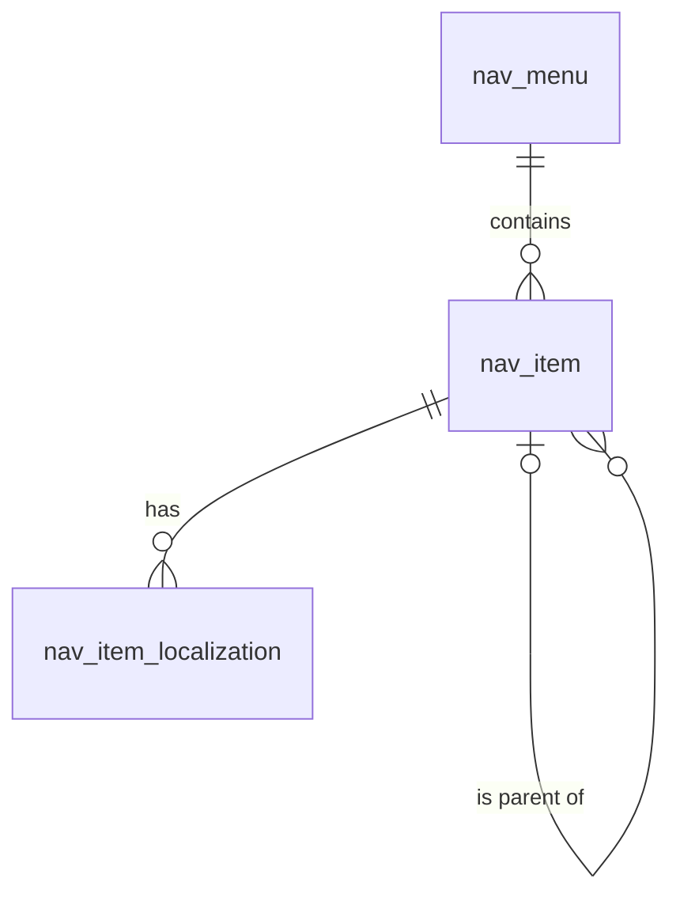

# 导航（navigation）模块设计

| 项 | 内容 |
|---|---|
| 模块 ID | `navigation` |
| 名称 | 导航 |
| 层 | L3 |
| 表前缀 | `nav_` |
| API 前缀 | `navigation` |
| 可停用 | 否 |
| 模块版本 | 1.0.0（module.json 的 version） |
| 平台版本 | `>=1.0.0 <2.0.0`（module.json 的 platform） |
| 里程碑切片 | M1：<…>；M2：<…>；M3：<…>；M4：<…>（详见第 13 节） |
| 模块负责人 | 待定 |
| 文档版本 | V1.0 |
| 状态 | 草案 |
| 更新日期 | 2026-10-14 |
| 依据 | 系统设计 V1.4 第 <…> 章；平台框架设计 V1.<x> 第 4 章 <…> 节；ADR-<…> |

> 本文只引用《平台框架设计》第 4 章中的契约，不定义新的跨模块契约；需要新契约时按平台框架设计 2.3 提出契约变更请求。

## 1. 职责与边界

### 1.1 职责

> 一段概述 + 要点列表；与系统设计 3.2 的职责描述一致，并细化到本模块的功能清单。

### 1.2 不负责的事

| 事项 | 归属模块 | 说明 |
|---|---|---|

### 1.3 协作概览

> 用图或表说明本模块与哪些模块协作、通过哪种方式（服务接口 / 事件 / 扩展点）。只画契约，不画实现。

### 1.4 适用的架构约束

> 列出与本模块直接相关的原则（P1–P8）、ADR 规则与 CLAUDE.md 禁止项，以及本模块如何满足。

## 2. 依赖与契约

### 2.1 module.json

```json
{
  "id": "<id>",
  "name": "<中文名称>",
  "version": "1.0.0",
  "layer": "L3",
  "platform": ">=1.0.0 <2.0.0",
  "requires": {},
  "optional": {},
  "disableable": true,
  "tablePrefix": "<前缀>_",
  "apiPrefix": "<id>",
  "permissions": [],
  "menus": [],
  "settings": null,
  "components": [],
  "events": { "publishes": [], "subscribes": [] }
}
```

> 完整描述符，须通过平台框架设计附录 A 的 Schema 与 A.3 的校验规则。

### 2.2 使用的服务接口

| 接口（平台框架设计小节） | 方法 | 用途 | 调用位置与时机（事务内 / 外） | 测试替身 |
|---|---|---|---|---|

### 2.3 提供的服务接口

| 接口（平台框架设计小节） | 方法 | 实现类 | 契约测试 | 说明（幂等、权限、性能目标） |
|---|---|---|---|---|

### 2.4 实现的扩展点

| 扩展点（平台框架设计小节） | 实现类 | 适用范围（内容类型 / 资源类型） | order | 收集方 |
|---|---|---|---|---|

### 2.5 收集的扩展点

| 扩展点 | 调用时机 | 过滤（站点启用状态、内容类型等） | 实现缺失或抛出异常时的行为 | 测试用示例实现 |
|---|---|---|---|---|

### 2.6 发布与订阅的事件

发布：

| 事件 | 触发时机（所在事务） | 关键字段 | 主要订阅方 |
|---|---|---|---|

订阅：

| 事件 | 处理 | 幂等方式 | 过期判断 | 失败与重试 |
|---|---|---|---|---|

### 2.7 使用的端口

| 端口 | 用途 | 测试替身 |
|---|---|---|

## 3. 领域模型

### 3.1 聚合、实体与值对象

| 类型 | 名称 | 说明 |
|---|---|---|
| 聚合根 | Menu（`nav_menu`） | 菜单：key（`header`、`footer-1`、`footer-2`…）、后台名称；整个菜单树一次保存，`version` 乐观锁 |
| 实体 | MenuItem（`nav_item`） | 菜单项：父项、深度、同级排序、链接（CONTENT / TERM / URL / NONE）、是否新窗口打开、Mega 配置；结构在各语言之间共享 |
| 实体 | MenuItemLocalization（`nav_item_localization`） | 菜单项在一种语言下的标签与可见性（站点资源：中文录入，其他语言由 translation 生成，带翻译状态与源指纹） |
| 值对象 | Link | `link_type` + `link_ref`（内容或分类项 ID）或 `link_url`；渲染时解析为当前语言的路径 |
| 值对象 | MegaConfig | 列数、推荐图片 `$media`、推荐链接 `$content`（取决于 Header 变体） |

在系统设计之外补充的字段：

| 补充 | 理由 |
|---|---|
| `nav_menu.key` 改名 `menu_key`；`nav_item.sort` 改名 `sort_order` | `key` 是 MySQL 关键字（本文 2.2）；与全库排序列命名一致 |
| `nav_menu.name`、`description`、`builtin`、`deleted_at`、`version` | 后台显示；主题使用的内置菜单不可删除；配置类实体软删除（本文 2.5）；菜单整体保存的乐观锁 |
| `nav_item.link_url` | 系统设计的 `link_ref` 保存 CONTENT / TERM 的 ID（第 7 章以 `nav_item.link_ref` 引用分类项）；URL 类型的地址另存一列 |
| `link_type = NONE` | Mega 菜单的列标题、分组标题只有文字，没有链接 |
| `nav_item.depth` | 限制层级（最大 3）并便于按层渲染 |
| `nav_item_localization.visible_locked` | 目标语言的可见性默认随源语言自动生成；人工设置后译文回写不再覆盖 |
| `nav_item_localization.translation_state`、`source_fingerprint` | 站点资源本地化表的统一字段（本文 2.7） |

### 3.2 不变量

| # | 规则 | 保证方式 |
|---|---|---|
| 1 | 站点内未删除菜单的 `menu_key` 唯一；key 创建后不可修改（主题按 key 读取）；内置菜单不可删除 | 数据库：`uk_menu_key`；应用层 |
| 2 | 菜单项与父项属于同一菜单；不能移动到自身子树下；根项 `parent_id` 为空且 `depth = 1`，子项 `depth` = 父项 `depth` + 1，最大 3 | 数据库：`ck_nav_item_depth`（范围）；应用层（与父项的关系：MySQL 不允许 CHECK 引用带级联动作的外键列） |
| 3 | 链接与类型一致：CONTENT / TERM 时 `link_ref` 非空且 `link_url` 为空；URL 时 `link_url` 非空且 `link_ref` 为空；NONE 时两者都为空 | 数据库：`ck_nav_item_link` |
| 4 | CONTENT 的目标是可路由内容（不能是 FAQ、GLOBAL_BLOCK）；TERM 的目标是可路由词汇表的分类项 | 应用层 |
| 5 | URL 只能是 `https://` 绝对地址，或以 `/` 开头、不含语言前缀的站内路径（渲染时加当前语言前缀）；不允许 `javascript:` 等协议 | 应用层 |
| 6 | 每个菜单项每种语言最多一条本地化；中文行必须存在且标签非空；中文行 `translation_state = NONE`、`source_fingerprint` 为空 | 数据库：`uk_nil_item_locale`；应用层 |
| 7 | 菜单项在某语言没有本地化或 `visible = 0` 时不显示；CONTENT / TERM 链接的目标在该语言未发布时自动隐藏（渲染时判断，不写库）；父项隐藏时子项一并隐藏 | 应用层（Delivery） |
| 8 | 子表的 `site_id` 与菜单一致 | 应用层 |

### 3.3 状态机

<<FILL: 状态与转换；没有状态机时写“不适用：<原因>”>>

## 4. 数据模型

> 遵守平台框架设计第 7 章的数据库通用约定。DDL 已在 MySQL 8.4 上执行通过；表结构以本节为准，与迁移脚本保持一致。

### 4.1 表清单

| 表 | 说明 | 站点级 | 软删除 | 预估规模（单站，按系统设计假设 A4） |
|---|---|---|---|---|
| `nav_menu` | 菜单 | 是 | 是（`deleted_at`） | 3–10 行 |
| `nav_item` | 菜单项 | 是 | 否（随菜单保存物理删除） | 50–300 行 |
| `nav_item_localization` | 菜单项本地化（站点资源） | 是 | 否（随菜单项） | 500–3 千行（× 10 种语言） |

### 4.2 ER 图



### 4.3 表结构

#### 4.3.1 `nav_menu`：菜单

| 字段 | 类型 | 可空 | 默认 | 说明 |
|---|---|---|---|---|
| `id` | BIGINT | 否 | — | 主键（TSID） |
| `site_id` | BIGINT | 否 | — | 站点 ID（sys_site.id） |
| `menu_key` | VARCHAR(64) bin | 否 | — | 菜单 key（小写字母、数字、连字符；创建后不可修改；主题按 key 读取），如 header、footer-1 |
| `name` | VARCHAR(100) | 否 | — | 名称（中文，只在后台显示） |
| `description` | VARCHAR(500) | 是 | — | 说明（显示位置，如“页脚第一列”） |
| `builtin` | TINYINT(1) | 否 | `0` | 是否内置（主题使用的菜单，不可删除） |
| `deleted_at` | DATETIME(3) | 是 | — | 删除时间（软删除） |
| `alive` | TINYINT | 是 | 生成列 `IF(deleted_at IS NULL, 1, NULL)` | 未删除标记（唯一索引用） |
| `version` | INT | 否 | `0` | 乐观锁版本号（整个菜单树一次保存） |
| `created_at` | DATETIME(3) | 否 | `CURRENT_TIMESTAMP(3)` | 创建时间（UTC） |
| `created_by` | BIGINT | 否 | `0` | 创建人用户 ID（0 = 系统） |
| `updated_at` | DATETIME(3) | 否 | `CURRENT_TIMESTAMP(3) ON UPDATE CURRENT_TIMESTAMP(3)` | 更新时间（UTC） |
| `updated_by` | BIGINT | 否 | `0` | 更新人用户 ID（0 = 系统） |

索引与约束：
- `PRIMARY KEY (id)`
- `uk_menu_key (site_id, menu_key, alive)`：未删除的 key 唯一；按 key 读取（站点引导数据、主题）；站点的菜单列表

```sql
CREATE TABLE nav_menu (
  id           BIGINT        NOT NULL COMMENT '主键（TSID）',
  site_id      BIGINT        NOT NULL COMMENT '站点 ID（sys_site.id）',
  menu_key     VARCHAR(64)   COLLATE utf8mb4_0900_bin NOT NULL COMMENT '菜单 key（小写字母、数字、连字符；创建后不可修改；主题按 key 读取），如 header、footer-1',
  name         VARCHAR(100)  NOT NULL COMMENT '名称（中文，只在后台显示）',
  description  VARCHAR(500)  NULL COMMENT '说明（显示位置，如“页脚第一列”）',
  builtin      TINYINT(1)    NOT NULL DEFAULT 0 COMMENT '是否内置（主题使用的菜单，不可删除）',
  deleted_at   DATETIME(3)   NULL COMMENT '删除时间（软删除）',
  alive        TINYINT       AS (IF(deleted_at IS NULL, 1, NULL)) STORED COMMENT '未删除标记（唯一索引用）',
  version      INT           NOT NULL DEFAULT 0 COMMENT '乐观锁版本号（整个菜单树一次保存）',
  created_at   DATETIME(3)   NOT NULL DEFAULT CURRENT_TIMESTAMP(3) COMMENT '创建时间（UTC）',
  created_by   BIGINT        NOT NULL DEFAULT 0 COMMENT '创建人用户 ID（0 = 系统）',
  updated_at   DATETIME(3)   NOT NULL DEFAULT CURRENT_TIMESTAMP(3) ON UPDATE CURRENT_TIMESTAMP(3) COMMENT '更新时间（UTC）',
  updated_by   BIGINT        NOT NULL DEFAULT 0 COMMENT '更新人用户 ID（0 = 系统）',
  PRIMARY KEY (id),
  UNIQUE KEY uk_menu_key (site_id, menu_key, alive)
) ENGINE = InnoDB DEFAULT CHARSET = utf8mb4 COLLATE = utf8mb4_0900_ai_ci COMMENT = '导航菜单（header、footer-1、footer-2 等；保存即生效）';
```

要点：
- 保存即生效（系统设计 16.1）：菜单树（菜单项与中文本地化）在一个事务中整体保存（`version` 乐观锁），写审计日志；事务提交后发布 `NavigationChangedEvent`（delivery 失效该站点的导航缓存，seo 重建 `NAV` 链接）与 `TranslatableResourceChangedEvent`（资源类型 `navigation.item`，每个新增、标签变化或删除的菜单项一条）。
- 站点创建或 navigation 安装时写入内置菜单 `header`、`footer-1`、`footer-2`（`builtin = 1`，第 23 章）；页脚菜单中配置法律页面链接（系统设计 10.7）。
- 前台：navigation 实现 `SiteBootstrapContributor`，按语言输出可见的菜单树（标签已按语言选取，链接为 `$content` / `$term` / URL），Delivery 解析链接并隐藏目标未发布的菜单项。

#### 4.3.2 `nav_item`：菜单项

| 字段 | 类型 | 可空 | 默认 | 说明 |
|---|---|---|---|---|
| `id` | BIGINT | 否 | — | 主键（TSID） |
| `site_id` | BIGINT | 否 | — | 站点 ID（sys_site.id） |
| `menu_id` | BIGINT | 否 | — | 菜单 ID（nav_menu.id） |
| `parent_id` | BIGINT | 是 | — | 父菜单项 ID（nav_item.id）；根项为空 |
| `depth` | TINYINT | 否 | `1` | 层级深度：根项为 1，最大 3 |
| `sort_order` | INT | 否 | `0` | 同级排序 |
| `link_type` | VARCHAR(16) | 否 | — | 链接类型：CONTENT（内容）/ TERM（分类项落地页）/ URL（外部地址或站内路径）/ NONE（仅标题） |
| `link_ref` | BIGINT | 是 | — | 链接目标 ID：CONTENT 为内容 ID（cnt_content.id）；TERM 为分类项 ID（tx_term.id） |
| `link_url` | VARCHAR(2048) | 是 | — | URL 类型的地址：https:// 绝对地址，或以 / 开头、不含语言前缀的站内路径（渲染时加当前语言前缀） |
| `open_in_new` | TINYINT(1) | 否 | `0` | 是否在新窗口打开（外部链接加 rel="noopener"） |
| `mega` | JSON | 是 | — | Mega 菜单配置（取决于 Header 变体，只用于根项）：{"columns":3,"featuredImage":{"$media":"…"},"featuredLink":{"$content":"…"}} |
| `created_at` | DATETIME(3) | 否 | `CURRENT_TIMESTAMP(3)` | 创建时间（UTC） |
| `created_by` | BIGINT | 否 | `0` | 创建人用户 ID（0 = 系统） |
| `updated_at` | DATETIME(3) | 否 | `CURRENT_TIMESTAMP(3) ON UPDATE CURRENT_TIMESTAMP(3)` | 更新时间（UTC） |
| `updated_by` | BIGINT | 否 | `0` | 更新人用户 ID（0 = 系统） |

索引与约束：
- `PRIMARY KEY (id)`
- `idx_item_menu (menu_id, parent_id, sort_order)`：加载整个菜单树；兼作 `fk_nav_item_menu` 的索引
- `idx_item_parent (parent_id)`：`fk_nav_item_parent` 的索引
- `idx_item_link (site_id, link_type, link_ref)`：按内容或分类项查找指向它的菜单项（`ContentImpactProvider`、内容彻底删除与分类项删除时的清理）
- `fk_nav_item_menu`、`fk_nav_item_parent`：组合关系，`ON DELETE CASCADE`（删除菜单项时连同子项）
- `ck_nav_item_link`、`ck_nav_item_depth`：见 3.2 不变量 3、2

```sql
CREATE TABLE nav_item (
  id           BIGINT         NOT NULL COMMENT '主键（TSID）',
  site_id      BIGINT         NOT NULL COMMENT '站点 ID（sys_site.id）',
  menu_id      BIGINT         NOT NULL COMMENT '菜单 ID（nav_menu.id）',
  parent_id    BIGINT         NULL COMMENT '父菜单项 ID（nav_item.id）；根项为空',
  depth        TINYINT        NOT NULL DEFAULT 1 COMMENT '层级深度：根项为 1，最大 3',
  sort_order   INT            NOT NULL DEFAULT 0 COMMENT '同级排序',
  link_type    VARCHAR(16)    NOT NULL COMMENT '链接类型：CONTENT（内容）/ TERM（分类项落地页）/ URL（外部地址或站内路径）/ NONE（仅标题）',
  link_ref     BIGINT         NULL COMMENT '链接目标 ID：CONTENT 为内容 ID（cnt_content.id）；TERM 为分类项 ID（tx_term.id）',
  link_url     VARCHAR(2048)  NULL COMMENT 'URL 类型的地址：https:// 绝对地址，或以 / 开头、不含语言前缀的站内路径（渲染时加当前语言前缀）',
  open_in_new  TINYINT(1)     NOT NULL DEFAULT 0 COMMENT '是否在新窗口打开（外部链接加 rel="noopener"）',
  mega         JSON           NULL COMMENT 'Mega 菜单配置（取决于 Header 变体，只用于根项）：{"columns":3,"featuredImage":{"$media":"…"},"featuredLink":{"$content":"…"}}',
  created_at   DATETIME(3)    NOT NULL DEFAULT CURRENT_TIMESTAMP(3) COMMENT '创建时间（UTC）',
  created_by   BIGINT         NOT NULL DEFAULT 0 COMMENT '创建人用户 ID（0 = 系统）',
  updated_at   DATETIME(3)    NOT NULL DEFAULT CURRENT_TIMESTAMP(3) ON UPDATE CURRENT_TIMESTAMP(3) COMMENT '更新时间（UTC）',
  updated_by   BIGINT         NOT NULL DEFAULT 0 COMMENT '更新人用户 ID（0 = 系统）',
  PRIMARY KEY (id),
  KEY idx_item_menu (menu_id, parent_id, sort_order),
  KEY idx_item_parent (parent_id),
  KEY idx_item_link (site_id, link_type, link_ref),
  CONSTRAINT fk_nav_item_menu FOREIGN KEY (menu_id) REFERENCES nav_menu (id) ON DELETE CASCADE,
  CONSTRAINT fk_nav_item_parent FOREIGN KEY (parent_id) REFERENCES nav_item (id) ON DELETE CASCADE,
  CONSTRAINT ck_nav_item_link CHECK ((link_type IN ('CONTENT', 'TERM') AND link_ref IS NOT NULL AND link_url IS NULL) OR (link_type = 'URL' AND link_url IS NOT NULL AND link_ref IS NULL) OR (link_type = 'NONE' AND link_ref IS NULL AND link_url IS NULL)),
  CONSTRAINT ck_nav_item_depth CHECK (depth BETWEEN 1 AND 3)
) ENGINE = InnoDB DEFAULT CHARSET = utf8mb4 COLLATE = utf8mb4_0900_ai_ci COMMENT = '导航菜单项（结构在各语言之间共享；链接为内容、分类项、URL 或仅标题）';
```

要点：
- 链接保存 ID，不保存内容的 URL：内容或分类项的路径变化、slug 修改后菜单无需修改（与布局文档的引用对象化原则一致，系统设计 10.3）。
- 结构（父项、排序、链接、Mega 配置）在各语言之间共享（系统设计 16.1）；某语言需要不同的菜单项时，在其他语言中设置 `visible = 0`。
- `mega` 中的推荐图片经 `MediaApi` 登记引用，有引用的媒体不能删除。

#### 4.3.3 `nav_item_localization`：菜单项本地化

| 字段 | 类型 | 可空 | 默认 | 说明 |
|---|---|---|---|---|
| `id` | BIGINT | 否 | — | 主键（TSID） |
| `site_id` | BIGINT | 否 | — | 站点 ID（sys_site.id） |
| `item_id` | BIGINT | 否 | — | 菜单项 ID（nav_item.id） |
| `locale` | VARCHAR(16) | 否 | — | 语言（BCP 47） |
| `label` | VARCHAR(100) | 否 | — | 标签（站点资源：中文录入，其他语言由 translation 经 TranslatableResourceProvider 写入） |
| `visible` | TINYINT(1) | 否 | `1` | 在该语言中是否显示 |
| `visible_locked` | TINYINT(1) | 否 | `0` | 可见性是否由人工设置（1 = 译文回写时不覆盖；中文行恒为 0） |
| `translation_state` | VARCHAR(16) | 否 | `'NONE'` | 标签的翻译状态：NONE / QUEUED / TRANSLATED / NEEDS_REVIEW / FAILED / OUTDATED |
| `source_fingerprint` | CHAR(64) bin | 是 | — | 生成本行译文时中文行的指纹（规范化 label 的 SHA-256）；中文行为空；与当前中文指纹不同即为过期 |
| `version` | INT | 否 | `0` | 乐观锁版本号（翻译编辑器按行修订） |
| `created_at` | DATETIME(3) | 否 | `CURRENT_TIMESTAMP(3)` | 创建时间（UTC） |
| `created_by` | BIGINT | 否 | `0` | 创建人用户 ID（0 = 系统，如译文回写） |
| `updated_at` | DATETIME(3) | 否 | `CURRENT_TIMESTAMP(3) ON UPDATE CURRENT_TIMESTAMP(3)` | 更新时间（UTC） |
| `updated_by` | BIGINT | 否 | `0` | 更新人用户 ID（0 = 系统，如译文回写） |

索引与约束：
- `PRIMARY KEY (id)`
- `uk_nil_item_locale (item_id, locale)`：每种语言一条；按菜单项取各语言标签；兼作 `fk_nav_nil_item` 的索引
- `idx_nil_state (site_id, translation_state, locale)`：翻译中心列出待处理的菜单标签
- `fk_nav_nil_item`：组合关系，`ON DELETE CASCADE`

```sql
CREATE TABLE nav_item_localization (
  id                  BIGINT        NOT NULL COMMENT '主键（TSID）',
  site_id             BIGINT        NOT NULL COMMENT '站点 ID（sys_site.id）',
  item_id             BIGINT        NOT NULL COMMENT '菜单项 ID（nav_item.id）',
  locale              VARCHAR(16)   NOT NULL COMMENT '语言（BCP 47）',
  label               VARCHAR(100)  NOT NULL COMMENT '标签（站点资源：中文录入，其他语言由 translation 经 TranslatableResourceProvider 写入）',
  visible             TINYINT(1)    NOT NULL DEFAULT 1 COMMENT '在该语言中是否显示',
  visible_locked      TINYINT(1)    NOT NULL DEFAULT 0 COMMENT '可见性是否由人工设置（1 = 译文回写时不覆盖；中文行恒为 0）',
  translation_state   VARCHAR(16)   NOT NULL DEFAULT 'NONE' COMMENT '标签的翻译状态：NONE / QUEUED / TRANSLATED / NEEDS_REVIEW / FAILED / OUTDATED',
  source_fingerprint  CHAR(64)      COLLATE utf8mb4_0900_bin NULL COMMENT '生成本行译文时中文行的指纹（规范化 label 的 SHA-256）；中文行为空；与当前中文指纹不同即为过期',
  version             INT           NOT NULL DEFAULT 0 COMMENT '乐观锁版本号（翻译编辑器按行修订）',
  created_at          DATETIME(3)   NOT NULL DEFAULT CURRENT_TIMESTAMP(3) COMMENT '创建时间（UTC）',
  created_by          BIGINT        NOT NULL DEFAULT 0 COMMENT '创建人用户 ID（0 = 系统，如译文回写）',
  updated_at          DATETIME(3)   NOT NULL DEFAULT CURRENT_TIMESTAMP(3) ON UPDATE CURRENT_TIMESTAMP(3) COMMENT '更新时间（UTC）',
  updated_by          BIGINT        NOT NULL DEFAULT 0 COMMENT '更新人用户 ID（0 = 系统，如译文回写）',
  PRIMARY KEY (id),
  UNIQUE KEY uk_nil_item_locale (item_id, locale),
  KEY idx_nil_state (site_id, translation_state, locale),
  CONSTRAINT fk_nav_nil_item FOREIGN KEY (item_id) REFERENCES nav_item (id) ON DELETE CASCADE
) ENGINE = InnoDB DEFAULT CHARSET = utf8mb4 COLLATE = utf8mb4_0900_ai_ci COMMENT = '菜单项本地化（标签与可见性为站点资源，带翻译状态与源指纹）';
```

要点：
- 翻译（系统设计 16.1、5.7）：中文 `label` 变化时发布 `TranslatableResourceChangedEvent`（资源类型 `navigation.item`，ID 为 `item_id`）；translation 经翻译记忆（全站译法一致）与 AI 引擎生成译文，经 navigation 的 `TranslatableResourceProvider` 回写目标语言行：写入 `label`、`translation_state`、`source_fingerprint`，`visible_locked = 0` 时 `visible` 复制中文行。新菜单项在目标语言的译文生成之前，该语言中不显示。
- 人工修订在翻译编辑器中进行，写回翻译记忆（`HUMAN`）；目标语言的 `visible` 由人工修改时置 `visible_locked = 1`。
- 删除菜单项时级联删除各语言行，并发布 `TranslatableResourceChangedEvent`（变化类型 `DELETED`），translation 取消未执行的翻译项。

### 4.4 枚举

| 字段 | 取值 | 说明 |
|---|---|---|
| `nav_menu.menu_key`（内置） | `header` / `footer-1` / `footer-2` | 页头主菜单 / 页脚第一列 / 页脚第二列（主题可声明更多，如 `footer-3`） |
| `nav_item.link_type` | `CONTENT` | 链接到可路由内容（`link_ref` = 内容 ID） |
| | `TERM` | 链接到可路由分类项的落地页（`link_ref` = 分类项 ID） |
| | `URL` | 外部 `https://` 地址或不含语言前缀的站内路径（`link_url`） |
| | `NONE` | 仅标题（Mega 菜单列标题、分组标题） |
| `nav_item_localization.translation_state` | `NONE` / `QUEUED` / `TRANSLATED` / `NEEDS_REVIEW` / `FAILED` / `OUTDATED` | 共享翻译状态枚举；中文行为 `NONE`；源语言变化后目标语言行重新进入 `QUEUED` |

### 4.5 站点过滤

<<FILL: | 表 | 行级拦截器（不豁免 / 豁免） | 访问方式与理由 |>>

### 4.6 跨模块引用与清理

| 本模块字段 | 引用对象（模块.表） | 被引用对象删除 / 下线时的处理 | 触发事件 |
|---|---|---|---|
| `nav_item.link_ref`（CONTENT）、`mega.featuredLink` | content.`cnt_content` | 下线、进回收站：渲染时自动隐藏，数据不变；下线或删除前由 navigation 的 `ContentImpactProvider` 列出指向它的菜单项；彻底删除：该项改为 `NONE`、`link_ref` 置空、各语言 `visible` 置 0（`featuredLink` 移除），后台提示重新选择链接 | `ContentPurgedEvent` |
| `nav_item.link_ref`（TERM） | taxonomy.`tx_term` | 分类项删除：同上处理；更名、移动无需处理（标签独立维护，路径在渲染时解析） | `TermChangedEvent`（DELETED） |
| `nav_item.mega.featuredImage` | media.`mda_media` | 有引用记录的媒体不能删除；收到删除事件时防御性移除推荐图片 | `MediaDeletedEvent` |
| `nav_item_localization.locale` | core.`sys_site_locale` | V1 不删除站点语言，无需清理 | — |
| `created_by`、`updated_by` | core.`sys_user` | 不清理 | — |

本模块发布的事件：`NavigationChangedEvent`、`TranslatableResourceChangedEvent`（资源类型 `navigation.item`）。订阅：`ContentPurgedEvent`、`TermChangedEvent`、`MediaDeletedEvent`。实现的扩展点：`TranslatableResourceProvider`、`SiteBootstrapContributor`、`ContentImpactProvider`。

其他模块引用本模块：seo 的 `seo_link`（`NAV` 行）在收到 `NavigationChangedEvent` 后重建（第 13 章）。

### 4.7 迁移脚本

| 文件 | 内容 | 里程碑 |
|---|---|---|
| `db/migration/navigation/V001__init.sql` | 4.3 中的全部表（3 张：`nav_menu`、`nav_item`、`nav_item_localization`），按本节顺序创建 | <见第 13 节> |

## 5. 业务流程

### 5.1 <流程名称>

```text
<步骤；标出事务边界、调用的服务接口、发布的事件、异步部分>
```

| 步骤 | 说明 | 失败处理 |
|---|---|---|

## 6. 接口

### 6.1 Admin 端点

| 方法 | 路径（/api/admin/v1/<apiPrefix>/…） | 说明 | 权限码 | 并发控制 / 幂等 | 审计 |
|---|---|---|---|---|---|

### 6.2 Public 端点

| 方法 | 路径（/api/public/v1/<apiPrefix>/…） | 说明 | 限流 | 缓存 |
|---|---|---|---|---|

### 6.3 Internal 端点

| 方法 | 路径（/api/internal/v1/<apiPrefix>/…） | 说明 | 调用方 |
|---|---|---|---|

### 6.4 权限码

| 权限码 | 名称 | 数据范围 | 高危（sensitive） | 受语言范围限制（localeScoped） |
|---|---|---|---|---|

### 6.5 错误码

| 错误码 | HTTP 状态 | 后台中文信息 | 前台文案键（仅公开接口） |
|---|---|---|---|

## 7. 后台界面

### 7.1 菜单与路由

| 菜单 key | 名称 | 父菜单 | 路由 | 权限码 |
|---|---|---|---|---|

### 7.2 页面

| 页面 | 路由 | 主要功能 | 使用的 admin-kit 组件 |
|---|---|---|---|

### 7.3 注册到内容编辑外壳的标签

| key | 适用内容类型 | 权限码 | 组件 |
|---|---|---|---|

### 7.4 界面文案

> texts.ts 中的分组与关键文案；后台只用简体中文。

## 8. 前台组件与模板

> 没有前台组件时写“不适用”。

### 8.1 组件

| 组件类型 | 名称（label） | 变体 | 分类 | allowedIn | 数据源 | 是否水合 |
|---|---|---|---|---|---|---|

### 8.2 属性与翻译

| 组件 | 属性 | 类型 / x-editor | x-translatable | maxLength |
|---|---|---|---|---|

### 8.3 模板

| 模板 key | 内容类型 | 固定区域与插槽 |
|---|---|---|

### 8.4 数据源

| key | 参数 | 返回 | 缓存标签 |
|---|---|---|---|

### 8.5 文案键

| 文案键 | 默认中文文案 | 使用位置 |
|---|---|---|

## 9. 配置项

### 9.1 站点设置（settings.schema.json）

| 键 | 类型 | 默认值 | 说明 | 敏感（x-secret） |
|---|---|---|---|---|

### 9.2 部署配置（application.yml，前缀 b2bweb.<id>）

| 属性 | 默认值 | 说明 |
|---|---|---|

## 10. 定时与异步任务

> 没有时写“不适用”。定时任务实现 `ScheduledTask`，通用异步任务实现 `JobHandler`（平台框架设计 4.4.12）；锁名与任务类型按平台框架设计 3.7 命名。事件监听器已在 2.6 中列出，这里只补充耗时长、需要单独调度或重试的处理。`PER_SITE` 任务由 core 在站点上下文中逐站点执行，停用了本模块的站点自动跳过（系统设计 3.8）。外部服务（AI 引擎、邮件、CDN）只在事务提交后的异步处理中调用，失败不回滚已提交的业务数据（ADR-003、ADR-017）。

| 任务 | 类型（定时 / sys_job / 事件监听） | 触发 | 锁名 | 幂等与重试 | 模块停用时 |
|---|---|---|---|---|---|

> 每个任务另写：执行粒度（`PER_SITE` / 系统级）、单次处理量与分批方式、超时、能否取消、失败后的可见结果（`sys_job` 的失败报告、指标 `b2bweb.<id>.*` 或告警）。

## 11. 测试要点

> 测试层级、替身与契约测试的写法见平台框架设计第 9 章，门禁与覆盖率见第 10 章。“至少”后的用例为必测项；不适用的行写“不适用：<原因>”，不得删除。

| 层级 | 覆盖内容 | 关键用例 |
|---|---|---|
| 单元 | <领域对象、不变量（3.2）、状态机（3.3）、扩展点实现（2.4）> | 至少：3.2 每条不变量的违反用例；3.3 每个非法状态转换被拒绝 |
| 模块集成（Testcontainers + 替身） | <应用服务 + 本模块的表与迁移> | 至少：迁移脚本在空库（MySQL 8.4）上执行通过；6.1 中声明的并发控制与幂等；唯一约束冲突转为 6.5 的错误码 |
| 契约（作为提供方） | <2.3 中本模块提供的服务接口> | 继承 testkit 中的 `<接口名>ContractTest`，用真实实现运行；不提供服务接口时写“不适用” |
| 事件（Scenario API，含重复投递） | <2.6 中发布与订阅的事件> | 至少：事件在业务事务内发布、事务回滚时不发布；每个监听器重复投递只生效一次、过期事件被丢弃（ADR-003） |
| 停用行为（可停用模块） | <系统设计 3.8 的各项> | 至少：停用后写操作与公开接口返回 `CORE_MODULE_DISABLED`；扩展点实现不再被收集；定时任务跳过；`analyzeDisableImpact` 的结果正确；重新启用后数据完整（S10） |
| 站点隔离 | <6.1 的全部后台接口与 4.5 的全部站点级表> | 至少：站点 A 的用户不能读写站点 B 的数据（遍历全部后台端点，系统设计 28）；豁免表只在 4.5 列出的位置访问 |
| 翻译（如有可翻译字段） | <`TranslatableContentProvider` / `TranslatableResourceProvider` 实现> | 至少：提取 → 回写往返一致；`x-translatable = false` 的字段不被提取；`HUMAN` / `REVIEWED` 段不被机器译文覆盖；资源变化时发布 `TranslatableResourceChangedEvent` |
| 前端（组件、Admin） | <主题组件、Admin 页面> | 至少：组件 Schema 校验与画廊示例（视觉回归）；前台文字只来自文案键、后台文字只来自 `texts.ts`；无权限时操作不可见 |
| E2E（场景） | <13.2 中验证方式为 E2E 的验收项> | Playwright 用例名包含 13.2 的验收项编号 |

## 12. 独立开发说明

### 12.1 依赖的测试替身

> 2.2 使用的每个服务接口、2.7 使用的每个端口、2.5 收集的每个扩展点，都要在此列出 testkit 中对应的替身或示例实现（平台框架设计 2.4、第 9 章）。testkit 中缺少的替身向框架组提出需求（DoR 第 3 条，平台框架设计 2.7），不在本模块中另建一套代替其他模块的模拟实现；单元测试可以用 Mockito 模拟个别方法，但对其他模块行为的假设以替身与契约测试为准。

| 替身（platform-testkit） | 代替的模块 | 用途 | 需要预置的数据 |
|---|---|---|---|

### 12.2 本模块提供的替身

> 只有提供服务接口的模块填写（core、content、url、media、taxonomy、form、notification、translation，见平台框架设计 4.2）；其他模块写“不适用：不提供服务接口”。替身由框架组编写并维护，与真实实现通过同一套契约测试；本模块改变服务接口的行为时，在同一个 PR 中同步修改契约测试，并通知框架组修改替身（平台框架设计 2.3）。无法消除的差异（如不做病毒扫描、不生成真实缩略图）列入下表，并确认不影响使用方的测试结论。

| 服务接口 | testkit 中的替身 | 与真实实现的差异（应为零，或已在契约测试中声明） |
|---|---|---|

### 12.3 本地运行

> 启动方式、依赖的本地服务（平台框架设计第 11 章）、需要的配置。

### 12.4 演示数据

> tools/demo-data 中本模块的数据及其用途。

## 13. 验收标准

### 13.1 里程碑切片

> 与平台框架设计 13.5 中本模块的一行一致；调整切片按平台框架设计 12.5 处理。该里程碑没有切片时写“—”（不表示不能提前开发）。

| 里程碑 | 交付功能 | 验收场景 |
|---|---|---|
| M1 | <…> | <S1、S2、S4 中与本模块相关的部分，或“模块自身”> |
| M2 | <…> | <…> |
| M3 | <…> | <…> |
| M4 | <…> | <…> |

### 13.2 验收项

> 每条验收项写明输入、期望结果与度量（如“5 分钟内”“P95 ≤ 200 ms”）。场景验收项只写本模块负责的部分（如 S2 中 url 负责“旧 URL 301 到新 URL、不产生重定向链”），不复述整个场景；各里程碑的场景见平台框架设计 13.6。验证方式为单元 / 集成 / E2E 时写出测试类或用例名；人工检查写明检查人与方法。

| # | 验收项 | 对应场景（S1–S13）或模块自身 | 验证方式（单元 / 集成 / E2E / 人工） | 里程碑 |
|---|---|---|---|---|
| A1 | <…> | <S? / 模块自身> | <集成：`<测试类>`> | M? |

> 每个模块都要包含以下通用验收项（不适用时注明原因）：架构测试与 Modulith 验证通过，无跨模块 import 与表访问；站点隔离测试覆盖全部后台接口；后台写操作都有权限码与审计记录；可停用模块满足 S10；可翻译字段与资源已登记并通过往返测试（S11、S12）；系统设计 1.5 中与本模块相关的非功能指标；文档与代码一致（DoD，平台框架设计 2.8）。

## 14. 待定问题

> 记录评审与开发中尚未决定的事项。“阻塞开发”的问题必须在评审通过（DoR）前关闭；需要新契约或修改上层文档的问题，写明契约变更请求或 Issue 编号。已关闭的问题保留在表中，填写结论。

| # | 问题 | 影响 | 是否阻塞开发 | 负责人 | 最晚解决 | 结论 |
|---|---|---|---|---|---|---|

## 修订记录

| 版本 | 日期 | 变更 |
|---|---|---|
| V1.0 | 2026-10-14 | 初稿 |
