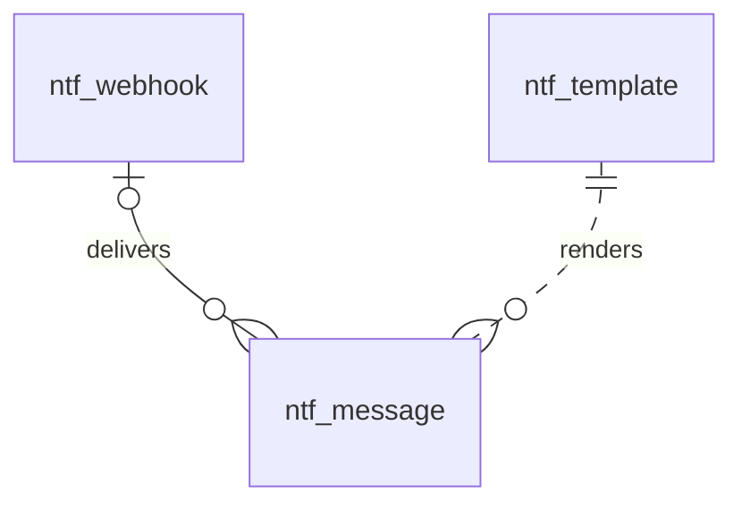

# 通知（notification）模块设计

| 项 | 内容 |
|---|---|
| 模块 ID | `notification` |
| 名称 | 通知 |
| 层 | L2 |
| 表前缀 | `ntf_` |
| API 前缀 | `notification` |
| 可停用 | 否 |
| 模块版本 | 1.0.0（module.json 的 version） |
| 平台版本 | `>=1.0.0 <2.0.0`（module.json 的 platform） |
| 里程碑切片 | M1：发件箱、重试、询盘通知与自动回复；M2：审核通知；M3：翻译失败与过期通知；Webhook；客户邮件模板翻译；M4：—（详见第 13 节） |
| 模块负责人 | 待定 |
| 文档版本 | V1.4 |
| 状态 | 草案 |
| 更新日期 | 2026-10-20 |
| 依据 | 系统设计 V1.7 第 18 章及 3.2、3.8、24–29 章；平台框架设计 V1.4 第 4、7–13 章；ADR-002、ADR-003、ADR-005、ADR-009、ADR-018 |

> 本文只引用《平台框架设计》第 4 章中的契约，不定义新的跨模块契约；需要新契约时按平台框架设计 2.3 提出契约变更请求。

## 1. 职责与边界

### 1.1 职责

维护邮件模板、发件箱和 Webhook；事务内记录待发送消息，提交后投递并重试；员工模板只用中文，客户模板按请求语言读取。

功能交付范围按第 13 章分为 M1–M4；表结构、约束与枚举以第 3、4 章为准。

### 1.2 不负责的事

| 事项 | 归属模块 | 边界 |
|---|---|---|
| 内容生命周期与路由 | content / url | 本模块只承担自身职责；不直接修改 cnt_、url_ 表 |
| 身份、权限、设置、任务及审计 | platform-core | 复用平台公共服务 |
| 第三方客户端与网络传输 | infrastructure | 仅经既有端口或 L2 服务使用，不在业务模块引入客户端 |

### 1.3 协作概览

| 协作方式 | 对象 | 本模块行为 |
|---|---|---|
| 服务接口 | 仅 core 公共服务 | 方法与事务边界见 2.2；无跨模块表访问 |
| 扩展点 | TranslatableResourceProvider、PersonalDataProvider、NotificationTemplateProvider | 实现/收集清单见 2.4、2.5 |
| 领域事件 | 见 2.6 | 与本地事务一起登记，提交后异步投递；重复与过期处理独立验证 |

### 1.4 适用的架构约束

遵守 P2、P3 与 ADR-018：编译依赖只到 platform-core/platform-api，跨模块协作只用第 2 章登记契约；只访问自己的表，禁止跨模块 JOIN/外键。遵守 ADR-003：事务内登记、提交后投递、监听器幂等并检查过期。遵守 ADR-009：每次请求/任务明确站点上下文，站点表默认过滤。

公开读取只用当前语言发布态，不跨语言回退（ADR-005）；预览与公开缓存隔离。后台中文文案与错误集中管理，前台文案经 UiTextApi，样式只用 Design Token。远程端口在数据库事务外调用，密钥经 SecretCipher，不写日志。

## 2. 依赖与契约

### 2.1 module.json

```json
{
  "id": "notification",
  "name": "通知",
  "version": "1.0.0",
  "layer": "L2",
  "platform": ">=1.0.0 <2.0.0",
  "requires": {},
  "optional": {},
  "disableable": false,
  "tablePrefix": "ntf_",
  "apiPrefix": "notification",
  "permissions": [
    {
      "code": "notification:message:view",
      "name": "查看发送记录"
    },
    {
      "code": "notification:message:retry",
      "name": "重试发送记录"
    },
    {
      "code": "notification:template:manage",
      "name": "管理模板"
    },
    {
      "code": "notification:webhook:manage",
      "name": "管理Webhook",
      "sensitive": true
    }
  ],
  "menus": [
    {
      "key": "notification",
      "name": "通知",
      "parent": "settings",
      "route": "/notification/messages",
      "permission": "notification:message:view",
      "order": 100
    }
  ],
  "settings": null,
  "components": [],
  "events": {
    "publishes": [
      "TranslatableResourceChangedEvent"
    ],
    "subscribes": [
      "TranslationOutdatedEvent",
      "ReviewRequestedEvent",
      "ReviewCompletedEvent",
      "TranslationFailedEvent",
      "ModuleDisabledEvent",
      "SiteSettingsChangedEvent"
    ]
  }
}
```

描述符为 M0 工程建立后的实现要求；目前尚无实际控制器、Schema 或组件包。依赖只声明运行能力；Maven 仍只依赖 platform-api/core。组件清单是本模块负责的类型，运行时 UI 不登记成可拖入布局的组件。

### 2.2 使用的服务接口

| 接口（平台框架设计小节） | 方法 | 用途 | 调用位置与时机 | 测试替身 |
|---|---|---|---|---|
| `SiteApi`（4.4.1） | 按该契约声明的方法 | 语言、站点模块开关 | 业务事务内；站点切换由任务入口完成 | `InMemorySiteApi` |
| `SiteContextProvider`（4.4.2） | 按该契约声明的方法 | 当前站点；异步与任务由 core 恢复 | 业务事务内；站点切换由任务入口完成 | `FakeSiteContextProvider` |
| `PermissionChecker`（4.4.7） | 按该契约声明的方法 | 后台权限与数据范围 | 业务事务内；站点切换由任务入口完成 | `FakePermissionChecker` |
| `AuditApi`（4.4.9） | 按该契约声明的方法 | 同事务写审计，密钥与个人数据脱敏 | 业务事务内；站点切换由任务入口完成 | `InMemoryAuditApi` |
| `EventMetaFactory`（4.4.14） | 按该契约声明的方法 | 事件 ID、版本、站点与操作人 | 业务事务内；站点切换由任务入口完成 | `FakeEventMetaFactory` |
| `ExtensionRegistry`（4.4.15） | 按该契约声明的方法 | 按启用模块收集 2.5 的扩展点 | 业务事务内；站点切换由任务入口完成 | `InMemoryExtensionRegistry` |
| `JobApi`（4.4.12） | 按该契约声明的方法 | 耗时任务提交、取消、进度与结果 | 业务事务内；站点切换由任务入口完成 | `InMemoryJobApi` |
| `SecretCipher`（4.4.10） | encrypt、decrypt、mask | 凭据加解密及掩码，不记录明文 | 事务内本地调用；明文只在事务外传入远程端口 | `FakeSecretCipher` |
| `UserDirectory`（4.4.8） | findAll | 员工地址、停用用户过滤 | 事务内本地调用；明文只在事务外传入远程端口 | `InMemoryUserDirectory` |
| `SiteProfileApi`（4.4.4） | 按 4.4.4 的只读方法 | 通知站点名称、公开地址与联系方式 | 事务内本地调用；明文只在事务外传入远程端口 | `InMemorySiteProfileApi` |

所有 L2/L3/L4 读写隐式使用当前站点；按 ID 查询单批最多 500。可选服务用 ObjectProvider 注入并检查当前站点启用状态，缺失时降级，不通过业务表绕过服务。

### 2.3 提供的服务接口

| 接口（平台框架设计小节） | 方法 | 实现类 | 契约测试 | 语义 |
|---|---|---|---|---|
| `NotificationApi`（4.4.21） | send、sendWebhookEvent、status、templateAvailable | `NotificationApiImpl` | `NotificationApiContractTest` 继承 `NotificationApiContract` | 完整遵守框架签名、站点隔离、事务及异常语义；远程调用按第 5 章拆分短事务；标注的交付热路径 P95 ≤ 20ms |

### 2.4 实现的扩展点

| 扩展点（平台框架设计小节） | 计划实现类 | 适用范围 | order | 收集方 |
|---|---|---|---|---|
| `TranslatableResourceProvider`（4.5.21） | `NotificationTranslatableResourceProvider` | notification.template：仅 CUSTOMER 模板文本；STAFF 固定中文 | DEFAULT=1000 | translation |
| `PersonalDataProvider`（4.5.18） | `NotificationPersonalDataProvider` | 按 subject_email 查找/导出/更正/删除消息中的个人数据 | DEFAULT=1000 | core |
| `PlatformModule`（4.5.22） | `NotificationModule` | 本模块安装/升级；可停用模块提供影响报告与停用后保留数据规则 | DEFAULT=1000 | core |

以上类名为待实现名称。PublishContributor 不调用调用方的写方法，不访问外部服务；翻译提供方只写本模块草稿/资源，先校验源指纹与共同 version。本模块不可站点级停用；对可选依赖缺失/停用仍须按框架约定降级。

### 2.5 收集的扩展点

| 扩展点 | 调用时机 | 过滤 | 失败行为 | 测试示例 |
|---|---|---|---|---|
| `NotificationTemplateProvider`（4.5.19） | 见第 5 章流程 | ExtensionRegistry 按站点启用状态、内容类型或 key 过滤 | 事务内校验/发布异常则回滚；只读可选部分失败记指标并降级，核心部分失败返回 503 | `SampleNotificationTemplateProvider` |

### 2.6 发布与订阅的事件

发布：

| 事件 | 触发事务 | 现有 payload 字段 | 订阅方 |
|---|---|---|---|
| `TranslatableResourceChangedEvent` | 源语言可翻译文本实际变化时 UPSERTED，资源整体删除时 DELETED；非文本变化与目标语言 apply 不发布此事件 | meta、resourceType、resourceId、change | 框架 4.2.4；未登记发布方的差异在第 14 章列出 |

订阅：

| 事件 | 处理 | 幂等 | 过期与删除 | 失败与重试 |
|---|---|---|---|---|
| `TranslationOutdatedEvent` | 排队 content.outdated.staff；按源修订和目标本地化去重，审校权限选择器缺口见第 14 章 | 本模块事务内的幂等标记与数据变更一起提交；缓存重复失效安全 | 读取当前状态/指纹；只有匹配的当前结果才更新；不以 occurredAt 单独当全序 | 失败抛出保留未完成投递；业务副作用转入已有任务/队列后重试 |
| `ReviewRequestedEvent` | 给对应内容类型审核权限人员排队 content.review.staff，dedupKey=review:localizationId:version | 本模块事务内的幂等标记与数据变更一起提交；缓存重复失效安全 | 读取当前状态/指纹；只有匹配的当前结果才更新；不以 occurredAt 单独当全序 | 失败抛出保留未完成投递；业务副作用转入已有任务/队列后重试 |
| `ReviewCompletedEvent` | 给 submittedBy 排队 content.reviewed.staff，dedupKey=reviewed:eventId | 本模块事务内的幂等标记与数据变更一起提交；缓存重复失效安全 | 读取当前状态/指纹；只有匹配的当前结果才更新；不以 occurredAt 单独当全序 | 失败抛出保留未完成投递；业务副作用转入已有任务/队列后重试 |
| `TranslationFailedEvent` | 排队 translation.failed.staff；按 jobId/对象/目标语言去重，不回查询盘文本 | 本模块事务内的幂等标记与数据变更一起提交；缓存重复失效安全 | 读取当前状态/指纹；只有匹配的当前结果才更新；不以 occurredAt 单独当全序 | 失败抛出保留未完成投递；业务副作用转入已有任务/队列后重试 |
| `ModuleDisabledEvent` | 当前站点隐藏该模块的公开能力，保留自身数据；处理事件.moduleId 而非假定是接收方自身 | 本模块事务内的幂等标记与数据变更一起提交；缓存重复失效安全 | 读取当前状态/指纹；只有匹配的当前结果才更新；不以 occurredAt 单独当全序 | 失败抛出保留未完成投递；业务副作用转入已有任务/队列后重试 |
| `SiteSettingsChangedEvent` | 按 scopes、settingKeys、localeChanges 筛选 4.6 的相关变化；不对无关设置做全量重建 | 本模块事务内的幂等标记与数据变更一起提交；缓存重复失效安全 | 读取当前状态/指纹；只有匹配的当前结果才更新；不以 occurredAt 单独当全序 | 失败抛出保留未完成投递；业务副作用转入已有任务/队列后重试 |

监听器按框架 5.8 建立站点/system 上下文；`ContentPurgedEvent` 在模块停用时仍必须清理（deliverWhenModuleDisabled）。其他停用期间跳过并完成的事件，重新启用后通过扫描当前状态补偿，不能假定还会重投。数据库幂等标记与本模块数据在同一事务提交；外部发送、下载、搜索与 CDN 调用不得被数据库长事务包裹，使用已声明的任务/端口和业务幂等键。事件 payload 仅引用框架现有字段，本文不扩展签名。

### 2.7 使用的端口

| 端口（平台框架小节） | 用途 | 测试替身 |
|---|---|---|
| `MailTransport`（4.7.4） | 第 5 章外部能力；只通过端口调用基础设施 | `InMemoryMailTransport` |
| `WebhookTransport`（4.7.5） | 第 5 章外部能力；只通过端口调用基础设施 | `FakeWebhookTransport` |

## 3. 领域模型

### 3.1 聚合、实体与值对象

| 类型 | 名称 | 说明 |
|---|---|---|
| 聚合根 | Template（`ntf_template`） | 一个（模板 key，渠道，语言）的主题与正文；zh-CN 行由 `NotificationTemplateProvider` 注册的默认模板同步而来，站点可以修改；客户模板的其他语言行是译文（站点资源本地化） |
| 聚合根 | Message（`ntf_message`） | 发件箱中的一条消息：渠道、收件人或 Webhook、模板 key 或事件类型、语言、变量、状态与重试信息 |
| 聚合根 | Webhook（`ntf_webhook`） | 站点配置的 Webhook：地址、订阅的事件、HMAC 密钥（加密）、是否包含联系人信息、启用状态 |
| 值对象 | TemplateKey | `{模块}.{场景}.{对象}`，如 `inquiry.autoreply.customer` |
| 值对象 | Audience | `STAFF`（员工，只有中文）/ `CUSTOMER`（客户，按 locale 选择语言） |
| 值对象 | RetryPolicy | 指数退避（1、5、15 分钟、1、3、6 小时），最多 6 次；最终失败告警 |
| 值对象 | EncryptedSecret | 加密信封 `v1:{keyId}:{Base64(nonce‖密文‖tag)}`（AES-256-GCM，与 core 相同格式，见第 4 章） |
| 值对象 | WebhookSignature | 请求头 `X-Signature: t={时间戳},v1={HMAC-SHA256(secret, 时间戳.请求体)}` |

在系统设计之外补充的字段：

| 补充 | 理由 |
|---|---|
| `ntf_template.template_key` | 系统设计的 `key` 是 MySQL 关键字，改名（平台框架设计 7.2） |
| `ntf_template.audience`、`module_id`、`name`、`variables`、`enabled` | 区分员工与客户模板（决定是否翻译、能否有非中文行）；记录注册模块（模块停用时不发送）；后台中文名称与变量说明；站点可关闭某个模板（如客户自动回复） |
| `ntf_template.customized`、`default_hash` | 系统设计 3.6 第 6 步“幂等同步通知模板”：未修改过的 zh-CN 行随默认模板升级自动更新；已修改的保留，并通过哈希提示“默认模板已更新” |
| `ntf_message.webhook_id`、`event_type` | Webhook 的投递与重试复用发件箱（同一套重试、告警、保留期） |
| `ntf_message.reply_to`、`subject`、`sent_at` | 客户自动回复的 Reply-To 为负责人邮箱（系统设计 18）；后台发送记录显示渲染后的主题与发送时间 |
| `ntf_message.subject_email` | 员工通知与 Webhook 的载荷也可能含有客户联系人信息；数据主体请求按客户邮箱查找与删除（系统设计 17.11）需要独立于收件人的可索引列 |
| `ntf_message.source_module`、`source_id`、`dedupe_key`、`locked_until` | 按业务对象查看发送记录（如询盘时间线）；定时提醒等重复写入的幂等；多实例投递的租约 |
| `ntf_webhook.name`、`include_contact`、投递统计、`deleted_at` | 后台名称；载荷默认不含联系人信息，开启需法务确认（系统设计 18）；最近投递结果与连续失败次数用于告警；配置类实体软删除 |
| `ntf_webhook.secret_ciphertext` | 系统设计的 `secret`：密钥以 AES-GCM 加密信封保存（系统设计 26.6），列名体现“密文” |

### 3.2 不变量

| # | 规则 | 保证方式 |
|---|---|---|
| 1 | 站点内（模板 key，渠道，语言）唯一 | 数据库：`uk_tpl_key_locale` |
| 2 | 员工模板（`STAFF`）只有 `zh-CN` 行 | 数据库：`ck_ntf_tpl_staff_locale` |
| 3 | 客户模板的 zh-CN 行是源语言（`translation_state = 'NONE'`）；其他语言行只由 translation 经 `TranslatableResourceProvider` 写入或在翻译编辑器中修订；模板语法（变量、条件）作为占位保护原样保留 | 应用层 |
| 4 | 发送客户邮件时按 `locale` 选择模板；该语言没有可用译文时使用站点默认对外语言的模板，并在发送记录中注明（通知不是前台页面，不适用“内容不跨语言回退”）；`enabled = 0` 或注册模块已停用时不发送 | 应用层 |
| 5 | `NotificationApi.send()` 在调用方的事务中写入发件箱：业务数据保存成功就一定有待发送的消息 | 应用层（同一事务） |
| 6 | 状态只能按 `PENDING → SENT`、`PENDING → PENDING`（失败重试：`attempts` + 1，按退避设置 `next_attempt_at`）、`PENDING → FAILED`（第 6 次失败）、`FAILED → PENDING`（后台手动重试，`attempts` 清零）流转；`SENT` 不再变化；状态变更使用条件更新 | 应用层 |
| 7 | 同一时刻一条消息只由一个实例投递：取件时以条件更新设置 `locked_until`，租约过期后才能被再次取件 | 应用层 |
| 8 | EMAIL 消息必须有收件人与模板 key；WEBHOOK 消息必须有 Webhook 与事件类型 | 数据库：`ck_ntf_msg_target` |
| 9 | `dedupe_key` 在站点内唯一；重复写入时忽略 | 数据库：`uk_msg_dedupe` |
| 10 | Webhook 密钥只以加密信封保存，明文只在创建或轮换时显示一次；地址必须是 https，保存时校验解析结果不是内网地址 | 应用层 |
| 11 | Webhook 载荷默认只含事件类型、询盘编号与后台链接；`include_contact = 1` 时才包含联系人信息 | 应用层 |
| 12 | 客户自动回复只发给 `ACCEPT` 的提交（由调用方 inquiry 判断） | 应用层（调用方） |

### 3.3 状态机

PENDING → SENT（外部投递确认）；PENDING → PENDING（可重试错误，递增次数并更新下次时间）；PENDING → FAILED（重试耗尽或永久错误）；FAILED → PENDING（有权限的人工重试）。SENT 不再次排队；网络确认不确定时保留稳定消息 ID，不能承诺外部投递恰好一次。

## 4. 数据模型

> 遵守平台框架设计第 7 章的数据库通用约定。本节给出待实现 DDL；本次文档审查未重跑 MySQL，不能据此认定 DDL 已验证。M0 后按第 11 章在 MySQL 8.4 空库验证，并使实际迁移脚本与本节一致。

### 4.1 表清单

| 表 | 说明 | 站点级 | 软删除 | 预估规模（单站，按系统设计假设 A4） |
|---|---|---|---|---|
| `ntf_template` | 通知模板（客户模板为站点资源本地化） | 是 | 否 | ≤ 200 行（约 15 个模板，客户模板 × 10 种语言） |
| `ntf_message` | 发件箱与发送记录 | 是 | 否（发送后 90 天物理删除） | ≈ 30 万行（≤ 1 千条询盘 / 天 × 约 3 条消息 × 90 天） |
| `ntf_webhook` | Webhook 配置 | 是 | 是（`deleted_at`） | ≤ 20 行 |

### 4.2 ER 图



虚线表示按 `template_key` 的逻辑关系（不建外键：模板可能在消息发送前被修改或停用，发件箱按 key 与语言在投递时查找）。

### 4.3 表结构

#### 4.3.1 `ntf_template`：通知模板

| 字段 | 类型 | 可空 | 默认 | 说明 |
|---|---|---|---|---|
| `id` | BIGINT | 否 | — | 主键（TSID） |
| `site_id` | BIGINT | 否 | — | 站点 ID（sys_site.id） |
| `template_key` | VARCHAR(100) bin | 否 | — | 模板 key（{模块}.{场景}.{对象}），如 inquiry.autoreply.customer |
| `channel` | VARCHAR(16) | 否 | `'EMAIL'` | 渠道：EMAIL（【V2+】WHATSAPP / SMS / WECOM 等） |
| `locale` | VARCHAR(16) | 否 | — | 语言（BCP 47）；员工模板只有 zh-CN |
| `audience` | VARCHAR(16) | 否 | — | 接收对象：STAFF（员工，只有 zh-CN）/ CUSTOMER（客户，中文为源语言，其他语言为译文） |
| `module_id` | VARCHAR(32) | 否 | — | 注册该模板的模块 ID（NotificationTemplateProvider 的实现模块），如 inquiry |
| `name` | VARCHAR(100) | 否 | — | 模板名称（中文，只在后台显示） |
| `subject` | VARCHAR(300) | 否 | — | 邮件主题（模板语法，变量如 {{inquiry.no}}） |
| `body` | TEXT | 否 | — | 正文（HTML 片段 + 模板语法，渲染时自动转义变量；外层套站点品牌布局） |
| `variables` | JSON | 是 | — | 可用变量说明（来自 NotificationTemplateProvider；只在 zh-CN 行）：[{"name":"inquiry.no","label":"询盘编号"}] |
| `enabled` | TINYINT(1) | 否 | `1` | 是否启用（以 zh-CN 行为准；停用后该模板不发送，如关闭客户自动回复） |
| `customized` | TINYINT(1) | 否 | `0` | zh-CN 行是否被站点修改过：0 = 与默认模板同步（默认模板升级时自动更新） |
| `default_hash` | CHAR(64) bin | 是 | — | 最近一次同步的默认模板（主题 + 正文）的 SHA-256；只用于 zh-CN 行，与代码中的默认模板比较以提示“默认模板已更新” |
| `translation_state` | VARCHAR(16) | 否 | `'NONE'` | 翻译状态：NONE / QUEUED / TRANSLATED / NEEDS_REVIEW / FAILED / OUTDATED |
| `source_fingerprint` | CHAR(64) bin | 是 | — | 生成本行译文时 zh-CN 行的指纹（规范化主题与正文的 SHA-256）；zh-CN 行为空；与当前中文指纹不同即为过期 |
| `version` | INT | 否 | `0` | 乐观锁版本号 |
| `created_at` | DATETIME(3) | 否 | `CURRENT_TIMESTAMP(3)` | 创建时间（UTC） |
| `created_by` | BIGINT | 否 | `0` | 创建人用户 ID（0 = 系统，如默认模板同步、翻译回写） |
| `updated_at` | DATETIME(3) | 否 | `CURRENT_TIMESTAMP(3) ON UPDATE CURRENT_TIMESTAMP(3)` | 更新时间（UTC） |
| `updated_by` | BIGINT | 否 | `0` | 更新人用户 ID（0 = 系统） |

索引与约束：
- `PRIMARY KEY (id)`
- `uk_tpl_key_locale (site_id, template_key, channel, locale)`：发送时按（key，渠道，语言）取模板；后台模板列表（按 key 分组）
- `idx_tpl_state (site_id, translation_state, locale)`：翻译中心列出待处理的客户模板
- `ck_ntf_tpl_staff_locale`：见 3.2 不变量 2

```sql
CREATE TABLE ntf_template (
  id                  BIGINT        NOT NULL COMMENT '主键（TSID）',
  site_id             BIGINT        NOT NULL COMMENT '站点 ID（sys_site.id）',
  template_key        VARCHAR(100)  COLLATE utf8mb4_0900_bin NOT NULL COMMENT '模板 key（{模块}.{场景}.{对象}），如 inquiry.autoreply.customer',
  channel             VARCHAR(16)   NOT NULL DEFAULT 'EMAIL' COMMENT '渠道：EMAIL（【V2+】WHATSAPP / SMS / WECOM 等）',
  locale              VARCHAR(16)   NOT NULL COMMENT '语言（BCP 47）；员工模板只有 zh-CN',
  audience            VARCHAR(16)   NOT NULL COMMENT '接收对象：STAFF（员工，只有 zh-CN）/ CUSTOMER（客户，中文为源语言，其他语言为译文）',
  module_id           VARCHAR(32)   NOT NULL COMMENT '注册该模板的模块 ID（NotificationTemplateProvider 的实现模块），如 inquiry',
  name                VARCHAR(100)  NOT NULL COMMENT '模板名称（中文，只在后台显示）',
  subject             VARCHAR(300)  NOT NULL COMMENT '邮件主题（模板语法，变量如 {{inquiry.no}}）',
  body                TEXT          NOT NULL COMMENT '正文（HTML 片段 + 模板语法，渲染时自动转义变量；外层套站点品牌布局）',
  variables           JSON          NULL COMMENT '可用变量说明（来自 NotificationTemplateProvider；只在 zh-CN 行）：[{"name":"inquiry.no","label":"询盘编号"}]',
  enabled             TINYINT(1)    NOT NULL DEFAULT 1 COMMENT '是否启用（以 zh-CN 行为准；停用后该模板不发送，如关闭客户自动回复）',
  customized          TINYINT(1)    NOT NULL DEFAULT 0 COMMENT 'zh-CN 行是否被站点修改过：0 = 与默认模板同步（默认模板升级时自动更新）',
  default_hash        CHAR(64)      COLLATE utf8mb4_0900_bin NULL COMMENT '最近一次同步的默认模板（主题 + 正文）的 SHA-256；只用于 zh-CN 行，与代码中的默认模板比较以提示“默认模板已更新”',
  translation_state   VARCHAR(16)   NOT NULL DEFAULT 'NONE' COMMENT '翻译状态：NONE / QUEUED / TRANSLATED / NEEDS_REVIEW / FAILED / OUTDATED',
  source_fingerprint  CHAR(64)      COLLATE utf8mb4_0900_bin NULL COMMENT '生成本行译文时 zh-CN 行的指纹（规范化主题与正文的 SHA-256）；zh-CN 行为空；与当前中文指纹不同即为过期',
  version             INT           NOT NULL DEFAULT 0 COMMENT '乐观锁版本号',
  created_at          DATETIME(3)   NOT NULL DEFAULT CURRENT_TIMESTAMP(3) COMMENT '创建时间（UTC）',
  created_by          BIGINT        NOT NULL DEFAULT 0 COMMENT '创建人用户 ID（0 = 系统，如默认模板同步、翻译回写）',
  updated_at          DATETIME(3)   NOT NULL DEFAULT CURRENT_TIMESTAMP(3) ON UPDATE CURRENT_TIMESTAMP(3) COMMENT '更新时间（UTC）',
  updated_by          BIGINT        NOT NULL DEFAULT 0 COMMENT '更新人用户 ID（0 = 系统）',
  PRIMARY KEY (id),
  UNIQUE KEY uk_tpl_key_locale (site_id, template_key, channel, locale),
  KEY idx_tpl_state (site_id, translation_state, locale),
  CONSTRAINT ck_ntf_tpl_staff_locale CHECK (audience <> 'STAFF' OR locale = 'zh-CN')
) ENGINE = InnoDB DEFAULT CHARSET = utf8mb4 COLLATE = utf8mb4_0900_ai_ci COMMENT = '通知模板（员工模板只有中文；客户模板以中文为源语言翻译到各语言）';
```

要点：
- 默认模板同步：模块安装、升级或站点启用模块时，按 `NotificationTemplateProvider` 为每个站点写入或更新 zh-CN 行（`customized = 0` 的行随默认模板更新；`customized = 1` 的行只更新 `default_hash` 之外的元数据）；“恢复默认”把 `customized` 置 0 并复制默认内容。
- 客户模板 zh-CN 行的主题或正文变化时发布 `TranslatableResourceChangedEvent`（资源类型 `notification.template`，ID 为 zh-CN 行的 `id`）；翻译单元按正文的块级元素拆分，行内标签与 `{{…}}` 变量转为编号占位标签。
- 正文中引用的品牌信息（公司名称、Logo、地址）在渲染时取自站点资料，不写死在模板中。

#### 4.3.2 `ntf_webhook`：Webhook

| 字段 | 类型 | 可空 | 默认 | 说明 |
|---|---|---|---|---|
| `id` | BIGINT | 否 | — | 主键（TSID） |
| `site_id` | BIGINT | 否 | — | 站点 ID（sys_site.id） |
| `name` | VARCHAR(100) | 否 | — | 名称（中文，后台显示），如“企业微信-销售群” |
| `url` | VARCHAR(2048) | 否 | — | 接收地址（必须 https；保存时校验解析结果不是内网地址） |
| `events` | JSON | 否 | `(JSON_ARRAY())` | 订阅的事件类型数组，如 ["inquiry.created","inquiry.assigned"] |
| `secret_ciphertext` | VARCHAR(512) bin | 否 | — | HMAC-SHA256 签名密钥的密文（AES-256-GCM 加密信封 v1:{keyId}:{Base64}）；明文只在创建或轮换时显示一次 |
| `include_contact` | TINYINT(1) | 否 | `0` | 载荷是否包含联系人信息（默认否；开启前须法务确认，见系统设计 18） |
| `enabled` | TINYINT(1) | 否 | `1` | 是否启用 |
| `last_delivered_at` | DATETIME(3) | 是 | — | 最近一次投递时间 |
| `last_status_code` | SMALLINT | 是 | — | 最近一次投递的 HTTP 状态码；网络错误为空 |
| `consecutive_failures` | INT | 否 | `0` | 连续最终失败的消息数（达到阈值时告警；成功一次即清零） |
| `deleted_at` | DATETIME(3) | 是 | — | 删除时间（软删除） |
| `version` | INT | 否 | `0` | 乐观锁版本号 |
| `created_at` | DATETIME(3) | 否 | `CURRENT_TIMESTAMP(3)` | 创建时间（UTC） |
| `created_by` | BIGINT | 否 | `0` | 创建人用户 ID（0 = 系统） |
| `updated_at` | DATETIME(3) | 否 | `CURRENT_TIMESTAMP(3) ON UPDATE CURRENT_TIMESTAMP(3)` | 更新时间（UTC） |
| `updated_by` | BIGINT | 否 | `0` | 更新人用户 ID（0 = 系统） |

索引与约束：
- `PRIMARY KEY (id)`
- `idx_webhook_site (site_id, enabled)`：按事件扇出时加载站点已启用的 Webhook；后台列表

```sql
CREATE TABLE ntf_webhook (
  id                    BIGINT         NOT NULL COMMENT '主键（TSID）',
  site_id               BIGINT         NOT NULL COMMENT '站点 ID（sys_site.id）',
  name                  VARCHAR(100)   NOT NULL COMMENT '名称（中文，后台显示），如“企业微信-销售群”',
  url                   VARCHAR(2048)  NOT NULL COMMENT '接收地址（必须 https；保存时校验解析结果不是内网地址）',
  events                JSON           NOT NULL DEFAULT (JSON_ARRAY()) COMMENT '订阅的事件类型数组，如 ["inquiry.created","inquiry.assigned"]',
  secret_ciphertext     VARCHAR(512)   COLLATE utf8mb4_0900_bin NOT NULL COMMENT 'HMAC-SHA256 签名密钥的密文（AES-256-GCM 加密信封 v1:{keyId}:{Base64}）；明文只在创建或轮换时显示一次',
  include_contact       TINYINT(1)     NOT NULL DEFAULT 0 COMMENT '载荷是否包含联系人信息（默认否；开启前须法务确认，见系统设计 18）',
  enabled               TINYINT(1)     NOT NULL DEFAULT 1 COMMENT '是否启用',
  last_delivered_at     DATETIME(3)    NULL COMMENT '最近一次投递时间',
  last_status_code      SMALLINT       NULL COMMENT '最近一次投递的 HTTP 状态码；网络错误为空',
  consecutive_failures  INT            NOT NULL DEFAULT 0 COMMENT '连续最终失败的消息数（达到阈值时告警；成功一次即清零）',
  deleted_at            DATETIME(3)    NULL COMMENT '删除时间（软删除）',
  version               INT            NOT NULL DEFAULT 0 COMMENT '乐观锁版本号',
  created_at            DATETIME(3)    NOT NULL DEFAULT CURRENT_TIMESTAMP(3) COMMENT '创建时间（UTC）',
  created_by            BIGINT         NOT NULL DEFAULT 0 COMMENT '创建人用户 ID（0 = 系统）',
  updated_at            DATETIME(3)    NOT NULL DEFAULT CURRENT_TIMESTAMP(3) ON UPDATE CURRENT_TIMESTAMP(3) COMMENT '更新时间（UTC）',
  updated_by            BIGINT         NOT NULL DEFAULT 0 COMMENT '更新人用户 ID（0 = 系统）',
  PRIMARY KEY (id),
  KEY idx_webhook_site (site_id, enabled)
) ENGINE = InnoDB DEFAULT CHARSET = utf8mb4 COLLATE = utf8mb4_0900_ai_ci COMMENT = 'Webhook 配置（HMAC 签名，经发件箱投递）';
```

要点：Webhook 接收方纳入处理者清单（系统设计 26.8）；修改地址、事件、密钥或 `include_contact` 记录审计日志（密钥只记录“已轮换”）。

#### 4.3.3 `ntf_message`：发件箱

| 字段 | 类型 | 可空 | 默认 | 说明 |
|---|---|---|---|---|
| `id` | BIGINT | 否 | — | 主键（TSID） |
| `site_id` | BIGINT | 否 | — | 站点 ID（sys_site.id） |
| `channel` | VARCHAR(16) | 否 | — | 渠道：EMAIL / WEBHOOK |
| `recipient` | VARCHAR(254) | 是 | — | 收件人邮箱（EMAIL）；WEBHOOK 为空（地址取自 ntf_webhook） |
| `reply_to` | VARCHAR(254) | 是 | — | Reply-To（客户自动回复设为负责人邮箱） |
| `webhook_id` | BIGINT | 是 | — | Webhook ID（ntf_webhook.id；WEBHOOK 渠道） |
| `template_key` | VARCHAR(100) bin | 是 | — | 模板 key（EMAIL） |
| `event_type` | VARCHAR(100) bin | 是 | — | 事件类型（WEBHOOK），如 inquiry.created |
| `locale` | VARCHAR(16) | 否 | `'zh-CN'` | 发送语言：员工通知为 zh-CN；客户邮件为询盘或提交记录的 locale |
| `payload` | JSON | 否 | — | 模板变量（EMAIL）或请求体（WEBHOOK） |
| `subject` | VARCHAR(500) | 是 | — | 渲染后的主题（投递时写入，供后台发送记录显示） |
| `subject_email` | VARCHAR(254) | 是 | — | 载荷涉及的客户邮箱（客户邮件即收件人；含联系人信息的员工通知或 Webhook 为客户邮箱）；数据主体请求按此查找 |
| `source_module` | VARCHAR(32) | 是 | — | 业务来源模块 ID，如 inquiry、content、translation、form |
| `source_id` | BIGINT | 是 | — | 业务对象 ID（如 inq_inquiry.id），不建外键 |
| `dedupe_key` | VARCHAR(128) bin | 是 | — | 去重键（站点内唯一），如 inquiry.sla.reminder:{inquiryId}:1；重复写入时忽略 |
| `status` | VARCHAR(16) | 否 | `'PENDING'` | 状态：PENDING / SENT / FAILED |
| `attempts` | INT | 否 | `0` | 已尝试次数（最多 6 次） |
| `next_attempt_at` | DATETIME(3) | 否 | `CURRENT_TIMESTAMP(3)` | 下次尝试时间（指数退避） |
| `locked_until` | DATETIME(3) | 是 | — | 投递租约到期时间：取件时设为当前时间 + 5 分钟，防止多实例重复发送 |
| `provider_message_id` | VARCHAR(255) bin | 是 | — | 服务商返回的消息 ID（SMTP Message-ID 或 API 返回值） |
| `error` | VARCHAR(2000) | 是 | — | 最近一次失败原因（已脱敏） |
| `sent_at` | DATETIME(3) | 是 | — | 发送成功时间 |
| `created_at` | DATETIME(3) | 否 | `CURRENT_TIMESTAMP(3)` | 写入时间（UTC，即调用方事务时间） |
| `created_by` | BIGINT | 否 | `0` | 触发人用户 ID（0 = 系统） |
| `updated_at` | DATETIME(3) | 否 | `CURRENT_TIMESTAMP(3) ON UPDATE CURRENT_TIMESTAMP(3)` | 更新时间（UTC） |

索引与约束：
- `PRIMARY KEY (id)`
- `uk_msg_dedupe (site_id, dedupe_key)`：幂等写入（NULL 不参与唯一）
- `idx_msg_due (status, next_attempt_at)`：投递任务取件（`status = 'PENDING' AND next_attempt_at <= now AND (locked_until IS NULL OR locked_until < now)`，跨站点）；失败积压告警
- `idx_msg_source (site_id, source_module, source_id)`：某业务对象的发送记录（如询盘详情的时间线）
- `idx_msg_subject (subject_email)`：数据主体请求按邮箱跨站点查找（系统管理接口）
- `idx_msg_list (site_id, created_at)`：后台发送记录列表；保留期清理
- `idx_msg_webhook (webhook_id, created_at)`：某 Webhook 的投递记录；兼作 `fk_ntf_msg_webhook` 的索引
- `fk_ntf_msg_webhook`：引用关系（RESTRICT；Webhook 只软删除）
- `ck_ntf_msg_target`：见 3.2 不变量 8

```sql
CREATE TABLE ntf_message (
  id                   BIGINT         NOT NULL COMMENT '主键（TSID）',
  site_id              BIGINT         NOT NULL COMMENT '站点 ID（sys_site.id）',
  channel              VARCHAR(16)    NOT NULL COMMENT '渠道：EMAIL / WEBHOOK',
  recipient            VARCHAR(254)   NULL COMMENT '收件人邮箱（EMAIL）；WEBHOOK 为空（地址取自 ntf_webhook）',
  reply_to             VARCHAR(254)   NULL COMMENT 'Reply-To（客户自动回复设为负责人邮箱）',
  webhook_id           BIGINT         NULL COMMENT 'Webhook ID（ntf_webhook.id；WEBHOOK 渠道）',
  template_key         VARCHAR(100)   COLLATE utf8mb4_0900_bin NULL COMMENT '模板 key（EMAIL）',
  event_type           VARCHAR(100)   COLLATE utf8mb4_0900_bin NULL COMMENT '事件类型（WEBHOOK），如 inquiry.created',
  locale               VARCHAR(16)    NOT NULL DEFAULT 'zh-CN' COMMENT '发送语言：员工通知为 zh-CN；客户邮件为询盘或提交记录的 locale',
  payload              JSON           NOT NULL COMMENT '模板变量（EMAIL）或请求体（WEBHOOK）',
  subject              VARCHAR(500)   NULL COMMENT '渲染后的主题（投递时写入，供后台发送记录显示）',
  subject_email        VARCHAR(254)   NULL COMMENT '载荷涉及的客户邮箱（客户邮件即收件人；含联系人信息的员工通知或 Webhook 为客户邮箱）；数据主体请求按此查找',
  source_module        VARCHAR(32)    NULL COMMENT '业务来源模块 ID，如 inquiry、content、translation、form',
  source_id            BIGINT         NULL COMMENT '业务对象 ID（如 inq_inquiry.id），不建外键',
  dedupe_key           VARCHAR(128)   COLLATE utf8mb4_0900_bin NULL COMMENT '去重键（站点内唯一），如 inquiry.sla.reminder:{inquiryId}:1；重复写入时忽略',
  status               VARCHAR(16)    NOT NULL DEFAULT 'PENDING' COMMENT '状态：PENDING / SENT / FAILED',
  attempts             INT            NOT NULL DEFAULT 0 COMMENT '已尝试次数（最多 6 次）',
  next_attempt_at      DATETIME(3)    NOT NULL DEFAULT CURRENT_TIMESTAMP(3) COMMENT '下次尝试时间（指数退避）',
  locked_until         DATETIME(3)    NULL COMMENT '投递租约到期时间：取件时设为当前时间 + 5 分钟，防止多实例重复发送',
  provider_message_id  VARCHAR(255)   COLLATE utf8mb4_0900_bin NULL COMMENT '服务商返回的消息 ID（SMTP Message-ID 或 API 返回值）',
  error                VARCHAR(2000)  NULL COMMENT '最近一次失败原因（已脱敏）',
  sent_at              DATETIME(3)    NULL COMMENT '发送成功时间',
  created_at           DATETIME(3)    NOT NULL DEFAULT CURRENT_TIMESTAMP(3) COMMENT '写入时间（UTC，即调用方事务时间）',
  created_by           BIGINT         NOT NULL DEFAULT 0 COMMENT '触发人用户 ID（0 = 系统）',
  updated_at           DATETIME(3)    NOT NULL DEFAULT CURRENT_TIMESTAMP(3) ON UPDATE CURRENT_TIMESTAMP(3) COMMENT '更新时间（UTC）',
  PRIMARY KEY (id),
  UNIQUE KEY uk_msg_dedupe (site_id, dedupe_key),
  KEY idx_msg_due (status, next_attempt_at),
  KEY idx_msg_source (site_id, source_module, source_id),
  KEY idx_msg_subject (subject_email),
  KEY idx_msg_list (site_id, created_at),
  KEY idx_msg_webhook (webhook_id, created_at),
  CONSTRAINT fk_ntf_msg_webhook FOREIGN KEY (webhook_id) REFERENCES ntf_webhook (id),
  CONSTRAINT ck_ntf_msg_target CHECK ((channel = 'EMAIL' AND recipient IS NOT NULL AND template_key IS NOT NULL) OR (channel = 'WEBHOOK' AND webhook_id IS NOT NULL AND event_type IS NOT NULL))
) ENGINE = InnoDB DEFAULT CHARSET = utf8mb4 COLLATE = utf8mb4_0900_ai_ci COMMENT = '通知发件箱（在调用方事务中写入，后台任务投递与重试）';
```

要点：
- 投递在模板渲染时才读取模板（按 `template_key`、`channel`、`locale`），因此发件箱只保存变量；渲染后的主题写入 `subject` 供后台查看，正文不落库。
- Webhook 扇出：调用方经 `NotificationApi` 提交（事件类型 + 载荷），notification 在同一事务中为每个订阅了该事件、已启用且未删除的 Webhook 写入一条 `WEBHOOK` 消息；Webhook 在投递前被停用或删除时，消息直接置为 `FAILED`。
- 保留期（系统设计 17.11）：`SENT` 与最终 `FAILED` 的消息 90 天后物理删除；数据主体删除请求按 `subject_email` 删除相关消息（服务商侧的记录按处理者清单处理）。

### 4.4 枚举

| 字段 | 取值 | 说明 |
|---|---|---|
| `ntf_template.channel`、`ntf_message.channel` | `EMAIL` | 邮件（SMTP 或服务商 API） |
| | `WEBHOOK` | 只用于 `ntf_message`（Webhook 投递）；模板不使用 |
| `ntf_template.audience` | `STAFF` / `CUSTOMER` | 员工（只有中文）/ 客户（按 locale 翻译） |
| `ntf_template.template_key`（V1 默认） | `inquiry.assigned.staff` | 询盘分配给负责人（STAFF，inquiry 注册） |
| | `inquiry.autoreply.customer` | 客户自动回复，含预计回复时间（CUSTOMER，inquiry 注册） |
| | `inquiry.sla.staff` | SLA 超时提醒负责人与主管（STAFF，inquiry 注册） |
| | `form.download.customer` | 留资文档下载链接（CUSTOMER，form 注册） |
| | `content.review.staff` | 提交审核通知审核人（STAFF，content 注册） |
| | `content.outdated.staff` | MANUAL 模式本地化过期，通知翻译审校人员（STAFF，content 注册） |
| | `translation.failed.staff` | 翻译失败（STAFF，translation 注册） |
| `ntf_template.translation_state` | `NONE` / `QUEUED` / `TRANSLATED` / `NEEDS_REVIEW` / `FAILED` / `OUTDATED` | 共享翻译状态枚举；zh-CN 行与员工模板为 `NONE` |
| `ntf_message.status` | `PENDING` / `SENT` / `FAILED` | 共享通知状态枚举 |
| `ntf_webhook.events[]`、`ntf_message.event_type` | `inquiry.created` / `inquiry.assigned` / `inquiry.status_changed` | 询盘事件（由 inquiry 经 `NotificationApi` 提交） |
| | `form.submitted` | 表单提交（只用于 `CUSTOM` 表单，由 form 提交） |

模板 key 和注册模块遵守平台框架 4.5.19；旧系统设计中的别名只用于迁移对照，不作为第二个 key。`content.reviewed.staff` 为审核结果通知，由 content 注册；`translation.failed.staff` 由 translation 注册。本次不改 SQL 表与历史数据，不执行重命名迁移。

### 4.5 站点过滤

| 表 | 行级拦截器 | 访问方式与理由 |
|---|---|---|
| `ntf_template` | 不豁免 | 请求和任务隐式使用当前站点；子表 site_id 与父表一致 |
| `ntf_webhook` | 不豁免 | 请求和任务隐式使用当前站点；子表 site_id 与父表一致 |
| `ntf_message` | 不豁免 | 请求和任务隐式使用当前站点；子表 site_id 与父表一致 |

### 4.6 跨模块引用与清理

**本模块引用其他模块的对象**：

| 本模块字段 | 引用对象（模块.表） | 被引用对象删除 / 下线时的处理 | 触发事件 |
|---|---|---|---|
| `ntf_template.module_id` | core.`sys_module` | 模块停用：保留模板，该模块的模板不发送；模块 MISSING / PURGED：PURGED 时删除其模板 | `ModuleDisabledEvent`、`onPurge` |
| `ntf_message.source_module` / `source_id` | 调用方模块的对象（如 inquiry.`inq_inquiry`） | 不清理；按保留期删除消息；询盘匿名化时由数据主体请求或保留期任务按 `subject_email` 删除 | — |
| `ntf_message.subject_email`、`recipient` | 客户或员工邮箱 | 数据主体删除请求：删除相关消息；notification 实现 `PersonalDataProvider` | — |
| `ntf_template.locale`、`ntf_message.locale` | core.`sys_site_locale` | V1 不删除站点语言，无需清理 | `SiteSettingsChangedEvent` |
| `created_by`、`updated_by` | core.`sys_user` | 不清理 | — |

**其他模块引用本模块的对象**（其他章节需配合）：

| 被引用对象 | 引用方 | 说明 | 事件 |
|---|---|---|---|
| `ntf_template.template_key` | inquiry、content（经 `NotificationTemplateProvider` 注册默认模板，经 `NotificationApi.send()` 按 key 发送） | key 由注册模块定义，不可改名（改名视为新模板） | — |
| `ntf_message.id` | inquiry（可在时间线中记录 `EMAIL_SENT` 活动并保存消息 ID） | 消息 90 天后删除，引用方须容忍其不存在 | — |

本模块订阅的事件：`ReviewRequestedEvent`、`ReviewCompletedEvent`、`TranslationOutdatedEvent`、`TranslationFailedEvent`（生成员工通知）、`ModuleDisabledEvent`。发布：`TranslatableResourceChangedEvent`（资源类型 `notification.template`）。

---

### 4.7 迁移脚本

| 文件 | 内容 | 里程碑 |
|---|---|---|
| `db/migration/notification/V001__init.sql` | 4.3 中的全部表（3 张：`ntf_template`、`ntf_webhook`、`ntf_message`），按本节顺序创建 | 按第 13.1 节分期启用，初始结构在首个有效切片建立 |

## 5. 业务流程

### 5.1 核心业务流程

| 步骤 | 事务及行为 | 失败处理 |
|---|---|---|
| 1 | 业务事务内经 NotificationApi 校验模板变量并以 dedupKey 写入 PENDING；事务回滚时消息和业务记录一起回滚。 | 输入或状态非法返回 4xx；数据库事务回滚；提交后外部处理失败进入重试与可见失败记录 |
| 2 | 发送任务短事务认领待发送记录，事务外调用 MailTransport 或 WebhookTransport，短事务写 SENT 或下次重试时间；远程接收成功但本地确认失败可能重复投递，Webhook 带稳定事件 ID 供接收方去重。 | 输入或状态非法返回 4xx；数据库事务回滚；提交后外部处理失败进入重试与可见失败记录 |
| 3 | 客户模板优先请求语言；只有调用方明确提供 fallbackLocale 时才允许使用该语言模板，两者都缺失则置 FAILED 并告警；人工重试沿用消息标识，模板与地址变更记录审计。 | 输入或状态非法返回 4xx；数据库事务回滚；提交后外部处理失败进入重试与可见失败记录 |

后台读写先校验权限与站点/语言范围；草稿写入和审计在同一事务。远程操作不能使用数据库长事务包裹。幂等重放返回既有结果；参数不同却复用同一幂等键时拒绝。

send 请求的 fallbackLocale 只参与入队时选择有效语言，最终语言存现有 ntf_message.locale；不要求新增 fallback_locale 列。入队和投递时模板状态均检查，模板后续禁用要形成可见失败，不能静默换语言发送。

### 5.2 一致性、失败与恢复约束

| 场景 | 必须满足的行为 | 可验证结果 |
|---|---|---|
| 发送前锁定有效语言 | enqueue 时按请求 locale、显式 fallbackLocale、模板启用状态确定 effectiveLocale 并写 ntf_message.locale；STAFF 恒为 zh-CN。没有可用模板则按契约失败，不在重试时擅自更换语言。 | 请求语言缺失且 fallback 为空时失败；提供可用 fallback 后只使用该语言；后续同幂等请求不产生另一语言消息。 |
| 发件箱租约与未知投递结果 | 短事务认领 locked_until，事务外发送后按仍有效租约确认状态；租约过期结果不得覆盖新工作器。外部已收到但本地确认失败时可能重发，Webhook 保持稳定业务事件 ID 供对方去重。 | 两个工作器竞争只有一个有效认领；注入外部成功后数据库失败，重试无重复发件箱行，状态与次数可追踪，不承诺 SMTP 恰好一次。 |
| 退避与人工重试 | 按 1/5/15 分钟、1/3/6 小时及现有次数上限退避，永久错误直接 FAILED。人工重试只针对 FAILED，校验当前模板/目标仍启用并沿用原业务 dedupKey。 | 用可拨动时钟验证每个下次时间；并发点击重试只重新排队一次；SENT 消息不能被普通重试接口再次发送。 |
| Webhook 地址与密钥 | 仅允许符合端口 SSRF 策略的 HTTPS 目的地；解析/跳转仍按策略检查，密钥掩码不代表新密钥。默认载荷不含联系人数据，测试投递不用真实询盘。 | 内网/环回/危险跳转被拒绝，HMAC 时间戳和原始请求体可验签；日志、列表和错误均无明文密钥。 |

### 5.3 实现前统一方案与接入要求

依据[平台框架 4.10.6](../framework/platform-framework.md)及[设计问题处理说明](../reviews/design-issue-resolution-2026-10-20.md)。新增契约相关ADR仍为Proposed；下列方案已具体化，待评审冻结后同批实现，不能据此声明运行问题已验证。涉及本节的旧异步引用、原地索引写入或待定措辞按此方案替代。

- form可在原事务调用NotificationApi.send，notification不回查FormApi/MediaApi；所需收件人、下载票据和模型由form完成授权后传入。
- TranslationOutdatedEvent/TranslationFailedEvent接收人统一查translation:memory:review，并按站点、目标locale、用户有效状态筛选；无接收人告警，不扩大权限范围。
- 实际SMTP投递仍按发件箱租约、重试与未知结果约束；调用方向调整不承诺外部邮件恰好一次。

## 6. 接口

### 6.1 Admin 端点

| 方法 | 路径（相对 /api/admin/v1/notification） | 说明 | 权限码 | 并发控制 / 幂等 | 审计 |
|---|---|---|---|---|---|
| GET | `/messages` | 发件箱与失败原因（敏感字段脱敏） | `notification:message:view` | 只读；不写入业务状态 | 否 |
| POST | `/messages/{id}/retry` | 重新排队失败消息 | `notification:message:retry` | 校验当前状态；按业务动作幂等，不重复生成外部副作用 | notification.messages.{id}.retry.post |
| GET | `/templates` | 模板列表与翻译状态 | `notification:template:manage` | 只读；不写入业务状态 | 否 |
| PUT | `/templates/{key}` | 保存中文模板并校验变量 | `notification:template:manage` | 聚合 version / If-Match；冲突 409 / 412，整笔回滚 | notification.templates.{key}.put |
| GET | `/webhooks` | Webhook 配置与密钥掩码 | `notification:webhook:manage` | 只读；不写入业务状态 | 否 |
| POST | `/webhooks` | 新增签名目标 | `notification:webhook:manage` | 唯一键检查；重复创建返回 409（不覆盖已有资源） | notification.webhooks.post |
| PUT | `/webhooks/{id}` | 更新配置或轮换密钥 | `notification:webhook:manage` | 聚合 version / If-Match；冲突 409 / 412，整笔回滚 | notification.webhooks.{id}.put |
| DELETE | `/webhooks/{id}` | 停用并删除目标 | `notification:webhook:manage` | 校验聚合 version 与引用；已不存在返回 404，不能重复副作用 | notification.webhooks.{id}.delete |
| POST | `/webhooks/{id}/test` | 发送无个人数据的测试事件 | `notification:webhook:manage` | 校验当前状态；按业务动作幂等，不重复生成外部副作用 | notification.webhooks.{id}.test.post |
| GET | `/messages/{id}` | 读取脱敏发送状态、次数与错误 | `notification:message:view` | 只读 | 否 |
| GET | `/webhooks/{id}` | 读取配置及 version，密钥只返回掩码 | `notification:webhook:manage` | 只读 | 否 |

ID 序列化为字符串，时间为 ISO-8601 UTC；列表 page/size（size ≤ 100），默认 size=20，排序字段白名单。版本化资源按框架 5.5.6 使用 ETag: "v{version}" 与 If-Match，不能用任意 JSON 摘要替代平台版本协议；无 version 的集合写入方式见本节补充约束。创建返回资源及标识；耗时 POST 返回 202 与 jobId；无跨站点 ID 访问。写操作审计不包含凭据、完整个人数据或任意脚本正文。

**请求与结果约束**：模板编辑输入 subject/body、enabled、version，变量必须来自注册的 variables 声明；不支持任意执行模板代码。Webhook 输入 https 地址、订阅事件、密钥（写入后只返回掩码）及 includeContact，默认不含联系信息。失败记录展示渠道、尝试次数、下次重试和脱敏原因。

### 6.2 Public 端点

不适用：内容、菜单、媒体引用等由 delivery 返回；本模块不增加绕过发布态约束的公开读取接口。

### 6.3 Internal 端点

不适用：不新增 internal HTTP 端点；跨模块使用进程内 platform-api 契约。Nuxt 所需公共读取使用 6.2 的既有入口及可信代理认证。

### 6.4 权限码

| 权限码 | 名称 | 数据范围 | 高危 | 语言范围 |
|---|---|---|---|---|
| `notification:message:view` | 查看发送记录 | 当前站点 | 否 | 否 |
| `notification:message:retry` | 重试发送记录 | 当前站点 | 否 | 否 |
| `notification:template:manage` | 管理模板 | 当前站点 | 否 | 否 |
| `notification:webhook:manage` | 管理Webhook | 当前站点 | 是，敏感操作要求二次验证 | 否 |

### 6.5 错误码

| 错误码 | HTTP 状态 | 后台中文信息 | 前台文案键 |
|---|---|---|---|
| `NOTIFICATION_TEMPLATE_NOT_FOUND` | 422 | 通知模板不存在 | —（仅后台） |
| `NOTIFICATION_RECIPIENT_INVALID` | 422 | 收件人无效 | —（仅后台） |
| `NOTIFICATION_MODEL_INVALID` | 422 | 模板变量不符合模板声明 | —（仅后台） |
| `CORE_MODULE_DISABLED` | 404 | 站点已停用该模块 | errors.moduleDisabled |
| `NOTIFICATION_VERSION_CONFLICT`（模块内部错误码） | 409 / 412 | 资源已被修改，请刷新后重试 | — |

跨模块错误使用框架已声明常量；本模块专用 HTTP 校验错误保存在本模块错误目录，不增加 platform-api 常量。公开接口不直接展示 detail；错误文案键统一登记在 UiTextApi。

**重点业务失败**：NOTIFICATION_TEMPLATE_NOT_FOUND、NOTIFICATION_RECIPIENT_INVALID、NOTIFICATION_MODEL_INVALID。模块内部错误不扩展 platform-api；HTTP 状态按本节与框架错误常量映射。

本模块内部错误补充：`NOTIFICATION_VERSION_CONFLICT` 默认 409，经 If-Match 提交为 412；幂等键复用但规范化业务请求不同为 `NOTIFICATION_IDEMPOTENCY_CONFLICT`（409）；状态操作不适用为 `NOTIFICATION_STATE_INVALID`（409）。只有实际存在相应端点时才注册/使用，均不新增跨模块错误常量。跨站点或数据范围外 ID 返回不泄露对象存在性的结果，日志保留 traceId 和授权判定。

## 7. 后台界面

### 7.1 菜单与路由

| 菜单 key | 名称 | 父菜单 | 路由 | 权限码 |
|---|---|---|---|---|
| notification | 通知 | settings | /notification/messages | notification:message:view |

### 7.2 页面

| 页面 | 路由 | 主要功能 | 共享组件 |
|---|---|---|---|
| 通知 | /notification/messages | 按第 6 章端点完成列表、筛选、详情与授权操作；失败保留编辑上下文 | 复用框架 8.2 的 SchemaForm 与通用选择器 |

### 7.3 注册到内容编辑外壳的标签

不适用：不向内容编辑外壳注册业务标签；公共生命周期控件由 content 外壳负责。

### 7.4 界面文案

| texts.ts 分组 | 中文文案 | 使用场景 |
|---|---|---|
| notification.title | 通知 | 页面标题 |
| notification.save | 保存成功 | 保存反馈 |
| notification.conflict | 内容已被修改，请刷新后重试 | 并发冲突 |
| notification.confirm | 确认执行此操作？ | 有副作用操作确认 |

字段名、枚举标签、按钮、空状态、错误与任务进度统一集中在本模块 texts.ts；后台不引入 vue-i18n。无权限时隐藏操作，服务端仍再次校验。

## 8. 前台组件与模板

> 没有前台组件时写“不适用”。

### 8.1 组件

不适用：不拥有可拖入布局的组件类型。运行时 UI 或主题固定区域见第 5、6 章。

### 8.2 属性与翻译

不适用：无本模块组件属性；可翻译内容及资源按第 3、4 章登记的提供方处理。

### 8.3 模板

不适用：模板元数据由 page 的 TemplateProvider 提供；本模块只提供所属组件或数据。

### 8.4 数据源

不适用：不提供 DataSourceProvider；使用发布快照或既有贡献接口。

### 8.5 文案键

不适用：本模块不直接显示前台 UI；公开错误文案键见 6.5。

## 9. 配置项

### 9.1 站点设置（settings.schema.json）

不新增 sys_setting 键；第 4 章业务配置表、模板或布局字段沿用各自定义及默认值，不能重复存放同一配置。没有独立站点设置 Schema 时，描述符 settings 为 null。

### 9.2 部署配置（application.yml）

本模块不另设连接地址或凭据前缀；数据库、Redis、对象存储及远程服务配置采用平台框架 5.12、5.14 的 `b2bweb.infra.*` 和环境变量。第 2.7 节列出的端口由 application 装配。部署地址、TLS 与密钥不写入仓库或响应。

执行批量任务时使用第 10 章的处理量与取消点；这些是初始运行预算，不能覆盖接口安全上限。任何新增可调参数先在本节明确类型、默认值及边界后再实现。

## 10. 定时与异步任务

| 任务 | 类型 | 触发 | 处理粒度与批量 | 锁与幂等 | 停用行为 |
|---|---|---|---|---|---|
| 发件箱投递 | 定时 | 持续轮询 | 100 消息/批；事务外发送；next_attempt_at 控制退避 | `notification.deliver_outbox`；按站点和对象/版本认领，幂等完成 | 不可停用 |
| 发送记录清理 | 定时 | 每日 | 100 条/批；成功记录 90 天后删除；失败记录按保留策略处理 | `notification.cleanup_messages`；按站点和对象/版本认领，幂等完成 | 不可停用 |

普通任务为 PER_SITE；全局引擎或跨站点认领仅在 4.5 允许的位置执行。每批完成后更新进度与心跳，检查取消；短事务不得包裹外部调用。单次工作预算 60 秒，到预算即保存游标并续跑，外部端口超时用框架 4.7 的各端口上限。可重试失败指数退避；永久失败写 sys_job 报告或领域任务状态并输出 `b2bweb.notification.task.errors` 指标，不记录敏感载荷。

上述标识为本模块任务/锁的稳定名称；定时任务仅该任务互斥，不用一个 notification.task 串行阻塞全部维护。core 已负责站点命名空间，不重复手工添加 s{siteId}。sys_job 进度写入后在安全批次边界响应取消；任务超时/租约丢失须停止提交新结果。

## 11. 测试要点

| 层级 | 覆盖内容 | 必测用例 |
|---|---|---|
| 单元 | 第 3.2 全部不变量、3.3 状态与纯计算 | 逐条构造非法输入；合法及非法转换均断言；业务用例见 13.2 |
| 模块集成（Testcontainers + 替身） | 第 6.1 全部端点、唯一约束和版本控制 | MySQL 8.4 空库迁移；跨站点 ID 拒绝；并发保存只成功一份；幂等重放不重复写入 |
| 契约（提供方） | NotificationApi | NotificationApiContractTest 使用真实实现继承 NotificationApiContract，并与 InMemory 实现运行同一套夹具 |
| 事件（Scenario API） | 2.6 的发布与订阅 | 事务回滚无事件；重复投递不重复副作用；新修订后再投旧事件不回退 |
| 停用行为 | 系统设计 3.8 | 不适用：不可停用；验证停用其可选依赖后仍能降级 |
| 站点隔离 | 6.1 全部端点、4.5 全部站点表或缓存索引 | A/B 两站同构数据互不可见；全局豁免表只在显式系统权限处访问 |
| 翻译 | 可翻译内容/资源与人工保护 | 提取回写往返一致，非文本不翻译，HUMAN/REVIEWED 不覆盖，源变化标记过期 |
| 前端 | Admin、Schema、主题及权限 | Vitest 校验字段/权限/错误；组件画廊视觉回归、Token 及文案键检查；未授权操作不可见 |
| E2E | 13.2 用例 | Playwright 用例名包含模块及 A 编号；不得把未实现测试写成已通过 |

本章是实现后的测试要求；当前仓库没有应用或测试工程，本次只验证文档及契约引用，未执行上述应用测试。

## 12. 独立开发说明

### 12.1 依赖的测试替身

| 替身或夹具（platform-testkit） | 替代能力 | 用途 | 预置数据 |
|---|---|---|---|
| InMemoryMailTransport | MailTransport | 替代远程服务或共享基础设施 | 成功、超时、临时错误、永久拒绝与重复请求 |
| FakeWebhookTransport | WebhookTransport | 替代远程服务或共享基础设施 | 成功、超时、临时错误、永久拒绝与重复请求 |
| SampleNotificationTemplateProvider | NotificationTemplateProvider | 验证收集过滤及缺省行为 | sample 类型、key、空输出与抛错实现 |
| TestPlatform / TestSites / TestUsers | core 公共服务与站点身份 | 按框架 9.2 装配替身、ManualClock | A/B 站、不同角色/语言范围、停用模块 |
| InMemorySiteApi | SiteApi | 替代 core 公共服务；实现以框架 9.2 为准 | 当前站点、不同角色及成功/拒绝分支 |
| FakeSiteContextProvider | SiteContextProvider | 替代 core 公共服务；实现以框架 9.2 为准 | 当前站点、不同角色及成功/拒绝分支 |
| FakePermissionChecker | PermissionChecker | 替代 core 公共服务；实现以框架 9.2 为准 | 当前站点、不同角色及成功/拒绝分支 |
| InMemoryAuditApi | AuditApi | 替代 core 公共服务；实现以框架 9.2 为准 | 当前站点、不同角色及成功/拒绝分支 |
| FakeEventMetaFactory | EventMetaFactory | 替代 core 公共服务；实现以框架 9.2 为准 | 当前站点、不同角色及成功/拒绝分支 |
| InMemoryExtensionRegistry | ExtensionRegistry | 替代 core 公共服务；实现以框架 9.2 为准 | 当前站点、不同角色及成功/拒绝分支 |
| InMemoryJobApi | JobApi | 替代 core 公共服务；实现以框架 9.2 为准 | 当前站点、不同角色及成功/拒绝分支 |
| FakeSecretCipher | SecretCipher | 替代 core 公共服务；实现以框架 9.2 为准 | 当前站点、不同角色及成功/拒绝分支 |
| InMemoryUserDirectory | UserDirectory | 替代 core 公共服务；实现以框架 9.2 为准 | 当前站点、不同角色及成功/拒绝分支 |
| InMemorySiteProfileApi | SiteProfileApi | 替代 core 公共服务；实现以框架 9.2 为准 | 当前站点、不同角色及成功/拒绝分支 |

类名是平台框架已定义的 testkit 交付要求，仓库尚无实现。发现缺少夹具或行为时向框架组提出 DoR 阻塞，不在模块中建立另一套跨模块模拟。

### 12.2 本模块提供的替身

| 服务接口 | 替身 | 差异与约束 |
|---|---|---|
| NotificationApi | InMemoryNotificationApi | 完整行为以 NotificationApiContract 为准；远程传输由端口假实现代替，真实端到端另测 |

### 12.3 本地运行

当前仅文档，尚无可运行的 `notification` 工程。M0 完成后，在仓库根目录按平台框架第 11 章启动 MySQL 8.4、Redis 及本模块 2.7 需要的本地服务；通过 application 的 dev/test profile 装配本模块及 TestPlatform，不能直接依赖其他业务模块的实现。

后端执行框架规定的 Maven 模块集成/契约测试，前端执行 pnpm lint、typecheck、test；演示环境再用 dev 装配执行第 13 章 E2E。具体命令以 M0 实际建立的 wrapper、脚本和锁文件为准，本文不虚构当前可运行命令。

### 12.4 演示数据

计划在框架规定的 `tools/demo-data` 中提供 `notification` 的演示数据（该目录尚未建立）：两站相同业务 key、中文源内容、已发布英语与未公开语言、一个草稿/缺失语言对象、一个越权用户和一个故障服务场景。模块特有数据按 13.2 的四个输入构造；不得使用真实联系人或凭据。

加载器只经已授权后台接口录入中文源数据，不直接写数据库；目标语言通过翻译流程及假引擎生成。按自然键重复加载幂等，仅补缺；不实际建立此目录直到 M0 任务要求实现。

## 13. 验收标准

### 13.1 里程碑切片

| 里程碑 | 交付功能 | 验收场景 |
|---|---|---|
| M1 | 发件箱、重试、询盘通知与自动回复 | S1、S2、S4（不含翻译/GA4） |
| M2 | 审核通知 | S3、S10 |
| M3 | 翻译失败与过期通知；Webhook；客户邮件模板翻译 | S5、S7–S9、S11–S13；S4 的同意/分配增强 |
| M4 | — | — |

切片逐字沿用平台框架 13.5；“—”表示没有该阶段集成要求，不表示不能提前实现。

### 13.2 验收项

| # | 输入与期望结果 | 场景 | 验证方式（计划用例名） | 里程碑 |
|---|---|---|---|---|
| A1 | 业务回滚后没有发件箱记录或外部邮件 | S4 | 集成：`NotificationA1IT`；涉及界面时 E2E：`notification-A1` | M1 |
| A2 | 同 dedupKey 只产生一条消息，临时失败按退避重试 | S4 | 集成：`NotificationA2IT`；涉及界面时 E2E：`notification-A2` | M1 |
| A3 | 员工邮件为中文，客户模板只在请求显式给出 fallbackLocale 时才允许回退 | S11 | 集成：`NotificationA3IT`；涉及界面时 E2E：`notification-A3` | M3 |
| A4 | Webhook 签名可验证，失败记录及日志不含明文密钥 | S4 | 集成：`NotificationA4IT`；涉及界面时 E2E：`notification-A4` | M3 |
| A5 | ArchUnit 与 Modulith verify 通过；零业务模块编译依赖、跨表 JOIN/外键 | 模块自身 | 架构：`NotificationArchitectureTest` | M1 |
| A6 | 第 6.1 当前切片已交付后台端点覆盖 A/B 站隔离、权限拒绝；全部成功写操作有脱敏审计 | 模块自身 | 集成：`NotificationIsolationIT`、`NotificationAuditIT` | M1 |
| A7 | 自身停用被拒绝，可选依赖缺失不阻塞基础功能 | 模块自身 | 集成：`NotificationModuleLifecycleIT` | M2 |
| A8 | 可翻译字段/资源登记并通过往返及人工保护测试 | S11、S12 | 集成：`NotificationLocaleIT` | M3 |
| A9 | 正常传输和队列条件下询盘员工通知≤1分钟；统计排队/发送时延及失败率，外部不可达按重试验收，不将邮件入队时间当成收件时间 | 模块自身 | 性能报告：`NotificationPerformanceIT`；架构负责人核对适用指标 | M1 |
| A10 | 实现与本文件、描述符、OpenAPI、Schema 和迁移保持一致；第 14 章阻塞项在开工前关闭 | 模块自身 | 人工：模块负责人逐项按框架 12.4 检查并附评审记录 | M1 |
| A11 | 请求语言缺失且 fallback 为空时失败；提供可用 fallback 后只使用该语言；后续同幂等请求不产生另一语言消息。 | 模块自身 / 5.2 | 集成：`NotificationA11IT`；涉及界面 E2E：`notification-A11` | M1 |
| A12 | 两个工作器竞争只有一个有效认领；注入外部成功后数据库失败，重试无重复发件箱行，状态与次数可追踪，不承诺 SMTP 恰好一次。 | 模块自身 / 5.2 | 集成：`NotificationA12IT`；涉及界面 E2E：`notification-A12` | M1 |
| A13 | 用可拨动时钟验证每个下次时间；并发点击重试只重新排队一次；SENT 消息不能被普通重试接口再次发送。 | 模块自身 / 5.2 | 集成：`NotificationA13IT`；涉及界面 E2E：`notification-A13` | M1 |
| A14 | 内网/环回/危险跳转被拒绝，HMAC 时间戳和原始请求体可验签；日志、列表和错误均无明文密钥。 | 模块自身 / 5.2 | 集成：`NotificationA14IT`；涉及界面 E2E：`notification-A14` | M3 |

用例名为后续实现要求，不表示已有测试。性能测试需记录数据规模、并发、冷/热缓存与结果分位数；不以单次请求代替验收。

## 14. 待定问题

| # | 问题 | 影响 | 是否阻塞开发 | 负责人 | 最晚解决 | 结论/处理要求 |
|---|---|---|---|---|---|---|
| NOTIFICATION-01 | 旧 4.4 默认模板 key 与框架 4.5.19 中的注册 key、所属模块不一致 | 模板注册一致性 | 否 | 框架负责人 / 本模块负责人 | 相关切片开工前 | 已在 4.4 按框架 4.5.19 统一默认 key；上层系统设计旧别名需由框架文档同步任务跟进。 |
| NOTIFICATION-M0 | 工程骨架、冻结契约与 testkit 尚未建立 | 所有运行和测试用例 | 是 | 框架负责人 | M0 完成 | 按 ADR-018 与框架 13.1 交付后才满足模块开工前提；文档补齐不等于 DoR 已通过。 |
| NOTIFICATION-02 | 框架事件接收人选择用 translation:memory:review，但附录 A 权限码要求三段且模块声明 translation:memory:review | 失败/过期通知接收人筛选 | 否（设计已明确；待实现验证） | 框架负责人 / 模块负责人 | M3 翻译通知开工前 | 统一方案：修正为现有translation:memory:review，按目标locale及站点筛选，不增权限。详见框架4.10.6及本模块第5章；保留原编号追踪评审与实施，不宣称已实现。 |

## 修订记录

| 版本 | 日期 | 变更 |
|---|---|---|
| V1.0 | 2026-10-14 | 初稿 |
| V1.1 | 2026-10-20 | 依据现有系统设计、框架契约与数据模型补齐职责、描述符、流程、接口、界面、测试及验收；保留未解决的上层契约问题，未声称运行测试通过 |
| V1.2 | 2026-10-20 | 全量复审：统一资源聚合标识、并发/失败恢复、接口闭环与验收里程碑；补充模块专项约束和审查记录，保留既有 SQL |
| V1.3 | 2026-10-20 | 补齐实现前统一方案与事务/恢复接入要求；关联ADR待评审，未执行应用测试 |
| V1.4 | 2026-10-20 | 整改正式评审DR-01～04的字段/锁/失败与缓存语义，同步框架V1.3；运行及ADR状态单独跟踪 |
