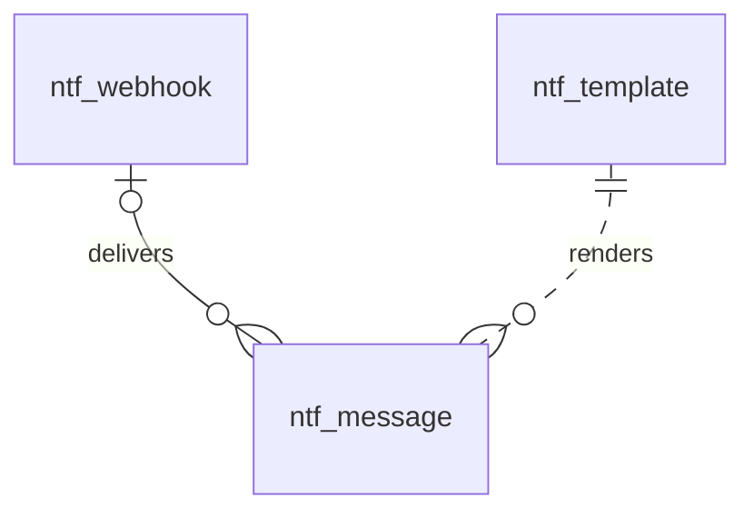

# 通知（notification）模块设计

| 项 | 内容 |
|---|---|
| 模块 ID | `notification` |
| 名称 | 通知 |
| 层 | L2 |
| 表前缀 | `ntf_` |
| API 前缀 | `notification` |
| 可停用 | 否 |
| 模块版本 | 1.0.0（module.json 的 version） |
| 平台版本 | `>=1.0.0 <2.0.0`（module.json 的 platform） |
| 里程碑切片 | M1：<…>；M2：<…>；M3：<…>；M4：<…>（详见第 13 节） |
| 模块负责人 | 待定 |
| 文档版本 | V1.0 |
| 状态 | 草案 |
| 更新日期 | 2026-10-14 |
| 依据 | 系统设计 V1.4 第 <…> 章；平台框架设计 V1.<x> 第 4 章 <…> 节；ADR-<…> |

> 本文只引用《平台框架设计》第 4 章中的契约，不定义新的跨模块契约；需要新契约时按平台框架设计 2.3 提出契约变更请求。

## 1. 职责与边界

### 1.1 职责

> 一段概述 + 要点列表；与系统设计 3.2 的职责描述一致，并细化到本模块的功能清单。

### 1.2 不负责的事

| 事项 | 归属模块 | 说明 |
|---|---|---|

### 1.3 协作概览

> 用图或表说明本模块与哪些模块协作、通过哪种方式（服务接口 / 事件 / 扩展点）。只画契约，不画实现。

### 1.4 适用的架构约束

> 列出与本模块直接相关的原则（P1–P8）、ADR 规则与 CLAUDE.md 禁止项，以及本模块如何满足。

## 2. 依赖与契约

### 2.1 module.json

```json
{
  "id": "<id>",
  "name": "<中文名称>",
  "version": "1.0.0",
  "layer": "L3",
  "platform": ">=1.0.0 <2.0.0",
  "requires": {},
  "optional": {},
  "disableable": true,
  "tablePrefix": "<前缀>_",
  "apiPrefix": "<id>",
  "permissions": [],
  "menus": [],
  "settings": null,
  "components": [],
  "events": { "publishes": [], "subscribes": [] }
}
```

> 完整描述符，须通过平台框架设计附录 A 的 Schema 与 A.3 的校验规则。

### 2.2 使用的服务接口

| 接口（平台框架设计小节） | 方法 | 用途 | 调用位置与时机（事务内 / 外） | 测试替身 |
|---|---|---|---|---|

### 2.3 提供的服务接口

| 接口（平台框架设计小节） | 方法 | 实现类 | 契约测试 | 说明（幂等、权限、性能目标） |
|---|---|---|---|---|

### 2.4 实现的扩展点

| 扩展点（平台框架设计小节） | 实现类 | 适用范围（内容类型 / 资源类型） | order | 收集方 |
|---|---|---|---|---|

### 2.5 收集的扩展点

| 扩展点 | 调用时机 | 过滤（站点启用状态、内容类型等） | 实现缺失或抛出异常时的行为 | 测试用示例实现 |
|---|---|---|---|---|

### 2.6 发布与订阅的事件

发布：

| 事件 | 触发时机（所在事务） | 关键字段 | 主要订阅方 |
|---|---|---|---|

订阅：

| 事件 | 处理 | 幂等方式 | 过期判断 | 失败与重试 |
|---|---|---|---|---|

### 2.7 使用的端口

| 端口 | 用途 | 测试替身 |
|---|---|---|

## 3. 领域模型

### 3.1 聚合、实体与值对象

| 类型 | 名称 | 说明 |
|---|---|---|
| 聚合根 | Template（`ntf_template`） | 一个（模板 key，渠道，语言）的主题与正文；zh-CN 行由 `NotificationTemplateProvider` 注册的默认模板同步而来，站点可以修改；客户模板的其他语言行是译文（站点资源本地化） |
| 聚合根 | Message（`ntf_message`） | 发件箱中的一条消息：渠道、收件人或 Webhook、模板 key 或事件类型、语言、变量、状态与重试信息 |
| 聚合根 | Webhook（`ntf_webhook`） | 站点配置的 Webhook：地址、订阅的事件、HMAC 密钥（加密）、是否包含联系人信息、启用状态 |
| 值对象 | TemplateKey | `{模块}.{场景}.{对象}`，如 `inquiry.autoreply.customer` |
| 值对象 | Audience | `STAFF`（员工，只有中文）/ `CUSTOMER`（客户，按 locale 选择语言） |
| 值对象 | RetryPolicy | 指数退避（1、5、15 分钟、1、3、6 小时），最多 6 次；最终失败告警 |
| 值对象 | EncryptedSecret | 加密信封 `v1:{keyId}:{Base64(nonce‖密文‖tag)}`（AES-256-GCM，与 core 相同格式，见第 4 章） |
| 值对象 | WebhookSignature | 请求头 `X-Signature: t={时间戳},v1={HMAC-SHA256(secret, 时间戳.请求体)}` |

在系统设计之外补充的字段：

| 补充 | 理由 |
|---|---|
| `ntf_template.template_key` | 系统设计的 `key` 是 MySQL 关键字，改名（本文 2.2） |
| `ntf_template.audience`、`module_id`、`name`、`variables`、`enabled` | 区分员工与客户模板（决定是否翻译、能否有非中文行）；记录注册模块（模块停用时不发送）；后台中文名称与变量说明；站点可关闭某个模板（如客户自动回复） |
| `ntf_template.customized`、`default_hash` | 系统设计 3.6 第 6 步“幂等同步通知模板”：未修改过的 zh-CN 行随默认模板升级自动更新；已修改的保留，并通过哈希提示“默认模板已更新” |
| `ntf_message.webhook_id`、`event_type` | Webhook 的投递与重试复用发件箱（同一套重试、告警、保留期） |
| `ntf_message.reply_to`、`subject`、`sent_at` | 客户自动回复的 Reply-To 为负责人邮箱（系统设计 18）；后台发送记录显示渲染后的主题与发送时间 |
| `ntf_message.subject_email` | 员工通知与 Webhook 的载荷也可能含有客户联系人信息；数据主体请求按客户邮箱查找与删除（系统设计 17.11）需要独立于收件人的可索引列 |
| `ntf_message.source_module`、`source_id`、`dedupe_key`、`locked_until` | 按业务对象查看发送记录（如询盘时间线）；定时提醒等重复写入的幂等；多实例投递的租约 |
| `ntf_webhook.name`、`include_contact`、投递统计、`deleted_at` | 后台名称；载荷默认不含联系人信息，开启需法务确认（系统设计 18）；最近投递结果与连续失败次数用于告警；配置类实体软删除 |
| `ntf_webhook.secret_ciphertext` | 系统设计的 `secret`：密钥以 AES-GCM 加密信封保存（系统设计 26.6），列名体现“密文” |

### 3.2 不变量

| # | 规则 | 保证方式 |
|---|---|---|
| 1 | 站点内（模板 key，渠道，语言）唯一 | 数据库：`uk_tpl_key_locale` |
| 2 | 员工模板（`STAFF`）只有 `zh-CN` 行 | 数据库：`ck_ntf_tpl_staff_locale` |
| 3 | 客户模板的 zh-CN 行是源语言（`translation_state = 'NONE'`）；其他语言行只由 translation 经 `TranslatableResourceProvider` 写入或在翻译编辑器中修订；模板语法（变量、条件）作为占位保护原样保留 | 应用层 |
| 4 | 发送客户邮件时按 `locale` 选择模板；该语言没有可用译文时使用站点默认对外语言的模板，并在发送记录中注明（通知不是前台页面，不适用“内容不跨语言回退”）；`enabled = 0` 或注册模块已停用时不发送 | 应用层 |
| 5 | `NotificationApi.send()` 在调用方的事务中写入发件箱：业务数据保存成功就一定有待发送的消息 | 应用层（同一事务） |
| 6 | 状态只能按 `PENDING → SENT`、`PENDING → PENDING`（失败重试：`attempts` + 1，按退避设置 `next_attempt_at`）、`PENDING → FAILED`（第 6 次失败）、`FAILED → PENDING`（后台手动重试，`attempts` 清零）流转；`SENT` 不再变化；状态变更使用条件更新 | 应用层 |
| 7 | 同一时刻一条消息只由一个实例投递：取件时以条件更新设置 `locked_until`，租约过期后才能被再次取件 | 应用层 |
| 8 | EMAIL 消息必须有收件人与模板 key；WEBHOOK 消息必须有 Webhook 与事件类型 | 数据库：`ck_ntf_msg_target` |
| 9 | `dedupe_key` 在站点内唯一；重复写入时忽略 | 数据库：`uk_msg_dedupe` |
| 10 | Webhook 密钥只以加密信封保存，明文只在创建或轮换时显示一次；地址必须是 https，保存时校验解析结果不是内网地址 | 应用层 |
| 11 | Webhook 载荷默认只含事件类型、询盘编号与后台链接；`include_contact = 1` 时才包含联系人信息 | 应用层 |
| 12 | 客户自动回复只发给 `ACCEPT` 的提交（由调用方 inquiry 判断） | 应用层（调用方） |

### 3.3 状态机

<<FILL: 状态与转换；没有状态机时写“不适用：<原因>”>>

## 4. 数据模型

> 遵守平台框架设计第 7 章的数据库通用约定。DDL 已在 MySQL 8.4 上执行通过；表结构以本节为准，与迁移脚本保持一致。

### 4.1 表清单

| 表 | 说明 | 站点级 | 软删除 | 预估规模（单站，按系统设计假设 A4） |
|---|---|---|---|---|
| `ntf_template` | 通知模板（客户模板为站点资源本地化） | 是 | 否 | ≤ 200 行（约 15 个模板，客户模板 × 10 种语言） |
| `ntf_message` | 发件箱与发送记录 | 是 | 否（发送后 90 天物理删除） | ≈ 30 万行（≤ 1 千条询盘 / 天 × 约 3 条消息 × 90 天） |
| `ntf_webhook` | Webhook 配置 | 是 | 是（`deleted_at`） | ≤ 20 行 |

### 4.2 ER 图



虚线表示按 `template_key` 的逻辑关系（不建外键：模板可能在消息发送前被修改或停用，发件箱按 key 与语言在投递时查找）。

### 4.3 表结构

#### 4.3.1 `ntf_template`：通知模板

| 字段 | 类型 | 可空 | 默认 | 说明 |
|---|---|---|---|---|
| `id` | BIGINT | 否 | — | 主键（TSID） |
| `site_id` | BIGINT | 否 | — | 站点 ID（sys_site.id） |
| `template_key` | VARCHAR(100) bin | 否 | — | 模板 key（{模块}.{场景}.{对象}），如 inquiry.autoreply.customer |
| `channel` | VARCHAR(16) | 否 | `'EMAIL'` | 渠道：EMAIL（【V2+】WHATSAPP / SMS / WECOM 等） |
| `locale` | VARCHAR(16) | 否 | — | 语言（BCP 47）；员工模板只有 zh-CN |
| `audience` | VARCHAR(16) | 否 | — | 接收对象：STAFF（员工，只有 zh-CN）/ CUSTOMER（客户，中文为源语言，其他语言为译文） |
| `module_id` | VARCHAR(32) | 否 | — | 注册该模板的模块 ID（NotificationTemplateProvider 的实现模块），如 inquiry |
| `name` | VARCHAR(100) | 否 | — | 模板名称（中文，只在后台显示） |
| `subject` | VARCHAR(300) | 否 | — | 邮件主题（模板语法，变量如 {{inquiry.no}}） |
| `body` | TEXT | 否 | — | 正文（HTML 片段 + 模板语法，渲染时自动转义变量；外层套站点品牌布局） |
| `variables` | JSON | 是 | — | 可用变量说明（来自 NotificationTemplateProvider；只在 zh-CN 行）：[{"name":"inquiry.no","label":"询盘编号"}] |
| `enabled` | TINYINT(1) | 否 | `1` | 是否启用（以 zh-CN 行为准；停用后该模板不发送，如关闭客户自动回复） |
| `customized` | TINYINT(1) | 否 | `0` | zh-CN 行是否被站点修改过：0 = 与默认模板同步（默认模板升级时自动更新） |
| `default_hash` | CHAR(64) bin | 是 | — | 最近一次同步的默认模板（主题 + 正文）的 SHA-256；只用于 zh-CN 行，与代码中的默认模板比较以提示“默认模板已更新” |
| `translation_state` | VARCHAR(16) | 否 | `'NONE'` | 翻译状态：NONE / QUEUED / TRANSLATED / NEEDS_REVIEW / FAILED / OUTDATED |
| `source_fingerprint` | CHAR(64) bin | 是 | — | 生成本行译文时 zh-CN 行的指纹（规范化主题与正文的 SHA-256）；zh-CN 行为空；与当前中文指纹不同即为过期 |
| `version` | INT | 否 | `0` | 乐观锁版本号 |
| `created_at` | DATETIME(3) | 否 | `CURRENT_TIMESTAMP(3)` | 创建时间（UTC） |
| `created_by` | BIGINT | 否 | `0` | 创建人用户 ID（0 = 系统，如默认模板同步、翻译回写） |
| `updated_at` | DATETIME(3) | 否 | `CURRENT_TIMESTAMP(3) ON UPDATE CURRENT_TIMESTAMP(3)` | 更新时间（UTC） |
| `updated_by` | BIGINT | 否 | `0` | 更新人用户 ID（0 = 系统） |

索引与约束：
- `PRIMARY KEY (id)`
- `uk_tpl_key_locale (site_id, template_key, channel, locale)`：发送时按（key，渠道，语言）取模板；后台模板列表（按 key 分组）
- `idx_tpl_state (site_id, translation_state, locale)`：翻译中心列出待处理的客户模板
- `ck_ntf_tpl_staff_locale`：见 3.2 不变量 2

```sql
CREATE TABLE ntf_template (
  id                  BIGINT        NOT NULL COMMENT '主键（TSID）',
  site_id             BIGINT        NOT NULL COMMENT '站点 ID（sys_site.id）',
  template_key        VARCHAR(100)  COLLATE utf8mb4_0900_bin NOT NULL COMMENT '模板 key（{模块}.{场景}.{对象}），如 inquiry.autoreply.customer',
  channel             VARCHAR(16)   NOT NULL DEFAULT 'EMAIL' COMMENT '渠道：EMAIL（【V2+】WHATSAPP / SMS / WECOM 等）',
  locale              VARCHAR(16)   NOT NULL COMMENT '语言（BCP 47）；员工模板只有 zh-CN',
  audience            VARCHAR(16)   NOT NULL COMMENT '接收对象：STAFF（员工，只有 zh-CN）/ CUSTOMER（客户，中文为源语言，其他语言为译文）',
  module_id           VARCHAR(32)   NOT NULL COMMENT '注册该模板的模块 ID（NotificationTemplateProvider 的实现模块），如 inquiry',
  name                VARCHAR(100)  NOT NULL COMMENT '模板名称（中文，只在后台显示）',
  subject             VARCHAR(300)  NOT NULL COMMENT '邮件主题（模板语法，变量如 {{inquiry.no}}）',
  body                TEXT          NOT NULL COMMENT '正文（HTML 片段 + 模板语法，渲染时自动转义变量；外层套站点品牌布局）',
  variables           JSON          NULL COMMENT '可用变量说明（来自 NotificationTemplateProvider；只在 zh-CN 行）：[{"name":"inquiry.no","label":"询盘编号"}]',
  enabled             TINYINT(1)    NOT NULL DEFAULT 1 COMMENT '是否启用（以 zh-CN 行为准；停用后该模板不发送，如关闭客户自动回复）',
  customized          TINYINT(1)    NOT NULL DEFAULT 0 COMMENT 'zh-CN 行是否被站点修改过：0 = 与默认模板同步（默认模板升级时自动更新）',
  default_hash        CHAR(64)      COLLATE utf8mb4_0900_bin NULL COMMENT '最近一次同步的默认模板（主题 + 正文）的 SHA-256；只用于 zh-CN 行，与代码中的默认模板比较以提示“默认模板已更新”',
  translation_state   VARCHAR(16)   NOT NULL DEFAULT 'NONE' COMMENT '翻译状态：NONE / QUEUED / TRANSLATED / NEEDS_REVIEW / FAILED / OUTDATED',
  source_fingerprint  CHAR(64)      COLLATE utf8mb4_0900_bin NULL COMMENT '生成本行译文时 zh-CN 行的指纹（规范化主题与正文的 SHA-256）；zh-CN 行为空；与当前中文指纹不同即为过期',
  version             INT           NOT NULL DEFAULT 0 COMMENT '乐观锁版本号',
  created_at          DATETIME(3)   NOT NULL DEFAULT CURRENT_TIMESTAMP(3) COMMENT '创建时间（UTC）',
  created_by          BIGINT        NOT NULL DEFAULT 0 COMMENT '创建人用户 ID（0 = 系统，如默认模板同步、翻译回写）',
  updated_at          DATETIME(3)   NOT NULL DEFAULT CURRENT_TIMESTAMP(3) ON UPDATE CURRENT_TIMESTAMP(3) COMMENT '更新时间（UTC）',
  updated_by          BIGINT        NOT NULL DEFAULT 0 COMMENT '更新人用户 ID（0 = 系统）',
  PRIMARY KEY (id),
  UNIQUE KEY uk_tpl_key_locale (site_id, template_key, channel, locale),
  KEY idx_tpl_state (site_id, translation_state, locale),
  CONSTRAINT ck_ntf_tpl_staff_locale CHECK (audience <> 'STAFF' OR locale = 'zh-CN')
) ENGINE = InnoDB DEFAULT CHARSET = utf8mb4 COLLATE = utf8mb4_0900_ai_ci COMMENT = '通知模板（员工模板只有中文；客户模板以中文为源语言翻译到各语言）';
```

要点：
- 默认模板同步：模块安装、升级或站点启用模块时，按 `NotificationTemplateProvider` 为每个站点写入或更新 zh-CN 行（`customized = 0` 的行随默认模板更新；`customized = 1` 的行只更新 `default_hash` 之外的元数据）；“恢复默认”把 `customized` 置 0 并复制默认内容。
- 客户模板 zh-CN 行的主题或正文变化时发布 `TranslatableResourceChangedEvent`（资源类型 `notification.template`，ID 为 zh-CN 行的 `id`）；翻译单元按正文的块级元素拆分，行内标签与 `{{…}}` 变量转为编号占位标签。
- 正文中引用的品牌信息（公司名称、Logo、地址）在渲染时取自站点资料，不写死在模板中。

#### 4.3.2 `ntf_webhook`：Webhook

| 字段 | 类型 | 可空 | 默认 | 说明 |
|---|---|---|---|---|
| `id` | BIGINT | 否 | — | 主键（TSID） |
| `site_id` | BIGINT | 否 | — | 站点 ID（sys_site.id） |
| `name` | VARCHAR(100) | 否 | — | 名称（中文，后台显示），如“企业微信-销售群” |
| `url` | VARCHAR(2048) | 否 | — | 接收地址（必须 https；保存时校验解析结果不是内网地址） |
| `events` | JSON | 否 | `(JSON_ARRAY())` | 订阅的事件类型数组，如 ["inquiry.created","inquiry.assigned"] |
| `secret_ciphertext` | VARCHAR(512) bin | 否 | — | HMAC-SHA256 签名密钥的密文（AES-256-GCM 加密信封 v1:{keyId}:{Base64}）；明文只在创建或轮换时显示一次 |
| `include_contact` | TINYINT(1) | 否 | `0` | 载荷是否包含联系人信息（默认否；开启前须法务确认，见系统设计 18） |
| `enabled` | TINYINT(1) | 否 | `1` | 是否启用 |
| `last_delivered_at` | DATETIME(3) | 是 | — | 最近一次投递时间 |
| `last_status_code` | SMALLINT | 是 | — | 最近一次投递的 HTTP 状态码；网络错误为空 |
| `consecutive_failures` | INT | 否 | `0` | 连续最终失败的消息数（达到阈值时告警；成功一次即清零） |
| `deleted_at` | DATETIME(3) | 是 | — | 删除时间（软删除） |
| `version` | INT | 否 | `0` | 乐观锁版本号 |
| `created_at` | DATETIME(3) | 否 | `CURRENT_TIMESTAMP(3)` | 创建时间（UTC） |
| `created_by` | BIGINT | 否 | `0` | 创建人用户 ID（0 = 系统） |
| `updated_at` | DATETIME(3) | 否 | `CURRENT_TIMESTAMP(3) ON UPDATE CURRENT_TIMESTAMP(3)` | 更新时间（UTC） |
| `updated_by` | BIGINT | 否 | `0` | 更新人用户 ID（0 = 系统） |

索引与约束：
- `PRIMARY KEY (id)`
- `idx_webhook_site (site_id, enabled)`：按事件扇出时加载站点已启用的 Webhook；后台列表

```sql
CREATE TABLE ntf_webhook (
  id                    BIGINT         NOT NULL COMMENT '主键（TSID）',
  site_id               BIGINT         NOT NULL COMMENT '站点 ID（sys_site.id）',
  name                  VARCHAR(100)   NOT NULL COMMENT '名称（中文，后台显示），如“企业微信-销售群”',
  url                   VARCHAR(2048)  NOT NULL COMMENT '接收地址（必须 https；保存时校验解析结果不是内网地址）',
  events                JSON           NOT NULL DEFAULT (JSON_ARRAY()) COMMENT '订阅的事件类型数组，如 ["inquiry.created","inquiry.assigned"]',
  secret_ciphertext     VARCHAR(512)   COLLATE utf8mb4_0900_bin NOT NULL COMMENT 'HMAC-SHA256 签名密钥的密文（AES-256-GCM 加密信封 v1:{keyId}:{Base64}）；明文只在创建或轮换时显示一次',
  include_contact       TINYINT(1)     NOT NULL DEFAULT 0 COMMENT '载荷是否包含联系人信息（默认否；开启前须法务确认，见系统设计 18）',
  enabled               TINYINT(1)     NOT NULL DEFAULT 1 COMMENT '是否启用',
  last_delivered_at     DATETIME(3)    NULL COMMENT '最近一次投递时间',
  last_status_code      SMALLINT       NULL COMMENT '最近一次投递的 HTTP 状态码；网络错误为空',
  consecutive_failures  INT            NOT NULL DEFAULT 0 COMMENT '连续最终失败的消息数（达到阈值时告警；成功一次即清零）',
  deleted_at            DATETIME(3)    NULL COMMENT '删除时间（软删除）',
  version               INT            NOT NULL DEFAULT 0 COMMENT '乐观锁版本号',
  created_at            DATETIME(3)    NOT NULL DEFAULT CURRENT_TIMESTAMP(3) COMMENT '创建时间（UTC）',
  created_by            BIGINT         NOT NULL DEFAULT 0 COMMENT '创建人用户 ID（0 = 系统）',
  updated_at            DATETIME(3)    NOT NULL DEFAULT CURRENT_TIMESTAMP(3) ON UPDATE CURRENT_TIMESTAMP(3) COMMENT '更新时间（UTC）',
  updated_by            BIGINT         NOT NULL DEFAULT 0 COMMENT '更新人用户 ID（0 = 系统）',
  PRIMARY KEY (id),
  KEY idx_webhook_site (site_id, enabled)
) ENGINE = InnoDB DEFAULT CHARSET = utf8mb4 COLLATE = utf8mb4_0900_ai_ci COMMENT = 'Webhook 配置（HMAC 签名，经发件箱投递）';
```

要点：Webhook 接收方纳入处理者清单（系统设计 26.8）；修改地址、事件、密钥或 `include_contact` 记录审计日志（密钥只记录“已轮换”）。

#### 4.3.3 `ntf_message`：发件箱

| 字段 | 类型 | 可空 | 默认 | 说明 |
|---|---|---|---|---|
| `id` | BIGINT | 否 | — | 主键（TSID） |
| `site_id` | BIGINT | 否 | — | 站点 ID（sys_site.id） |
| `channel` | VARCHAR(16) | 否 | — | 渠道：EMAIL / WEBHOOK |
| `recipient` | VARCHAR(254) | 是 | — | 收件人邮箱（EMAIL）；WEBHOOK 为空（地址取自 ntf_webhook） |
| `reply_to` | VARCHAR(254) | 是 | — | Reply-To（客户自动回复设为负责人邮箱） |
| `webhook_id` | BIGINT | 是 | — | Webhook ID（ntf_webhook.id；WEBHOOK 渠道） |
| `template_key` | VARCHAR(100) bin | 是 | — | 模板 key（EMAIL） |
| `event_type` | VARCHAR(100) bin | 是 | — | 事件类型（WEBHOOK），如 inquiry.created |
| `locale` | VARCHAR(16) | 否 | `'zh-CN'` | 发送语言：员工通知为 zh-CN；客户邮件为询盘或提交记录的 locale |
| `payload` | JSON | 否 | — | 模板变量（EMAIL）或请求体（WEBHOOK） |
| `subject` | VARCHAR(500) | 是 | — | 渲染后的主题（投递时写入，供后台发送记录显示） |
| `subject_email` | VARCHAR(254) | 是 | — | 载荷涉及的客户邮箱（客户邮件即收件人；含联系人信息的员工通知或 Webhook 为客户邮箱）；数据主体请求按此查找 |
| `source_module` | VARCHAR(32) | 是 | — | 业务来源模块 ID，如 inquiry、content、translation、form |
| `source_id` | BIGINT | 是 | — | 业务对象 ID（如 inq_inquiry.id），不建外键 |
| `dedupe_key` | VARCHAR(128) bin | 是 | — | 去重键（站点内唯一），如 inquiry.sla.reminder:{inquiryId}:1；重复写入时忽略 |
| `status` | VARCHAR(16) | 否 | `'PENDING'` | 状态：PENDING / SENT / FAILED |
| `attempts` | INT | 否 | `0` | 已尝试次数（最多 6 次） |
| `next_attempt_at` | DATETIME(3) | 否 | `CURRENT_TIMESTAMP(3)` | 下次尝试时间（指数退避） |
| `locked_until` | DATETIME(3) | 是 | — | 投递租约到期时间：取件时设为当前时间 + 5 分钟，防止多实例重复发送 |
| `provider_message_id` | VARCHAR(255) bin | 是 | — | 服务商返回的消息 ID（SMTP Message-ID 或 API 返回值） |
| `error` | VARCHAR(2000) | 是 | — | 最近一次失败原因（已脱敏） |
| `sent_at` | DATETIME(3) | 是 | — | 发送成功时间 |
| `created_at` | DATETIME(3) | 否 | `CURRENT_TIMESTAMP(3)` | 写入时间（UTC，即调用方事务时间） |
| `created_by` | BIGINT | 否 | `0` | 触发人用户 ID（0 = 系统） |
| `updated_at` | DATETIME(3) | 否 | `CURRENT_TIMESTAMP(3) ON UPDATE CURRENT_TIMESTAMP(3)` | 更新时间（UTC） |

索引与约束：
- `PRIMARY KEY (id)`
- `uk_msg_dedupe (site_id, dedupe_key)`：幂等写入（NULL 不参与唯一）
- `idx_msg_due (status, next_attempt_at)`：投递任务取件（`status = 'PENDING' AND next_attempt_at <= now AND (locked_until IS NULL OR locked_until < now)`，跨站点）；失败积压告警
- `idx_msg_source (site_id, source_module, source_id)`：某业务对象的发送记录（如询盘详情的时间线）
- `idx_msg_subject (subject_email)`：数据主体请求按邮箱跨站点查找（系统管理接口）
- `idx_msg_list (site_id, created_at)`：后台发送记录列表；保留期清理
- `idx_msg_webhook (webhook_id, created_at)`：某 Webhook 的投递记录；兼作 `fk_ntf_msg_webhook` 的索引
- `fk_ntf_msg_webhook`：引用关系（RESTRICT；Webhook 只软删除）
- `ck_ntf_msg_target`：见 3.2 不变量 8

```sql
CREATE TABLE ntf_message (
  id                   BIGINT         NOT NULL COMMENT '主键（TSID）',
  site_id              BIGINT         NOT NULL COMMENT '站点 ID（sys_site.id）',
  channel              VARCHAR(16)    NOT NULL COMMENT '渠道：EMAIL / WEBHOOK',
  recipient            VARCHAR(254)   NULL COMMENT '收件人邮箱（EMAIL）；WEBHOOK 为空（地址取自 ntf_webhook）',
  reply_to             VARCHAR(254)   NULL COMMENT 'Reply-To（客户自动回复设为负责人邮箱）',
  webhook_id           BIGINT         NULL COMMENT 'Webhook ID（ntf_webhook.id；WEBHOOK 渠道）',
  template_key         VARCHAR(100)   COLLATE utf8mb4_0900_bin NULL COMMENT '模板 key（EMAIL）',
  event_type           VARCHAR(100)   COLLATE utf8mb4_0900_bin NULL COMMENT '事件类型（WEBHOOK），如 inquiry.created',
  locale               VARCHAR(16)    NOT NULL DEFAULT 'zh-CN' COMMENT '发送语言：员工通知为 zh-CN；客户邮件为询盘或提交记录的 locale',
  payload              JSON           NOT NULL COMMENT '模板变量（EMAIL）或请求体（WEBHOOK）',
  subject              VARCHAR(500)   NULL COMMENT '渲染后的主题（投递时写入，供后台发送记录显示）',
  subject_email        VARCHAR(254)   NULL COMMENT '载荷涉及的客户邮箱（客户邮件即收件人；含联系人信息的员工通知或 Webhook 为客户邮箱）；数据主体请求按此查找',
  source_module        VARCHAR(32)    NULL COMMENT '业务来源模块 ID，如 inquiry、content、translation、form',
  source_id            BIGINT         NULL COMMENT '业务对象 ID（如 inq_inquiry.id），不建外键',
  dedupe_key           VARCHAR(128)   COLLATE utf8mb4_0900_bin NULL COMMENT '去重键（站点内唯一），如 inquiry.sla.reminder:{inquiryId}:1；重复写入时忽略',
  status               VARCHAR(16)    NOT NULL DEFAULT 'PENDING' COMMENT '状态：PENDING / SENT / FAILED',
  attempts             INT            NOT NULL DEFAULT 0 COMMENT '已尝试次数（最多 6 次）',
  next_attempt_at      DATETIME(3)    NOT NULL DEFAULT CURRENT_TIMESTAMP(3) COMMENT '下次尝试时间（指数退避）',
  locked_until         DATETIME(3)    NULL COMMENT '投递租约到期时间：取件时设为当前时间 + 5 分钟，防止多实例重复发送',
  provider_message_id  VARCHAR(255)   COLLATE utf8mb4_0900_bin NULL COMMENT '服务商返回的消息 ID（SMTP Message-ID 或 API 返回值）',
  error                VARCHAR(2000)  NULL COMMENT '最近一次失败原因（已脱敏）',
  sent_at              DATETIME(3)    NULL COMMENT '发送成功时间',
  created_at           DATETIME(3)    NOT NULL DEFAULT CURRENT_TIMESTAMP(3) COMMENT '写入时间（UTC，即调用方事务时间）',
  created_by           BIGINT         NOT NULL DEFAULT 0 COMMENT '触发人用户 ID（0 = 系统）',
  updated_at           DATETIME(3)    NOT NULL DEFAULT CURRENT_TIMESTAMP(3) ON UPDATE CURRENT_TIMESTAMP(3) COMMENT '更新时间（UTC）',
  PRIMARY KEY (id),
  UNIQUE KEY uk_msg_dedupe (site_id, dedupe_key),
  KEY idx_msg_due (status, next_attempt_at),
  KEY idx_msg_source (site_id, source_module, source_id),
  KEY idx_msg_subject (subject_email),
  KEY idx_msg_list (site_id, created_at),
  KEY idx_msg_webhook (webhook_id, created_at),
  CONSTRAINT fk_ntf_msg_webhook FOREIGN KEY (webhook_id) REFERENCES ntf_webhook (id),
  CONSTRAINT ck_ntf_msg_target CHECK ((channel = 'EMAIL' AND recipient IS NOT NULL AND template_key IS NOT NULL) OR (channel = 'WEBHOOK' AND webhook_id IS NOT NULL AND event_type IS NOT NULL))
) ENGINE = InnoDB DEFAULT CHARSET = utf8mb4 COLLATE = utf8mb4_0900_ai_ci COMMENT = '通知发件箱（在调用方事务中写入，后台任务投递与重试）';
```

要点：
- 投递在模板渲染时才读取模板（按 `template_key`、`channel`、`locale`），因此发件箱只保存变量；渲染后的主题写入 `subject` 供后台查看，正文不落库。
- Webhook 扇出：调用方经 `NotificationApi` 提交（事件类型 + 载荷），notification 在同一事务中为每个订阅了该事件、已启用且未删除的 Webhook 写入一条 `WEBHOOK` 消息；Webhook 在投递前被停用或删除时，消息直接置为 `FAILED`。
- 保留期（系统设计 17.11）：`SENT` 与最终 `FAILED` 的消息 90 天后物理删除；数据主体删除请求按 `subject_email` 删除相关消息（服务商侧的记录按处理者清单处理）。

### 4.4 枚举

| 字段 | 取值 | 说明 |
|---|---|---|
| `ntf_template.channel`、`ntf_message.channel` | `EMAIL` | 邮件（SMTP 或服务商 API） |
| | `WEBHOOK` | 只用于 `ntf_message`（Webhook 投递）；模板不使用 |
| `ntf_template.audience` | `STAFF` / `CUSTOMER` | 员工（只有中文）/ 客户（按 locale 翻译） |
| `ntf_template.template_key`（V1 默认） | `inquiry.assigned.staff` | 询盘分配给负责人（STAFF，inquiry 注册） |
| | `inquiry.autoreply.customer` | 客户自动回复，含预计回复时间（CUSTOMER，inquiry 注册） |
| | `inquiry.sla.reminder` | SLA 超时提醒负责人与主管（STAFF，inquiry 注册） |
| | `download.link` | 留资文档下载链接（CUSTOMER，inquiry 注册） |
| | `content.review.requested` | 提交审核通知审核人（STAFF，content 注册） |
| | `translation.outdated` | MANUAL 模式本地化过期，通知翻译审校人员（STAFF，content 注册） |
| | `translation.failed` | 翻译失败（STAFF，content 注册） |
| `ntf_template.translation_state` | `NONE` / `QUEUED` / `TRANSLATED` / `NEEDS_REVIEW` / `FAILED` / `OUTDATED` | 共享翻译状态枚举；zh-CN 行与员工模板为 `NONE` |
| `ntf_message.status` | `PENDING` / `SENT` / `FAILED` | 共享通知状态枚举 |
| `ntf_webhook.events[]`、`ntf_message.event_type` | `inquiry.created` / `inquiry.assigned` / `inquiry.status_changed` | 询盘事件（由 inquiry 经 `NotificationApi` 提交） |
| | `form.submitted` | 表单提交（只用于 `CUSTOM` 表单，由 form 提交） |

`download.link` 与 `translation.*` 的注册模块是本文的建议：系统设计 3.7 的 `NotificationTemplateProvider` 实现方只列出 inquiry、content。

### 4.5 站点过滤

<<FILL: | 表 | 行级拦截器（不豁免 / 豁免） | 访问方式与理由 |>>

### 4.6 跨模块引用与清理

**本模块引用其他模块的对象**：

| 本模块字段 | 引用对象（模块.表） | 被引用对象删除 / 下线时的处理 | 触发事件 |
|---|---|---|---|
| `ntf_template.module_id` | core.`sys_module` | 模块停用：保留模板，该模块的模板不发送；模块 MISSING / PURGED：PURGED 时删除其模板 | `ModuleDisabledEvent`、`onPurge` |
| `ntf_message.source_module` / `source_id` | 调用方模块的对象（如 inquiry.`inq_inquiry`） | 不清理；按保留期删除消息；询盘匿名化时由数据主体请求或保留期任务按 `subject_email` 删除 | — |
| `ntf_message.subject_email`、`recipient` | 客户或员工邮箱 | 数据主体删除请求：删除相关消息；notification 实现 `PersonalDataProvider` | — |
| `ntf_template.locale`、`ntf_message.locale` | core.`sys_site_locale` | V1 不删除站点语言，无需清理 | `SiteSettingsChangedEvent` |
| `created_by`、`updated_by` | core.`sys_user` | 不清理 | — |

**其他模块引用本模块的对象**（其他章节需配合）：

| 被引用对象 | 引用方 | 说明 | 事件 |
|---|---|---|---|
| `ntf_template.template_key` | inquiry、content（经 `NotificationTemplateProvider` 注册默认模板，经 `NotificationApi.send()` 按 key 发送） | key 由注册模块定义，不可改名（改名视为新模板） | — |
| `ntf_message.id` | inquiry（可在时间线中记录 `EMAIL_SENT` 活动并保存消息 ID） | 消息 90 天后删除，引用方须容忍其不存在 | — |

本模块订阅的事件：`ReviewRequestedEvent`、`ReviewCompletedEvent`、`TranslationOutdatedEvent`、`TranslationFailedEvent`（生成员工通知）、`ModuleDisabledEvent`。发布：`TranslatableResourceChangedEvent`（资源类型 `notification.template`）。

---

### 4.7 迁移脚本

| 文件 | 内容 | 里程碑 |
|---|---|---|
| `db/migration/notification/V001__init.sql` | 4.3 中的全部表（3 张：`ntf_template`、`ntf_webhook`、`ntf_message`），按本节顺序创建 | <见第 13 节> |

## 5. 业务流程

### 5.1 <流程名称>

```text
<步骤；标出事务边界、调用的服务接口、发布的事件、异步部分>
```

| 步骤 | 说明 | 失败处理 |
|---|---|---|

## 6. 接口

### 6.1 Admin 端点

| 方法 | 路径（/api/admin/v1/<apiPrefix>/…） | 说明 | 权限码 | 并发控制 / 幂等 | 审计 |
|---|---|---|---|---|---|

### 6.2 Public 端点

| 方法 | 路径（/api/public/v1/<apiPrefix>/…） | 说明 | 限流 | 缓存 |
|---|---|---|---|---|

### 6.3 Internal 端点

| 方法 | 路径（/api/internal/v1/<apiPrefix>/…） | 说明 | 调用方 |
|---|---|---|---|

### 6.4 权限码

| 权限码 | 名称 | 数据范围 | 高危（sensitive） | 受语言范围限制（localeScoped） |
|---|---|---|---|---|

### 6.5 错误码

| 错误码 | HTTP 状态 | 后台中文信息 | 前台文案键（仅公开接口） |
|---|---|---|---|

## 7. 后台界面

### 7.1 菜单与路由

| 菜单 key | 名称 | 父菜单 | 路由 | 权限码 |
|---|---|---|---|---|

### 7.2 页面

| 页面 | 路由 | 主要功能 | 使用的 admin-kit 组件 |
|---|---|---|---|

### 7.3 注册到内容编辑外壳的标签

| key | 适用内容类型 | 权限码 | 组件 |
|---|---|---|---|

### 7.4 界面文案

> texts.ts 中的分组与关键文案；后台只用简体中文。

## 8. 前台组件与模板

> 没有前台组件时写“不适用”。

### 8.1 组件

| 组件类型 | 名称（label） | 变体 | 分类 | allowedIn | 数据源 | 是否水合 |
|---|---|---|---|---|---|---|

### 8.2 属性与翻译

| 组件 | 属性 | 类型 / x-editor | x-translatable | maxLength |
|---|---|---|---|---|

### 8.3 模板

| 模板 key | 内容类型 | 固定区域与插槽 |
|---|---|---|

### 8.4 数据源

| key | 参数 | 返回 | 缓存标签 |
|---|---|---|---|

### 8.5 文案键

| 文案键 | 默认中文文案 | 使用位置 |
|---|---|---|

## 9. 配置项

### 9.1 站点设置（settings.schema.json）

| 键 | 类型 | 默认值 | 说明 | 敏感（x-secret） |
|---|---|---|---|---|

### 9.2 部署配置（application.yml，前缀 b2bweb.<id>）

| 属性 | 默认值 | 说明 |
|---|---|---|

## 10. 定时与异步任务

> 没有时写“不适用”。定时任务实现 `ScheduledTask`，通用异步任务实现 `JobHandler`（平台框架设计 4.4.12）；锁名与任务类型按平台框架设计 3.7 命名。事件监听器已在 2.6 中列出，这里只补充耗时长、需要单独调度或重试的处理。`PER_SITE` 任务由 core 在站点上下文中逐站点执行，停用了本模块的站点自动跳过（系统设计 3.8）。外部服务（AI 引擎、邮件、CDN）只在事务提交后的异步处理中调用，失败不回滚已提交的业务数据（ADR-003、ADR-017）。

| 任务 | 类型（定时 / sys_job / 事件监听） | 触发 | 锁名 | 幂等与重试 | 模块停用时 |
|---|---|---|---|---|---|

> 每个任务另写：执行粒度（`PER_SITE` / 系统级）、单次处理量与分批方式、超时、能否取消、失败后的可见结果（`sys_job` 的失败报告、指标 `b2bweb.<id>.*` 或告警）。

## 11. 测试要点

> 测试层级、替身与契约测试的写法见平台框架设计第 9 章，门禁与覆盖率见第 10 章。“至少”后的用例为必测项；不适用的行写“不适用：<原因>”，不得删除。

| 层级 | 覆盖内容 | 关键用例 |
|---|---|---|
| 单元 | <领域对象、不变量（3.2）、状态机（3.3）、扩展点实现（2.4）> | 至少：3.2 每条不变量的违反用例；3.3 每个非法状态转换被拒绝 |
| 模块集成（Testcontainers + 替身） | <应用服务 + 本模块的表与迁移> | 至少：迁移脚本在空库（MySQL 8.4）上执行通过；6.1 中声明的并发控制与幂等；唯一约束冲突转为 6.5 的错误码 |
| 契约（作为提供方） | <2.3 中本模块提供的服务接口> | 继承 testkit 中的 `<接口名>ContractTest`，用真实实现运行；不提供服务接口时写“不适用” |
| 事件（Scenario API，含重复投递） | <2.6 中发布与订阅的事件> | 至少：事件在业务事务内发布、事务回滚时不发布；每个监听器重复投递只生效一次、过期事件被丢弃（ADR-003） |
| 停用行为（可停用模块） | <系统设计 3.8 的各项> | 至少：停用后写操作与公开接口返回 `CORE_MODULE_DISABLED`；扩展点实现不再被收集；定时任务跳过；`analyzeDisableImpact` 的结果正确；重新启用后数据完整（S10） |
| 站点隔离 | <6.1 的全部后台接口与 4.5 的全部站点级表> | 至少：站点 A 的用户不能读写站点 B 的数据（遍历全部后台端点，系统设计 28）；豁免表只在 4.5 列出的位置访问 |
| 翻译（如有可翻译字段） | <`TranslatableContentProvider` / `TranslatableResourceProvider` 实现> | 至少：提取 → 回写往返一致；`x-translatable = false` 的字段不被提取；`HUMAN` / `REVIEWED` 段不被机器译文覆盖；资源变化时发布 `TranslatableResourceChangedEvent` |
| 前端（组件、Admin） | <主题组件、Admin 页面> | 至少：组件 Schema 校验与画廊示例（视觉回归）；前台文字只来自文案键、后台文字只来自 `texts.ts`；无权限时操作不可见 |
| E2E（场景） | <13.2 中验证方式为 E2E 的验收项> | Playwright 用例名包含 13.2 的验收项编号 |

## 12. 独立开发说明

### 12.1 依赖的测试替身

> 2.2 使用的每个服务接口、2.7 使用的每个端口、2.5 收集的每个扩展点，都要在此列出 testkit 中对应的替身或示例实现（平台框架设计 2.4、第 9 章）。testkit 中缺少的替身向框架组提出需求（DoR 第 3 条，平台框架设计 2.7），不在本模块中另建一套代替其他模块的模拟实现；单元测试可以用 Mockito 模拟个别方法，但对其他模块行为的假设以替身与契约测试为准。

| 替身（platform-testkit） | 代替的模块 | 用途 | 需要预置的数据 |
|---|---|---|---|

### 12.2 本模块提供的替身

> 只有提供服务接口的模块填写（core、content、url、media、taxonomy、form、notification、translation，见平台框架设计 4.2）；其他模块写“不适用：不提供服务接口”。替身由框架组编写并维护，与真实实现通过同一套契约测试；本模块改变服务接口的行为时，在同一个 PR 中同步修改契约测试，并通知框架组修改替身（平台框架设计 2.3）。无法消除的差异（如不做病毒扫描、不生成真实缩略图）列入下表，并确认不影响使用方的测试结论。

| 服务接口 | testkit 中的替身 | 与真实实现的差异（应为零，或已在契约测试中声明） |
|---|---|---|

### 12.3 本地运行

> 启动方式、依赖的本地服务（平台框架设计第 11 章）、需要的配置。

### 12.4 演示数据

> tools/demo-data 中本模块的数据及其用途。

## 13. 验收标准

### 13.1 里程碑切片

> 与平台框架设计 13.5 中本模块的一行一致；调整切片按平台框架设计 12.5 处理。该里程碑没有切片时写“—”（不表示不能提前开发）。

| 里程碑 | 交付功能 | 验收场景 |
|---|---|---|
| M1 | <…> | <S1、S2、S4 中与本模块相关的部分，或“模块自身”> |
| M2 | <…> | <…> |
| M3 | <…> | <…> |
| M4 | <…> | <…> |

### 13.2 验收项

> 每条验收项写明输入、期望结果与度量（如“5 分钟内”“P95 ≤ 200 ms”）。场景验收项只写本模块负责的部分（如 S2 中 url 负责“旧 URL 301 到新 URL、不产生重定向链”），不复述整个场景；各里程碑的场景见平台框架设计 13.6。验证方式为单元 / 集成 / E2E 时写出测试类或用例名；人工检查写明检查人与方法。

| # | 验收项 | 对应场景（S1–S13）或模块自身 | 验证方式（单元 / 集成 / E2E / 人工） | 里程碑 |
|---|---|---|---|---|
| A1 | <…> | <S? / 模块自身> | <集成：`<测试类>`> | M? |

> 每个模块都要包含以下通用验收项（不适用时注明原因）：架构测试与 Modulith 验证通过，无跨模块 import 与表访问；站点隔离测试覆盖全部后台接口；后台写操作都有权限码与审计记录；可停用模块满足 S10；可翻译字段与资源已登记并通过往返测试（S11、S12）；系统设计 1.5 中与本模块相关的非功能指标；文档与代码一致（DoD，平台框架设计 2.8）。

## 14. 待定问题

> 记录评审与开发中尚未决定的事项。“阻塞开发”的问题必须在评审通过（DoR）前关闭；需要新契约或修改上层文档的问题，写明契约变更请求或 Issue 编号。已关闭的问题保留在表中，填写结论。

| # | 问题 | 影响 | 是否阻塞开发 | 负责人 | 最晚解决 | 结论 |
|---|---|---|---|---|---|---|

## 修订记录

| 版本 | 日期 | 变更 |
|---|---|---|
| V1.0 | 2026-10-14 | 初稿 |
