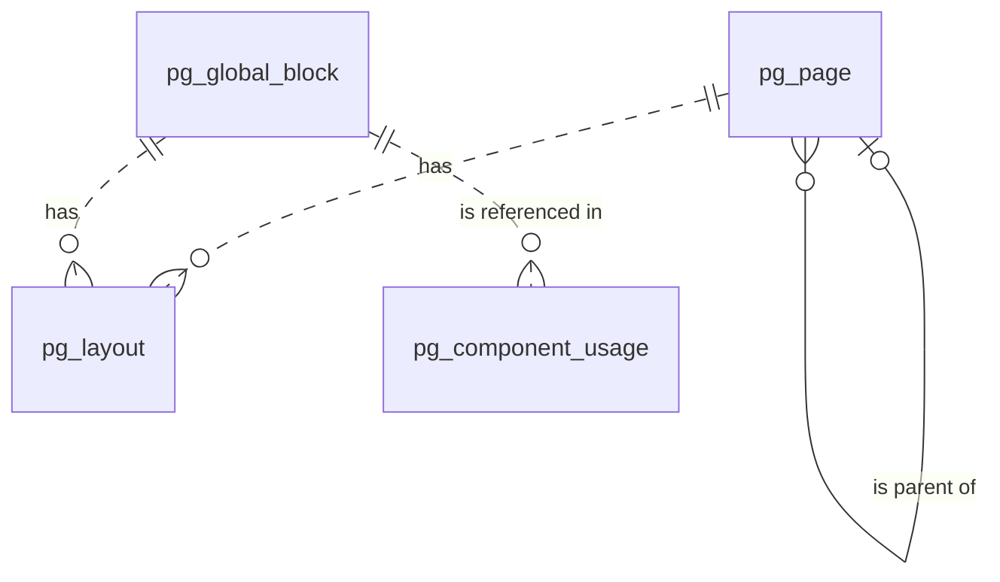

# 页面（page）模块设计

| 项 | 内容 |
|---|---|
| 模块 ID | `page` |
| 名称 | 页面 |
| 层 | L3 |
| 表前缀 | `pg_` |
| API 前缀 | `page` |
| 可停用 | 否 |
| 模块版本 | 1.0.0（module.json 的 version） |
| 平台版本 | `>=1.0.0 <2.0.0`（module.json 的 platform） |
| 里程碑切片 | M1：<…>；M2：<…>；M3：<…>；M4：<…>（详见第 13 节） |
| 模块负责人 | 待定 |
| 文档版本 | V1.0 |
| 状态 | 草案 |
| 更新日期 | 2026-10-14 |
| 依据 | 系统设计 V1.4 第 <…> 章；平台框架设计 V1.<x> 第 4 章 <…> 节；ADR-<…> |

> 本文只引用《平台框架设计》第 4 章中的契约，不定义新的跨模块契约；需要新契约时按平台框架设计 2.3 提出契约变更请求。

## 1. 职责与边界

### 1.1 职责

> 一段概述 + 要点列表；与系统设计 3.2 的职责描述一致，并细化到本模块的功能清单。

### 1.2 不负责的事

| 事项 | 归属模块 | 说明 |
|---|---|---|

### 1.3 协作概览

> 用图或表说明本模块与哪些模块协作、通过哪种方式（服务接口 / 事件 / 扩展点）。只画契约，不画实现。

### 1.4 适用的架构约束

> 列出与本模块直接相关的原则（P1–P8）、ADR 规则与 CLAUDE.md 禁止项，以及本模块如何满足。

## 2. 依赖与契约

### 2.1 module.json

```json
{
  "id": "<id>",
  "name": "<中文名称>",
  "version": "1.0.0",
  "layer": "L3",
  "platform": ">=1.0.0 <2.0.0",
  "requires": {},
  "optional": {},
  "disableable": true,
  "tablePrefix": "<前缀>_",
  "apiPrefix": "<id>",
  "permissions": [],
  "menus": [],
  "settings": null,
  "components": [],
  "events": { "publishes": [], "subscribes": [] }
}
```

> 完整描述符，须通过平台框架设计附录 A 的 Schema 与 A.3 的校验规则。

### 2.2 使用的服务接口

| 接口（平台框架设计小节） | 方法 | 用途 | 调用位置与时机（事务内 / 外） | 测试替身 |
|---|---|---|---|---|

### 2.3 提供的服务接口

| 接口（平台框架设计小节） | 方法 | 实现类 | 契约测试 | 说明（幂等、权限、性能目标） |
|---|---|---|---|---|

### 2.4 实现的扩展点

| 扩展点（平台框架设计小节） | 实现类 | 适用范围（内容类型 / 资源类型） | order | 收集方 |
|---|---|---|---|---|

### 2.5 收集的扩展点

| 扩展点 | 调用时机 | 过滤（站点启用状态、内容类型等） | 实现缺失或抛出异常时的行为 | 测试用示例实现 |
|---|---|---|---|---|

### 2.6 发布与订阅的事件

发布：

| 事件 | 触发时机（所在事务） | 关键字段 | 主要订阅方 |
|---|---|---|---|

订阅：

| 事件 | 处理 | 幂等方式 | 过期判断 | 失败与重试 |
|---|---|---|---|---|

### 2.7 使用的端口

| 端口 | 用途 | 测试替身 |
|---|---|---|

## 3. 领域模型

### 3.1 聚合、实体与值对象

| 类型 | 名称 | 说明 |
|---|---|---|
| 聚合根 | Page（`pg_page`） | PAGE 内容的语言无关字段：父页面、物化路径、深度、同级排序、模板 key、页面角色（首页、Imprint）。与 `cnt_content`（type = PAGE）1:1，主键即 `content_id` |
| 聚合根 | GlobalBlock（`pg_global_block`） | GLOBAL_BLOCK 内容的区块 key 与后台名称；与 `cnt_content`（type = GLOBAL_BLOCK）1:1 |
| 聚合根 | Layout（`pg_layout`） | 一个内容在一种语言下的草稿布局文档（JSON）：PAGE、GLOBAL_BLOCK 为完整文档（`sections`），模板渲染的类型（PRODUCT、ARTICLE、CASE_STUDY、TERM_PAGE）为插槽文档（`slots`）；与 `cnt_localization` 按（内容，语言）1:1 |
| 实体（投影） | ComponentUsage（`pg_component_usage`） | 已发布本地化使用的组件类型、组件版本与引用 key（表单 key、全局区块 key），发布后按快照重建 |
| 值对象 | LayoutDocument | `schemaVersion`、`template`、`sections[]` 或 `slots{}`；Section：`id`、`component`、`componentVersion`、`variant`、`hidden`、`visibility`、`style`、`props`、`children`（系统设计 10.3） |
| 值对象 | ObjectRef | `$content`、`$media`、`$term`、`$source`：布局中的引用一律对象化，不保存 URL |
| 值对象 | TemplateDefinition、ComponentDefinition | 模板元数据（区域、插槽、允许的组件、默认值）与组件 Schema（含 `x-translatable`、`x-editor`），代码中定义，不落表 |

在系统设计之外补充的字段：

| 补充 | 理由 |
|---|---|
| `pg_page`、`pg_global_block` 以 `content_id` 为主键 | 与产品、文章一致：身份即内容身份（系统设计 6.1） |
| `pg_page.tree_path`、`depth`、`sort_order` | 面包屑“首页 › 父页面链 › 页面”（系统设计 16.2）、后台页面树、移动父页面时的子树检查；最大 5 级，限制 URL 层级 |
| `pg_page.page_role` | 首页由 page 模块标记（第 6 章：首页的路径就是语言前缀）；Imprint 的正文由站点资料自动生成（系统设计 10.1、16.3），需要识别哪个页面是 Imprint |
| `pg_global_block` 整表 | 系统设计 10.6 规定全局区块按 key 引用，25.8 表清单未单列；key 需要站点内唯一并能按 key 查找 |
| `pg_layout.content_type`、`template_key`（生成列） | 按内容类型与模板查找布局（模板升级影响分析、法律模板检查、统计），不必解析 JSON |
| `pg_component_usage.ref_key`、`revision_no`、`usage_count` | 表单删除前列出引用位置（第 9 章）、全局区块“被哪些页面使用”；事件乱序时只接受更新的修订；统计同一页面中的使用次数 |

### 3.2 不变量

| # | 规则 | 保证方式 |
|---|---|---|
| 1 | `pg_page`、`pg_global_block` 分别与 `cnt_content`（type = PAGE / GLOBAL_BLOCK）1:1；`content_id` 由 `ContentApi.create(type, zh-CN)` 在同一事务中返回 | 应用层 |
| 2 | 每个内容每种语言最多一个布局文档；布局行与 `cnt_localization` 同生共灭 | 数据库：`uk_layout_content_locale`；应用层 |
| 3 | 根页面 `parent_content_id` 为空且 `depth = 1`；子页面 `depth` = 父页面 `depth` + 1，最大 5；不能以自身为父页面 | 数据库：`ck_pg_page_depth`、`ck_pg_page_parent`；应用层 |
| 4 | `tree_path` = 父页面 `tree_path` + 自身 ID + `/`（根为 `/` + ID + `/`）；移动页面时在同一事务中更新整棵子树的 `tree_path` 与 `depth`；不能移动到自身子树下 | 应用层 |
| 5 | 首页不能作为父页面；有子页面（含回收站中的子页面）的页面不能移入回收站或彻底删除，须先移动或删除子页面 | 数据库：`fk_pg_page_parent`（RESTRICT，针对物理删除）；应用层 |
| 6 | 每个站点最多一个首页、一个 Imprint；首页没有父页面；Imprint 使用 `legal` 模板 | 数据库：`uk_page_role`、`ck_pg_page_role` |
| 7 | 模板必须在该内容类型定义的 `templates` 中；同一内容各语言布局的 `template_key` 相同，PAGE 还等于 `pg_page.template_key`；模板只能在源语言中切换，同一事务中同步到全部语言（`MANUAL` 语言保留同名插槽中的组件） | 应用层 |
| 8 | `template_key = 'legal'` 的页面，其 `cnt_content.translation_review_required = 1`（切换模板时经 `ContentApi` 设置，切出时置 0） | 应用层 |
| 9 | 站点内 `block_key` 唯一（回收站中的区块仍占用）；创建后不可修改 | 数据库：`uk_block_key`；应用层 |
| 10 | 全局区块的布局不能包含 `global-block` 组件；只有布局类组件可以嵌套，最大深度 2；插槽中只能放模板允许的组件，数量不超过 `max` | 应用层（保存时按最新组件 JSON Schema 与模板定义校验） |
| 11 | 布局中的引用只能是 `$content` / `$media` / `$term` / `$source` 对象，不保存 URL；`style` 只取 Token 枚举 | 应用层 |
| 12 | Section `id` 在同一内容的全部语言中稳定；`AUTO` 语言的结构与源语言一致，只有 `x-translatable` 属性不同 | 应用层（译文回写时按源语言结构生成） |
| 13 | `pg_component_usage` 只包含 `publish_state = PUBLISHED` 的本地化，与其当前发布修订快照的 `layout` 部分一致 | 应用层（事件驱动重建） |
| 14 | 各表 `site_id` 与所属内容一致 | 应用层 |

### 3.3 状态机

<<FILL: 状态与转换；没有状态机时写“不适用：<原因>”>>

## 4. 数据模型

> 遵守平台框架设计第 7 章的数据库通用约定。DDL 已在 MySQL 8.4 上执行通过；表结构以本节为准，与迁移脚本保持一致。

### 4.1 表清单

| 表 | 说明 | 站点级 | 软删除 | 预估规模（单站，按系统设计假设 A4） |
|---|---|---|---|---|
| `pg_page` | 页面（PAGE 的语言无关字段） | 是 | 否（随内容回收站） | 50–500 行 |
| `pg_global_block` | 全局区块（GLOBAL_BLOCK 的 key） | 是 | 否（随内容回收站） | 10–50 行 |
| `pg_layout` | 草稿布局文档（各内容类型 × 各语言） | 是 | 否 | ≤ 20 万行（≈ 2 万内容 × 10 种语言，插槽布局按需创建）；PAGE 文档 10–100 KB，插槽文档通常 < 5 KB |
| `pg_component_usage` | 组件使用索引（发布态投影） | 是 | 否 | ≈ 50–100 万行（已发布本地化 × 平均 3–5 种组件） |

### 4.2 ER 图



虚线表示按 `content_id` 或 key 的逻辑关系（不建外键：`pg_layout` 同时保存其他模块内容类型的插槽布局；`pg_component_usage.ref_key` 也可能是表单 key）。

### 4.3 表结构

类型列中的 `bin` 表示该列排序规则为 `utf8mb4_0900_bin`（第 18、19 章同）。

#### 4.3.1 `pg_page`：页面

| 字段 | 类型 | 可空 | 默认 | 说明 |
|---|---|---|---|---|
| `content_id` | BIGINT | 否 | — | 内容 ID（cnt_content.id，类型 PAGE），即页面主键 |
| `site_id` | BIGINT | 否 | — | 站点 ID（sys_site.id） |
| `parent_content_id` | BIGINT | 是 | — | 父页面的内容 ID（pg_page.content_id）；根页面为空 |
| `tree_path` | VARCHAR(128) bin | 否 | — | 物化路径：祖先与自身的内容 ID，如 /11/25/ |
| `depth` | TINYINT | 否 | `1` | 层级深度：根为 1，最大 5 |
| `sort_order` | INT | 否 | `0` | 同级排序（后台页面树） |
| `template_key` | VARCHAR(64) bin | 否 | `'default'` | 模板 key（TemplateProvider 注册），如 default、landing、legal；各语言布局文档的 template 与之一致 |
| `page_role` | VARCHAR(16) | 是 | — | 页面角色：HOME（首页）/ IMPRINT（Imprint，正文由站点资料生成）；普通页面为空 |
| `version` | INT | 否 | `0` | 乐观锁版本号 |
| `created_at` | DATETIME(3) | 否 | `CURRENT_TIMESTAMP(3)` | 创建时间（UTC） |
| `created_by` | BIGINT | 否 | `0` | 创建人用户 ID（0 = 系统） |
| `updated_at` | DATETIME(3) | 否 | `CURRENT_TIMESTAMP(3) ON UPDATE CURRENT_TIMESTAMP(3)` | 更新时间（UTC） |
| `updated_by` | BIGINT | 否 | `0` | 更新人用户 ID（0 = 系统） |

索引与约束：
- `PRIMARY KEY (content_id)`
- `uk_page_role (site_id, page_role)`：每站最多一个首页、一个 Imprint（NULL 不参与）；按角色查找首页与 Imprint
- `idx_page_parent (parent_content_id, sort_order)`：子页面列表（后台页面树展开、删除前检查子页面）；兼作 `fk_pg_page_parent` 的索引
- `idx_page_path (site_id, tree_path)`：子树查询（`tree_path LIKE '/11/%'`：移动页面时更新子树、面包屑取祖先链）
- `idx_page_template (site_id, template_key)`：按模板列出页面（落地页列表、法律页面检查、模板升级影响分析）
- `fk_pg_page_parent`：引用关系（RESTRICT）
- `ck_pg_page_depth`、`ck_pg_page_parent`、`ck_pg_page_role`：见 3.2 不变量 3、6

```sql
CREATE TABLE pg_page (
  content_id         BIGINT        NOT NULL COMMENT '内容 ID（cnt_content.id，类型 PAGE），即页面主键',
  site_id            BIGINT        NOT NULL COMMENT '站点 ID（sys_site.id）',
  parent_content_id  BIGINT        NULL COMMENT '父页面的内容 ID（pg_page.content_id）；根页面为空',
  tree_path          VARCHAR(128)  COLLATE utf8mb4_0900_bin NOT NULL COMMENT '物化路径：祖先与自身的内容 ID，如 /11/25/',
  depth              TINYINT       NOT NULL DEFAULT 1 COMMENT '层级深度：根为 1，最大 5',
  sort_order         INT           NOT NULL DEFAULT 0 COMMENT '同级排序（后台页面树）',
  template_key       VARCHAR(64)   COLLATE utf8mb4_0900_bin NOT NULL DEFAULT 'default' COMMENT '模板 key（TemplateProvider 注册），如 default、landing、legal；各语言布局文档的 template 与之一致',
  page_role          VARCHAR(16)   NULL COMMENT '页面角色：HOME（首页）/ IMPRINT（Imprint，正文由站点资料生成）；普通页面为空',
  version            INT           NOT NULL DEFAULT 0 COMMENT '乐观锁版本号',
  created_at         DATETIME(3)   NOT NULL DEFAULT CURRENT_TIMESTAMP(3) COMMENT '创建时间（UTC）',
  created_by         BIGINT        NOT NULL DEFAULT 0 COMMENT '创建人用户 ID（0 = 系统）',
  updated_at         DATETIME(3)   NOT NULL DEFAULT CURRENT_TIMESTAMP(3) ON UPDATE CURRENT_TIMESTAMP(3) COMMENT '更新时间（UTC）',
  updated_by         BIGINT        NOT NULL DEFAULT 0 COMMENT '更新人用户 ID（0 = 系统）',
  PRIMARY KEY (content_id),
  UNIQUE KEY uk_page_role (site_id, page_role),
  KEY idx_page_parent (parent_content_id, sort_order),
  KEY idx_page_path (site_id, tree_path),
  KEY idx_page_template (site_id, template_key),
  CONSTRAINT fk_pg_page_parent FOREIGN KEY (parent_content_id) REFERENCES pg_page (content_id),
  CONSTRAINT ck_pg_page_depth CHECK ((parent_content_id IS NULL AND depth = 1) OR (parent_content_id IS NOT NULL AND depth BETWEEN 2 AND 5)),
  CONSTRAINT ck_pg_page_parent CHECK (parent_content_id IS NULL OR parent_content_id <> content_id),
  CONSTRAINT ck_pg_page_role CHECK (page_role IS NULL OR (page_role = 'HOME' AND parent_content_id IS NULL) OR (page_role = 'IMPRINT' AND template_key = 'legal'))
) ENGINE = InnoDB DEFAULT CHARSET = utf8mb4 COLLATE = utf8mb4_0900_ai_ci COMMENT = '页面（与 cnt_content 1:1 的语言无关字段：父页面、模板、页面角色）';
```

要点：
- 父页面、模板与页面角色是语言无关的草稿结构，保存即写入本表，各语言在下次发布时生效：page 的 `PublishContributor` 把 `parentContentId` 与 `role` 写入快照 `parts.page`，url 据此展开 `{parentPath}`（父页面在同一语言没有 `ACTIVE` 路由时发布校验报错，见第 6 章）；父页面路径变化后，url 按前缀重算子树路由并生成 301（系统设计 13.4）。
- 首页（`HOME`）的路径就是语言前缀本身（如 `/zh`）；根路径 `/` 302 到默认对外语言的首页（系统设计 5.4）。
- 下线策略 `REDIRECT_PARENT`：page 解析为父页面，根页面解析为首页（第 5 章）。
- 面包屑：page 的 `BreadcrumbProvider` 按 `tree_path` 取祖先链，标题取各祖先在同一语言的发布投影 `pub_title`。
- 法律页面：模板切换为 `legal` 时经 `ContentApi` 设置 `translation_review_required = 1`，其机器译文不自动发布（系统设计 5.5、10.1）。Imprint 页面的正文在渲染时由 `sys_site_profile` 的法定信息生成，布局中只放其他说明。

#### 4.3.2 `pg_global_block`：全局区块

| 字段 | 类型 | 可空 | 默认 | 说明 |
|---|---|---|---|---|
| `content_id` | BIGINT | 否 | — | 内容 ID（cnt_content.id，类型 GLOBAL_BLOCK），即区块主键 |
| `site_id` | BIGINT | 否 | — | 站点 ID（sys_site.id） |
| `block_key` | VARCHAR(64) bin | 否 | — | 区块 key（小写字母、数字、连字符；创建后不可修改；global-block 组件与模板插槽默认值按 key 引用），如 product-cta |
| `name` | VARCHAR(100) | 否 | — | 名称（中文，只在后台显示） |
| `description` | VARCHAR(500) | 是 | — | 说明（后台提示用途与放置位置） |
| `version` | INT | 否 | `0` | 乐观锁版本号 |
| `created_at` | DATETIME(3) | 否 | `CURRENT_TIMESTAMP(3)` | 创建时间（UTC） |
| `created_by` | BIGINT | 否 | `0` | 创建人用户 ID（0 = 系统） |
| `updated_at` | DATETIME(3) | 否 | `CURRENT_TIMESTAMP(3) ON UPDATE CURRENT_TIMESTAMP(3)` | 更新时间（UTC） |
| `updated_by` | BIGINT | 否 | `0` | 更新人用户 ID（0 = 系统） |

索引与约束：
- `PRIMARY KEY (content_id)`
- `uk_block_key (site_id, block_key)`：站点内 key 唯一；发布时把布局中的 key 解析为内容 ID；后台区块列表

```sql
CREATE TABLE pg_global_block (
  content_id   BIGINT        NOT NULL COMMENT '内容 ID（cnt_content.id，类型 GLOBAL_BLOCK），即区块主键',
  site_id      BIGINT        NOT NULL COMMENT '站点 ID（sys_site.id）',
  block_key    VARCHAR(64)   COLLATE utf8mb4_0900_bin NOT NULL COMMENT '区块 key（小写字母、数字、连字符；创建后不可修改；global-block 组件与模板插槽默认值按 key 引用），如 product-cta',
  name         VARCHAR(100)  NOT NULL COMMENT '名称（中文，只在后台显示）',
  description  VARCHAR(500)  NULL COMMENT '说明（后台提示用途与放置位置）',
  version      INT           NOT NULL DEFAULT 0 COMMENT '乐观锁版本号',
  created_at   DATETIME(3)   NOT NULL DEFAULT CURRENT_TIMESTAMP(3) COMMENT '创建时间（UTC）',
  created_by   BIGINT        NOT NULL DEFAULT 0 COMMENT '创建人用户 ID（0 = 系统）',
  updated_at   DATETIME(3)   NOT NULL DEFAULT CURRENT_TIMESTAMP(3) ON UPDATE CURRENT_TIMESTAMP(3) COMMENT '更新时间（UTC）',
  updated_by   BIGINT        NOT NULL DEFAULT 0 COMMENT '更新人用户 ID（0 = 系统）',
  PRIMARY KEY (content_id),
  UNIQUE KEY uk_block_key (site_id, block_key)
) ENGINE = InnoDB DEFAULT CHARSET = utf8mb4 COLLATE = utf8mb4_0900_ai_ci COMMENT = '全局区块（与 cnt_content 1:1：区块 key 与后台名称）';
```

要点：
- 区块的内容（`sections`）保存在 `pg_layout`（`content_type = 'GLOBAL_BLOCK'`，`template_key` 为空），复用内容内核的修订、审核、发布与翻译（系统设计 10.6）。
- 引用方布局只保存 key；page 的 `PublishContributor` 发布时把 key 解析为 `{"$content": blockContentId}` 写入快照，Delivery 按普通内容引用读取区块的发布快照，并推导缓存标签 `c:{blockContentId}`；区块发布后按该标签失效所有使用它的页面。区块未发布、已下线或在回收站中时，该组件渲染为空，引用方发布校验给出警告。

#### 4.3.3 `pg_layout`：草稿布局文档

| 字段 | 类型 | 可空 | 默认 | 说明 |
|---|---|---|---|---|
| `id` | BIGINT | 否 | — | 主键（TSID） |
| `site_id` | BIGINT | 否 | — | 站点 ID（sys_site.id） |
| `content_id` | BIGINT | 否 | — | 内容 ID（cnt_content.id） |
| `locale` | VARCHAR(16) | 否 | — | 语言（BCP 47），与 cnt_localization.locale 一一对应 |
| `content_type` | VARCHAR(32) | 否 | — | 内容类型（冗余 cnt_content.type）：PAGE / PRODUCT / ARTICLE / CASE_STUDY / TERM_PAGE / GLOBAL_BLOCK |
| `document` | JSON | 否 | — | 草稿布局文档（顶层 schemaVersion）：PAGE、GLOBAL_BLOCK 为 {template, sections[]}；模板渲染的类型为 {template, slots{插槽 key: sections[]}} |
| `template_key` | VARCHAR(64) bin | 是 | 生成列 `document.template` | 模板 key（生成列，取自 document.template）；GLOBAL_BLOCK 为空 |
| `version` | INT | 否 | `0` | 乐观锁版本号（编辑器每 30 秒自动保存） |
| `created_at` | DATETIME(3) | 否 | `CURRENT_TIMESTAMP(3)` | 创建时间（UTC） |
| `created_by` | BIGINT | 否 | `0` | 创建人用户 ID（0 = 系统，如译文回写） |
| `updated_at` | DATETIME(3) | 否 | `CURRENT_TIMESTAMP(3) ON UPDATE CURRENT_TIMESTAMP(3)` | 更新时间（UTC） |
| `updated_by` | BIGINT | 否 | `0` | 更新人用户 ID（0 = 系统，如译文回写） |

索引与约束：
- `PRIMARY KEY (id)`
- `uk_layout_content_locale (content_id, locale)`：每种语言一条；编辑器、发布组装快照、预览、译文提取与回写按（内容，语言）读写
- `idx_layout_template (site_id, template_key, content_type)`：按模板查找布局（模板升级或下线前的影响分析、法律模板检查）

```sql
CREATE TABLE pg_layout (
  id            BIGINT        NOT NULL COMMENT '主键（TSID）',
  site_id       BIGINT        NOT NULL COMMENT '站点 ID（sys_site.id）',
  content_id    BIGINT        NOT NULL COMMENT '内容 ID（cnt_content.id）',
  locale        VARCHAR(16)   NOT NULL COMMENT '语言（BCP 47），与 cnt_localization.locale 一一对应',
  content_type  VARCHAR(32)   NOT NULL COMMENT '内容类型（冗余 cnt_content.type）：PAGE / PRODUCT / ARTICLE / CASE_STUDY / TERM_PAGE / GLOBAL_BLOCK',
  document      JSON          NOT NULL COMMENT '草稿布局文档（顶层 schemaVersion）：PAGE、GLOBAL_BLOCK 为 {template, sections[]}；模板渲染的类型为 {template, slots{插槽 key: sections[]}}',
  template_key  VARCHAR(64)   COLLATE utf8mb4_0900_bin AS (NULLIF(JSON_UNQUOTE(JSON_EXTRACT(document, '$.template')), 'null')) STORED COMMENT '模板 key（生成列，取自 document.template）；GLOBAL_BLOCK 为空',
  version       INT           NOT NULL DEFAULT 0 COMMENT '乐观锁版本号（编辑器每 30 秒自动保存）',
  created_at    DATETIME(3)   NOT NULL DEFAULT CURRENT_TIMESTAMP(3) COMMENT '创建时间（UTC）',
  created_by    BIGINT        NOT NULL DEFAULT 0 COMMENT '创建人用户 ID（0 = 系统，如译文回写）',
  updated_at    DATETIME(3)   NOT NULL DEFAULT CURRENT_TIMESTAMP(3) ON UPDATE CURRENT_TIMESTAMP(3) COMMENT '更新时间（UTC）',
  updated_by    BIGINT        NOT NULL DEFAULT 0 COMMENT '更新人用户 ID（0 = 系统，如译文回写）',
  PRIMARY KEY (id),
  UNIQUE KEY uk_layout_content_locale (content_id, locale),
  KEY idx_layout_template (site_id, template_key, content_type)
) ENGINE = InnoDB DEFAULT CHARSET = utf8mb4 COLLATE = utf8mb4_0900_ai_ci COMMENT = '草稿布局文档（各内容类型 × 各语言；PAGE 为完整布局，模板渲染类型为插槽布局）';
```

要点：
- 内容类本地化数据，不带翻译状态；翻译模式与状态在 `cnt_localization`（本文 2.7）。
- 创建：PAGE、GLOBAL_BLOCK 创建内容时同时写入源语言行；其他类型在首次编辑插槽时创建，行不存在时按模板插槽的 `default` 生成（发布、预览同此）。
- 保存：后端按组件最新 JSON Schema 与模板定义校验；Admin 打开草稿时先执行组件迁移，因此保存的总是最新组件版本（系统设计 10.9）；文档大小上限与快照一致（≤ 1 MB）。
- 翻译：page 的 `TranslatableContentProvider` 支持所有有布局的类型，从源语言行按 `x-translatable` 提取翻译单元（单元 ID 由系统生成，形如 `layout.{sectionId}.{属性路径}`，属性的 `maxLength` 作为长度上限）；`apply()` 为 `AUTO` 语言写入“源语言结构 + 译文”并覆盖目标行；`MANUAL` 语言在页面编辑器中独立编辑，可以从其他语言复制结构（系统设计 10.3、10.8）。
- 发布：page 的 `PublishContributor` 校验 Schema、插槽允许的组件与数量、嵌套深度、引用对象是否存在与已发布，把文档写入快照 `parts.layout`（全局区块 key 解析为 `$content`）；`restore()` 回滚时把快照写回本行；经 `MediaReferenceCollector` 上报 `$media` 引用。

#### 4.3.4 `pg_component_usage`：组件使用索引

| 字段 | 类型 | 可空 | 默认 | 说明 |
|---|---|---|---|---|
| `localization_id` | BIGINT | 否 | — | 本地化 ID（cnt_localization.id，已发布） |
| `component_type` | VARCHAR(64) bin | 否 | — | 组件类型（组件定义的 type），如 hero、inquiry-form、global-block |
| `component_version` | SMALLINT | 否 | — | 组件版本（布局中的 componentVersion） |
| `ref_key` | VARCHAR(64) bin | 否 | `''` | 组件引用的 key：inquiry-form 的 formKey、global-block 的区块 key；其他组件为空字符串 |
| `site_id` | BIGINT | 否 | — | 站点 ID（sys_site.id） |
| `content_id` | BIGINT | 否 | — | 内容 ID（cnt_content.id） |
| `content_type` | VARCHAR(32) | 否 | — | 内容类型：PAGE / PRODUCT / ARTICLE / CASE_STUDY / TERM_PAGE / GLOBAL_BLOCK |
| `locale` | VARCHAR(16) | 否 | — | 语言（BCP 47） |
| `revision_no` | INT | 否 | — | 建立索引所依据的修订号（cnt_revision.revision_no）；事件乱序时只接受更大的修订号 |
| `usage_count` | SMALLINT | 否 | `1` | 该组件（同版本、同 key）在本次发布中出现的次数（含插槽与嵌套 children） |
| `created_at` | DATETIME(3) | 否 | `CURRENT_TIMESTAMP(3)` | 建立时间（UTC；每次发布整体重建） |

索引与约束：
- `PRIMARY KEY (localization_id, component_type, component_version, ref_key)`：按本地化整体删除与重建
- `idx_cu_component (component_type, component_version)`：组件弃用检查——是否还有已发布内容使用某组件或旧版本（跨站点，系统管理接口）
- `idx_cu_ref (site_id, component_type, ref_key)`：表单删除前列出引用位置、全局区块“被哪些页面使用”
- `idx_cu_content (content_id)`：内容彻底删除时清理

```sql
CREATE TABLE pg_component_usage (
  localization_id    BIGINT        NOT NULL COMMENT '本地化 ID（cnt_localization.id，已发布）',
  component_type     VARCHAR(64)   COLLATE utf8mb4_0900_bin NOT NULL COMMENT '组件类型（组件定义的 type），如 hero、inquiry-form、global-block',
  component_version  SMALLINT      NOT NULL COMMENT '组件版本（布局中的 componentVersion）',
  ref_key            VARCHAR(64)   COLLATE utf8mb4_0900_bin NOT NULL DEFAULT '' COMMENT '组件引用的 key：inquiry-form 的 formKey、global-block 的区块 key；其他组件为空字符串',
  site_id            BIGINT        NOT NULL COMMENT '站点 ID（sys_site.id）',
  content_id         BIGINT        NOT NULL COMMENT '内容 ID（cnt_content.id）',
  content_type       VARCHAR(32)   NOT NULL COMMENT '内容类型：PAGE / PRODUCT / ARTICLE / CASE_STUDY / TERM_PAGE / GLOBAL_BLOCK',
  locale             VARCHAR(16)   NOT NULL COMMENT '语言（BCP 47）',
  revision_no        INT           NOT NULL COMMENT '建立索引所依据的修订号（cnt_revision.revision_no）；事件乱序时只接受更大的修订号',
  usage_count        SMALLINT      NOT NULL DEFAULT 1 COMMENT '该组件（同版本、同 key）在本次发布中出现的次数（含插槽与嵌套 children）',
  created_at         DATETIME(3)   NOT NULL DEFAULT CURRENT_TIMESTAMP(3) COMMENT '建立时间（UTC；每次发布整体重建）',
  PRIMARY KEY (localization_id, component_type, component_version, ref_key),
  KEY idx_cu_component (component_type, component_version),
  KEY idx_cu_ref (site_id, component_type, ref_key),
  KEY idx_cu_content (content_id)
) ENGINE = InnoDB DEFAULT CHARSET = utf8mb4 COLLATE = utf8mb4_0900_ai_ci COMMENT = '组件使用索引（发布态投影：已发布本地化使用的组件、版本与引用 key）';
```

要点：
- 维护：page 订阅 `ContentPublishedEvent`，经 `ContentApi` 读取该修订快照的 `layout` 部分，在一个事务中删除该本地化的旧行并插入新行；`revision_no` 小于已记录值的事件忽略。`ContentUnpublishedEvent`、`LocalizationDeletedEvent`、`ContentPurgedEvent`：删除对应行。内容进回收站前已全部下线，无需单独处理。
- 只记录布局文档中的组件（含插槽、嵌套与插槽默认值）；模板固定区域由模板渲染，不记录；草稿中的使用不记录（已弃用的组件在组件面板中隐藏，打开草稿时提示替换）。
- 用途：组件弃用与删除（系统设计 10.9）、表单删除前的引用检查（第 9 章）、全局区块的使用位置、模块停用前的影响分析（组件所属模块）。

### 4.4 枚举

| 字段 | 取值 | 说明 |
|---|---|---|
| `pg_page.page_role` | `HOME` | 首页：路径为语言前缀本身；没有父页面；不能作为父页面 |
| | `IMPRINT` | Imprint：使用 `legal` 模板，正文由站点资料的法定信息生成 |
| `pg_page.template_key`（PAGE，V1） | `default` / `landing` / `legal` | 普通页面 / 落地页 / 法律页面（隐私政策、Cookie 政策、使用条款、Imprint、无障碍声明；机器译文必须人工审校后发布）；以 `TemplateProvider` 注册为准，`default` 为本文暂定名 |
| `pg_layout.content_type`、`pg_component_usage.content_type` | `PAGE` / `PRODUCT` / `ARTICLE` / `CASE_STUDY` / `TERM_PAGE` / `GLOBAL_BLOCK` | 共享内容类型枚举中有布局的类型（FAQ 不可路由，没有布局） |
| `pg_component_usage.component_type` | V1 组件清单（系统设计 10.4） | 如 `hero`、`rich-text`、`product-grid`、`inquiry-form`、`global-block`、`custom-html` |

### 4.5 站点过滤

<<FILL: | 表 | 行级拦截器（不豁免 / 豁免） | 访问方式与理由 |>>

### 4.6 跨模块引用与清理

| 本模块字段 | 引用对象（模块.表） | 被引用对象删除 / 下线时的处理 | 触发事件 |
|---|---|---|---|
| `pg_page.content_id`、`pg_global_block.content_id`、`pg_layout.content_id`、`pg_component_usage.content_id` | content.`cnt_content` | page 经 `ContentApi` 创建、移入回收站、恢复；彻底删除：删除本模块对应行（子页面须先移动） | `ContentPurgedEvent` |
| `pg_layout.locale` | content.`cnt_localization` | 本地化删除：删除该语言的布局行与使用索引 | `LocalizationDeletedEvent` |
| `pg_component_usage.localization_id`、`revision_no` | content.`cnt_localization`、`cnt_revision` | 发布时重建；下线时删除 | `ContentPublishedEvent`、`ContentUnpublishedEvent` |
| 布局中的 `$media` | media.`mda_media` | 有引用记录的媒体不能删除；page 经 `MediaReferenceCollector` 上报引用 | `ContentPublishedEvent` → media |
| 布局中的 `$content`、`$term`、`$source` | content、taxonomy、各 `DataSourceProvider` | 读取时解析；目标不存在或未发布时降级（不渲染卡片，链接降级为纯文本）；发布校验对未发布的引用给出警告 | — |
| `inquiry-form` 的 `formKey`（`pg_component_usage.ref_key`） | form.`frm_form.form_key` | key 不可修改；表单停用或删除后组件不渲染；form 删除表单前经本表列出引用位置 | — |
| `pg_page.template_key`、`pg_layout.template_key`、`pg_component_usage.component_type` | 代码（`TemplateProvider`、`packages/component-schemas`） | 模板或组件移除前先弃用；模板不存在时发布校验报 ERROR | — |
| `created_by`、`updated_by` | core.`sys_user` | 不清理 | — |

本模块不发布自有事件（页面与区块的变化经内容内核的事件传播）。订阅：`ContentPublishedEvent`、`ContentUnpublishedEvent`、`LocalizationDeletedEvent`、`ContentPurgedEvent`。实现的扩展点：`ContentTypeProvider`（PAGE、GLOBAL_BLOCK）、`PublishContributor`（`layout`、`page`）、`TemplateProvider`、`BreadcrumbProvider`、`SchemaOrgProvider`、`SearchDocumentProvider`、`MediaReferenceCollector`、`TranslatableContentProvider`。

其他模块以内容 ID 引用页面（如 `trk_setting.privacy_policy_content_id`、`cookie_policy_content_id`，`nav_item.link_ref`），按内容内核的事件各自处理。

---

### 4.7 迁移脚本

| 文件 | 内容 | 里程碑 |
|---|---|---|
| `db/migration/page/V001__init.sql` | 4.3 中的全部表（4 张：`pg_page`、`pg_global_block`、`pg_layout`、`pg_component_usage`），按本节顺序创建 | <见第 13 节> |

## 5. 业务流程

### 5.1 <流程名称>

```text
<步骤；标出事务边界、调用的服务接口、发布的事件、异步部分>
```

| 步骤 | 说明 | 失败处理 |
|---|---|---|

## 6. 接口

### 6.1 Admin 端点

| 方法 | 路径（/api/admin/v1/<apiPrefix>/…） | 说明 | 权限码 | 并发控制 / 幂等 | 审计 |
|---|---|---|---|---|---|

### 6.2 Public 端点

| 方法 | 路径（/api/public/v1/<apiPrefix>/…） | 说明 | 限流 | 缓存 |
|---|---|---|---|---|

### 6.3 Internal 端点

| 方法 | 路径（/api/internal/v1/<apiPrefix>/…） | 说明 | 调用方 |
|---|---|---|---|

### 6.4 权限码

| 权限码 | 名称 | 数据范围 | 高危（sensitive） | 受语言范围限制（localeScoped） |
|---|---|---|---|---|

### 6.5 错误码

| 错误码 | HTTP 状态 | 后台中文信息 | 前台文案键（仅公开接口） |
|---|---|---|---|

## 7. 后台界面

### 7.1 菜单与路由

| 菜单 key | 名称 | 父菜单 | 路由 | 权限码 |
|---|---|---|---|---|

### 7.2 页面

| 页面 | 路由 | 主要功能 | 使用的 admin-kit 组件 |
|---|---|---|---|

### 7.3 注册到内容编辑外壳的标签

| key | 适用内容类型 | 权限码 | 组件 |
|---|---|---|---|

### 7.4 界面文案

> texts.ts 中的分组与关键文案；后台只用简体中文。

## 8. 前台组件与模板

> 没有前台组件时写“不适用”。

### 8.1 组件

| 组件类型 | 名称（label） | 变体 | 分类 | allowedIn | 数据源 | 是否水合 |
|---|---|---|---|---|---|---|

### 8.2 属性与翻译

| 组件 | 属性 | 类型 / x-editor | x-translatable | maxLength |
|---|---|---|---|---|

### 8.3 模板

| 模板 key | 内容类型 | 固定区域与插槽 |
|---|---|---|

### 8.4 数据源

| key | 参数 | 返回 | 缓存标签 |
|---|---|---|---|

### 8.5 文案键

| 文案键 | 默认中文文案 | 使用位置 |
|---|---|---|

## 9. 配置项

### 9.1 站点设置（settings.schema.json）

| 键 | 类型 | 默认值 | 说明 | 敏感（x-secret） |
|---|---|---|---|---|

### 9.2 部署配置（application.yml，前缀 b2bweb.<id>）

| 属性 | 默认值 | 说明 |
|---|---|---|

## 10. 定时与异步任务

> 没有时写“不适用”。定时任务实现 `ScheduledTask`，通用异步任务实现 `JobHandler`（平台框架设计 4.4.12）；锁名与任务类型按平台框架设计 3.7 命名。事件监听器已在 2.6 中列出，这里只补充耗时长、需要单独调度或重试的处理。`PER_SITE` 任务由 core 在站点上下文中逐站点执行，停用了本模块的站点自动跳过（系统设计 3.8）。外部服务（AI 引擎、邮件、CDN）只在事务提交后的异步处理中调用，失败不回滚已提交的业务数据（ADR-003、ADR-017）。

| 任务 | 类型（定时 / sys_job / 事件监听） | 触发 | 锁名 | 幂等与重试 | 模块停用时 |
|---|---|---|---|---|---|

> 每个任务另写：执行粒度（`PER_SITE` / 系统级）、单次处理量与分批方式、超时、能否取消、失败后的可见结果（`sys_job` 的失败报告、指标 `b2bweb.<id>.*` 或告警）。

## 11. 测试要点

> 测试层级、替身与契约测试的写法见平台框架设计第 9 章，门禁与覆盖率见第 10 章。“至少”后的用例为必测项；不适用的行写“不适用：<原因>”，不得删除。

| 层级 | 覆盖内容 | 关键用例 |
|---|---|---|
| 单元 | <领域对象、不变量（3.2）、状态机（3.3）、扩展点实现（2.4）> | 至少：3.2 每条不变量的违反用例；3.3 每个非法状态转换被拒绝 |
| 模块集成（Testcontainers + 替身） | <应用服务 + 本模块的表与迁移> | 至少：迁移脚本在空库（MySQL 8.4）上执行通过；6.1 中声明的并发控制与幂等；唯一约束冲突转为 6.5 的错误码 |
| 契约（作为提供方） | <2.3 中本模块提供的服务接口> | 继承 testkit 中的 `<接口名>ContractTest`，用真实实现运行；不提供服务接口时写“不适用” |
| 事件（Scenario API，含重复投递） | <2.6 中发布与订阅的事件> | 至少：事件在业务事务内发布、事务回滚时不发布；每个监听器重复投递只生效一次、过期事件被丢弃（ADR-003） |
| 停用行为（可停用模块） | <系统设计 3.8 的各项> | 至少：停用后写操作与公开接口返回 `CORE_MODULE_DISABLED`；扩展点实现不再被收集；定时任务跳过；`analyzeDisableImpact` 的结果正确；重新启用后数据完整（S10） |
| 站点隔离 | <6.1 的全部后台接口与 4.5 的全部站点级表> | 至少：站点 A 的用户不能读写站点 B 的数据（遍历全部后台端点，系统设计 28）；豁免表只在 4.5 列出的位置访问 |
| 翻译（如有可翻译字段） | <`TranslatableContentProvider` / `TranslatableResourceProvider` 实现> | 至少：提取 → 回写往返一致；`x-translatable = false` 的字段不被提取；`HUMAN` / `REVIEWED` 段不被机器译文覆盖；资源变化时发布 `TranslatableResourceChangedEvent` |
| 前端（组件、Admin） | <主题组件、Admin 页面> | 至少：组件 Schema 校验与画廊示例（视觉回归）；前台文字只来自文案键、后台文字只来自 `texts.ts`；无权限时操作不可见 |
| E2E（场景） | <13.2 中验证方式为 E2E 的验收项> | Playwright 用例名包含 13.2 的验收项编号 |

## 12. 独立开发说明

### 12.1 依赖的测试替身

> 2.2 使用的每个服务接口、2.7 使用的每个端口、2.5 收集的每个扩展点，都要在此列出 testkit 中对应的替身或示例实现（平台框架设计 2.4、第 9 章）。testkit 中缺少的替身向框架组提出需求（DoR 第 3 条，平台框架设计 2.7），不在本模块中另建一套代替其他模块的模拟实现；单元测试可以用 Mockito 模拟个别方法，但对其他模块行为的假设以替身与契约测试为准。

| 替身（platform-testkit） | 代替的模块 | 用途 | 需要预置的数据 |
|---|---|---|---|

### 12.2 本模块提供的替身

> 只有提供服务接口的模块填写（core、content、url、media、taxonomy、form、notification、translation，见平台框架设计 4.2）；其他模块写“不适用：不提供服务接口”。替身由框架组编写并维护，与真实实现通过同一套契约测试；本模块改变服务接口的行为时，在同一个 PR 中同步修改契约测试，并通知框架组修改替身（平台框架设计 2.3）。无法消除的差异（如不做病毒扫描、不生成真实缩略图）列入下表，并确认不影响使用方的测试结论。

| 服务接口 | testkit 中的替身 | 与真实实现的差异（应为零，或已在契约测试中声明） |
|---|---|---|

### 12.3 本地运行

> 启动方式、依赖的本地服务（平台框架设计第 11 章）、需要的配置。

### 12.4 演示数据

> tools/demo-data 中本模块的数据及其用途。

## 13. 验收标准

### 13.1 里程碑切片

> 与平台框架设计 13.5 中本模块的一行一致；调整切片按平台框架设计 12.5 处理。该里程碑没有切片时写“—”（不表示不能提前开发）。

| 里程碑 | 交付功能 | 验收场景 |
|---|---|---|
| M1 | <…> | <S1、S2、S4 中与本模块相关的部分，或“模块自身”> |
| M2 | <…> | <…> |
| M3 | <…> | <…> |
| M4 | <…> | <…> |

### 13.2 验收项

> 每条验收项写明输入、期望结果与度量（如“5 分钟内”“P95 ≤ 200 ms”）。场景验收项只写本模块负责的部分（如 S2 中 url 负责“旧 URL 301 到新 URL、不产生重定向链”），不复述整个场景；各里程碑的场景见平台框架设计 13.6。验证方式为单元 / 集成 / E2E 时写出测试类或用例名；人工检查写明检查人与方法。

| # | 验收项 | 对应场景（S1–S13）或模块自身 | 验证方式（单元 / 集成 / E2E / 人工） | 里程碑 |
|---|---|---|---|---|
| A1 | <…> | <S? / 模块自身> | <集成：`<测试类>`> | M? |

> 每个模块都要包含以下通用验收项（不适用时注明原因）：架构测试与 Modulith 验证通过，无跨模块 import 与表访问；站点隔离测试覆盖全部后台接口；后台写操作都有权限码与审计记录；可停用模块满足 S10；可翻译字段与资源已登记并通过往返测试（S11、S12）；系统设计 1.5 中与本模块相关的非功能指标；文档与代码一致（DoD，平台框架设计 2.8）。

## 14. 待定问题

> 记录评审与开发中尚未决定的事项。“阻塞开发”的问题必须在评审通过（DoR）前关闭；需要新契约或修改上层文档的问题，写明契约变更请求或 Issue 编号。已关闭的问题保留在表中，填写结论。

| # | 问题 | 影响 | 是否阻塞开发 | 负责人 | 最晚解决 | 结论 |
|---|---|---|---|---|---|---|

## 修订记录

| 版本 | 日期 | 变更 |
|---|---|---|
| V1.0 | 2026-10-14 | 初稿 |
