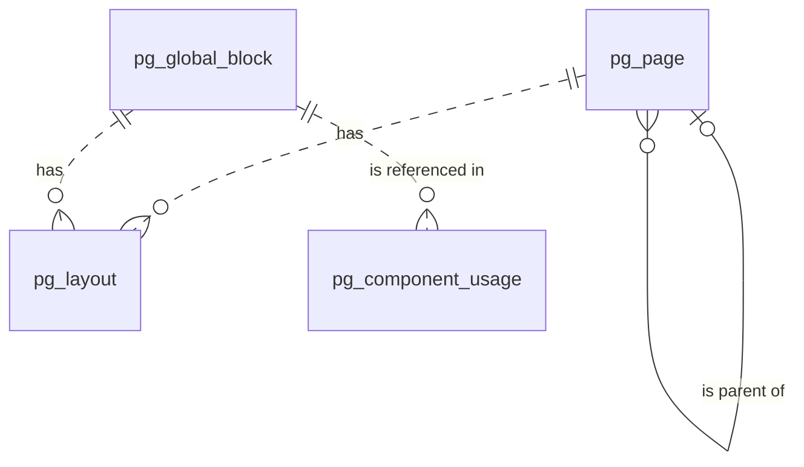

# 页面（page）模块设计

| 项 | 内容 |
|---|---|
| 模块 ID | `page` |
| 名称 | 页面 |
| 层 | L3 |
| 表前缀 | `pg_` |
| API 前缀 | `page` |
| 可停用 | 否 |
| 模块版本 | 1.0.0（module.json 的 version） |
| 平台版本 | `>=1.0.0 <2.0.0`（module.json 的 platform） |
| 里程碑切片 | M1：`product-detail` 模板（模板元数据与 `TemplateProvider`）；M2：页面、模板与插槽、页面编辑器、全局区块；M3：法律页面（`legal` 模板）；M4：—（详见第 13 节） |
| 模块负责人 | 待定 |
| 文档版本 | V1.6 |
| 状态 | 草案 |
| 更新日期 | 2026-10-20 |
| 依据 | 系统设计 V1.8 第 10 章及 3.2、3.8、24–29 章；平台框架设计 V1.6 第 4、7–13 章；ADR-002、ADR-003、ADR-005、ADR-009、ADR-018 |

> 本文只引用《平台框架设计》第 4 章中的契约，不定义新的跨模块契约；需要新契约时按平台框架设计 2.3 提出契约变更请求。

## 1. 职责与边界

### 1.1 职责

维护页面与全局区块、模板元数据及布局 Schema；提供可视化页面编辑器、组件引用索引、插槽布局与法律页人工审校约束。

功能交付范围按第 13 章分为 M1–M4；表结构、约束与枚举以第 3、4 章为准。

### 1.2 不负责的事

| 事项 | 归属模块 | 边界 |
|---|---|---|
| 内容生命周期与路由 | content / url | 本模块只承担自身职责；不直接修改 cnt_、url_ 表 |
| 身份、权限、设置、任务及审计 | platform-core | 复用平台公共服务 |
| 第三方客户端与网络传输 | infrastructure | 仅经既有端口或 L2 服务使用，不在业务模块引入客户端 |

### 1.3 协作概览

| 协作方式 | 对象 | 本模块行为 |
|---|---|---|
| 服务接口 | ContentApi、MediaApi、TaxonomyApi | 方法与事务边界见 2.2；无跨模块表访问 |
| 扩展点 | ContentTypeProvider、PublishContributor、TemplateProvider、DeliveryContributor、BreadcrumbProvider、SchemaOrgProvider、SearchDocumentProvider、MediaReferenceCollector、TranslatableContentProvider | 实现/收集清单见 2.4、2.5 |
| 领域事件 | 见 2.6 | 与本地事务一起登记，提交后异步投递；重复与过期处理独立验证 |

### 1.4 适用的架构约束

遵守 P2、P3 与 ADR-018：编译依赖只到 platform-core/platform-api，跨模块协作只用第 2 章登记契约；只访问自己的表，禁止跨模块 JOIN/外键。遵守 ADR-003：事务内登记、提交后投递、监听器幂等并检查过期。遵守 ADR-009：每次请求/任务明确站点上下文，站点表默认过滤。

公开读取只用当前语言发布态，不跨语言回退（ADR-005）；预览与公开缓存隔离。后台中文文案与错误集中管理，前台文案经 UiTextApi，样式只用 Design Token。远程端口在数据库事务外调用，密钥经 SecretCipher，不写日志。

## 2. 依赖与契约

### 2.1 module.json

```json
{
  "id": "page",
  "name": "页面",
  "version": "1.0.0",
  "layer": "L3",
  "platform": ">=1.0.0 <2.0.0",
  "requires": {
    "content": "^1.0",
    "media": "^1.0",
    "taxonomy": "^1.0"
  },
  "optional": {},
  "disableable": false,
  "tablePrefix": "pg_",
  "apiPrefix": "page",
  "permissions": [
    {
      "code": "page:page:view",
      "name": "查看页面"
    },
    {
      "code": "content:page:edit",
      "name": "编辑页面"
    },
    {
      "code": "page:layout:edit",
      "name": "编辑布局"
    },
    {
      "code": "page:global-block:view",
      "name": "查看全局区块"
    },
    {
      "code": "content:global-block:edit",
      "name": "编辑全局区块"
    },
    {
      "code": "content:page:review",
      "name": "审核页面"
    },
    {
      "code": "content:page:publish",
      "name": "发布页面"
    },
    {
      "code": "content:page:delete",
      "name": "删除页面"
    },
    {
      "code": "content:global-block:review",
      "name": "审核全局区块"
    },
    {
      "code": "content:global-block:publish",
      "name": "发布全局区块"
    },
    {
      "code": "content:global-block:delete",
      "name": "删除全局区块"
    }
  ],
  "menus": [
    {
      "key": "page",
      "name": "页面",
      "parent": "editorial",
      "route": "/page/pages",
      "permission": "page:page:view",
      "order": 100
    }
  ],
  "settings": null,
  "components": [
    "hero",
    "rich-text",
    "global-block",
    "columns",
    "tabs",
    "accordion-group",
    "feature-list",
    "image-text",
    "stats",
    "logo-wall",
    "testimonial",
    "process-steps",
    "timeline",
    "cta",
    "video",
    "gallery",
    "contact-info",
    "contact-buttons",
    "map",
    "breadcrumb",
    "embed",
    "custom-html"
  ],
  "events": {
    "publishes": [],
    "subscribes": [
      "ContentPurgedEvent",
      "LocalizationDeletedEvent",
      "ContentPublishedEvent",
      "ContentUnpublishedEvent"
    ]
  }
}
```

描述符为 M0 工程建立后的实现要求；目前尚无实际控制器、Schema 或组件包。依赖只声明运行能力；Maven 仍只依赖 platform-api/core。组件清单是本模块负责的类型，运行时 UI 不登记成可拖入布局的组件。

### 2.2 使用的服务接口

| 接口（平台框架设计小节） | 方法 | 用途 | 调用位置与时机 | 测试替身 |
|---|---|---|---|---|
| `ContentApi`（4.4.16） | lockDraftForWrite、setTranslationReviewRequirement、create、updateDraftMeta、findPublishedSnapshot、findPublishedCards | 读当前发布快照与卡片；内容类型所属模块创建身份并标记草稿变化 | 读接口在查询阶段调用；写方法加入业务事务，远程文本翻译必须在事务外 | `InMemoryContentApi` |
| `MediaApi`（4.4.18） | findAll、views、imageSources | 媒体视图、图片源与授权下载；不读取媒体表 | 读接口在查询阶段调用；写方法加入业务事务，远程文本翻译必须在事务外 | `InMemoryMediaApi` |
| `TaxonomyApi`（4.4.19） | findTerms、termViews、assignmentsOf | 词汇表、分类视图与内容指派；不读取分类表 | 读接口在查询阶段调用；写方法加入业务事务，远程文本翻译必须在事务外 | `InMemoryTaxonomyApi` |
| `SiteApi`（4.4.1） | 按该契约声明的方法 | 语言、站点模块开关 | 业务事务内；站点切换由任务入口完成 | `InMemorySiteApi` |
| `SiteContextProvider`（4.4.2） | 按该契约声明的方法 | 当前站点；异步与任务由 core 恢复 | 业务事务内；站点切换由任务入口完成 | `FakeSiteContextProvider` |
| `PermissionChecker`（4.4.7） | 按该契约声明的方法 | 后台权限与数据范围 | 业务事务内；站点切换由任务入口完成 | `FakePermissionChecker` |
| `AuditApi`（4.4.9） | 按该契约声明的方法 | 同事务写审计，密钥与个人数据脱敏 | 业务事务内；站点切换由任务入口完成 | `InMemoryAuditApi` |
| `EventMetaFactory`（4.4.14） | 按该契约声明的方法 | 事件 ID、版本、站点与操作人 | 业务事务内；站点切换由任务入口完成 | `FakeEventMetaFactory` |
| `JobApi`（4.4.12） | 按该契约声明的方法 | 耗时任务提交、取消、进度与结果 | 业务事务内；站点切换由任务入口完成 | `InMemoryJobApi` |
| `TransactionMutexApi`（4.10，Proposed） | lock、advance | 原保存事务内协调，失败回滚，站点隔离 | MANDATORY；不得afterCommit补写 | 框架4.10对应协议替身 |

所有 L2/L3/L4 读写隐式使用当前站点；按 ID 查询单批最多 500。可选服务用 ObjectProvider 注入并检查当前站点启用状态，缺失时降级，不通过业务表绕过服务。


### 2.3 提供的服务接口

不适用：本模块不提供跨模块服务接口；其他模块通过 2.4 的既有扩展点或领域事件协作。

### 2.4 实现的扩展点

| 扩展点（平台框架设计小节） | 计划实现类 | 适用范围 | order | 收集方 |
|---|---|---|---|---|
| `ContentTypeProvider`（4.5.2） | `PageContentTypeProvider` | PAGE / GLOBAL_BLOCK；后者不可路由 | OWNER=500 | content / url（经 content） |
| `PublishContributor`（4.5.3） | `PagePublishContributor` | PAGE/GLOBAL_BLOCK 的 card；各有布局类型的 parts.layout | OWNER=500 | content |
| `TemplateProvider`（4.5.5） | `PageTemplateProvider` | product-detail / default / landing / legal，其他元数据随主题声明 | DEFAULT=1000 | delivery / Admin |
| `DeliveryContributor`（4.5.7） | `PageDeliveryContributor` | sectionKey=globalBlocks；只读当前语言已发布区块 | DEFAULT=1000 | delivery |
| `BreadcrumbProvider`（4.5.9） | `PageBreadcrumbProvider` | 按本模块职责及 3、4 章登记的内容/资源类型 | DEFAULT=1000 | delivery / seo |
| `SchemaOrgProvider`（4.5.10） | `PageSchemaOrgProvider` | 按本模块职责及 3、4 章登记的内容/资源类型 | OWNER=500 | seo |
| `SearchDocumentProvider`（4.5.14） | `PageSearchDocumentProvider` | 按本模块职责及 3、4 章登记的内容/资源类型 | DEFAULT=1000 | search |
| `MediaReferenceCollector`（4.5.16） | `PageMediaReferenceCollector` | 按本模块职责及 3、4 章登记的内容/资源类型 | DEFAULT=1000 | media |
| `TranslatableContentProvider`（4.5.20） | `PageTranslatableContentProvider` | 布局内 x-translatable 字段及富文本文本单元；不翻译布局结构或引用 | DEFAULT=1000 | translation |
| `PlatformModule`（4.5.22） | `PageModule` | 本模块安装/升级；可停用模块提供影响报告与停用后保留数据规则 | DEFAULT=1000 | core |

以上类名为待实现名称。PublishContributor 不调用调用方的写方法，不访问外部服务；翻译提供方只写本模块草稿/资源，先校验源指纹与共同 version。本模块不可站点级停用；对可选依赖缺失/停用仍须按框架约定降级。

### 2.5 收集的扩展点

不适用：不收集业务扩展点；PlatformModule 与任务 SPI 由 core 收集。

### 2.6 发布与订阅的事件

发布：

不适用：没有本模块领域事件。

订阅：

| 事件 | 处理 | 幂等 | 过期与删除 | 失败与重试 |
|---|---|---|---|---|
| `ContentPurgedEvent` | 按事件 contentId/localizationIds 清理本模块外部引用或子行；历史业务快照按 4.6 保留；不回查已不存在的父内容 | 本模块事务内的幂等标记与数据变更一起提交；缓存重复失效安全 | 清理使用事件中的 ID；查不到父对象仍须清理 | 失败抛出保留未完成投递；业务副作用转入已有任务/队列后重试 |
| `LocalizationDeletedEvent` | 仅清理对应语言的本模块本地化/投影，不删除其他语言或共享业务字段 | 本模块事务内的幂等标记与数据变更一起提交；缓存重复失效安全 | 清理使用事件中的 ID；查不到父对象仍须清理 | 失败抛出保留未完成投递；业务副作用转入已有任务/队列后重试 |
| `ContentPublishedEvent` | 按第 4.6 节处理事件所标识的对象；副作用只发生在本模块数据范围 | 本模块事务内的幂等标记与数据变更一起提交；缓存重复失效安全 | 读取当前状态/指纹；只有匹配的当前结果才更新；不以 occurredAt 单独当全序 | 失败抛出保留未完成投递；业务副作用转入已有任务/队列后重试 |
| `ContentUnpublishedEvent` | 移除该语言的公开投影/候选/缓存依赖，人工关系及历史快照按 4.6 保留 | 本模块事务内的幂等标记与数据变更一起提交；缓存重复失效安全 | 读取当前状态/指纹；只有匹配的当前结果才更新；不以 occurredAt 单独当全序 | 失败抛出保留未完成投递；业务副作用转入已有任务/队列后重试 |

监听器按框架 5.8 建立站点/system 上下文；`ContentPurgedEvent` 在模块停用时仍必须清理（deliverWhenModuleDisabled）。其他停用期间跳过并完成的事件，重新启用后通过扫描当前状态补偿，不能假定还会重投。数据库幂等标记与本模块数据在同一事务提交；外部发送、下载、搜索与 CDN 调用不得被数据库长事务包裹，使用已声明的任务/端口和业务幂等键。事件 payload 仅引用框架现有字段，本文不扩展签名。

### 2.7 使用的端口

不适用：不直接使用基础设施端口；媒体、通知等外部操作经相应 L2 服务编排。

## 3. 领域模型

### 3.1 聚合、实体与值对象

| 类型 | 名称 | 说明 |
|---|---|---|
| 聚合根 | Page（`pg_page`） | PAGE 内容的语言无关字段：父页面、物化路径、深度、同级排序、模板 key、页面角色（首页、Imprint）。与 `cnt_content`（type = PAGE）1:1，主键即 `content_id` |
| 聚合根 | GlobalBlock（`pg_global_block`） | GLOBAL_BLOCK 内容的区块 key 与后台名称；与 `cnt_content`（type = GLOBAL_BLOCK）1:1 |
| 聚合根 | Layout（`pg_layout`） | 一个内容在一种语言下的草稿布局文档（JSON）：PAGE、GLOBAL_BLOCK 为完整文档（`sections`），模板渲染的类型（PRODUCT、ARTICLE、CASE_STUDY、TERM_PAGE）为插槽文档（`slots`）；与 `cnt_localization` 按（内容，语言）1:1 |
| 实体（投影） | ComponentUsage（`pg_component_usage`） | 已发布本地化使用的组件类型、组件版本与引用 key（表单 key、全局区块 key），发布后按快照重建 |
| 值对象 | LayoutDocument | `schemaVersion`、`template`、`sections[]` 或 `slots{}`；Section：`id`、`component`、`componentVersion`、`variant`、`hidden`、`visibility`、`style`、`props`、`children`（系统设计 10.3） |
| 值对象 | ObjectRef | `$content`、`$media`、`$term`、`$source`：布局中的引用一律对象化，不保存 URL |
| 值对象 | TemplateDefinition、ComponentDefinition | 模板元数据（区域、插槽、允许的组件、默认值）与组件 Schema（含 `x-translatable`、`x-editor`），代码中定义，不落表 |

在系统设计之外补充的字段：

| 补充 | 理由 |
|---|---|
| `pg_page`、`pg_global_block` 以 `content_id` 为主键 | 与产品、文章一致：身份即内容身份（系统设计 6.1） |
| `pg_page.tree_path`、`depth`、`sort_order` | 面包屑“首页 › 父页面链 › 页面”（系统设计 16.2）、后台页面树、移动父页面时的子树检查；最大 5 级，限制 URL 层级 |
| `pg_page.page_role` | 首页由 page 模块标记（第 6 章：首页的路径就是语言前缀）；Imprint 的正文由站点资料自动生成（系统设计 10.1、16.3），需要识别哪个页面是 Imprint |
| `pg_global_block` 整表 | 系统设计 10.6 规定全局区块按 key 引用，25.8 表清单未单列；key 需要站点内唯一并能按 key 查找 |
| `pg_layout.content_type`、`template_key`（生成列） | 按内容类型与模板查找布局（模板升级影响分析、法律模板检查、统计），不必解析 JSON |
| `pg_component_usage.ref_key`、`revision_no`、`usage_count` | 表单删除前列出引用位置（第 9 章）、全局区块“被哪些页面使用”；事件乱序时只接受更新的修订；统计同一页面中的使用次数 |

### 3.2 不变量

| # | 规则 | 保证方式 |
|---|---|---|
| 1 | `pg_page`、`pg_global_block` 分别与 `cnt_content`（type = PAGE / GLOBAL_BLOCK）1:1；`content_id` 由 `ContentApi.create(type, zh-CN)` 在同一事务中返回 | 应用层 |
| 2 | 每个内容每种语言最多一个布局文档；布局行与 `cnt_localization` 同生共灭 | 数据库：`uk_layout_content_locale`；应用层 |
| 3 | 根页面 `parent_content_id` 为空且 `depth = 1`；子页面 `depth` = 父页面 `depth` + 1，最大 5；不能以自身为父页面 | 数据库：`ck_pg_page_depth`、`ck_pg_page_parent`；应用层 |
| 4 | `tree_path` = 父页面 `tree_path` + 自身 ID + `/`（根为 `/` + ID + `/`）；移动页面时在同一事务中更新整棵子树的 `tree_path` 与 `depth`；不能移动到自身子树下 | 应用层 |
| 5 | 首页不能作为父页面；有子页面（含回收站中的子页面）的页面不能移入回收站或彻底删除，须先移动或删除子页面 | 数据库：`fk_pg_page_parent`（RESTRICT，针对物理删除）；应用层 |
| 6 | 每个站点最多一个首页、一个 Imprint；首页没有父页面；Imprint 使用 `legal` 模板 | 数据库：`uk_page_role`、`ck_pg_page_role` |
| 7 | 模板必须在该内容类型定义的 `templates` 中；同一内容各语言布局的 `template_key` 相同，PAGE 还等于 `pg_page.template_key`；模板只能在源语言中切换，同一事务中同步到全部语言（`MANUAL` 语言保留同名插槽中的组件） | 应用层 |
| 8 | `template_key = 'legal'` 的页面，其 `cnt_content.translation_review_required = 1`（切换模板时经 `ContentApi` 设置，切出时置 0） | 应用层 |
| 9 | 站点内 `block_key` 唯一（回收站中的区块仍占用）；创建后不可修改 | 数据库：`uk_block_key`；应用层 |
| 10 | 全局区块的布局不能包含 `global-block` 组件；只有布局类组件可以嵌套，最大深度 2；插槽中只能放模板允许的组件，数量不超过 `max` | 应用层（保存时按最新组件 JSON Schema 与模板定义校验） |
| 11 | 布局中的引用只能是 `$content` / `$media` / `$term` / `$source` 对象，不保存 URL；`style` 只取 Token 枚举 | 应用层 |
| 12 | Section `id` 在同一内容的全部语言中稳定；`AUTO` 语言的结构与源语言一致，只有 `x-translatable` 属性不同 | 应用层（译文回写时按源语言结构生成） |
| 13 | `pg_component_usage` 只包含 `publish_state = PUBLISHED` 的本地化，与其当前发布修订快照的 `layout` 部分一致 | 应用层（事件驱动重建） |
| 14 | 各表 `site_id` 与所属内容一致 | 应用层 |

### 3.3 状态机

内容发布状态与草稿状态均由 ContentApi 管理，完整转换见 content 模块 3.3 和系统设计 6.3；本模块不复制状态列或自行转换。保存业务草稿只改变内容共同 version 与草稿状态，发布经 PublishContributor 参与同一事务；回收站、恢复、下线与翻译模式按内容内核执行。配置及站点资源保存即生效，不伪装成内容发布。

## 4. 数据模型

> 遵守平台框架设计第 7 章的数据库通用约定。本节给出待实现 DDL；本次文档审查未重跑 MySQL，不能据此认定 DDL 已验证。M0 后按第 11 章在 MySQL 8.4 空库验证，并使实际迁移脚本与本节一致。

### 4.1 表清单

| 表 | 说明 | 站点级 | 软删除 | 预估规模（单站，按系统设计假设 A4） |
|---|---|---|---|---|
| `pg_page` | 页面（PAGE 的语言无关字段） | 是 | 否（随内容回收站） | 50–500 行 |
| `pg_global_block` | 全局区块（GLOBAL_BLOCK 的 key） | 是 | 否（随内容回收站） | 10–50 行 |
| `pg_layout` | 草稿布局文档（各内容类型 × 各语言） | 是 | 否 | ≤ 20 万行（≈ 2 万内容 × 10 种语言，插槽布局按需创建）；PAGE 文档 10–100 KB，插槽文档通常 < 5 KB |
| `pg_component_usage` | 组件使用索引（发布态投影） | 是 | 否 | ≈ 50–100 万行（已发布本地化 × 平均 3–5 种组件） |

### 4.2 ER 图



虚线表示按 `content_id` 或 key 的逻辑关系（不建外键：`pg_layout` 同时保存其他模块内容类型的插槽布局；`pg_component_usage.ref_key` 也可能是表单 key）。

### 4.3 表结构

类型列中的 `bin` 表示该列排序规则为 `utf8mb4_0900_bin`（第 18、19 章同）。

#### 4.3.1 `pg_page`：页面

| 字段 | 类型 | 可空 | 默认 | 说明 |
|---|---|---|---|---|
| `content_id` | BIGINT | 否 | — | 内容 ID（cnt_content.id，类型 PAGE），即页面主键 |
| `site_id` | BIGINT | 否 | — | 站点 ID（sys_site.id） |
| `parent_content_id` | BIGINT | 是 | — | 父页面的内容 ID（pg_page.content_id）；根页面为空 |
| `tree_path` | VARCHAR(128) bin | 否 | — | 物化路径：祖先与自身的内容 ID，如 /11/25/ |
| `depth` | TINYINT | 否 | `1` | 层级深度：根为 1，最大 5 |
| `sort_order` | INT | 否 | `0` | 同级排序（后台页面树） |
| `template_key` | VARCHAR(64) bin | 否 | `'default'` | 模板 key（TemplateProvider 注册），如 default、landing、legal；各语言布局文档的 template 与之一致 |
| `page_role` | VARCHAR(16) | 是 | — | 页面角色：HOME（首页）/ IMPRINT（Imprint，正文由站点资料生成）；普通页面为空 |
| `version` | INT | 否 | `0` | 乐观锁版本号 |
| `created_at` | DATETIME(3) | 否 | `CURRENT_TIMESTAMP(3)` | 创建时间（UTC） |
| `created_by` | BIGINT | 否 | `0` | 创建人用户 ID（0 = 系统） |
| `updated_at` | DATETIME(3) | 否 | `CURRENT_TIMESTAMP(3) ON UPDATE CURRENT_TIMESTAMP(3)` | 更新时间（UTC） |
| `updated_by` | BIGINT | 否 | `0` | 更新人用户 ID（0 = 系统） |

索引与约束：
- `PRIMARY KEY (content_id)`
- `uk_page_role (site_id, page_role)`：每站最多一个首页、一个 Imprint（NULL 不参与）；按角色查找首页与 Imprint
- `idx_page_parent (parent_content_id, sort_order)`：子页面列表（后台页面树展开、删除前检查子页面）；兼作 `fk_pg_page_parent` 的索引
- `idx_page_path (site_id, tree_path)`：子树查询（`tree_path LIKE '/11/%'`：移动页面时更新子树、面包屑取祖先链）
- `idx_page_template (site_id, template_key)`：按模板列出页面（落地页列表、法律页面检查、模板升级影响分析）
- `fk_pg_page_parent`：引用关系（RESTRICT）
- `ck_pg_page_depth`、`ck_pg_page_parent`、`ck_pg_page_role`：见 3.2 不变量 3、6

```sql
CREATE TABLE pg_page (
  content_id         BIGINT        NOT NULL COMMENT '内容 ID（cnt_content.id，类型 PAGE），即页面主键',
  site_id            BIGINT        NOT NULL COMMENT '站点 ID（sys_site.id）',
  parent_content_id  BIGINT        NULL COMMENT '父页面的内容 ID（pg_page.content_id）；根页面为空',
  tree_path          VARCHAR(128)  COLLATE utf8mb4_0900_bin NOT NULL COMMENT '物化路径：祖先与自身的内容 ID，如 /11/25/',
  depth              TINYINT       NOT NULL DEFAULT 1 COMMENT '层级深度：根为 1，最大 5',
  sort_order         INT           NOT NULL DEFAULT 0 COMMENT '同级排序（后台页面树）',
  template_key       VARCHAR(64)   COLLATE utf8mb4_0900_bin NOT NULL DEFAULT 'default' COMMENT '模板 key（TemplateProvider 注册），如 default、landing、legal；各语言布局文档的 template 与之一致',
  page_role          VARCHAR(16)   NULL COMMENT '页面角色：HOME（首页）/ IMPRINT（Imprint，正文由站点资料生成）；普通页面为空',
  version            INT           NOT NULL DEFAULT 0 COMMENT '乐观锁版本号',
  created_at         DATETIME(3)   NOT NULL DEFAULT CURRENT_TIMESTAMP(3) COMMENT '创建时间（UTC）',
  created_by         BIGINT        NOT NULL DEFAULT 0 COMMENT '创建人用户 ID（0 = 系统）',
  updated_at         DATETIME(3)   NOT NULL DEFAULT CURRENT_TIMESTAMP(3) ON UPDATE CURRENT_TIMESTAMP(3) COMMENT '更新时间（UTC）',
  updated_by         BIGINT        NOT NULL DEFAULT 0 COMMENT '更新人用户 ID（0 = 系统）',
  PRIMARY KEY (content_id),
  UNIQUE KEY uk_page_role (site_id, page_role),
  KEY idx_page_parent (parent_content_id, sort_order),
  KEY idx_page_path (site_id, tree_path),
  KEY idx_page_template (site_id, template_key),
  CONSTRAINT fk_pg_page_parent FOREIGN KEY (parent_content_id) REFERENCES pg_page (content_id),
  CONSTRAINT ck_pg_page_depth CHECK ((parent_content_id IS NULL AND depth = 1) OR (parent_content_id IS NOT NULL AND depth BETWEEN 2 AND 5)),
  CONSTRAINT ck_pg_page_parent CHECK (parent_content_id IS NULL OR parent_content_id <> content_id),
  CONSTRAINT ck_pg_page_role CHECK (page_role IS NULL OR (page_role = 'HOME' AND parent_content_id IS NULL) OR (page_role = 'IMPRINT' AND template_key = 'legal'))
) ENGINE = InnoDB DEFAULT CHARSET = utf8mb4 COLLATE = utf8mb4_0900_ai_ci COMMENT = '页面（与 cnt_content 1:1 的语言无关字段：父页面、模板、页面角色）';
```

要点：
- 父页面、模板与页面角色是语言无关的草稿结构，保存即写入本表，各语言在下次发布时生效：page 的 `PublishContributor` 把 `parentContentId` 与 `role` 写入快照 `parts.page`，url 据此展开 `{parentPath}`（父页面在同一语言没有 `ACTIVE` 路由时发布校验报错，见第 6 章）；父页面路径变化后，url 按前缀重算子树路由并生成 301（系统设计 13.4）。
- 首页（`HOME`）的路径就是语言前缀本身（如 `/zh`）；根路径 `/` 302 到默认对外语言的首页（系统设计 5.4）。
- 下线策略 `REDIRECT_PARENT`：page 解析为父页面，根页面解析为首页（第 5 章）。
- 面包屑：page 的 `BreadcrumbProvider` 按 `tree_path` 取祖先链，标题取各祖先在同一语言的发布投影 `pub_title`。
- 法律页面：模板切换为 `legal` 时经 `ContentApi` 设置 `translation_review_required = 1`，其机器译文不自动发布（系统设计 5.5、10.1）。Imprint 页面的正文在渲染时由 `sys_site_profile` 的法定信息生成，布局中只放其他说明。

#### 4.3.2 `pg_global_block`：全局区块

| 字段 | 类型 | 可空 | 默认 | 说明 |
|---|---|---|---|---|
| `content_id` | BIGINT | 否 | — | 内容 ID（cnt_content.id，类型 GLOBAL_BLOCK），即区块主键 |
| `site_id` | BIGINT | 否 | — | 站点 ID（sys_site.id） |
| `block_key` | VARCHAR(64) bin | 否 | — | 区块 key（小写字母、数字、连字符；创建后不可修改；global-block 组件与模板插槽默认值按 key 引用），如 product-cta |
| `name` | VARCHAR(100) | 否 | — | 名称（中文，只在后台显示） |
| `description` | VARCHAR(500) | 是 | — | 说明（后台提示用途与放置位置） |
| `version` | INT | 否 | `0` | 乐观锁版本号 |
| `created_at` | DATETIME(3) | 否 | `CURRENT_TIMESTAMP(3)` | 创建时间（UTC） |
| `created_by` | BIGINT | 否 | `0` | 创建人用户 ID（0 = 系统） |
| `updated_at` | DATETIME(3) | 否 | `CURRENT_TIMESTAMP(3) ON UPDATE CURRENT_TIMESTAMP(3)` | 更新时间（UTC） |
| `updated_by` | BIGINT | 否 | `0` | 更新人用户 ID（0 = 系统） |

索引与约束：
- `PRIMARY KEY (content_id)`
- `uk_block_key (site_id, block_key)`：站点内 key 唯一；发布时把布局中的 key 解析为内容 ID；后台区块列表

```sql
CREATE TABLE pg_global_block (
  content_id   BIGINT        NOT NULL COMMENT '内容 ID（cnt_content.id，类型 GLOBAL_BLOCK），即区块主键',
  site_id      BIGINT        NOT NULL COMMENT '站点 ID（sys_site.id）',
  block_key    VARCHAR(64)   COLLATE utf8mb4_0900_bin NOT NULL COMMENT '区块 key（小写字母、数字、连字符；创建后不可修改；global-block 组件与模板插槽默认值按 key 引用），如 product-cta',
  name         VARCHAR(100)  NOT NULL COMMENT '名称（中文，只在后台显示）',
  description  VARCHAR(500)  NULL COMMENT '说明（后台提示用途与放置位置）',
  version      INT           NOT NULL DEFAULT 0 COMMENT '乐观锁版本号',
  created_at   DATETIME(3)   NOT NULL DEFAULT CURRENT_TIMESTAMP(3) COMMENT '创建时间（UTC）',
  created_by   BIGINT        NOT NULL DEFAULT 0 COMMENT '创建人用户 ID（0 = 系统）',
  updated_at   DATETIME(3)   NOT NULL DEFAULT CURRENT_TIMESTAMP(3) ON UPDATE CURRENT_TIMESTAMP(3) COMMENT '更新时间（UTC）',
  updated_by   BIGINT        NOT NULL DEFAULT 0 COMMENT '更新人用户 ID（0 = 系统）',
  PRIMARY KEY (content_id),
  UNIQUE KEY uk_block_key (site_id, block_key)
) ENGINE = InnoDB DEFAULT CHARSET = utf8mb4 COLLATE = utf8mb4_0900_ai_ci COMMENT = '全局区块（与 cnt_content 1:1：区块 key 与后台名称）';
```

要点：
- 区块的内容（`sections`）保存在 `pg_layout`（`content_type = 'GLOBAL_BLOCK'`，`template_key` 为空），复用内容内核的修订、审核、发布与翻译（系统设计 10.6）。
- 引用方布局只保存 key；page 的 `PublishContributor` 发布时把 key 解析为 `{"$content": blockContentId}` 写入快照，Delivery 按普通内容引用读取区块的发布快照，并推导缓存标签 `c:{blockContentId}`；区块发布后按该标签失效所有使用它的页面。区块未发布、已下线或在回收站中时，该组件渲染为空，引用方发布校验给出警告。

#### 4.3.3 `pg_layout`：草稿布局文档

| 字段 | 类型 | 可空 | 默认 | 说明 |
|---|---|---|---|---|
| `id` | BIGINT | 否 | — | 主键（TSID） |
| `site_id` | BIGINT | 否 | — | 站点 ID（sys_site.id） |
| `content_id` | BIGINT | 否 | — | 内容 ID（cnt_content.id） |
| `locale` | VARCHAR(16) | 否 | — | 语言（BCP 47），与 cnt_localization.locale 一一对应 |
| `content_type` | VARCHAR(32) | 否 | — | 内容类型（冗余 cnt_content.type）：PAGE / PRODUCT / ARTICLE / CASE_STUDY / TERM_PAGE / GLOBAL_BLOCK |
| `document` | JSON | 否 | — | 草稿布局文档（顶层 schemaVersion）：PAGE、GLOBAL_BLOCK 为 {template, sections[]}；模板渲染的类型为 {template, slots{插槽 key: sections[]}} |
| `template_key` | VARCHAR(64) bin | 是 | 生成列 `document.template` | 模板 key（生成列，取自 document.template）；GLOBAL_BLOCK 为空 |
| `version` | INT | 否 | `0` | 乐观锁版本号（编辑器每 30 秒自动保存） |
| `created_at` | DATETIME(3) | 否 | `CURRENT_TIMESTAMP(3)` | 创建时间（UTC） |
| `created_by` | BIGINT | 否 | `0` | 创建人用户 ID（0 = 系统，如译文回写） |
| `updated_at` | DATETIME(3) | 否 | `CURRENT_TIMESTAMP(3) ON UPDATE CURRENT_TIMESTAMP(3)` | 更新时间（UTC） |
| `updated_by` | BIGINT | 否 | `0` | 更新人用户 ID（0 = 系统，如译文回写） |

索引与约束：
- `PRIMARY KEY (id)`
- `uk_layout_content_locale (content_id, locale)`：每种语言一条；编辑器、发布组装快照、预览、译文提取与回写按（内容，语言）读写
- `idx_layout_template (site_id, template_key, content_type)`：按模板查找布局（模板升级或下线前的影响分析、法律模板检查）

```sql
CREATE TABLE pg_layout (
  id            BIGINT        NOT NULL COMMENT '主键（TSID）',
  site_id       BIGINT        NOT NULL COMMENT '站点 ID（sys_site.id）',
  content_id    BIGINT        NOT NULL COMMENT '内容 ID（cnt_content.id）',
  locale        VARCHAR(16)   NOT NULL COMMENT '语言（BCP 47），与 cnt_localization.locale 一一对应',
  content_type  VARCHAR(32)   NOT NULL COMMENT '内容类型（冗余 cnt_content.type）：PAGE / PRODUCT / ARTICLE / CASE_STUDY / TERM_PAGE / GLOBAL_BLOCK',
  document      JSON          NOT NULL COMMENT '草稿布局文档（顶层 schemaVersion）：PAGE、GLOBAL_BLOCK 为 {template, sections[]}；模板渲染的类型为 {template, slots{插槽 key: sections[]}}',
  template_key  VARCHAR(64)   COLLATE utf8mb4_0900_bin AS (NULLIF(JSON_UNQUOTE(JSON_EXTRACT(document, '$.template')), 'null')) STORED COMMENT '模板 key（生成列，取自 document.template）；GLOBAL_BLOCK 为空',
  version       INT           NOT NULL DEFAULT 0 COMMENT '乐观锁版本号（编辑器每 30 秒自动保存）',
  created_at    DATETIME(3)   NOT NULL DEFAULT CURRENT_TIMESTAMP(3) COMMENT '创建时间（UTC）',
  created_by    BIGINT        NOT NULL DEFAULT 0 COMMENT '创建人用户 ID（0 = 系统，如译文回写）',
  updated_at    DATETIME(3)   NOT NULL DEFAULT CURRENT_TIMESTAMP(3) ON UPDATE CURRENT_TIMESTAMP(3) COMMENT '更新时间（UTC）',
  updated_by    BIGINT        NOT NULL DEFAULT 0 COMMENT '更新人用户 ID（0 = 系统，如译文回写）',
  PRIMARY KEY (id),
  UNIQUE KEY uk_layout_content_locale (content_id, locale),
  KEY idx_layout_template (site_id, template_key, content_type)
) ENGINE = InnoDB DEFAULT CHARSET = utf8mb4 COLLATE = utf8mb4_0900_ai_ci COMMENT = '草稿布局文档（各内容类型 × 各语言；PAGE 为完整布局，模板渲染类型为插槽布局）';
```

要点：
- 内容类本地化数据，不带翻译状态；翻译模式与状态在 `cnt_localization`（平台框架设计 7.7）。
- 创建：PAGE、GLOBAL_BLOCK 创建内容时同时写入源语言行；其他类型在首次编辑插槽时创建，行不存在时按模板插槽的 `default` 生成（发布、预览同此）。
- 保存：后端按组件最新 JSON Schema 与模板定义校验；Admin 打开草稿时先执行组件迁移，因此保存的总是最新组件版本（系统设计 10.9）；文档大小上限与快照一致（≤ 1 MB）。
- 翻译：page 的 `TranslatableContentProvider` 支持所有有布局的类型，从源语言行按 `x-translatable` 提取翻译单元（单元 ID 由系统生成，形如 `layout.{sectionId}.{属性路径}`，属性的 `maxLength` 作为长度上限）；`apply()` 为 `AUTO` 语言写入“源语言结构 + 译文”并覆盖目标行；`MANUAL` 语言在页面编辑器中独立编辑，可以从其他语言复制结构（系统设计 10.3、10.8）。
- 发布：page 的 `PublishContributor` 校验 Schema、插槽允许的组件与数量、嵌套深度、引用对象是否存在与已发布，把文档写入快照 `parts.layout`（全局区块 key 解析为 `$content`）；`restore()` 回滚时把快照写回本行；经 `MediaReferenceCollector` 上报 `$media` 引用。

#### 4.3.4 `pg_component_usage`：组件使用索引

| 字段 | 类型 | 可空 | 默认 | 说明 |
|---|---|---|---|---|
| `localization_id` | BIGINT | 否 | — | 本地化 ID（cnt_localization.id，已发布） |
| `component_type` | VARCHAR(64) bin | 否 | — | 组件类型（组件定义的 type），如 hero、inquiry-form、global-block |
| `component_version` | SMALLINT | 否 | — | 组件版本（布局中的 componentVersion） |
| `ref_key` | VARCHAR(64) bin | 否 | `''` | 组件引用的 key：inquiry-form 的 formKey、global-block 的区块 key；其他组件为空字符串 |
| `site_id` | BIGINT | 否 | — | 站点 ID（sys_site.id） |
| `content_id` | BIGINT | 否 | — | 内容 ID（cnt_content.id） |
| `content_type` | VARCHAR(32) | 否 | — | 内容类型：PAGE / PRODUCT / ARTICLE / CASE_STUDY / TERM_PAGE / GLOBAL_BLOCK |
| `locale` | VARCHAR(16) | 否 | — | 语言（BCP 47） |
| `revision_no` | INT | 否 | — | 建立索引所依据的修订号（cnt_revision.revision_no）；事件乱序时只接受更大的修订号 |
| `usage_count` | SMALLINT | 否 | `1` | 该组件（同版本、同 key）在本次发布中出现的次数（含插槽与嵌套 children） |
| `created_at` | DATETIME(3) | 否 | `CURRENT_TIMESTAMP(3)` | 建立时间（UTC；每次发布整体重建） |

索引与约束：
- `PRIMARY KEY (localization_id, component_type, component_version, ref_key)`：按本地化整体删除与重建
- `idx_cu_component (component_type, component_version)`：组件弃用检查——是否还有已发布内容使用某组件或旧版本（跨站点，系统管理接口）
- `idx_cu_ref (site_id, component_type, ref_key)`：表单删除前列出引用位置、全局区块“被哪些页面使用”
- `idx_cu_content (content_id)`：内容彻底删除时清理

```sql
CREATE TABLE pg_component_usage (
  localization_id    BIGINT        NOT NULL COMMENT '本地化 ID（cnt_localization.id，已发布）',
  component_type     VARCHAR(64)   COLLATE utf8mb4_0900_bin NOT NULL COMMENT '组件类型（组件定义的 type），如 hero、inquiry-form、global-block',
  component_version  SMALLINT      NOT NULL COMMENT '组件版本（布局中的 componentVersion）',
  ref_key            VARCHAR(64)   COLLATE utf8mb4_0900_bin NOT NULL DEFAULT '' COMMENT '组件引用的 key：inquiry-form 的 formKey、global-block 的区块 key；其他组件为空字符串',
  site_id            BIGINT        NOT NULL COMMENT '站点 ID（sys_site.id）',
  content_id         BIGINT        NOT NULL COMMENT '内容 ID（cnt_content.id）',
  content_type       VARCHAR(32)   NOT NULL COMMENT '内容类型：PAGE / PRODUCT / ARTICLE / CASE_STUDY / TERM_PAGE / GLOBAL_BLOCK',
  locale             VARCHAR(16)   NOT NULL COMMENT '语言（BCP 47）',
  revision_no        INT           NOT NULL COMMENT '建立索引所依据的修订号（cnt_revision.revision_no）；事件乱序时只接受更大的修订号',
  usage_count        SMALLINT      NOT NULL DEFAULT 1 COMMENT '该组件（同版本、同 key）在本次发布中出现的次数（含插槽与嵌套 children）',
  created_at         DATETIME(3)   NOT NULL DEFAULT CURRENT_TIMESTAMP(3) COMMENT '建立时间（UTC；每次发布整体重建）',
  PRIMARY KEY (localization_id, component_type, component_version, ref_key),
  KEY idx_cu_component (component_type, component_version),
  KEY idx_cu_ref (site_id, component_type, ref_key),
  KEY idx_cu_content (content_id)
) ENGINE = InnoDB DEFAULT CHARSET = utf8mb4 COLLATE = utf8mb4_0900_ai_ci COMMENT = '组件使用索引（发布态投影：已发布本地化使用的组件、版本与引用 key）';
```

要点：
- 维护：page 订阅 `ContentPublishedEvent`，经 `ContentApi` 读取该修订快照的 `layout` 部分，在一个事务中删除该本地化的旧行并插入新行；`revision_no` 小于已记录值的事件忽略。`ContentUnpublishedEvent`、`LocalizationDeletedEvent`、`ContentPurgedEvent`：删除对应行。内容进回收站前已全部下线，无需单独处理。
- 只记录布局文档中的组件（含插槽、嵌套与插槽默认值）；模板固定区域由模板渲染，不记录；草稿中的使用不记录（已弃用的组件在组件面板中隐藏，打开草稿时提示替换）。
- 用途：组件弃用与删除（系统设计 10.9）、表单删除前的引用检查（第 9 章）、全局区块的使用位置、模块停用前的影响分析（组件所属模块）。

### 4.4 枚举

| 字段 | 取值 | 说明 |
|---|---|---|
| `pg_page.page_role` | `HOME` | 首页：路径为语言前缀本身；没有父页面；不能作为父页面 |
| | `IMPRINT` | Imprint：使用 `legal` 模板，正文由站点资料的法定信息生成 |
| `pg_page.template_key`（PAGE，V1） | `default` / `landing` / `legal` | 普通页面 / 落地页 / 法律页面（隐私政策、Cookie 政策、使用条款、Imprint、无障碍声明；机器译文必须人工审校后发布）；以 `TemplateProvider` 注册为准，`default` 为本文暂定名 |
| `pg_layout.content_type`、`pg_component_usage.content_type` | `PAGE` / `PRODUCT` / `ARTICLE` / `CASE_STUDY` / `TERM_PAGE` / `GLOBAL_BLOCK` | 共享内容类型枚举中有布局的类型（FAQ 不可路由，没有布局） |
| `pg_component_usage.component_type` | V1 组件清单（系统设计 10.4） | 如 `hero`、`rich-text`、`product-grid`、`inquiry-form`、`global-block`、`custom-html` |

### 4.5 站点过滤

| 表 | 行级拦截器 | 访问方式与理由 |
|---|---|---|
| `pg_page` | 不豁免 | 请求和任务隐式使用当前站点；子表 site_id 与父表一致 |
| `pg_global_block` | 不豁免 | 请求和任务隐式使用当前站点；子表 site_id 与父表一致 |
| `pg_layout` | 不豁免 | 请求和任务隐式使用当前站点；子表 site_id 与父表一致 |
| `pg_component_usage` | 不豁免 | 请求和任务隐式使用当前站点；子表 site_id 与父表一致 |

### 4.6 跨模块引用与清理

| 本模块字段 | 引用对象（模块.表） | 被引用对象删除 / 下线时的处理 | 触发事件 |
|---|---|---|---|
| `pg_page.content_id`、`pg_global_block.content_id`、`pg_layout.content_id`、`pg_component_usage.content_id` | content.`cnt_content` | page 经 `ContentApi` 创建、移入回收站、恢复；彻底删除：删除本模块对应行（子页面须先移动） | `ContentPurgedEvent` |
| `pg_layout.locale` | content.`cnt_localization` | 本地化删除：删除该语言的布局行与使用索引 | `LocalizationDeletedEvent` |
| `pg_component_usage.localization_id`、`revision_no` | content.`cnt_localization`、`cnt_revision` | 发布时重建；下线时删除 | `ContentPublishedEvent`、`ContentUnpublishedEvent` |
| 布局中的 `$media` | media.`mda_media` | 有引用记录的媒体不能删除；page 经 `MediaReferenceCollector` 上报引用 | content发布事务→ReferenceWriteApi |
| 布局中的 `$content`、`$term`、`$source` | content、taxonomy、各 `DataSourceProvider` | 读取时解析；目标不存在或未发布时降级（不渲染卡片，链接降级为纯文本）；发布校验对未发布的引用给出警告 | — |
| `inquiry-form` 的 `formKey`（`pg_component_usage.ref_key`） | form.`frm_form.form_key` | key 不可修改；表单停用或删除后组件不渲染；form 删除表单前经本表列出引用位置 | — |
| `pg_page.template_key`、`pg_layout.template_key`、`pg_component_usage.component_type` | 代码（`TemplateProvider`、`packages/component-schemas`） | 模板或组件移除前先弃用；模板不存在时发布校验报 ERROR | — |
| `created_by`、`updated_by` | core.`sys_user` | 不清理 | — |

本模块不发布自有事件（页面与区块的变化经内容内核的事件传播）。订阅：`ContentPublishedEvent`、`ContentUnpublishedEvent`、`LocalizationDeletedEvent`、`ContentPurgedEvent`。实现的扩展点：`ContentTypeProvider`（PAGE、GLOBAL_BLOCK）、`PublishContributor`（`layout`、`page`）、`TemplateProvider`、`BreadcrumbProvider`、`SchemaOrgProvider`、`SearchDocumentProvider`、`MediaReferenceCollector`、`TranslatableContentProvider`。

其他模块以内容 ID 引用页面（如 `trk_setting.privacy_policy_content_id`、`cookie_policy_content_id`，`nav_item.link_ref`），按内容内核的事件各自处理。

---

### 4.7 迁移脚本

| 文件 | 内容 | 里程碑 |
|---|---|---|
| `db/migration/page/V001__init.sql` | 4.3 中的全部表（4 张：`pg_page`、`pg_global_block`、`pg_layout`、`pg_component_usage`），按本节顺序创建 | 按第 13.1 节分期启用，初始结构在首个有效切片建立 |

## 5. 业务流程

已有内容的编辑/翻译/导入保存先按框架4.4.16调用ContentApi.lockDraftForWrite校验目标共同版本并取得父先子后锁，再写本模块业务表，最后updateDraftMeta。新建先create取得内容身份；路由输入事务先取得content.route_tree锁。禁止先持有业务行锁再申请内容父锁。

### 5.1 核心业务流程

| 步骤 | 事务及行为 | 失败处理 |
|---|---|---|
| 1 | 创建 PAGE 或 GLOBAL_BLOCK 时经 ContentApi 建立内容身份，写 page 业务行；保存布局必须通过模板插槽、组件 Schema、引用格式、allowedIn 与版本校验，同一事务调用 updateDraftMeta(expectedVersion, sharedDataChanged)，共同版本冲突时布局写入也回滚。 | 输入或状态非法返回 4xx；数据库事务回滚；提交后外部处理失败进入重试与可见失败记录 |
| 2 | 预览走带令牌的 delivery，不持久化编辑器临时布局；iframe 通信校验 origin、source 与消息 Schema。发布时贡献经过校验的布局，提交后重建 pg_component_usage。 | 输入或状态非法返回 4xx；数据库事务回滚；提交后外部处理失败进入重试与可见失败记录 |
| 3 | 全局区块只能读取当前语言已发布版本；递归引用必须检测环及深度；法律页和 legal 模板的机器译文进入人工审核。 | 输入或状态非法返回 4xx；数据库事务回滚；提交后外部处理失败进入重试与可见失败记录 |

后台读写先校验权限与站点/语言范围；草稿写入和审计在同一事务。远程操作不能使用数据库长事务包裹。幂等重放返回既有结果；参数不同却复用同一幂等键时拒绝。

### 5.2 一致性、失败与恢复约束

| 场景 | 必须满足的行为 | 可验证结果 |
|---|---|---|
| 编辑器并发与节点标识 | 布局的共同 version 由 ContentApi.updateDraftMeta 检查，pg_layout 的版本不能替代内容共同版本；节点使用稳定 ID，拖动排序不生成全新 ID。 | 两窗口用同一内容版本保存布局，只有一份成功；冲突后本地未保存布局保留供比较，不静默覆盖。 |
| Schema、插槽和 HTML | 先按声明版本迁移已知旧结构，再校验 allowedIn、组件属性、插槽数量及引用；未知新版本拒绝。custom-html 仅开发者权限，仍走既有净化/CSP 约束。 | 非法变体、未知 schemaVersion、跨 slot 类型和超额插槽均有字段路径错误，线上旧修订不变；普通编辑不能保存 custom-html。 |
| 全局区块与预览隔离 | 只读取同语言已发布区块；检测直接/间接循环及平台规定的深度/节点预算。预览令牌只授予指定用途，不允许画布通过 token 取得后台写权限。 | A→B→A 循环拒绝；1440/768/390px 标准预览及 360px 补测成功但不写公共缓存；伪造 origin/source 消息无效。 |
| 法律页审校 | page 的 TranslatableContentProvider.requiresHumanReview 对 legal 与法律页身份返回 true；translation 完成事件标志与 content 再校验共同约束自动发布。 | 普通页允许按站点配置自动发布，legal 页机器翻译只到草稿/待审，拥有相应审核/发布权限的人工完成后才上线。 |

### 5.3 实现前统一方案与接入要求

依据[平台框架 4.10.1、4.10.5、4.10.7](../framework/platform-framework.md)及[设计问题处理说明](../reviews/design-issue-resolution-2026-10-20.md)。新增契约相关ADR仍为Proposed；下列方案已具体化，待评审冻结后同批实现，不能据此声明运行问题已验证。涉及本节的旧异步引用、原地索引写入或待定措辞按此方案替代。

- 页面布局/全局区块保存由content草稿哈希流程收集媒体并同步登记；资源型图片按源事务登记，不能等异步引用更新后再保护删除。
- 页面树移动先取得content.route_tree数据库事务锁，再写pg_元数据并调用ContentApi.requestRouteRecalculation；任务读取当前ContentTypeProvider.routeHints，不把旧树输入交给url恢复使用；移动旧页面到较新的父页面后，ID大小不再代表父子顺序，恢复必须按拓扑检查点定位。
- 创建/切换legal模板时同一事务按内容ID及内容version更新cnt_content.translation_review_required；新目标语言读取该共享策略，旧审批和旧翻译任务不得发布新草稿。

## 6. 接口

### 6.1 Admin 端点

| 方法 | 路径（相对 /api/admin/v1/page） | 说明 | 权限码 | 并发控制 / 幂等 | 审计 |
|---|---|---|---|---|---|
| GET | `/pages` | 页面树及角色 | `page:page:view` | 只读；不写入业务状态 | 否 |
| POST | `/pages` | 创建页面 | `content:page:edit` | 唯一键检查；重复创建返回 409（不覆盖已有资源） | page.pages.post |
| PUT | `/pages/{id}` | 保存页面与父级 | `content:page:edit` | 聚合 version / If-Match；冲突 409 / 412，整笔回滚 | page.pages.{id}.put |
| GET | `/templates` | 已注册模板和插槽定义 | `page:page:view` | 只读；不写入业务状态 | 否 |
| GET | `/layouts/{localizationId}` | 草稿布局 | `page:layout:edit` | 只读；不写入业务状态 | 否 |
| PUT | `/layouts/{localizationId}` | 校验并保存布局 | `page:layout:edit` | 聚合 version / If-Match；冲突 409 / 412，整笔回滚 | page.layouts.{localizationId}.put |
| GET | `/global-blocks` | 全局区块列表 | `page:global-block:view` | 只读；不写入业务状态 | 否 |
| POST | `/global-blocks` | 创建全局区块 | `content:global-block:edit` | 唯一键检查；重复创建返回 409（不覆盖已有资源） | page.global-blocks.post |
| GET | `/components/usages` | 查询组件使用位置 | `page:page:view` | 只读；不写入业务状态 | 否 |
| GET | `/pages/{id}` | 读取页面角色、父级与内容共同版本 | `content:page:edit` | 只读 | 否 |
| GET | `/global-blocks/{id}` | 读取全局区块及共同版本 | `content:global-block:edit` | 只读 | 否 |
| PUT | `/global-blocks/{id}` | 保存区块元数据，key 创建后不可修改 | `content:global-block:edit` | 更新校验聚合 version；失败整笔回滚 | page.global-blocks.put |
| GET | `/components` | 读取已装配组件 Schema 与 allowedIn | `page:page:view` | 只读 | 否 |

ID 序列化为字符串，时间为 ISO-8601 UTC；列表 page/size（size ≤ 100），默认 size=20，排序字段白名单。版本化资源按框架 5.5.6 使用 ETag: "v{version}" 与 If-Match，不能用任意 JSON 摘要替代平台版本协议；无 version 的集合写入方式见本节补充约束。创建返回资源及标识；耗时 POST 返回 202 与 jobId；无跨站点 ID 访问。写操作审计不包含凭据、完整个人数据或任意脚本正文。

审核、发布、下线、修订、回收站与预览令牌统一使用 content 模块第 6 章端点，不在本模块复制生命周期控制器。业务草稿保存与共同 version 同步。

**请求与结果约束**：页面保存含 parentId、pageRole、templateKey；布局请求含 localizationId、schemaVersion、template/slots 与稳定节点 ID。后端先迁移合法旧版本，再按组件 Schema 与 allowedIn 校验；未知版本拒绝保存。编辑器消息要求 type/requestId/payload，校验 origin/source，只有受支持消息进入画布；Share token 不拥有写草稿权限。

### 6.2 Public 端点

不适用：内容、菜单、媒体引用等由 delivery 返回；本模块不增加绕过发布态约束的公开读取接口。

### 6.3 Internal 端点

不适用：不新增 internal HTTP 端点；跨模块使用进程内 platform-api 契约。Nuxt 所需公共读取使用 6.2 的既有入口及可信代理认证。

### 6.4 权限码

| 权限码 | 名称 | 数据范围 | 高危 | 语言范围 |
|---|---|---|---|---|
| `page:page:view` | 查看页面 | 当前站点 | 否 | 否 |
| `content:page:edit` | 编辑页面 | 当前站点 | 否 | 否 |
| `page:layout:edit` | 编辑布局 | 当前站点 | 否 | 否 |
| `page:global-block:view` | 查看全局区块 | 当前站点 | 否 | 否 |
| `content:global-block:edit` | 编辑全局区块 | 当前站点 | 否 | 否 |
| `content:page:review` | 审核页面 | 当前站点 | 否 | 否 |
| `content:page:publish` | 发布页面 | 当前站点 | 否 | 否 |
| `content:page:delete` | 删除页面 | 当前站点 | 否 | 否 |
| `content:global-block:review` | 审核全局区块 | 当前站点 | 否 | 否 |
| `content:global-block:publish` | 发布全局区块 | 当前站点 | 否 | 否 |
| `content:global-block:delete` | 删除全局区块 | 当前站点 | 否 | 否 |

### 6.5 错误码

| 错误码 | HTTP 状态 | 后台中文信息 | 前台文案键 |
|---|---|---|---|
| `PAGE_VALIDATION_FAILED` | 422 | 输入不符合本模块规则 | — |
| `PAGE_NOT_FOUND` | 404 | 请求的资源不存在 | — |
| `CORE_MODULE_DISABLED` | 404 | 站点已停用该模块 | errors.moduleDisabled |
| `PAGE_VERSION_CONFLICT`（模块内部错误码） | 409 / 412 | 资源已被修改，请刷新后重试 | — |

跨模块错误使用框架已声明常量；本模块专用 HTTP 校验错误保存在本模块错误目录，不增加 platform-api 常量。公开接口不直接展示 detail；错误文案键统一登记在 UiTextApi。

**重点业务失败**：PAGE_VALIDATION_FAILED（本模块内部）、CONTENT_VERSION_CONFLICT、CONTENT_PUBLISH_VALIDATION_FAILED。模块内部错误不扩展 platform-api；HTTP 状态按本节与框架错误常量映射。

本模块内部错误补充：`PAGE_VERSION_CONFLICT` 默认 409，经 If-Match 提交为 412；幂等键复用但规范化业务请求不同为 `PAGE_IDEMPOTENCY_CONFLICT`（409）；状态操作不适用为 `PAGE_STATE_INVALID`（409）。只有实际存在相应端点时才注册/使用，均不新增跨模块错误常量。跨站点或数据范围外 ID 返回不泄露对象存在性的结果，日志保留 traceId 和授权判定。

## 7. 后台界面

### 7.1 菜单与路由

| 菜单 key | 名称 | 父菜单 | 路由 | 权限码 |
|---|---|---|---|---|
| page | 页面 | editorial | /page/pages | page:page:view |

### 7.2 页面

| 页面 | 路由 | 主要功能 | 共享组件 |
|---|---|---|---|
| 页面 | /page/pages | 按第 6 章端点完成列表、筛选、详情与授权操作；失败保留编辑上下文 | 复用框架 8.2 的 SchemaForm 与通用选择器 |
| 内容编辑页 | /page/edit/:id | 业务标签 + 内容外壳；语言、审核、预览和发布统一交外壳 | 内容编辑外壳、ContentPicker、MediaPicker、TermPicker |
| 可视化编辑器 | /page/editor/:localizationId | 组件面板、结构树、属性、撤销重做、响应式预览与保存冲突提示 | SchemaForm、iframe 画布 |

### 7.3 注册到内容编辑外壳的标签

| key | 适用内容类型 | 权限码 | 计划组件 |
|---|---|---|---|
| page-details | PAGE | content:page:edit | PageEditor |
| page-details | GLOBAL_BLOCK | content:global-block:edit | PageEditor |

### 7.4 界面文案

| texts.ts 分组 | 中文文案 | 使用场景 |
|---|---|---|
| page.title | 页面 | 页面标题 |
| page.save | 保存成功 | 保存反馈 |
| page.conflict | 内容已被修改，请刷新后重试 | 并发冲突 |
| page.confirm | 确认执行此操作？ | 有副作用操作确认 |

字段名、枚举标签、按钮、空状态、错误与任务进度统一集中在本模块 texts.ts；后台不引入 vue-i18n。无权限时隐藏操作，服务端仍再次校验。

## 8. 前台组件与模板

> 没有前台组件时写“不适用”。

### 8.1 组件

| 组件类型 | 名称 | 变体 | 分类 | allowedIn | 数据源 | 水合 |
|---|---|---|---|---|---|---|
| hero | 首屏横幅 | 由主题声明的 2–3 个变体 | 布局/营销/系统 | page / slot；固定区由模板声明 | 发布快照、对象化引用或第 8.4 节 | 按交互需要；静态内容不水合 |
| rich-text | 富文本 | 由主题声明的 2–3 个变体 | 布局/营销/系统 | page / slot；固定区由模板声明 | 发布快照、对象化引用或第 8.4 节 | 按交互需要；静态内容不水合 |
| global-block | 全局区块 | 由主题声明的 2–3 个变体 | 布局/营销/系统 | page / slot；固定区由模板声明 | 发布快照、对象化引用或第 8.4 节 | 按交互需要；静态内容不水合 |
| columns | 分栏 | 由主题声明的 2–3 个变体 | 布局/营销/系统 | page / slot；固定区由模板声明 | 发布快照、对象化引用或第 8.4 节 | 按交互需要；静态内容不水合 |
| tabs | 标签页 | 由主题声明的 2–3 个变体 | 布局/营销/系统 | page / slot；固定区由模板声明 | 发布快照、对象化引用或第 8.4 节 | 按交互需要；静态内容不水合 |
| accordion-group | 折叠组 | 由主题声明的 2–3 个变体 | 布局/营销/系统 | page / slot；固定区由模板声明 | 发布快照、对象化引用或第 8.4 节 | 按交互需要；静态内容不水合 |
| feature-list | 优势列表 | 由主题声明的 2–3 个变体 | 布局/营销/系统 | page / slot；固定区由模板声明 | 发布快照、对象化引用或第 8.4 节 | 按交互需要；静态内容不水合 |
| image-text | 图文 | 由主题声明的 2–3 个变体 | 布局/营销/系统 | page / slot；固定区由模板声明 | 发布快照、对象化引用或第 8.4 节 | 按交互需要；静态内容不水合 |
| stats | 数字概览 | 由主题声明的 2–3 个变体 | 布局/营销/系统 | page / slot；固定区由模板声明 | 发布快照、对象化引用或第 8.4 节 | 按交互需要；静态内容不水合 |
| logo-wall | 品牌墙 | 由主题声明的 2–3 个变体 | 布局/营销/系统 | page / slot；固定区由模板声明 | 发布快照、对象化引用或第 8.4 节 | 按交互需要；静态内容不水合 |
| testimonial | 客户评价 | 由主题声明的 2–3 个变体 | 布局/营销/系统 | page / slot；固定区由模板声明 | 发布快照、对象化引用或第 8.4 节 | 按交互需要；静态内容不水合 |
| process-steps | 流程步骤 | 由主题声明的 2–3 个变体 | 布局/营销/系统 | page / slot；固定区由模板声明 | 发布快照、对象化引用或第 8.4 节 | 按交互需要；静态内容不水合 |
| timeline | 时间线 | 由主题声明的 2–3 个变体 | 布局/营销/系统 | page / slot；固定区由模板声明 | 发布快照、对象化引用或第 8.4 节 | 按交互需要；静态内容不水合 |
| cta | 行动号召 | 由主题声明的 2–3 个变体 | 布局/营销/系统 | page / slot；固定区由模板声明 | 发布快照、对象化引用或第 8.4 节 | 按交互需要；静态内容不水合 |
| video | 视频 | 由主题声明的 2–3 个变体 | 布局/营销/系统 | page / slot；固定区由模板声明 | 发布快照、对象化引用或第 8.4 节 | 按交互需要；静态内容不水合 |
| gallery | 图片画廊 | 由主题声明的 2–3 个变体 | 布局/营销/系统 | page / slot；固定区由模板声明 | 发布快照、对象化引用或第 8.4 节 | 按交互需要；静态内容不水合 |
| contact-info | 联系信息 | 由主题声明的 2–3 个变体 | 布局/营销/系统 | page / slot；固定区由模板声明 | 发布快照、对象化引用或第 8.4 节 | 按交互需要；静态内容不水合 |
| contact-buttons | 联系按钮 | 由主题声明的 2–3 个变体 | 布局/营销/系统 | page / slot；固定区由模板声明 | 发布快照、对象化引用或第 8.4 节 | 按交互需要；静态内容不水合 |
| map | 地图 | 由主题声明的 2–3 个变体 | 布局/营销/系统 | page / slot；固定区由模板声明 | 发布快照、对象化引用或第 8.4 节 | 按交互需要；静态内容不水合 |
| breadcrumb | 面包屑 | 由主题声明的 2–3 个变体 | 布局/营销/系统 | page / slot；固定区由模板声明 | 发布快照、对象化引用或第 8.4 节 | 按交互需要；静态内容不水合 |
| embed | 嵌入内容 | 由主题声明的 2–3 个变体 | 布局/营销/系统 | page / slot；固定区由模板声明 | 发布快照、对象化引用或第 8.4 节 | 按交互需要；静态内容不水合 |
| custom-html | 自定义 HTML | 由主题声明的 2–3 个变体 | 布局/营销/系统 | page / slot；固定区由模板声明 | 发布快照、对象化引用或第 8.4 节 | 按交互需要；静态内容不水合 |

### 8.2 属性与翻译

| 组件 | 属性 | 类型 / x-editor | x-translatable | maxLength |
|---|---|---|---|---|
| hero | title | 按 component-schemas 的 JSON Schema；对象引用用对应选择器 | true | 120 |
| rich-text | body | 按 component-schemas 的 JSON Schema；对象引用用对应选择器 | true | — |
| global-block | blockKey | 按 component-schemas 的 JSON Schema；对象引用用对应选择器 | false | 64 |
| columns | 见组件 Schema | 按 component-schemas 的 JSON Schema；对象引用用对应选择器 | 按内部字段 | — |
| tabs | 见组件 Schema | 按 component-schemas 的 JSON Schema；对象引用用对应选择器 | 按内部字段 | — |
| accordion-group | 见组件 Schema | 按 component-schemas 的 JSON Schema；对象引用用对应选择器 | 按内部字段 | — |
| feature-list | 见组件 Schema | 按 component-schemas 的 JSON Schema；对象引用用对应选择器 | 按内部字段 | — |
| image-text | 见组件 Schema | 按 component-schemas 的 JSON Schema；对象引用用对应选择器 | 按内部字段 | — |
| stats | 见组件 Schema | 按 component-schemas 的 JSON Schema；对象引用用对应选择器 | 按内部字段 | — |
| logo-wall | 见组件 Schema | 按 component-schemas 的 JSON Schema；对象引用用对应选择器 | 按内部字段 | — |
| testimonial | 见组件 Schema | 按 component-schemas 的 JSON Schema；对象引用用对应选择器 | 按内部字段 | — |
| process-steps | 见组件 Schema | 按 component-schemas 的 JSON Schema；对象引用用对应选择器 | 按内部字段 | — |
| timeline | 见组件 Schema | 按 component-schemas 的 JSON Schema；对象引用用对应选择器 | 按内部字段 | — |
| cta | 见组件 Schema | 按 component-schemas 的 JSON Schema；对象引用用对应选择器 | 按内部字段 | — |
| video | 见组件 Schema | 按 component-schemas 的 JSON Schema；对象引用用对应选择器 | 按内部字段 | — |
| gallery | 见组件 Schema | 按 component-schemas 的 JSON Schema；对象引用用对应选择器 | 按内部字段 | — |
| contact-info | 见组件 Schema | 按 component-schemas 的 JSON Schema；对象引用用对应选择器 | 按内部字段 | — |
| contact-buttons | 见组件 Schema | 按 component-schemas 的 JSON Schema；对象引用用对应选择器 | 按内部字段 | — |
| map | 见组件 Schema | 按 component-schemas 的 JSON Schema；对象引用用对应选择器 | 按内部字段 | — |
| breadcrumb | 见组件 Schema | 按 component-schemas 的 JSON Schema；对象引用用对应选择器 | 按内部字段 | — |
| embed | 见组件 Schema | 按 component-schemas 的 JSON Schema；对象引用用对应选择器 | 按内部字段 | — |
| custom-html | 见组件 Schema | 按 component-schemas 的 JSON Schema；对象引用用对应选择器 | 按内部字段 | — |

字符串/富文本逐内部字段标记可翻译，型号、ID、枚举、key、URL 与引用不可翻译。内容/媒体/分类/数据源使用 $content/$media/$term/$source，不存渲染 URL。样式只使用 Token。

### 8.3 模板

| 模板 key | 内容类型 | 固定区域与插槽 |
|---|---|---|
| product-detail | PRODUCT | 固定 product-hero/product-specification/related-content；afterSpecs 与 bottom 插槽见系统设计 10.2 |
| default / landing | PAGE | 头尾由主题；正文为页面布局，组件由 Schema 限定 |
| legal | PAGE | 法律正文与法定信息；机器译文人工审核后发布 |

### 8.4 数据源

不适用：不提供 DataSourceProvider；使用发布快照或既有贡献接口。

### 8.5 文案键

| 文案键 | 默认中文文案 | 位置 |
|---|---|---|
| page.empty | 暂无内容 | 列表/组件空态 |
| page.loading | 正在加载 | 交互等待 |
| page.retry | 重试 | 可恢复错误 |

### 8.6 视觉方向与组件呈现

遵循[前台视觉设计方向与 UI 基线](../design/visual-direction.md)，Token 集中在 design-tokens 包定义，变体由主题实现；后台仍使用 Element Plus。

首页和营销页采用大幅产品/应用影像、黑白灰、疏朗图文与清楚的主次 CTA，使用既有 hero、image-text、rich-text、cta 等组件和模板。法律页保留易读单列；不因视觉需求新增内容类型或组件类型。Header/Footer 仍由主题固定提供。

视觉稿覆盖默认、加载、空、错误、成功及键盘焦点等适用状态；本节为呈现要求，未声称已有设计稿或组件实现。

## 9. 配置项

### 9.1 站点设置（settings.schema.json）

不新增 sys_setting 键；第 4 章业务配置表、模板或布局字段沿用各自定义及默认值，不能重复存放同一配置。没有独立站点设置 Schema 时，描述符 settings 为 null。

### 9.2 部署配置（application.yml）

本模块不另设连接地址或凭据前缀；数据库、Redis、对象存储及远程服务配置采用平台框架 5.12、5.14 的 `b2bweb.infra.*` 和环境变量。第 2.7 节列出的端口由 application 装配。部署地址、TLS 与密钥不写入仓库或响应。

执行批量任务时使用第 10 章的处理量与取消点；这些是初始运行预算，不能覆盖接口安全上限。任何新增可调参数先在本节明确类型、默认值及边界后再实现。

## 10. 定时与异步任务

| 任务 | 类型 | 触发 | 处理粒度与批量 | 锁与幂等 | 停用行为 |
|---|---|---|---|---|---|
| 组件使用索引重建 | sys_job | 发布事件或管理员修复 | 100 本地化/批；仅索引当前发布快照；可取消 | `page.rebuild_component_usage`；按站点和对象/版本认领，幂等完成 | 不可停用 |

普通任务为 PER_SITE；全局引擎或跨站点认领仅在 4.5 允许的位置执行。每批完成后更新进度与心跳，检查取消；短事务不得包裹外部调用。单次工作预算 60 秒，到预算即保存游标并续跑，外部端口超时用框架 4.7 的各端口上限。可重试失败指数退避；永久失败写 sys_job 报告或领域任务状态并输出 `b2bweb.page.task.errors` 指标，不记录敏感载荷。

上述标识为本模块任务/锁的稳定名称；定时任务仅该任务互斥，不用一个 page.task 串行阻塞全部维护。core 已负责站点命名空间，不重复手工添加 s{siteId}。sys_job 进度写入后在安全批次边界响应取消；任务超时/租约丢失须停止提交新结果。

## 11. 测试要点

| 层级 | 覆盖内容 | 必测用例 |
|---|---|---|
| 单元 | 第 3.2 全部不变量、3.3 状态与纯计算 | 逐条构造非法输入；合法及非法转换均断言；业务用例见 13.2 |
| 模块集成（Testcontainers + 替身） | 第 6.1 全部端点、唯一约束和版本控制 | MySQL 8.4 空库迁移；跨站点 ID 拒绝；并发保存只成功一份；幂等重放不重复写入 |
| 契约（提供方） | 不适用：不提供服务接口 | 扩展点实现运行框架 4.8.5 中对应 Conformance 套件 |
| 事件（Scenario API） | 2.6 的发布与订阅 | 事务回滚无事件；重复投递不重复副作用；新修订后再投旧事件不回退 |
| 停用行为 | 系统设计 3.8 | 不适用：不可停用；验证停用其可选依赖后仍能降级 |
| 站点隔离 | 6.1 全部端点、4.5 全部站点表或缓存索引 | A/B 两站同构数据互不可见；全局豁免表只在显式系统权限处访问 |
| 翻译 | 可翻译内容/资源与人工保护 | 提取回写往返一致，非文本不翻译，HUMAN/REVIEWED 不覆盖，源变化标记过期 |
| 前端 | Admin、Schema、主题及权限 | Vitest 校验字段/权限/错误；组件画廊视觉回归、Token 及文案键检查；未授权操作不可见 |
| E2E | 13.2 用例 | Playwright 用例名包含模块及 A 编号；不得把未实现测试写成已通过 |

本章是实现后的测试要求；当前仓库没有应用或测试工程，本次只验证文档及契约引用，未执行上述应用测试。

## 12. 独立开发说明

### 12.1 依赖的测试替身

| 替身或夹具（platform-testkit） | 替代能力 | 用途 | 预置数据 |
|---|---|---|---|
| InMemoryContentApi | ContentApi | 替代对应 L2 模块 | 站点 A/B、公开与未公开语言、发布/草稿/下线对象 |
| InMemoryMediaApi | MediaApi | 替代对应 L2 模块 | 站点 A/B、公开与未公开语言、发布/草稿/下线对象 |
| InMemoryTaxonomyApi | TaxonomyApi | 替代对应 L2 模块 | 站点 A/B、公开与未公开语言、发布/草稿/下线对象 |
| TestPlatform / TestSites / TestUsers | core 公共服务与站点身份 | 按框架 9.2 装配替身、ManualClock | A/B 站、不同角色/语言范围、停用模块 |
| InMemorySiteApi | SiteApi | 替代 core 公共服务；实现以框架 9.2 为准 | 当前站点、不同角色及成功/拒绝分支 |
| FakeSiteContextProvider | SiteContextProvider | 替代 core 公共服务；实现以框架 9.2 为准 | 当前站点、不同角色及成功/拒绝分支 |
| FakePermissionChecker | PermissionChecker | 替代 core 公共服务；实现以框架 9.2 为准 | 当前站点、不同角色及成功/拒绝分支 |
| InMemoryAuditApi | AuditApi | 替代 core 公共服务；实现以框架 9.2 为准 | 当前站点、不同角色及成功/拒绝分支 |
| FakeEventMetaFactory | EventMetaFactory | 替代 core 公共服务；实现以框架 9.2 为准 | 当前站点、不同角色及成功/拒绝分支 |
| InMemoryJobApi | JobApi | 替代 core 公共服务；实现以框架 9.2 为准 | 当前站点、不同角色及成功/拒绝分支 |

类名是平台框架已定义的 testkit 交付要求，仓库尚无实现。发现缺少夹具或行为时向框架组提出 DoR 阻塞，不在模块中建立另一套跨模块模拟。

### 12.2 本模块提供的替身

不适用：不提供服务接口。扩展点的 Sample 实现由 testkit 统一维护。

### 12.3 本地运行

当前仅文档，尚无可运行的 `page` 工程。M0 完成后，在仓库根目录按平台框架第 11 章启动 MySQL 8.4、Redis 及本模块 2.7 需要的本地服务；通过 application 的 dev/test profile 装配本模块及 TestPlatform，不能直接依赖其他业务模块的实现。

后端执行框架规定的 Maven 模块集成/契约测试，前端执行 pnpm lint、typecheck、test；演示环境再用 dev 装配执行第 13 章 E2E。具体命令以 M0 实际建立的 wrapper、脚本和锁文件为准，本文不虚构当前可运行命令。

### 12.4 演示数据

计划在框架规定的 `tools/demo-data` 中提供 `page` 的演示数据（该目录尚未建立）：两站相同业务 key、中文源内容、已发布英语与未公开语言、一个草稿/缺失语言对象、一个越权用户和一个故障服务场景。模块特有数据按 13.2 的四个输入构造；不得使用真实联系人或凭据。

加载器只经已授权后台接口录入中文源数据，不直接写数据库；目标语言通过翻译流程及假引擎生成。按自然键重复加载幂等，仅补缺；不实际建立此目录直到 M0 任务要求实现。

## 13. 验收标准

### 13.1 里程碑切片

| 里程碑 | 交付功能 | 验收场景 |
|---|---|---|
| M1 | `product-detail` 模板（模板元数据与 `TemplateProvider`） | S1、S2、S4（不含翻译/GA4） |
| M2 | 页面、模板与插槽、页面编辑器、全局区块 | S3、S10 |
| M3 | 法律页面（`legal` 模板） | S5、S7–S9、S11–S13；S4 的同意/分配增强 |
| M4 | — | — |

切片逐字沿用平台框架 13.5；“—”表示没有该阶段集成要求，不表示不能提前实现。

### 13.2 验收项

| # | 输入与期望结果 | 场景 | 验证方式（计划用例名） | 里程碑 |
|---|---|---|---|---|
| A1 | 非法组件、错误插槽、硬编码 URL 引用和区块循环被拒绝 | S3 | 集成：`PageA1IT`；涉及界面时 E2E：`page-A1` | M2 |
| A2 | 编辑器在三种设备尺寸预览，未保存或未发布修改不影响线上 | S3 | 集成：`PageA2IT`；涉及界面时 E2E：`page-A2` | M2 |
| A3 | 全局区块发布后所有引用页面在缓存预算内更新 | S3 | 集成：`PageA3IT`；涉及界面时 E2E：`page-A3` | M2 |
| A4 | legal 机器译文不能自动发布，iframe 拒绝未知 origin 的消息 | S11 | 集成：`PageA4IT`；涉及界面时 E2E：`page-A4` | M3 |
| A5 | ArchUnit 与 Modulith verify 通过；零业务模块编译依赖、跨表 JOIN/外键 | 模块自身 | 架构：`PageArchitectureTest` | M1 |
| A6 | 第 6.1 当前切片已交付后台端点覆盖 A/B 站隔离、权限拒绝；全部成功写操作有脱敏审计 | 模块自身 | 集成：`PageIsolationIT`、`PageAuditIT` | M1 |
| A7 | 自身停用被拒绝，可选依赖缺失不阻塞基础功能 | 模块自身 | 集成：`PageModuleLifecycleIT` | M2 |
| A8 | 可翻译字段/资源登记并通过往返及人工保护测试 | S11、S12 | 集成：`PageLocaleIT` | M3 |
| A9 | 后台常规 API P95≤500ms（50并发用户）；典型产品/落地页 LCP≤2.5s、INP≤200ms、CLS≤0.1、首屏gzip JS≤150KB，WCAG 2.2 AA 以已实现组件验证 | 模块自身 | 性能报告：`PagePerformanceIT`；架构负责人核对适用指标 | M1 |
| A10 | 实现与本文件、描述符、OpenAPI、Schema 和迁移保持一致；第 14 章阻塞项在开工前关闭 | 模块自身 | 人工：模块负责人逐项按框架 12.4 检查并附评审记录 | M1 |
| A11 | 两窗口用同一内容版本保存布局，只有一份成功；冲突后本地未保存布局保留供比较，不静默覆盖。 | 模块自身 / 5.2 | 集成：`PageA11IT`；涉及界面 E2E：`page-A11` | M2 |
| A12 | 非法变体、未知 schemaVersion、跨 slot 类型和超额插槽均有字段路径错误，线上旧修订不变；普通编辑不能保存 custom-html。 | 模块自身 / 5.2 | 集成：`PageA12IT`；涉及界面 E2E：`page-A12` | M2 |
| A13 | A→B→A 循环拒绝；1440/768/390px 标准预览及 360px 补测成功但不写公共缓存；伪造 origin/source 消息无效。 | 模块自身 / 5.2 | 集成：`PageA13IT`；涉及界面 E2E：`page-A13` | M2 |
| A14 | 普通页允许按站点配置自动发布，legal 页机器翻译只到草稿/待审，拥有相应审核/发布权限的人工完成后才上线。 | 模块自身 / 5.2 | 集成：`PageA14IT`；涉及界面 E2E：`page-A14` | M3 |

用例名为后续实现要求，不表示已有测试。性能测试需记录数据规模、并发、冷/热缓存与结果分位数；不以单次请求代替验收。

## 14. 待定问题

| # | 问题 | 影响 | 是否阻塞开发 | 负责人 | 最晚解决 | 结论/处理要求 |
|---|---|---|---|---|---|---|
| PAGE-M0 | 工程骨架、冻结契约与 testkit 尚未建立 | 所有运行和测试用例 | 是 | 框架负责人 | M0 完成 | 按 ADR-018 与框架 13.1 交付后才满足模块开工前提；文档补齐不等于 DoR 已通过。 |
| PAGE-MEDIA | 既有 4.6/数据模型要求经 MediaApi 写草稿或资源引用，但框架 MediaApi 只声明 usages 查询，未声明引用整组替换方法 | DRAFT / 资源引用维护 | 否（已澄清） | 框架负责人、media 负责人 | 本模块首个切片开工前 | 已澄清：框架 4.5.16 已用源事务collectDraft/发布快照扫描并同步登记覆盖本模块内容媒体引用；无需新增 MediaApi 引用写方法。保存必须经 updateDraftMeta 产生事件，删除竞态见 MEDIA-02。 |

## 修订记录

| 版本 | 日期 | 变更 |
|---|---|---|
| V1.0 | 2026-10-14 | 初稿 |
| V1.1 | 2026-10-20 | 依据现有系统设计、框架契约与数据模型补齐职责、描述符、流程、接口、界面、测试及验收；保留未解决的上层契约问题，未声称运行测试通过 |
| V1.2 | 2026-10-20 | 全量复审：统一资源聚合标识、并发/失败恢复、接口闭环与验收里程碑；补充模块专项约束和审查记录，保留既有 SQL |
| V1.3 | 2026-10-20 | 补充 Tesla 参考下的前台视觉、响应式与交互状态要求，引用统一视觉基线；业务模型、接口与组件类型保持不变 |
| V1.4 | 2026-10-20 | 补齐实现前统一方案与事务/恢复接入要求；关联ADR待评审，未执行应用测试 |
| V1.5 | 2026-10-20 | 整改正式评审DR-01～04的字段/锁/失败与缓存语义，同步框架V1.3；运行及ADR状态单独跟踪 |
| V1.6 | 2026-10-20 | M0-07B验证当前树重算与小ID子页面恢复；沿用统一content任务，不传旧树给url；详见路由协议复审，未代替正式服务验收 |
