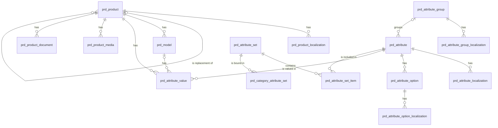

# 产品（product）模块设计

| 项 | 内容 |
|---|---|
| 模块 ID | `product` |
| 名称 | 产品 |
| 层 | L3 |
| 表前缀 | `prd_` |
| API 前缀 | `product` |
| 可停用 | 是 |
| 模块版本 | 1.0.0（module.json 的 version） |
| 平台版本 | `>=1.0.0 <2.0.0`（module.json 的 platform） |
| 里程碑切片 | M1：<…>；M2：<…>；M3：<…>；M4：<…>（详见第 13 节） |
| 模块负责人 | 待定 |
| 文档版本 | V1.0 |
| 状态 | 草案 |
| 更新日期 | 2026-10-14 |
| 依据 | 系统设计 V1.4 第 <…> 章；平台框架设计 V1.<x> 第 4 章 <…> 节；ADR-<…> |

> 本文只引用《平台框架设计》第 4 章中的契约，不定义新的跨模块契约；需要新契约时按平台框架设计 2.3 提出契约变更请求。

## 1. 职责与边界

### 1.1 职责

> 一段概述 + 要点列表；与系统设计 3.2 的职责描述一致，并细化到本模块的功能清单。

### 1.2 不负责的事

| 事项 | 归属模块 | 说明 |
|---|---|---|

### 1.3 协作概览

> 用图或表说明本模块与哪些模块协作、通过哪种方式（服务接口 / 事件 / 扩展点）。只画契约，不画实现。

### 1.4 适用的架构约束

> 列出与本模块直接相关的原则（P1–P8）、ADR 规则与 CLAUDE.md 禁止项，以及本模块如何满足。

## 2. 依赖与契约

### 2.1 module.json

```json
{
  "id": "<id>",
  "name": "<中文名称>",
  "version": "1.0.0",
  "layer": "L3",
  "platform": ">=1.0.0 <2.0.0",
  "requires": {},
  "optional": {},
  "disableable": true,
  "tablePrefix": "<前缀>_",
  "apiPrefix": "<id>",
  "permissions": [],
  "menus": [],
  "settings": null,
  "components": [],
  "events": { "publishes": [], "subscribes": [] }
}
```

> 完整描述符，须通过平台框架设计附录 A 的 Schema 与 A.3 的校验规则。

### 2.2 使用的服务接口

| 接口（平台框架设计小节） | 方法 | 用途 | 调用位置与时机（事务内 / 外） | 测试替身 |
|---|---|---|---|---|

### 2.3 提供的服务接口

| 接口（平台框架设计小节） | 方法 | 实现类 | 契约测试 | 说明（幂等、权限、性能目标） |
|---|---|---|---|---|

### 2.4 实现的扩展点

| 扩展点（平台框架设计小节） | 实现类 | 适用范围（内容类型 / 资源类型） | order | 收集方 |
|---|---|---|---|---|

### 2.5 收集的扩展点

| 扩展点 | 调用时机 | 过滤（站点启用状态、内容类型等） | 实现缺失或抛出异常时的行为 | 测试用示例实现 |
|---|---|---|---|---|

### 2.6 发布与订阅的事件

发布：

| 事件 | 触发时机（所在事务） | 关键字段 | 主要订阅方 |
|---|---|---|---|

订阅：

| 事件 | 处理 | 幂等方式 | 过期判断 | 失败与重试 |
|---|---|---|---|---|

### 2.7 使用的端口

| 端口 | 用途 | 测试替身 |
|---|---|---|

## 3. 领域模型

### 3.1 聚合、实体与值对象

| 类型 | 名称 | 说明 |
|---|---|---|
| 聚合根 | Product（`prd_product`） | 产品的语言无关业务字段：型号、品牌、主分类、标记（新品 / 热销 / 停产）、替代产品、排序。与 `cnt_content`（type = PRODUCT）1:1，主键即 `content_id`（系统设计 6.1、8.1） |
| 实体 | ProductLocalization（`prd_product_localization`） | 产品在一种语言下的草稿业务字段：名称、副标题、简介、详情、卖点、包装、交期、MOQ；与 `cnt_localization` 按（内容，语言）1:1 |
| 实体 | Model（`prd_model`） | 型号表的一行（系列 + 多个型号，系统设计 8.3）；询盘可精确到型号 |
| 实体 | AttributeValue（`prd_attribute_value`） | EAV 属性值：产品级（`model_id` 为空）或型号级；只有 `TEXT` 类型按语言保存 |
| 实体 | ProductMedia（`prd_product_media`） | 产品图片：封面、图集、示意图 |
| 实体 | ProductDocument（`prd_product_document`） | 产品文档：规格书、手册、证书、CAD；公开或留资（`gated_form_key`） |
| 聚合根 | AttributeGroup（`prd_attribute_group`） | 属性分组（如“电气参数”），名称在本地化表（站点资源） |
| 聚合根 | Attribute（`prd_attribute`） | 属性定义：key、分组、数据类型、标准单位、小数位、双单位显示、筛选 / 搜索 / 对比 / 卡片显示开关 |
| 实体 | AttributeOption（`prd_attribute_option`） | `ENUM` / `MULTI_ENUM` 属性的选项 |
| 实体 | AttributeGroupLocalization、AttributeLocalization、AttributeOptionLocalization | 分组名、属性名、选项名的多语言文本（站点资源，带 `translation_state`、`source_fingerprint`） |
| 聚合根 | AttributeSet（`prd_attribute_set`） | 属性集：包含哪些属性、是否必填、顺序 |
| 实体 | AttributeSetItem（`prd_attribute_set_item`） | 属性集中的一个属性 |
| 实体 | CategoryAttributeSet（`prd_category_attribute_set`） | 产品分类绑定的属性集（子分类继承） |
| 值对象 | DataType | `TEXT`（可翻译）/ `NUMBER` / `RANGE` / `BOOLEAN` / `ENUM` / `MULTI_ENUM` |
| 值对象 | DualUnit | `dual_unit` + `secondary_unit` + `secondary_decimal_places`；换算系数来自代码中的单位注册表，发布时换算写入快照，前台不换算（系统设计 8.1） |
| 值对象 | ProductFlags | `new_arrival`、`hot_selling`、`discontinued` |
| 值对象 | SpecSnapshot | 快照 `product` 部分中的结构化规格 `[{group, items: [{key, label, value, unit, secondaryValue, secondaryUnit}]}]`（系统设计 8.2） |

在系统设计之外补充的字段：

| 补充 | 理由 |
|---|---|
| `prd_product.site_id` 及各子表的 `site_id` | 站点级表必须带 `site_id`，由行级拦截器过滤（系统设计 5.3） |
| 系统设计的 `flags` 拆为 `new_arrival`、`hot_selling`、`discontinued` 三个布尔列；`sort` 改名 `sort_order` | 布尔列可直接用于筛选与 CHECK；与全库排序列命名一致 |
| `group_key`、`attr_key`、`option_key` | 系统设计的 `key` 是 MySQL 关键字（本文 2.2）；稳定标识用于导入模板列、快照规格 `key`、搜索分面字段 `attr.{attr_key}` 与筛选参数值，不随名称或语言变化 |
| `prd_attribute.precision` 改名 `decimal_places`；补充 `secondary_decimal_places` | `PRECISION` 是 MySQL 保留字；第二单位的显示精度可能不同（系统设计 8.1 的示例 `100 mm (3.94 in)` 与 `5 kg (11 lb)`） |
| 属性分组、属性、选项、属性集的 `deleted_at` | 配置类实体软删除（本文 2.5）；其 ID 被属性值与快照引用 |
| `prd_attribute_set.name`、`description` | 后台显示与选择（只在后台使用，不翻译） |
| `prd_category_attribute_set.sort_order` | 一个分类可以绑定多个属性集，编辑页按此顺序合并 |
| `prd_attribute_value.model_key`、`locale_key`（虚拟生成列） | `model_id`、`locale` 可空，唯一索引中 NULL 互不相等；用生成列把 NULL 规范化后保证“每个产品 / 型号 / 语言的每个属性一个值” |
| `prd_product_media.cover_flag`（生成列） | 用唯一索引保证每个产品最多一张封面 |
| `prd_product_localization.version`、`prd_product.version` | 产品编辑页按标签整体保存，乐观锁防止并发覆盖 |

### 3.2 不变量

| # | 规则 | 保证方式 |
|---|---|---|
| 1 | `prd_product` 与 `cnt_content`（type = PRODUCT）1:1；`content_id` 由 `ContentApi.create(PRODUCT, zh-CN)` 在同一事务中返回 | 应用层 |
| 2 | 产品的每个 `cnt_localization` 恰有一条同语言的 `prd_product_localization`；每个产品每种语言最多一条 | 数据库：`uk_ploc_product_locale`；应用层（创建本地化时同时写入） |
| 3 | 站点内非空的产品 `model_no` 唯一（导入匹配键）；同一产品内型号 `model_no` 唯一 | 数据库：`uk_product_model`、`uk_model_no` |
| 4 | 替代产品不是自身，属于同一站点 | 数据库：`ck_prd_product_replacement`；应用层 |
| 5 | 发布时必须有主分类；`primary_category_term_id` 等于 `tx_assignment` 中 `product_category` 词汇表的主分类 | 应用层（产品编辑页的分类由 product 接口保存，同一事务中经 `TaxonomyApi` 写入指派并同步本列；发布校验） |
| 6 | 站点内未删除的 `group_key`、`attr_key` 唯一；同一属性内未删除的 `option_key` 唯一；key 创建后不可修改 | 数据库：`uk_ag_key`、`uk_attr_key`、`uk_opt_key`；应用层 |
| 7 | 单位、小数位、双单位只用于 `NUMBER` / `RANGE`；开启 `dual_unit` 时 `unit`、`secondary_unit` 非空且不同；两个单位属于同一量纲（单位注册表中存在换算） | 数据库：`ck_prd_attr_unit`、`ck_prd_attr_dual`、`ck_prd_attr_decimals`；应用层（量纲） |
| 8 | `TEXT` 属性不能作为筛选分面（值按语言不同且不规范；需要筛选时改用 `ENUM`） | 数据库：`ck_prd_attr_filter` |
| 9 | 每条属性值恰好使用一种取值列，且与属性的 `data_type` 匹配：TEXT → `value_text`；NUMBER → `value_number`；RANGE → `value_number` + `value_number_max`；BOOLEAN → `value_bool`；ENUM → `option_ids`（1 个元素）；MULTI_ENUM → `option_ids`（≥ 1 个元素） | 数据库：`ck_prd_av_kind`（恰好一种）；应用层（与类型匹配） |
| 10 | 只有 `TEXT` 值带 `locale`（每种语言一行）；其他类型 `locale` 为空，所有语言共用 | 数据库：`ck_prd_av_locale`；应用层 |
| 11 | 每个（产品，属性，型号，语言）最多一个值 | 数据库：`uk_av_value` |
| 12 | `RANGE` 的最大值不小于最小值；数值一律按属性的标准单位 `unit` 存储（导入时换算） | 数据库：`ck_prd_av_range`；应用层 |
| 13 | 型号级值（`model_id` 非空）只用于 `comparable = 1` 的属性；型号属于同一产品 | 应用层 |
| 14 | `option_ids` 中的选项属于该属性且未删除 | 应用层 |
| 15 | 被属性集引用或已有取值的属性不能删除；已有取值引用的选项不能删除 | 数据库：`fk_prd_asi_attr`、`fk_prd_av_attr`（RESTRICT，针对物理删除）；应用层（软删除前检查） |
| 16 | 每个产品最多一张封面；同一媒体在同一角色中只出现一次 | 数据库：`uk_pm_cover`、`uk_pm_media` |
| 17 | 留资文档（`gated_form_key` 非空）的媒体为 `PRIVATE`，表单存在、启用且用途为 `DOWNLOAD`；公开文档的媒体为 `PUBLIC` | 应用层（发布校验 ERROR） |
| 18 | `prd_category_attribute_set.term_id` 属于 `product_category` 词汇表 | 应用层 |
| 19 | 站点资源本地化：每个分组 / 属性 / 选项每种语言最多一条；中文行 `translation_state = NONE`、`source_fingerprint` 为空 | 数据库：`uk_agl_group_locale`、`uk_al_attr_locale`、`uk_ol_option_locale`；应用层 |
| 20 | 子表的 `site_id` 与父表一致 | 应用层 |

### 3.3 状态机

<<FILL: 状态与转换；没有状态机时写“不适用：<原因>”>>

## 4. 数据模型

> 遵守平台框架设计第 7 章的数据库通用约定。DDL 已在 MySQL 8.4 上执行通过；表结构以本节为准，与迁移脚本保持一致。

### 4.1 表清单

| 表 | 说明 | 站点级 | 软删除 | 预估规模（单站，按系统设计假设 A4） |
|---|---|---|---|---|
| `prd_product` | 产品（语言无关业务字段） | 是 | 否（随内容回收站） | ≤ 1 万行 |
| `prd_product_localization` | 产品本地化（内容类草稿） | 是 | 否 | ≤ 10 万行（× 10 种语言） |
| `prd_attribute_group` | 属性分组 | 是 | 是（`deleted_at`） | 10–50 行 |
| `prd_attribute_group_localization` | 属性分组本地化（站点资源） | 是 | 否（随分组） | ≤ 500 行 |
| `prd_attribute` | 属性定义 | 是 | 是（`deleted_at`） | 100–500 行 |
| `prd_attribute_localization` | 属性本地化（站点资源） | 是 | 否（随属性） | ≤ 5 千行 |
| `prd_attribute_option` | 枚举选项 | 是 | 是（`deleted_at`） | 1 千–5 千行 |
| `prd_attribute_option_localization` | 选项本地化（站点资源） | 是 | 否（随选项） | ≤ 5 万行 |
| `prd_attribute_set` | 属性集 | 是 | 是（`deleted_at`） | 10–100 行 |
| `prd_attribute_set_item` | 属性集中的属性 | 是 | 否 | 500–3 千行 |
| `prd_category_attribute_set` | 产品分类绑定属性集 | 是 | 否 | 50–500 行 |
| `prd_model` | 型号表的行 | 是 | 否 | ≈ 5 万行（平均每个产品 5 个型号） |
| `prd_attribute_value` | 属性值（EAV，草稿态） | 是 | 否 | ≈ 100 万行（产品级 1 万 × 20；型号级 5 万 × 10；TEXT 1 万 × 3 × 10 种语言） |
| `prd_product_media` | 产品图片 | 是 | 否 | ≈ 8 万行 |
| `prd_product_document` | 产品文档 | 是 | 否 | ≈ 3 万行 |

### 4.2 ER 图



### 4.3 表结构

类型列中的 `bin` 表示该列排序规则为 `utf8mb4_0900_bin`（第 16 章同）。

#### 4.3.1 `prd_product`：产品

| 字段 | 类型 | 可空 | 默认 | 说明 |
|---|---|---|---|---|
| `content_id` | BIGINT | 否 | — | 内容 ID（cnt_content.id，类型 PRODUCT），即产品主键 |
| `site_id` | BIGINT | 否 | — | 站点 ID（sys_site.id） |
| `model_no` | VARCHAR(100) bin | 是 | — | 产品型号（系列号或主型号；站点内唯一，导入匹配键；不翻译） |
| `brand` | VARCHAR(100) | 是 | — | 品牌（不翻译；Schema.org Product.brand） |
| `primary_category_term_id` | BIGINT | 是 | — | 主分类 ID（tx_term.id，词汇表 product_category）；冗余 tx_assignment 中的主分类；发布时必填 |
| `new_arrival` | TINYINT(1) | 否 | `0` | 标记：新品 |
| `hot_selling` | TINYINT(1) | 否 | `0` | 标记：热销 |
| `discontinued` | TINYINT(1) | 否 | `0` | 标记：停产（页面显示停产标识与替代产品链接，继续可索引） |
| `replacement_content_id` | BIGINT | 是 | — | 替代产品的内容 ID（prd_product.content_id），停产时填写 |
| `sort_order` | INT | 否 | `0` | 排序值（越小越靠前，用于后台列表与 content-query 的手工排序） |
| `version` | INT | 否 | `0` | 乐观锁版本号 |
| `created_at` | DATETIME(3) | 否 | `CURRENT_TIMESTAMP(3)` | 创建时间（UTC） |
| `created_by` | BIGINT | 否 | `0` | 创建人用户 ID（0 = 系统，如导入） |
| `updated_at` | DATETIME(3) | 否 | `CURRENT_TIMESTAMP(3) ON UPDATE CURRENT_TIMESTAMP(3)` | 更新时间（UTC） |
| `updated_by` | BIGINT | 否 | `0` | 更新人用户 ID（0 = 系统） |

索引与约束：
- `PRIMARY KEY (content_id)`
- `uk_product_model (site_id, model_no)`：站点内型号唯一（NULL 不参与）；导入按型号匹配、后台按型号查找
- `idx_product_category (site_id, primary_category_term_id, sort_order)`：后台按分类筛选产品（系统设计 8.7）；分类项删除时查找受影响产品
- `idx_product_replacement (replacement_content_id)`：被替代产品彻底删除前，查找以它为替代的产品；兼作 `fk_prd_product_replacement` 的索引
- `fk_prd_product_replacement`：引用关系（RESTRICT）
- `ck_prd_product_replacement`：见 3.2 不变量 4

```sql
CREATE TABLE prd_product (
  content_id                BIGINT        NOT NULL COMMENT '内容 ID（cnt_content.id，类型 PRODUCT），即产品主键',
  site_id                   BIGINT        NOT NULL COMMENT '站点 ID（sys_site.id）',
  model_no                  VARCHAR(100)  COLLATE utf8mb4_0900_bin NULL COMMENT '产品型号（系列号或主型号；站点内唯一，导入匹配键；不翻译）',
  brand                     VARCHAR(100)  NULL COMMENT '品牌（不翻译；Schema.org Product.brand）',
  primary_category_term_id  BIGINT        NULL COMMENT '主分类 ID（tx_term.id，词汇表 product_category）；冗余 tx_assignment 中的主分类；发布时必填',
  new_arrival               TINYINT(1)    NOT NULL DEFAULT 0 COMMENT '标记：新品',
  hot_selling               TINYINT(1)    NOT NULL DEFAULT 0 COMMENT '标记：热销',
  discontinued              TINYINT(1)    NOT NULL DEFAULT 0 COMMENT '标记：停产（页面显示停产标识与替代产品链接，继续可索引）',
  replacement_content_id    BIGINT        NULL COMMENT '替代产品的内容 ID（prd_product.content_id），停产时填写',
  sort_order                INT           NOT NULL DEFAULT 0 COMMENT '排序值（越小越靠前，用于后台列表与 content-query 的手工排序）',
  version                   INT           NOT NULL DEFAULT 0 COMMENT '乐观锁版本号',
  created_at                DATETIME(3)   NOT NULL DEFAULT CURRENT_TIMESTAMP(3) COMMENT '创建时间（UTC）',
  created_by                BIGINT        NOT NULL DEFAULT 0 COMMENT '创建人用户 ID（0 = 系统，如导入）',
  updated_at                DATETIME(3)   NOT NULL DEFAULT CURRENT_TIMESTAMP(3) ON UPDATE CURRENT_TIMESTAMP(3) COMMENT '更新时间（UTC）',
  updated_by                BIGINT        NOT NULL DEFAULT 0 COMMENT '更新人用户 ID（0 = 系统）',
  PRIMARY KEY (content_id),
  UNIQUE KEY uk_product_model (site_id, model_no),
  KEY idx_product_category (site_id, primary_category_term_id, sort_order),
  KEY idx_product_replacement (replacement_content_id),
  CONSTRAINT fk_prd_product_replacement FOREIGN KEY (replacement_content_id) REFERENCES prd_product (content_id),
  CONSTRAINT ck_prd_product_replacement CHECK (replacement_content_id IS NULL OR replacement_content_id <> content_id)
) ENGINE = InnoDB DEFAULT CHARSET = utf8mb4 COLLATE = utf8mb4_0900_ai_ci COMMENT = '产品（与 cnt_content 1:1 的语言无关业务字段：型号、品牌、主分类、标记、替代产品）';
```

要点：
- 主键沿用系统设计 6.1、8.1 的 `content_id`（产品身份即内容身份），不另设 `id`；子表以 `product_id` 引用本列。
- 内容在回收站时本行保留，`model_no` 仍占用唯一键；恢复时无冲突。彻底删除时由 `ContentPurgedEvent` 驱动物理删除（见 4.6）。
- 停产与替代（系统设计 8.5）：`discontinued`、`replacement_content_id` 进入快照；替代产品未发布时前台不渲染替代链接（`$content` 解析降级）。下线时选择 `REDIRECT_CONTENT` 到替代产品或 `REDIRECT_PARENT` 到主分类页，由 product 实现的下线目标解析扩展返回 `primary_category_term_id` 对应的 TERM_PAGE。
- 型号、品牌、标记、主分类、替代产品是非文本数据，所有语言沿用（系统设计 8.1）。

#### 4.3.2 `prd_product_localization`：产品本地化

| 字段 | 类型 | 可空 | 默认 | 说明 |
|---|---|---|---|---|
| `id` | BIGINT | 否 | — | 主键（TSID） |
| `site_id` | BIGINT | 否 | — | 站点 ID（sys_site.id） |
| `product_id` | BIGINT | 否 | — | 产品 ID（prd_product.content_id，即 cnt_content.id） |
| `locale` | VARCHAR(16) | 否 | — | 语言（BCP 47），与 cnt_localization.locale 一一对应 |
| `name` | VARCHAR(300) | 否 | — | 产品名称（同步为 cnt_localization.draft_title；快照 card.title） |
| `subtitle` | VARCHAR(300) | 是 | — | 副标题 |
| `summary` | VARCHAR(1000) | 是 | — | 简介（纯文本；快照 card.summary） |
| `description` | JSON | 是 | — | 详情（ProseMirror JSON 富文本） |
| `selling_points` | JSON | 否 | `(JSON_ARRAY())` | 卖点列表：字符串数组，如 ["循环寿命 6000 次", "IP65 防护"] |
| `packaging` | VARCHAR(1000) | 是 | — | 包装信息（纯文本） |
| `lead_time` | VARCHAR(200) | 是 | — | 交期文本，如“15–30 天” |
| `moq` | VARCHAR(200) | 是 | — | 最小起订量文本（MOQ），如“100 件” |
| `version` | INT | 否 | `0` | 乐观锁版本号 |
| `created_at` | DATETIME(3) | 否 | `CURRENT_TIMESTAMP(3)` | 创建时间（UTC） |
| `created_by` | BIGINT | 否 | `0` | 创建人用户 ID（0 = 系统，如译文回写、导入） |
| `updated_at` | DATETIME(3) | 否 | `CURRENT_TIMESTAMP(3) ON UPDATE CURRENT_TIMESTAMP(3)` | 更新时间（UTC） |
| `updated_by` | BIGINT | 否 | `0` | 更新人用户 ID（0 = 系统，如译文回写） |

索引与约束：
- `PRIMARY KEY (id)`
- `uk_ploc_product_locale (product_id, locale)`：每种语言一条；编辑页、发布组装快照、译文回写按（产品，语言）读写；兼作 `fk_prd_ploc_product` 的索引
- `idx_ploc_name (site_id, locale, name)`：后台按名称搜索产品（ProductPicker、询盘明细选择产品）
- `fk_prd_ploc_product`：组合关系，`ON DELETE CASCADE`

```sql
CREATE TABLE prd_product_localization (
  id              BIGINT         NOT NULL COMMENT '主键（TSID）',
  site_id         BIGINT         NOT NULL COMMENT '站点 ID（sys_site.id）',
  product_id      BIGINT         NOT NULL COMMENT '产品 ID（prd_product.content_id，即 cnt_content.id）',
  locale          VARCHAR(16)    NOT NULL COMMENT '语言（BCP 47），与 cnt_localization.locale 一一对应',
  name            VARCHAR(300)   NOT NULL COMMENT '产品名称（同步为 cnt_localization.draft_title；快照 card.title）',
  subtitle        VARCHAR(300)   NULL COMMENT '副标题',
  summary         VARCHAR(1000)  NULL COMMENT '简介（纯文本；快照 card.summary）',
  description     JSON           NULL COMMENT '详情（ProseMirror JSON 富文本）',
  selling_points  JSON           NOT NULL DEFAULT (JSON_ARRAY()) COMMENT '卖点列表：字符串数组，如 ["循环寿命 6000 次", "IP65 防护"]',
  packaging       VARCHAR(1000)  NULL COMMENT '包装信息（纯文本）',
  lead_time       VARCHAR(200)   NULL COMMENT '交期文本，如“15–30 天”',
  moq             VARCHAR(200)   NULL COMMENT '最小起订量文本（MOQ），如“100 件”',
  version         INT            NOT NULL DEFAULT 0 COMMENT '乐观锁版本号',
  created_at      DATETIME(3)    NOT NULL DEFAULT CURRENT_TIMESTAMP(3) COMMENT '创建时间（UTC）',
  created_by      BIGINT         NOT NULL DEFAULT 0 COMMENT '创建人用户 ID（0 = 系统，如译文回写、导入）',
  updated_at      DATETIME(3)    NOT NULL DEFAULT CURRENT_TIMESTAMP(3) ON UPDATE CURRENT_TIMESTAMP(3) COMMENT '更新时间（UTC）',
  updated_by      BIGINT         NOT NULL DEFAULT 0 COMMENT '更新人用户 ID（0 = 系统，如译文回写）',
  PRIMARY KEY (id),
  UNIQUE KEY uk_ploc_product_locale (product_id, locale),
  KEY idx_ploc_name (site_id, locale, name),
  CONSTRAINT fk_prd_ploc_product FOREIGN KEY (product_id) REFERENCES prd_product (content_id) ON DELETE CASCADE
) ENGINE = InnoDB DEFAULT CHARSET = utf8mb4 COLLATE = utf8mb4_0900_ai_ci COMMENT = '产品本地化（内容类草稿：名称、副标题、简介、详情、卖点、包装、交期、MOQ）';
```

要点：
- 内容类本地化表，不带翻译状态；翻译模式与状态在 `cnt_localization`（本文 2.7）。保存草稿时经 `ContentApi.updateDraftMeta()` 同步 `draft_title`。
- 翻译：product 的 `TranslatableContentProvider` 从中文行提取 `name`、`subtitle`、`summary`、`description`（按块级节点拆分）、`selling_points[]`、`packaging`、`lead_time`、`moq` 与 `TEXT` 属性值（4.3.13）；`apply()` 写入或覆盖目标语言行（目标行不存在时创建）。`MANUAL` 模式的本地化由编辑直接修改本行。

#### 4.3.3 `prd_attribute_group`：属性分组

| 字段 | 类型 | 可空 | 默认 | 说明 |
|---|---|---|---|---|
| `id` | BIGINT | 否 | — | 主键（TSID） |
| `site_id` | BIGINT | 否 | — | 站点 ID（sys_site.id） |
| `group_key` | VARCHAR(64) bin | 否 | — | 分组 key（小写字母、数字、下划线；创建后不可修改），如 electrical |
| `sort_order` | INT | 否 | `0` | 分组在规格表中的顺序 |
| `deleted_at` | DATETIME(3) | 是 | — | 删除时间（软删除） |
| `alive` | TINYINT | 是 | 生成列 `IF(deleted_at IS NULL, 1, NULL)` | 未删除标记（唯一索引用） |
| `version` | INT | 否 | `0` | 乐观锁版本号 |
| `created_at` | DATETIME(3) | 否 | `CURRENT_TIMESTAMP(3)` | 创建时间（UTC） |
| `created_by` | BIGINT | 否 | `0` | 创建人用户 ID（0 = 系统） |
| `updated_at` | DATETIME(3) | 否 | `CURRENT_TIMESTAMP(3) ON UPDATE CURRENT_TIMESTAMP(3)` | 更新时间（UTC） |
| `updated_by` | BIGINT | 否 | `0` | 更新人用户 ID（0 = 系统） |

索引与约束：
- `PRIMARY KEY (id)`
- `uk_ag_key (site_id, group_key, alive)`：未删除的 key 唯一；站点的分组列表；导入按 key 查找

```sql
CREATE TABLE prd_attribute_group (
  id          BIGINT       NOT NULL COMMENT '主键（TSID）',
  site_id     BIGINT       NOT NULL COMMENT '站点 ID（sys_site.id）',
  group_key   VARCHAR(64)  COLLATE utf8mb4_0900_bin NOT NULL COMMENT '分组 key（小写字母、数字、下划线；创建后不可修改），如 electrical',
  sort_order  INT          NOT NULL DEFAULT 0 COMMENT '分组在规格表中的顺序',
  deleted_at  DATETIME(3)  NULL COMMENT '删除时间（软删除）',
  alive       TINYINT      AS (IF(deleted_at IS NULL, 1, NULL)) STORED COMMENT '未删除标记（唯一索引用）',
  version     INT          NOT NULL DEFAULT 0 COMMENT '乐观锁版本号',
  created_at  DATETIME(3)  NOT NULL DEFAULT CURRENT_TIMESTAMP(3) COMMENT '创建时间（UTC）',
  created_by  BIGINT       NOT NULL DEFAULT 0 COMMENT '创建人用户 ID（0 = 系统）',
  updated_at  DATETIME(3)  NOT NULL DEFAULT CURRENT_TIMESTAMP(3) ON UPDATE CURRENT_TIMESTAMP(3) COMMENT '更新时间（UTC）',
  updated_by  BIGINT       NOT NULL DEFAULT 0 COMMENT '更新人用户 ID（0 = 系统）',
  PRIMARY KEY (id),
  UNIQUE KEY uk_ag_key (site_id, group_key, alive)
) ENGINE = InnoDB DEFAULT CHARSET = utf8mb4 COLLATE = utf8mb4_0900_ai_ci COMMENT = '属性分组（如电气参数、机械参数）';
```

要点：有未删除属性的分组不能删除（应用层）；没有分组的属性在规格表中归入“其他”分组（文案键 `product.spec.group.other`）。

#### 4.3.4 `prd_attribute_group_localization`：属性分组本地化

| 字段 | 类型 | 可空 | 默认 | 说明 |
|---|---|---|---|---|
| `id` | BIGINT | 否 | — | 主键（TSID） |
| `site_id` | BIGINT | 否 | — | 站点 ID（sys_site.id） |
| `group_id` | BIGINT | 否 | — | 属性分组 ID（prd_attribute_group.id） |
| `locale` | VARCHAR(16) | 否 | — | 语言（BCP 47） |
| `name` | VARCHAR(100) | 否 | — | 分组名（站点资源：中文录入，其他语言由 translation 经 TranslatableResourceProvider 写入），如“电气参数” |
| `translation_state` | VARCHAR(16) | 否 | `'NONE'` | 翻译状态：NONE / QUEUED / TRANSLATED / NEEDS_REVIEW / FAILED / OUTDATED |
| `source_fingerprint` | CHAR(64) bin | 是 | — | 生成本行译文时中文行的指纹（规范化 name 的 SHA-256）；中文行为空；与当前中文指纹不同即为过期 |
| `version` | INT | 否 | `0` | 乐观锁版本号 |
| `created_at` | DATETIME(3) | 否 | `CURRENT_TIMESTAMP(3)` | 创建时间（UTC） |
| `created_by` | BIGINT | 否 | `0` | 创建人用户 ID（0 = 系统） |
| `updated_at` | DATETIME(3) | 否 | `CURRENT_TIMESTAMP(3) ON UPDATE CURRENT_TIMESTAMP(3)` | 更新时间（UTC） |
| `updated_by` | BIGINT | 否 | `0` | 更新人用户 ID（0 = 系统） |

索引与约束：
- `PRIMARY KEY (id)`
- `uk_agl_group_locale (group_id, locale)`：每种语言一条；按分组取各语言名称；兼作 `fk_prd_agl_group` 的索引
- `idx_agl_state (site_id, translation_state, locale)`：翻译中心列出待处理的分组名
- `fk_prd_agl_group`：组合关系，`ON DELETE CASCADE`

```sql
CREATE TABLE prd_attribute_group_localization (
  id                  BIGINT        NOT NULL COMMENT '主键（TSID）',
  site_id             BIGINT        NOT NULL COMMENT '站点 ID（sys_site.id）',
  group_id            BIGINT        NOT NULL COMMENT '属性分组 ID（prd_attribute_group.id）',
  locale              VARCHAR(16)   NOT NULL COMMENT '语言（BCP 47）',
  name                VARCHAR(100)  NOT NULL COMMENT '分组名（站点资源：中文录入，其他语言由 translation 经 TranslatableResourceProvider 写入），如“电气参数”',
  translation_state   VARCHAR(16)   NOT NULL DEFAULT 'NONE' COMMENT '翻译状态：NONE / QUEUED / TRANSLATED / NEEDS_REVIEW / FAILED / OUTDATED',
  source_fingerprint  CHAR(64)      COLLATE utf8mb4_0900_bin NULL COMMENT '生成本行译文时中文行的指纹（规范化 name 的 SHA-256）；中文行为空；与当前中文指纹不同即为过期',
  version             INT           NOT NULL DEFAULT 0 COMMENT '乐观锁版本号',
  created_at          DATETIME(3)   NOT NULL DEFAULT CURRENT_TIMESTAMP(3) COMMENT '创建时间（UTC）',
  created_by          BIGINT        NOT NULL DEFAULT 0 COMMENT '创建人用户 ID（0 = 系统）',
  updated_at          DATETIME(3)   NOT NULL DEFAULT CURRENT_TIMESTAMP(3) ON UPDATE CURRENT_TIMESTAMP(3) COMMENT '更新时间（UTC）',
  updated_by          BIGINT        NOT NULL DEFAULT 0 COMMENT '更新人用户 ID（0 = 系统）',
  PRIMARY KEY (id),
  UNIQUE KEY uk_agl_group_locale (group_id, locale),
  KEY idx_agl_state (site_id, translation_state, locale),
  CONSTRAINT fk_prd_agl_group FOREIGN KEY (group_id) REFERENCES prd_attribute_group (id) ON DELETE CASCADE
) ENGINE = InnoDB DEFAULT CHARSET = utf8mb4 COLLATE = utf8mb4_0900_ai_ci COMMENT = '属性分组本地化（分组名为站点资源，带翻译状态与源指纹）';
```

要点：中文 `name` 变化时发布 `TranslatableResourceChangedEvent`（资源类型 `product.attribute_group`，ID 为 `group_id`）；translation 回写目标语言行并设置 `translation_state` 与 `source_fingerprint`（系统设计 5.7、8.1）。属性与选项的本地化表（4.3.6、4.3.8）同理。

#### 4.3.5 `prd_attribute`：属性定义

| 字段 | 类型 | 可空 | 默认 | 说明 |
|---|---|---|---|---|
| `id` | BIGINT | 否 | — | 主键（TSID） |
| `site_id` | BIGINT | 否 | — | 站点 ID（sys_site.id） |
| `attr_key` | VARCHAR(64) bin | 否 | — | 属性 key（小写字母、数字、下划线；创建后不可修改）；快照规格 key 与搜索分面字段 attr.{attr_key}，如 voltage |
| `group_id` | BIGINT | 是 | — | 属性分组 ID（prd_attribute_group.id）；空 = 归入“其他” |
| `data_type` | VARCHAR(16) | 否 | — | 数据类型：TEXT（可翻译）/ NUMBER / RANGE / BOOLEAN / ENUM / MULTI_ENUM；有取值后不可修改 |
| `unit` | VARCHAR(16) bin | 是 | — | 标准单位（NUMBER / RANGE；单位注册表中的符号，如 mm、kg、V、Ah、°C）；数值按此单位存储 |
| `decimal_places` | TINYINT | 是 | — | 显示小数位数（0–6，NUMBER / RANGE）；空 = 按存储值去除末尾 0 显示 |
| `dual_unit` | TINYINT(1) | 否 | `0` | 是否双单位显示（公制 + 英制，如 100 mm (3.94 in)）；只用于 NUMBER / RANGE |
| `secondary_unit` | VARCHAR(16) bin | 是 | — | 第二单位（与 unit 同一量纲，如 in、lb、°F）；dual_unit = 1 时必填 |
| `secondary_decimal_places` | TINYINT | 是 | — | 第二单位的显示小数位数（0–6）；空 = 同 decimal_places |
| `filterable` | TINYINT(1) | 否 | `0` | 是否作为列表筛选分面（写入搜索索引 attr.{attr_key}）；TEXT 不可开启 |
| `searchable` | TINYINT(1) | 否 | `0` | 取值是否参与站内全文搜索 |
| `comparable` | TINYINT(1) | 否 | `0` | 是否可比较：出现在型号对比表，允许型号级取值 |
| `show_on_card` | TINYINT(1) | 否 | `0` | 是否在产品卡片上显示（关键参数） |
| `sort_order` | INT | 否 | `0` | 分组内的默认顺序（属性集中的顺序优先） |
| `deleted_at` | DATETIME(3) | 是 | — | 删除时间（软删除） |
| `alive` | TINYINT | 是 | 生成列 `IF(deleted_at IS NULL, 1, NULL)` | 未删除标记（唯一索引用） |
| `version` | INT | 否 | `0` | 乐观锁版本号 |
| `created_at` | DATETIME(3) | 否 | `CURRENT_TIMESTAMP(3)` | 创建时间（UTC） |
| `created_by` | BIGINT | 否 | `0` | 创建人用户 ID（0 = 系统） |
| `updated_at` | DATETIME(3) | 否 | `CURRENT_TIMESTAMP(3) ON UPDATE CURRENT_TIMESTAMP(3)` | 更新时间（UTC） |
| `updated_by` | BIGINT | 否 | `0` | 更新人用户 ID（0 = 系统） |

索引与约束：
- `PRIMARY KEY (id)`
- `uk_attr_key (site_id, attr_key, alive)`：未删除的 key 唯一；按 key 查找（导入模板列、搜索文档组装）；站点的属性列表
- `idx_attr_group (group_id, sort_order)`：分组下的属性列表；兼作 `fk_prd_attr_group` 的索引
- `fk_prd_attr_group`：引用关系（RESTRICT）
- `ck_prd_attr_unit`、`ck_prd_attr_dual`、`ck_prd_attr_decimals`、`ck_prd_attr_filter`：见 3.2 不变量 7、8

```sql
CREATE TABLE prd_attribute (
  id                        BIGINT       NOT NULL COMMENT '主键（TSID）',
  site_id                   BIGINT       NOT NULL COMMENT '站点 ID（sys_site.id）',
  attr_key                  VARCHAR(64)  COLLATE utf8mb4_0900_bin NOT NULL COMMENT '属性 key（小写字母、数字、下划线；创建后不可修改）；快照规格 key 与搜索分面字段 attr.{attr_key}，如 voltage',
  group_id                  BIGINT       NULL COMMENT '属性分组 ID（prd_attribute_group.id）；空 = 归入“其他”',
  data_type                 VARCHAR(16)  NOT NULL COMMENT '数据类型：TEXT（可翻译）/ NUMBER / RANGE / BOOLEAN / ENUM / MULTI_ENUM；有取值后不可修改',
  unit                      VARCHAR(16)  COLLATE utf8mb4_0900_bin NULL COMMENT '标准单位（NUMBER / RANGE；单位注册表中的符号，如 mm、kg、V、Ah、°C）；数值按此单位存储',
  decimal_places            TINYINT      NULL COMMENT '显示小数位数（0–6，NUMBER / RANGE）；空 = 按存储值去除末尾 0 显示',
  dual_unit                 TINYINT(1)   NOT NULL DEFAULT 0 COMMENT '是否双单位显示（公制 + 英制，如 100 mm (3.94 in)）；只用于 NUMBER / RANGE',
  secondary_unit            VARCHAR(16)  COLLATE utf8mb4_0900_bin NULL COMMENT '第二单位（与 unit 同一量纲，如 in、lb、°F）；dual_unit = 1 时必填',
  secondary_decimal_places  TINYINT      NULL COMMENT '第二单位的显示小数位数（0–6）；空 = 同 decimal_places',
  filterable                TINYINT(1)   NOT NULL DEFAULT 0 COMMENT '是否作为列表筛选分面（写入搜索索引 attr.{attr_key}）；TEXT 不可开启',
  searchable                TINYINT(1)   NOT NULL DEFAULT 0 COMMENT '取值是否参与站内全文搜索',
  comparable                TINYINT(1)   NOT NULL DEFAULT 0 COMMENT '是否可比较：出现在型号对比表，允许型号级取值',
  show_on_card              TINYINT(1)   NOT NULL DEFAULT 0 COMMENT '是否在产品卡片上显示（关键参数）',
  sort_order                INT          NOT NULL DEFAULT 0 COMMENT '分组内的默认顺序（属性集中的顺序优先）',
  deleted_at                DATETIME(3)  NULL COMMENT '删除时间（软删除）',
  alive                     TINYINT      AS (IF(deleted_at IS NULL, 1, NULL)) STORED COMMENT '未删除标记（唯一索引用）',
  version                   INT          NOT NULL DEFAULT 0 COMMENT '乐观锁版本号',
  created_at                DATETIME(3)  NOT NULL DEFAULT CURRENT_TIMESTAMP(3) COMMENT '创建时间（UTC）',
  created_by                BIGINT       NOT NULL DEFAULT 0 COMMENT '创建人用户 ID（0 = 系统）',
  updated_at                DATETIME(3)  NOT NULL DEFAULT CURRENT_TIMESTAMP(3) ON UPDATE CURRENT_TIMESTAMP(3) COMMENT '更新时间（UTC）',
  updated_by                BIGINT       NOT NULL DEFAULT 0 COMMENT '更新人用户 ID（0 = 系统）',
  PRIMARY KEY (id),
  UNIQUE KEY uk_attr_key (site_id, attr_key, alive),
  KEY idx_attr_group (group_id, sort_order),
  CONSTRAINT fk_prd_attr_group FOREIGN KEY (group_id) REFERENCES prd_attribute_group (id),
  CONSTRAINT ck_prd_attr_unit CHECK (data_type IN ('NUMBER', 'RANGE') OR (unit IS NULL AND decimal_places IS NULL AND dual_unit = 0)),
  CONSTRAINT ck_prd_attr_dual CHECK (dual_unit = 0 OR (unit IS NOT NULL AND secondary_unit IS NOT NULL AND secondary_unit <> unit)),
  CONSTRAINT ck_prd_attr_decimals CHECK ((decimal_places IS NULL OR decimal_places BETWEEN 0 AND 6) AND (secondary_decimal_places IS NULL OR secondary_decimal_places BETWEEN 0 AND 6)),
  CONSTRAINT ck_prd_attr_filter CHECK (filterable = 0 OR data_type <> 'TEXT')
) ENGINE = InnoDB DEFAULT CHARSET = utf8mb4 COLLATE = utf8mb4_0900_ai_ci COMMENT = '产品属性定义（数据类型、标准单位、双单位显示、筛选 / 搜索 / 对比 / 卡片开关）';
```

要点：
- 双单位（系统设计 8.1、8.2）：发布时 product 的 `PublishContributor` 按单位注册表把 `value_number`（与 `value_number_max`）换算为第二单位，写入快照规格的 `secondaryValue`、`secondaryUnit`；`dual_unit = 0` 时两者为空。单位注册表在代码中维护（量纲、换算系数、符号），不落表。
- 属性名、选项名、分组名（含译文）变化后，已发布产品的快照在下次发布时更新；需要立即生效时，后台可按属性对引用它的已发布产品批量重新发布（异步任务，经 `idx_av_attr` 找到产品）。
- `filterable`、`searchable` 变化只影响此后的搜索文档；后台提示重建该站点的产品索引。

#### 4.3.6 `prd_attribute_localization`：属性本地化

| 字段 | 类型 | 可空 | 默认 | 说明 |
|---|---|---|---|---|
| `id` | BIGINT | 否 | — | 主键（TSID） |
| `site_id` | BIGINT | 否 | — | 站点 ID（sys_site.id） |
| `attribute_id` | BIGINT | 否 | — | 属性 ID（prd_attribute.id） |
| `locale` | VARCHAR(16) | 否 | — | 语言（BCP 47） |
| `name` | VARCHAR(100) | 否 | — | 属性名（站点资源：中文录入，其他语言由 translation 经 TranslatableResourceProvider 写入），如“额定电压”；快照规格 label |
| `translation_state` | VARCHAR(16) | 否 | `'NONE'` | 翻译状态：NONE / QUEUED / TRANSLATED / NEEDS_REVIEW / FAILED / OUTDATED |
| `source_fingerprint` | CHAR(64) bin | 是 | — | 生成本行译文时中文行的指纹（规范化 name 的 SHA-256）；中文行为空；与当前中文指纹不同即为过期 |
| `version` | INT | 否 | `0` | 乐观锁版本号 |
| `created_at` | DATETIME(3) | 否 | `CURRENT_TIMESTAMP(3)` | 创建时间（UTC） |
| `created_by` | BIGINT | 否 | `0` | 创建人用户 ID（0 = 系统） |
| `updated_at` | DATETIME(3) | 否 | `CURRENT_TIMESTAMP(3) ON UPDATE CURRENT_TIMESTAMP(3)` | 更新时间（UTC） |
| `updated_by` | BIGINT | 否 | `0` | 更新人用户 ID（0 = 系统） |

索引与约束：
- `PRIMARY KEY (id)`
- `uk_al_attr_locale (attribute_id, locale)`：每种语言一条；发布组装规格、搜索文档按属性取名称；兼作 `fk_prd_al_attr` 的索引
- `idx_al_name (site_id, locale, name)`：后台按名称搜索属性；导入时按中文属性名匹配列
- `idx_al_state (site_id, translation_state, locale)`：翻译中心列出待处理的属性名
- `fk_prd_al_attr`：组合关系，`ON DELETE CASCADE`

```sql
CREATE TABLE prd_attribute_localization (
  id                  BIGINT        NOT NULL COMMENT '主键（TSID）',
  site_id             BIGINT        NOT NULL COMMENT '站点 ID（sys_site.id）',
  attribute_id        BIGINT        NOT NULL COMMENT '属性 ID（prd_attribute.id）',
  locale              VARCHAR(16)   NOT NULL COMMENT '语言（BCP 47）',
  name                VARCHAR(100)  NOT NULL COMMENT '属性名（站点资源：中文录入，其他语言由 translation 经 TranslatableResourceProvider 写入），如“额定电压”；快照规格 label',
  translation_state   VARCHAR(16)   NOT NULL DEFAULT 'NONE' COMMENT '翻译状态：NONE / QUEUED / TRANSLATED / NEEDS_REVIEW / FAILED / OUTDATED',
  source_fingerprint  CHAR(64)      COLLATE utf8mb4_0900_bin NULL COMMENT '生成本行译文时中文行的指纹（规范化 name 的 SHA-256）；中文行为空；与当前中文指纹不同即为过期',
  version             INT           NOT NULL DEFAULT 0 COMMENT '乐观锁版本号',
  created_at          DATETIME(3)   NOT NULL DEFAULT CURRENT_TIMESTAMP(3) COMMENT '创建时间（UTC）',
  created_by          BIGINT        NOT NULL DEFAULT 0 COMMENT '创建人用户 ID（0 = 系统）',
  updated_at          DATETIME(3)   NOT NULL DEFAULT CURRENT_TIMESTAMP(3) ON UPDATE CURRENT_TIMESTAMP(3) COMMENT '更新时间（UTC）',
  updated_by          BIGINT        NOT NULL DEFAULT 0 COMMENT '更新人用户 ID（0 = 系统）',
  PRIMARY KEY (id),
  UNIQUE KEY uk_al_attr_locale (attribute_id, locale),
  KEY idx_al_name (site_id, locale, name),
  KEY idx_al_state (site_id, translation_state, locale),
  CONSTRAINT fk_prd_al_attr FOREIGN KEY (attribute_id) REFERENCES prd_attribute (id) ON DELETE CASCADE
) ENGINE = InnoDB DEFAULT CHARSET = utf8mb4 COLLATE = utf8mb4_0900_ai_ci COMMENT = '属性本地化（属性名为站点资源，带翻译状态与源指纹）';
```

要点：资源类型 `product.attribute`，ID 为 `attribute_id`；经翻译记忆保证同一属性名全站译法一致（系统设计 8.1）。单位符号不翻译。

#### 4.3.7 `prd_attribute_option`：枚举选项

| 字段 | 类型 | 可空 | 默认 | 说明 |
|---|---|---|---|---|
| `id` | BIGINT | 否 | — | 主键（TSID） |
| `site_id` | BIGINT | 否 | — | 站点 ID（sys_site.id） |
| `attribute_id` | BIGINT | 否 | — | 属性 ID（prd_attribute.id，类型 ENUM / MULTI_ENUM） |
| `option_key` | VARCHAR(64) bin | 否 | — | 选项 key（小写字母、数字、连字符；创建后不可修改）；搜索分面值与筛选参数值，如 lifepo4 |
| `sort_order` | INT | 否 | `0` | 选项顺序（编辑下拉、筛选面板、规格显示） |
| `deleted_at` | DATETIME(3) | 是 | — | 删除时间（软删除） |
| `alive` | TINYINT | 是 | 生成列 `IF(deleted_at IS NULL, 1, NULL)` | 未删除标记（唯一索引用） |
| `version` | INT | 否 | `0` | 乐观锁版本号 |
| `created_at` | DATETIME(3) | 否 | `CURRENT_TIMESTAMP(3)` | 创建时间（UTC） |
| `created_by` | BIGINT | 否 | `0` | 创建人用户 ID（0 = 系统） |
| `updated_at` | DATETIME(3) | 否 | `CURRENT_TIMESTAMP(3) ON UPDATE CURRENT_TIMESTAMP(3)` | 更新时间（UTC） |
| `updated_by` | BIGINT | 否 | `0` | 更新人用户 ID（0 = 系统） |

索引与约束：
- `PRIMARY KEY (id)`
- `uk_opt_key (attribute_id, option_key, alive)`：同一属性内未删除的 key 唯一；按属性列出选项；兼作 `fk_prd_opt_attr` 的索引
- `fk_prd_opt_attr`：组合关系，`ON DELETE CASCADE`（选项随属性物理删除）

```sql
CREATE TABLE prd_attribute_option (
  id            BIGINT       NOT NULL COMMENT '主键（TSID）',
  site_id       BIGINT       NOT NULL COMMENT '站点 ID（sys_site.id）',
  attribute_id  BIGINT       NOT NULL COMMENT '属性 ID（prd_attribute.id，类型 ENUM / MULTI_ENUM）',
  option_key    VARCHAR(64)  COLLATE utf8mb4_0900_bin NOT NULL COMMENT '选项 key（小写字母、数字、连字符；创建后不可修改）；搜索分面值与筛选参数值，如 lifepo4',
  sort_order    INT          NOT NULL DEFAULT 0 COMMENT '选项顺序（编辑下拉、筛选面板、规格显示）',
  deleted_at    DATETIME(3)  NULL COMMENT '删除时间（软删除）',
  alive         TINYINT      AS (IF(deleted_at IS NULL, 1, NULL)) STORED COMMENT '未删除标记（唯一索引用）',
  version       INT          NOT NULL DEFAULT 0 COMMENT '乐观锁版本号',
  created_at    DATETIME(3)  NOT NULL DEFAULT CURRENT_TIMESTAMP(3) COMMENT '创建时间（UTC）',
  created_by    BIGINT       NOT NULL DEFAULT 0 COMMENT '创建人用户 ID（0 = 系统）',
  updated_at    DATETIME(3)  NOT NULL DEFAULT CURRENT_TIMESTAMP(3) ON UPDATE CURRENT_TIMESTAMP(3) COMMENT '更新时间（UTC）',
  updated_by    BIGINT       NOT NULL DEFAULT 0 COMMENT '更新人用户 ID（0 = 系统）',
  PRIMARY KEY (id),
  UNIQUE KEY uk_opt_key (attribute_id, option_key, alive),
  CONSTRAINT fk_prd_opt_attr FOREIGN KEY (attribute_id) REFERENCES prd_attribute (id) ON DELETE CASCADE
) ENGINE = InnoDB DEFAULT CHARSET = utf8mb4 COLLATE = utf8mb4_0900_ai_ci COMMENT = '属性枚举选项（ENUM / MULTI_ENUM）';
```

要点：删除选项前检查取值引用（`idx_av_attr` 定位该属性的取值，再以 `JSON_CONTAINS(option_ids, ...)` 判断）；被引用时拒绝删除并列出产品。

#### 4.3.8 `prd_attribute_option_localization`：选项本地化

| 字段 | 类型 | 可空 | 默认 | 说明 |
|---|---|---|---|---|
| `id` | BIGINT | 否 | — | 主键（TSID） |
| `site_id` | BIGINT | 否 | — | 站点 ID（sys_site.id） |
| `option_id` | BIGINT | 否 | — | 选项 ID（prd_attribute_option.id） |
| `locale` | VARCHAR(16) | 否 | — | 语言（BCP 47） |
| `label` | VARCHAR(200) | 否 | — | 选项名（站点资源：中文录入，其他语言由 translation 经 TranslatableResourceProvider 写入），如“磷酸铁锂” |
| `translation_state` | VARCHAR(16) | 否 | `'NONE'` | 翻译状态：NONE / QUEUED / TRANSLATED / NEEDS_REVIEW / FAILED / OUTDATED |
| `source_fingerprint` | CHAR(64) bin | 是 | — | 生成本行译文时中文行的指纹（规范化 label 的 SHA-256）；中文行为空；与当前中文指纹不同即为过期 |
| `version` | INT | 否 | `0` | 乐观锁版本号 |
| `created_at` | DATETIME(3) | 否 | `CURRENT_TIMESTAMP(3)` | 创建时间（UTC） |
| `created_by` | BIGINT | 否 | `0` | 创建人用户 ID（0 = 系统） |
| `updated_at` | DATETIME(3) | 否 | `CURRENT_TIMESTAMP(3) ON UPDATE CURRENT_TIMESTAMP(3)` | 更新时间（UTC） |
| `updated_by` | BIGINT | 否 | `0` | 更新人用户 ID（0 = 系统） |

索引与约束：
- `PRIMARY KEY (id)`
- `uk_ol_option_locale (option_id, locale)`：每种语言一条；兼作 `fk_prd_ol_option` 的索引
- `idx_ol_state (site_id, translation_state, locale)`：翻译中心列出待处理的选项名
- `fk_prd_ol_option`：组合关系，`ON DELETE CASCADE`

```sql
CREATE TABLE prd_attribute_option_localization (
  id                  BIGINT        NOT NULL COMMENT '主键（TSID）',
  site_id             BIGINT        NOT NULL COMMENT '站点 ID（sys_site.id）',
  option_id           BIGINT        NOT NULL COMMENT '选项 ID（prd_attribute_option.id）',
  locale              VARCHAR(16)   NOT NULL COMMENT '语言（BCP 47）',
  label               VARCHAR(200)  NOT NULL COMMENT '选项名（站点资源：中文录入，其他语言由 translation 经 TranslatableResourceProvider 写入），如“磷酸铁锂”',
  translation_state   VARCHAR(16)   NOT NULL DEFAULT 'NONE' COMMENT '翻译状态：NONE / QUEUED / TRANSLATED / NEEDS_REVIEW / FAILED / OUTDATED',
  source_fingerprint  CHAR(64)      COLLATE utf8mb4_0900_bin NULL COMMENT '生成本行译文时中文行的指纹（规范化 label 的 SHA-256）；中文行为空；与当前中文指纹不同即为过期',
  version             INT           NOT NULL DEFAULT 0 COMMENT '乐观锁版本号',
  created_at          DATETIME(3)   NOT NULL DEFAULT CURRENT_TIMESTAMP(3) COMMENT '创建时间（UTC）',
  created_by          BIGINT        NOT NULL DEFAULT 0 COMMENT '创建人用户 ID（0 = 系统）',
  updated_at          DATETIME(3)   NOT NULL DEFAULT CURRENT_TIMESTAMP(3) ON UPDATE CURRENT_TIMESTAMP(3) COMMENT '更新时间（UTC）',
  updated_by          BIGINT        NOT NULL DEFAULT 0 COMMENT '更新人用户 ID（0 = 系统）',
  PRIMARY KEY (id),
  UNIQUE KEY uk_ol_option_locale (option_id, locale),
  KEY idx_ol_state (site_id, translation_state, locale),
  CONSTRAINT fk_prd_ol_option FOREIGN KEY (option_id) REFERENCES prd_attribute_option (id) ON DELETE CASCADE
) ENGINE = InnoDB DEFAULT CHARSET = utf8mb4 COLLATE = utf8mb4_0900_ai_ci COMMENT = '枚举选项本地化（选项名为站点资源，带翻译状态与源指纹）';
```

要点：资源类型 `product.attribute_option`，ID 为 `option_id`。导入时按（属性，中文选项名）匹配选项。

#### 4.3.9 `prd_attribute_set`：属性集

| 字段 | 类型 | 可空 | 默认 | 说明 |
|---|---|---|---|---|
| `id` | BIGINT | 否 | — | 主键（TSID） |
| `site_id` | BIGINT | 否 | — | 站点 ID（sys_site.id） |
| `name` | VARCHAR(100) | 否 | — | 属性集名称（中文，只在后台显示），如“锂电池组” |
| `description` | VARCHAR(500) | 是 | — | 说明（后台提示） |
| `deleted_at` | DATETIME(3) | 是 | — | 删除时间（软删除） |
| `alive` | TINYINT | 是 | 生成列 `IF(deleted_at IS NULL, 1, NULL)` | 未删除标记（唯一索引用） |
| `version` | INT | 否 | `0` | 乐观锁版本号 |
| `created_at` | DATETIME(3) | 否 | `CURRENT_TIMESTAMP(3)` | 创建时间（UTC） |
| `created_by` | BIGINT | 否 | `0` | 创建人用户 ID（0 = 系统） |
| `updated_at` | DATETIME(3) | 否 | `CURRENT_TIMESTAMP(3) ON UPDATE CURRENT_TIMESTAMP(3)` | 更新时间（UTC） |
| `updated_by` | BIGINT | 否 | `0` | 更新人用户 ID（0 = 系统） |

索引与约束：
- `PRIMARY KEY (id)`
- `uk_set_name (site_id, name, alive)`：未删除的名称唯一（导入模板按属性集名称选择）；站点的属性集列表

```sql
CREATE TABLE prd_attribute_set (
  id           BIGINT        NOT NULL COMMENT '主键（TSID）',
  site_id      BIGINT        NOT NULL COMMENT '站点 ID（sys_site.id）',
  name         VARCHAR(100)  NOT NULL COMMENT '属性集名称（中文，只在后台显示），如“锂电池组”',
  description  VARCHAR(500)  NULL COMMENT '说明（后台提示）',
  deleted_at   DATETIME(3)   NULL COMMENT '删除时间（软删除）',
  alive        TINYINT       AS (IF(deleted_at IS NULL, 1, NULL)) STORED COMMENT '未删除标记（唯一索引用）',
  version      INT           NOT NULL DEFAULT 0 COMMENT '乐观锁版本号',
  created_at   DATETIME(3)   NOT NULL DEFAULT CURRENT_TIMESTAMP(3) COMMENT '创建时间（UTC）',
  created_by   BIGINT        NOT NULL DEFAULT 0 COMMENT '创建人用户 ID（0 = 系统）',
  updated_at   DATETIME(3)   NOT NULL DEFAULT CURRENT_TIMESTAMP(3) ON UPDATE CURRENT_TIMESTAMP(3) COMMENT '更新时间（UTC）',
  updated_by   BIGINT        NOT NULL DEFAULT 0 COMMENT '更新人用户 ID（0 = 系统）',
  PRIMARY KEY (id),
  UNIQUE KEY uk_set_name (site_id, name, alive)
) ENGINE = InnoDB DEFAULT CHARSET = utf8mb4 COLLATE = utf8mb4_0900_ai_ci COMMENT = '属性集（一组属性及其必填、顺序；按分类绑定，生成导入模板）';
```

要点：属性集只决定编辑页显示哪些属性、哪些必填以及导入模板的列（系统设计 8.6），不限制已保存的属性值；软删除时同时删除其分类绑定（应用层）。

#### 4.3.10 `prd_attribute_set_item`：属性集中的属性

| 字段 | 类型 | 可空 | 默认 | 说明 |
|---|---|---|---|---|
| `set_id` | BIGINT | 否 | — | 属性集 ID（prd_attribute_set.id） |
| `attribute_id` | BIGINT | 否 | — | 属性 ID（prd_attribute.id） |
| `site_id` | BIGINT | 否 | — | 站点 ID（sys_site.id） |
| `required` | TINYINT(1) | 否 | `0` | 是否必填（发布校验 ERROR） |
| `sort_order` | INT | 否 | `0` | 在属性集中的顺序 |
| `created_at` | DATETIME(3) | 否 | `CURRENT_TIMESTAMP(3)` | 创建时间（UTC） |
| `created_by` | BIGINT | 否 | `0` | 创建人用户 ID（0 = 系统） |
| `updated_at` | DATETIME(3) | 否 | `CURRENT_TIMESTAMP(3) ON UPDATE CURRENT_TIMESTAMP(3)` | 更新时间（UTC） |
| `updated_by` | BIGINT | 否 | `0` | 更新人用户 ID（0 = 系统） |

索引与约束：
- `PRIMARY KEY (set_id, attribute_id)`：读取属性集的全部属性
- `idx_asi_attr (attribute_id)`：属性被哪些属性集引用（删除属性前检查）；兼作 `fk_prd_asi_attr` 的索引
- `fk_prd_asi_set`：组合关系，`ON DELETE CASCADE`；`fk_prd_asi_attr`：引用关系（RESTRICT）

```sql
CREATE TABLE prd_attribute_set_item (
  set_id        BIGINT       NOT NULL COMMENT '属性集 ID（prd_attribute_set.id）',
  attribute_id  BIGINT       NOT NULL COMMENT '属性 ID（prd_attribute.id）',
  site_id       BIGINT       NOT NULL COMMENT '站点 ID（sys_site.id）',
  required      TINYINT(1)   NOT NULL DEFAULT 0 COMMENT '是否必填（发布校验 ERROR）',
  sort_order    INT          NOT NULL DEFAULT 0 COMMENT '在属性集中的顺序',
  created_at    DATETIME(3)  NOT NULL DEFAULT CURRENT_TIMESTAMP(3) COMMENT '创建时间（UTC）',
  created_by    BIGINT       NOT NULL DEFAULT 0 COMMENT '创建人用户 ID（0 = 系统）',
  updated_at    DATETIME(3)  NOT NULL DEFAULT CURRENT_TIMESTAMP(3) ON UPDATE CURRENT_TIMESTAMP(3) COMMENT '更新时间（UTC）',
  updated_by    BIGINT       NOT NULL DEFAULT 0 COMMENT '更新人用户 ID（0 = 系统）',
  PRIMARY KEY (set_id, attribute_id),
  KEY idx_asi_attr (attribute_id),
  CONSTRAINT fk_prd_asi_set FOREIGN KEY (set_id) REFERENCES prd_attribute_set (id) ON DELETE CASCADE,
  CONSTRAINT fk_prd_asi_attr FOREIGN KEY (attribute_id) REFERENCES prd_attribute (id)
) ENGINE = InnoDB DEFAULT CHARSET = utf8mb4 COLLATE = utf8mb4_0900_ai_ci COMMENT = '属性集中的属性（是否必填、顺序）';
```

#### 4.3.11 `prd_category_attribute_set`：分类绑定属性集

| 字段 | 类型 | 可空 | 默认 | 说明 |
|---|---|---|---|---|
| `term_id` | BIGINT | 否 | — | 产品分类 ID（tx_term.id，词汇表 product_category） |
| `set_id` | BIGINT | 否 | — | 属性集 ID（prd_attribute_set.id） |
| `site_id` | BIGINT | 否 | — | 站点 ID（sys_site.id） |
| `sort_order` | INT | 否 | `0` | 同一分类绑定多个属性集时的合并顺序 |
| `created_at` | DATETIME(3) | 否 | `CURRENT_TIMESTAMP(3)` | 创建时间（UTC） |
| `created_by` | BIGINT | 否 | `0` | 创建人用户 ID（0 = 系统） |
| `updated_at` | DATETIME(3) | 否 | `CURRENT_TIMESTAMP(3) ON UPDATE CURRENT_TIMESTAMP(3)` | 更新时间（UTC） |
| `updated_by` | BIGINT | 否 | `0` | 更新人用户 ID（0 = 系统） |

索引与约束：
- `PRIMARY KEY (term_id, set_id)`：读取分类（及其祖先）绑定的属性集
- `idx_cas_set (set_id)`：属性集被哪些分类绑定；兼作 `fk_prd_cas_set` 的索引
- `fk_prd_cas_set`：组合关系，`ON DELETE CASCADE`（绑定随属性集物理删除）；`term_id` 跨模块，不建外键

```sql
CREATE TABLE prd_category_attribute_set (
  term_id     BIGINT       NOT NULL COMMENT '产品分类 ID（tx_term.id，词汇表 product_category）',
  set_id      BIGINT       NOT NULL COMMENT '属性集 ID（prd_attribute_set.id）',
  site_id     BIGINT       NOT NULL COMMENT '站点 ID（sys_site.id）',
  sort_order  INT          NOT NULL DEFAULT 0 COMMENT '同一分类绑定多个属性集时的合并顺序',
  created_at  DATETIME(3)  NOT NULL DEFAULT CURRENT_TIMESTAMP(3) COMMENT '创建时间（UTC）',
  created_by  BIGINT       NOT NULL DEFAULT 0 COMMENT '创建人用户 ID（0 = 系统）',
  updated_at  DATETIME(3)  NOT NULL DEFAULT CURRENT_TIMESTAMP(3) ON UPDATE CURRENT_TIMESTAMP(3) COMMENT '更新时间（UTC）',
  updated_by  BIGINT       NOT NULL DEFAULT 0 COMMENT '更新人用户 ID（0 = 系统）',
  PRIMARY KEY (term_id, set_id),
  KEY idx_cas_set (set_id),
  CONSTRAINT fk_prd_cas_set FOREIGN KEY (set_id) REFERENCES prd_attribute_set (id) ON DELETE CASCADE
) ENGINE = InnoDB DEFAULT CHARSET = utf8mb4 COLLATE = utf8mb4_0900_ai_ci COMMENT = '产品分类绑定的属性集（子分类继承）';
```

要点（继承规则）：产品的生效属性 = 主分类及其全部祖先（经 `TaxonomyApi` 取物化路径）绑定的属性集的并集；同一属性出现在多个属性集时，任一处必填即必填，顺序取最先出现的位置（祖先在前，同级按 `sort_order`）。主分类为空时只显示已有取值的属性。

#### 4.3.12 `prd_model`：型号

| 字段 | 类型 | 可空 | 默认 | 说明 |
|---|---|---|---|---|
| `id` | BIGINT | 否 | — | 主键（TSID） |
| `site_id` | BIGINT | 否 | — | 站点 ID（sys_site.id） |
| `product_id` | BIGINT | 否 | — | 产品 ID（prd_product.content_id） |
| `model_no` | VARCHAR(100) bin | 否 | — | 型号（产品内唯一；不翻译；Schema.org sku / mpn），如 LFP-48100 |
| `sort_order` | INT | 否 | `0` | 在型号表中的顺序 |
| `created_at` | DATETIME(3) | 否 | `CURRENT_TIMESTAMP(3)` | 创建时间（UTC） |
| `created_by` | BIGINT | 否 | `0` | 创建人用户 ID（0 = 系统，如导入） |
| `updated_at` | DATETIME(3) | 否 | `CURRENT_TIMESTAMP(3) ON UPDATE CURRENT_TIMESTAMP(3)` | 更新时间（UTC） |
| `updated_by` | BIGINT | 否 | `0` | 更新人用户 ID（0 = 系统） |

索引与约束：
- `PRIMARY KEY (id)`
- `uk_model_no (product_id, model_no)`：产品内型号唯一；按产品读取型号表；兼作 `fk_prd_model_product` 的索引
- `idx_model_site_no (site_id, model_no)`：后台与导入按型号查找（跨产品）；`ContentVariantProvider` 按型号解析
- `fk_prd_model_product`：组合关系，`ON DELETE CASCADE`

```sql
CREATE TABLE prd_model (
  id          BIGINT        NOT NULL COMMENT '主键（TSID）',
  site_id     BIGINT        NOT NULL COMMENT '站点 ID（sys_site.id）',
  product_id  BIGINT        NOT NULL COMMENT '产品 ID（prd_product.content_id）',
  model_no    VARCHAR(100)  COLLATE utf8mb4_0900_bin NOT NULL COMMENT '型号（产品内唯一；不翻译；Schema.org sku / mpn），如 LFP-48100',
  sort_order  INT           NOT NULL DEFAULT 0 COMMENT '在型号表中的顺序',
  created_at  DATETIME(3)   NOT NULL DEFAULT CURRENT_TIMESTAMP(3) COMMENT '创建时间（UTC）',
  created_by  BIGINT        NOT NULL DEFAULT 0 COMMENT '创建人用户 ID（0 = 系统，如导入）',
  updated_at  DATETIME(3)   NOT NULL DEFAULT CURRENT_TIMESTAMP(3) ON UPDATE CURRENT_TIMESTAMP(3) COMMENT '更新时间（UTC）',
  updated_by  BIGINT        NOT NULL DEFAULT 0 COMMENT '更新人用户 ID（0 = 系统）',
  PRIMARY KEY (id),
  UNIQUE KEY uk_model_no (product_id, model_no),
  KEY idx_model_site_no (site_id, model_no),
  CONSTRAINT fk_prd_model_product FOREIGN KEY (product_id) REFERENCES prd_product (content_id) ON DELETE CASCADE
) ENGINE = InnoDB DEFAULT CHARSET = utf8mb4 COLLATE = utf8mb4_0900_ai_ci COMMENT = '产品型号表的行（每行有自己的可比较属性值）';
```

要点：
- 型号表结构与型号是非文本数据，所有语言沿用（系统设计 8.1）；型号级属性值见 4.3.13。
- product 实现 `ContentVariantProvider`，向询价篮与询盘明细提供型号（系统设计 3.7、17.8）；询盘明细保存型号快照，型号删除后不影响历史询盘。

#### 4.3.13 `prd_attribute_value`：属性值

| 字段 | 类型 | 可空 | 默认 | 说明 |
|---|---|---|---|---|
| `id` | BIGINT | 否 | — | 主键（TSID） |
| `site_id` | BIGINT | 否 | — | 站点 ID（sys_site.id） |
| `product_id` | BIGINT | 否 | — | 产品 ID（prd_product.content_id） |
| `attribute_id` | BIGINT | 否 | — | 属性 ID（prd_attribute.id） |
| `model_id` | BIGINT | 是 | — | 型号 ID（prd_model.id）；空 = 产品级取值 |
| `locale` | VARCHAR(16) | 是 | — | 语言（BCP 47）；只有 TEXT 取值按语言保存，其他类型为空（所有语言共用） |
| `value_text` | VARCHAR(2000) | 是 | — | TEXT 取值（纯文本，可翻译） |
| `value_number` | DECIMAL(20,6) | 是 | — | NUMBER 取值，或 RANGE 的最小值（按属性标准单位） |
| `value_number_max` | DECIMAL(20,6) | 是 | — | RANGE 的最大值（按属性标准单位） |
| `option_ids` | JSON | 是 | — | ENUM / MULTI_ENUM 取值：选项 ID 数组（prd_attribute_option.id，字符串），ENUM 只有 1 个元素 |
| `value_bool` | TINYINT(1) | 是 | — | BOOLEAN 取值：0 / 1 |
| `model_key` | BIGINT | 是 | 虚拟生成列 `IFNULL(model_id, 0)` | 型号规范化键（产品级为 0；唯一索引用） |
| `locale_key` | VARCHAR(16) | 是 | 虚拟生成列 `IFNULL(locale, '')` | 语言规范化键（与语言无关为空串；唯一索引用） |
| `created_at` | DATETIME(3) | 否 | `CURRENT_TIMESTAMP(3)` | 创建时间（UTC） |
| `created_by` | BIGINT | 否 | `0` | 创建人用户 ID（0 = 系统，如导入、译文回写） |
| `updated_at` | DATETIME(3) | 否 | `CURRENT_TIMESTAMP(3) ON UPDATE CURRENT_TIMESTAMP(3)` | 更新时间（UTC） |
| `updated_by` | BIGINT | 否 | `0` | 更新人用户 ID（0 = 系统） |

索引与约束：
- `PRIMARY KEY (id)`
- `uk_av_value (product_id, attribute_id, model_key, locale_key)`：每个（产品，属性，型号，语言）一个值；按产品读取全部取值（编辑页“属性”“型号”标签、发布组装规格）；兼作 `fk_prd_av_product` 的索引
- `idx_av_attr (attribute_id)`：属性或选项删除前检查取值、按属性批量重新发布；兼作 `fk_prd_av_attr` 的索引
- `idx_av_model (model_id)`：兼作 `fk_prd_av_model` 的索引
- `fk_prd_av_product`、`fk_prd_av_model`：组合关系，`ON DELETE CASCADE`；`fk_prd_av_attr`：引用关系（RESTRICT）
- `ck_prd_av_kind`、`ck_prd_av_locale`、`ck_prd_av_range`：见 3.2 不变量 9、10、12

```sql
CREATE TABLE prd_attribute_value (
  id                BIGINT          NOT NULL COMMENT '主键（TSID）',
  site_id           BIGINT          NOT NULL COMMENT '站点 ID（sys_site.id）',
  product_id        BIGINT          NOT NULL COMMENT '产品 ID（prd_product.content_id）',
  attribute_id      BIGINT          NOT NULL COMMENT '属性 ID（prd_attribute.id）',
  model_id          BIGINT          NULL COMMENT '型号 ID（prd_model.id）；空 = 产品级取值',
  locale            VARCHAR(16)     NULL COMMENT '语言（BCP 47）；只有 TEXT 取值按语言保存，其他类型为空（所有语言共用）',
  value_text        VARCHAR(2000)   NULL COMMENT 'TEXT 取值（纯文本，可翻译）',
  value_number      DECIMAL(20,6)   NULL COMMENT 'NUMBER 取值，或 RANGE 的最小值（按属性标准单位）',
  value_number_max  DECIMAL(20,6)   NULL COMMENT 'RANGE 的最大值（按属性标准单位）',
  option_ids        JSON            NULL COMMENT 'ENUM / MULTI_ENUM 取值：选项 ID 数组（prd_attribute_option.id，字符串），ENUM 只有 1 个元素',
  value_bool        TINYINT(1)      NULL COMMENT 'BOOLEAN 取值：0 / 1',
  model_key         BIGINT          AS (IFNULL(model_id, 0)) VIRTUAL COMMENT '型号规范化键（产品级为 0；唯一索引用）',
  locale_key        VARCHAR(16)     AS (IFNULL(locale, '')) VIRTUAL COMMENT '语言规范化键（与语言无关为空串；唯一索引用）',
  created_at        DATETIME(3)     NOT NULL DEFAULT CURRENT_TIMESTAMP(3) COMMENT '创建时间（UTC）',
  created_by        BIGINT          NOT NULL DEFAULT 0 COMMENT '创建人用户 ID（0 = 系统，如导入、译文回写）',
  updated_at        DATETIME(3)     NOT NULL DEFAULT CURRENT_TIMESTAMP(3) ON UPDATE CURRENT_TIMESTAMP(3) COMMENT '更新时间（UTC）',
  updated_by        BIGINT          NOT NULL DEFAULT 0 COMMENT '更新人用户 ID（0 = 系统）',
  PRIMARY KEY (id),
  UNIQUE KEY uk_av_value (product_id, attribute_id, model_key, locale_key),
  KEY idx_av_attr (attribute_id),
  KEY idx_av_model (model_id),
  CONSTRAINT fk_prd_av_product FOREIGN KEY (product_id) REFERENCES prd_product (content_id) ON DELETE CASCADE,
  CONSTRAINT fk_prd_av_attr FOREIGN KEY (attribute_id) REFERENCES prd_attribute (id),
  CONSTRAINT fk_prd_av_model FOREIGN KEY (model_id) REFERENCES prd_model (id) ON DELETE CASCADE,
  CONSTRAINT ck_prd_av_kind CHECK ((value_text IS NOT NULL) + (value_number IS NOT NULL) + (option_ids IS NOT NULL) + (value_bool IS NOT NULL) = 1),
  CONSTRAINT ck_prd_av_locale CHECK ((locale IS NOT NULL AND value_text IS NOT NULL) OR (locale IS NULL AND value_text IS NULL)),
  CONSTRAINT ck_prd_av_range CHECK (value_number_max IS NULL OR (value_number IS NOT NULL AND value_number_max >= value_number))
) ENGINE = InnoDB DEFAULT CHARSET = utf8mb4 COLLATE = utf8mb4_0900_ai_ci COMMENT = '产品属性值（EAV，草稿态；产品级或型号级；TEXT 按语言）';
```

要点：
- 生成列使用 `VIRTUAL`：MySQL 不允许外键带 `CASCADE` 动作的列（`model_id`）作为 `STORED` 生成列的基列，`VIRTUAL` 生成列上的二级索引不受此限制。
- 编辑页按标签整体保存（同一事务中先删后插该产品的取值）；空值不存行。
- 翻译：中文 `TEXT` 值（`locale = 'zh-CN'`）随产品作为内容翻译，`apply()` 写入同一（产品，属性，型号）的目标语言行；数值、选项、布尔、单位不翻译（系统设计 8.1）。某语言缺少 `TEXT` 译文时规格中不显示该项，不回退到中文。
- 发布：`PublishContributor` 把取值展开为快照规格（选项名、属性名取本语言的站点资源本地化），型号级取值进入型号对比表；`SearchDocumentProvider` 把 `filterable` 属性写入分面 `attr.{attr_key}`（选项取 `option_key`，数值取标准单位数值）。前台不查询本表（系统设计 8.2）。

#### 4.3.14 `prd_product_media`：产品图片

| 字段 | 类型 | 可空 | 默认 | 说明 |
|---|---|---|---|---|
| `id` | BIGINT | 否 | — | 主键（TSID） |
| `site_id` | BIGINT | 否 | — | 站点 ID（sys_site.id） |
| `product_id` | BIGINT | 否 | — | 产品 ID（prd_product.content_id） |
| `media_id` | BIGINT | 否 | — | 媒体 ID（mda_media.id，类型 IMAGE / VIDEO） |
| `role` | VARCHAR(16) | 否 | — | 角色：COVER（封面）/ GALLERY（图集）/ DIAGRAM（尺寸图、结构示意图） |
| `sort_order` | INT | 否 | `0` | 同一角色内的顺序 |
| `cover_flag` | TINYINT | 是 | 生成列 `IF(role = 'COVER', 1, NULL)` | 封面标记（唯一索引用） |
| `created_at` | DATETIME(3) | 否 | `CURRENT_TIMESTAMP(3)` | 创建时间（UTC） |
| `created_by` | BIGINT | 否 | `0` | 创建人用户 ID（0 = 系统，如导入） |
| `updated_at` | DATETIME(3) | 否 | `CURRENT_TIMESTAMP(3) ON UPDATE CURRENT_TIMESTAMP(3)` | 更新时间（UTC） |
| `updated_by` | BIGINT | 否 | `0` | 更新人用户 ID（0 = 系统） |

索引与约束：
- `PRIMARY KEY (id)`
- `uk_pm_media (product_id, role, media_id)`：同一媒体在同一角色中只出现一次；按产品读取全部图片；兼作 `fk_prd_pm_product` 的索引
- `uk_pm_cover (product_id, cover_flag)`：每个产品最多一张封面
- `idx_pm_media (media_id)`：媒体删除事件的防御性清理；按媒体反查产品
- `fk_prd_pm_product`：组合关系，`ON DELETE CASCADE`；`media_id` 跨模块，不建外键

```sql
CREATE TABLE prd_product_media (
  id          BIGINT       NOT NULL COMMENT '主键（TSID）',
  site_id     BIGINT       NOT NULL COMMENT '站点 ID（sys_site.id）',
  product_id  BIGINT       NOT NULL COMMENT '产品 ID（prd_product.content_id）',
  media_id    BIGINT       NOT NULL COMMENT '媒体 ID（mda_media.id，类型 IMAGE / VIDEO）',
  role        VARCHAR(16)  NOT NULL COMMENT '角色：COVER（封面）/ GALLERY（图集）/ DIAGRAM（尺寸图、结构示意图）',
  sort_order  INT          NOT NULL DEFAULT 0 COMMENT '同一角色内的顺序',
  cover_flag  TINYINT      AS (IF(role = 'COVER', 1, NULL)) STORED COMMENT '封面标记（唯一索引用）',
  created_at  DATETIME(3)  NOT NULL DEFAULT CURRENT_TIMESTAMP(3) COMMENT '创建时间（UTC）',
  created_by  BIGINT       NOT NULL DEFAULT 0 COMMENT '创建人用户 ID（0 = 系统，如导入）',
  updated_at  DATETIME(3)  NOT NULL DEFAULT CURRENT_TIMESTAMP(3) ON UPDATE CURRENT_TIMESTAMP(3) COMMENT '更新时间（UTC）',
  updated_by  BIGINT       NOT NULL DEFAULT 0 COMMENT '更新人用户 ID（0 = 系统）',
  PRIMARY KEY (id),
  UNIQUE KEY uk_pm_media (product_id, role, media_id),
  UNIQUE KEY uk_pm_cover (product_id, cover_flag),
  KEY idx_pm_media (media_id),
  CONSTRAINT fk_prd_pm_product FOREIGN KEY (product_id) REFERENCES prd_product (content_id) ON DELETE CASCADE
) ENGINE = InnoDB DEFAULT CHARSET = utf8mb4 COLLATE = utf8mb4_0900_ai_ci COMMENT = '产品图片（封面、图集、示意图；语言无关）';
```

要点：
- 媒体是非文本数据，所有语言沿用；alt 与标题来自媒体本地化（站点资源）。封面进入快照 `card.coverMediaId`（投影 `cnt_localization.pub_cover_media_id`）。
- 保存时 product 经 `MediaApi` 替换本产品 `product` 部分的 `DRAFT` 引用（`locale` 为空）；发布后由 product 的 `MediaReferenceCollector` 从快照收集 `PUBLISHED` 引用（见 media 模块设计 4.3.4）。

#### 4.3.15 `prd_product_document`：产品文档

| 字段 | 类型 | 可空 | 默认 | 说明 |
|---|---|---|---|---|
| `id` | BIGINT | 否 | — | 主键（TSID） |
| `site_id` | BIGINT | 否 | — | 站点 ID（sys_site.id） |
| `product_id` | BIGINT | 否 | — | 产品 ID（prd_product.content_id） |
| `media_id` | BIGINT | 否 | — | 媒体 ID（mda_media.id，类型 DOCUMENT / ARCHIVE）；公开文档为 PUBLIC，留资文档为 PRIVATE |
| `doc_type` | VARCHAR(16) | 否 | — | 文档类型：DATASHEET（规格书）/ MANUAL（手册）/ CERTIFICATE（证书）/ CAD（图纸模型） |
| `locale` | VARCHAR(16) | 是 | — | 文档语言（BCP 47）；空 = 适用全部语言；非空时只在该语言页面显示 |
| `gated_form_key` | VARCHAR(64) bin | 是 | — | 留资表单 key（frm_form.form_key，用途 DOWNLOAD）；空 = 公开文档，经 CDN 直接下载 |
| `sort_order` | INT | 否 | `0` | 文档列表顺序 |
| `created_at` | DATETIME(3) | 否 | `CURRENT_TIMESTAMP(3)` | 创建时间（UTC） |
| `created_by` | BIGINT | 否 | `0` | 创建人用户 ID（0 = 系统，如导入） |
| `updated_at` | DATETIME(3) | 否 | `CURRENT_TIMESTAMP(3) ON UPDATE CURRENT_TIMESTAMP(3)` | 更新时间（UTC） |
| `updated_by` | BIGINT | 否 | `0` | 更新人用户 ID（0 = 系统） |

索引与约束：
- `PRIMARY KEY (id)`
- `uk_pd_media (product_id, media_id)`：同一文件在一个产品中只出现一次；按产品读取文档列表；兼作 `fk_prd_pd_product` 的索引
- `idx_pd_media (media_id)`：媒体删除事件的防御性清理；签发下载链接前按媒体确认其为留资文档
- `idx_pd_form (site_id, gated_form_key)`：表单删除前列出使用它的产品文档
- `fk_prd_pd_product`：组合关系，`ON DELETE CASCADE`；`media_id`、`gated_form_key` 跨模块，不建外键

```sql
CREATE TABLE prd_product_document (
  id              BIGINT       NOT NULL COMMENT '主键（TSID）',
  site_id         BIGINT       NOT NULL COMMENT '站点 ID（sys_site.id）',
  product_id      BIGINT       NOT NULL COMMENT '产品 ID（prd_product.content_id）',
  media_id        BIGINT       NOT NULL COMMENT '媒体 ID（mda_media.id，类型 DOCUMENT / ARCHIVE）；公开文档为 PUBLIC，留资文档为 PRIVATE',
  doc_type        VARCHAR(16)  NOT NULL COMMENT '文档类型：DATASHEET（规格书）/ MANUAL（手册）/ CERTIFICATE（证书）/ CAD（图纸模型）',
  locale          VARCHAR(16)  NULL COMMENT '文档语言（BCP 47）；空 = 适用全部语言；非空时只在该语言页面显示',
  gated_form_key  VARCHAR(64)  COLLATE utf8mb4_0900_bin NULL COMMENT '留资表单 key（frm_form.form_key，用途 DOWNLOAD）；空 = 公开文档，经 CDN 直接下载',
  sort_order      INT          NOT NULL DEFAULT 0 COMMENT '文档列表顺序',
  created_at      DATETIME(3)  NOT NULL DEFAULT CURRENT_TIMESTAMP(3) COMMENT '创建时间（UTC）',
  created_by      BIGINT       NOT NULL DEFAULT 0 COMMENT '创建人用户 ID（0 = 系统，如导入）',
  updated_at      DATETIME(3)  NOT NULL DEFAULT CURRENT_TIMESTAMP(3) ON UPDATE CURRENT_TIMESTAMP(3) COMMENT '更新时间（UTC）',
  updated_by      BIGINT       NOT NULL DEFAULT 0 COMMENT '更新人用户 ID（0 = 系统）',
  PRIMARY KEY (id),
  UNIQUE KEY uk_pd_media (product_id, media_id),
  KEY idx_pd_media (media_id),
  KEY idx_pd_form (site_id, gated_form_key),
  CONSTRAINT fk_prd_pd_product FOREIGN KEY (product_id) REFERENCES prd_product (content_id) ON DELETE CASCADE
) ENGINE = InnoDB DEFAULT CHARSET = utf8mb4 COLLATE = utf8mb4_0900_ai_ci COMMENT = '产品文档（规格书、手册、证书、CAD；公开或下载留资）';
```

要点：
- 下载留资（系统设计 8.4、17）：快照只保存文档的 `mediaId`、`docType`、`gated`、`formKey`，留资文档不输出任何文件 URL，不会被索引。访客提交 DOWNLOAD 表单后，后端签发短期下载链接（页面返回并邮件发送），并生成 `DOWNLOAD` 类型线索。
- 文档显示名取媒体本地化的标题（站点资源，按语言翻译），本表不另存文字。

### 4.4 枚举

| 字段 | 取值 | 说明 |
|---|---|---|
| `prd_attribute.data_type` | `TEXT` | 文本（可翻译，按语言保存；不能作为筛选分面） |
| | `NUMBER` | 数值（DECIMAL(20,6)，按标准单位存储，可双单位显示） |
| | `RANGE` | 范围：最小值 `value_number` – 最大值 `value_number_max`（可双单位显示） |
| | `BOOLEAN` | 是 / 否（前台显示文案键 `common.yes` / `common.no`） |
| | `ENUM` | 单选：`option_ids` 1 个元素 |
| | `MULTI_ENUM` | 多选：`option_ids` ≥ 1 个元素 |
| `prd_attribute.unit`、`secondary_unit` | 单位注册表中的符号 | 如长度 `mm` / `m` / `in` / `ft`，质量 `kg` / `lb`，温度 `°C` / `°F`，电学 `V` / `A` / `Ah` / `W` / `kWh`；单位符号不翻译 |
| `prd_product_media.role` | `COVER` / `GALLERY` / `DIAGRAM` | 封面（每个产品最多 1 张）/ 图集 / 尺寸图与结构示意图 |
| `prd_product_document.doc_type` | `DATASHEET` / `MANUAL` / `CERTIFICATE` / `CAD` | 规格书 / 使用手册 / 认证证书 / CAD 图纸与模型（dwg、dxf、step 等） |
| `prd_attribute_group_localization.translation_state`、`prd_attribute_localization.translation_state`、`prd_attribute_option_localization.translation_state` | `NONE` / `QUEUED` / `TRANSLATED` / `NEEDS_REVIEW` / `FAILED` / `OUTDATED` | 共享翻译状态枚举；中文行为 `NONE` |
| `TranslatableResourceChangedEvent` 资源类型 | `product.attribute_group` / `product.attribute` / `product.attribute_option` | 分组名、属性名、选项名（ID 分别为 `group_id`、`attribute_id`、`option_id`） |

### 4.5 站点过滤

<<FILL: | 表 | 行级拦截器（不豁免 / 豁免） | 访问方式与理由 |>>

### 4.6 跨模块引用与清理

**本模块引用其他模块的对象**：

| 本模块字段 | 引用对象（模块.表） | 被引用对象删除 / 下线时的处理 | 触发事件 |
|---|---|---|---|
| `prd_product.content_id` | content.`cnt_content`（PRODUCT） | 内容彻底删除：先清空其他产品指向它的 `replacement_content_id`（`idx_product_replacement`），再删除本行，级联删除本地化、型号、属性值、图片、文档 | `ContentPurgedEvent` |
| `prd_product_localization`（`product_id`, `locale`）、`prd_attribute_value.locale` | content.`cnt_localization` | 本地化删除：删除该语言的产品本地化与该语言的 `TEXT` 属性值 | `LocalizationDeletedEvent` |
| `prd_product.primary_category_term_id` | taxonomy.`tx_term` | 分类项删除：置空（已发布快照不变；再次发布前须重新选择主分类，发布校验报 ERROR）；移动：无需处理（属性集继承按新路径计算） | `TermChangedEvent`（DELETED / MOVED） |
| `prd_category_attribute_set.term_id` | taxonomy.`tx_term` | 分类项删除：删除其绑定 | `TermChangedEvent`（DELETED） |
| `prd_product_media.media_id`、`prd_product_document.media_id` | media.`mda_media` | 有引用记录（`mda_usage`）的媒体不能删除；收到删除事件时防御性删除对应行 | `MediaDeletedEvent` |
| `prd_product_document.gated_form_key` | form.`frm_form.form_key` | 表单删除或停用：发布校验报 ERROR（改选表单或改为公开文档）；已发布产品的前台不显示该文档的下载入口 | — |
| `*_localization.locale`、`prd_product_document.locale` | core.`sys_site_locale` | V1 不删除站点语言，无需清理 | `SiteSettingsChangedEvent` |
| 内容类型 `PRODUCT` | core.`sys_site_module` | 模块停用：数据全部保留，产品路由返回 404（系统设计 3.8） | `ModuleDisabledEvent` |
| `created_by`、`updated_by` | core.`sys_user` | 不清理 | — |

**其他模块引用本模块的对象**：

| 被引用对象 | 引用方 | 本模块对象变化时的处理 | 事件 |
|---|---|---|---|
| `prd_model.id` | form.`frm_submission.payload`（产品选择的 `modelId`）、inquiry 询盘明细 | 历史记录，不清理；询盘明细保存型号快照（系统设计 17） | — |
| `prd_product_document.media_id` | form.`frm_submission.download_media_id` | 历史记录，不清理 | — |
| `prd_attribute.attr_key`、`prd_attribute_option.option_key` | search 索引的分面字段与筛选参数 | key 不可修改；属性或选项删除后，相关产品下次发布或重建索引时移除 | `ContentPublishedEvent` |

本模块发布的事件：`TranslatableResourceChangedEvent`（资源类型 `product.attribute_group`、`product.attribute`、`product.attribute_option`）。订阅：`ContentPurgedEvent`、`LocalizationDeletedEvent`、`TermChangedEvent`、`MediaDeletedEvent`。本模块实现的扩展点：`ContentTypeProvider`（PRODUCT）、`PublishContributor`（快照 `product` 部分）、`TranslatableContentProvider`、`TranslatableResourceProvider`、`MediaReferenceCollector`、`SearchDocumentProvider`、`SchemaOrgProvider`（Product）、`ContentVariantProvider`（型号）。

---

### 4.7 迁移脚本

| 文件 | 内容 | 里程碑 |
|---|---|---|
| `db/migration/product/V001__init.sql` | 4.3 中的全部表（15 张：`prd_product`、`prd_product_localization`、`prd_attribute_group`、`prd_attribute_group_localization`、`prd_attribute`、`prd_attribute_localization`、`prd_attribute_option`、`prd_attribute_option_localization`、`prd_attribute_set`、`prd_attribute_set_item`、`prd_category_attribute_set`、`prd_model`、`prd_attribute_value`、`prd_product_media`、`prd_product_document`），按本节顺序创建 | <见第 13 节> |

## 5. 业务流程

### 5.1 <流程名称>

```text
<步骤；标出事务边界、调用的服务接口、发布的事件、异步部分>
```

| 步骤 | 说明 | 失败处理 |
|---|---|---|

## 6. 接口

### 6.1 Admin 端点

| 方法 | 路径（/api/admin/v1/<apiPrefix>/…） | 说明 | 权限码 | 并发控制 / 幂等 | 审计 |
|---|---|---|---|---|---|

### 6.2 Public 端点

| 方法 | 路径（/api/public/v1/<apiPrefix>/…） | 说明 | 限流 | 缓存 |
|---|---|---|---|---|

### 6.3 Internal 端点

| 方法 | 路径（/api/internal/v1/<apiPrefix>/…） | 说明 | 调用方 |
|---|---|---|---|

### 6.4 权限码

| 权限码 | 名称 | 数据范围 | 高危（sensitive） | 受语言范围限制（localeScoped） |
|---|---|---|---|---|

### 6.5 错误码

| 错误码 | HTTP 状态 | 后台中文信息 | 前台文案键（仅公开接口） |
|---|---|---|---|

## 7. 后台界面

### 7.1 菜单与路由

| 菜单 key | 名称 | 父菜单 | 路由 | 权限码 |
|---|---|---|---|---|

### 7.2 页面

| 页面 | 路由 | 主要功能 | 使用的 admin-kit 组件 |
|---|---|---|---|

### 7.3 注册到内容编辑外壳的标签

| key | 适用内容类型 | 权限码 | 组件 |
|---|---|---|---|

### 7.4 界面文案

> texts.ts 中的分组与关键文案；后台只用简体中文。

## 8. 前台组件与模板

> 没有前台组件时写“不适用”。

### 8.1 组件

| 组件类型 | 名称（label） | 变体 | 分类 | allowedIn | 数据源 | 是否水合 |
|---|---|---|---|---|---|---|

### 8.2 属性与翻译

| 组件 | 属性 | 类型 / x-editor | x-translatable | maxLength |
|---|---|---|---|---|

### 8.3 模板

| 模板 key | 内容类型 | 固定区域与插槽 |
|---|---|---|

### 8.4 数据源

| key | 参数 | 返回 | 缓存标签 |
|---|---|---|---|

### 8.5 文案键

| 文案键 | 默认中文文案 | 使用位置 |
|---|---|---|

## 9. 配置项

### 9.1 站点设置（settings.schema.json）

| 键 | 类型 | 默认值 | 说明 | 敏感（x-secret） |
|---|---|---|---|---|

### 9.2 部署配置（application.yml，前缀 b2bweb.<id>）

| 属性 | 默认值 | 说明 |
|---|---|---|

## 10. 定时与异步任务

> 没有时写“不适用”。定时任务实现 `ScheduledTask`，通用异步任务实现 `JobHandler`（平台框架设计 4.4.12）；锁名与任务类型按平台框架设计 3.7 命名。事件监听器已在 2.6 中列出，这里只补充耗时长、需要单独调度或重试的处理。`PER_SITE` 任务由 core 在站点上下文中逐站点执行，停用了本模块的站点自动跳过（系统设计 3.8）。外部服务（AI 引擎、邮件、CDN）只在事务提交后的异步处理中调用，失败不回滚已提交的业务数据（ADR-003、ADR-017）。

| 任务 | 类型（定时 / sys_job / 事件监听） | 触发 | 锁名 | 幂等与重试 | 模块停用时 |
|---|---|---|---|---|---|

> 每个任务另写：执行粒度（`PER_SITE` / 系统级）、单次处理量与分批方式、超时、能否取消、失败后的可见结果（`sys_job` 的失败报告、指标 `b2bweb.<id>.*` 或告警）。

## 11. 测试要点

> 测试层级、替身与契约测试的写法见平台框架设计第 9 章，门禁与覆盖率见第 10 章。“至少”后的用例为必测项；不适用的行写“不适用：<原因>”，不得删除。

| 层级 | 覆盖内容 | 关键用例 |
|---|---|---|
| 单元 | <领域对象、不变量（3.2）、状态机（3.3）、扩展点实现（2.4）> | 至少：3.2 每条不变量的违反用例；3.3 每个非法状态转换被拒绝 |
| 模块集成（Testcontainers + 替身） | <应用服务 + 本模块的表与迁移> | 至少：迁移脚本在空库（MySQL 8.4）上执行通过；6.1 中声明的并发控制与幂等；唯一约束冲突转为 6.5 的错误码 |
| 契约（作为提供方） | <2.3 中本模块提供的服务接口> | 继承 testkit 中的 `<接口名>ContractTest`，用真实实现运行；不提供服务接口时写“不适用” |
| 事件（Scenario API，含重复投递） | <2.6 中发布与订阅的事件> | 至少：事件在业务事务内发布、事务回滚时不发布；每个监听器重复投递只生效一次、过期事件被丢弃（ADR-003） |
| 停用行为（可停用模块） | <系统设计 3.8 的各项> | 至少：停用后写操作与公开接口返回 `CORE_MODULE_DISABLED`；扩展点实现不再被收集；定时任务跳过；`analyzeDisableImpact` 的结果正确；重新启用后数据完整（S10） |
| 站点隔离 | <6.1 的全部后台接口与 4.5 的全部站点级表> | 至少：站点 A 的用户不能读写站点 B 的数据（遍历全部后台端点，系统设计 28）；豁免表只在 4.5 列出的位置访问 |
| 翻译（如有可翻译字段） | <`TranslatableContentProvider` / `TranslatableResourceProvider` 实现> | 至少：提取 → 回写往返一致；`x-translatable = false` 的字段不被提取；`HUMAN` / `REVIEWED` 段不被机器译文覆盖；资源变化时发布 `TranslatableResourceChangedEvent` |
| 前端（组件、Admin） | <主题组件、Admin 页面> | 至少：组件 Schema 校验与画廊示例（视觉回归）；前台文字只来自文案键、后台文字只来自 `texts.ts`；无权限时操作不可见 |
| E2E（场景） | <13.2 中验证方式为 E2E 的验收项> | Playwright 用例名包含 13.2 的验收项编号 |

## 12. 独立开发说明

### 12.1 依赖的测试替身

> 2.2 使用的每个服务接口、2.7 使用的每个端口、2.5 收集的每个扩展点，都要在此列出 testkit 中对应的替身或示例实现（平台框架设计 2.4、第 9 章）。testkit 中缺少的替身向框架组提出需求（DoR 第 3 条，平台框架设计 2.7），不在本模块中另建一套代替其他模块的模拟实现；单元测试可以用 Mockito 模拟个别方法，但对其他模块行为的假设以替身与契约测试为准。

| 替身（platform-testkit） | 代替的模块 | 用途 | 需要预置的数据 |
|---|---|---|---|

### 12.2 本模块提供的替身

> 只有提供服务接口的模块填写（core、content、url、media、taxonomy、form、notification、translation，见平台框架设计 4.2）；其他模块写“不适用：不提供服务接口”。替身由框架组编写并维护，与真实实现通过同一套契约测试；本模块改变服务接口的行为时，在同一个 PR 中同步修改契约测试，并通知框架组修改替身（平台框架设计 2.3）。无法消除的差异（如不做病毒扫描、不生成真实缩略图）列入下表，并确认不影响使用方的测试结论。

| 服务接口 | testkit 中的替身 | 与真实实现的差异（应为零，或已在契约测试中声明） |
|---|---|---|

### 12.3 本地运行

> 启动方式、依赖的本地服务（平台框架设计第 11 章）、需要的配置。

### 12.4 演示数据

> tools/demo-data 中本模块的数据及其用途。

## 13. 验收标准

### 13.1 里程碑切片

> 与平台框架设计 13.5 中本模块的一行一致；调整切片按平台框架设计 12.5 处理。该里程碑没有切片时写“—”（不表示不能提前开发）。

| 里程碑 | 交付功能 | 验收场景 |
|---|---|---|
| M1 | <…> | <S1、S2、S4 中与本模块相关的部分，或“模块自身”> |
| M2 | <…> | <…> |
| M3 | <…> | <…> |
| M4 | <…> | <…> |

### 13.2 验收项

> 每条验收项写明输入、期望结果与度量（如“5 分钟内”“P95 ≤ 200 ms”）。场景验收项只写本模块负责的部分（如 S2 中 url 负责“旧 URL 301 到新 URL、不产生重定向链”），不复述整个场景；各里程碑的场景见平台框架设计 13.6。验证方式为单元 / 集成 / E2E 时写出测试类或用例名；人工检查写明检查人与方法。

| # | 验收项 | 对应场景（S1–S13）或模块自身 | 验证方式（单元 / 集成 / E2E / 人工） | 里程碑 |
|---|---|---|---|---|
| A1 | <…> | <S? / 模块自身> | <集成：`<测试类>`> | M? |

> 每个模块都要包含以下通用验收项（不适用时注明原因）：架构测试与 Modulith 验证通过，无跨模块 import 与表访问；站点隔离测试覆盖全部后台接口；后台写操作都有权限码与审计记录；可停用模块满足 S10；可翻译字段与资源已登记并通过往返测试（S11、S12）；系统设计 1.5 中与本模块相关的非功能指标；文档与代码一致（DoD，平台框架设计 2.8）。

## 14. 待定问题

> 记录评审与开发中尚未决定的事项。“阻塞开发”的问题必须在评审通过（DoR）前关闭；需要新契约或修改上层文档的问题，写明契约变更请求或 Issue 编号。已关闭的问题保留在表中，填写结论。

| # | 问题 | 影响 | 是否阻塞开发 | 负责人 | 最晚解决 | 结论 |
|---|---|---|---|---|---|---|

## 修订记录

| 版本 | 日期 | 变更 |
|---|---|---|
| V1.0 | 2026-10-14 | 初稿 |
