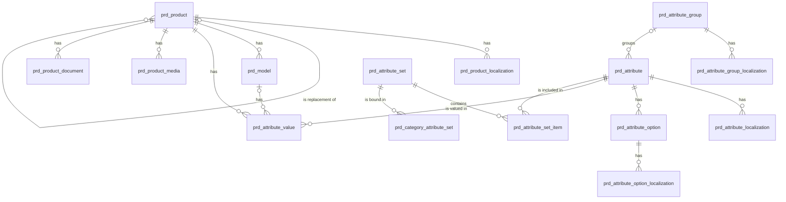

# 产品（product）模块设计

| 项 | 内容 |
|---|---|
| 模块 ID | `product` |
| 名称 | 产品 |
| 层 | L3 |
| 表前缀 | `prd_` |
| API 前缀 | `product` |
| 可停用 | 是 |
| 模块版本 | 1.0.0（module.json 的 version） |
| 平台版本 | `>=1.0.0 <2.0.0`（module.json 的 platform） |
| 里程碑切片 | M1：基础字段与属性、媒体、文档；M2：—；M3：停产与替代（S8）；属性与选项作为可翻译资源；M4：Excel 导入导出；型号表（详见第 13 节） |
| 模块负责人 | 待定 |
| 文档版本 | V1.5 |
| 状态 | 草案 |
| 更新日期 | 2026-10-20 |
| 依据 | 系统设计 V1.9 第 8 章及 3.2、3.8、24–29 章；平台框架设计 V1.7 第 4、7–13 章；ADR-002、ADR-003、ADR-005、ADR-009、ADR-018 |

> 本文只引用《平台框架设计》第 4 章中的契约，不定义新的跨模块契约；需要新契约时按平台框架设计 2.3 提出契约变更请求。

## 1. 职责与边界

### 1.1 职责

管理产品草稿、属性与属性集、媒体和文档、型号表、停产替代及 Excel 导入导出；注册 PRODUCT 类型并贡献快照、搜索文档、结构化数据与可翻译字段。

功能交付范围按第 13 章分为 M1–M4；表结构、约束与枚举以第 3、4 章为准。

### 1.2 不负责的事

| 事项 | 归属模块 | 边界 |
|---|---|---|
| 内容生命周期与路由 | content / url | 本模块只承担自身职责；不直接修改 cnt_、url_ 表 |
| 身份、权限、设置、任务及审计 | platform-core | 复用平台公共服务 |
| 第三方客户端与网络传输 | infrastructure | 仅经既有端口或 L2 服务使用，不在业务模块引入客户端 |

### 1.3 协作概览

| 协作方式 | 对象 | 本模块行为 |
|---|---|---|
| 服务接口 | ContentApi、UrlApi、MediaApi、TaxonomyApi、FormApi | 方法与事务边界见 2.2；无跨模块表访问 |
| 扩展点 | ContentTypeProvider、PublishContributor、BreadcrumbProvider、SchemaOrgProvider、SeoVariableProvider、SeoRule、SearchDocumentProvider、RelationTypeProvider、MediaReferenceCollector、ContentVariantProvider、TranslatableContentProvider、TranslatableResourceProvider | 实现/收集清单见 2.4、2.5 |
| 领域事件 | 见 2.6 | 与本地事务一起登记，提交后异步投递；重复与过期处理独立验证 |

### 1.4 适用的架构约束

遵守 P2、P3 与 ADR-018：编译依赖只到 platform-core/platform-api，跨模块协作只用第 2 章登记契约；只访问自己的表，禁止跨模块 JOIN/外键。遵守 ADR-003：事务内登记、提交后投递、监听器幂等并检查过期。遵守 ADR-009：每次请求/任务明确站点上下文，站点表默认过滤。

公开读取只用当前语言发布态，不跨语言回退（ADR-005）；预览与公开缓存隔离。后台中文文案与错误集中管理，前台文案经 UiTextApi，样式只用 Design Token。远程端口在数据库事务外调用，密钥经 SecretCipher，不写日志。

## 2. 依赖与契约

### 2.1 module.json

```json
{
  "id": "product",
  "name": "产品",
  "version": "1.0.0",
  "layer": "L3",
  "platform": ">=1.0.0 <2.0.0",
  "requires": {
    "content": "^1.0",
    "url": "^1.0",
    "media": "^1.0",
    "taxonomy": "^1.0"
  },
  "optional": {
    "form": "^1.0"
  },
  "disableable": true,
  "tablePrefix": "prd_",
  "apiPrefix": "product",
  "permissions": [
    {
      "code": "product:product:view",
      "name": "查看产品"
    },
    {
      "code": "content:product:edit",
      "name": "编辑产品"
    },
    {
      "code": "product:attribute:manage",
      "name": "管理产品属性"
    },
    {
      "code": "product:product:import",
      "name": "导入产品"
    },
    {
      "code": "product:product:export",
      "name": "导出产品",
      "sensitive": true
    },
    {
      "code": "content:product:review",
      "name": "审核产品"
    },
    {
      "code": "content:product:publish",
      "name": "发布产品"
    },
    {
      "code": "content:product:delete",
      "name": "删除产品"
    }
  ],
  "menus": [
    {
      "key": "product",
      "name": "产品",
      "parent": "editorial",
      "route": "/product/products",
      "permission": "product:product:view",
      "order": 100
    }
  ],
  "settings": null,
  "components": [
    "product-gallery",
    "product-specification",
    "download-list",
    "product-model-table",
    "product-hero",
    "product-grid",
    "product-category-grid"
  ],
  "events": {
    "publishes": [
      "TranslatableResourceChangedEvent"
    ],
    "subscribes": [
      "TermChangedEvent",
      "ContentPurgedEvent",
      "LocalizationDeletedEvent",
      "MediaDeletedEvent",
      "SiteSettingsChangedEvent",
      "ModuleDisabledEvent",
      "ContentPublishedEvent"
    ]
  }
}
```

描述符为 M0 工程建立后的实现要求；目前尚无实际控制器、Schema 或组件包。依赖只声明运行能力；Maven 仍只依赖 platform-api/core。组件清单是本模块负责的类型，运行时 UI 不登记成可拖入布局的组件。

### 2.2 使用的服务接口

| 接口（平台框架设计小节） | 方法 | 用途 | 调用位置与时机 | 测试替身 |
|---|---|---|---|---|
| `ContentApi`（4.4.16） | lockDraftForWrite、create、updateDraftMeta、markDraftChanged、findPublishedSnapshot、findPublishedCards | 读当前发布快照与卡片；内容类型所属模块创建身份并标记草稿变化 | 读接口在查询阶段调用；写方法加入业务事务，远程文本翻译必须在事务外 | `InMemoryContentApi` |
| `UrlApi`（4.4.17） | generateSlug、validateSlug | 解析当前路径、生成 slug 或规范地址；不读取 url 表 | 读接口在查询阶段调用；写方法加入业务事务，远程文本翻译必须在事务外 | `InMemoryUrlApi` |
| `MediaApi`（4.4.18） | findAll、views、imageSources、setDownloadGate、uploadFromUrl | 媒体视图、图片源与授权下载；不读取媒体表 | 读接口在查询阶段调用；写方法加入业务事务，远程文本翻译必须在事务外 | `InMemoryMediaApi` |
| `TaxonomyApi`（4.4.19） | findTerms、termViews、assignmentsOf | 词汇表、分类视图与内容指派；不读取分类表 | 读接口在查询阶段调用；写方法加入业务事务，远程文本翻译必须在事务外 | `InMemoryTaxonomyApi` |
| `FormApi`（4.4.20） | findForm | 表单摘要与提交视图 | 读接口在查询阶段调用；写方法加入业务事务，远程文本翻译必须在事务外 | `InMemoryFormApi` |
| `SiteApi`（4.4.1） | 按该契约声明的方法 | 语言、站点模块开关 | 业务事务内；站点切换由任务入口完成 | `InMemorySiteApi` |
| `SiteContextProvider`（4.4.2） | 按该契约声明的方法 | 当前站点；异步与任务由 core 恢复 | 业务事务内；站点切换由任务入口完成 | `FakeSiteContextProvider` |
| `PermissionChecker`（4.4.7） | 按该契约声明的方法 | 后台权限与数据范围 | 业务事务内；站点切换由任务入口完成 | `FakePermissionChecker` |
| `AuditApi`（4.4.9） | 按该契约声明的方法 | 同事务写审计，密钥与个人数据脱敏 | 业务事务内；站点切换由任务入口完成 | `InMemoryAuditApi` |
| `EventMetaFactory`（4.4.14） | 按该契约声明的方法 | 事件 ID、版本、站点与操作人 | 业务事务内；站点切换由任务入口完成 | `FakeEventMetaFactory` |
| `JobApi`（4.4.12） | 按该契约声明的方法 | 耗时任务提交、取消、进度与结果 | 业务事务内；站点切换由任务入口完成 | `InMemoryJobApi` |

所有 L2/L3/L4 读写隐式使用当前站点；按 ID 查询单批最多 500。可选服务用 ObjectProvider 注入并检查当前站点启用状态，缺失时降级，不通过业务表绕过服务。


### 2.3 提供的服务接口

不适用：本模块不提供跨模块服务接口；其他模块通过 2.4 的既有扩展点或领域事件协作。

### 2.4 实现的扩展点

| 扩展点（平台框架设计小节） | 计划实现类 | 适用范围 | order | 收集方 |
|---|---|---|---|---|
| `ContentTypeProvider`（4.5.2） | `ProductContentTypeProvider` | PRODUCT，可路由 /products/{slug} | OWNER=500 | content / url（经 content） |
| `PublishContributor`（4.5.3） | `ProductPublishContributor` | PRODUCT：card 与 parts.product 分别实现；OWNER=500 | OWNER=500 | content |
| `BreadcrumbProvider`（4.5.9） | `ProductBreadcrumbProvider` | 按本模块职责及 3、4 章登记的内容/资源类型 | DEFAULT=1000 | delivery / seo |
| `SchemaOrgProvider`（4.5.10） | `ProductSchemaOrgProvider` | 按本模块职责及 3、4 章登记的内容/资源类型 | OWNER=500 | seo |
| `SeoVariableProvider`（4.5.11） | `ProductSeoVariableProvider` | 按本模块职责及 3、4 章登记的内容/资源类型 | DEFAULT=1000 | seo |
| `SeoRule`（4.5.12） | `ProductSeoRule` | 按本模块职责及 3、4 章登记的内容/资源类型 | DEFAULT=1000 | seo |
| `SearchDocumentProvider`（4.5.14） | `ProductSearchDocumentProvider` | PRODUCT：型号、发布分类与 typed attr 分面 | DEFAULT=1000 | search |
| `RelationTypeProvider`（4.5.15） | `ProductRelationTypeProvider` | ACCESSORY_OF / HAS_ACCESSORY / REPLACED_BY / REPLACES | DEFAULT=1000 | graph |
| `MediaReferenceCollector`（4.5.16） | `ProductMediaReferenceCollector` | 按本模块职责及 3、4 章登记的内容/资源类型 | DEFAULT=1000 | media |
| `ContentVariantProvider`（4.5.17） | `ProductContentVariantProvider` | PRODUCT：型号 ID、编号、标题与可用状态 | DEFAULT=1000 | inquiry |
| `TranslatableContentProvider`（4.5.20） | `ProductTranslatableContentProvider` | PRODUCT：名称、摘要、描述、卖点、包装、交期、MOQ 及 TEXT 属性值 | DEFAULT=1000 | translation |
| `TranslatableResourceProvider`（4.5.21） | `ProductTranslatableResourceProvider` | product.attribute_group / product.attribute（含 options） | DEFAULT=1000 | translation |
| `PlatformModule`（4.5.22） | `ProductModule` | 本模块安装/升级；可停用模块提供影响报告与停用后保留数据规则 | DEFAULT=1000 | core |

以上类名为待实现名称。PublishContributor 不调用调用方的写方法，不访问外部服务；翻译提供方只写本模块草稿/资源，先校验源指纹与共同 version。停用时 analyzeDisableImpact 返回本模块内容、组件及外部引用的影响，数据保留。

### 2.5 收集的扩展点

不适用：不收集业务扩展点；PlatformModule 与任务 SPI 由 core 收集。

### 2.6 发布与订阅的事件

发布：

| 事件 | 触发事务 | 现有 payload 字段 | 订阅方 |
|---|---|---|---|
| `TranslatableResourceChangedEvent` | 源语言可翻译文本实际变化时 UPSERTED，资源整体删除时 DELETED；非文本变化与目标语言 apply 不发布此事件 | meta、resourceType、resourceId、change | 框架 4.2.4；未登记发布方的差异在第 14 章列出 |

订阅：

| 事件 | 处理 | 幂等 | 过期与删除 | 失败与重试 |
|---|---|---|---|---|
| `TermChangedEvent` | 按 change/termId 更新相关草稿引用或重算候选；草稿指派不冒充发布态指派 | 本模块事务内的幂等标记与数据变更一起提交；缓存重复失效安全 | 读取当前状态/指纹；只有匹配的当前结果才更新；不以 occurredAt 单独当全序 | 失败抛出保留未完成投递；业务副作用转入已有任务/队列后重试 |
| `ContentPurgedEvent` | 按事件 contentId/localizationIds 清理本模块外部引用或子行；历史业务快照按 4.6 保留；不回查已不存在的父内容 | 本模块事务内的幂等标记与数据变更一起提交；缓存重复失效安全 | 清理使用事件中的 ID；查不到父对象仍须清理 | 失败抛出保留未完成投递；业务副作用转入已有任务/队列后重试 |
| `LocalizationDeletedEvent` | 仅清理对应语言的本模块本地化/投影，不删除其他语言或共享业务字段 | 本模块事务内的幂等标记与数据变更一起提交；缓存重复失效安全 | 清理使用事件中的 ID；查不到父对象仍须清理 | 失败抛出保留未完成投递；业务副作用转入已有任务/队列后重试 |
| `MediaDeletedEvent` | 仅处理被引用媒体：更新当前媒体视图或按 4.6 防御性清理；仍有有效引用的媒体不能被主动删除 | 本模块事务内的幂等标记与数据变更一起提交；缓存重复失效安全 | 清理使用事件中的 ID；查不到父对象仍须清理 | 失败抛出保留未完成投递；业务副作用转入已有任务/队列后重试 |
| `SiteSettingsChangedEvent` | 按 scopes、settingKeys、localeChanges 筛选 4.6 的相关变化；不对无关设置做全量重建 | 本模块事务内的幂等标记与数据变更一起提交；缓存重复失效安全 | 读取当前状态/指纹；只有匹配的当前结果才更新；不以 occurredAt 单独当全序 | 失败抛出保留未完成投递；业务副作用转入已有任务/队列后重试 |
| `ModuleDisabledEvent` | 当前站点隐藏该模块的公开能力，保留自身数据；处理事件.moduleId 而非假定是接收方自身 | 本模块事务内的幂等标记与数据变更一起提交；缓存重复失效安全 | 读取当前状态/指纹；只有匹配的当前结果才更新；不以 occurredAt 单独当全序 | 失败抛出保留未完成投递；业务副作用转入已有任务/队列后重试 |
| `ContentPublishedEvent` | 按第 4.6 节处理事件所标识的对象；副作用只发生在本模块数据范围 | 本模块事务内的幂等标记与数据变更一起提交；缓存重复失效安全 | 读取当前状态/指纹；只有匹配的当前结果才更新；不以 occurredAt 单独当全序 | 失败抛出保留未完成投递；业务副作用转入已有任务/队列后重试 |

监听器按框架 5.8 建立站点/system 上下文；`ContentPurgedEvent` 在模块停用时仍必须清理（deliverWhenModuleDisabled）。其他停用期间跳过并完成的事件，重新启用后通过扫描当前状态补偿，不能假定还会重投。数据库幂等标记与本模块数据在同一事务提交；外部发送、下载、搜索与 CDN 调用不得被数据库长事务包裹，使用已声明的任务/端口和业务幂等键。事件 payload 仅引用框架现有字段，本文不扩展签名。

### 2.7 使用的端口

| 端口（平台框架小节） | 用途 | 测试替身 |
|---|---|---|
| `RemoteFileFetcher`（4.7.13） | 第 5 章外部能力；只通过端口调用基础设施 | `FakeRemoteFileFetcher` |

## 3. 领域模型

### 3.1 聚合、实体与值对象

| 类型 | 名称 | 说明 |
|---|---|---|
| 聚合根 | Product（`prd_product`） | 产品的语言无关业务字段：型号、品牌、主分类、标记（新品 / 热销 / 停产）、替代产品、排序。与 `cnt_content`（type = PRODUCT）1:1，主键即 `content_id`（系统设计 6.1、8.1） |
| 实体 | ProductLocalization（`prd_product_localization`） | 产品在一种语言下的草稿业务字段：名称、副标题、简介、详情、卖点、包装、交期、MOQ；与 `cnt_localization` 按（内容，语言）1:1 |
| 实体 | Model（`prd_model`） | 型号表的一行（系列 + 多个型号，系统设计 8.3）；询盘可精确到型号 |
| 实体 | AttributeValue（`prd_attribute_value`） | EAV 属性值：产品级（`model_id` 为空）或型号级；只有 `TEXT` 类型按语言保存 |
| 实体 | ProductMedia（`prd_product_media`） | 产品图片：封面、图集、示意图 |
| 实体 | ProductDocument（`prd_product_document`） | 产品文档：规格书、手册、证书、CAD；公开或留资（`gated_form_key`） |
| 聚合根 | AttributeGroup（`prd_attribute_group`） | 属性分组（如“电气参数”），名称在本地化表（站点资源） |
| 聚合根 | Attribute（`prd_attribute`） | 属性定义：key、分组、数据类型、标准单位、小数位、双单位显示、筛选 / 搜索 / 对比 / 卡片显示开关 |
| 实体 | AttributeOption（`prd_attribute_option`） | `ENUM` / `MULTI_ENUM` 属性的选项 |
| 实体 | AttributeGroupLocalization、AttributeLocalization、AttributeOptionLocalization | 分组名、属性名、选项名的多语言文本（站点资源，带 `translation_state`、`source_fingerprint`） |
| 聚合根 | AttributeSet（`prd_attribute_set`） | 属性集：包含哪些属性、是否必填、顺序 |
| 实体 | AttributeSetItem（`prd_attribute_set_item`） | 属性集中的一个属性 |
| 实体 | CategoryAttributeSet（`prd_category_attribute_set`） | 产品分类绑定的属性集（子分类继承） |
| 值对象 | DataType | `TEXT`（可翻译）/ `NUMBER` / `RANGE` / `BOOLEAN` / `ENUM` / `MULTI_ENUM` |
| 值对象 | DualUnit | `dual_unit` + `secondary_unit` + `secondary_decimal_places`；换算系数来自代码中的单位注册表，发布时换算写入快照，前台不换算（系统设计 8.1） |
| 值对象 | ProductFlags | `new_arrival`、`hot_selling`、`discontinued` |
| 值对象 | SpecSnapshot | 快照 `product` 部分中的结构化规格 `[{group, items: [{key, label, value, unit, secondaryValue, secondaryUnit}]}]`（系统设计 8.2） |

在系统设计之外补充的字段：

| 补充 | 理由 |
|---|---|
| `prd_product.site_id` 及各子表的 `site_id` | 站点级表必须带 `site_id`，由行级拦截器过滤（系统设计 5.3） |
| 系统设计的 `flags` 拆为 `new_arrival`、`hot_selling`、`discontinued` 三个布尔列；`sort` 改名 `sort_order` | 布尔列可直接用于筛选与 CHECK；与全库排序列命名一致 |
| `group_key`、`attr_key`、`option_key` | 系统设计的 `key` 是 MySQL 关键字（平台框架设计 7.2）；稳定标识用于导入模板列、快照规格 `key`、搜索分面字段 `attr.{attr_key}` 与筛选参数值，不随名称或语言变化 |
| `prd_attribute.precision` 改名 `decimal_places`；补充 `secondary_decimal_places` | `PRECISION` 是 MySQL 保留字；第二单位的显示精度可能不同（系统设计 8.1 的示例 `100 mm (3.94 in)` 与 `5 kg (11 lb)`） |
| 属性分组、属性、选项、属性集的 `deleted_at` | 配置类实体软删除（平台框架设计 7.5）；其 ID 被属性值与快照引用 |
| `prd_attribute_set.name`、`description` | 后台显示与选择（只在后台使用，不翻译） |
| `prd_category_attribute_set.sort_order` | 一个分类可以绑定多个属性集，编辑页按此顺序合并 |
| `prd_attribute_value.model_key`、`locale_key`（虚拟生成列） | `model_id`、`locale` 可空，唯一索引中 NULL 互不相等；用生成列把 NULL 规范化后保证“每个产品 / 型号 / 语言的每个属性一个值” |
| `prd_product_media.cover_flag`（生成列） | 用唯一索引保证每个产品最多一张封面 |
| `prd_product_localization.version`、`prd_product.version` | 产品编辑页按标签整体保存，乐观锁防止并发覆盖 |

### 3.2 不变量

| # | 规则 | 保证方式 |
|---|---|---|
| 1 | `prd_product` 与 `cnt_content`（type = PRODUCT）1:1；`content_id` 由 `ContentApi.create(PRODUCT, zh-CN)` 在同一事务中返回 | 应用层 |
| 2 | 产品的每个 `cnt_localization` 恰有一条同语言的 `prd_product_localization`；每个产品每种语言最多一条 | 数据库：`uk_ploc_product_locale`；应用层（创建本地化时同时写入） |
| 3 | 站点内非空的产品 `model_no` 唯一（导入匹配键）；同一产品内型号 `model_no` 唯一 | 数据库：`uk_product_model`、`uk_model_no` |
| 4 | 替代产品不是自身，属于同一站点 | 数据库：`ck_prd_product_replacement`；应用层 |
| 5 | 发布时必须有主分类；`primary_category_term_id` 等于 `tx_assignment` 中 `product_category` 词汇表的主分类 | 应用层（产品编辑页的分类由 product 接口保存，同一事务中经 `TaxonomyApi` 写入指派并同步本列；发布校验） |
| 6 | 站点内未删除的 `group_key`、`attr_key` 唯一；同一属性内未删除的 `option_key` 唯一；key 创建后不可修改 | 数据库：`uk_ag_key`、`uk_attr_key`、`uk_opt_key`；应用层 |
| 7 | 单位、小数位、双单位只用于 `NUMBER` / `RANGE`；开启 `dual_unit` 时 `unit`、`secondary_unit` 非空且不同；两个单位属于同一量纲（单位注册表中存在换算） | 数据库：`ck_prd_attr_unit`、`ck_prd_attr_dual`、`ck_prd_attr_decimals`；应用层（量纲） |
| 8 | `TEXT` 属性不能作为筛选分面（值按语言不同且不规范；需要筛选时改用 `ENUM`） | 数据库：`ck_prd_attr_filter` |
| 9 | 每条属性值恰好使用一种取值列，且与属性的 `data_type` 匹配：TEXT → `value_text`；NUMBER → `value_number`；RANGE → `value_number` + `value_number_max`；BOOLEAN → `value_bool`；ENUM → `option_ids`（1 个元素）；MULTI_ENUM → `option_ids`（≥ 1 个元素） | 数据库：`ck_prd_av_kind`（恰好一种）；应用层（与类型匹配） |
| 10 | 只有 `TEXT` 值带 `locale`（每种语言一行）；其他类型 `locale` 为空，所有语言共用 | 数据库：`ck_prd_av_locale`；应用层 |
| 11 | 每个（产品，属性，型号，语言）最多一个值 | 数据库：`uk_av_value` |
| 12 | `RANGE` 的最大值不小于最小值；数值一律按属性的标准单位 `unit` 存储（导入时换算） | 数据库：`ck_prd_av_range`；应用层 |
| 13 | 型号级值（`model_id` 非空）只用于 `comparable = 1` 的属性；型号属于同一产品 | 应用层 |
| 14 | `option_ids` 中的选项属于该属性且未删除 | 应用层 |
| 15 | 被属性集引用或已有取值的属性不能删除；已有取值引用的选项不能删除 | 数据库：`fk_prd_asi_attr`、`fk_prd_av_attr`（RESTRICT，针对物理删除）；应用层（软删除前检查） |
| 16 | 每个产品最多一张封面；同一媒体在同一角色中只出现一次 | 数据库：`uk_pm_cover`、`uk_pm_media` |
| 17 | 留资文档（`gated_form_key` 非空）的媒体为 `PRIVATE`，表单存在、启用且用途为 `DOWNLOAD`；公开文档的媒体为 `PUBLIC` | 应用层（发布校验 ERROR） |
| 18 | `prd_category_attribute_set.term_id` 属于 `product_category` 词汇表 | 应用层 |
| 19 | 站点资源本地化：每个分组 / 属性 / 选项每种语言最多一条；中文行 `translation_state = NONE`、`source_fingerprint` 为空 | 数据库：`uk_agl_group_locale`、`uk_al_attr_locale`、`uk_ol_option_locale`；应用层 |
| 20 | 子表的 `site_id` 与父表一致 | 应用层 |

### 3.3 状态机

内容发布状态与草稿状态均由 ContentApi 管理，完整转换见 content 模块 3.3 和系统设计 6.3；本模块不复制状态列或自行转换。保存业务草稿只改变内容共同 version 与草稿状态，发布经 PublishContributor 参与同一事务；回收站、恢复、下线与翻译模式按内容内核执行。配置及站点资源保存即生效，不伪装成内容发布。

## 4. 数据模型

> 遵守平台框架设计第 7 章的数据库通用约定。本节给出待实现 DDL；本次文档审查未重跑 MySQL，不能据此认定 DDL 已验证。M0 后按第 11 章在 MySQL 8.4 空库验证，并使实际迁移脚本与本节一致。

### 4.1 表清单

| 表 | 说明 | 站点级 | 软删除 | 预估规模（单站，按系统设计假设 A4） |
|---|---|---|---|---|
| `prd_product` | 产品（语言无关业务字段） | 是 | 否（随内容回收站） | ≤ 1 万行 |
| `prd_product_localization` | 产品本地化（内容类草稿） | 是 | 否 | ≤ 10 万行（× 10 种语言） |
| `prd_attribute_group` | 属性分组 | 是 | 是（`deleted_at`） | 10–50 行 |
| `prd_attribute_group_localization` | 属性分组本地化（站点资源） | 是 | 否（随分组） | ≤ 500 行 |
| `prd_attribute` | 属性定义 | 是 | 是（`deleted_at`） | 100–500 行 |
| `prd_attribute_localization` | 属性本地化（站点资源） | 是 | 否（随属性） | ≤ 5 千行 |
| `prd_attribute_option` | 枚举选项 | 是 | 是（`deleted_at`） | 1 千–5 千行 |
| `prd_attribute_option_localization` | 选项本地化（站点资源） | 是 | 否（随选项） | ≤ 5 万行 |
| `prd_attribute_set` | 属性集 | 是 | 是（`deleted_at`） | 10–100 行 |
| `prd_attribute_set_item` | 属性集中的属性 | 是 | 否 | 500–3 千行 |
| `prd_category_attribute_set` | 产品分类绑定属性集 | 是 | 否 | 50–500 行 |
| `prd_model` | 型号表的行 | 是 | 否 | ≈ 5 万行（平均每个产品 5 个型号） |
| `prd_attribute_value` | 属性值（EAV，草稿态） | 是 | 否 | ≈ 100 万行（产品级 1 万 × 20；型号级 5 万 × 10；TEXT 1 万 × 3 × 10 种语言） |
| `prd_product_media` | 产品图片 | 是 | 否 | ≈ 8 万行 |
| `prd_product_document` | 产品文档 | 是 | 否 | ≈ 3 万行 |

### 4.2 ER 图



### 4.3 表结构

类型列中的 `bin` 表示该列排序规则为 `utf8mb4_0900_bin`（本模块各表同）。

#### 4.3.1 `prd_product`：产品

| 字段 | 类型 | 可空 | 默认 | 说明 |
|---|---|---|---|---|
| `content_id` | BIGINT | 否 | — | 内容 ID（cnt_content.id，类型 PRODUCT），即产品主键 |
| `site_id` | BIGINT | 否 | — | 站点 ID（sys_site.id） |
| `model_no` | VARCHAR(100) bin | 是 | — | 产品型号（系列号或主型号；站点内唯一，导入匹配键；不翻译） |
| `brand` | VARCHAR(100) | 是 | — | 品牌（不翻译；Schema.org Product.brand） |
| `primary_category_term_id` | BIGINT | 是 | — | 主分类 ID（tx_term.id，词汇表 product_category）；冗余 tx_assignment 中的主分类；发布时必填 |
| `new_arrival` | TINYINT(1) | 否 | `0` | 标记：新品 |
| `hot_selling` | TINYINT(1) | 否 | `0` | 标记：热销 |
| `discontinued` | TINYINT(1) | 否 | `0` | 标记：停产（页面显示停产标识与替代产品链接，继续可索引） |
| `replacement_content_id` | BIGINT | 是 | — | 替代产品的内容 ID（prd_product.content_id），停产时填写 |
| `sort_order` | INT | 否 | `0` | 排序值（越小越靠前，用于后台列表与 content-query 的手工排序） |
| `version` | INT | 否 | `0` | 乐观锁版本号 |
| `created_at` | DATETIME(3) | 否 | `CURRENT_TIMESTAMP(3)` | 创建时间（UTC） |
| `created_by` | BIGINT | 否 | `0` | 创建人用户 ID（0 = 系统，如导入） |
| `updated_at` | DATETIME(3) | 否 | `CURRENT_TIMESTAMP(3) ON UPDATE CURRENT_TIMESTAMP(3)` | 更新时间（UTC） |
| `updated_by` | BIGINT | 否 | `0` | 更新人用户 ID（0 = 系统） |

索引与约束：
- `PRIMARY KEY (content_id)`
- `uk_product_model (site_id, model_no)`：站点内型号唯一（NULL 不参与）；导入按型号匹配、后台按型号查找
- `idx_product_category (site_id, primary_category_term_id, sort_order)`：后台按分类筛选产品（系统设计 8.7）；分类项删除时查找受影响产品
- `idx_product_replacement (replacement_content_id)`：被替代产品彻底删除前，查找以它为替代的产品；兼作 `fk_prd_product_replacement` 的索引
- `fk_prd_product_replacement`：引用关系（RESTRICT）
- `ck_prd_product_replacement`：见 3.2 不变量 4

```sql
CREATE TABLE prd_product (
  content_id                BIGINT        NOT NULL COMMENT '内容 ID（cnt_content.id，类型 PRODUCT），即产品主键',
  site_id                   BIGINT        NOT NULL COMMENT '站点 ID（sys_site.id）',
  model_no                  VARCHAR(100)  COLLATE utf8mb4_0900_bin NULL COMMENT '产品型号（系列号或主型号；站点内唯一，导入匹配键；不翻译）',
  brand                     VARCHAR(100)  NULL COMMENT '品牌（不翻译；Schema.org Product.brand）',
  primary_category_term_id  BIGINT        NULL COMMENT '主分类 ID（tx_term.id，词汇表 product_category）；冗余 tx_assignment 中的主分类；发布时必填',
  new_arrival               TINYINT(1)    NOT NULL DEFAULT 0 COMMENT '标记：新品',
  hot_selling               TINYINT(1)    NOT NULL DEFAULT 0 COMMENT '标记：热销',
  discontinued              TINYINT(1)    NOT NULL DEFAULT 0 COMMENT '标记：停产（页面显示停产标识与替代产品链接，继续可索引）',
  replacement_content_id    BIGINT        NULL COMMENT '替代产品的内容 ID（prd_product.content_id），停产时填写',
  sort_order                INT           NOT NULL DEFAULT 0 COMMENT '排序值（越小越靠前，用于后台列表与 content-query 的手工排序）',
  version                   INT           NOT NULL DEFAULT 0 COMMENT '乐观锁版本号',
  created_at                DATETIME(3)   NOT NULL DEFAULT CURRENT_TIMESTAMP(3) COMMENT '创建时间（UTC）',
  created_by                BIGINT        NOT NULL DEFAULT 0 COMMENT '创建人用户 ID（0 = 系统，如导入）',
  updated_at                DATETIME(3)   NOT NULL DEFAULT CURRENT_TIMESTAMP(3) ON UPDATE CURRENT_TIMESTAMP(3) COMMENT '更新时间（UTC）',
  updated_by                BIGINT        NOT NULL DEFAULT 0 COMMENT '更新人用户 ID（0 = 系统）',
  PRIMARY KEY (content_id),
  UNIQUE KEY uk_product_model (site_id, model_no),
  KEY idx_product_category (site_id, primary_category_term_id, sort_order),
  KEY idx_product_replacement (replacement_content_id),
  CONSTRAINT fk_prd_product_replacement FOREIGN KEY (replacement_content_id) REFERENCES prd_product (content_id),
  CONSTRAINT ck_prd_product_replacement CHECK (replacement_content_id IS NULL OR replacement_content_id <> content_id)
) ENGINE = InnoDB DEFAULT CHARSET = utf8mb4 COLLATE = utf8mb4_0900_ai_ci COMMENT = '产品（与 cnt_content 1:1 的语言无关业务字段：型号、品牌、主分类、标记、替代产品）';
```

要点：
- 主键沿用系统设计 6.1、8.1 的 `content_id`（产品身份即内容身份），不另设 `id`；子表以 `product_id` 引用本列。
- 内容在回收站时本行保留，`model_no` 仍占用唯一键；恢复时无冲突。彻底删除时由 `ContentPurgedEvent` 驱动物理删除（见 4.6）。
- 停产与替代（系统设计 8.5）：`discontinued`、`replacement_content_id` 进入快照；替代产品未发布时前台不渲染替代链接（`$content` 解析降级）。下线时选择 `REDIRECT_CONTENT` 到替代产品或 `REDIRECT_PARENT` 到主分类页，由 product 实现的下线目标解析扩展返回 `primary_category_term_id` 对应的 TERM_PAGE。
- 型号、品牌、标记、主分类、替代产品是非文本数据，所有语言沿用（系统设计 8.1）。

#### 4.3.2 `prd_product_localization`：产品本地化

| 字段 | 类型 | 可空 | 默认 | 说明 |
|---|---|---|---|---|
| `id` | BIGINT | 否 | — | 主键（TSID） |
| `site_id` | BIGINT | 否 | — | 站点 ID（sys_site.id） |
| `product_id` | BIGINT | 否 | — | 产品 ID（prd_product.content_id，即 cnt_content.id） |
| `locale` | VARCHAR(16) | 否 | — | 语言（BCP 47），与 cnt_localization.locale 一一对应 |
| `name` | VARCHAR(300) | 否 | — | 产品名称（同步为 cnt_localization.draft_title；快照 card.title） |
| `subtitle` | VARCHAR(300) | 是 | — | 副标题 |
| `summary` | VARCHAR(1000) | 是 | — | 简介（纯文本；快照 card.summary） |
| `description` | JSON | 是 | — | 详情（ProseMirror JSON 富文本） |
| `selling_points` | JSON | 否 | `(JSON_ARRAY())` | 卖点列表：字符串数组，如 ["循环寿命 6000 次", "IP65 防护"] |
| `packaging` | VARCHAR(1000) | 是 | — | 包装信息（纯文本） |
| `lead_time` | VARCHAR(200) | 是 | — | 交期文本，如“15–30 天” |
| `moq` | VARCHAR(200) | 是 | — | 最小起订量文本（MOQ），如“100 件” |
| `version` | INT | 否 | `0` | 乐观锁版本号 |
| `created_at` | DATETIME(3) | 否 | `CURRENT_TIMESTAMP(3)` | 创建时间（UTC） |
| `created_by` | BIGINT | 否 | `0` | 创建人用户 ID（0 = 系统，如译文回写、导入） |
| `updated_at` | DATETIME(3) | 否 | `CURRENT_TIMESTAMP(3) ON UPDATE CURRENT_TIMESTAMP(3)` | 更新时间（UTC） |
| `updated_by` | BIGINT | 否 | `0` | 更新人用户 ID（0 = 系统，如译文回写） |

索引与约束：
- `PRIMARY KEY (id)`
- `uk_ploc_product_locale (product_id, locale)`：每种语言一条；编辑页、发布组装快照、译文回写按（产品，语言）读写；兼作 `fk_prd_ploc_product` 的索引
- `idx_ploc_name (site_id, locale, name)`：后台按名称搜索产品（ProductPicker、询盘明细选择产品）
- `fk_prd_ploc_product`：组合关系，`ON DELETE CASCADE`

```sql
CREATE TABLE prd_product_localization (
  id              BIGINT         NOT NULL COMMENT '主键（TSID）',
  site_id         BIGINT         NOT NULL COMMENT '站点 ID（sys_site.id）',
  product_id      BIGINT         NOT NULL COMMENT '产品 ID（prd_product.content_id，即 cnt_content.id）',
  locale          VARCHAR(16)    NOT NULL COMMENT '语言（BCP 47），与 cnt_localization.locale 一一对应',
  name            VARCHAR(300)   NOT NULL COMMENT '产品名称（同步为 cnt_localization.draft_title；快照 card.title）',
  subtitle        VARCHAR(300)   NULL COMMENT '副标题',
  summary         VARCHAR(1000)  NULL COMMENT '简介（纯文本；快照 card.summary）',
  description     JSON           NULL COMMENT '详情（ProseMirror JSON 富文本）',
  selling_points  JSON           NOT NULL DEFAULT (JSON_ARRAY()) COMMENT '卖点列表：字符串数组，如 ["循环寿命 6000 次", "IP65 防护"]',
  packaging       VARCHAR(1000)  NULL COMMENT '包装信息（纯文本）',
  lead_time       VARCHAR(200)   NULL COMMENT '交期文本，如“15–30 天”',
  moq             VARCHAR(200)   NULL COMMENT '最小起订量文本（MOQ），如“100 件”',
  version         INT            NOT NULL DEFAULT 0 COMMENT '乐观锁版本号',
  created_at      DATETIME(3)    NOT NULL DEFAULT CURRENT_TIMESTAMP(3) COMMENT '创建时间（UTC）',
  created_by      BIGINT         NOT NULL DEFAULT 0 COMMENT '创建人用户 ID（0 = 系统，如译文回写、导入）',
  updated_at      DATETIME(3)    NOT NULL DEFAULT CURRENT_TIMESTAMP(3) ON UPDATE CURRENT_TIMESTAMP(3) COMMENT '更新时间（UTC）',
  updated_by      BIGINT         NOT NULL DEFAULT 0 COMMENT '更新人用户 ID（0 = 系统，如译文回写）',
  PRIMARY KEY (id),
  UNIQUE KEY uk_ploc_product_locale (product_id, locale),
  KEY idx_ploc_name (site_id, locale, name),
  CONSTRAINT fk_prd_ploc_product FOREIGN KEY (product_id) REFERENCES prd_product (content_id) ON DELETE CASCADE
) ENGINE = InnoDB DEFAULT CHARSET = utf8mb4 COLLATE = utf8mb4_0900_ai_ci COMMENT = '产品本地化（内容类草稿：名称、副标题、简介、详情、卖点、包装、交期、MOQ）';
```

要点：
- 内容类本地化表，不带翻译状态；翻译模式与状态在 `cnt_localization`（平台框架设计 7.7）。保存草稿时经 `ContentApi.updateDraftMeta()` 同步 `draft_title`。
- 翻译：product 的 `TranslatableContentProvider` 从中文行提取 `name`、`subtitle`、`summary`、`description`（按块级节点拆分）、`selling_points[]`、`packaging`、`lead_time`、`moq` 与 `TEXT` 属性值（4.3.13）；`apply()` 写入或覆盖目标语言行（目标行不存在时创建）。`MANUAL` 模式的本地化由编辑直接修改本行。

#### 4.3.3 `prd_attribute_group`：属性分组

| 字段 | 类型 | 可空 | 默认 | 说明 |
|---|---|---|---|---|
| `id` | BIGINT | 否 | — | 主键（TSID） |
| `site_id` | BIGINT | 否 | — | 站点 ID（sys_site.id） |
| `group_key` | VARCHAR(64) bin | 否 | — | 分组 key（小写字母、数字、下划线；创建后不可修改），如 electrical |
| `sort_order` | INT | 否 | `0` | 分组在规格表中的顺序 |
| `deleted_at` | DATETIME(3) | 是 | — | 删除时间（软删除） |
| `alive` | TINYINT | 是 | 生成列 `IF(deleted_at IS NULL, 1, NULL)` | 未删除标记（唯一索引用） |
| `version` | INT | 否 | `0` | 乐观锁版本号 |
| `created_at` | DATETIME(3) | 否 | `CURRENT_TIMESTAMP(3)` | 创建时间（UTC） |
| `created_by` | BIGINT | 否 | `0` | 创建人用户 ID（0 = 系统） |
| `updated_at` | DATETIME(3) | 否 | `CURRENT_TIMESTAMP(3) ON UPDATE CURRENT_TIMESTAMP(3)` | 更新时间（UTC） |
| `updated_by` | BIGINT | 否 | `0` | 更新人用户 ID（0 = 系统） |

索引与约束：
- `PRIMARY KEY (id)`
- `uk_ag_key (site_id, group_key, alive)`：未删除的 key 唯一；站点的分组列表；导入按 key 查找

```sql
CREATE TABLE prd_attribute_group (
  id          BIGINT       NOT NULL COMMENT '主键（TSID）',
  site_id     BIGINT       NOT NULL COMMENT '站点 ID（sys_site.id）',
  group_key   VARCHAR(64)  COLLATE utf8mb4_0900_bin NOT NULL COMMENT '分组 key（小写字母、数字、下划线；创建后不可修改），如 electrical',
  sort_order  INT          NOT NULL DEFAULT 0 COMMENT '分组在规格表中的顺序',
  deleted_at  DATETIME(3)  NULL COMMENT '删除时间（软删除）',
  alive       TINYINT      AS (IF(deleted_at IS NULL, 1, NULL)) STORED COMMENT '未删除标记（唯一索引用）',
  version     INT          NOT NULL DEFAULT 0 COMMENT '乐观锁版本号',
  created_at  DATETIME(3)  NOT NULL DEFAULT CURRENT_TIMESTAMP(3) COMMENT '创建时间（UTC）',
  created_by  BIGINT       NOT NULL DEFAULT 0 COMMENT '创建人用户 ID（0 = 系统）',
  updated_at  DATETIME(3)  NOT NULL DEFAULT CURRENT_TIMESTAMP(3) ON UPDATE CURRENT_TIMESTAMP(3) COMMENT '更新时间（UTC）',
  updated_by  BIGINT       NOT NULL DEFAULT 0 COMMENT '更新人用户 ID（0 = 系统）',
  PRIMARY KEY (id),
  UNIQUE KEY uk_ag_key (site_id, group_key, alive)
) ENGINE = InnoDB DEFAULT CHARSET = utf8mb4 COLLATE = utf8mb4_0900_ai_ci COMMENT = '属性分组（如电气参数、机械参数）';
```

要点：有未删除属性的分组不能删除（应用层）；没有分组的属性在规格表中归入“其他”分组（文案键 `product.spec.group.other`）。

#### 4.3.4 `prd_attribute_group_localization`：属性分组本地化

| 字段 | 类型 | 可空 | 默认 | 说明 |
|---|---|---|---|---|
| `id` | BIGINT | 否 | — | 主键（TSID） |
| `site_id` | BIGINT | 否 | — | 站点 ID（sys_site.id） |
| `group_id` | BIGINT | 否 | — | 属性分组 ID（prd_attribute_group.id） |
| `locale` | VARCHAR(16) | 否 | — | 语言（BCP 47） |
| `name` | VARCHAR(100) | 否 | — | 分组名（站点资源：中文录入，其他语言由 translation 经 TranslatableResourceProvider 写入），如“电气参数” |
| `translation_state` | VARCHAR(16) | 否 | `'NONE'` | 翻译状态：NONE / QUEUED / TRANSLATED / NEEDS_REVIEW / FAILED / OUTDATED |
| `source_fingerprint` | CHAR(64) bin | 是 | — | 生成本行译文时中文行的指纹（规范化 name 的 SHA-256）；中文行为空；与当前中文指纹不同即为过期 |
| `version` | INT | 否 | `0` | 乐观锁版本号 |
| `created_at` | DATETIME(3) | 否 | `CURRENT_TIMESTAMP(3)` | 创建时间（UTC） |
| `created_by` | BIGINT | 否 | `0` | 创建人用户 ID（0 = 系统） |
| `updated_at` | DATETIME(3) | 否 | `CURRENT_TIMESTAMP(3) ON UPDATE CURRENT_TIMESTAMP(3)` | 更新时间（UTC） |
| `updated_by` | BIGINT | 否 | `0` | 更新人用户 ID（0 = 系统） |

索引与约束：
- `PRIMARY KEY (id)`
- `uk_agl_group_locale (group_id, locale)`：每种语言一条；按分组取各语言名称；兼作 `fk_prd_agl_group` 的索引
- `idx_agl_state (site_id, translation_state, locale)`：翻译中心列出待处理的分组名
- `fk_prd_agl_group`：组合关系，`ON DELETE CASCADE`

```sql
CREATE TABLE prd_attribute_group_localization (
  id                  BIGINT        NOT NULL COMMENT '主键（TSID）',
  site_id             BIGINT        NOT NULL COMMENT '站点 ID（sys_site.id）',
  group_id            BIGINT        NOT NULL COMMENT '属性分组 ID（prd_attribute_group.id）',
  locale              VARCHAR(16)   NOT NULL COMMENT '语言（BCP 47）',
  name                VARCHAR(100)  NOT NULL COMMENT '分组名（站点资源：中文录入，其他语言由 translation 经 TranslatableResourceProvider 写入），如“电气参数”',
  translation_state   VARCHAR(16)   NOT NULL DEFAULT 'NONE' COMMENT '翻译状态：NONE / QUEUED / TRANSLATED / NEEDS_REVIEW / FAILED / OUTDATED',
  source_fingerprint  CHAR(64)      COLLATE utf8mb4_0900_bin NULL COMMENT '生成本行译文时中文行的指纹（规范化 name 的 SHA-256）；中文行为空；与当前中文指纹不同即为过期',
  version             INT           NOT NULL DEFAULT 0 COMMENT '乐观锁版本号',
  created_at          DATETIME(3)   NOT NULL DEFAULT CURRENT_TIMESTAMP(3) COMMENT '创建时间（UTC）',
  created_by          BIGINT        NOT NULL DEFAULT 0 COMMENT '创建人用户 ID（0 = 系统）',
  updated_at          DATETIME(3)   NOT NULL DEFAULT CURRENT_TIMESTAMP(3) ON UPDATE CURRENT_TIMESTAMP(3) COMMENT '更新时间（UTC）',
  updated_by          BIGINT        NOT NULL DEFAULT 0 COMMENT '更新人用户 ID（0 = 系统）',
  PRIMARY KEY (id),
  UNIQUE KEY uk_agl_group_locale (group_id, locale),
  KEY idx_agl_state (site_id, translation_state, locale),
  CONSTRAINT fk_prd_agl_group FOREIGN KEY (group_id) REFERENCES prd_attribute_group (id) ON DELETE CASCADE
) ENGINE = InnoDB DEFAULT CHARSET = utf8mb4 COLLATE = utf8mb4_0900_ai_ci COMMENT = '属性分组本地化（分组名为站点资源，带翻译状态与源指纹）';
```

要点：中文 `name` 变化时发布 `TranslatableResourceChangedEvent`（资源类型 `product.attribute_group`，ID 为 `group_id`）；translation 回写目标语言行并设置 `translation_state` 与 `source_fingerprint`（系统设计 5.7、8.1）。属性与选项的本地化表（4.3.6、4.3.8）同理。

#### 4.3.5 `prd_attribute`：属性定义

| 字段 | 类型 | 可空 | 默认 | 说明 |
|---|---|---|---|---|
| `id` | BIGINT | 否 | — | 主键（TSID） |
| `site_id` | BIGINT | 否 | — | 站点 ID（sys_site.id） |
| `attr_key` | VARCHAR(64) bin | 否 | — | 属性 key（小写字母、数字、下划线；创建后不可修改）；快照规格 key 与搜索分面字段 attr.{attr_key}，如 voltage |
| `group_id` | BIGINT | 是 | — | 属性分组 ID（prd_attribute_group.id）；空 = 归入“其他” |
| `data_type` | VARCHAR(16) | 否 | — | 数据类型：TEXT（可翻译）/ NUMBER / RANGE / BOOLEAN / ENUM / MULTI_ENUM；有取值后不可修改 |
| `unit` | VARCHAR(16) bin | 是 | — | 标准单位（NUMBER / RANGE；单位注册表中的符号，如 mm、kg、V、Ah、°C）；数值按此单位存储 |
| `decimal_places` | TINYINT | 是 | — | 显示小数位数（0–6，NUMBER / RANGE）；空 = 按存储值去除末尾 0 显示 |
| `dual_unit` | TINYINT(1) | 否 | `0` | 是否双单位显示（公制 + 英制，如 100 mm (3.94 in)）；只用于 NUMBER / RANGE |
| `secondary_unit` | VARCHAR(16) bin | 是 | — | 第二单位（与 unit 同一量纲，如 in、lb、°F）；dual_unit = 1 时必填 |
| `secondary_decimal_places` | TINYINT | 是 | — | 第二单位的显示小数位数（0–6）；空 = 同 decimal_places |
| `filterable` | TINYINT(1) | 否 | `0` | 是否作为列表筛选分面（写入搜索索引 attr.{attr_key}）；TEXT 不可开启 |
| `searchable` | TINYINT(1) | 否 | `0` | 取值是否参与站内全文搜索 |
| `comparable` | TINYINT(1) | 否 | `0` | 是否可比较：出现在型号对比表，允许型号级取值 |
| `show_on_card` | TINYINT(1) | 否 | `0` | 是否在产品卡片上显示（关键参数） |
| `sort_order` | INT | 否 | `0` | 分组内的默认顺序（属性集中的顺序优先） |
| `deleted_at` | DATETIME(3) | 是 | — | 删除时间（软删除） |
| `alive` | TINYINT | 是 | 生成列 `IF(deleted_at IS NULL, 1, NULL)` | 未删除标记（唯一索引用） |
| `version` | INT | 否 | `0` | 乐观锁版本号 |
| `created_at` | DATETIME(3) | 否 | `CURRENT_TIMESTAMP(3)` | 创建时间（UTC） |
| `created_by` | BIGINT | 否 | `0` | 创建人用户 ID（0 = 系统） |
| `updated_at` | DATETIME(3) | 否 | `CURRENT_TIMESTAMP(3) ON UPDATE CURRENT_TIMESTAMP(3)` | 更新时间（UTC） |
| `updated_by` | BIGINT | 否 | `0` | 更新人用户 ID（0 = 系统） |

索引与约束：
- `PRIMARY KEY (id)`
- `uk_attr_key (site_id, attr_key, alive)`：未删除的 key 唯一；按 key 查找（导入模板列、搜索文档组装）；站点的属性列表
- `idx_attr_group (group_id, sort_order)`：分组下的属性列表；兼作 `fk_prd_attr_group` 的索引
- `fk_prd_attr_group`：引用关系（RESTRICT）
- `ck_prd_attr_unit`、`ck_prd_attr_dual`、`ck_prd_attr_decimals`、`ck_prd_attr_filter`：见 3.2 不变量 7、8

```sql
CREATE TABLE prd_attribute (
  id                        BIGINT       NOT NULL COMMENT '主键（TSID）',
  site_id                   BIGINT       NOT NULL COMMENT '站点 ID（sys_site.id）',
  attr_key                  VARCHAR(64)  COLLATE utf8mb4_0900_bin NOT NULL COMMENT '属性 key（小写字母、数字、下划线；创建后不可修改）；快照规格 key 与搜索分面字段 attr.{attr_key}，如 voltage',
  group_id                  BIGINT       NULL COMMENT '属性分组 ID（prd_attribute_group.id）；空 = 归入“其他”',
  data_type                 VARCHAR(16)  NOT NULL COMMENT '数据类型：TEXT（可翻译）/ NUMBER / RANGE / BOOLEAN / ENUM / MULTI_ENUM；有取值后不可修改',
  unit                      VARCHAR(16)  COLLATE utf8mb4_0900_bin NULL COMMENT '标准单位（NUMBER / RANGE；单位注册表中的符号，如 mm、kg、V、Ah、°C）；数值按此单位存储',
  decimal_places            TINYINT      NULL COMMENT '显示小数位数（0–6，NUMBER / RANGE）；空 = 按存储值去除末尾 0 显示',
  dual_unit                 TINYINT(1)   NOT NULL DEFAULT 0 COMMENT '是否双单位显示（公制 + 英制，如 100 mm (3.94 in)）；只用于 NUMBER / RANGE',
  secondary_unit            VARCHAR(16)  COLLATE utf8mb4_0900_bin NULL COMMENT '第二单位（与 unit 同一量纲，如 in、lb、°F）；dual_unit = 1 时必填',
  secondary_decimal_places  TINYINT      NULL COMMENT '第二单位的显示小数位数（0–6）；空 = 同 decimal_places',
  filterable                TINYINT(1)   NOT NULL DEFAULT 0 COMMENT '是否作为列表筛选分面（写入搜索索引 attr.{attr_key}）；TEXT 不可开启',
  searchable                TINYINT(1)   NOT NULL DEFAULT 0 COMMENT '取值是否参与站内全文搜索',
  comparable                TINYINT(1)   NOT NULL DEFAULT 0 COMMENT '是否可比较：出现在型号对比表，允许型号级取值',
  show_on_card              TINYINT(1)   NOT NULL DEFAULT 0 COMMENT '是否在产品卡片上显示（关键参数）',
  sort_order                INT          NOT NULL DEFAULT 0 COMMENT '分组内的默认顺序（属性集中的顺序优先）',
  deleted_at                DATETIME(3)  NULL COMMENT '删除时间（软删除）',
  alive                     TINYINT      AS (IF(deleted_at IS NULL, 1, NULL)) STORED COMMENT '未删除标记（唯一索引用）',
  version                   INT          NOT NULL DEFAULT 0 COMMENT '乐观锁版本号',
  created_at                DATETIME(3)  NOT NULL DEFAULT CURRENT_TIMESTAMP(3) COMMENT '创建时间（UTC）',
  created_by                BIGINT       NOT NULL DEFAULT 0 COMMENT '创建人用户 ID（0 = 系统）',
  updated_at                DATETIME(3)  NOT NULL DEFAULT CURRENT_TIMESTAMP(3) ON UPDATE CURRENT_TIMESTAMP(3) COMMENT '更新时间（UTC）',
  updated_by                BIGINT       NOT NULL DEFAULT 0 COMMENT '更新人用户 ID（0 = 系统）',
  PRIMARY KEY (id),
  UNIQUE KEY uk_attr_key (site_id, attr_key, alive),
  KEY idx_attr_group (group_id, sort_order),
  CONSTRAINT fk_prd_attr_group FOREIGN KEY (group_id) REFERENCES prd_attribute_group (id),
  CONSTRAINT ck_prd_attr_unit CHECK (data_type IN ('NUMBER', 'RANGE') OR (unit IS NULL AND decimal_places IS NULL AND dual_unit = 0)),
  CONSTRAINT ck_prd_attr_dual CHECK (dual_unit = 0 OR (unit IS NOT NULL AND secondary_unit IS NOT NULL AND secondary_unit <> unit)),
  CONSTRAINT ck_prd_attr_decimals CHECK ((decimal_places IS NULL OR decimal_places BETWEEN 0 AND 6) AND (secondary_decimal_places IS NULL OR secondary_decimal_places BETWEEN 0 AND 6)),
  CONSTRAINT ck_prd_attr_filter CHECK (filterable = 0 OR data_type <> 'TEXT')
) ENGINE = InnoDB DEFAULT CHARSET = utf8mb4 COLLATE = utf8mb4_0900_ai_ci COMMENT = '产品属性定义（数据类型、标准单位、双单位显示、筛选 / 搜索 / 对比 / 卡片开关）';
```

要点：
- 双单位（系统设计 8.1、8.2）：发布时 product 的 `PublishContributor` 按单位注册表把 `value_number`（与 `value_number_max`）换算为第二单位，写入快照规格的 `secondaryValue`、`secondaryUnit`；`dual_unit = 0` 时两者为空。单位注册表在代码中维护（量纲、换算系数、符号），不落表。
- 属性名、选项名、分组名（含译文）变化后，已发布产品的快照在下次发布时更新；需要立即生效时，后台可按属性对引用它的已发布产品批量重新发布（异步任务，经 `idx_av_attr` 找到产品）。
- `filterable`、`searchable` 变化只影响此后的搜索文档；后台提示重建该站点的产品索引。

#### 4.3.6 `prd_attribute_localization`：属性本地化

| 字段 | 类型 | 可空 | 默认 | 说明 |
|---|---|---|---|---|
| `id` | BIGINT | 否 | — | 主键（TSID） |
| `site_id` | BIGINT | 否 | — | 站点 ID（sys_site.id） |
| `attribute_id` | BIGINT | 否 | — | 属性 ID（prd_attribute.id） |
| `locale` | VARCHAR(16) | 否 | — | 语言（BCP 47） |
| `name` | VARCHAR(100) | 否 | — | 属性名（站点资源：中文录入，其他语言由 translation 经 TranslatableResourceProvider 写入），如“额定电压”；快照规格 label |
| `translation_state` | VARCHAR(16) | 否 | `'NONE'` | 翻译状态：NONE / QUEUED / TRANSLATED / NEEDS_REVIEW / FAILED / OUTDATED |
| `source_fingerprint` | CHAR(64) bin | 是 | — | 生成本行译文时中文行的指纹（规范化 name 的 SHA-256）；中文行为空；与当前中文指纹不同即为过期 |
| `version` | INT | 否 | `0` | 乐观锁版本号 |
| `created_at` | DATETIME(3) | 否 | `CURRENT_TIMESTAMP(3)` | 创建时间（UTC） |
| `created_by` | BIGINT | 否 | `0` | 创建人用户 ID（0 = 系统） |
| `updated_at` | DATETIME(3) | 否 | `CURRENT_TIMESTAMP(3) ON UPDATE CURRENT_TIMESTAMP(3)` | 更新时间（UTC） |
| `updated_by` | BIGINT | 否 | `0` | 更新人用户 ID（0 = 系统） |

索引与约束：
- `PRIMARY KEY (id)`
- `uk_al_attr_locale (attribute_id, locale)`：每种语言一条；发布组装规格、搜索文档按属性取名称；兼作 `fk_prd_al_attr` 的索引
- `idx_al_name (site_id, locale, name)`：后台按名称搜索属性；导入时按中文属性名匹配列
- `idx_al_state (site_id, translation_state, locale)`：翻译中心列出待处理的属性名
- `fk_prd_al_attr`：组合关系，`ON DELETE CASCADE`

```sql
CREATE TABLE prd_attribute_localization (
  id                  BIGINT        NOT NULL COMMENT '主键（TSID）',
  site_id             BIGINT        NOT NULL COMMENT '站点 ID（sys_site.id）',
  attribute_id        BIGINT        NOT NULL COMMENT '属性 ID（prd_attribute.id）',
  locale              VARCHAR(16)   NOT NULL COMMENT '语言（BCP 47）',
  name                VARCHAR(100)  NOT NULL COMMENT '属性名（站点资源：中文录入，其他语言由 translation 经 TranslatableResourceProvider 写入），如“额定电压”；快照规格 label',
  translation_state   VARCHAR(16)   NOT NULL DEFAULT 'NONE' COMMENT '翻译状态：NONE / QUEUED / TRANSLATED / NEEDS_REVIEW / FAILED / OUTDATED',
  source_fingerprint  CHAR(64)      COLLATE utf8mb4_0900_bin NULL COMMENT '生成本行译文时中文行的指纹（规范化 name 的 SHA-256）；中文行为空；与当前中文指纹不同即为过期',
  version             INT           NOT NULL DEFAULT 0 COMMENT '乐观锁版本号',
  created_at          DATETIME(3)   NOT NULL DEFAULT CURRENT_TIMESTAMP(3) COMMENT '创建时间（UTC）',
  created_by          BIGINT        NOT NULL DEFAULT 0 COMMENT '创建人用户 ID（0 = 系统）',
  updated_at          DATETIME(3)   NOT NULL DEFAULT CURRENT_TIMESTAMP(3) ON UPDATE CURRENT_TIMESTAMP(3) COMMENT '更新时间（UTC）',
  updated_by          BIGINT        NOT NULL DEFAULT 0 COMMENT '更新人用户 ID（0 = 系统）',
  PRIMARY KEY (id),
  UNIQUE KEY uk_al_attr_locale (attribute_id, locale),
  KEY idx_al_name (site_id, locale, name),
  KEY idx_al_state (site_id, translation_state, locale),
  CONSTRAINT fk_prd_al_attr FOREIGN KEY (attribute_id) REFERENCES prd_attribute (id) ON DELETE CASCADE
) ENGINE = InnoDB DEFAULT CHARSET = utf8mb4 COLLATE = utf8mb4_0900_ai_ci COMMENT = '属性本地化（属性名为站点资源，带翻译状态与源指纹）';
```

要点：资源类型 `product.attribute`，ID 为 `attribute_id`；经翻译记忆保证同一属性名全站译法一致（系统设计 8.1）。单位符号不翻译。

#### 4.3.7 `prd_attribute_option`：枚举选项

| 字段 | 类型 | 可空 | 默认 | 说明 |
|---|---|---|---|---|
| `id` | BIGINT | 否 | — | 主键（TSID） |
| `site_id` | BIGINT | 否 | — | 站点 ID（sys_site.id） |
| `attribute_id` | BIGINT | 否 | — | 属性 ID（prd_attribute.id，类型 ENUM / MULTI_ENUM） |
| `option_key` | VARCHAR(64) bin | 否 | — | 选项 key（小写字母、数字、连字符；创建后不可修改）；搜索分面值与筛选参数值，如 lifepo4 |
| `sort_order` | INT | 否 | `0` | 选项顺序（编辑下拉、筛选面板、规格显示） |
| `deleted_at` | DATETIME(3) | 是 | — | 删除时间（软删除） |
| `alive` | TINYINT | 是 | 生成列 `IF(deleted_at IS NULL, 1, NULL)` | 未删除标记（唯一索引用） |
| `version` | INT | 否 | `0` | 乐观锁版本号 |
| `created_at` | DATETIME(3) | 否 | `CURRENT_TIMESTAMP(3)` | 创建时间（UTC） |
| `created_by` | BIGINT | 否 | `0` | 创建人用户 ID（0 = 系统） |
| `updated_at` | DATETIME(3) | 否 | `CURRENT_TIMESTAMP(3) ON UPDATE CURRENT_TIMESTAMP(3)` | 更新时间（UTC） |
| `updated_by` | BIGINT | 否 | `0` | 更新人用户 ID（0 = 系统） |

索引与约束：
- `PRIMARY KEY (id)`
- `uk_opt_key (attribute_id, option_key, alive)`：同一属性内未删除的 key 唯一；按属性列出选项；兼作 `fk_prd_opt_attr` 的索引
- `fk_prd_opt_attr`：组合关系，`ON DELETE CASCADE`（选项随属性物理删除）

```sql
CREATE TABLE prd_attribute_option (
  id            BIGINT       NOT NULL COMMENT '主键（TSID）',
  site_id       BIGINT       NOT NULL COMMENT '站点 ID（sys_site.id）',
  attribute_id  BIGINT       NOT NULL COMMENT '属性 ID（prd_attribute.id，类型 ENUM / MULTI_ENUM）',
  option_key    VARCHAR(64)  COLLATE utf8mb4_0900_bin NOT NULL COMMENT '选项 key（小写字母、数字、连字符；创建后不可修改）；搜索分面值与筛选参数值，如 lifepo4',
  sort_order    INT          NOT NULL DEFAULT 0 COMMENT '选项顺序（编辑下拉、筛选面板、规格显示）',
  deleted_at    DATETIME(3)  NULL COMMENT '删除时间（软删除）',
  alive         TINYINT      AS (IF(deleted_at IS NULL, 1, NULL)) STORED COMMENT '未删除标记（唯一索引用）',
  version       INT          NOT NULL DEFAULT 0 COMMENT '乐观锁版本号',
  created_at    DATETIME(3)  NOT NULL DEFAULT CURRENT_TIMESTAMP(3) COMMENT '创建时间（UTC）',
  created_by    BIGINT       NOT NULL DEFAULT 0 COMMENT '创建人用户 ID（0 = 系统）',
  updated_at    DATETIME(3)  NOT NULL DEFAULT CURRENT_TIMESTAMP(3) ON UPDATE CURRENT_TIMESTAMP(3) COMMENT '更新时间（UTC）',
  updated_by    BIGINT       NOT NULL DEFAULT 0 COMMENT '更新人用户 ID（0 = 系统）',
  PRIMARY KEY (id),
  UNIQUE KEY uk_opt_key (attribute_id, option_key, alive),
  CONSTRAINT fk_prd_opt_attr FOREIGN KEY (attribute_id) REFERENCES prd_attribute (id) ON DELETE CASCADE
) ENGINE = InnoDB DEFAULT CHARSET = utf8mb4 COLLATE = utf8mb4_0900_ai_ci COMMENT = '属性枚举选项（ENUM / MULTI_ENUM）';
```

要点：删除选项前检查取值引用（`idx_av_attr` 定位该属性的取值，再以 `JSON_CONTAINS(option_ids, ...)` 判断）；被引用时拒绝删除并列出产品。

#### 4.3.8 `prd_attribute_option_localization`：选项本地化

| 字段 | 类型 | 可空 | 默认 | 说明 |
|---|---|---|---|---|
| `id` | BIGINT | 否 | — | 主键（TSID） |
| `site_id` | BIGINT | 否 | — | 站点 ID（sys_site.id） |
| `option_id` | BIGINT | 否 | — | 选项 ID（prd_attribute_option.id） |
| `locale` | VARCHAR(16) | 否 | — | 语言（BCP 47） |
| `label` | VARCHAR(200) | 否 | — | 选项名（站点资源：中文录入，其他语言由 translation 经 TranslatableResourceProvider 写入），如“磷酸铁锂” |
| `translation_state` | VARCHAR(16) | 否 | `'NONE'` | 翻译状态：NONE / QUEUED / TRANSLATED / NEEDS_REVIEW / FAILED / OUTDATED |
| `source_fingerprint` | CHAR(64) bin | 是 | — | 生成本行译文时中文行的指纹（规范化 label 的 SHA-256）；中文行为空；与当前中文指纹不同即为过期 |
| `version` | INT | 否 | `0` | 乐观锁版本号 |
| `created_at` | DATETIME(3) | 否 | `CURRENT_TIMESTAMP(3)` | 创建时间（UTC） |
| `created_by` | BIGINT | 否 | `0` | 创建人用户 ID（0 = 系统） |
| `updated_at` | DATETIME(3) | 否 | `CURRENT_TIMESTAMP(3) ON UPDATE CURRENT_TIMESTAMP(3)` | 更新时间（UTC） |
| `updated_by` | BIGINT | 否 | `0` | 更新人用户 ID（0 = 系统） |

索引与约束：
- `PRIMARY KEY (id)`
- `uk_ol_option_locale (option_id, locale)`：每种语言一条；兼作 `fk_prd_ol_option` 的索引
- `idx_ol_state (site_id, translation_state, locale)`：翻译中心列出待处理的选项名
- `fk_prd_ol_option`：组合关系，`ON DELETE CASCADE`

```sql
CREATE TABLE prd_attribute_option_localization (
  id                  BIGINT        NOT NULL COMMENT '主键（TSID）',
  site_id             BIGINT        NOT NULL COMMENT '站点 ID（sys_site.id）',
  option_id           BIGINT        NOT NULL COMMENT '选项 ID（prd_attribute_option.id）',
  locale              VARCHAR(16)   NOT NULL COMMENT '语言（BCP 47）',
  label               VARCHAR(200)  NOT NULL COMMENT '选项名（站点资源：中文录入，其他语言由 translation 经 TranslatableResourceProvider 写入），如“磷酸铁锂”',
  translation_state   VARCHAR(16)   NOT NULL DEFAULT 'NONE' COMMENT '翻译状态：NONE / QUEUED / TRANSLATED / NEEDS_REVIEW / FAILED / OUTDATED',
  source_fingerprint  CHAR(64)      COLLATE utf8mb4_0900_bin NULL COMMENT '生成本行译文时中文行的指纹（规范化 label 的 SHA-256）；中文行为空；与当前中文指纹不同即为过期',
  version             INT           NOT NULL DEFAULT 0 COMMENT '乐观锁版本号',
  created_at          DATETIME(3)   NOT NULL DEFAULT CURRENT_TIMESTAMP(3) COMMENT '创建时间（UTC）',
  created_by          BIGINT        NOT NULL DEFAULT 0 COMMENT '创建人用户 ID（0 = 系统）',
  updated_at          DATETIME(3)   NOT NULL DEFAULT CURRENT_TIMESTAMP(3) ON UPDATE CURRENT_TIMESTAMP(3) COMMENT '更新时间（UTC）',
  updated_by          BIGINT        NOT NULL DEFAULT 0 COMMENT '更新人用户 ID（0 = 系统）',
  PRIMARY KEY (id),
  UNIQUE KEY uk_ol_option_locale (option_id, locale),
  KEY idx_ol_state (site_id, translation_state, locale),
  CONSTRAINT fk_prd_ol_option FOREIGN KEY (option_id) REFERENCES prd_attribute_option (id) ON DELETE CASCADE
) ENGINE = InnoDB DEFAULT CHARSET = utf8mb4 COLLATE = utf8mb4_0900_ai_ci COMMENT = '枚举选项本地化（选项名为站点资源，带翻译状态与源指纹）';
```

要点：资源类型 `product.attribute`，resourceId 为所属 `attribute_id`；单元 key 使用 options.{optionId}.label。导入时按（属性，中文选项名）匹配选项。

#### 4.3.9 `prd_attribute_set`：属性集

| 字段 | 类型 | 可空 | 默认 | 说明 |
|---|---|---|---|---|
| `id` | BIGINT | 否 | — | 主键（TSID） |
| `site_id` | BIGINT | 否 | — | 站点 ID（sys_site.id） |
| `name` | VARCHAR(100) | 否 | — | 属性集名称（中文，只在后台显示），如“锂电池组” |
| `description` | VARCHAR(500) | 是 | — | 说明（后台提示） |
| `deleted_at` | DATETIME(3) | 是 | — | 删除时间（软删除） |
| `alive` | TINYINT | 是 | 生成列 `IF(deleted_at IS NULL, 1, NULL)` | 未删除标记（唯一索引用） |
| `version` | INT | 否 | `0` | 乐观锁版本号 |
| `created_at` | DATETIME(3) | 否 | `CURRENT_TIMESTAMP(3)` | 创建时间（UTC） |
| `created_by` | BIGINT | 否 | `0` | 创建人用户 ID（0 = 系统） |
| `updated_at` | DATETIME(3) | 否 | `CURRENT_TIMESTAMP(3) ON UPDATE CURRENT_TIMESTAMP(3)` | 更新时间（UTC） |
| `updated_by` | BIGINT | 否 | `0` | 更新人用户 ID（0 = 系统） |

索引与约束：
- `PRIMARY KEY (id)`
- `uk_set_name (site_id, name, alive)`：未删除的名称唯一（导入模板按属性集名称选择）；站点的属性集列表

```sql
CREATE TABLE prd_attribute_set (
  id           BIGINT        NOT NULL COMMENT '主键（TSID）',
  site_id      BIGINT        NOT NULL COMMENT '站点 ID（sys_site.id）',
  name         VARCHAR(100)  NOT NULL COMMENT '属性集名称（中文，只在后台显示），如“锂电池组”',
  description  VARCHAR(500)  NULL COMMENT '说明（后台提示）',
  deleted_at   DATETIME(3)   NULL COMMENT '删除时间（软删除）',
  alive        TINYINT       AS (IF(deleted_at IS NULL, 1, NULL)) STORED COMMENT '未删除标记（唯一索引用）',
  version      INT           NOT NULL DEFAULT 0 COMMENT '乐观锁版本号',
  created_at   DATETIME(3)   NOT NULL DEFAULT CURRENT_TIMESTAMP(3) COMMENT '创建时间（UTC）',
  created_by   BIGINT        NOT NULL DEFAULT 0 COMMENT '创建人用户 ID（0 = 系统）',
  updated_at   DATETIME(3)   NOT NULL DEFAULT CURRENT_TIMESTAMP(3) ON UPDATE CURRENT_TIMESTAMP(3) COMMENT '更新时间（UTC）',
  updated_by   BIGINT        NOT NULL DEFAULT 0 COMMENT '更新人用户 ID（0 = 系统）',
  PRIMARY KEY (id),
  UNIQUE KEY uk_set_name (site_id, name, alive)
) ENGINE = InnoDB DEFAULT CHARSET = utf8mb4 COLLATE = utf8mb4_0900_ai_ci COMMENT = '属性集（一组属性及其必填、顺序；按分类绑定，生成导入模板）';
```

要点：属性集只决定编辑页显示哪些属性、哪些必填以及导入模板的列（系统设计 8.6），不限制已保存的属性值；软删除时同时删除其分类绑定（应用层）。

#### 4.3.10 `prd_attribute_set_item`：属性集中的属性

| 字段 | 类型 | 可空 | 默认 | 说明 |
|---|---|---|---|---|
| `set_id` | BIGINT | 否 | — | 属性集 ID（prd_attribute_set.id） |
| `attribute_id` | BIGINT | 否 | — | 属性 ID（prd_attribute.id） |
| `site_id` | BIGINT | 否 | — | 站点 ID（sys_site.id） |
| `required` | TINYINT(1) | 否 | `0` | 是否必填（发布校验 ERROR） |
| `sort_order` | INT | 否 | `0` | 在属性集中的顺序 |
| `created_at` | DATETIME(3) | 否 | `CURRENT_TIMESTAMP(3)` | 创建时间（UTC） |
| `created_by` | BIGINT | 否 | `0` | 创建人用户 ID（0 = 系统） |
| `updated_at` | DATETIME(3) | 否 | `CURRENT_TIMESTAMP(3) ON UPDATE CURRENT_TIMESTAMP(3)` | 更新时间（UTC） |
| `updated_by` | BIGINT | 否 | `0` | 更新人用户 ID（0 = 系统） |

索引与约束：
- `PRIMARY KEY (set_id, attribute_id)`：读取属性集的全部属性
- `idx_asi_attr (attribute_id)`：属性被哪些属性集引用（删除属性前检查）；兼作 `fk_prd_asi_attr` 的索引
- `fk_prd_asi_set`：组合关系，`ON DELETE CASCADE`；`fk_prd_asi_attr`：引用关系（RESTRICT）

```sql
CREATE TABLE prd_attribute_set_item (
  set_id        BIGINT       NOT NULL COMMENT '属性集 ID（prd_attribute_set.id）',
  attribute_id  BIGINT       NOT NULL COMMENT '属性 ID（prd_attribute.id）',
  site_id       BIGINT       NOT NULL COMMENT '站点 ID（sys_site.id）',
  required      TINYINT(1)   NOT NULL DEFAULT 0 COMMENT '是否必填（发布校验 ERROR）',
  sort_order    INT          NOT NULL DEFAULT 0 COMMENT '在属性集中的顺序',
  created_at    DATETIME(3)  NOT NULL DEFAULT CURRENT_TIMESTAMP(3) COMMENT '创建时间（UTC）',
  created_by    BIGINT       NOT NULL DEFAULT 0 COMMENT '创建人用户 ID（0 = 系统）',
  updated_at    DATETIME(3)  NOT NULL DEFAULT CURRENT_TIMESTAMP(3) ON UPDATE CURRENT_TIMESTAMP(3) COMMENT '更新时间（UTC）',
  updated_by    BIGINT       NOT NULL DEFAULT 0 COMMENT '更新人用户 ID（0 = 系统）',
  PRIMARY KEY (set_id, attribute_id),
  KEY idx_asi_attr (attribute_id),
  CONSTRAINT fk_prd_asi_set FOREIGN KEY (set_id) REFERENCES prd_attribute_set (id) ON DELETE CASCADE,
  CONSTRAINT fk_prd_asi_attr FOREIGN KEY (attribute_id) REFERENCES prd_attribute (id)
) ENGINE = InnoDB DEFAULT CHARSET = utf8mb4 COLLATE = utf8mb4_0900_ai_ci COMMENT = '属性集中的属性（是否必填、顺序）';
```

#### 4.3.11 `prd_category_attribute_set`：分类绑定属性集

| 字段 | 类型 | 可空 | 默认 | 说明 |
|---|---|---|---|---|
| `term_id` | BIGINT | 否 | — | 产品分类 ID（tx_term.id，词汇表 product_category） |
| `set_id` | BIGINT | 否 | — | 属性集 ID（prd_attribute_set.id） |
| `site_id` | BIGINT | 否 | — | 站点 ID（sys_site.id） |
| `sort_order` | INT | 否 | `0` | 同一分类绑定多个属性集时的合并顺序 |
| `created_at` | DATETIME(3) | 否 | `CURRENT_TIMESTAMP(3)` | 创建时间（UTC） |
| `created_by` | BIGINT | 否 | `0` | 创建人用户 ID（0 = 系统） |
| `updated_at` | DATETIME(3) | 否 | `CURRENT_TIMESTAMP(3) ON UPDATE CURRENT_TIMESTAMP(3)` | 更新时间（UTC） |
| `updated_by` | BIGINT | 否 | `0` | 更新人用户 ID（0 = 系统） |

索引与约束：
- `PRIMARY KEY (term_id, set_id)`：读取分类（及其祖先）绑定的属性集
- `idx_cas_set (set_id)`：属性集被哪些分类绑定；兼作 `fk_prd_cas_set` 的索引
- `fk_prd_cas_set`：组合关系，`ON DELETE CASCADE`（绑定随属性集物理删除）；`term_id` 跨模块，不建外键

```sql
CREATE TABLE prd_category_attribute_set (
  term_id     BIGINT       NOT NULL COMMENT '产品分类 ID（tx_term.id，词汇表 product_category）',
  set_id      BIGINT       NOT NULL COMMENT '属性集 ID（prd_attribute_set.id）',
  site_id     BIGINT       NOT NULL COMMENT '站点 ID（sys_site.id）',
  sort_order  INT          NOT NULL DEFAULT 0 COMMENT '同一分类绑定多个属性集时的合并顺序',
  created_at  DATETIME(3)  NOT NULL DEFAULT CURRENT_TIMESTAMP(3) COMMENT '创建时间（UTC）',
  created_by  BIGINT       NOT NULL DEFAULT 0 COMMENT '创建人用户 ID（0 = 系统）',
  updated_at  DATETIME(3)  NOT NULL DEFAULT CURRENT_TIMESTAMP(3) ON UPDATE CURRENT_TIMESTAMP(3) COMMENT '更新时间（UTC）',
  updated_by  BIGINT       NOT NULL DEFAULT 0 COMMENT '更新人用户 ID（0 = 系统）',
  PRIMARY KEY (term_id, set_id),
  KEY idx_cas_set (set_id),
  CONSTRAINT fk_prd_cas_set FOREIGN KEY (set_id) REFERENCES prd_attribute_set (id) ON DELETE CASCADE
) ENGINE = InnoDB DEFAULT CHARSET = utf8mb4 COLLATE = utf8mb4_0900_ai_ci COMMENT = '产品分类绑定的属性集（子分类继承）';
```

要点（继承规则）：产品的生效属性 = 主分类及其全部祖先（经 `TaxonomyApi` 取物化路径）绑定的属性集的并集；同一属性出现在多个属性集时，任一处必填即必填，顺序取最先出现的位置（祖先在前，同级按 `sort_order`）。主分类为空时只显示已有取值的属性。

#### 4.3.12 `prd_model`：型号

| 字段 | 类型 | 可空 | 默认 | 说明 |
|---|---|---|---|---|
| `id` | BIGINT | 否 | — | 主键（TSID） |
| `site_id` | BIGINT | 否 | — | 站点 ID（sys_site.id） |
| `product_id` | BIGINT | 否 | — | 产品 ID（prd_product.content_id） |
| `model_no` | VARCHAR(100) bin | 否 | — | 型号（产品内唯一；不翻译；Schema.org sku / mpn），如 LFP-48100 |
| `sort_order` | INT | 否 | `0` | 在型号表中的顺序 |
| `created_at` | DATETIME(3) | 否 | `CURRENT_TIMESTAMP(3)` | 创建时间（UTC） |
| `created_by` | BIGINT | 否 | `0` | 创建人用户 ID（0 = 系统，如导入） |
| `updated_at` | DATETIME(3) | 否 | `CURRENT_TIMESTAMP(3) ON UPDATE CURRENT_TIMESTAMP(3)` | 更新时间（UTC） |
| `updated_by` | BIGINT | 否 | `0` | 更新人用户 ID（0 = 系统） |

索引与约束：
- `PRIMARY KEY (id)`
- `uk_model_no (product_id, model_no)`：产品内型号唯一；按产品读取型号表；兼作 `fk_prd_model_product` 的索引
- `idx_model_site_no (site_id, model_no)`：后台与导入按型号查找（跨产品）；`ContentVariantProvider` 按型号解析
- `fk_prd_model_product`：组合关系，`ON DELETE CASCADE`

```sql
CREATE TABLE prd_model (
  id          BIGINT        NOT NULL COMMENT '主键（TSID）',
  site_id     BIGINT        NOT NULL COMMENT '站点 ID（sys_site.id）',
  product_id  BIGINT        NOT NULL COMMENT '产品 ID（prd_product.content_id）',
  model_no    VARCHAR(100)  COLLATE utf8mb4_0900_bin NOT NULL COMMENT '型号（产品内唯一；不翻译；Schema.org sku / mpn），如 LFP-48100',
  sort_order  INT           NOT NULL DEFAULT 0 COMMENT '在型号表中的顺序',
  created_at  DATETIME(3)   NOT NULL DEFAULT CURRENT_TIMESTAMP(3) COMMENT '创建时间（UTC）',
  created_by  BIGINT        NOT NULL DEFAULT 0 COMMENT '创建人用户 ID（0 = 系统，如导入）',
  updated_at  DATETIME(3)   NOT NULL DEFAULT CURRENT_TIMESTAMP(3) ON UPDATE CURRENT_TIMESTAMP(3) COMMENT '更新时间（UTC）',
  updated_by  BIGINT        NOT NULL DEFAULT 0 COMMENT '更新人用户 ID（0 = 系统）',
  PRIMARY KEY (id),
  UNIQUE KEY uk_model_no (product_id, model_no),
  KEY idx_model_site_no (site_id, model_no),
  CONSTRAINT fk_prd_model_product FOREIGN KEY (product_id) REFERENCES prd_product (content_id) ON DELETE CASCADE
) ENGINE = InnoDB DEFAULT CHARSET = utf8mb4 COLLATE = utf8mb4_0900_ai_ci COMMENT = '产品型号表的行（每行有自己的可比较属性值）';
```

要点：
- 型号表结构与型号是非文本数据，所有语言沿用（系统设计 8.1）；型号级属性值见 4.3.13。
- product 实现 `ContentVariantProvider`，向询价篮与询盘明细提供型号（系统设计 3.7、17.8）；询盘明细保存型号快照，型号删除后不影响历史询盘。

#### 4.3.13 `prd_attribute_value`：属性值

| 字段 | 类型 | 可空 | 默认 | 说明 |
|---|---|---|---|---|
| `id` | BIGINT | 否 | — | 主键（TSID） |
| `site_id` | BIGINT | 否 | — | 站点 ID（sys_site.id） |
| `product_id` | BIGINT | 否 | — | 产品 ID（prd_product.content_id） |
| `attribute_id` | BIGINT | 否 | — | 属性 ID（prd_attribute.id） |
| `model_id` | BIGINT | 是 | — | 型号 ID（prd_model.id）；空 = 产品级取值 |
| `locale` | VARCHAR(16) | 是 | — | 语言（BCP 47）；只有 TEXT 取值按语言保存，其他类型为空（所有语言共用） |
| `value_text` | VARCHAR(2000) | 是 | — | TEXT 取值（纯文本，可翻译） |
| `value_number` | DECIMAL(20,6) | 是 | — | NUMBER 取值，或 RANGE 的最小值（按属性标准单位） |
| `value_number_max` | DECIMAL(20,6) | 是 | — | RANGE 的最大值（按属性标准单位） |
| `option_ids` | JSON | 是 | — | ENUM / MULTI_ENUM 取值：选项 ID 数组（prd_attribute_option.id，字符串），ENUM 只有 1 个元素 |
| `value_bool` | TINYINT(1) | 是 | — | BOOLEAN 取值：0 / 1 |
| `model_key` | BIGINT | 是 | 虚拟生成列 `IFNULL(model_id, 0)` | 型号规范化键（产品级为 0；唯一索引用） |
| `locale_key` | VARCHAR(16) | 是 | 虚拟生成列 `IFNULL(locale, '')` | 语言规范化键（与语言无关为空串；唯一索引用） |
| `created_at` | DATETIME(3) | 否 | `CURRENT_TIMESTAMP(3)` | 创建时间（UTC） |
| `created_by` | BIGINT | 否 | `0` | 创建人用户 ID（0 = 系统，如导入、译文回写） |
| `updated_at` | DATETIME(3) | 否 | `CURRENT_TIMESTAMP(3) ON UPDATE CURRENT_TIMESTAMP(3)` | 更新时间（UTC） |
| `updated_by` | BIGINT | 否 | `0` | 更新人用户 ID（0 = 系统） |

索引与约束：
- `PRIMARY KEY (id)`
- `uk_av_value (product_id, attribute_id, model_key, locale_key)`：每个（产品，属性，型号，语言）一个值；按产品读取全部取值（编辑页“属性”“型号”标签、发布组装规格）；兼作 `fk_prd_av_product` 的索引
- `idx_av_attr (attribute_id)`：属性或选项删除前检查取值、按属性批量重新发布；兼作 `fk_prd_av_attr` 的索引
- `idx_av_model (model_id)`：兼作 `fk_prd_av_model` 的索引
- `fk_prd_av_product`、`fk_prd_av_model`：组合关系，`ON DELETE CASCADE`；`fk_prd_av_attr`：引用关系（RESTRICT）
- `ck_prd_av_kind`、`ck_prd_av_locale`、`ck_prd_av_range`：见 3.2 不变量 9、10、12

```sql
CREATE TABLE prd_attribute_value (
  id                BIGINT          NOT NULL COMMENT '主键（TSID）',
  site_id           BIGINT          NOT NULL COMMENT '站点 ID（sys_site.id）',
  product_id        BIGINT          NOT NULL COMMENT '产品 ID（prd_product.content_id）',
  attribute_id      BIGINT          NOT NULL COMMENT '属性 ID（prd_attribute.id）',
  model_id          BIGINT          NULL COMMENT '型号 ID（prd_model.id）；空 = 产品级取值',
  locale            VARCHAR(16)     NULL COMMENT '语言（BCP 47）；只有 TEXT 取值按语言保存，其他类型为空（所有语言共用）',
  value_text        VARCHAR(2000)   NULL COMMENT 'TEXT 取值（纯文本，可翻译）',
  value_number      DECIMAL(20,6)   NULL COMMENT 'NUMBER 取值，或 RANGE 的最小值（按属性标准单位）',
  value_number_max  DECIMAL(20,6)   NULL COMMENT 'RANGE 的最大值（按属性标准单位）',
  option_ids        JSON            NULL COMMENT 'ENUM / MULTI_ENUM 取值：选项 ID 数组（prd_attribute_option.id，字符串），ENUM 只有 1 个元素',
  value_bool        TINYINT(1)      NULL COMMENT 'BOOLEAN 取值：0 / 1',
  model_key         BIGINT          AS (IFNULL(model_id, 0)) VIRTUAL COMMENT '型号规范化键（产品级为 0；唯一索引用）',
  locale_key        VARCHAR(16)     AS (IFNULL(locale, '')) VIRTUAL COMMENT '语言规范化键（与语言无关为空串；唯一索引用）',
  created_at        DATETIME(3)     NOT NULL DEFAULT CURRENT_TIMESTAMP(3) COMMENT '创建时间（UTC）',
  created_by        BIGINT          NOT NULL DEFAULT 0 COMMENT '创建人用户 ID（0 = 系统，如导入、译文回写）',
  updated_at        DATETIME(3)     NOT NULL DEFAULT CURRENT_TIMESTAMP(3) ON UPDATE CURRENT_TIMESTAMP(3) COMMENT '更新时间（UTC）',
  updated_by        BIGINT          NOT NULL DEFAULT 0 COMMENT '更新人用户 ID（0 = 系统）',
  PRIMARY KEY (id),
  UNIQUE KEY uk_av_value (product_id, attribute_id, model_key, locale_key),
  KEY idx_av_attr (attribute_id),
  KEY idx_av_model (model_id),
  CONSTRAINT fk_prd_av_product FOREIGN KEY (product_id) REFERENCES prd_product (content_id) ON DELETE CASCADE,
  CONSTRAINT fk_prd_av_attr FOREIGN KEY (attribute_id) REFERENCES prd_attribute (id),
  CONSTRAINT fk_prd_av_model FOREIGN KEY (model_id) REFERENCES prd_model (id) ON DELETE CASCADE,
  CONSTRAINT ck_prd_av_kind CHECK ((value_text IS NOT NULL) + (value_number IS NOT NULL) + (option_ids IS NOT NULL) + (value_bool IS NOT NULL) = 1),
  CONSTRAINT ck_prd_av_locale CHECK ((locale IS NOT NULL AND value_text IS NOT NULL) OR (locale IS NULL AND value_text IS NULL)),
  CONSTRAINT ck_prd_av_range CHECK (value_number_max IS NULL OR (value_number IS NOT NULL AND value_number_max >= value_number))
) ENGINE = InnoDB DEFAULT CHARSET = utf8mb4 COLLATE = utf8mb4_0900_ai_ci COMMENT = '产品属性值（EAV，草稿态；产品级或型号级；TEXT 按语言）';
```

要点：
- 生成列使用 `VIRTUAL`：MySQL 不允许外键带 `CASCADE` 动作的列（`model_id`）作为 `STORED` 生成列的基列，`VIRTUAL` 生成列上的二级索引不受此限制。
- 编辑页按标签整体保存（同一事务中先删后插该产品的取值）；空值不存行。
- 翻译：中文 `TEXT` 值（`locale = 'zh-CN'`）随产品作为内容翻译，`apply()` 写入同一（产品，属性，型号）的目标语言行；数值、选项、布尔、单位不翻译（系统设计 8.1）。某语言缺少 `TEXT` 译文时规格中不显示该项，不回退到中文。
- 发布：`PublishContributor` 把取值展开为快照规格（选项名、属性名取本语言的站点资源本地化），型号级取值进入型号对比表；`SearchDocumentProvider` 把 `filterable` 属性写入分面 `attr.{attr_key}`（选项取 `option_key`，数值取标准单位数值）。前台不查询本表（系统设计 8.2）。

#### 4.3.14 `prd_product_media`：产品图片

| 字段 | 类型 | 可空 | 默认 | 说明 |
|---|---|---|---|---|
| `id` | BIGINT | 否 | — | 主键（TSID） |
| `site_id` | BIGINT | 否 | — | 站点 ID（sys_site.id） |
| `product_id` | BIGINT | 否 | — | 产品 ID（prd_product.content_id） |
| `media_id` | BIGINT | 否 | — | 媒体 ID（mda_media.id，类型 IMAGE / VIDEO） |
| `role` | VARCHAR(16) | 否 | — | 角色：COVER（封面）/ GALLERY（图集）/ DIAGRAM（尺寸图、结构示意图） |
| `sort_order` | INT | 否 | `0` | 同一角色内的顺序 |
| `cover_flag` | TINYINT | 是 | 生成列 `IF(role = 'COVER', 1, NULL)` | 封面标记（唯一索引用） |
| `created_at` | DATETIME(3) | 否 | `CURRENT_TIMESTAMP(3)` | 创建时间（UTC） |
| `created_by` | BIGINT | 否 | `0` | 创建人用户 ID（0 = 系统，如导入） |
| `updated_at` | DATETIME(3) | 否 | `CURRENT_TIMESTAMP(3) ON UPDATE CURRENT_TIMESTAMP(3)` | 更新时间（UTC） |
| `updated_by` | BIGINT | 否 | `0` | 更新人用户 ID（0 = 系统） |

索引与约束：
- `PRIMARY KEY (id)`
- `uk_pm_media (product_id, role, media_id)`：同一媒体在同一角色中只出现一次；按产品读取全部图片；兼作 `fk_prd_pm_product` 的索引
- `uk_pm_cover (product_id, cover_flag)`：每个产品最多一张封面
- `idx_pm_media (media_id)`：媒体删除事件的防御性清理；按媒体反查产品
- `fk_prd_pm_product`：组合关系，`ON DELETE CASCADE`；`media_id` 跨模块，不建外键

```sql
CREATE TABLE prd_product_media (
  id          BIGINT       NOT NULL COMMENT '主键（TSID）',
  site_id     BIGINT       NOT NULL COMMENT '站点 ID（sys_site.id）',
  product_id  BIGINT       NOT NULL COMMENT '产品 ID（prd_product.content_id）',
  media_id    BIGINT       NOT NULL COMMENT '媒体 ID（mda_media.id，类型 IMAGE / VIDEO）',
  role        VARCHAR(16)  NOT NULL COMMENT '角色：COVER（封面）/ GALLERY（图集）/ DIAGRAM（尺寸图、结构示意图）',
  sort_order  INT          NOT NULL DEFAULT 0 COMMENT '同一角色内的顺序',
  cover_flag  TINYINT      AS (IF(role = 'COVER', 1, NULL)) STORED COMMENT '封面标记（唯一索引用）',
  created_at  DATETIME(3)  NOT NULL DEFAULT CURRENT_TIMESTAMP(3) COMMENT '创建时间（UTC）',
  created_by  BIGINT       NOT NULL DEFAULT 0 COMMENT '创建人用户 ID（0 = 系统，如导入）',
  updated_at  DATETIME(3)  NOT NULL DEFAULT CURRENT_TIMESTAMP(3) ON UPDATE CURRENT_TIMESTAMP(3) COMMENT '更新时间（UTC）',
  updated_by  BIGINT       NOT NULL DEFAULT 0 COMMENT '更新人用户 ID（0 = 系统）',
  PRIMARY KEY (id),
  UNIQUE KEY uk_pm_media (product_id, role, media_id),
  UNIQUE KEY uk_pm_cover (product_id, cover_flag),
  KEY idx_pm_media (media_id),
  CONSTRAINT fk_prd_pm_product FOREIGN KEY (product_id) REFERENCES prd_product (content_id) ON DELETE CASCADE
) ENGINE = InnoDB DEFAULT CHARSET = utf8mb4 COLLATE = utf8mb4_0900_ai_ci COMMENT = '产品图片（封面、图集、示意图；语言无关）';
```

要点：
- 媒体是非文本数据，所有语言沿用；alt 与标题来自媒体本地化（站点资源）。封面进入快照 `card.coverMediaId`（投影 `cnt_localization.pub_cover_media_id`）。
- 保存时 product 同事务调用 ContentApi.updateDraftMeta，media 在 ContentDraftChangedEvent 后经 collectDraft 替换本产品 product 部分的 DRAFT 引用（`locale` 为空）；发布后由 media 通过 ReferenceSet.scan 扫描发布快照维护 PUBLISHED 引用（见 media 模块设计 4.3.4）。

#### 4.3.15 `prd_product_document`：产品文档

| 字段 | 类型 | 可空 | 默认 | 说明 |
|---|---|---|---|---|
| `id` | BIGINT | 否 | — | 主键（TSID） |
| `site_id` | BIGINT | 否 | — | 站点 ID（sys_site.id） |
| `product_id` | BIGINT | 否 | — | 产品 ID（prd_product.content_id） |
| `media_id` | BIGINT | 否 | — | 媒体 ID（mda_media.id，类型 DOCUMENT / ARCHIVE）；公开文档为 PUBLIC，留资文档为 PRIVATE |
| `doc_type` | VARCHAR(16) | 否 | — | 文档类型：DATASHEET（规格书）/ MANUAL（手册）/ CERTIFICATE（证书）/ CAD（图纸模型） |
| `locale` | VARCHAR(16) | 是 | — | 文档语言（BCP 47）；空 = 适用全部语言；非空时只在该语言页面显示 |
| `gated_form_key` | VARCHAR(64) bin | 是 | — | 留资表单 key（frm_form.form_key，用途 DOWNLOAD）；空 = 公开文档，经 CDN 直接下载 |
| `sort_order` | INT | 否 | `0` | 文档列表顺序 |
| `created_at` | DATETIME(3) | 否 | `CURRENT_TIMESTAMP(3)` | 创建时间（UTC） |
| `created_by` | BIGINT | 否 | `0` | 创建人用户 ID（0 = 系统，如导入） |
| `updated_at` | DATETIME(3) | 否 | `CURRENT_TIMESTAMP(3) ON UPDATE CURRENT_TIMESTAMP(3)` | 更新时间（UTC） |
| `updated_by` | BIGINT | 否 | `0` | 更新人用户 ID（0 = 系统） |

索引与约束：
- `PRIMARY KEY (id)`
- `uk_pd_media (product_id, media_id)`：同一文件在一个产品中只出现一次；按产品读取文档列表；兼作 `fk_prd_pd_product` 的索引
- `idx_pd_media (media_id)`：媒体删除事件的防御性清理；签发下载链接前按媒体确认其为留资文档
- `idx_pd_form (site_id, gated_form_key)`：表单删除前列出使用它的产品文档
- `fk_prd_pd_product`：组合关系，`ON DELETE CASCADE`；`media_id`、`gated_form_key` 跨模块，不建外键

```sql
CREATE TABLE prd_product_document (
  id              BIGINT       NOT NULL COMMENT '主键（TSID）',
  site_id         BIGINT       NOT NULL COMMENT '站点 ID（sys_site.id）',
  product_id      BIGINT       NOT NULL COMMENT '产品 ID（prd_product.content_id）',
  media_id        BIGINT       NOT NULL COMMENT '媒体 ID（mda_media.id，类型 DOCUMENT / ARCHIVE）；公开文档为 PUBLIC，留资文档为 PRIVATE',
  doc_type        VARCHAR(16)  NOT NULL COMMENT '文档类型：DATASHEET（规格书）/ MANUAL（手册）/ CERTIFICATE（证书）/ CAD（图纸模型）',
  locale          VARCHAR(16)  NULL COMMENT '文档语言（BCP 47）；空 = 适用全部语言；非空时只在该语言页面显示',
  gated_form_key  VARCHAR(64)  COLLATE utf8mb4_0900_bin NULL COMMENT '留资表单 key（frm_form.form_key，用途 DOWNLOAD）；空 = 公开文档，经 CDN 直接下载',
  sort_order      INT          NOT NULL DEFAULT 0 COMMENT '文档列表顺序',
  created_at      DATETIME(3)  NOT NULL DEFAULT CURRENT_TIMESTAMP(3) COMMENT '创建时间（UTC）',
  created_by      BIGINT       NOT NULL DEFAULT 0 COMMENT '创建人用户 ID（0 = 系统，如导入）',
  updated_at      DATETIME(3)  NOT NULL DEFAULT CURRENT_TIMESTAMP(3) ON UPDATE CURRENT_TIMESTAMP(3) COMMENT '更新时间（UTC）',
  updated_by      BIGINT       NOT NULL DEFAULT 0 COMMENT '更新人用户 ID（0 = 系统）',
  PRIMARY KEY (id),
  UNIQUE KEY uk_pd_media (product_id, media_id),
  KEY idx_pd_media (media_id),
  KEY idx_pd_form (site_id, gated_form_key),
  CONSTRAINT fk_prd_pd_product FOREIGN KEY (product_id) REFERENCES prd_product (content_id) ON DELETE CASCADE
) ENGINE = InnoDB DEFAULT CHARSET = utf8mb4 COLLATE = utf8mb4_0900_ai_ci COMMENT = '产品文档（规格书、手册、证书、CAD；公开或下载留资）';
```

要点：
- 下载留资（系统设计 8.4、17）：快照只保存文档的 `mediaId`、`docType`、`gated`、`formKey`，留资文档不输出任何文件 URL，不会被索引。访客提交 DOWNLOAD 表单后，后端签发短期下载链接（页面返回并邮件发送），并生成 `DOWNLOAD` 类型线索。
- 文档显示名取媒体本地化的标题（站点资源，按语言翻译），本表不另存文字。

### 4.4 枚举

| 字段 | 取值 | 说明 |
|---|---|---|
| `prd_attribute.data_type` | `TEXT` | 文本（可翻译，按语言保存；不能作为筛选分面） |
| | `NUMBER` | 数值（DECIMAL(20,6)，按标准单位存储，可双单位显示） |
| | `RANGE` | 范围：最小值 `value_number` – 最大值 `value_number_max`（可双单位显示） |
| | `BOOLEAN` | 是 / 否（前台显示文案键 `common.yes` / `common.no`） |
| | `ENUM` | 单选：`option_ids` 1 个元素 |
| | `MULTI_ENUM` | 多选：`option_ids` ≥ 1 个元素 |
| `prd_attribute.unit`、`secondary_unit` | 单位注册表中的符号 | 如长度 `mm` / `m` / `in` / `ft`，质量 `kg` / `lb`，温度 `°C` / `°F`，电学 `V` / `A` / `Ah` / `W` / `kWh`；单位符号不翻译 |
| `prd_product_media.role` | `COVER` / `GALLERY` / `DIAGRAM` | 封面（每个产品最多 1 张）/ 图集 / 尺寸图与结构示意图 |
| `prd_product_document.doc_type` | `DATASHEET` / `MANUAL` / `CERTIFICATE` / `CAD` | 规格书 / 使用手册 / 认证证书 / CAD 图纸与模型（dwg、dxf、step 等） |
| `prd_attribute_group_localization.translation_state`、`prd_attribute_localization.translation_state`、`prd_attribute_option_localization.translation_state` | `NONE` / `QUEUED` / `TRANSLATED` / `NEEDS_REVIEW` / `FAILED` / `OUTDATED` | 共享翻译状态枚举；中文行为 `NONE` |
| `TranslatableResourceChangedEvent` 资源类型 | `product.attribute_group` / `product.attribute`（含选项） | 分组资源以 group_id 标识；属性及选项资源以 attribute_id 标识，选项的稳定 optionId 只用于单元 key |

### 4.5 站点过滤

| 表 | 行级拦截器 | 访问方式与理由 |
|---|---|---|
| `prd_product` | 不豁免 | 请求和任务隐式使用当前站点；子表 site_id 与父表一致 |
| `prd_product_localization` | 不豁免 | 请求和任务隐式使用当前站点；子表 site_id 与父表一致 |
| `prd_attribute_group` | 不豁免 | 请求和任务隐式使用当前站点；子表 site_id 与父表一致 |
| `prd_attribute_group_localization` | 不豁免 | 请求和任务隐式使用当前站点；子表 site_id 与父表一致 |
| `prd_attribute` | 不豁免 | 请求和任务隐式使用当前站点；子表 site_id 与父表一致 |
| `prd_attribute_localization` | 不豁免 | 请求和任务隐式使用当前站点；子表 site_id 与父表一致 |
| `prd_attribute_option` | 不豁免 | 请求和任务隐式使用当前站点；子表 site_id 与父表一致 |
| `prd_attribute_option_localization` | 不豁免 | 请求和任务隐式使用当前站点；子表 site_id 与父表一致 |
| `prd_attribute_set` | 不豁免 | 请求和任务隐式使用当前站点；子表 site_id 与父表一致 |
| `prd_attribute_set_item` | 不豁免 | 请求和任务隐式使用当前站点；子表 site_id 与父表一致 |
| `prd_category_attribute_set` | 不豁免 | 请求和任务隐式使用当前站点；子表 site_id 与父表一致 |
| `prd_model` | 不豁免 | 请求和任务隐式使用当前站点；子表 site_id 与父表一致 |
| `prd_attribute_value` | 不豁免 | 请求和任务隐式使用当前站点；子表 site_id 与父表一致 |
| `prd_product_media` | 不豁免 | 请求和任务隐式使用当前站点；子表 site_id 与父表一致 |
| `prd_product_document` | 不豁免 | 请求和任务隐式使用当前站点；子表 site_id 与父表一致 |

### 4.6 跨模块引用与清理

**本模块引用其他模块的对象**：

| 本模块字段 | 引用对象（模块.表） | 被引用对象删除 / 下线时的处理 | 触发事件 |
|---|---|---|---|
| `prd_product.content_id` | content.`cnt_content`（PRODUCT） | 内容彻底删除：先清空其他产品指向它的 `replacement_content_id`（`idx_product_replacement`），再删除本行，级联删除本地化、型号、属性值、图片、文档 | `ContentPurgedEvent` |
| `prd_product_localization`（`product_id`, `locale`）、`prd_attribute_value.locale` | content.`cnt_localization` | 本地化删除：删除该语言的产品本地化与该语言的 `TEXT` 属性值 | `LocalizationDeletedEvent` |
| `prd_product.primary_category_term_id` | taxonomy.`tx_term` | 分类项删除：置空（已发布快照不变；再次发布前须重新选择主分类，发布校验报 ERROR）；移动：无需处理（属性集继承按新路径计算） | `TermChangedEvent`（DELETED / MOVED） |
| `prd_category_attribute_set.term_id` | taxonomy.`tx_term` | 分类项删除：删除其绑定 | `TermChangedEvent`（DELETED） |
| `prd_product_media.media_id`、`prd_product_document.media_id` | media.`mda_media` | 有引用记录（`mda_usage`）的媒体不能删除；收到删除事件时防御性删除对应行 | `MediaDeletedEvent` |
| `prd_product_document.gated_form_key` | form.`frm_form.form_key` | 表单删除或停用：发布校验报 ERROR（改选表单或改为公开文档）；已发布产品的前台不显示该文档的下载入口 | — |
| `*_localization.locale`、`prd_product_document.locale` | core.`sys_site_locale` | V1 不删除站点语言，无需清理 | `SiteSettingsChangedEvent` |
| 内容类型 `PRODUCT` | core.`sys_site_module` | 模块停用：数据全部保留，产品路由返回 404（系统设计 3.8） | `ModuleDisabledEvent` |
| `created_by`、`updated_by` | core.`sys_user` | 不清理 | — |

**其他模块引用本模块的对象**：

| 被引用对象 | 引用方 | 本模块对象变化时的处理 | 事件 |
|---|---|---|---|
| `prd_model.id` | form.`frm_submission.payload`（产品选择的 `modelId`）、inquiry 询盘明细 | 历史记录，不清理；询盘明细保存型号快照（系统设计 17） | — |
| `prd_product_document.media_id` | form.`frm_submission.download_media_id` | 历史记录，不清理 | — |
| `prd_attribute.attr_key`、`prd_attribute_option.option_key` | search 索引的分面字段与筛选参数 | key 不可修改；属性或选项删除后，相关产品下次发布或重建索引时移除 | `ContentPublishedEvent` |

本模块发布的事件：`TranslatableResourceChangedEvent`（资源类型 `product.attribute_group`、`product.attribute`（含选项））。订阅：`ContentPurgedEvent`、`LocalizationDeletedEvent`、`TermChangedEvent`、`MediaDeletedEvent`。本模块实现的扩展点：`ContentTypeProvider`（PRODUCT）、`PublishContributor`（快照 `product` 部分）、`TranslatableContentProvider`、`TranslatableResourceProvider`、`MediaReferenceCollector`、`SearchDocumentProvider`、`SchemaOrgProvider`（Product）、`ContentVariantProvider`（型号）。

---

### 4.7 迁移脚本

| 文件 | 内容 | 里程碑 |
|---|---|---|
| `db/migration/product/V001__init.sql` | 4.3 中的全部表（15 张：`prd_product`、`prd_product_localization`、`prd_attribute_group`、`prd_attribute_group_localization`、`prd_attribute`、`prd_attribute_localization`、`prd_attribute_option`、`prd_attribute_option_localization`、`prd_attribute_set`、`prd_attribute_set_item`、`prd_category_attribute_set`、`prd_model`、`prd_attribute_value`、`prd_product_media`、`prd_product_document`），按本节顺序创建 | 按第 13.1 节分期启用，初始结构在首个有效切片建立 |

## 5. 业务流程

已有内容的编辑/翻译/导入保存先按框架4.4.16调用ContentApi.lockDraftForWrite校验目标共同版本并取得父先子后锁，再写本模块业务表，最后updateDraftMeta。新建先create取得内容身份；路由输入事务先取得content.route_tree锁。禁止先持有业务行锁再申请内容父锁。

### 5.1 核心业务流程

| 步骤 | 事务及行为 | 失败处理 |
|---|---|---|
| 1 | 新建时在单一事务经 ContentApi.create 获取身份与中文本地化，写产品业务表；保存时以内容共同 version 校验，按属性定义检查数据类型、标准单位与选项，TaxonomyApi 整组替换分类，再调用 updateDraftMeta(expectedVersion, sharedDataChanged=true)；普通编辑不用无版本的 markDraftChanged。 | 输入或状态非法返回 4xx；数据库事务回滚；提交后外部处理失败进入重试与可见失败记录 |
| 2 | 发布由 ContentApi 编排，ProductPublishContributor 只读自身草稿，输出 card、产品详情、属性、媒体和文档，校验封面及必填项；任何 ERROR 回滚整个发布。 | 输入或状态非法返回 4xx；数据库事务回滚；提交后外部处理失败进入重试与可见失败记录 |
| 3 | 停产由内容下线策略处理：GONE 或跳转至有效替代内容/主分类，相关列表按发布态自动过滤；Excel 导入先映射与逐行预检，确认后异步按型号 upsert，每行独立事务并保留结果。 | 输入或状态非法返回 4xx；数据库事务回滚；提交后外部处理失败进入重试与可见失败记录 |

后台读写先校验权限与站点/语言范围；草稿写入和审计在同一事务。远程操作不能使用数据库长事务包裹。幂等重放返回既有结果；参数不同却复用同一幂等键时拒绝。

### 5.2 一致性、失败与恢复约束

| 场景 | 必须满足的行为 | 可验证结果 |
|---|---|---|
| 共享字段与共同版本 | 型号、媒体、非文本属性共享；编辑器在一个事务内保存产品、分类、属性和 updateDraftMeta(expectedVersion, sharedDataChanged)。共享变化同时使各语言草稿版本/哈希失效，不能绕开版本检查。 | A/B 编辑器并发修改不同标签只有匹配共同版本的一次成功，失败请求的 EAV/分类也回滚；未发布变化不影响线上卡片。 |
| 导入快照与表格安全 | 列映射/文件哈希与预检批次绑定；不执行 Excel 公式、宏、外链；导出会被表格程序当公式的文本以安全文本单元格输出。型号按既有唯一键规范化，取消不撤回已提交成功行。 | 300 行含重复型号、非法枚举、公式型字段、远程图失败，逐行可定位；网络重试不多建产品；合法导出重新打开不会执行输入文本。 |
| 型号表与公开选择 | 型号集合由产品聚合控制版本；询价篮和 ContentVariantProvider 只暴露已发布快照中的型号，不能把删除后的草稿型号误当可询价实体。历史询盘保留型号快照。 | 未发布新增型号不出现在公开选择；旧询盘引用已删除型号仍展示 title/modelNo/url 快照，不直接查询 prd_model 失败。 |
| 门控文档与属性翻译 | 公开文件和 PRIVATE 门控文件严格区分；form 缺失/停用时不开放原私有 URL。product.attribute 以属性 ID 聚合名称、单位说明和选项译文，TEXT 属性值走内容翻译。 | 停用 form 后受控文档仍不暴露下载地址；只改选项中文时发布 attribute 聚合变化，选项的 stable ID 与值不变。 |

### 5.3 实现前统一方案与接入要求

依据[平台框架 4.10.1、4.10.4](../framework/platform-framework.md)及[设计问题处理说明](../reviews/design-issue-resolution-2026-10-20.md)。新增契约相关ADR仍为Proposed；下列方案已具体化，待评审冻结后同批实现，不能据此声明运行问题已验证。涉及本节的旧异步引用、原地索引写入或待定措辞按此方案替代。

产品保存、导入、图集和文档变化均通过content共同版本/哈希入口，提交前同步登记完整媒体集合；旧媒体不能在保存完成而引用未登记的窗口被删除。发布/下线及影响搜索的批量变更接入同事务搜索捕获，禁止导入路径绕过协调入口。

## 6. 接口

### 6.1 Admin 端点

| 方法 | 路径（相对 /api/admin/v1/product） | 说明 | 权限码 | 并发控制 / 幂等 | 审计 |
|---|---|---|---|---|---|
| GET | `/products` | 产品与发布状态列表 | `product:product:view` | 只读；不写入业务状态 | 否 |
| POST | `/products` | 创建产品与中文草稿 | `content:product:edit` | 唯一键检查；重复创建返回 409（不覆盖已有资源） | product.products.post |
| GET | `/products/{id}` | 读取业务草稿与共同 version | `content:product:edit` | 只读；不写入业务状态 | 否 |
| PUT | `/products/{id}` | 保存产品、媒体、文档、属性和分类 | `content:product:edit` | 聚合 version / If-Match；冲突 409 / 412，整笔回滚 | product.products.{id}.put |
| GET | `/attributes` | 属性字典 | `product:attribute:manage` | 只读；不写入业务状态 | 否 |
| POST | `/attributes` | 创建属性定义 | `product:attribute:manage` | 唯一键检查；重复创建返回 409（不覆盖已有资源） | product.attributes.post |
| PUT | `/attributes/{id}` | 修改属性与选项 | `product:attribute:manage` | 聚合 version / If-Match；冲突 409 / 412，整笔回滚 | product.attributes.{id}.put |
| GET | `/attribute-sets` | 属性集及分类映射 | `product:attribute:manage` | 只读；不写入业务状态 | 否 |
| PUT | `/attribute-sets/{id}` | 保存属性集 | `product:attribute:manage` | 聚合 version / If-Match；冲突 409 / 412，整笔回滚 | product.attribute-sets.{id}.put |
| PUT | `/products/{id}/models` | 保存型号表 | `content:product:edit` | 聚合 version / If-Match；冲突 409 / 412，整笔回滚 | product.products.{id}.models.put |
| POST | `/imports/validate` | Excel 映射与预检 | `product:product:import` | Idempotency-Key；同键同请求返回既有任务/结果 | product.imports.validate.post |
| POST | `/imports/{id}/commit` | 按型号异步导入 | `product:product:import` | Idempotency-Key；同键同请求返回既有任务/结果 | product.imports.{id}.commit.post |
| POST | `/exports` | 异步导出 xlsx | `product:product:export` | Idempotency-Key；同键同请求返回既有任务/结果 | product.exports.post |
| GET | `/attributes/{id}` | 读取属性、选项及资源翻译状态 | `product:attribute:manage` | 只读 | 否 |
| DELETE | `/attributes/{id}` | 检查属性值及属性集引用后软删除 | `product:attribute:manage` | 更新校验聚合 version；失败整笔回滚 | product.attributes.delete |
| GET | `/attribute-groups` | 读取属性分组 | `product:attribute:manage` | 只读 | 否 |
| POST | `/attribute-groups` | 创建中文属性分组 | `product:attribute:manage` | 更新校验聚合 version；失败整笔回滚 | product.attribute-groups.post |
| PUT | `/attribute-groups/{id}` | 保存分组名称和排序 | `product:attribute:manage` | 更新校验聚合 version；失败整笔回滚 | product.attribute-groups.put |
| DELETE | `/attribute-groups/{id}` | 只删除不再包含有效属性的分组 | `product:attribute:manage` | 更新校验聚合 version；失败整笔回滚 | product.attribute-groups.delete |
| POST | `/attributes/{id}/options` | 创建属性选项并按属性聚合翻译 | `product:attribute:manage` | 更新校验聚合 version；失败整笔回滚 | product.attributes.post |
| PUT | `/attributes/{id}/options/{optionId}` | 修改该属性选项的中文名称与排序 | `product:attribute:manage` | 更新校验聚合 version；失败整笔回滚 | product.attributes.put |
| DELETE | `/attributes/{id}/options/{optionId}` | 检查引用后软删除属性选项 | `product:attribute:manage` | 更新校验聚合 version；失败整笔回滚 | product.attributes.delete |
| POST | `/attribute-sets` | 创建属性集 | `product:attribute:manage` | 更新校验聚合 version；失败整笔回滚 | product.attribute-sets.post |
| DELETE | `/attribute-sets/{id}` | 检查分类绑定后删除属性集 | `product:attribute:manage` | 更新校验聚合 version；失败整笔回滚 | product.attribute-sets.delete |
| PUT | `/categories/{termId}/attribute-set` | 保存产品分类与属性集绑定，不修改分类表 | `product:attribute:manage` | 更新校验聚合 version；失败整笔回滚 | product.categories.put |
| GET | `/imports/{id}` | 读取列映射、文件哈希及预检报告 | `product:product:import` | 只读 | 否 |

ID 序列化为字符串，时间为 ISO-8601 UTC；列表 page/size（size ≤ 100），默认 size=20，排序字段白名单。版本化资源按框架 5.5.6 使用 ETag: "v{version}" 与 If-Match，不能用任意 JSON 摘要替代平台版本协议；无 version 的集合写入方式见本节补充约束。创建返回资源及标识；耗时 POST 返回 202 与 jobId；无跨站点 ID 访问。写操作审计不包含凭据、完整个人数据或任意脚本正文。

审核、发布、下线、修订、回收站与预览令牌统一使用 content 模块第 6 章端点，不在本模块复制生命周期控制器。业务草稿保存与共同 version 同步。

**请求与结果约束**：产品保存输入共享 modelNo、品牌、分类指派、属性值、媒体角色/排序及文档门控配置，以及 locale 下名称、摘要和描述；带内容共同 version。属性值严格服从 data_type，枚举只接受现存 optionId；TEXT 可翻译，型号和单位不可翻译。导入请求给出文件 ID、列映射、匹配策略、预检批次 ID；确认时核对文件哈希，防止换文件绕过预检。

### 6.2 Public 端点

不适用：内容、菜单、媒体引用等由 delivery 返回；本模块不增加绕过发布态约束的公开读取接口。

### 6.3 Internal 端点

不适用：不新增 internal HTTP 端点；跨模块使用进程内 platform-api 契约。Nuxt 所需公共读取使用 6.2 的既有入口及可信代理认证。

### 6.4 权限码

| 权限码 | 名称 | 数据范围 | 高危 | 语言范围 |
|---|---|---|---|---|
| `product:product:view` | 查看产品 | 当前站点 | 否 | 否 |
| `content:product:edit` | 编辑产品 | 当前站点 | 否 | 否 |
| `product:attribute:manage` | 管理产品属性 | 当前站点 | 否 | 否 |
| `product:product:import` | 导入产品 | 当前站点 | 否 | 否 |
| `product:product:export` | 导出产品 | 当前站点 | 是，敏感操作要求二次验证 | 否 |
| `content:product:review` | 审核产品 | 当前站点 | 否 | 否 |
| `content:product:publish` | 发布产品 | 当前站点 | 否 | 否 |
| `content:product:delete` | 删除产品 | 当前站点 | 否 | 否 |

### 6.5 错误码

| 错误码 | HTTP 状态 | 后台中文信息 | 前台文案键 |
|---|---|---|---|
| `PRODUCT_VALIDATION_FAILED` | 422 | 输入不符合本模块规则 | — |
| `PRODUCT_NOT_FOUND` | 404 | 请求的资源不存在 | — |
| `CORE_MODULE_DISABLED` | 404 | 站点已停用该模块 | errors.moduleDisabled |
| `PRODUCT_VERSION_CONFLICT`（模块内部错误码） | 409 / 412 | 资源已被修改，请刷新后重试 | — |

跨模块错误使用框架已声明常量；本模块专用 HTTP 校验错误保存在本模块错误目录，不增加 platform-api 常量。公开接口不直接展示 detail；错误文案键统一登记在 UiTextApi。

**重点业务失败**：PRODUCT_VALIDATION_FAILED（本模块内部）、CONTENT_VERSION_CONFLICT、CONTENT_PUBLISH_VALIDATION_FAILED。模块内部错误不扩展 platform-api；HTTP 状态按本节与框架错误常量映射。

本模块内部错误补充：`PRODUCT_VERSION_CONFLICT` 默认 409，经 If-Match 提交为 412；幂等键复用但规范化业务请求不同为 `PRODUCT_IDEMPOTENCY_CONFLICT`（409）；状态操作不适用为 `PRODUCT_STATE_INVALID`（409）。只有实际存在相应端点时才注册/使用，均不新增跨模块错误常量。跨站点或数据范围外 ID 返回不泄露对象存在性的结果，日志保留 traceId 和授权判定。

## 7. 后台界面

### 7.1 菜单与路由

| 菜单 key | 名称 | 父菜单 | 路由 | 权限码 |
|---|---|---|---|---|
| product | 产品 | editorial | /product/products | product:product:view |

### 7.2 页面

| 页面 | 路由 | 主要功能 | 共享组件 |
|---|---|---|---|
| 产品 | /product/products | 按第 6 章端点完成列表、筛选、详情与授权操作；失败保留编辑上下文 | 复用框架 8.2 的 SchemaForm 与通用选择器 |
| 内容编辑页 | /product/edit/:id | 业务标签 + 内容外壳；语言、审核、预览和发布统一交外壳 | 内容编辑外壳、ContentPicker、MediaPicker、TermPicker |

### 7.3 注册到内容编辑外壳的标签

| key | 适用内容类型 | 权限码 | 计划组件 |
|---|---|---|---|
| product-details | PRODUCT | content:product:edit | ProductEditor |

### 7.4 界面文案

| texts.ts 分组 | 中文文案 | 使用场景 |
|---|---|---|
| product.title | 产品 | 页面标题 |
| product.save | 保存成功 | 保存反馈 |
| product.conflict | 内容已被修改，请刷新后重试 | 并发冲突 |
| product.confirm | 确认执行此操作？ | 有副作用操作确认 |

字段名、枚举标签、按钮、空状态、错误与任务进度统一集中在本模块 texts.ts；后台不引入 vue-i18n。无权限时隐藏操作，服务端仍再次校验。

## 8. 前台组件与模板

> 没有前台组件时写“不适用”。

### 8.1 组件

| 组件类型 | 名称 | 变体 | 分类 | allowedIn | 数据源 | 水合 |
|---|---|---|---|---|---|---|
| product-gallery | 产品图集 | 由主题声明的 2–3 个变体 | 业务 | page / slot；固定区由模板声明 | 发布快照、对象化引用或第 8.4 节 | 按交互需要；静态内容不水合 |
| product-specification | 规格参数 | 由主题声明的 2–3 个变体 | 业务 | page / slot；固定区由模板声明 | 发布快照、对象化引用或第 8.4 节 | 按交互需要；静态内容不水合 |
| download-list | 产品文档 | 由主题声明的 2–3 个变体 | 业务 | page / slot；固定区由模板声明 | 发布快照、对象化引用或第 8.4 节 | 按交互需要；静态内容不水合 |
| product-model-table | 型号表 | 由主题声明的 2–3 个变体 | 业务 | page / slot；固定区由模板声明 | 发布快照、对象化引用或第 8.4 节 | 按交互需要；静态内容不水合 |
| product-hero | 产品首屏 | 由主题声明的 2–3 个变体 | 业务 | page / slot；固定区由模板声明 | 发布快照、对象化引用或第 8.4 节 | 按交互需要；静态内容不水合 |
| product-grid | 产品网格 | 由主题声明的 2–3 个变体 | 业务 | page / slot；固定区由模板声明 | 发布快照、对象化引用或第 8.4 节 | 按交互需要；静态内容不水合 |
| product-category-grid | 产品分类网格 | 由主题声明的 2–3 个变体 | 业务 | page / slot；固定区由模板声明 | 发布快照、对象化引用或第 8.4 节 | 按交互需要；静态内容不水合 |

### 8.2 属性与翻译

| 组件 | 属性 | 类型 / x-editor | x-translatable | maxLength |
|---|---|---|---|---|
| product-gallery | images | 按 component-schemas 的 JSON Schema；对象引用用对应选择器 | false | — |
| product-specification | contentId | 按 component-schemas 的 JSON Schema；对象引用用对应选择器 | false | — |
| download-list | contentId | 按 component-schemas 的 JSON Schema；对象引用用对应选择器 | false | — |
| product-model-table | contentId | 按 component-schemas 的 JSON Schema；对象引用用对应选择器 | false | — |
| product-hero | contentId | 按 component-schemas 的 JSON Schema；对象引用用对应选择器 | false | — |
| product-grid | source | 按 component-schemas 的 JSON Schema；对象引用用对应选择器 | false | — |
| product-category-grid | source | 按 component-schemas 的 JSON Schema；对象引用用对应选择器 | false | — |

字符串/富文本逐内部字段标记可翻译，型号、ID、枚举、key、URL 与引用不可翻译。内容/媒体/分类/数据源使用 $content/$media/$term/$source，不存渲染 URL。样式只使用 Token。

### 8.3 模板

不适用：模板元数据由 page 的 TemplateProvider 提供；本模块只提供所属组件或数据。

### 8.4 数据源

不适用：不提供 DataSourceProvider；使用发布快照或既有贡献接口。

### 8.5 文案键

| 文案键 | 默认中文文案 | 位置 |
|---|---|---|
| product.empty | 暂无内容 | 列表/组件空态 |
| product.loading | 正在加载 | 交互等待 |
| product.retry | 重试 | 可恢复错误 |

### 8.6 视觉方向与组件呈现

遵循[前台视觉设计方向与 UI 基线](../design/visual-direction.md)，Token 集中在 design-tokens 包定义，变体由主题实现；后台仍使用 Element Plus。

产品首屏和图集突出真实产品影像，网格使用浅底与稳定对齐；规格表保持数值、单位和差异可扫描，资料入口显示类型与必要说明。移动宽表仅在表格容器内滚动。型号表按 M4 交付，留资下载按 form 门控；视觉稿应区分已交付能力与后续能力。

视觉稿覆盖默认、加载、空、错误、成功及键盘焦点等适用状态；本节为呈现要求，未声称已有设计稿或组件实现。

## 9. 配置项

### 9.1 站点设置（settings.schema.json）

不新增 sys_setting 键；第 4 章业务配置表、模板或布局字段沿用各自定义及默认值，不能重复存放同一配置。没有独立站点设置 Schema 时，描述符 settings 为 null。

### 9.2 部署配置（application.yml）

本模块不另设连接地址或凭据前缀；数据库、Redis、对象存储及远程服务配置采用平台框架 5.12、5.14 的 `b2bweb.infra.*` 和环境变量。第 2.7 节列出的端口由 application 装配。部署地址、TLS 与密钥不写入仓库或响应。

执行批量任务时使用第 10 章的处理量与取消点；这些是初始运行预算，不能覆盖接口安全上限。任何新增可调参数先在本节明确类型、默认值及边界后再实现。

## 10. 定时与异步任务

| 任务 | 类型 | 触发 | 处理粒度与批量 | 锁与幂等 | 停用行为 |
|---|---|---|---|---|---|
| 产品导入 | sys_job | 确认 Excel 预检 | 100 行/批；每行事务；可取消并保留已完成结果 | `product.import_products`；按站点和对象/版本认领，幂等完成 | 跳过并保留待处理数据 |
| 产品导出 | sys_job | 后台请求 | 500 行游标/批；导出文件有授权与过期时间 | `product.export_products`；按站点和对象/版本认领，幂等完成 | 跳过并保留待处理数据 |

普通任务为 PER_SITE；全局引擎或跨站点认领仅在 4.5 允许的位置执行。每批完成后更新进度与心跳，检查取消；短事务不得包裹外部调用。单次工作预算 60 秒，到预算即保存游标并续跑，外部端口超时用框架 4.7 的各端口上限。可重试失败指数退避；永久失败写 sys_job 报告或领域任务状态并输出 `b2bweb.product.task.errors` 指标，不记录敏感载荷。

上述标识为本模块任务/锁的稳定名称；定时任务仅该任务互斥，不用一个 product.task 串行阻塞全部维护。core 已负责站点命名空间，不重复手工添加 s{siteId}。sys_job 进度写入后在安全批次边界响应取消；任务超时/租约丢失须停止提交新结果。

## 11. 测试要点

| 层级 | 覆盖内容 | 必测用例 |
|---|---|---|
| 单元 | 第 3.2 全部不变量、3.3 状态与纯计算 | 逐条构造非法输入；合法及非法转换均断言；业务用例见 13.2 |
| 模块集成（Testcontainers + 替身） | 第 6.1 全部端点、唯一约束和版本控制 | MySQL 8.4 空库迁移；跨站点 ID 拒绝；并发保存只成功一份；幂等重放不重复写入 |
| 契约（提供方） | 不适用：不提供服务接口 | 扩展点实现运行框架 4.8.5 中对应 Conformance 套件 |
| 事件（Scenario API） | 2.6 的发布与订阅 | 事务回滚无事件；重复投递不重复副作用；新修订后再投旧事件不回退 |
| 停用行为 | 系统设计 3.8 | 写与公开接口 404/CORE_MODULE_DISABLED；只读历史允许；扩展点过滤、任务跳过，重启用数据保留；验证影响报告 |
| 站点隔离 | 6.1 全部端点、4.5 全部站点表或缓存索引 | A/B 两站同构数据互不可见；全局豁免表只在显式系统权限处访问 |
| 翻译 | 可翻译内容/资源与人工保护 | 提取回写往返一致，非文本不翻译，HUMAN/REVIEWED 不覆盖，源变化标记过期 |
| 前端 | Admin、Schema、主题及权限 | Vitest 校验字段/权限/错误；组件画廊视觉回归、Token 及文案键检查；未授权操作不可见 |
| E2E | 13.2 用例 | Playwright 用例名包含模块及 A 编号；不得把未实现测试写成已通过 |

本章是实现后的测试要求；当前仓库没有应用或测试工程，本次只验证文档及契约引用，未执行上述应用测试。

## 12. 独立开发说明

### 12.1 依赖的测试替身

| 替身或夹具（platform-testkit） | 替代能力 | 用途 | 预置数据 |
|---|---|---|---|
| InMemoryContentApi | ContentApi | 替代对应 L2 模块 | 站点 A/B、公开与未公开语言、发布/草稿/下线对象 |
| InMemoryUrlApi | UrlApi | 替代对应 L2 模块 | 站点 A/B、公开与未公开语言、发布/草稿/下线对象 |
| InMemoryMediaApi | MediaApi | 替代对应 L2 模块 | 站点 A/B、公开与未公开语言、发布/草稿/下线对象 |
| InMemoryTaxonomyApi | TaxonomyApi | 替代对应 L2 模块 | 站点 A/B、公开与未公开语言、发布/草稿/下线对象 |
| InMemoryFormApi | FormApi | 替代对应 L2 模块 | 站点 A/B、公开与未公开语言、发布/草稿/下线对象 |
| FakeRemoteFileFetcher | RemoteFileFetcher | 替代远程服务或共享基础设施 | 成功、超时、临时错误、永久拒绝与重复请求 |
| TestPlatform / TestSites / TestUsers | core 公共服务与站点身份 | 按框架 9.2 装配替身、ManualClock | A/B 站、不同角色/语言范围、停用模块 |
| InMemorySiteApi | SiteApi | 替代 core 公共服务；实现以框架 9.2 为准 | 当前站点、不同角色及成功/拒绝分支 |
| FakeSiteContextProvider | SiteContextProvider | 替代 core 公共服务；实现以框架 9.2 为准 | 当前站点、不同角色及成功/拒绝分支 |
| FakePermissionChecker | PermissionChecker | 替代 core 公共服务；实现以框架 9.2 为准 | 当前站点、不同角色及成功/拒绝分支 |
| InMemoryAuditApi | AuditApi | 替代 core 公共服务；实现以框架 9.2 为准 | 当前站点、不同角色及成功/拒绝分支 |
| FakeEventMetaFactory | EventMetaFactory | 替代 core 公共服务；实现以框架 9.2 为准 | 当前站点、不同角色及成功/拒绝分支 |
| InMemoryJobApi | JobApi | 替代 core 公共服务；实现以框架 9.2 为准 | 当前站点、不同角色及成功/拒绝分支 |

类名是平台框架已定义的 testkit 交付要求，仓库尚无实现。发现缺少夹具或行为时向框架组提出 DoR 阻塞，不在模块中建立另一套跨模块模拟。

### 12.2 本模块提供的替身

不适用：不提供服务接口。扩展点的 Sample 实现由 testkit 统一维护。

### 12.3 本地运行

当前仅文档，尚无可运行的 `product` 工程。M0 完成后，在仓库根目录按平台框架第 11 章启动 MySQL 8.4、Redis 及本模块 2.7 需要的本地服务；通过 application 的 dev/test profile 装配本模块及 TestPlatform，不能直接依赖其他业务模块的实现。

后端执行框架规定的 Maven 模块集成/契约测试，前端执行 pnpm lint、typecheck、test；演示环境再用 dev 装配执行第 13 章 E2E。具体命令以 M0 实际建立的 wrapper、脚本和锁文件为准，本文不虚构当前可运行命令。

### 12.4 演示数据

计划在框架规定的 `tools/demo-data` 中提供 `product` 的演示数据（该目录尚未建立）：两站相同业务 key、中文源内容、已发布英语与未公开语言、一个草稿/缺失语言对象、一个越权用户和一个故障服务场景。模块特有数据按 13.2 的四个输入构造；不得使用真实联系人或凭据。

加载器只经已授权后台接口录入中文源数据，不直接写数据库；目标语言通过翻译流程及假引擎生成。按自然键重复加载幂等，仅补缺；不实际建立此目录直到 M0 任务要求实现。

## 13. 验收标准

### 13.1 里程碑切片

| 里程碑 | 交付功能 | 验收场景 |
|---|---|---|
| M1 | 基础字段与属性、媒体、文档 | S1、S2、S4（不含翻译/GA4） |
| M2 | — | — |
| M3 | 停产与替代（S8）；属性与选项作为可翻译资源 | S5、S7–S9、S11–S13；S4 的同意/分配增强 |
| M4 | Excel 导入导出；型号表 | S6；搜索与数据范围验收 |

切片逐字沿用平台框架 13.5；“—”表示没有该阶段集成要求，不表示不能提前实现。

### 13.2 验收项

| # | 输入与期望结果 | 场景 | 验证方式（计划用例名） | 里程碑 |
|---|---|---|---|---|
| A1 | 同一产品所有语言共享型号、属性定义和媒体，文本值按语言保存 | S1 | 集成：`ProductA1IT`；涉及界面时 E2E：`product-A1` | M1 |
| A2 | 错误单位、数值范围、重复型号和不存在选项在保存时被拒绝 | S1 | 集成：`ProductA2IT`；涉及界面时 E2E：`product-A2` | M1 |
| A3 | 停产后原路径返回 410 或单跳 301，发布卡片从列表移除 | S8 | 集成：`ProductA3IT`；涉及界面时 E2E：`product-A3` | M3 |
| A4 | 导入 300 产品逐行报告，再次导入按型号更新而不增加重复产品 | S6 | 集成：`ProductA4IT`；涉及界面时 E2E：`product-A4` | M4 |
| A5 | ArchUnit 与 Modulith verify 通过；零业务模块编译依赖、跨表 JOIN/外键 | 模块自身 | 架构：`ProductArchitectureTest` | M1 |
| A6 | 第 6.1 当前切片已交付后台端点覆盖 A/B 站隔离、权限拒绝；全部成功写操作有脱敏审计 | 模块自身 | 集成：`ProductIsolationIT`、`ProductAuditIT` | M1 |
| A7 | 停用与重新启用满足 S10，影响报告可列出内容与组件引用 | S10 | 集成：`ProductModuleLifecycleIT` | M2 |
| A8 | 可翻译字段/资源登记并通过往返及人工保护测试 | S11、S12 | 集成：`ProductLocaleIT` | M3 |
| A9 | 后台常规 API P95≤500ms（50并发用户）；典型产品页移动Lighthouse Performance≥90、SEO=100、Accessibility≥95；300产品导入逐行报告而非只报进程成功 | 模块自身 | 性能报告：`ProductPerformanceIT`；架构负责人核对适用指标 | M1 |
| A10 | 实现与本文件、描述符、OpenAPI、Schema 和迁移保持一致；第 14 章阻塞项在开工前关闭 | 模块自身 | 人工：模块负责人逐项按框架 12.4 检查并附评审记录 | M1 |
| A11 | A/B 编辑器并发修改不同标签只有匹配共同版本的一次成功，失败请求的 EAV/分类也回滚；未发布变化不影响线上卡片。 | 模块自身 / 5.2 | 集成：`ProductA11IT`；涉及界面 E2E：`product-A11` | M1 |
| A12 | 300 行含重复型号、非法枚举、公式型字段、远程图失败，逐行可定位；网络重试不多建产品；合法导出重新打开不会执行输入文本。 | 模块自身 / 5.2 | 集成：`ProductA12IT`；涉及界面 E2E：`product-A12` | M4 |
| A13 | 未发布新增型号不出现在公开选择；旧询盘引用已删除型号仍展示 title/modelNo/url 快照，不直接查询 prd_model 失败。 | 模块自身 / 5.2 | 集成：`ProductA13IT`；涉及界面 E2E：`product-A13` | M4 |
| A14 | 停用 form 后受控文档仍不暴露下载地址；只改选项中文时发布 attribute 聚合变化，选项的 stable ID 与值不变。 | 模块自身 / 5.2 | 集成：`ProductA14IT`；涉及界面 E2E：`product-A14` | M3 |

用例名为后续实现要求，不表示已有测试。性能测试需记录数据规模、并发、冷/热缓存与结果分位数；不以单次请求代替验收。

## 14. 待定问题

| # | 问题 | 影响 | 是否阻塞开发 | 负责人 | 最晚解决 | 结论/处理要求 |
|---|---|---|---|---|---|---|
| PRODUCT-M0 | 工程骨架、冻结契约与 testkit 尚未建立 | 所有运行和测试用例 | 是 | 框架负责人 | M0 完成 | 按 ADR-018 与框架 13.1 交付后才满足模块开工前提；文档补齐不等于 DoR 已通过。 |
| PRODUCT-MEDIA | 既有 4.6/数据模型要求经 MediaApi 写草稿或资源引用，但框架 MediaApi 只声明 usages 查询，未声明引用整组替换方法 | DRAFT / 资源引用维护 | 否（已澄清） | 框架负责人、media 负责人 | 本模块首个切片开工前 | 内容 DRAFT 引用已由 源保存事务collectDraft → ReferenceWriteApi 覆盖，发布引用由快照扫描覆盖；修正旧“直接调用 MediaApi 上报”表述，不新增写方法。删除窗口闭环由 MEDIA-02 统一跟踪。 |

## 修订记录

| 版本 | 日期 | 变更 |
|---|---|---|
| V1.0 | 2026-10-14 | 初稿 |
| V1.1 | 2026-10-20 | 依据现有系统设计、框架契约与数据模型补齐职责、描述符、流程、接口、界面、测试及验收；保留未解决的上层契约问题，未声称运行测试通过 |
| V1.2 | 2026-10-20 | 全量复审：统一资源聚合标识、并发/失败恢复、接口闭环与验收里程碑；补充模块专项约束和审查记录，保留既有 SQL |
| V1.3 | 2026-10-20 | 补充 Tesla 参考下的前台视觉、响应式与交互状态要求，引用统一视觉基线；业务模型、接口与组件类型保持不变 |
| V1.4 | 2026-10-20 | 补齐实现前统一方案与事务/恢复接入要求；关联ADR待评审，未执行应用测试 |
| V1.5 | 2026-10-20 | 整改正式评审DR-01～04的字段/锁/失败与缓存语义，同步框架V1.3；运行及ADR状态单独跟踪 |
