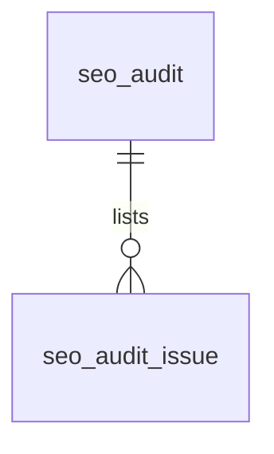

# SEO（seo）模块设计

| 项 | 内容 |
|---|---|
| 模块 ID | `seo` |
| 名称 | SEO |
| 层 | L4 |
| 表前缀 | `seo_` |
| API 前缀 | `seo` |
| 可停用 | 否 |
| 模块版本 | 1.0.0（module.json 的 version） |
| 平台版本 | `>=1.0.0 <2.0.0`（module.json 的 platform） |
| 里程碑切片 | M1：<…>；M2：<…>；M3：<…>；M4：<…>（详见第 13 节） |
| 模块负责人 | 待定 |
| 文档版本 | V1.0 |
| 状态 | 草案 |
| 更新日期 | 2026-10-14 |
| 依据 | 系统设计 V1.4 第 <…> 章；平台框架设计 V1.<x> 第 4 章 <…> 节；ADR-<…> |

> 本文只引用《平台框架设计》第 4 章中的契约，不定义新的跨模块契约；需要新契约时按平台框架设计 2.3 提出契约变更请求。

## 1. 职责与边界

### 1.1 职责

> 一段概述 + 要点列表；与系统设计 3.2 的职责描述一致，并细化到本模块的功能清单。

### 1.2 不负责的事

| 事项 | 归属模块 | 说明 |
|---|---|---|

### 1.3 协作概览

> 用图或表说明本模块与哪些模块协作、通过哪种方式（服务接口 / 事件 / 扩展点）。只画契约，不画实现。

### 1.4 适用的架构约束

> 列出与本模块直接相关的原则（P1–P8）、ADR 规则与 CLAUDE.md 禁止项，以及本模块如何满足。

## 2. 依赖与契约

### 2.1 module.json

```json
{
  "id": "<id>",
  "name": "<中文名称>",
  "version": "1.0.0",
  "layer": "L3",
  "platform": ">=1.0.0 <2.0.0",
  "requires": {},
  "optional": {},
  "disableable": true,
  "tablePrefix": "<前缀>_",
  "apiPrefix": "<id>",
  "permissions": [],
  "menus": [],
  "settings": null,
  "components": [],
  "events": { "publishes": [], "subscribes": [] }
}
```

> 完整描述符，须通过平台框架设计附录 A 的 Schema 与 A.3 的校验规则。

### 2.2 使用的服务接口

| 接口（平台框架设计小节） | 方法 | 用途 | 调用位置与时机（事务内 / 外） | 测试替身 |
|---|---|---|---|---|

### 2.3 提供的服务接口

| 接口（平台框架设计小节） | 方法 | 实现类 | 契约测试 | 说明（幂等、权限、性能目标） |
|---|---|---|---|---|

### 2.4 实现的扩展点

| 扩展点（平台框架设计小节） | 实现类 | 适用范围（内容类型 / 资源类型） | order | 收集方 |
|---|---|---|---|---|

### 2.5 收集的扩展点

| 扩展点 | 调用时机 | 过滤（站点启用状态、内容类型等） | 实现缺失或抛出异常时的行为 | 测试用示例实现 |
|---|---|---|---|---|

### 2.6 发布与订阅的事件

发布：

| 事件 | 触发时机（所在事务） | 关键字段 | 主要订阅方 |
|---|---|---|---|

订阅：

| 事件 | 处理 | 幂等方式 | 过期判断 | 失败与重试 |
|---|---|---|---|---|

### 2.7 使用的端口

| 端口 | 用途 | 测试替身 |
|---|---|---|

## 3. 领域模型

### 3.1 聚合、实体与值对象

| 类型 | 名称 | 说明 |
|---|---|---|
| 聚合根 | SeoMeta（`seo_meta`） | 一个本地化的 SEO 覆盖值（草稿态）：标题、描述、canonical、robots、OG、补充 JSON-LD、焦点关键词；下次发布时进入快照 |
| 聚合根 | SeoTemplate（`seo_template`） | 站点 × 语言 × 内容类型的标题与描述模板（自动值的来源） |
| 实体（读模型） | Link（`seo_link`） | 链接索引：某页面（本地化）以某种方式链接到某内容；发布后按来源页面整体重建 |
| 聚合根 | Audit（`seo_audit`） | 一个已发布本地化最近一次健康检查的结果：分数、问题数、用于重复检测的标题与描述哈希、入站链接数 |
| 实体 | AuditIssue（`seo_audit_issue`） | 检查发现的一个问题（规则、级别、位置、说明），随检查结果整体替换 |
| 聚合根 | RobotsRule（`seo_robots_rule`） | 站点管理员追加到 robots.txt 的规则 |
| 实体（队列） | PingQueueEntry（`seo_ping_queue`） | 待推送到 IndexNow 的 URL |
| 值对象 | SeoSnapshotPart | 快照 `seo` 部分：`{title, description, robots, canonical, og, auto:{…}, overridden:[…]}`（系统设计 6.4） |
| 值对象 | RobotsDirective | `index,follow` / `noindex,follow` / `index,nofollow` / `noindex,nofollow` |
| 值对象 | Severity | `ERROR`（扣 15 分）/ `WARNING`（扣 5 分）/ `INFO`（扣 1 分） |
| 值对象 | SeoSiteSettings | 站点 SEO 设置，保存在 `sys_setting`（键 `seo.site`，见下） |

### 3.2 不变量

| # | 规则 | 保证方式 |
|---|---|---|
| 1 | 每个本地化最多一行覆盖值 | 数据库：`uk_meta_loc` |
| 2 | **自动值永远不写入 `*_override` 字段**；“恢复为自动”即把覆盖字段置空；快照中的 `overridden` 列表与非空的覆盖字段一致 | 应用层 + 单元测试（ADR-008） |
| 3 | canonical 只能指向本语言的页面（禁止跨语言 canonical）；默认指向自身，覆盖值在发布校验时检查可访问、非重定向、非 noindex | 应用层（`PublishContributor.validate()`、SEO 规则） |
| 4 | `AUTO` 模式的目标语言本地化中，标题、描述、OG 标题与描述的覆盖值只由翻译回写（seo 实现的 `TranslatableContentProvider`），人工只能在翻译编辑器中按段修订；其余字段的处理见下表 | 应用层 |
| 5 | robots 覆盖值只能是四种组合之一 | 数据库：`ck_seo_meta_robots` |
| 6 | 模板查找顺序：（语言，类型）→（语言，`*`）→（`*`，类型）→（`*`，`*`）→ 内置默认 `{title} \| {siteName}`、`{summary}`；标题与描述各自独立查找。`locale = '*'` 的行只能含变量与标点（不含中日韩文字），含字面文字的模板必须按语言配置 | 应用层（模板保存时校验） |
| 7 | 链接只在同一语言内建立；`NAV` 行的来源为 0（全站导航），其他类型的来源是具体本地化 | 数据库：`ck_seo_link_nav`；应用层 |
| 8 | 某来源页面的链接索引在一个事务中整体替换（先删后插）；来源页面下线时删除其出向链接 | 应用层 |
| 9 | 只有已发布的本地化有检查结果，每个本地化一行；分数在 0–100 之间；问题行随检查结果在同一事务中替换 | 数据库：`uk_aud_loc`、`ck_seo_aud_score`；应用层 |
| 10 | 同一 URL 最多一条待推送记录；只推送对外公开语言、主域名下的 URL | 数据库：`uk_ping_pending`；应用层 |
| 11 | robots 规则的路径以 `/` 开头；未删除的规则不重复 | 数据库：`ck_seo_robots_path`、`uk_robots_rule` |
| 12 | `schema_extra` 只有开发者角色可以编辑，修改记入审计 | 应用层（权限点 `seo:schema:edit`，高危） |

**覆盖值字段在目标语言中的处理**（seo 的 `TranslatableContentProvider`，系统设计 14.1）：

| 字段 | `AUTO` 模式的目标语言 | `MANUAL` 模式 |
|---|---|---|
| `title_override`、`description_override`、`og_title_override`、`og_description_override` | 源语言有值时作为翻译单元（`maxLength` 取字段长度建议上限：标题 60、描述 160）翻译后写入；源语言为空时目标语言也为空，由该语言的模板生成自动值 | 独立编辑 |
| `robots_override`、`og_image_media_id`、`schema_extra` | 从源语言复制（非文本数据） | 独立编辑 |
| `canonical_override`、`focus_keyword` | 按语言单独维护，不复制、不翻译（canonical 必须指向本语言页面；关键词因语言而异） | 独立编辑 |

**补充与取舍**（系统设计之外的补充及理由）：

| 项 | 内容与理由 |
|---|---|
| 站点 SEO 设置用 `sys_setting` | 不建 `seo_site_setting` 表：站点验证 meta、AI 爬虫策略、IndexNow key、默认 OG 图、关键页面清单是每站点一份的设置，与翻译设置一样放 `sys_setting`（键 `seo.site`），使用 Schema 表单；修改后由 core 发布 `SiteSettingsChangedEvent`，delivery 清除 `settings` 标签 |
| `seo_meta.content_id`、`locale` | 冗余，用于内容彻底删除时清理与按语言列出 |
| `seo_template` 的 `*` 行与 `description_max_length` | 系统设计只给出“站点 × 语言 × 内容类型”；增加通配行，避免为每种语言、每种类型重复配置；描述截断长度（默认 155）可按语言调整 |
| `seo_link` 的补充列 | `source_content_id`（内容彻底删除时清理出向链接）、`locale`（同语言统计）、`occurrences` 与 `anchor_text`（“哪些页面链接到这里”展示锚文本）；全站导航只记一份（`NAV` 行来源为 0），不在每个页面重复 |
| 新增 `seo_audit_issue` | 系统设计只写“结果保存在 `seo_audit`”。看板的“问题排行”“按规则筛选页面”需要按规则聚合，拆成问题行才能建索引，不必在每次查询时展开 JSON |
| `seo_audit` 的冗余列 | `path`、`seo_title`（列表显示不必跨模块查询）、`title_hash` / `description_hash`（“同站点、同语言标题或描述重复”在单页检查时直接用索引查重）、`inbound_link_count` |
| 新增 `seo_ping_queue` | IndexNow “按分钟批量推送”（系统设计 14.7）需要持久的去重队列：实例重启不丢失、可重试、可查看推送记录 |
| 关键页面清单 | SEO 规则“关键页面的机器译文未经审校”需要知道哪些是关键页面：由 `seo.site.keyContentIds` 配置（首页、主要产品与分类页），规则经 `TranslationApi` 查询这些页面目标语言中来源仍为 `MACHINE` 的段数 |

**站点 SEO 设置**（`sys_setting`，键 `seo.site`，`module_id = 'seo'`）：

```json
{
  "schemaVersion": 1,
  "verification": { "google": "abc123def456", "bing": "0123456789ABCDEF" },
  "aiCrawlers": { "GPTBot": "DISALLOW", "ClaudeBot": "ALLOW", "Google-Extended": "DISALLOW", "PerplexityBot": "ALLOW", "CCBot": "DISALLOW" },
  "indexNow": { "enabled": true, "key": "3f7c2a9e5b8d4c1fa0e6b2d9c7a4f1e8" },
  "defaultOgImageMediaId": "7201893453918208",
  "keyContentIds": ["7201893453912345", "7201893453912399"]
}
```

| 键 | 说明 |
|---|---|
| `verification.google` / `verification.bing` | Google Search Console（`google-site-verification`）与 Bing Webmaster Tools（`msvalidate.01`）的验证 meta 内容，输出到首页 `<head>`（系统设计 14.7） |
| `aiCrawlers` | AI 爬虫策略：爬虫名 → `ALLOW` / `DISALLOW`，生成 robots.txt 中的独立分组；未列出的爬虫遵循 `User-agent: *` 规则（系统设计 14.3） |
| `indexNow.enabled` / `indexNow.key` | IndexNow 开关与密钥（8–128 个字符，`[A-Za-z0-9-]`；公开值，不加密）；Nuxt 在 `/{key}.txt` 返回该密钥 |
| `defaultOgImageMediaId` | 站点默认 OG 图（`mda_media.id`），本地化与内容都没有图片时使用 |
| `keyContentIds` | 关键页面（`cnt_content.id`，≤ 100 个），用于 SEO 规则“关键页面的机器译文未经审校” |

robots.txt 的生成顺序：默认模板（`Disallow: /api/`、`/__preview/`、`/__editor`）→ `aiCrawlers` 分组 → `seo_robots_rule` 中启用的规则（按 `user_agent` 分组、`sort_order` 排序）→ `Sitemap:` 行；预发布与测试环境整体替换为 `Disallow: /`（系统设计 14.3）。

### 3.3 状态机

<<FILL: 状态与转换；没有状态机时写“不适用：<原因>”>>

## 4. 数据模型

> 遵守平台框架设计第 7 章的数据库通用约定。DDL 已在 MySQL 8.4 上执行通过；表结构以本节为准，与迁移脚本保持一致。

### 4.1 表清单

| 表 | 说明 | 站点级 | 软删除 | 预估规模（单站，按系统设计假设 A4） |
|---|---|---|---|---|
| `seo_meta` | 本地化的 SEO 覆盖值 | 是 | 否（“恢复为自动”即清空字段；本地化删除时物理删除） | 只有设置了覆盖值的本地化才有行：≈ 2–5 万，上限 ≈ 20 万 |
| `seo_template` | 标题与描述模板 | 是 | 否（删除即回退到上一级） | ≤ 100 |
| `seo_link` | 链接索引 | 是 | 否（发布后整体替换） | 已发布本地化 ≈ 15 万 × 平均 25 条 ≈ 300–400 万 |
| `seo_audit` | 健康检查结果（每个已发布本地化一行） | 是 | 否 | ≈ 15 万 |
| `seo_audit_issue` | 健康检查问题 | 是 | 否（随检查结果替换） | ≈ 30–50 万 |
| `seo_robots_rule` | robots.txt 追加规则 | 是 | 是 | ≤ 50 |
| `seo_ping_queue` | IndexNow 推送队列 | 是 | 否（已推送 7 天、失败 30 天后删除） | 发布量 × 对外公开语言数，约数百至数千 / 天；常驻 < 5 万 |

**站点过滤**：全部为站点级表，由拦截器过滤。例外：每分钟的 IndexNow 推送任务跨站点轮询到期记录、每晚的全站检查按站点逐个执行，均使用标注 `@InterceptorIgnore` 的专用查询（或显式设置站点上下文）。

### 4.2 ER 图



其余表（`seo_meta`、`seo_template`、`seo_link`、`seo_robots_rule`、`seo_ping_queue`）在模块内没有外键关系，只以 ID 引用内容、本地化与媒体（见 4.6），未画出。

### 4.3 表结构

类型列中的 `bin` 表示 `COLLATE utf8mb4_0900_bin`；通用字段的定义见第 2.4 节。

#### 4.3.1 `seo_meta`：SEO 覆盖值

每个本地化最多一行（草稿态，系统设计 14.1）；没有行或字段为空表示使用自动值。SEO 标签（内容编辑外壳中由 seo 注册，权限 `seo:meta:edit`）单独保存，带自己的乐观锁；修改在下次发布时进入快照，并参与内核的 `draft_hash`（经 `PublishContributor.contribute()`）。

| 字段 | 类型 | 可空 | 默认 | 说明 |
|---|---|---|---|---|
| `id` | BIGINT | 否 | — | 主键（TSID） |
| `site_id` | BIGINT | 否 | — | 站点 |
| `content_id` | BIGINT | 否 | — | 内容（`cnt_content.id`） |
| `localization_id` | BIGINT | 否 | — | 本地化（`cnt_localization.id`） |
| `locale` | VARCHAR(16) | 否 | — | 语言（冗余 `cnt_localization.locale`） |
| `title_override` | VARCHAR(300) | 是 | — | SEO 标题覆盖值（建议 30–60 个字符，按像素宽度 ≤ 580 px） |
| `description_override` | VARCHAR(1000) | 是 | — | meta description 覆盖值（建议 70–160 个字符） |
| `canonical_override` | VARCHAR(2048) | 是 | — | canonical 覆盖值（绝对 URL，必须是本语言页面） |
| `robots_override` | VARCHAR(20) | 是 | — | robots 覆盖值：`index,follow` / `noindex,follow` / `index,nofollow` / `noindex,nofollow` |
| `og_title_override` | VARCHAR(300) | 是 | — | Open Graph 标题覆盖值 |
| `og_description_override` | VARCHAR(1000) | 是 | — | Open Graph 描述覆盖值 |
| `og_image_media_id` | BIGINT | 是 | — | Open Graph 图片（`mda_media.id`）；为空依次取封面图、站点默认 OG 图 |
| `schema_extra` | JSON | 是 | — | 手工补充的 JSON-LD 节点（仅开发者角色），合并进 `@graph` |
| `focus_keyword` | VARCHAR(200) | 是 | — | 焦点关键词（只用于后台分析，不输出到页面） |
| `version` | INT | 否 | 0 | 乐观锁 |
| `created_at` | DATETIME(3) | 否 | CURRENT_TIMESTAMP(3) | 创建时间 |
| `created_by` | BIGINT | 否 | 0 | 创建人（翻译回写为 0） |
| `updated_at` | DATETIME(3) | 否 | CURRENT_TIMESTAMP(3)，更新时自动刷新 | 更新时间 |
| `updated_by` | BIGINT | 否 | 0 | 更新人 |

索引与约束：
- `PRIMARY KEY (id)`
- `uk_meta_loc (localization_id)`：每个本地化一行；SEO 标签读取、发布时组装快照、翻译提取与回写都按本地化读取
- `idx_meta_content (site_id, content_id)`：按内容读取全部语言的覆盖值（翻译回写时读取源语言行）；内容彻底删除时清理
- `ck_seo_meta_robots`：robots 覆盖值只能是四种组合之一

```sql
CREATE TABLE seo_meta (
  id                       BIGINT         NOT NULL COMMENT '主键（TSID）',
  site_id                  BIGINT         NOT NULL COMMENT '站点',
  content_id               BIGINT         NOT NULL COMMENT '内容（cnt_content.id）',
  localization_id          BIGINT         NOT NULL COMMENT '本地化（cnt_localization.id）；每个本地化最多一行',
  locale                   VARCHAR(16)    NOT NULL COMMENT '语言（冗余 cnt_localization.locale）',
  title_override           VARCHAR(300)   NULL COMMENT 'SEO 标题覆盖值（建议 30–60 个字符）；为空使用模板生成的自动值；AUTO 目标语言由翻译回写',
  description_override     VARCHAR(1000)  NULL COMMENT 'meta description 覆盖值（建议 70–160 个字符）；AUTO 目标语言由翻译回写',
  canonical_override       VARCHAR(2048)  NULL COMMENT 'canonical 覆盖值（绝对 URL，必须是本语言页面；默认指向自身）；不随翻译复制',
  robots_override          VARCHAR(20)    NULL COMMENT 'robots 覆盖值：index,follow / noindex,follow / index,nofollow / noindex,nofollow；为空按索引控制规则；AUTO 目标语言从源语言复制',
  og_title_override        VARCHAR(300)   NULL COMMENT 'Open Graph 标题覆盖值；AUTO 目标语言由翻译回写',
  og_description_override  VARCHAR(1000)  NULL COMMENT 'Open Graph 描述覆盖值；AUTO 目标语言由翻译回写',
  og_image_media_id        BIGINT         NULL COMMENT 'Open Graph 图片（mda_media.id）；为空依次取封面图、站点默认 OG 图；AUTO 目标语言从源语言复制',
  schema_extra             JSON           NULL COMMENT '手工补充的 JSON-LD 节点（仅开发者角色），合并进 @graph；AUTO 目标语言从源语言复制，不翻译',
  focus_keyword            VARCHAR(200)   NULL COMMENT '焦点关键词（只用于后台分析，不输出到页面）；按语言单独维护，不翻译',
  version                  INT            NOT NULL DEFAULT 0 COMMENT '乐观锁版本号',
  created_at               DATETIME(3)    NOT NULL DEFAULT CURRENT_TIMESTAMP(3) COMMENT '创建时间',
  created_by               BIGINT         NOT NULL DEFAULT 0 COMMENT '创建人（0 = 系统，如翻译回写）',
  updated_at               DATETIME(3)    NOT NULL DEFAULT CURRENT_TIMESTAMP(3) ON UPDATE CURRENT_TIMESTAMP(3) COMMENT '更新时间',
  updated_by               BIGINT         NOT NULL DEFAULT 0 COMMENT '更新人（0 = 系统）',
  PRIMARY KEY (id),
  UNIQUE KEY uk_meta_loc (localization_id),
  KEY idx_meta_content (site_id, content_id),
  CONSTRAINT ck_seo_meta_robots CHECK (robots_override IS NULL OR robots_override IN ('index,follow', 'noindex,follow', 'index,nofollow', 'noindex,nofollow'))
) ENGINE = InnoDB DEFAULT CHARSET = utf8mb4 COLLATE = utf8mb4_0900_ai_ci COMMENT = 'SEO 覆盖值（每个本地化最多一行，草稿态）';
```

#### 4.3.2 `seo_template`：标题与描述模板

自动值的来源（系统设计 14.1）：标题如 `{title} | {siteName}`，描述如 `{summary}` 截断到 155 个字符。变量由 `SeoVariableProvider` 提供（产品可提供 `{modelNo}`、`{primaryCategory}`、`{brand}`），`{siteName}` 取站点资料当前语言的公司名称。修改模板后，已发布内容的自动值在重新发布时更新（ADR-008；批量刷新方式见《URL 与 SEO 引擎详细设计》）。

| 字段 | 类型 | 可空 | 默认 | 说明 |
|---|---|---|---|---|
| `id` | BIGINT | 否 | — | 主键（TSID） |
| `site_id` | BIGINT | 否 | — | 站点 |
| `locale` | VARCHAR(16) | 否 | — | 语言；`*` 表示全部语言 |
| `content_type` | VARCHAR(32) | 否 | — | 内容类型；`*` 表示全部类型 |
| `title_template` | VARCHAR(300) | 是 | — | 标题模板；为空则按查找顺序取上一级 |
| `description_template` | VARCHAR(500) | 是 | — | 描述模板；为空则取上一级 |
| `description_max_length` | SMALLINT | 否 | 155 | 描述自动值的截断长度（字符） |
| `version` | INT | 否 | 0 | 乐观锁 |
| `created_at` | DATETIME(3) | 否 | CURRENT_TIMESTAMP(3) | 创建时间 |
| `created_by` | BIGINT | 否 | 0 | 创建人 |
| `updated_at` | DATETIME(3) | 否 | CURRENT_TIMESTAMP(3)，更新时自动刷新 | 更新时间 |
| `updated_by` | BIGINT | 否 | 0 | 更新人 |

索引与约束：
- `PRIMARY KEY (id)`
- `uk_tpl_scope (site_id, locale, content_type)`：每个范围一行；发布时按（站点，语言 IN (语言, `*`)）读取并在内存中按查找顺序合并（结果缓存）
- `ck_seo_tpl_present`：标题与描述模板至少有一个
- `ck_seo_tpl_desc_len`：截断长度在 50–300 之间

```sql
CREATE TABLE seo_template (
  id                      BIGINT        NOT NULL COMMENT '主键（TSID）',
  site_id                 BIGINT        NOT NULL COMMENT '站点',
  locale                  VARCHAR(16)   NOT NULL COMMENT '语言（BCP 47）；* 表示全部语言（只能含变量与标点）',
  content_type            VARCHAR(32)   NOT NULL COMMENT '内容类型：PAGE / PRODUCT / ARTICLE / CASE_STUDY / TERM_PAGE …；* 表示全部类型',
  title_template         VARCHAR(300)  NULL COMMENT '标题模板，如 {title} | {siteName}；为空则按查找顺序取上一级',
  description_template    VARCHAR(500)  NULL COMMENT '描述模板，如 {summary}；为空则取上一级',
  description_max_length  SMALLINT      NOT NULL DEFAULT 155 COMMENT '描述自动值的截断长度（字符）',
  version                 INT           NOT NULL DEFAULT 0 COMMENT '乐观锁版本号',
  created_at              DATETIME(3)   NOT NULL DEFAULT CURRENT_TIMESTAMP(3) COMMENT '创建时间',
  created_by              BIGINT        NOT NULL DEFAULT 0 COMMENT '创建人（0 = 系统）',
  updated_at              DATETIME(3)   NOT NULL DEFAULT CURRENT_TIMESTAMP(3) ON UPDATE CURRENT_TIMESTAMP(3) COMMENT '更新时间',
  updated_by              BIGINT        NOT NULL DEFAULT 0 COMMENT '更新人（0 = 系统）',
  PRIMARY KEY (id),
  UNIQUE KEY uk_tpl_scope (site_id, locale, content_type),
  CONSTRAINT ck_seo_tpl_present CHECK (title_template IS NOT NULL OR description_template IS NOT NULL),
  CONSTRAINT ck_seo_tpl_desc_len CHECK (description_max_length BETWEEN 50 AND 300)
) ENGINE = InnoDB DEFAULT CHARSET = utf8mb4 COLLATE = utf8mb4_0900_ai_ci COMMENT = 'SEO 标题与描述模板（站点 × 语言 × 内容类型）';
```

#### 4.3.3 `seo_link`：链接索引

发布后（`ContentPublishedEvent`）按来源页面重建（系统设计 14.8）：`BODY` 来自富文本中的 `content://` 引用，`COMPONENT` 来自布局中的 `$content` 引用与组件链接，`BREADCRUMB` 来自 `BreadcrumbProvider`，`RELATED` 来自图谱推荐（`RelationChangedEvent` 后也重建），`NAV` 来自导航菜单（`NavigationChangedEvent` 后重建全站导航行）。用途：入站链接统计、孤立页面、“哪些页面链接到这里”、下线前的影响分析（`ContentImpactProvider`）、SEO 规则“引用已下线内容”。分类项的链接以其 `TERM_PAGE` 内容记录；外部链接与非内容 URL 不记录。

| 字段 | 类型 | 可空 | 默认 | 说明 |
|---|---|---|---|---|
| `id` | BIGINT | 否 | — | 主键（TSID） |
| `site_id` | BIGINT | 否 | — | 站点 |
| `locale` | VARCHAR(16) | 否 | — | 语言（来源与目标同语言） |
| `source_content_id` | BIGINT | 否 | — | 来源内容（`cnt_content.id`）；`NAV` 为 0 |
| `source_localization_id` | BIGINT | 否 | — | 来源本地化（`cnt_localization.id`）；`NAV` 为 0（全站导航） |
| `target_content_id` | BIGINT | 否 | — | 目标内容（`cnt_content.id`） |
| `kind` | VARCHAR(16) | 否 | — | 链接类型：`NAV` / `BREADCRUMB` / `RELATED` / `BODY` / `COMPONENT` |
| `occurrences` | SMALLINT | 否 | 1 | 来源页面中同类链接指向该目标的次数 |
| `anchor_text` | VARCHAR(200) | 是 | — | 首个锚文本（截断到 200 个字符） |
| `created_at` | DATETIME(3) | 否 | CURRENT_TIMESTAMP(3) | 写入时间（重建时整体替换，无更新） |

索引与约束：
- `PRIMARY KEY (id)`
- `uk_link (site_id, locale, source_localization_id, target_content_id, kind)`：同一来源、目标、类型一行；重建时按前缀（站点，语言，来源本地化）先删后插
- `idx_link_target (site_id, target_content_id, locale)`：入站链接计数、孤立页面、“哪些页面链接到这里”、下线影响分析；目标内容彻底删除时清理
- `idx_link_source (source_content_id)`：来源内容彻底删除时清理全部语言的出向链接
- `ck_seo_link_nav`：`NAV` 当且仅当来源为 0

```sql
CREATE TABLE seo_link (
  id                      BIGINT        NOT NULL COMMENT '主键（TSID）',
  site_id                 BIGINT        NOT NULL COMMENT '站点',
  locale                  VARCHAR(16)   NOT NULL COMMENT '语言（来源与目标同语言）',
  source_content_id       BIGINT        NOT NULL COMMENT '来源内容（cnt_content.id）；NAV 为 0',
  source_localization_id  BIGINT        NOT NULL COMMENT '来源本地化（cnt_localization.id）；NAV 为 0（全站导航）',
  target_content_id       BIGINT        NOT NULL COMMENT '目标内容（cnt_content.id）',
  kind                    VARCHAR(16)   NOT NULL COMMENT '链接类型：NAV（导航）/ BREADCRUMB（面包屑）/ RELATED（相关内容）/ BODY（正文 content:// 引用）/ COMPONENT（组件中的 $content 引用）',
  occurrences             SMALLINT      NOT NULL DEFAULT 1 COMMENT '来源页面中同类链接指向该目标的次数',
  anchor_text             VARCHAR(200)  NULL COMMENT '首个锚文本（截断到 200 个字符）',
  created_at              DATETIME(3)   NOT NULL DEFAULT CURRENT_TIMESTAMP(3) COMMENT '写入时间（重建时整体替换）',
  PRIMARY KEY (id),
  UNIQUE KEY uk_link (site_id, locale, source_localization_id, target_content_id, kind),
  KEY idx_link_target (site_id, target_content_id, locale),
  KEY idx_link_source (source_content_id),
  CONSTRAINT ck_seo_link_nav CHECK ((kind = 'NAV') = (source_localization_id = 0 AND source_content_id = 0))
) ENGINE = InnoDB DEFAULT CHARSET = utf8mb4 COLLATE = utf8mb4_0900_ai_ci COMMENT = '链接索引（发布后按来源页面重建）';
```

#### 4.3.4 `seo_audit`：健康检查结果

每个已发布本地化一行，保存最近一次检查的结果（系统设计 14.9）：发布后异步检查单页（`PUBLISH`），每晚全站检查（`NIGHTLY`，重复检测与孤立页面需要全站数据），也可手动重新检查。下线或删除时删除该行。发布前编辑器侧栏中的问题是即时计算的，不写入本表。

| 字段 | 类型 | 可空 | 默认 | 说明 |
|---|---|---|---|---|
| `id` | BIGINT | 否 | — | 主键（TSID） |
| `site_id` | BIGINT | 否 | — | 站点 |
| `content_id` | BIGINT | 否 | — | 内容（`cnt_content.id`） |
| `localization_id` | BIGINT | 否 | — | 本地化（`cnt_localization.id`） |
| `locale` | VARCHAR(16) | 否 | — | 语言 |
| `content_type` | VARCHAR(32) | 否 | — | 内容类型（看板按类型筛选） |
| `revision_no` | INT | 否 | — | 被检查的发布修订号 |
| `path` | VARCHAR(500) bin | 是 | — | 页面路径（检查时的 `pub_path`；不可路由为空） |
| `seo_title` | VARCHAR(300) | 是 | — | 检查时的最终 SEO 标题（列表显示） |
| `title_hash` | CHAR(64) bin | 是 | — | 最终标题规范化（NFC、去首尾空白、合并空白、转小写）后的 SHA-256 |
| `description_hash` | CHAR(64) bin | 是 | — | 最终描述规范化后的 SHA-256 |
| `inbound_link_count` | INT | 否 | 0 | 入站内链数（来自 `seo_link`，不计 sitemap） |
| `score` | SMALLINT | 否 | 100 | 分数 = 100 − Σ 扣分（ERROR 15、WARNING 5、INFO 1），最低 0 |
| `error_count` | SMALLINT | 否 | 0 | ERROR 问题数 |
| `warning_count` | SMALLINT | 否 | 0 | WARNING 问题数 |
| `info_count` | SMALLINT | 否 | 0 | INFO 问题数 |
| `audit_trigger` | VARCHAR(16) | 否 | — | 触发：`PUBLISH` / `NIGHTLY` / `MANUAL` |
| `audited_at` | DATETIME(3) | 否 | — | 检查时间 |
| `created_at` | DATETIME(3) | 否 | CURRENT_TIMESTAMP(3) | 创建时间 |
| `updated_at` | DATETIME(3) | 否 | CURRENT_TIMESTAMP(3)，更新时自动刷新 | 更新时间 |

索引与约束：
- `PRIMARY KEY (id)`
- `uk_aud_loc (localization_id)`：每个本地化一行；编辑器与内容列表读取单页结果
- `idx_aud_score (site_id, locale, score)`：看板的分数分布与“按分数筛选内容列表”
- `idx_aud_title (site_id, locale, title_hash)`：重复标题检测（单页检查时查同哈希的其他行；全站检查时 `GROUP BY title_hash HAVING COUNT(*) > 1`）
- `idx_aud_desc (site_id, locale, description_hash)`：重复描述检测
- `idx_aud_content (site_id, content_id)`：内容下线、彻底删除时清理全部语言的结果
- `ck_seo_aud_score`：分数在 0–100 之间

```sql
CREATE TABLE seo_audit (
  id                  BIGINT        NOT NULL COMMENT '主键（TSID）',
  site_id             BIGINT        NOT NULL COMMENT '站点',
  content_id          BIGINT        NOT NULL COMMENT '内容（cnt_content.id）',
  localization_id     BIGINT        NOT NULL COMMENT '本地化（cnt_localization.id）；每个已发布本地化一行',
  locale              VARCHAR(16)   NOT NULL COMMENT '语言',
  content_type        VARCHAR(32)   NOT NULL COMMENT '内容类型：PAGE / PRODUCT / ARTICLE / CASE_STUDY / FAQ / TERM_PAGE / GLOBAL_BLOCK',
  revision_no         INT           NOT NULL COMMENT '被检查的发布修订号',
  path                VARCHAR(500)  COLLATE utf8mb4_0900_bin NULL COMMENT '页面路径（检查时的 pub_path，含语言前缀；不可路由为空）',
  seo_title           VARCHAR(300)  NULL COMMENT '检查时的最终 SEO 标题（列表显示）',
  title_hash          CHAR(64)      COLLATE utf8mb4_0900_bin NULL COMMENT '最终标题规范化（NFC、去首尾空白、合并空白、转小写）后的 SHA-256；重复标题检测',
  description_hash    CHAR(64)      COLLATE utf8mb4_0900_bin NULL COMMENT '最终描述规范化后的 SHA-256；重复描述检测',
  inbound_link_count  INT           NOT NULL DEFAULT 0 COMMENT '入站内链数（来自 seo_link，不计 sitemap）',
  score               SMALLINT      NOT NULL DEFAULT 100 COMMENT '分数 = 100 − Σ 扣分（ERROR 15、WARNING 5、INFO 1），最低 0',
  error_count         SMALLINT      NOT NULL DEFAULT 0 COMMENT 'ERROR 问题数',
  warning_count       SMALLINT      NOT NULL DEFAULT 0 COMMENT 'WARNING 问题数',
  info_count          SMALLINT      NOT NULL DEFAULT 0 COMMENT 'INFO 问题数',
  audit_trigger       VARCHAR(16)   NOT NULL COMMENT '触发：PUBLISH（发布后单页检查）/ NIGHTLY（每晚全站检查）/ MANUAL（手动重新检查）',
  audited_at          DATETIME(3)   NOT NULL COMMENT '检查时间',
  created_at          DATETIME(3)   NOT NULL DEFAULT CURRENT_TIMESTAMP(3) COMMENT '创建时间',
  updated_at          DATETIME(3)   NOT NULL DEFAULT CURRENT_TIMESTAMP(3) ON UPDATE CURRENT_TIMESTAMP(3) COMMENT '更新时间',
  PRIMARY KEY (id),
  UNIQUE KEY uk_aud_loc (localization_id),
  KEY idx_aud_score (site_id, locale, score),
  KEY idx_aud_title (site_id, locale, title_hash),
  KEY idx_aud_desc (site_id, locale, description_hash),
  KEY idx_aud_content (site_id, content_id),
  CONSTRAINT ck_seo_aud_score CHECK (score BETWEEN 0 AND 100)
) ENGINE = InnoDB DEFAULT CHARSET = utf8mb4 COLLATE = utf8mb4_0900_ai_ci COMMENT = 'SEO 健康检查结果（每个已发布本地化一行）';
```

#### 4.3.5 `seo_audit_issue`：健康检查问题

| 字段 | 类型 | 可空 | 默认 | 说明 |
|---|---|---|---|---|
| `id` | BIGINT | 否 | — | 主键（TSID） |
| `site_id` | BIGINT | 否 | — | 站点 |
| `audit_id` | BIGINT | 否 | — | 所属检查结果（`seo_audit.id`） |
| `localization_id` | BIGINT | 否 | — | 本地化（冗余，按规则列出页面时不必回表） |
| `locale` | VARCHAR(16) | 否 | — | 语言（冗余） |
| `rule_id` | VARCHAR(64) bin | 否 | — | 规则 ID（`SeoRule.id()`，如 `seo.title.length`） |
| `severity` | VARCHAR(8) | 否 | — | 级别：`ERROR` / `WARNING` / `INFO` |
| `field` | VARCHAR(100) | 是 | — | 问题位置（字段路径或 Section ID，如 `seo.title`、`sections.sec_01J9X4K2`），后台据此跳转修复 |
| `message` | VARCHAR(500) | 否 | — | 问题说明（中文） |
| `params` | JSON | 是 | — | 规则参数（如 `{"length":72,"max":60}`、重复标题的其他本地化 ID） |
| `created_at` | DATETIME(3) | 否 | CURRENT_TIMESTAMP(3) | 写入时间（随检查结果替换） |

索引与约束：
- `PRIMARY KEY (id)`
- `idx_iss_audit (audit_id)`：读取单页的问题列表；外键索引
- `idx_iss_rule (site_id, rule_id, locale)`：看板“问题排行”（按规则计数）与“按规则筛选页面”
- `fk_seo_issue_audit`：→ `seo_audit.id`，`ON DELETE CASCADE`

```sql
CREATE TABLE seo_audit_issue (
  id               BIGINT        NOT NULL COMMENT '主键（TSID）',
  site_id          BIGINT        NOT NULL COMMENT '站点',
  audit_id         BIGINT        NOT NULL COMMENT '所属检查结果（seo_audit.id）',
  localization_id  BIGINT        NOT NULL COMMENT '本地化（cnt_localization.id，冗余）',
  locale           VARCHAR(16)   NOT NULL COMMENT '语言（冗余）',
  rule_id          VARCHAR(64)   COLLATE utf8mb4_0900_bin NOT NULL COMMENT '规则 ID（SeoRule.id()，如 seo.title.length）',
  severity         VARCHAR(8)    NOT NULL COMMENT '级别：ERROR / WARNING / INFO',
  field            VARCHAR(100)  NULL COMMENT '问题位置（字段路径或 Section ID，如 seo.title、sections.sec_01J9X4K2），后台据此跳转修复',
  message          VARCHAR(500)  NOT NULL COMMENT '问题说明（中文）',
  params           JSON          NULL COMMENT '规则参数（如 {"length":72,"max":60}、重复标题的其他本地化 ID）',
  created_at       DATETIME(3)   NOT NULL DEFAULT CURRENT_TIMESTAMP(3) COMMENT '写入时间（随检查结果替换）',
  PRIMARY KEY (id),
  KEY idx_iss_audit (audit_id),
  KEY idx_iss_rule (site_id, rule_id, locale),
  CONSTRAINT fk_seo_issue_audit FOREIGN KEY (audit_id) REFERENCES seo_audit (id) ON DELETE CASCADE,
  CONSTRAINT ck_seo_issue_severity CHECK (severity IN ('ERROR', 'WARNING', 'INFO'))
) ENGINE = InnoDB DEFAULT CHARSET = utf8mb4 COLLATE = utf8mb4_0900_ai_ci COMMENT = 'SEO 健康检查问题';
```

#### 4.3.6 `seo_robots_rule`：robots.txt 追加规则

站点管理员追加的规则（系统设计 14.3）；默认模板、AI 爬虫策略与 `Sitemap:` 行由系统生成，不存本表。修改后清除 robots.txt 的缓存。

| 字段 | 类型 | 可空 | 默认 | 说明 |
|---|---|---|---|---|
| `id` | BIGINT | 否 | — | 主键（TSID） |
| `site_id` | BIGINT | 否 | — | 站点 |
| `user_agent` | VARCHAR(100) | 否 | `'*'` | User-agent（`*` 或爬虫名，如 `Googlebot`） |
| `directive` | VARCHAR(16) | 否 | — | 指令：`ALLOW` / `DISALLOW` |
| `path` | VARCHAR(500) bin | 否 | — | 路径规则（以 `/` 开头，可含 `*` 与 `$`），如 `/zh/search` |
| `sort_order` | INT | 否 | 0 | 同一 User-agent 分组内的顺序 |
| `enabled` | TINYINT(1) | 否 | 1 | 启用 |
| `note` | VARCHAR(300) | 是 | — | 备注（添加原因） |
| `deleted_at` | DATETIME(3) | 是 | — | 删除时间（软删除） |
| `alive` | TINYINT（生成列） | 是 | — | 未删除标记（唯一索引用） |
| `version` | INT | 否 | 0 | 乐观锁 |
| `created_at` | DATETIME(3) | 否 | CURRENT_TIMESTAMP(3) | 创建时间 |
| `created_by` | BIGINT | 否 | 0 | 创建人 |
| `updated_at` | DATETIME(3) | 否 | CURRENT_TIMESTAMP(3)，更新时自动刷新 | 更新时间 |
| `updated_by` | BIGINT | 否 | 0 | 更新人 |

索引与约束：
- `PRIMARY KEY (id)`
- `uk_robots_rule (site_id, user_agent, directive, path, alive)`：未删除的规则不重复；生成 robots.txt 时按站点读取全部规则（≤ 50 行）
- `ck_seo_robots_directive`：指令只能是 `ALLOW` / `DISALLOW`
- `ck_seo_robots_path`：路径以 `/` 开头

```sql
CREATE TABLE seo_robots_rule (
  id          BIGINT        NOT NULL COMMENT '主键（TSID）',
  site_id     BIGINT        NOT NULL COMMENT '站点',
  user_agent  VARCHAR(100)  NOT NULL DEFAULT '*' COMMENT 'User-agent（* 或爬虫名，如 Googlebot）',
  directive   VARCHAR(16)   NOT NULL COMMENT '指令：ALLOW / DISALLOW',
  path        VARCHAR(500)  COLLATE utf8mb4_0900_bin NOT NULL COMMENT '路径规则（以 / 开头，可含 * 与 $），如 /zh/search',
  sort_order  INT           NOT NULL DEFAULT 0 COMMENT '同一 User-agent 分组内的顺序，小的在前',
  enabled     TINYINT(1)    NOT NULL DEFAULT 1 COMMENT '启用',
  note        VARCHAR(300)  NULL COMMENT '备注（添加原因）',
  deleted_at  DATETIME(3)   NULL COMMENT '删除时间（软删除）',
  alive       TINYINT AS (IF(deleted_at IS NULL, 1, NULL)) STORED COMMENT '未删除标记（唯一索引用）',
  version     INT           NOT NULL DEFAULT 0 COMMENT '乐观锁版本号',
  created_at  DATETIME(3)   NOT NULL DEFAULT CURRENT_TIMESTAMP(3) COMMENT '创建时间',
  created_by  BIGINT        NOT NULL DEFAULT 0 COMMENT '创建人（0 = 系统）',
  updated_at  DATETIME(3)   NOT NULL DEFAULT CURRENT_TIMESTAMP(3) ON UPDATE CURRENT_TIMESTAMP(3) COMMENT '更新时间',
  updated_by  BIGINT        NOT NULL DEFAULT 0 COMMENT '更新人（0 = 系统）',
  PRIMARY KEY (id),
  UNIQUE KEY uk_robots_rule (site_id, user_agent, directive, path, alive),
  CONSTRAINT ck_seo_robots_directive CHECK (directive IN ('ALLOW', 'DISALLOW')),
  CONSTRAINT ck_seo_robots_path CHECK (path LIKE '/%')
) ENGINE = InnoDB DEFAULT CHARSET = utf8mb4 COLLATE = utf8mb4_0900_ai_ci COMMENT = 'robots.txt 追加规则';
```

#### 4.3.7 `seo_ping_queue`：IndexNow 推送队列

发布、下线、路径变化时入队（路径变化时新旧 URL 各一条；语言设为对外公开时，该语言全部已发布 URL 分批入队），只入队对外公开语言、主域名下的 URL（系统设计 14.7）。每分钟的任务按站点取到期的 `PENDING` 记录（每次 ≤ 10,000 条，同一主机），一次 `POST https://api.indexnow.org/indexnow` 推送；200 / 202 置为 `SENT`；429 与 5xx 退避重试，最多 5 次后 `FAILED`；403 / 422（密钥或 URL 无效）直接 `FAILED` 并告警。站点主域名变化时删除旧域名下未推送的记录。

| 字段 | 类型 | 可空 | 默认 | 说明 |
|---|---|---|---|---|
| `id` | BIGINT | 否 | — | 主键（TSID） |
| `site_id` | BIGINT | 否 | — | 站点 |
| `locale` | VARCHAR(16) | 否 | — | 语言 |
| `url` | VARCHAR(2048) | 否 | — | 完整 URL（主域名 https，含语言前缀） |
| `url_hash` | CHAR(64) bin | 否 | — | URL 的 SHA-256（去重） |
| `reason` | VARCHAR(16) | 否 | — | 原因：`PUBLISHED` / `UNPUBLISHED` / `PATH_CHANGED` / `LOCALE_PUBLIC` |
| `status` | VARCHAR(10) | 否 | `'PENDING'` | 状态：`PENDING` / `SENT` / `FAILED` |
| `pending_flag` | TINYINT（生成列） | 是 | — | `PENDING` 时为 1，否则 NULL（唯一索引用） |
| `attempts` | INT | 否 | 0 | 已推送次数 |
| `next_attempt_at` | DATETIME(3) | 否 | CURRENT_TIMESTAMP(3) | 最早推送时间（退避重试） |
| `sent_at` | DATETIME(3) | 是 | — | 推送成功时间 |
| `response_code` | SMALLINT | 是 | — | 最近一次推送的 HTTP 状态码 |
| `last_error` | VARCHAR(500) | 是 | — | 最近一次失败说明 |
| `created_at` | DATETIME(3) | 否 | CURRENT_TIMESTAMP(3) | 入队时间 |
| `updated_at` | DATETIME(3) | 否 | CURRENT_TIMESTAMP(3)，更新时自动刷新 | 更新时间 |

索引与约束：
- `PRIMARY KEY (id)`
- `uk_ping_pending (site_id, url_hash, pending_flag)`：同一 URL 最多一条待推送记录（入队使用 `INSERT IGNORE`）
- `idx_ping_poll (status, next_attempt_at)`：每分钟的推送任务跨站点取到期的 `PENDING` 记录；清理任务按状态与时间删除（专用豁免查询）
- `idx_ping_list (site_id, created_at)`：后台查看推送记录

```sql
CREATE TABLE seo_ping_queue (
  id               BIGINT         NOT NULL COMMENT '主键（TSID）',
  site_id          BIGINT         NOT NULL COMMENT '站点',
  locale           VARCHAR(16)    NOT NULL COMMENT '语言（只入队对外公开的语言）',
  url              VARCHAR(2048)  NOT NULL COMMENT '完整 URL（主域名 https，含语言前缀）',
  url_hash         CHAR(64)       COLLATE utf8mb4_0900_bin NOT NULL COMMENT 'URL 的 SHA-256（去重）',
  reason           VARCHAR(16)    NOT NULL COMMENT '原因：PUBLISHED（发布）/ UNPUBLISHED（下线）/ PATH_CHANGED（路径变化，新旧 URL 各一条）/ LOCALE_PUBLIC（语言设为对外公开）',
  status           VARCHAR(10)    NOT NULL DEFAULT 'PENDING' COMMENT '状态：PENDING / SENT / FAILED',
  pending_flag     TINYINT AS (IF(status = 'PENDING', 1, NULL)) STORED COMMENT '待推送标记：PENDING 为 1，否则 NULL（唯一索引用）',
  attempts         INT            NOT NULL DEFAULT 0 COMMENT '已推送次数',
  next_attempt_at  DATETIME(3)    NOT NULL DEFAULT CURRENT_TIMESTAMP(3) COMMENT '最早推送时间（退避重试）',
  sent_at          DATETIME(3)    NULL COMMENT '推送成功时间',
  response_code    SMALLINT       NULL COMMENT '最近一次推送的 HTTP 状态码',
  last_error       VARCHAR(500)   NULL COMMENT '最近一次失败说明',
  created_at       DATETIME(3)    NOT NULL DEFAULT CURRENT_TIMESTAMP(3) COMMENT '入队时间',
  updated_at       DATETIME(3)    NOT NULL DEFAULT CURRENT_TIMESTAMP(3) ON UPDATE CURRENT_TIMESTAMP(3) COMMENT '更新时间',
  PRIMARY KEY (id),
  UNIQUE KEY uk_ping_pending (site_id, url_hash, pending_flag),
  KEY idx_ping_poll (status, next_attempt_at),
  KEY idx_ping_list (site_id, created_at)
) ENGINE = InnoDB DEFAULT CHARSET = utf8mb4 COLLATE = utf8mb4_0900_ai_ci COMMENT = 'IndexNow 推送队列';
```

### 4.4 枚举

| 字段 | 取值 | 说明 |
|---|---|---|
| `seo_meta.robots_override` | `index,follow` / `noindex,follow` / `index,nofollow` / `noindex,nofollow` | 为空时按系统设计 14.3 的索引控制规则 |
| `seo_template.locale`、`seo_template.content_type` | BCP 47 语言代码 / 内容类型（共享枚举），或 `*` | `*` 为通配 |
| `seo_link.kind` | `NAV` | 导航菜单（全站一份，来源为 0） |
| | `BREADCRUMB` | 面包屑 |
| | `RELATED` | 相关内容（图谱推荐） |
| | `BODY` | 正文中的 `content://` 引用 |
| | `COMPONENT` | 布局与组件中的 `$content` 引用、按钮链接 |
| `seo_audit.audit_trigger` | `PUBLISH` / `NIGHTLY` / `MANUAL` | 发布后单页检查 / 每晚全站检查 / 手动重新检查 |
| `seo_audit_issue.severity` | `ERROR` / `WARNING` / `INFO` | 扣分 15 / 5 / 1 |
| `seo_audit_issue.rule_id`（V1 内置） | `seo.title.length`、`seo.description.length`、`seo.title.duplicate`、`seo.description.duplicate`、`seo.h1.count`、`seo.heading.order`、`seo.image.alt`、`seo.canonical.invalid`、`seo.schema.required`、`seo.link.orphan`、`seo.related.few`、`seo.body.words`、`seo.slug.quality`、`seo.link.unpublished`、`seo.translation.outdated`、`seo.translation.machine_unreviewed` | 对应系统设计 14.9 的 V1 规则；业务模块可经 `SeoRule` 注册更多（ID 以模块 ID 开头，如 `product.spec.missing`） |
| `seo_robots_rule.directive` | `ALLOW` / `DISALLOW` | robots.txt 指令 |
| `seo_ping_queue.reason` | `PUBLISHED` / `UNPUBLISHED` / `PATH_CHANGED` / `LOCALE_PUBLIC` | 入队原因 |
| `seo_ping_queue.status` | `PENDING` / `SENT` / `FAILED` | 待推送 / 已推送 / 失败（重试耗尽或密钥、URL 无效） |
| `seo.site.aiCrawlers.*` | `ALLOW` / `DISALLOW` | AI 爬虫策略（设置值，不落本模块表） |

### 4.5 站点过滤

<<FILL: | 表 | 行级拦截器（不豁免 / 豁免） | 访问方式与理由 |>>

### 4.6 跨模块引用与清理

| 本模块字段 | 引用对象（模块.表） | 被引用对象删除 / 下线时的处理 | 触发事件 |
|---|---|---|---|
| 各表 `site_id` | core.`sys_site` | V1 不删除站点 | — |
| `seo_meta.content_id`、`localization_id` | content.`cnt_content`、`cnt_localization` | 本地化删除：删除该行；内容彻底删除：按 `idx_meta_content` 删除全部语言的行 | `LocalizationDeletedEvent`、`ContentPurgedEvent` |
| `seo_meta.og_image_media_id`、`seo.site.defaultOgImageMediaId` | media.`mda_media` | seo 实现 `MediaReferenceCollector` 上报引用，media 据此阻止删除；仍收到删除事件时置空并在下次发布时生效 | `MediaDeletedEvent` |
| `seo_link.source_content_id`、`source_localization_id` | content | 来源下线：删除其出向链接；本地化删除或内容彻底删除：同上 | `ContentUnpublishedEvent`、`LocalizationDeletedEvent`、`ContentPurgedEvent` |
| `seo_link.target_content_id` | content | 目标下线：保留（用于规则“引用已下线内容”与影响分析），来源页面下次发布或每晚检查时据实更新；目标彻底删除：按 `idx_link_target` 删除 | `ContentUnpublishedEvent`、`ContentPurgedEvent` |
| `seo_link`（`NAV` 行） | navigation.`nav_item`（链接到内容或分类项的菜单项） | 菜单变化时重建该站点各语言的 `NAV` 行 | `NavigationChangedEvent` |
| `seo_link`（`RELATED` 行） | graph.`grh_relation` | 关系变化时重建相关来源页面的 `RELATED` 行 | `RelationChangedEvent` |
| `seo_audit.content_id`、`localization_id`、`path`、`seo_title` | content | 下线、本地化删除、彻底删除：删除检查结果（级联删除问题行）；路径变化：更新 `path` 并入队 IndexNow | `ContentUnpublishedEvent`、`LocalizationDeletedEvent`、`ContentPurgedEvent`、`ContentPathChangedEvent` |
| `seo_ping_queue.url` | url.`url_route`（发布路径）、core.`sys_site_domain`（主域名） | URL 在入队时生成并固定；主域名变化时删除旧域名下未推送的记录 | `ContentPublishedEvent`、`ContentUnpublishedEvent`、`ContentPathChangedEvent`、`SiteSettingsChangedEvent` |
| `seo_template.locale`、`seo_meta.locale`、`seo_link.locale` | core.`sys_site_locale` | V1 不删除站点语言；语言设为对外公开时把该语言全部已发布 URL 入队 IndexNow，并清除 sitemap 与 hreflang 缓存 | `SiteSettingsChangedEvent` |
| `seo_template.content_type`、`seo_audit.content_type` | 内容类型（代码注册） | 所属模块停用：保留配置与结果；sitemap、检查跳过该类型 | `ModuleDisabledEvent` |
| `seo.site.keyContentIds` | content.`cnt_content` | 内容彻底删除时从清单中移除 | `ContentPurgedEvent` |
| `created_by`、`updated_by` | core.`sys_user` | 不清理 | — |

本模块订阅的其他事件：`ContentPublishedEvent`（sitemap 缓存失效、IndexNow 入队、重建链接索引、单页检查）、`LocalizationCreatedEvent` / `LocalizationDeletedEvent`（hreflang 变化：清除同一内容其他语言页面的缓存标签）、`MediaUpdatedEvent`（alt 变化影响“图片 alt”规则，下次全站检查生效）、`SiteSettingsChangedEvent`、`ModuleEnabledEvent` / `ModuleDisabledEvent`、`TermChangedEvent`（面包屑变化，下次检查时重建 `BREADCRUMB` 行）。本模块实现的扩展点：`PublishContributor`（快照 `seo` 部分）、`DeliveryContributor`、`ContentImpactProvider`、`TranslatableContentProvider`、`MediaReferenceCollector`、`SeoRule`（内置规则）。

---

### 4.7 迁移脚本

| 文件 | 内容 | 里程碑 |
|---|---|---|
| `db/migration/seo/V001__init.sql` | 4.3 中的全部表（7 张：`seo_meta`、`seo_template`、`seo_link`、`seo_audit`、`seo_audit_issue`、`seo_robots_rule`、`seo_ping_queue`），按本节顺序创建 | <见第 13 节> |

## 5. 业务流程

### 5.1 <流程名称>

```text
<步骤；标出事务边界、调用的服务接口、发布的事件、异步部分>
```

| 步骤 | 说明 | 失败处理 |
|---|---|---|

## 6. 接口

### 6.1 Admin 端点

| 方法 | 路径（/api/admin/v1/<apiPrefix>/…） | 说明 | 权限码 | 并发控制 / 幂等 | 审计 |
|---|---|---|---|---|---|

### 6.2 Public 端点

| 方法 | 路径（/api/public/v1/<apiPrefix>/…） | 说明 | 限流 | 缓存 |
|---|---|---|---|---|

### 6.3 Internal 端点

| 方法 | 路径（/api/internal/v1/<apiPrefix>/…） | 说明 | 调用方 |
|---|---|---|---|

### 6.4 权限码

| 权限码 | 名称 | 数据范围 | 高危（sensitive） | 受语言范围限制（localeScoped） |
|---|---|---|---|---|

### 6.5 错误码

| 错误码 | HTTP 状态 | 后台中文信息 | 前台文案键（仅公开接口） |
|---|---|---|---|

## 7. 后台界面

### 7.1 菜单与路由

| 菜单 key | 名称 | 父菜单 | 路由 | 权限码 |
|---|---|---|---|---|

### 7.2 页面

| 页面 | 路由 | 主要功能 | 使用的 admin-kit 组件 |
|---|---|---|---|

### 7.3 注册到内容编辑外壳的标签

| key | 适用内容类型 | 权限码 | 组件 |
|---|---|---|---|

### 7.4 界面文案

> texts.ts 中的分组与关键文案；后台只用简体中文。

## 8. 前台组件与模板

> 没有前台组件时写“不适用”。

### 8.1 组件

| 组件类型 | 名称（label） | 变体 | 分类 | allowedIn | 数据源 | 是否水合 |
|---|---|---|---|---|---|---|

### 8.2 属性与翻译

| 组件 | 属性 | 类型 / x-editor | x-translatable | maxLength |
|---|---|---|---|---|

### 8.3 模板

| 模板 key | 内容类型 | 固定区域与插槽 |
|---|---|---|

### 8.4 数据源

| key | 参数 | 返回 | 缓存标签 |
|---|---|---|---|

### 8.5 文案键

| 文案键 | 默认中文文案 | 使用位置 |
|---|---|---|

## 9. 配置项

### 9.1 站点设置（settings.schema.json）

| 键 | 类型 | 默认值 | 说明 | 敏感（x-secret） |
|---|---|---|---|---|

### 9.2 部署配置（application.yml，前缀 b2bweb.<id>）

| 属性 | 默认值 | 说明 |
|---|---|---|

## 10. 定时与异步任务

> 没有时写“不适用”。定时任务实现 `ScheduledTask`，通用异步任务实现 `JobHandler`（平台框架设计 4.4.12）；锁名与任务类型按平台框架设计 3.7 命名。事件监听器已在 2.6 中列出，这里只补充耗时长、需要单独调度或重试的处理。`PER_SITE` 任务由 core 在站点上下文中逐站点执行，停用了本模块的站点自动跳过（系统设计 3.8）。外部服务（AI 引擎、邮件、CDN）只在事务提交后的异步处理中调用，失败不回滚已提交的业务数据（ADR-003、ADR-017）。

| 任务 | 类型（定时 / sys_job / 事件监听） | 触发 | 锁名 | 幂等与重试 | 模块停用时 |
|---|---|---|---|---|---|

> 每个任务另写：执行粒度（`PER_SITE` / 系统级）、单次处理量与分批方式、超时、能否取消、失败后的可见结果（`sys_job` 的失败报告、指标 `b2bweb.<id>.*` 或告警）。

## 11. 测试要点

> 测试层级、替身与契约测试的写法见平台框架设计第 9 章，门禁与覆盖率见第 10 章。“至少”后的用例为必测项；不适用的行写“不适用：<原因>”，不得删除。

| 层级 | 覆盖内容 | 关键用例 |
|---|---|---|
| 单元 | <领域对象、不变量（3.2）、状态机（3.3）、扩展点实现（2.4）> | 至少：3.2 每条不变量的违反用例；3.3 每个非法状态转换被拒绝 |
| 模块集成（Testcontainers + 替身） | <应用服务 + 本模块的表与迁移> | 至少：迁移脚本在空库（MySQL 8.4）上执行通过；6.1 中声明的并发控制与幂等；唯一约束冲突转为 6.5 的错误码 |
| 契约（作为提供方） | <2.3 中本模块提供的服务接口> | 继承 testkit 中的 `<接口名>ContractTest`，用真实实现运行；不提供服务接口时写“不适用” |
| 事件（Scenario API，含重复投递） | <2.6 中发布与订阅的事件> | 至少：事件在业务事务内发布、事务回滚时不发布；每个监听器重复投递只生效一次、过期事件被丢弃（ADR-003） |
| 停用行为（可停用模块） | <系统设计 3.8 的各项> | 至少：停用后写操作与公开接口返回 `CORE_MODULE_DISABLED`；扩展点实现不再被收集；定时任务跳过；`analyzeDisableImpact` 的结果正确；重新启用后数据完整（S10） |
| 站点隔离 | <6.1 的全部后台接口与 4.5 的全部站点级表> | 至少：站点 A 的用户不能读写站点 B 的数据（遍历全部后台端点，系统设计 28）；豁免表只在 4.5 列出的位置访问 |
| 翻译（如有可翻译字段） | <`TranslatableContentProvider` / `TranslatableResourceProvider` 实现> | 至少：提取 → 回写往返一致；`x-translatable = false` 的字段不被提取；`HUMAN` / `REVIEWED` 段不被机器译文覆盖；资源变化时发布 `TranslatableResourceChangedEvent` |
| 前端（组件、Admin） | <主题组件、Admin 页面> | 至少：组件 Schema 校验与画廊示例（视觉回归）；前台文字只来自文案键、后台文字只来自 `texts.ts`；无权限时操作不可见 |
| E2E（场景） | <13.2 中验证方式为 E2E 的验收项> | Playwright 用例名包含 13.2 的验收项编号 |

## 12. 独立开发说明

### 12.1 依赖的测试替身

> 2.2 使用的每个服务接口、2.7 使用的每个端口、2.5 收集的每个扩展点，都要在此列出 testkit 中对应的替身或示例实现（平台框架设计 2.4、第 9 章）。testkit 中缺少的替身向框架组提出需求（DoR 第 3 条，平台框架设计 2.7），不在本模块中另建一套代替其他模块的模拟实现；单元测试可以用 Mockito 模拟个别方法，但对其他模块行为的假设以替身与契约测试为准。

| 替身（platform-testkit） | 代替的模块 | 用途 | 需要预置的数据 |
|---|---|---|---|

### 12.2 本模块提供的替身

> 只有提供服务接口的模块填写（core、content、url、media、taxonomy、form、notification、translation，见平台框架设计 4.2）；其他模块写“不适用：不提供服务接口”。替身由框架组编写并维护，与真实实现通过同一套契约测试；本模块改变服务接口的行为时，在同一个 PR 中同步修改契约测试，并通知框架组修改替身（平台框架设计 2.3）。无法消除的差异（如不做病毒扫描、不生成真实缩略图）列入下表，并确认不影响使用方的测试结论。

| 服务接口 | testkit 中的替身 | 与真实实现的差异（应为零，或已在契约测试中声明） |
|---|---|---|

### 12.3 本地运行

> 启动方式、依赖的本地服务（平台框架设计第 11 章）、需要的配置。

### 12.4 演示数据

> tools/demo-data 中本模块的数据及其用途。

## 13. 验收标准

### 13.1 里程碑切片

> 与平台框架设计 13.5 中本模块的一行一致；调整切片按平台框架设计 12.5 处理。该里程碑没有切片时写“—”（不表示不能提前开发）。

| 里程碑 | 交付功能 | 验收场景 |
|---|---|---|
| M1 | <…> | <S1、S2、S4 中与本模块相关的部分，或“模块自身”> |
| M2 | <…> | <…> |
| M3 | <…> | <…> |
| M4 | <…> | <…> |

### 13.2 验收项

> 每条验收项写明输入、期望结果与度量（如“5 分钟内”“P95 ≤ 200 ms”）。场景验收项只写本模块负责的部分（如 S2 中 url 负责“旧 URL 301 到新 URL、不产生重定向链”），不复述整个场景；各里程碑的场景见平台框架设计 13.6。验证方式为单元 / 集成 / E2E 时写出测试类或用例名；人工检查写明检查人与方法。

| # | 验收项 | 对应场景（S1–S13）或模块自身 | 验证方式（单元 / 集成 / E2E / 人工） | 里程碑 |
|---|---|---|---|---|
| A1 | <…> | <S? / 模块自身> | <集成：`<测试类>`> | M? |

> 每个模块都要包含以下通用验收项（不适用时注明原因）：架构测试与 Modulith 验证通过，无跨模块 import 与表访问；站点隔离测试覆盖全部后台接口；后台写操作都有权限码与审计记录；可停用模块满足 S10；可翻译字段与资源已登记并通过往返测试（S11、S12）；系统设计 1.5 中与本模块相关的非功能指标；文档与代码一致（DoD，平台框架设计 2.8）。

## 14. 待定问题

> 记录评审与开发中尚未决定的事项。“阻塞开发”的问题必须在评审通过（DoR）前关闭；需要新契约或修改上层文档的问题，写明契约变更请求或 Issue 编号。已关闭的问题保留在表中，填写结论。

| # | 问题 | 影响 | 是否阻塞开发 | 负责人 | 最晚解决 | 结论 |
|---|---|---|---|---|---|---|

## 修订记录

| 版本 | 日期 | 变更 |
|---|---|---|
| V1.0 | 2026-10-14 | 初稿 |
