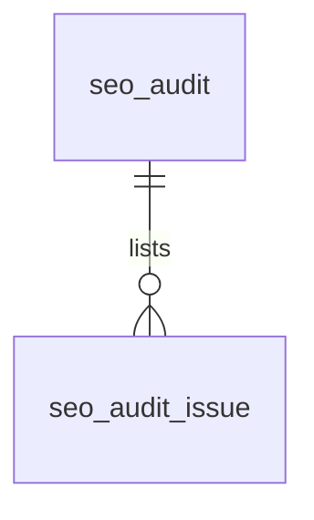

# SEO（seo）模块设计

| 项 | 内容 |
|---|---|
| 模块 ID | `seo` |
| 名称 | SEO |
| 层 | L4 |
| 表前缀 | `seo_` |
| API 前缀 | `seo` |
| 可停用 | 否 |
| 模块版本 | 1.0.0（module.json 的 version） |
| 平台版本 | `>=1.0.0 <2.0.0`（module.json 的 platform） |
| 里程碑切片 | M1：Meta 自动生成与覆盖、canonical、Product / Breadcrumb / Organization JSON-LD；M2：—；M3：Sitemap（含图片）、robots、IndexNow、链接索引、健康检查、hreflang；M4：—（详见第 13 节） |
| 模块负责人 | 待定 |
| 文档版本 | V1.4 |
| 状态 | 草案 |
| 更新日期 | 2026-10-20 |
| 依据 | 系统设计 V1.7 第 14 章及 3.2、3.8、24–29 章；平台框架设计 V1.5 第 4、7–13 章；ADR-002、ADR-003、ADR-005、ADR-009、ADR-018 |

> 本文只引用《平台框架设计》第 4 章中的契约，不定义新的跨模块契约；需要新契约时按平台框架设计 2.3 提出契约变更请求。

## 1. 职责与边界

### 1.1 职责

管理 SEO 覆盖值与模板，发布时计算 Meta，交付时组装 canonical、hreflang 和 JSON-LD；维护 sitemap、robots、链接索引、健康报告与 IndexNow。

功能交付范围按第 13 章分为 M1–M4；表结构、约束与枚举以第 3、4 章为准。

### 1.2 不负责的事

| 事项 | 归属模块 | 边界 |
|---|---|---|
| 内容生命周期与路由 | content / url | 本模块只承担自身职责；不直接修改 cnt_、url_ 表 |
| 身份、权限、设置、任务及审计 | platform-core | 复用平台公共服务 |
| 第三方客户端与网络传输 | infrastructure | 仅经既有端口或 L2 服务使用，不在业务模块引入客户端 |

### 1.3 协作概览

| 协作方式 | 对象 | 本模块行为 |
|---|---|---|
| 服务接口 | ContentApi、UrlApi、MediaApi、TaxonomyApi、TranslationApi | 方法与事务边界见 2.2；无跨模块表访问 |
| 扩展点 | PublishContributor、DeliveryContributor、ContentImpactProvider、MediaReferenceCollector、TranslatableContentProvider、SeoRule、SchemaOrgProvider、SeoVariableProvider、SeoRule、SitemapProvider | 实现/收集清单见 2.4、2.5 |
| 领域事件 | 见 2.6 | 与本地事务一起登记，提交后异步投递；重复与过期处理独立验证 |

### 1.4 适用的架构约束

遵守 P2、P3 与 ADR-018：编译依赖只到 platform-core/platform-api，跨模块协作只用第 2 章登记契约；只访问自己的表，禁止跨模块 JOIN/外键。遵守 ADR-003：事务内登记、提交后投递、监听器幂等并检查过期。遵守 ADR-009：每次请求/任务明确站点上下文，站点表默认过滤。

公开读取只用当前语言发布态，不跨语言回退（ADR-005）；预览与公开缓存隔离。后台中文文案与错误集中管理，前台文案经 UiTextApi，样式只用 Design Token。远程端口在数据库事务外调用，密钥经 SecretCipher，不写日志。

## 2. 依赖与契约

### 2.1 module.json

```json
{
  "id": "seo",
  "name": "搜索引擎优化",
  "version": "1.0.0",
  "layer": "L4",
  "platform": ">=1.0.0 <2.0.0",
  "requires": {
    "content": "^1.0",
    "url": "^1.0",
    "media": "^1.0",
    "taxonomy": "^1.0"
  },
  "optional": {
    "translation": "^1.0"
  },
  "disableable": false,
  "tablePrefix": "seo_",
  "apiPrefix": "seo",
  "permissions": [
    {
      "code": "seo:meta:edit",
      "name": "编辑SEO 草稿",
      "localeScoped": true
    },
    {
      "code": "seo:template:manage",
      "name": "管理模板"
    },
    {
      "code": "seo:robots:manage",
      "name": "管理爬虫规则"
    },
    {
      "code": "seo:audit:run",
      "name": "执行健康报告"
    },
    {
      "code": "seo:audit:view",
      "name": "查看健康报告"
    },
    {
      "code": "seo:sitemap:manage",
      "name": "管理Sitemap"
    }
  ],
  "menus": [
    {
      "key": "seo",
      "name": "搜索引擎优化",
      "parent": "settings",
      "route": "/seo/meta",
      "permission": "seo:meta:edit",
      "order": 100
    }
  ],
  "settings": null,
  "components": [],
  "events": {
    "publishes": [],
    "subscribes": [
      "ContentPublishedEvent",
      "ContentUnpublishedEvent",
      "LocalizationCreatedEvent",
      "LocalizationDeletedEvent",
      "ContentPathChangedEvent",
      "MediaUploadedEvent",
      "MediaUpdatedEvent",
      "MediaDeletedEvent",
      "SiteSettingsChangedEvent",
      "ModuleEnabledEvent",
      "ModuleDisabledEvent",
      "ContentPurgedEvent",
      "NavigationChangedEvent",
      "RelationChangedEvent",
      "TermChangedEvent"
    ]
  }
}
```

描述符为未来 M0 后的实现要求，中文名称须满足框架附录 A Schema。

### 2.2 使用的服务接口

| 接口（平台框架设计小节） | 方法 | 用途 | 调用位置与时机 | 测试替身 |
|---|---|---|---|---|
| `ContentApi`（4.4.16） | lockDraftForWrite、findPublishedSnapshot、findPublishedCards、publishedVersions、scanPublished | 读当前发布快照与卡片；内容类型所属模块创建身份并标记草稿变化 | 读接口在查询阶段调用；写方法加入业务事务，远程文本翻译必须在事务外 | `InMemoryContentApi` |
| `UrlApi`（4.4.17） | pathsOf、absoluteUrl | 解析当前路径、生成 slug 或规范地址；不读取 url 表 | 读接口在查询阶段调用；写方法加入业务事务，远程文本翻译必须在事务外 | `InMemoryUrlApi` |
| `MediaApi`（4.4.18） | findAll、views、imageSources | 媒体视图、图片源与授权下载；不读取媒体表 | 读接口在查询阶段调用；写方法加入业务事务，远程文本翻译必须在事务外 | `InMemoryMediaApi` |
| `TaxonomyApi`（4.4.19） | findTerms、termViews、assignmentsOf | 词汇表、分类视图与内容指派；不读取分类表 | 读接口在查询阶段调用；写方法加入业务事务，远程文本翻译必须在事务外 | `InMemoryTaxonomyApi` |
| `TranslationApi`（4.4.22） | segmentOrigins | 事务外按需文本翻译或读取审校统计 | 读接口在查询阶段调用；写方法加入业务事务，远程文本翻译必须在事务外 | `InMemoryTranslationApi` |
| `SiteApi`（4.4.1） | 按该契约声明的方法 | 语言、站点模块开关 | 业务事务内；站点切换由任务入口完成 | `InMemorySiteApi` |
| `SiteContextProvider`（4.4.2） | 按该契约声明的方法 | 当前站点；异步与任务由 core 恢复 | 业务事务内；站点切换由任务入口完成 | `FakeSiteContextProvider` |
| `PermissionChecker`（4.4.7） | 按该契约声明的方法 | 后台权限与数据范围 | 业务事务内；站点切换由任务入口完成 | `FakePermissionChecker` |
| `AuditApi`（4.4.9） | 按该契约声明的方法 | 同事务写审计，密钥与个人数据脱敏 | 业务事务内；站点切换由任务入口完成 | `InMemoryAuditApi` |
| `EventMetaFactory`（4.4.14） | 按该契约声明的方法 | 事件 ID、版本、站点与操作人 | 业务事务内；站点切换由任务入口完成 | `FakeEventMetaFactory` |
| `ExtensionRegistry`（4.4.15） | 按该契约声明的方法 | 按启用模块收集 2.5 的扩展点 | 业务事务内；站点切换由任务入口完成 | `InMemoryExtensionRegistry` |
| `JobApi`（4.4.12） | 按该契约声明的方法 | 耗时任务提交、取消、进度与结果 | 业务事务内；站点切换由任务入口完成 | `InMemoryJobApi` |
| `ReferenceWriteApi`（4.10，Proposed） | replaceMedia | 原保存事务内协调，失败回滚，站点隔离 | MANDATORY；不得afterCommit补写 | 框架4.10对应协议替身 |
| `ProjectionChangeApi`（4.10，Proposed） | searchChanged | 原保存事务内协调，失败回滚，站点隔离 | MANDATORY；不得afterCommit补写 | 框架4.10对应协议替身 |

所有 L2/L3/L4 读写隐式使用当前站点；按 ID 查询单批最多 500。可选服务用 ObjectProvider 注入并检查当前站点启用状态，缺失时降级，不通过业务表绕过服务。


### 2.3 提供的服务接口

不适用：本模块不提供跨模块服务接口；其他模块通过 2.4 的既有扩展点或领域事件协作。

### 2.4 实现的扩展点

| 扩展点（平台框架设计小节） | 计划实现类 | 适用范围 | order | 收集方 |
|---|---|---|---|---|
| `PublishContributor`（4.5.3） | `SeoPublishContributor` | parts.seo：最终值/自动值/覆盖字段；LATE=5000 | LATE=5000 | content |
| `DeliveryContributor`（4.5.7） | `SeoDeliveryContributor` | sectionKey=seo：head、canonical、公开语言 alternates 与 @graph | DEFAULT=1000 | delivery |
| `ContentImpactProvider`（4.5.4） | `SeoContentImpactProvider` | 按本模块职责及 3、4 章登记的内容/资源类型 | DEFAULT=1000 | content / core |
| `MediaReferenceCollector`（4.5.16） | `SeoMediaReferenceCollector` | 按本模块职责及 3、4 章登记的内容/资源类型 | DEFAULT=1000 | media |
| `TranslatableContentProvider`（4.5.20） | `SeoTranslatableContentProvider` | 内容的 title/description/OG 文本覆盖；不翻译 canonical/robots | DEFAULT=1000 | translation |
| `SeoRule`（4.5.12） | `SeoSeoRule` | 系统设计 14.9 全部 V1 健康规则 | DEFAULT=1000 | seo |
| `PlatformModule`（4.5.22） | `SeoModule` | 本模块安装/升级；可停用模块提供影响报告与停用后保留数据规则 | DEFAULT=1000 | core |

以上类名为待实现名称。PublishContributor 不调用调用方的写方法，不访问外部服务；翻译提供方只写本模块草稿/资源，先校验源指纹与共同 version。本模块不可站点级停用；对可选依赖缺失/停用仍须按框架约定降级。

### 2.5 收集的扩展点

| 扩展点 | 调用时机 | 过滤 | 失败行为 | 测试示例 |
|---|---|---|---|---|
| `SchemaOrgProvider`（4.5.10） | 见第 5 章流程 | ExtensionRegistry 按站点启用状态、内容类型或 key 过滤 | 事务内校验/发布异常则回滚；只读可选部分失败记指标并降级，核心部分失败返回 503 | `SampleSchemaOrgProvider` |
| `SeoVariableProvider`（4.5.11） | 见第 5 章流程 | ExtensionRegistry 按站点启用状态、内容类型或 key 过滤 | 事务内校验/发布异常则回滚；只读可选部分失败记指标并降级，核心部分失败返回 503 | `SampleSeoVariableProvider` |
| `SeoRule`（4.5.12） | 见第 5 章流程 | ExtensionRegistry 按站点启用状态、内容类型或 key 过滤 | 事务内校验/发布异常则回滚；只读可选部分失败记指标并降级，核心部分失败返回 503 | `SampleSeoRule` |
| `SitemapProvider`（4.5.13） | 见第 5 章流程 | ExtensionRegistry 按站点启用状态、内容类型或 key 过滤 | 事务内校验/发布异常则回滚；只读可选部分失败记指标并降级，核心部分失败返回 503 | `SampleSitemapProvider` |

### 2.6 发布与订阅的事件

发布：

不适用：没有本模块领域事件。

订阅：

| 事件 | 处理 | 幂等 | 过期与删除 | 失败与重试 |
|---|---|---|---|---|
| `ContentPublishedEvent` | 按第 4.6 节处理事件所标识的对象；副作用只发生在本模块数据范围 | 本模块事务内的幂等标记与数据变更一起提交；缓存重复失效安全 | 读取当前状态/指纹；只有匹配的当前结果才更新；不以 occurredAt 单独当全序 | 失败抛出保留未完成投递；业务副作用转入已有任务/队列后重试 |
| `ContentUnpublishedEvent` | 移除该语言的公开投影/候选/缓存依赖，人工关系及历史快照按 4.6 保留 | 本模块事务内的幂等标记与数据变更一起提交；缓存重复失效安全 | 读取当前状态/指纹；只有匹配的当前结果才更新；不以 occurredAt 单独当全序 | 失败抛出保留未完成投递；业务副作用转入已有任务/队列后重试 |
| `LocalizationCreatedEvent` | 按第 4.6 节处理事件所标识的对象；副作用只发生在本模块数据范围 | 本模块事务内的幂等标记与数据变更一起提交；缓存重复失效安全 | 读取当前状态/指纹；只有匹配的当前结果才更新；不以 occurredAt 单独当全序 | 失败抛出保留未完成投递；业务副作用转入已有任务/队列后重试 |
| `LocalizationDeletedEvent` | 仅清理对应语言的本模块本地化/投影，不删除其他语言或共享业务字段 | 本模块事务内的幂等标记与数据变更一起提交；缓存重复失效安全 | 清理使用事件中的 ID；查不到父对象仍须清理 | 失败抛出保留未完成投递；业务副作用转入已有任务/队列后重试 |
| `ContentPathChangedEvent` | 按第 4.6 节处理事件所标识的对象；副作用只发生在本模块数据范围 | 本模块事务内的幂等标记与数据变更一起提交；缓存重复失效安全 | 读取当前状态/指纹；只有匹配的当前结果才更新；不以 occurredAt 单独当全序 | 失败抛出保留未完成投递；业务副作用转入已有任务/队列后重试 |
| `MediaUploadedEvent` | 仅处理被引用媒体：更新当前媒体视图或按 4.6 防御性清理；仍有有效引用的媒体不能被主动删除 | 本模块事务内的幂等标记与数据变更一起提交；缓存重复失效安全 | 读取当前状态/指纹；只有匹配的当前结果才更新；不以 occurredAt 单独当全序 | 失败抛出保留未完成投递；业务副作用转入已有任务/队列后重试 |
| `MediaUpdatedEvent` | 仅处理被引用媒体：更新当前媒体视图或按 4.6 防御性清理；仍有有效引用的媒体不能被主动删除 | 本模块事务内的幂等标记与数据变更一起提交；缓存重复失效安全 | 读取当前状态/指纹；只有匹配的当前结果才更新；不以 occurredAt 单独当全序 | 失败抛出保留未完成投递；业务副作用转入已有任务/队列后重试 |
| `MediaDeletedEvent` | 仅处理被引用媒体：更新当前媒体视图或按 4.6 防御性清理；仍有有效引用的媒体不能被主动删除 | 本模块事务内的幂等标记与数据变更一起提交；缓存重复失效安全 | 清理使用事件中的 ID；查不到父对象仍须清理 | 失败抛出保留未完成投递；业务副作用转入已有任务/队列后重试 |
| `SiteSettingsChangedEvent` | 按 scopes、settingKeys、localeChanges 筛选 4.6 的相关变化；不对无关设置做全量重建 | 本模块事务内的幂等标记与数据变更一起提交；缓存重复失效安全 | 读取当前状态/指纹；只有匹配的当前结果才更新；不以 occurredAt 单独当全序 | 失败抛出保留未完成投递；业务副作用转入已有任务/队列后重试 |
| `ModuleEnabledEvent` | 检查被启用模块的当前数据，重建受影响读模型并补偿停用期间跳过的事件 | 本模块事务内的幂等标记与数据变更一起提交；缓存重复失效安全 | 读取当前状态/指纹；只有匹配的当前结果才更新；不以 occurredAt 单独当全序 | 失败抛出保留未完成投递；业务副作用转入已有任务/队列后重试 |
| `ModuleDisabledEvent` | 当前站点隐藏该模块的公开能力，保留自身数据；处理事件.moduleId 而非假定是接收方自身 | 本模块事务内的幂等标记与数据变更一起提交；缓存重复失效安全 | 读取当前状态/指纹；只有匹配的当前结果才更新；不以 occurredAt 单独当全序 | 失败抛出保留未完成投递；业务副作用转入已有任务/队列后重试 |
| `ContentPurgedEvent` | 按事件 contentId/localizationIds 清理本模块外部引用或子行；历史业务快照按 4.6 保留；不回查已不存在的父内容 | 本模块事务内的幂等标记与数据变更一起提交；缓存重复失效安全 | 清理使用事件中的 ID；查不到父对象仍须清理 | 失败抛出保留未完成投递；业务副作用转入已有任务/队列后重试 |
| `NavigationChangedEvent` | 按菜单整体变化重建导航派生结果或缓存，menuId 是聚合 ID | 本模块事务内的幂等标记与数据变更一起提交；缓存重复失效安全 | 读取当前状态/指纹；只有匹配的当前结果才更新；不以 occurredAt 单独当全序 | 失败抛出保留未完成投递；业务副作用转入已有任务/队列后重试 |
| `RelationChangedEvent` | 失效该源内容的 g 标签，重读当前关系集合 | 本模块事务内的幂等标记与数据变更一起提交；缓存重复失效安全 | 读取当前状态/指纹；只有匹配的当前结果才更新；不以 occurredAt 单独当全序 | 失败抛出保留未完成投递；业务副作用转入已有任务/队列后重试 |
| `TermChangedEvent` | 按 change/termId 更新相关草稿引用或重算候选；草稿指派不冒充发布态指派 | 本模块事务内的幂等标记与数据变更一起提交；缓存重复失效安全 | 读取当前状态/指纹；只有匹配的当前结果才更新；不以 occurredAt 单独当全序 | 失败抛出保留未完成投递；业务副作用转入已有任务/队列后重试 |

监听器按框架 5.8 建立站点/system 上下文；`ContentPurgedEvent` 在模块停用时仍必须清理（deliverWhenModuleDisabled）。其他停用期间跳过并完成的事件，重新启用后通过扫描当前状态补偿，不能假定还会重投。数据库幂等标记与本模块数据在同一事务提交；外部发送、下载、搜索与 CDN 调用不得被数据库长事务包裹，使用已声明的任务/端口和业务幂等键。事件 payload 仅引用框架现有字段，本文不扩展签名。

### 2.7 使用的端口

| 端口（平台框架小节） | 用途 | 测试替身 |
|---|---|---|
| `TaggedCache`（4.7.14） | 第 5 章外部能力；只通过端口调用基础设施 | `InMemoryTaggedCache` |
| `IndexNowClient`（4.7.8） | 第 5 章外部能力；只通过端口调用基础设施 | `RecordingIndexNowClient` |
| `CdnPurger`（4.7.7） | 第 5 章外部能力；只通过端口调用基础设施 | `RecordingCdnPurger` |
| `BufferStore`（4.7.17） | 第 5 章外部能力；只通过端口调用基础设施 | `InMemoryBufferStore` |

## 3. 领域模型

### 3.1 聚合、实体与值对象

| 类型 | 名称 | 说明 |
|---|---|---|
| 聚合根 | SeoMeta（`seo_meta`） | 一个本地化的 SEO 覆盖值（草稿态）：标题、描述、canonical、robots、OG、补充 JSON-LD、焦点关键词；下次发布时进入快照 |
| 聚合根 | SeoTemplate（`seo_template`） | 站点 × 语言 × 内容类型的标题与描述模板（自动值的来源） |
| 实体（读模型） | Link（`seo_link`） | 链接索引：某页面（本地化）以某种方式链接到某内容；发布后按来源页面整体重建 |
| 聚合根 | Audit（`seo_audit`） | 一个已发布本地化最近一次健康检查的结果：分数、问题数、用于重复检测的标题与描述哈希、入站链接数 |
| 实体 | AuditIssue（`seo_audit_issue`） | 检查发现的一个问题（规则、级别、位置、说明），随检查结果整体替换 |
| 聚合根 | RobotsRule（`seo_robots_rule`） | 站点管理员追加到 robots.txt 的规则 |
| 实体（队列） | PingQueueEntry（`seo_ping_queue`） | 待推送到 IndexNow 的 URL |
| 值对象 | SeoSnapshotPart | 快照 `seo` 部分：`{title, description, robots, canonical, og, auto:{…}, overridden:[…]}`（系统设计 6.4） |
| 值对象 | RobotsDirective | `index,follow` / `noindex,follow` / `index,nofollow` / `noindex,nofollow` |
| 值对象 | Severity | `ERROR`（扣 15 分）/ `WARNING`（扣 5 分）/ `INFO`（扣 1 分） |
| 值对象 | SeoSiteSettings | 站点 SEO 设置，保存在 `sys_setting`（键 `seo.site`，见下） |

### 3.2 不变量

| # | 规则 | 保证方式 |
|---|---|---|
| 1 | 每个本地化最多一行覆盖值 | 数据库：`uk_meta_loc` |
| 2 | **自动值永远不写入 `*_override` 字段**；“恢复为自动”即把覆盖字段置空；快照中的 `overridden` 列表与非空的覆盖字段一致 | 应用层 + 单元测试（ADR-008） |
| 3 | canonical 只能指向本语言的页面（禁止跨语言 canonical）；默认指向自身，覆盖值在发布校验时检查可访问、非重定向、非 noindex | 应用层（`PublishContributor.validate()`、SEO 规则） |
| 4 | `AUTO` 模式的目标语言本地化中，标题、描述、OG 标题与描述的覆盖值只由翻译回写（seo 实现的 `TranslatableContentProvider`），人工只能在翻译编辑器中按段修订；其余字段的处理见下表 | 应用层 |
| 5 | robots 覆盖值只能是四种组合之一 | 数据库：`ck_seo_meta_robots` |
| 6 | 模板查找顺序：（语言，类型）→（语言，`*`）→（`*`，类型）→（`*`，`*`）→ 内置默认 `{title} \| {siteName}`、`{summary}`；标题与描述各自独立查找。`locale = '*'` 的行只能含变量与标点（不含中日韩文字），含字面文字的模板必须按语言配置 | 应用层（模板保存时校验） |
| 7 | 链接只在同一语言内建立；`NAV` 行的来源为 0（全站导航），其他类型的来源是具体本地化 | 数据库：`ck_seo_link_nav`；应用层 |
| 8 | 某来源页面的链接索引在一个事务中整体替换（先删后插）；来源页面下线时删除其出向链接 | 应用层 |
| 9 | 只有已发布的本地化有检查结果，每个本地化一行；分数在 0–100 之间；问题行随检查结果在同一事务中替换 | 数据库：`uk_aud_loc`、`ck_seo_aud_score`；应用层 |
| 10 | 同一 URL 最多一条待推送记录；只推送对外公开语言、主域名下的 URL | 数据库：`uk_ping_pending`；应用层 |
| 11 | robots 规则的路径以 `/` 开头；未删除的规则不重复 | 数据库：`ck_seo_robots_path`、`uk_robots_rule` |
| 12 | `schema_extra` 只有开发者角色可以编辑，修改记入审计 | 应用层（权限点 `seo:schema:edit`，高危） |

**覆盖值字段在目标语言中的处理**（seo 的 `TranslatableContentProvider`，系统设计 14.1）：

| 字段 | `AUTO` 模式的目标语言 | `MANUAL` 模式 |
|---|---|---|
| `title_override`、`description_override`、`og_title_override`、`og_description_override` | 源语言有值时作为翻译单元（`maxLength` 取字段长度建议上限：标题 60、描述 160）翻译后写入；源语言为空时目标语言也为空，由该语言的模板生成自动值 | 独立编辑 |
| `robots_override`、`og_image_media_id`、`schema_extra` | 从源语言复制（非文本数据） | 独立编辑 |
| `canonical_override`、`focus_keyword` | 按语言单独维护，不复制、不翻译（canonical 必须指向本语言页面；关键词因语言而异） | 独立编辑 |

**补充与取舍**（系统设计之外的补充及理由）：

| 项 | 内容与理由 |
|---|---|
| 站点 SEO 设置用 `sys_setting` | 不建 `seo_site_setting` 表：站点验证 meta、AI 爬虫策略、IndexNow key、默认 OG 图、关键页面清单是每站点一份的设置，与翻译设置一样放 `sys_setting`（键 `seo.site`），使用 Schema 表单；修改后由 core 发布 `SiteSettingsChangedEvent`，delivery 清除 `settings` 标签 |
| `seo_meta.content_id`、`locale` | 冗余，用于内容彻底删除时清理与按语言列出 |
| `seo_template` 的 `*` 行与 `description_max_length` | 系统设计只给出“站点 × 语言 × 内容类型”；增加通配行，避免为每种语言、每种类型重复配置；描述截断长度（默认 155）可按语言调整 |
| `seo_link` 的补充列 | `source_content_id`（内容彻底删除时清理出向链接）、`locale`（同语言统计）、`occurrences` 与 `anchor_text`（“哪些页面链接到这里”展示锚文本）；全站导航只记一份（`NAV` 行来源为 0），不在每个页面重复 |
| 新增 `seo_audit_issue` | 系统设计只写“结果保存在 `seo_audit`”。看板的“问题排行”“按规则筛选页面”需要按规则聚合，拆成问题行才能建索引，不必在每次查询时展开 JSON |
| `seo_audit` 的冗余列 | `path`、`seo_title`（列表显示不必跨模块查询）、`title_hash` / `description_hash`（“同站点、同语言标题或描述重复”在单页检查时直接用索引查重）、`inbound_link_count` |
| 新增 `seo_ping_queue` | IndexNow “按分钟批量推送”（系统设计 14.7）需要持久的去重队列：实例重启不丢失、可重试、可查看推送记录 |
| 关键页面清单 | SEO 规则“关键页面的机器译文未经审校”需要知道哪些是关键页面：由 `seo.site.keyContentIds` 配置（首页、主要产品与分类页），规则经 `TranslationApi` 查询这些页面目标语言中来源仍为 `MACHINE` 的段数 |

**站点 SEO 设置**（`sys_setting`，键 `seo.site`，`module_id = 'seo'`）：

```json
{
  "schemaVersion": 1,
  "verification": { "google": "abc123def456", "bing": "0123456789ABCDEF" },
  "aiCrawlers": { "GPTBot": "DISALLOW", "ClaudeBot": "ALLOW", "Google-Extended": "DISALLOW", "PerplexityBot": "ALLOW", "CCBot": "DISALLOW" },
  "indexNow": { "enabled": true, "key": "3f7c2a9e5b8d4c1fa0e6b2d9c7a4f1e8" },
  "defaultOgImageMediaId": "7201893453918208",
  "keyContentIds": ["7201893453912345", "7201893453912399"]
}
```

| 键 | 说明 |
|---|---|
| `verification.google` / `verification.bing` | Google Search Console（`google-site-verification`）与 Bing Webmaster Tools（`msvalidate.01`）的验证 meta 内容，输出到首页 `<head>`（系统设计 14.7） |
| `aiCrawlers` | AI 爬虫策略：爬虫名 → `ALLOW` / `DISALLOW`，生成 robots.txt 中的独立分组；未列出的爬虫遵循 `User-agent: *` 规则（系统设计 14.3） |
| `indexNow.enabled` / `indexNow.key` | IndexNow 开关与密钥（8–128 个字符，`[A-Za-z0-9-]`；公开值，不加密）；Nuxt 在 `/{key}.txt` 返回该密钥 |
| `defaultOgImageMediaId` | 站点默认 OG 图（`mda_media.id`），本地化与内容都没有图片时使用 |
| `keyContentIds` | 关键页面（`cnt_content.id`，≤ 100 个），用于 SEO 规则“关键页面的机器译文未经审校” |

robots.txt 的生成顺序：默认模板（`Disallow: /api/`、`/__preview/`、`/__editor`）→ `aiCrawlers` 分组 → `seo_robots_rule` 中启用的规则（按 `user_agent` 分组、`sort_order` 排序）→ `Sitemap:` 行；预发布与测试环境整体替换为 `Disallow: /`（系统设计 14.3）。

### 3.3 状态机

不适用：没有持久化业务状态机。

## 4. 数据模型

> 遵守平台框架设计第 7 章的数据库通用约定。本节给出待实现 DDL；本次文档审查未重跑 MySQL，不能据此认定 DDL 已验证。M0 后按第 11 章在 MySQL 8.4 空库验证，并使实际迁移脚本与本节一致。

### 4.1 表清单

| 表 | 说明 | 站点级 | 软删除 | 预估规模（单站，按系统设计假设 A4） |
|---|---|---|---|---|
| `seo_meta` | 本地化的 SEO 覆盖值 | 是 | 否（“恢复为自动”即清空字段；本地化删除时物理删除） | 只有设置了覆盖值的本地化才有行：≈ 2–5 万，上限 ≈ 20 万 |
| `seo_template` | 标题与描述模板 | 是 | 否（删除即回退到上一级） | ≤ 100 |
| `seo_link` | 链接索引 | 是 | 否（发布后整体替换） | 已发布本地化 ≈ 15 万 × 平均 25 条 ≈ 300–400 万 |
| `seo_audit` | 健康检查结果（每个已发布本地化一行） | 是 | 否 | ≈ 15 万 |
| `seo_audit_issue` | 健康检查问题 | 是 | 否（随检查结果替换） | ≈ 30–50 万 |
| `seo_robots_rule` | robots.txt 追加规则 | 是 | 是 | ≤ 50 |
| `seo_ping_queue` | IndexNow 推送队列 | 是 | 否（已推送 7 天、失败 30 天后删除） | 发布量 × 对外公开语言数，约数百至数千 / 天；常驻 < 5 万 |

**站点过滤**：全部为站点级表，由拦截器过滤。例外：每分钟的 IndexNow 推送任务跨站点轮询到期记录、每晚的全站检查按站点逐个执行，均使用标注 `@InterceptorIgnore` 的专用查询（或显式设置站点上下文）。

### 4.2 ER 图



其余表（`seo_meta`、`seo_template`、`seo_link`、`seo_robots_rule`、`seo_ping_queue`）在模块内没有外键关系，只以 ID 引用内容、本地化与媒体（见 4.6），未画出。

### 4.3 表结构

类型列中的 `bin` 表示 `COLLATE utf8mb4_0900_bin`；通用字段的定义见第 2.4 节。

#### 4.3.1 `seo_meta`：SEO 覆盖值

每个本地化最多一行（草稿态，系统设计 14.1）；没有行或字段为空表示使用自动值。SEO 标签（内容编辑外壳中由 seo 注册，权限 `seo:meta:edit`）单独保存，带自己的乐观锁；修改在下次发布时进入快照，并参与内核的 `draft_hash`（经 `PublishContributor.contribute()`）。

| 字段 | 类型 | 可空 | 默认 | 说明 |
|---|---|---|---|---|
| `id` | BIGINT | 否 | — | 主键（TSID） |
| `site_id` | BIGINT | 否 | — | 站点 |
| `content_id` | BIGINT | 否 | — | 内容（`cnt_content.id`） |
| `localization_id` | BIGINT | 否 | — | 本地化（`cnt_localization.id`） |
| `locale` | VARCHAR(16) | 否 | — | 语言（冗余 `cnt_localization.locale`） |
| `title_override` | VARCHAR(300) | 是 | — | SEO 标题覆盖值（建议 30–60 个字符，按像素宽度 ≤ 580 px） |
| `description_override` | VARCHAR(1000) | 是 | — | meta description 覆盖值（建议 70–160 个字符） |
| `canonical_override` | VARCHAR(2048) | 是 | — | canonical 覆盖值（绝对 URL，必须是本语言页面） |
| `robots_override` | VARCHAR(20) | 是 | — | robots 覆盖值：`index,follow` / `noindex,follow` / `index,nofollow` / `noindex,nofollow` |
| `og_title_override` | VARCHAR(300) | 是 | — | Open Graph 标题覆盖值 |
| `og_description_override` | VARCHAR(1000) | 是 | — | Open Graph 描述覆盖值 |
| `og_image_media_id` | BIGINT | 是 | — | Open Graph 图片（`mda_media.id`）；为空依次取封面图、站点默认 OG 图 |
| `schema_extra` | JSON | 是 | — | 手工补充的 JSON-LD 节点（仅开发者角色），合并进 `@graph` |
| `focus_keyword` | VARCHAR(200) | 是 | — | 焦点关键词（只用于后台分析，不输出到页面） |
| `version` | INT | 否 | 0 | 乐观锁 |
| `created_at` | DATETIME(3) | 否 | CURRENT_TIMESTAMP(3) | 创建时间 |
| `created_by` | BIGINT | 否 | 0 | 创建人（翻译回写为 0） |
| `updated_at` | DATETIME(3) | 否 | CURRENT_TIMESTAMP(3)，更新时自动刷新 | 更新时间 |
| `updated_by` | BIGINT | 否 | 0 | 更新人 |

索引与约束：
- `PRIMARY KEY (id)`
- `uk_meta_loc (localization_id)`：每个本地化一行；SEO 标签读取、发布时组装快照、翻译提取与回写都按本地化读取
- `idx_meta_content (site_id, content_id)`：按内容读取全部语言的覆盖值（翻译回写时读取源语言行）；内容彻底删除时清理
- `ck_seo_meta_robots`：robots 覆盖值只能是四种组合之一

```sql
CREATE TABLE seo_meta (
  id                       BIGINT         NOT NULL COMMENT '主键（TSID）',
  site_id                  BIGINT         NOT NULL COMMENT '站点',
  content_id               BIGINT         NOT NULL COMMENT '内容（cnt_content.id）',
  localization_id          BIGINT         NOT NULL COMMENT '本地化（cnt_localization.id）；每个本地化最多一行',
  locale                   VARCHAR(16)    NOT NULL COMMENT '语言（冗余 cnt_localization.locale）',
  title_override           VARCHAR(300)   NULL COMMENT 'SEO 标题覆盖值（建议 30–60 个字符）；为空使用模板生成的自动值；AUTO 目标语言由翻译回写',
  description_override     VARCHAR(1000)  NULL COMMENT 'meta description 覆盖值（建议 70–160 个字符）；AUTO 目标语言由翻译回写',
  canonical_override       VARCHAR(2048)  NULL COMMENT 'canonical 覆盖值（绝对 URL，必须是本语言页面；默认指向自身）；不随翻译复制',
  robots_override          VARCHAR(20)    NULL COMMENT 'robots 覆盖值：index,follow / noindex,follow / index,nofollow / noindex,nofollow；为空按索引控制规则；AUTO 目标语言从源语言复制',
  og_title_override        VARCHAR(300)   NULL COMMENT 'Open Graph 标题覆盖值；AUTO 目标语言由翻译回写',
  og_description_override  VARCHAR(1000)  NULL COMMENT 'Open Graph 描述覆盖值；AUTO 目标语言由翻译回写',
  og_image_media_id        BIGINT         NULL COMMENT 'Open Graph 图片（mda_media.id）；为空依次取封面图、站点默认 OG 图；AUTO 目标语言从源语言复制',
  schema_extra             JSON           NULL COMMENT '手工补充的 JSON-LD 节点（仅开发者角色），合并进 @graph；AUTO 目标语言从源语言复制，不翻译',
  focus_keyword            VARCHAR(200)   NULL COMMENT '焦点关键词（只用于后台分析，不输出到页面）；按语言单独维护，不翻译',
  version                  INT            NOT NULL DEFAULT 0 COMMENT '乐观锁版本号',
  created_at               DATETIME(3)    NOT NULL DEFAULT CURRENT_TIMESTAMP(3) COMMENT '创建时间',
  created_by               BIGINT         NOT NULL DEFAULT 0 COMMENT '创建人（0 = 系统，如翻译回写）',
  updated_at               DATETIME(3)    NOT NULL DEFAULT CURRENT_TIMESTAMP(3) ON UPDATE CURRENT_TIMESTAMP(3) COMMENT '更新时间',
  updated_by               BIGINT         NOT NULL DEFAULT 0 COMMENT '更新人（0 = 系统）',
  PRIMARY KEY (id),
  UNIQUE KEY uk_meta_loc (localization_id),
  KEY idx_meta_content (site_id, content_id),
  CONSTRAINT ck_seo_meta_robots CHECK (robots_override IS NULL OR robots_override IN ('index,follow', 'noindex,follow', 'index,nofollow', 'noindex,nofollow'))
) ENGINE = InnoDB DEFAULT CHARSET = utf8mb4 COLLATE = utf8mb4_0900_ai_ci COMMENT = 'SEO 覆盖值（每个本地化最多一行，草稿态）';
```

#### 4.3.2 `seo_template`：标题与描述模板

自动值的来源（系统设计 14.1）：标题如 `{title} | {siteName}`，描述如 `{summary}` 截断到 155 个字符。变量由 `SeoVariableProvider` 提供（产品可提供 `{modelNo}`、`{primaryCategory}`、`{brand}`），`{siteName}` 取站点资料当前语言的公司名称。修改模板后，已发布内容的自动值在重新发布时更新（ADR-008；批量刷新方式见《URL 与 SEO 引擎详细设计》）。

| 字段 | 类型 | 可空 | 默认 | 说明 |
|---|---|---|---|---|
| `id` | BIGINT | 否 | — | 主键（TSID） |
| `site_id` | BIGINT | 否 | — | 站点 |
| `locale` | VARCHAR(16) | 否 | — | 语言；`*` 表示全部语言 |
| `content_type` | VARCHAR(32) | 否 | — | 内容类型；`*` 表示全部类型 |
| `title_template` | VARCHAR(300) | 是 | — | 标题模板；为空则按查找顺序取上一级 |
| `description_template` | VARCHAR(500) | 是 | — | 描述模板；为空则取上一级 |
| `description_max_length` | SMALLINT | 否 | 155 | 描述自动值的截断长度（字符） |
| `version` | INT | 否 | 0 | 乐观锁 |
| `created_at` | DATETIME(3) | 否 | CURRENT_TIMESTAMP(3) | 创建时间 |
| `created_by` | BIGINT | 否 | 0 | 创建人 |
| `updated_at` | DATETIME(3) | 否 | CURRENT_TIMESTAMP(3)，更新时自动刷新 | 更新时间 |
| `updated_by` | BIGINT | 否 | 0 | 更新人 |

索引与约束：
- `PRIMARY KEY (id)`
- `uk_tpl_scope (site_id, locale, content_type)`：每个范围一行；发布时按（站点，语言 IN (语言, `*`)）读取并在内存中按查找顺序合并（结果缓存）
- `ck_seo_tpl_present`：标题与描述模板至少有一个
- `ck_seo_tpl_desc_len`：截断长度在 50–300 之间

```sql
CREATE TABLE seo_template (
  id                      BIGINT        NOT NULL COMMENT '主键（TSID）',
  site_id                 BIGINT        NOT NULL COMMENT '站点',
  locale                  VARCHAR(16)   NOT NULL COMMENT '语言（BCP 47）；* 表示全部语言（只能含变量与标点）',
  content_type            VARCHAR(32)   NOT NULL COMMENT '内容类型：PAGE / PRODUCT / ARTICLE / CASE_STUDY / TERM_PAGE …；* 表示全部类型',
  title_template         VARCHAR(300)  NULL COMMENT '标题模板，如 {title} | {siteName}；为空则按查找顺序取上一级',
  description_template    VARCHAR(500)  NULL COMMENT '描述模板，如 {summary}；为空则取上一级',
  description_max_length  SMALLINT      NOT NULL DEFAULT 155 COMMENT '描述自动值的截断长度（字符）',
  version                 INT           NOT NULL DEFAULT 0 COMMENT '乐观锁版本号',
  created_at              DATETIME(3)   NOT NULL DEFAULT CURRENT_TIMESTAMP(3) COMMENT '创建时间',
  created_by              BIGINT        NOT NULL DEFAULT 0 COMMENT '创建人（0 = 系统）',
  updated_at              DATETIME(3)   NOT NULL DEFAULT CURRENT_TIMESTAMP(3) ON UPDATE CURRENT_TIMESTAMP(3) COMMENT '更新时间',
  updated_by              BIGINT        NOT NULL DEFAULT 0 COMMENT '更新人（0 = 系统）',
  PRIMARY KEY (id),
  UNIQUE KEY uk_tpl_scope (site_id, locale, content_type),
  CONSTRAINT ck_seo_tpl_present CHECK (title_template IS NOT NULL OR description_template IS NOT NULL),
  CONSTRAINT ck_seo_tpl_desc_len CHECK (description_max_length BETWEEN 50 AND 300)
) ENGINE = InnoDB DEFAULT CHARSET = utf8mb4 COLLATE = utf8mb4_0900_ai_ci COMMENT = 'SEO 标题与描述模板（站点 × 语言 × 内容类型）';
```

#### 4.3.3 `seo_link`：链接索引

发布后（`ContentPublishedEvent`）按来源页面重建（系统设计 14.8）：`BODY` 来自富文本中的 `content://` 引用，`COMPONENT` 来自布局中的 `$content` 引用与组件链接，`BREADCRUMB` 来自 `BreadcrumbProvider`，`RELATED` 来自图谱推荐（`RelationChangedEvent` 后也重建），`NAV` 来自导航菜单（`NavigationChangedEvent` 后重建全站导航行）。用途：入站链接统计、孤立页面、“哪些页面链接到这里”、下线前的影响分析（`ContentImpactProvider`）、SEO 规则“引用已下线内容”。分类项的链接以其 `TERM_PAGE` 内容记录；外部链接与非内容 URL 不记录。

| 字段 | 类型 | 可空 | 默认 | 说明 |
|---|---|---|---|---|
| `id` | BIGINT | 否 | — | 主键（TSID） |
| `site_id` | BIGINT | 否 | — | 站点 |
| `locale` | VARCHAR(16) | 否 | — | 语言（来源与目标同语言） |
| `source_content_id` | BIGINT | 否 | — | 来源内容（`cnt_content.id`）；`NAV` 为 0 |
| `source_localization_id` | BIGINT | 否 | — | 来源本地化（`cnt_localization.id`）；`NAV` 为 0（全站导航） |
| `target_content_id` | BIGINT | 否 | — | 目标内容（`cnt_content.id`） |
| `kind` | VARCHAR(16) | 否 | — | 链接类型：`NAV` / `BREADCRUMB` / `RELATED` / `BODY` / `COMPONENT` |
| `occurrences` | SMALLINT | 否 | 1 | 来源页面中同类链接指向该目标的次数 |
| `anchor_text` | VARCHAR(200) | 是 | — | 首个锚文本（截断到 200 个字符） |
| `created_at` | DATETIME(3) | 否 | CURRENT_TIMESTAMP(3) | 写入时间（重建时整体替换，无更新） |

索引与约束：
- `PRIMARY KEY (id)`
- `uk_link (site_id, locale, source_localization_id, target_content_id, kind)`：同一来源、目标、类型一行；重建时按前缀（站点，语言，来源本地化）先删后插
- `idx_link_target (site_id, target_content_id, locale)`：入站链接计数、孤立页面、“哪些页面链接到这里”、下线影响分析；目标内容彻底删除时清理
- `idx_link_source (source_content_id)`：来源内容彻底删除时清理全部语言的出向链接
- `ck_seo_link_nav`：`NAV` 当且仅当来源为 0

```sql
CREATE TABLE seo_link (
  id                      BIGINT        NOT NULL COMMENT '主键（TSID）',
  site_id                 BIGINT        NOT NULL COMMENT '站点',
  locale                  VARCHAR(16)   NOT NULL COMMENT '语言（来源与目标同语言）',
  source_content_id       BIGINT        NOT NULL COMMENT '来源内容（cnt_content.id）；NAV 为 0',
  source_localization_id  BIGINT        NOT NULL COMMENT '来源本地化（cnt_localization.id）；NAV 为 0（全站导航）',
  target_content_id       BIGINT        NOT NULL COMMENT '目标内容（cnt_content.id）',
  kind                    VARCHAR(16)   NOT NULL COMMENT '链接类型：NAV（导航）/ BREADCRUMB（面包屑）/ RELATED（相关内容）/ BODY（正文 content:// 引用）/ COMPONENT（组件中的 $content 引用）',
  occurrences             SMALLINT      NOT NULL DEFAULT 1 COMMENT '来源页面中同类链接指向该目标的次数',
  anchor_text             VARCHAR(200)  NULL COMMENT '首个锚文本（截断到 200 个字符）',
  created_at              DATETIME(3)   NOT NULL DEFAULT CURRENT_TIMESTAMP(3) COMMENT '写入时间（重建时整体替换）',
  PRIMARY KEY (id),
  UNIQUE KEY uk_link (site_id, locale, source_localization_id, target_content_id, kind),
  KEY idx_link_target (site_id, target_content_id, locale),
  KEY idx_link_source (source_content_id),
  CONSTRAINT ck_seo_link_nav CHECK ((kind = 'NAV') = (source_localization_id = 0 AND source_content_id = 0))
) ENGINE = InnoDB DEFAULT CHARSET = utf8mb4 COLLATE = utf8mb4_0900_ai_ci COMMENT = '链接索引（发布后按来源页面重建）';
```

#### 4.3.4 `seo_audit`：健康检查结果

每个已发布本地化一行，保存最近一次检查的结果（系统设计 14.9）：发布后异步检查单页（`PUBLISH`），每晚全站检查（`NIGHTLY`，重复检测与孤立页面需要全站数据），也可手动重新检查。下线或删除时删除该行。发布前编辑器侧栏中的问题是即时计算的，不写入本表。

| 字段 | 类型 | 可空 | 默认 | 说明 |
|---|---|---|---|---|
| `id` | BIGINT | 否 | — | 主键（TSID） |
| `site_id` | BIGINT | 否 | — | 站点 |
| `content_id` | BIGINT | 否 | — | 内容（`cnt_content.id`） |
| `localization_id` | BIGINT | 否 | — | 本地化（`cnt_localization.id`） |
| `locale` | VARCHAR(16) | 否 | — | 语言 |
| `content_type` | VARCHAR(32) | 否 | — | 内容类型（看板按类型筛选） |
| `revision_no` | INT | 否 | — | 被检查的发布修订号 |
| `path` | VARCHAR(500) bin | 是 | — | 页面路径（检查时的 `pub_path`；不可路由为空） |
| `seo_title` | VARCHAR(300) | 是 | — | 检查时的最终 SEO 标题（列表显示） |
| `title_hash` | CHAR(64) bin | 是 | — | 最终标题规范化（NFC、去首尾空白、合并空白、转小写）后的 SHA-256 |
| `description_hash` | CHAR(64) bin | 是 | — | 最终描述规范化后的 SHA-256 |
| `inbound_link_count` | INT | 否 | 0 | 入站内链数（来自 `seo_link`，不计 sitemap） |
| `score` | SMALLINT | 否 | 100 | 分数 = 100 − Σ 扣分（ERROR 15、WARNING 5、INFO 1），最低 0 |
| `error_count` | SMALLINT | 否 | 0 | ERROR 问题数 |
| `warning_count` | SMALLINT | 否 | 0 | WARNING 问题数 |
| `info_count` | SMALLINT | 否 | 0 | INFO 问题数 |
| `audit_trigger` | VARCHAR(16) | 否 | — | 触发：`PUBLISH` / `NIGHTLY` / `MANUAL` |
| `audited_at` | DATETIME(3) | 否 | — | 检查时间 |
| `created_at` | DATETIME(3) | 否 | CURRENT_TIMESTAMP(3) | 创建时间 |
| `updated_at` | DATETIME(3) | 否 | CURRENT_TIMESTAMP(3)，更新时自动刷新 | 更新时间 |

索引与约束：
- `PRIMARY KEY (id)`
- `uk_aud_loc (localization_id)`：每个本地化一行；编辑器与内容列表读取单页结果
- `idx_aud_score (site_id, locale, score)`：看板的分数分布与“按分数筛选内容列表”
- `idx_aud_title (site_id, locale, title_hash)`：重复标题检测（单页检查时查同哈希的其他行；全站检查时 `GROUP BY title_hash HAVING COUNT(*) > 1`）
- `idx_aud_desc (site_id, locale, description_hash)`：重复描述检测
- `idx_aud_content (site_id, content_id)`：内容下线、彻底删除时清理全部语言的结果
- `ck_seo_aud_score`：分数在 0–100 之间

```sql
CREATE TABLE seo_audit (
  id                  BIGINT        NOT NULL COMMENT '主键（TSID）',
  site_id             BIGINT        NOT NULL COMMENT '站点',
  content_id          BIGINT        NOT NULL COMMENT '内容（cnt_content.id）',
  localization_id     BIGINT        NOT NULL COMMENT '本地化（cnt_localization.id）；每个已发布本地化一行',
  locale              VARCHAR(16)   NOT NULL COMMENT '语言',
  content_type        VARCHAR(32)   NOT NULL COMMENT '内容类型：PAGE / PRODUCT / ARTICLE / CASE_STUDY / FAQ / TERM_PAGE / GLOBAL_BLOCK',
  revision_no         INT           NOT NULL COMMENT '被检查的发布修订号',
  path                VARCHAR(500)  COLLATE utf8mb4_0900_bin NULL COMMENT '页面路径（检查时的 pub_path，含语言前缀；不可路由为空）',
  seo_title           VARCHAR(300)  NULL COMMENT '检查时的最终 SEO 标题（列表显示）',
  title_hash          CHAR(64)      COLLATE utf8mb4_0900_bin NULL COMMENT '最终标题规范化（NFC、去首尾空白、合并空白、转小写）后的 SHA-256；重复标题检测',
  description_hash    CHAR(64)      COLLATE utf8mb4_0900_bin NULL COMMENT '最终描述规范化后的 SHA-256；重复描述检测',
  inbound_link_count  INT           NOT NULL DEFAULT 0 COMMENT '入站内链数（来自 seo_link，不计 sitemap）',
  score               SMALLINT      NOT NULL DEFAULT 100 COMMENT '分数 = 100 − Σ 扣分（ERROR 15、WARNING 5、INFO 1），最低 0',
  error_count         SMALLINT      NOT NULL DEFAULT 0 COMMENT 'ERROR 问题数',
  warning_count       SMALLINT      NOT NULL DEFAULT 0 COMMENT 'WARNING 问题数',
  info_count          SMALLINT      NOT NULL DEFAULT 0 COMMENT 'INFO 问题数',
  audit_trigger       VARCHAR(16)   NOT NULL COMMENT '触发：PUBLISH（发布后单页检查）/ NIGHTLY（每晚全站检查）/ MANUAL（手动重新检查）',
  audited_at          DATETIME(3)   NOT NULL COMMENT '检查时间',
  created_at          DATETIME(3)   NOT NULL DEFAULT CURRENT_TIMESTAMP(3) COMMENT '创建时间',
  updated_at          DATETIME(3)   NOT NULL DEFAULT CURRENT_TIMESTAMP(3) ON UPDATE CURRENT_TIMESTAMP(3) COMMENT '更新时间',
  PRIMARY KEY (id),
  UNIQUE KEY uk_aud_loc (localization_id),
  KEY idx_aud_score (site_id, locale, score),
  KEY idx_aud_title (site_id, locale, title_hash),
  KEY idx_aud_desc (site_id, locale, description_hash),
  KEY idx_aud_content (site_id, content_id),
  CONSTRAINT ck_seo_aud_score CHECK (score BETWEEN 0 AND 100)
) ENGINE = InnoDB DEFAULT CHARSET = utf8mb4 COLLATE = utf8mb4_0900_ai_ci COMMENT = 'SEO 健康检查结果（每个已发布本地化一行）';
```

#### 4.3.5 `seo_audit_issue`：健康检查问题

| 字段 | 类型 | 可空 | 默认 | 说明 |
|---|---|---|---|---|
| `id` | BIGINT | 否 | — | 主键（TSID） |
| `site_id` | BIGINT | 否 | — | 站点 |
| `audit_id` | BIGINT | 否 | — | 所属检查结果（`seo_audit.id`） |
| `localization_id` | BIGINT | 否 | — | 本地化（冗余，按规则列出页面时不必回表） |
| `locale` | VARCHAR(16) | 否 | — | 语言（冗余） |
| `rule_id` | VARCHAR(64) bin | 否 | — | 规则 ID（`SeoRule.id()`，如 `seo.title.length`） |
| `severity` | VARCHAR(8) | 否 | — | 级别：`ERROR` / `WARNING` / `INFO` |
| `field` | VARCHAR(100) | 是 | — | 问题位置（字段路径或 Section ID，如 `seo.title`、`sections.sec_01J9X4K2`），后台据此跳转修复 |
| `message` | VARCHAR(500) | 否 | — | 问题说明（中文） |
| `params` | JSON | 是 | — | 规则参数（如 `{"length":72,"max":60}`、重复标题的其他本地化 ID） |
| `created_at` | DATETIME(3) | 否 | CURRENT_TIMESTAMP(3) | 写入时间（随检查结果替换） |

索引与约束：
- `PRIMARY KEY (id)`
- `idx_iss_audit (audit_id)`：读取单页的问题列表；外键索引
- `idx_iss_rule (site_id, rule_id, locale)`：看板“问题排行”（按规则计数）与“按规则筛选页面”
- `fk_seo_issue_audit`：→ `seo_audit.id`，`ON DELETE CASCADE`

```sql
CREATE TABLE seo_audit_issue (
  id               BIGINT        NOT NULL COMMENT '主键（TSID）',
  site_id          BIGINT        NOT NULL COMMENT '站点',
  audit_id         BIGINT        NOT NULL COMMENT '所属检查结果（seo_audit.id）',
  localization_id  BIGINT        NOT NULL COMMENT '本地化（cnt_localization.id，冗余）',
  locale           VARCHAR(16)   NOT NULL COMMENT '语言（冗余）',
  rule_id          VARCHAR(64)   COLLATE utf8mb4_0900_bin NOT NULL COMMENT '规则 ID（SeoRule.id()，如 seo.title.length）',
  severity         VARCHAR(8)    NOT NULL COMMENT '级别：ERROR / WARNING / INFO',
  field            VARCHAR(100)  NULL COMMENT '问题位置（字段路径或 Section ID，如 seo.title、sections.sec_01J9X4K2），后台据此跳转修复',
  message          VARCHAR(500)  NOT NULL COMMENT '问题说明（中文）',
  params           JSON          NULL COMMENT '规则参数（如 {"length":72,"max":60}、重复标题的其他本地化 ID）',
  created_at       DATETIME(3)   NOT NULL DEFAULT CURRENT_TIMESTAMP(3) COMMENT '写入时间（随检查结果替换）',
  PRIMARY KEY (id),
  KEY idx_iss_audit (audit_id),
  KEY idx_iss_rule (site_id, rule_id, locale),
  CONSTRAINT fk_seo_issue_audit FOREIGN KEY (audit_id) REFERENCES seo_audit (id) ON DELETE CASCADE,
  CONSTRAINT ck_seo_issue_severity CHECK (severity IN ('ERROR', 'WARNING', 'INFO'))
) ENGINE = InnoDB DEFAULT CHARSET = utf8mb4 COLLATE = utf8mb4_0900_ai_ci COMMENT = 'SEO 健康检查问题';
```

#### 4.3.6 `seo_robots_rule`：robots.txt 追加规则

站点管理员追加的规则（系统设计 14.3）；默认模板、AI 爬虫策略与 `Sitemap:` 行由系统生成，不存本表。修改后清除 robots.txt 的缓存。

| 字段 | 类型 | 可空 | 默认 | 说明 |
|---|---|---|---|---|
| `id` | BIGINT | 否 | — | 主键（TSID） |
| `site_id` | BIGINT | 否 | — | 站点 |
| `user_agent` | VARCHAR(100) | 否 | `'*'` | User-agent（`*` 或爬虫名，如 `Googlebot`） |
| `directive` | VARCHAR(16) | 否 | — | 指令：`ALLOW` / `DISALLOW` |
| `path` | VARCHAR(500) bin | 否 | — | 路径规则（以 `/` 开头，可含 `*` 与 `$`），如 `/zh/search` |
| `sort_order` | INT | 否 | 0 | 同一 User-agent 分组内的顺序 |
| `enabled` | TINYINT(1) | 否 | 1 | 启用 |
| `note` | VARCHAR(300) | 是 | — | 备注（添加原因） |
| `deleted_at` | DATETIME(3) | 是 | — | 删除时间（软删除） |
| `alive` | TINYINT（生成列） | 是 | — | 未删除标记（唯一索引用） |
| `version` | INT | 否 | 0 | 乐观锁 |
| `created_at` | DATETIME(3) | 否 | CURRENT_TIMESTAMP(3) | 创建时间 |
| `created_by` | BIGINT | 否 | 0 | 创建人 |
| `updated_at` | DATETIME(3) | 否 | CURRENT_TIMESTAMP(3)，更新时自动刷新 | 更新时间 |
| `updated_by` | BIGINT | 否 | 0 | 更新人 |

索引与约束：
- `PRIMARY KEY (id)`
- `uk_robots_rule (site_id, user_agent, directive, path, alive)`：未删除的规则不重复；生成 robots.txt 时按站点读取全部规则（≤ 50 行）
- `ck_seo_robots_directive`：指令只能是 `ALLOW` / `DISALLOW`
- `ck_seo_robots_path`：路径以 `/` 开头

```sql
CREATE TABLE seo_robots_rule (
  id          BIGINT        NOT NULL COMMENT '主键（TSID）',
  site_id     BIGINT        NOT NULL COMMENT '站点',
  user_agent  VARCHAR(100)  NOT NULL DEFAULT '*' COMMENT 'User-agent（* 或爬虫名，如 Googlebot）',
  directive   VARCHAR(16)   NOT NULL COMMENT '指令：ALLOW / DISALLOW',
  path        VARCHAR(500)  COLLATE utf8mb4_0900_bin NOT NULL COMMENT '路径规则（以 / 开头，可含 * 与 $），如 /zh/search',
  sort_order  INT           NOT NULL DEFAULT 0 COMMENT '同一 User-agent 分组内的顺序，小的在前',
  enabled     TINYINT(1)    NOT NULL DEFAULT 1 COMMENT '启用',
  note        VARCHAR(300)  NULL COMMENT '备注（添加原因）',
  deleted_at  DATETIME(3)   NULL COMMENT '删除时间（软删除）',
  alive       TINYINT AS (IF(deleted_at IS NULL, 1, NULL)) STORED COMMENT '未删除标记（唯一索引用）',
  version     INT           NOT NULL DEFAULT 0 COMMENT '乐观锁版本号',
  created_at  DATETIME(3)   NOT NULL DEFAULT CURRENT_TIMESTAMP(3) COMMENT '创建时间',
  created_by  BIGINT        NOT NULL DEFAULT 0 COMMENT '创建人（0 = 系统）',
  updated_at  DATETIME(3)   NOT NULL DEFAULT CURRENT_TIMESTAMP(3) ON UPDATE CURRENT_TIMESTAMP(3) COMMENT '更新时间',
  updated_by  BIGINT        NOT NULL DEFAULT 0 COMMENT '更新人（0 = 系统）',
  PRIMARY KEY (id),
  UNIQUE KEY uk_robots_rule (site_id, user_agent, directive, path, alive),
  CONSTRAINT ck_seo_robots_directive CHECK (directive IN ('ALLOW', 'DISALLOW')),
  CONSTRAINT ck_seo_robots_path CHECK (path LIKE '/%')
) ENGINE = InnoDB DEFAULT CHARSET = utf8mb4 COLLATE = utf8mb4_0900_ai_ci COMMENT = 'robots.txt 追加规则';
```

#### 4.3.7 `seo_ping_queue`：IndexNow 推送队列

发布、下线、路径变化时入队（路径变化时新旧 URL 各一条；语言设为对外公开时，该语言全部已发布 URL 分批入队），只入队对外公开语言、主域名下的 URL（系统设计 14.7）。每分钟的任务按站点取到期的 `PENDING` 记录（每次 ≤ 10,000 条，同一主机），一次 `POST https://api.indexnow.org/indexnow` 推送；200 / 202 置为 `SENT`；429 与 5xx 退避重试，最多 5 次后 `FAILED`；403 / 422（密钥或 URL 无效）直接 `FAILED` 并告警。站点主域名变化时删除旧域名下未推送的记录。

| 字段 | 类型 | 可空 | 默认 | 说明 |
|---|---|---|---|---|
| `id` | BIGINT | 否 | — | 主键（TSID） |
| `site_id` | BIGINT | 否 | — | 站点 |
| `locale` | VARCHAR(16) | 否 | — | 语言 |
| `url` | VARCHAR(2048) | 否 | — | 完整 URL（主域名 https，含语言前缀） |
| `url_hash` | CHAR(64) bin | 否 | — | URL 的 SHA-256（去重） |
| `reason` | VARCHAR(16) | 否 | — | 原因：`PUBLISHED` / `UNPUBLISHED` / `PATH_CHANGED` / `LOCALE_PUBLIC` |
| `status` | VARCHAR(10) | 否 | `'PENDING'` | 状态：`PENDING` / `SENT` / `FAILED` |
| `pending_flag` | TINYINT（生成列） | 是 | — | `PENDING` 时为 1，否则 NULL（唯一索引用） |
| `attempts` | INT | 否 | 0 | 已推送次数 |
| `next_attempt_at` | DATETIME(3) | 否 | CURRENT_TIMESTAMP(3) | 最早推送时间（退避重试） |
| `sent_at` | DATETIME(3) | 是 | — | 推送成功时间 |
| `response_code` | SMALLINT | 是 | — | 最近一次推送的 HTTP 状态码 |
| `last_error` | VARCHAR(500) | 是 | — | 最近一次失败说明 |
| `created_at` | DATETIME(3) | 否 | CURRENT_TIMESTAMP(3) | 入队时间 |
| `updated_at` | DATETIME(3) | 否 | CURRENT_TIMESTAMP(3)，更新时自动刷新 | 更新时间 |

索引与约束：
- `PRIMARY KEY (id)`
- `uk_ping_pending (site_id, url_hash, pending_flag)`：同一 URL 最多一条待推送记录（入队使用 `INSERT IGNORE`）
- `idx_ping_poll (status, next_attempt_at)`：每分钟的推送任务跨站点取到期的 `PENDING` 记录；清理任务按状态与时间删除（专用豁免查询）
- `idx_ping_list (site_id, created_at)`：后台查看推送记录

```sql
CREATE TABLE seo_ping_queue (
  id               BIGINT         NOT NULL COMMENT '主键（TSID）',
  site_id          BIGINT         NOT NULL COMMENT '站点',
  locale           VARCHAR(16)    NOT NULL COMMENT '语言（只入队对外公开的语言）',
  url              VARCHAR(2048)  NOT NULL COMMENT '完整 URL（主域名 https，含语言前缀）',
  url_hash         CHAR(64)       COLLATE utf8mb4_0900_bin NOT NULL COMMENT 'URL 的 SHA-256（去重）',
  reason           VARCHAR(16)    NOT NULL COMMENT '原因：PUBLISHED（发布）/ UNPUBLISHED（下线）/ PATH_CHANGED（路径变化，新旧 URL 各一条）/ LOCALE_PUBLIC（语言设为对外公开）',
  status           VARCHAR(10)    NOT NULL DEFAULT 'PENDING' COMMENT '状态：PENDING / SENT / FAILED',
  pending_flag     TINYINT AS (IF(status = 'PENDING', 1, NULL)) STORED COMMENT '待推送标记：PENDING 为 1，否则 NULL（唯一索引用）',
  attempts         INT            NOT NULL DEFAULT 0 COMMENT '已推送次数',
  next_attempt_at  DATETIME(3)    NOT NULL DEFAULT CURRENT_TIMESTAMP(3) COMMENT '最早推送时间（退避重试）',
  sent_at          DATETIME(3)    NULL COMMENT '推送成功时间',
  response_code    SMALLINT       NULL COMMENT '最近一次推送的 HTTP 状态码',
  last_error       VARCHAR(500)   NULL COMMENT '最近一次失败说明',
  created_at       DATETIME(3)    NOT NULL DEFAULT CURRENT_TIMESTAMP(3) COMMENT '入队时间',
  updated_at       DATETIME(3)    NOT NULL DEFAULT CURRENT_TIMESTAMP(3) ON UPDATE CURRENT_TIMESTAMP(3) COMMENT '更新时间',
  PRIMARY KEY (id),
  UNIQUE KEY uk_ping_pending (site_id, url_hash, pending_flag),
  KEY idx_ping_poll (status, next_attempt_at),
  KEY idx_ping_list (site_id, created_at)
) ENGINE = InnoDB DEFAULT CHARSET = utf8mb4 COLLATE = utf8mb4_0900_ai_ci COMMENT = 'IndexNow 推送队列';
```

### 4.4 枚举

| 字段 | 取值 | 说明 |
|---|---|---|
| `seo_meta.robots_override` | `index,follow` / `noindex,follow` / `index,nofollow` / `noindex,nofollow` | 为空时按系统设计 14.3 的索引控制规则 |
| `seo_template.locale`、`seo_template.content_type` | BCP 47 语言代码 / 内容类型（共享枚举），或 `*` | `*` 为通配 |
| `seo_link.kind` | `NAV` | 导航菜单（全站一份，来源为 0） |
| | `BREADCRUMB` | 面包屑 |
| | `RELATED` | 相关内容（图谱推荐） |
| | `BODY` | 正文中的 `content://` 引用 |
| | `COMPONENT` | 布局与组件中的 `$content` 引用、按钮链接 |
| `seo_audit.audit_trigger` | `PUBLISH` / `NIGHTLY` / `MANUAL` | 发布后单页检查 / 每晚全站检查 / 手动重新检查 |
| `seo_audit_issue.severity` | `ERROR` / `WARNING` / `INFO` | 扣分 15 / 5 / 1 |
| `seo_audit_issue.rule_id`（V1 内置） | `seo.title.length`、`seo.description.length`、`seo.title.duplicate`、`seo.description.duplicate`、`seo.h1.count`、`seo.heading.order`、`seo.image.alt`、`seo.canonical.invalid`、`seo.schema.required`、`seo.link.orphan`、`seo.related.few`、`seo.body.words`、`seo.slug.quality`、`seo.link.unpublished`、`seo.translation.outdated`、`seo.translation.machine_unreviewed` | 对应系统设计 14.9 的 V1 规则；业务模块可经 `SeoRule` 注册更多（ID 以模块 ID 开头，如 `product.spec.missing`） |
| `seo_robots_rule.directive` | `ALLOW` / `DISALLOW` | robots.txt 指令 |
| `seo_ping_queue.reason` | `PUBLISHED` / `UNPUBLISHED` / `PATH_CHANGED` / `LOCALE_PUBLIC` | 入队原因 |
| `seo_ping_queue.status` | `PENDING` / `SENT` / `FAILED` | 待推送 / 已推送 / 失败（重试耗尽或密钥、URL 无效） |
| `seo.site.aiCrawlers.*` | `ALLOW` / `DISALLOW` | AI 爬虫策略（设置值，不落本模块表） |

### 4.5 站点过滤

| 表 | 行级拦截器 | 访问方式与理由 |
|---|---|---|
| `seo_meta` | 不豁免 | 请求和任务隐式使用当前站点；子表 site_id 与父表一致 |
| `seo_template` | 不豁免 | 请求和任务隐式使用当前站点；子表 site_id 与父表一致 |
| `seo_link` | 不豁免 | 请求和任务隐式使用当前站点；子表 site_id 与父表一致 |
| `seo_audit` | 不豁免 | 请求和任务隐式使用当前站点；子表 site_id 与父表一致 |
| `seo_audit_issue` | 不豁免 | 请求和任务隐式使用当前站点；子表 site_id 与父表一致 |
| `seo_robots_rule` | 不豁免 | 请求和任务隐式使用当前站点；子表 site_id 与父表一致 |
| `seo_ping_queue` | 不豁免 | 请求和任务隐式使用当前站点；子表 site_id 与父表一致 |

### 4.6 跨模块引用与清理

| 本模块字段 | 引用对象（模块.表） | 被引用对象删除 / 下线时的处理 | 触发事件 |
|---|---|---|---|
| 各表 `site_id` | core.`sys_site` | V1 不删除站点 | — |
| `seo_meta.content_id`、`localization_id` | content.`cnt_content`、`cnt_localization` | 本地化删除：删除该行；内容彻底删除：按 `idx_meta_content` 删除全部语言的行 | `LocalizationDeletedEvent`、`ContentPurgedEvent` |
| `seo_meta.og_image_media_id`、`seo.site.defaultOgImageMediaId` | media.`mda_media` | seo 实现 `MediaReferenceCollector` 上报引用，由源事务经ReferenceWriteApi登记，media据此阻止删除；仍收到删除事件时置空并在下次发布时生效 | `MediaDeletedEvent` |
| `seo_link.source_content_id`、`source_localization_id` | content | 来源下线：删除其出向链接；本地化删除或内容彻底删除：同上 | `ContentUnpublishedEvent`、`LocalizationDeletedEvent`、`ContentPurgedEvent` |
| `seo_link.target_content_id` | content | 目标下线：保留（用于规则“引用已下线内容”与影响分析），来源页面下次发布或每晚检查时据实更新；目标彻底删除：按 `idx_link_target` 删除 | `ContentUnpublishedEvent`、`ContentPurgedEvent` |
| `seo_link`（`NAV` 行） | navigation.`nav_item`（链接到内容或分类项的菜单项） | 菜单变化时重建该站点各语言的 `NAV` 行 | `NavigationChangedEvent` |
| `seo_link`（`RELATED` 行） | graph.`grh_relation` | 关系变化时重建相关来源页面的 `RELATED` 行 | `RelationChangedEvent` |
| `seo_audit.content_id`、`localization_id`、`path`、`seo_title` | content | 下线、本地化删除、彻底删除：删除检查结果（级联删除问题行）；路径变化：更新 `path` 并入队 IndexNow | `ContentUnpublishedEvent`、`LocalizationDeletedEvent`、`ContentPurgedEvent`、`ContentPathChangedEvent` |
| `seo_ping_queue.url` | url.`url_route`（发布路径）、core.`sys_site_domain`（主域名） | URL 在入队时生成并固定；主域名变化时删除旧域名下未推送的记录 | `ContentPublishedEvent`、`ContentUnpublishedEvent`、`ContentPathChangedEvent`、`SiteSettingsChangedEvent` |
| `seo_template.locale`、`seo_meta.locale`、`seo_link.locale` | core.`sys_site_locale` | V1 不删除站点语言；语言设为对外公开时把该语言全部已发布 URL 入队 IndexNow，并清除 sitemap 与 hreflang 缓存 | `SiteSettingsChangedEvent` |
| `seo_template.content_type`、`seo_audit.content_type` | 内容类型（代码注册） | 所属模块停用：保留配置与结果；sitemap、检查跳过该类型 | `ModuleDisabledEvent` |
| `seo.site.keyContentIds` | content.`cnt_content` | 内容彻底删除时从清单中移除 | `ContentPurgedEvent` |
| `created_by`、`updated_by` | core.`sys_user` | 不清理 | — |

本模块订阅的其他事件：`ContentPublishedEvent`（sitemap 缓存失效、IndexNow 入队、重建链接索引、单页检查）、`LocalizationCreatedEvent` / `LocalizationDeletedEvent`（hreflang 变化：清除同一内容其他语言页面的缓存标签）、`MediaUpdatedEvent`（alt 变化影响“图片 alt”规则，下次全站检查生效）、`SiteSettingsChangedEvent`、`ModuleEnabledEvent` / `ModuleDisabledEvent`、`TermChangedEvent`（面包屑变化，下次检查时重建 `BREADCRUMB` 行）。本模块实现的扩展点：`PublishContributor`（快照 `seo` 部分）、`DeliveryContributor`、`ContentImpactProvider`、`TranslatableContentProvider`、`MediaReferenceCollector`、`SeoRule`（内置规则）。

---

### 4.7 迁移脚本

| 文件 | 内容 | 里程碑 |
|---|---|---|
| `db/migration/seo/V001__init.sql` | 4.3 中的全部表（7 张：`seo_meta`、`seo_template`、`seo_link`、`seo_audit`、`seo_audit_issue`、`seo_robots_rule`、`seo_ping_queue`），按本节顺序创建 | 按第 13.1 节分期启用，初始结构在首个有效切片建立 |

## 5. 业务流程

已有内容的编辑/翻译/导入保存先按框架4.4.16调用ContentApi.lockDraftForWrite校验目标共同版本并取得父先子后锁，再写本模块业务表，最后updateDraftMeta。新建先create取得内容身份；路由输入事务先取得content.route_tree锁。禁止先持有业务行锁再申请内容父锁。

### 5.1 核心业务流程

| 步骤 | 事务及行为 | 失败处理 |
|---|---|---|
| 1 | 保存 seo_meta 作为内容草稿的一部分，使用共同 version；PublishContributor 按人工覆盖优先计算最终值与自动值并写 seo 快照，自动值不覆盖人工。 | 输入或状态非法返回 4xx；数据库事务回滚；提交后外部处理失败进入重试与可见失败记录 |
| 2 | DeliveryContributor 只读当前发布快照，经 SchemaOrgProvider 组合 @graph，并使用同内容已发布且公开的语言集合生成 hreflang；分页 canonical 指向自身，筛选 noindex 且不跨语言 canonical。 | 输入或状态非法返回 4xx；数据库事务回滚；提交后外部处理失败进入重试与可见失败记录 |
| 3 | 内容和路径事件提交后增量重建链接索引、sitemap 缓存并向 seo_ping_queue 写幂等推送；健康扫描游标遍历发布态，每条规则独立报告，远程 IndexNow 在事务外批量执行。 | 输入或状态非法返回 4xx；数据库事务回滚；提交后外部处理失败进入重试与可见失败记录 |

后台读写先校验权限与站点/语言范围；草稿写入和审计在同一事务。远程操作不能使用数据库长事务包裹。幂等重放返回既有结果；参数不同却复用同一幂等键时拒绝。

### 5.2 一致性、失败与恢复约束

| 场景 | 必须满足的行为 | 可验证结果 |
|---|---|---|
| 覆盖值与发布一致性 | 自动值永不写回覆盖人工字段；恢复自动用 null。保存 SEO 标签参与内容共同 version，失败回滚 seo_meta；最终值在 parts.seo，动态 head 只用对应发布修订。 | 同时保存正文与 SEO 的旧共同版本只成功一次；改模板后重新发布的自动值更新，但人工覆盖与上一修订保持可追溯。 |
| canonical 与公开语言集合 | 分页/筛选 canonical 保留规则允许参数并指向当前语言自身；hreflang 来源是当前已发布且公开的同内容版本集合。语言关闭或路径变更即使修订号不变也更新。 | 关闭英语后 HTML、语言切换与 sitemap 不再含英语；page=2 canonical 保留 page=2；未发布语言不输出 alternate。 |
| Sitemap 与结构化数据 | sitemap 排除 noindex/跨 URL canonical，按 50000 URL 和未压缩 50MB 双阈值切片；lastmod 取 content_modified_at。JSON-LD 序列化要防止文本中的 script 结束标签逃逸。 | 只重新发布未改内容时 lastmod 不变；临界文件按两个阈值正确切片；含 </script> 的业务标题不终止 JSON-LD 脚本。 |
| 健康检查与推送恢复 | 规则失败单列为扫描执行问题，不伪造健康通过；全量扫描可取消续跑。IndexNow 合并同 URL，站点域名/目标变动后再验证，外部失败不回滚发布。 | 一条规则抛错时报告标明未执行/失败，其他规则有结果；IndexNow 失败重试只更新队列状态，已发布内容仍在线。 |

### 5.3 实现前统一方案与接入要求

依据[平台框架 4.10.1、4.10.4](../framework/platform-framework.md)及[设计问题处理说明](../reviews/design-issue-resolution-2026-10-20.md)。新增契约相关ADR仍为Proposed；下列方案已具体化，待评审冻结后同批实现，不能据此声明运行问题已验证。涉及本节的旧异步引用、原地索引写入或待定措辞按此方案替代。

OG图、站点分享图和布局媒体经当前拥有者保存事务同步登记；内容SEO变更仍走共同草稿版本，发布后才进入公开搜索事实。noindex及搜索可见性变化须随发布/配置事务经ProjectionChangeApi登记，不能只删缓存而遗漏索引日志。

## 6. 接口

### 6.1 Admin 端点

| 方法 | 路径（相对 /api/admin/v1/seo） | 说明 | 权限码 | 并发控制 / 幂等 | 审计 |
|---|---|---|---|---|---|
| GET | `/meta/{localizationId}` | SEO 草稿与自动值预览 | `seo:meta:edit` | 只读；不写入业务状态 | 否 |
| PUT | `/meta/{localizationId}` | 保存覆盖或恢复自动 | `seo:meta:edit` | 聚合 version / If-Match；冲突 409 / 412，整笔回滚 | seo.meta.{localizationId}.put |
| GET | `/templates` | 按语言与内容类型的模板 | `seo:template:manage` | 只读；不写入业务状态 | 否 |
| PUT | `/templates/{id}` | 保存已声明变量的模板 | `seo:template:manage` | 聚合 version / If-Match；冲突 409 / 412，整笔回滚 | seo.templates.{id}.put |
| GET | `/robots` | 爬虫规则 | `seo:robots:manage` | 只读；不写入业务状态 | 否 |
| PUT | `/robots` | 保存 robots 追加规则 | `seo:robots:manage` | 聚合 version / If-Match；冲突 409 / 412，整笔回滚 | seo.robots.put |
| POST | `/audits` | 提交 SEO 健康扫描 | `seo:audit:run` | Idempotency-Key；同键同请求返回既有任务/结果 | seo.audits.post |
| GET | `/audits/{id}` | 扫描状态与汇总 | `seo:audit:view` | 只读；不写入业务状态 | 否 |
| GET | `/audits/{id}/issues` | 问题列表与修复链接 | `seo:audit:view` | 只读；不写入业务状态 | 否 |
| GET | `/links` | 按内容查询入链出链 | `seo:audit:view` | 只读；不写入业务状态 | 否 |
| POST | `/sitemap/rebuild` | 重建 sitemap 缓存 | `seo:sitemap:manage` | Idempotency-Key；同键同请求返回既有任务/结果 | seo.sitemap.rebuild.post |
| POST | `/templates` | 创建站点、语言及内容类型作用域的 SEO 模板 | `seo:template:manage` | 更新校验聚合 version；失败整笔回滚 | seo.templates.post |
| DELETE | `/templates/{id}` | 删除覆盖模板并恢复内置默认 | `seo:template:manage` | 更新校验聚合 version；失败整笔回滚 | seo.templates.delete |

ID 序列化为字符串，时间为 ISO-8601 UTC；列表 page/size（size ≤ 100），默认 size=20，排序字段白名单。版本化资源按框架 5.5.6 使用 ETag: "v{version}" 与 If-Match，不能用任意 JSON 摘要替代平台版本协议；无 version 的集合写入方式见本节补充约束。创建返回资源及标识；耗时 POST 返回 202 与 jobId；无跨站点 ID 访问。写操作审计不包含凭据、完整个人数据或任意脚本正文。

**请求与结果约束**：SEO 保存使用 localizationId 与共同 version；null 表示恢复自动，空字符串不能隐式抹掉有效自动标题。schemaExtra 只限开发者并做结构校验；canonical 仅允许已发布可访问地址，不跨语言。扫描请求含语言、内容类型、规则范围，返回 jobId/auditId；issue 给出 ruleId、severity、content/localizationId 与修复入口。

### 6.2 Public 端点

不适用：内容、菜单、媒体引用等由 delivery 返回；本模块不增加绕过发布态约束的公开读取接口。

### 6.3 Internal 端点

不适用：不新增 internal HTTP 端点；跨模块使用进程内 platform-api 契约。Nuxt 所需公共读取使用 6.2 的既有入口及可信代理认证。

### 6.4 权限码

| 权限码 | 名称 | 数据范围 | 高危 | 语言范围 |
|---|---|---|---|---|
| `seo:meta:edit` | 编辑SEO 草稿 | 当前站点 | 否 | 是，按角色目标语言范围校验 |
| `seo:template:manage` | 管理模板 | 当前站点 | 否 | 否 |
| `seo:robots:manage` | 管理爬虫规则 | 当前站点 | 否 | 否 |
| `seo:audit:run` | 执行健康报告 | 当前站点 | 否 | 否 |
| `seo:audit:view` | 查看健康报告 | 当前站点 | 否 | 否 |
| `seo:sitemap:manage` | 管理Sitemap | 当前站点 | 否 | 否 |

### 6.5 错误码

| 错误码 | HTTP 状态 | 后台中文信息 | 前台文案键 |
|---|---|---|---|
| `SEO_VALIDATION_FAILED` | 422 | 输入不符合本模块规则 | — |
| `SEO_NOT_FOUND` | 404 | 请求的资源不存在 | — |
| `CORE_MODULE_DISABLED` | 404 | 站点已停用该模块 | errors.moduleDisabled |
| `SEO_VERSION_CONFLICT`（模块内部错误码） | 409 / 412 | 资源已被修改，请刷新后重试 | — |

跨模块错误使用框架已声明常量；本模块专用 HTTP 校验错误保存在本模块错误目录，不增加 platform-api 常量。公开接口不直接展示 detail；错误文案键统一登记在 UiTextApi。

**重点业务失败**：SEO_VALIDATION_FAILED（本模块内部）、CONTENT_VERSION_CONFLICT。模块内部错误不扩展 platform-api；HTTP 状态按本节与框架错误常量映射。

本模块内部错误补充：`SEO_VERSION_CONFLICT` 默认 409，经 If-Match 提交为 412；幂等键复用但规范化业务请求不同为 `SEO_IDEMPOTENCY_CONFLICT`（409）；状态操作不适用为 `SEO_STATE_INVALID`（409）。只有实际存在相应端点时才注册/使用，均不新增跨模块错误常量。跨站点或数据范围外 ID 返回不泄露对象存在性的结果，日志保留 traceId 和授权判定。

## 7. 后台界面

### 7.1 菜单与路由

| 菜单 key | 名称 | 父菜单 | 路由 | 权限码 |
|---|---|---|---|---|
| seo | 搜索引擎优化 | settings | /seo/meta | seo:meta:edit |

### 7.2 页面

| 页面 | 路由 | 主要功能 | 共享组件 |
|---|---|---|---|
| 搜索引擎优化 | /seo/meta | 按第 6 章端点完成列表、筛选、详情与授权操作；失败保留编辑上下文 | 复用框架 8.2 的 SchemaForm 与通用选择器 |

### 7.3 注册到内容编辑外壳的标签

| key | 适用内容类型 | 权限码 | 计划组件 |
|---|---|---|---|
| seo-panel | 已注册可路由类型 | seo:meta:edit | SeoPanel |

### 7.4 界面文案

| texts.ts 分组 | 中文文案 | 使用场景 |
|---|---|---|
| seo.title | SEO | 页面标题 |
| seo.save | 保存成功 | 保存反馈 |
| seo.conflict | 内容已被修改，请刷新后重试 | 并发冲突 |
| seo.confirm | 确认执行此操作？ | 有副作用操作确认 |

字段名、枚举标签、按钮、空状态、错误与任务进度统一集中在本模块 texts.ts；后台不引入 vue-i18n。无权限时隐藏操作，服务端仍再次校验。

## 8. 前台组件与模板

> 没有前台组件时写“不适用”。

### 8.1 组件

不适用：不拥有可拖入布局的组件类型。运行时 UI 或主题固定区域见第 5、6 章。

### 8.2 属性与翻译

不适用：无本模块组件属性；可翻译内容及资源按第 3、4 章登记的提供方处理。

### 8.3 模板

不适用：模板元数据由 page 的 TemplateProvider 提供；本模块只提供所属组件或数据。

### 8.4 数据源

不适用：不提供 DataSourceProvider；使用发布快照或既有贡献接口。

### 8.5 文案键

不适用：本模块不直接显示前台 UI；公开错误文案键见 6.5。

## 9. 配置项

### 9.1 站点设置（settings.schema.json）

不新增 sys_setting 键；第 4 章业务配置表、模板或布局字段沿用各自定义及默认值，不能重复存放同一配置。没有独立站点设置 Schema 时，描述符 settings 为 null。

### 9.2 部署配置（application.yml）

本模块不另设连接地址或凭据前缀；数据库、Redis、对象存储及远程服务配置采用平台框架 5.12、5.14 的 `b2bweb.infra.*` 和环境变量。第 2.7 节列出的端口由 application 装配。部署地址、TLS 与密钥不写入仓库或响应。

执行批量任务时使用第 10 章的处理量与取消点；这些是初始运行预算，不能覆盖接口安全上限。任何新增可调参数先在本节明确类型、默认值及边界后再实现。

## 10. 定时与异步任务

| 任务 | 类型 | 触发 | 处理粒度与批量 | 锁与幂等 | 停用行为 |
|---|---|---|---|---|---|
| 健康检查 | sys_job | 人工触发或夜间 | 100 本地化/批；规则异常单列；可取消 | `seo.audit`；按站点和对象/版本认领，幂等完成 | 不可停用 |
| IndexNow 推送 | 定时 | 队列到期 | 按服务上限分批；URL 去重；失败退避 | `seo.indexnow`；按站点和对象/版本认领，幂等完成 | 不可停用 |
| 链接索引重建 | sys_job | 发布事件或管理员请求 | 100 本地化/批；按最新修订替换 | `seo.rebuild_links`；按站点和对象/版本认领，幂等完成 | 不可停用 |

普通任务为 PER_SITE；全局引擎或跨站点认领仅在 4.5 允许的位置执行。每批完成后更新进度与心跳，检查取消；短事务不得包裹外部调用。单次工作预算 60 秒，到预算即保存游标并续跑，外部端口超时用框架 4.7 的各端口上限。可重试失败指数退避；永久失败写 sys_job 报告或领域任务状态并输出 `b2bweb.seo.task.errors` 指标，不记录敏感载荷。

上述标识为本模块任务/锁的稳定名称；定时任务仅该任务互斥，不用一个 seo.task 串行阻塞全部维护。core 已负责站点命名空间，不重复手工添加 s{siteId}。sys_job 进度写入后在安全批次边界响应取消；任务超时/租约丢失须停止提交新结果。

## 11. 测试要点

| 层级 | 覆盖内容 | 必测用例 |
|---|---|---|
| 单元 | 第 3.2 全部不变量、3.3 状态与纯计算 | 逐条构造非法输入；合法及非法转换均断言；业务用例见 13.2 |
| 模块集成（Testcontainers + 替身） | 第 6.1 全部端点、唯一约束和版本控制 | MySQL 8.4 空库迁移；跨站点 ID 拒绝；并发保存只成功一份；幂等重放不重复写入 |
| 契约（提供方） | 不适用：不提供服务接口 | 扩展点实现运行框架 4.8.5 中对应 Conformance 套件 |
| 事件（Scenario API） | 2.6 的发布与订阅 | 事务回滚无事件；重复投递不重复副作用；新修订后再投旧事件不回退 |
| 停用行为 | 系统设计 3.8 | 不适用：不可停用；验证停用其可选依赖后仍能降级 |
| 站点隔离 | 6.1 全部端点、4.5 全部站点表或缓存索引 | A/B 两站同构数据互不可见；全局豁免表只在显式系统权限处访问 |
| 翻译 | 可翻译内容/资源与人工保护 | 提取回写往返一致，非文本不翻译，HUMAN/REVIEWED 不覆盖，源变化标记过期 |
| 前端 | Admin、Schema、主题及权限 | Vitest 校验字段/权限/错误；组件画廊视觉回归、Token 及文案键检查；未授权操作不可见 |
| E2E | 13.2 用例 | Playwright 用例名包含模块及 A 编号；不得把未实现测试写成已通过 |

本章是实现后的测试要求；当前仓库没有应用或测试工程，本次只验证文档及契约引用，未执行上述应用测试。

## 12. 独立开发说明

### 12.1 依赖的测试替身

| 替身或夹具（platform-testkit） | 替代能力 | 用途 | 预置数据 |
|---|---|---|---|
| InMemoryContentApi | ContentApi | 替代对应 L2 模块 | 站点 A/B、公开与未公开语言、发布/草稿/下线对象 |
| InMemoryUrlApi | UrlApi | 替代对应 L2 模块 | 站点 A/B、公开与未公开语言、发布/草稿/下线对象 |
| InMemoryMediaApi | MediaApi | 替代对应 L2 模块 | 站点 A/B、公开与未公开语言、发布/草稿/下线对象 |
| InMemoryTaxonomyApi | TaxonomyApi | 替代对应 L2 模块 | 站点 A/B、公开与未公开语言、发布/草稿/下线对象 |
| InMemoryTranslationApi | TranslationApi | 替代对应 L2 模块 | 站点 A/B、公开与未公开语言、发布/草稿/下线对象 |
| InMemoryTaggedCache | TaggedCache | 替代远程服务或共享基础设施 | 成功、超时、临时错误、永久拒绝与重复请求 |
| RecordingIndexNowClient | IndexNowClient | 替代远程服务或共享基础设施 | 成功、超时、临时错误、永久拒绝与重复请求 |
| RecordingCdnPurger | CdnPurger | 替代远程服务或共享基础设施 | 成功、超时、临时错误、永久拒绝与重复请求 |
| InMemoryBufferStore | BufferStore | 替代远程服务或共享基础设施 | 成功、超时、临时错误、永久拒绝与重复请求 |
| SampleSchemaOrgProvider | SchemaOrgProvider | 验证收集过滤及缺省行为 | sample 类型、key、空输出与抛错实现 |
| SampleSeoVariableProvider | SeoVariableProvider | 验证收集过滤及缺省行为 | sample 类型、key、空输出与抛错实现 |
| SampleSeoRule | SeoRule | 验证收集过滤及缺省行为 | sample 类型、key、空输出与抛错实现 |
| SampleSitemapProvider | SitemapProvider | 验证收集过滤及缺省行为 | sample 类型、key、空输出与抛错实现 |
| TestPlatform / TestSites / TestUsers | core 公共服务与站点身份 | 按框架 9.2 装配替身、ManualClock | A/B 站、不同角色/语言范围、停用模块 |
| InMemorySiteApi | SiteApi | 替代 core 公共服务；实现以框架 9.2 为准 | 当前站点、不同角色及成功/拒绝分支 |
| FakeSiteContextProvider | SiteContextProvider | 替代 core 公共服务；实现以框架 9.2 为准 | 当前站点、不同角色及成功/拒绝分支 |
| FakePermissionChecker | PermissionChecker | 替代 core 公共服务；实现以框架 9.2 为准 | 当前站点、不同角色及成功/拒绝分支 |
| InMemoryAuditApi | AuditApi | 替代 core 公共服务；实现以框架 9.2 为准 | 当前站点、不同角色及成功/拒绝分支 |
| FakeEventMetaFactory | EventMetaFactory | 替代 core 公共服务；实现以框架 9.2 为准 | 当前站点、不同角色及成功/拒绝分支 |
| InMemoryExtensionRegistry | ExtensionRegistry | 替代 core 公共服务；实现以框架 9.2 为准 | 当前站点、不同角色及成功/拒绝分支 |
| InMemoryJobApi | JobApi | 替代 core 公共服务；实现以框架 9.2 为准 | 当前站点、不同角色及成功/拒绝分支 |

类名是平台框架已定义的 testkit 交付要求，仓库尚无实现。发现缺少夹具或行为时向框架组提出 DoR 阻塞，不在模块中建立另一套跨模块模拟。

### 12.2 本模块提供的替身

不适用：不提供服务接口。扩展点的 Sample 实现由 testkit 统一维护。

### 12.3 本地运行

当前仅文档，尚无可运行的 `seo` 工程。M0 完成后，在仓库根目录按平台框架第 11 章启动 MySQL 8.4、Redis 及本模块 2.7 需要的本地服务；通过 application 的 dev/test profile 装配本模块及 TestPlatform，不能直接依赖其他业务模块的实现。

后端执行框架规定的 Maven 模块集成/契约测试，前端执行 pnpm lint、typecheck、test；演示环境再用 dev 装配执行第 13 章 E2E。具体命令以 M0 实际建立的 wrapper、脚本和锁文件为准，本文不虚构当前可运行命令。

### 12.4 演示数据

计划在框架规定的 `tools/demo-data` 中提供 `seo` 的演示数据（该目录尚未建立）：两站相同业务 key、中文源内容、已发布英语与未公开语言、一个草稿/缺失语言对象、一个越权用户和一个故障服务场景。模块特有数据按 13.2 的四个输入构造；不得使用真实联系人或凭据。

加载器只经已授权后台接口录入中文源数据，不直接写数据库；目标语言通过翻译流程及假引擎生成。按自然键重复加载幂等，仅补缺；不实际建立此目录直到 M0 任务要求实现。

## 13. 验收标准

### 13.1 里程碑切片

| 里程碑 | 交付功能 | 验收场景 |
|---|---|---|
| M1 | Meta 自动生成与覆盖、canonical、Product / Breadcrumb / Organization JSON-LD | S1、S2、S4（不含翻译/GA4） |
| M2 | — | — |
| M3 | Sitemap（含图片）、robots、IndexNow、链接索引、健康检查、hreflang | S5、S7–S9、S11–S13；S4 的同意/分配增强 |
| M4 | — | — |

切片逐字沿用平台框架 13.5；“—”表示没有该阶段集成要求，不表示不能提前实现。

### 13.2 验收项

| # | 输入与期望结果 | 场景 | 验证方式（计划用例名） | 里程碑 |
|---|---|---|---|---|
| A1 | 人工标题覆盖不被模板计算覆盖，恢复自动后使用当前语言模板 | S1 | 集成：`SeoA1IT`；涉及界面时 E2E：`seo-A1` | M1 |
| A2 | hreflang 只含已发布且公开语言，HTML 与 sitemap 一致 | S11 | 集成：`SeoA2IT`；涉及界面时 E2E：`seo-A2` | M3 |
| A3 | sitemap 排除 noindex、非自身 canonical 及停用内容，每片不超过 50000 URL/50MB | S9 | 集成：`SeoA3IT`；涉及界面时 E2E：`seo-A3` | M3 |
| A4 | 健康报告发现断链、孤立页、缺失 alt 和未审校机器译文，能跳到对应编辑页 | S9 | 集成：`SeoA4IT`；涉及界面时 E2E：`seo-A4` | M3 |
| A5 | ArchUnit 与 Modulith verify 通过；零业务模块编译依赖、跨表 JOIN/外键 | 模块自身 | 架构：`SeoArchitectureTest` | M1 |
| A6 | 第 6.1 当前切片已交付后台端点覆盖 A/B 站隔离、权限拒绝；全部成功写操作有脱敏审计 | 模块自身 | 集成：`SeoIsolationIT`、`SeoAuditIT` | M1 |
| A7 | 自身停用被拒绝，可选依赖缺失不阻塞基础功能 | 模块自身 | 集成：`SeoModuleLifecycleIT` | M2 |
| A8 | 可翻译字段/资源登记并通过往返及人工保护测试 | S11、S12 | 集成：`SeoLocaleIT` | M3 |
| A9 | 后台常规 API P95≤500ms（50并发用户）；标注为 Delivery 热路径的读方法 P95≤20ms；本模块公开数据变更在≤60s缓存预算内可见，记录数据规模及冷热缓存条件 | 模块自身 | 性能报告：`SeoPerformanceIT`；架构负责人核对适用指标 | M1 |
| A10 | 实现与本文件、描述符、OpenAPI、Schema 和迁移保持一致；第 14 章阻塞项在开工前关闭 | 模块自身 | 人工：模块负责人逐项按框架 12.4 检查并附评审记录 | M1 |
| A11 | 同时保存正文与 SEO 的旧共同版本只成功一次；改模板后重新发布的自动值更新，但人工覆盖与上一修订保持可追溯。 | 模块自身 / 5.2 | 集成：`SeoA11IT`；涉及界面 E2E：`seo-A11` | M1 |
| A12 | 关闭英语后 HTML、语言切换与 sitemap 不再含英语；page=2 canonical 保留 page=2；未发布语言不输出 alternate。 | 模块自身 / 5.2 | 集成：`SeoA12IT`；涉及界面 E2E：`seo-A12` | M3 |
| A13 | 只重新发布未改内容时 lastmod 不变；临界文件按两个阈值正确切片；含 </script> 的业务标题不终止 JSON-LD 脚本。 | 模块自身 / 5.2 | 集成：`SeoA13IT`；涉及界面 E2E：`seo-A13` | M3 |
| A14 | 一条规则抛错时报告标明未执行/失败，其他规则有结果；IndexNow 失败重试只更新队列状态，已发布内容仍在线。 | 模块自身 / 5.2 | 集成：`SeoA14IT`；涉及界面 E2E：`seo-A14` | M3 |

用例名为后续实现要求，不表示已有测试。性能测试需记录数据规模、并发、冷/热缓存与结果分位数；不以单次请求代替验收。

## 14. 待定问题

| # | 问题 | 影响 | 是否阻塞开发 | 负责人 | 最晚解决 | 结论/处理要求 |
|---|---|---|---|---|---|---|
| SEO-M0 | 工程骨架、冻结契约与 testkit 尚未建立 | 所有运行和测试用例 | 是 | 框架负责人 | M0 完成 | 按 ADR-018 与框架 13.1 交付后才满足模块开工前提；文档补齐不等于 DoR 已通过。 |
| SEO-MEDIA | 既有 4.6/数据模型要求经 MediaApi 写草稿或资源引用，但框架 MediaApi 只声明 usages 查询，未声明引用整组替换方法 | DRAFT / 资源引用维护 | 否（已澄清） | 框架负责人、media 负责人 | 本模块首个切片开工前 | 已澄清：框架 4.5.16 已用源事务collectDraft/发布快照扫描并同步登记覆盖本模块内容媒体引用；无需新增 MediaApi 引用写方法。保存必须经 updateDraftMeta 产生事件，删除竞态见 MEDIA-02。 |

## 修订记录

| 版本 | 日期 | 变更 |
|---|---|---|
| V1.0 | 2026-10-14 | 初稿 |
| V1.1 | 2026-10-20 | 依据现有系统设计、框架契约与数据模型补齐职责、描述符、流程、接口、界面、测试及验收；保留未解决的上层契约问题，未声称运行测试通过 |
| V1.2 | 2026-10-20 | 全量复审：统一资源聚合标识、并发/失败恢复、接口闭环与验收里程碑；补充模块专项约束和审查记录，保留既有 SQL |
| V1.3 | 2026-10-20 | 补齐实现前统一方案与事务/恢复接入要求；关联ADR待评审，未执行应用测试 |
| V1.4 | 2026-10-20 | 整改正式评审DR-01～04的字段/锁/失败与缓存语义，同步框架V1.3；运行及ADR状态单独跟踪 |
