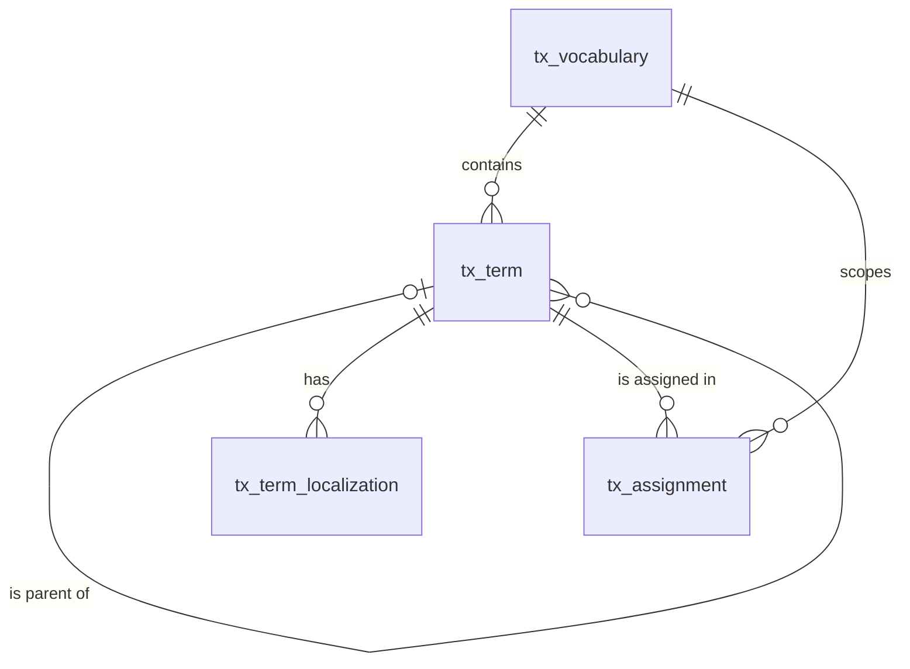

# 分类体系（taxonomy）模块设计

| 项 | 内容 |
|---|---|
| 模块 ID | `taxonomy` |
| 名称 | 分类体系 |
| 层 | L2 |
| 表前缀 | `tx_` |
| API 前缀 | `taxonomy` |
| 可停用 | 否 |
| 模块版本 | 1.0.0（module.json 的 version） |
| 平台版本 | `>=1.0.0 <2.0.0`（module.json 的 platform） |
| 里程碑切片 | M1：词汇表、分类项、指派、分类落地页；M2：—；M3：分类名作为可翻译资源；M4：—（详见第 13 节） |
| 模块负责人 | 待定 |
| 文档版本 | V1.4 |
| 状态 | 草案 |
| 更新日期 | 2026-10-20 |
| 依据 | 系统设计 V1.9 第 7 章及 3.2、3.8、24–29 章；平台框架设计 V1.7 第 4、7–13 章；ADR-002、ADR-003、ADR-005、ADR-009、ADR-018 |

> 本文只引用《平台框架设计》第 4 章中的契约，不定义新的跨模块契约；需要新契约时按平台框架设计 2.3 提出契约变更请求。

## 1. 职责与边界

### 1.1 职责

管理词汇表、层级分类项与内容指派；为可路由分类维护 TERM_PAGE；发布分类投影，向交付、面包屑及筛选提供分类视图。

功能交付范围按第 13 章分为 M1–M4；表结构、约束与枚举以第 3、4 章为准。

### 1.2 不负责的事

| 事项 | 归属模块 | 边界 |
|---|---|---|
| 上层产品、文章、询盘业务 | 对应 L3 模块 | 不反向调用上层服务或访问其表 |
| 身份、权限、设置、任务及审计 | platform-core | 复用平台公共服务 |
| 第三方客户端与网络传输 | infrastructure | 仅经既有端口或 L2 服务使用，不在业务模块引入客户端 |

### 1.3 协作概览

| 协作方式 | 对象 | 本模块行为 |
|---|---|---|
| 服务接口 | ContentApi | 方法与事务边界见 2.2；无跨模块表访问 |
| 扩展点 | ContentTypeProvider、PublishContributor、DataSourceProvider、BreadcrumbProvider、TranslatableContentProvider、TranslatableResourceProvider | 实现/收集清单见 2.4、2.5 |
| 领域事件 | 见 2.6 | 与本地事务一起登记，提交后异步投递；重复与过期处理独立验证 |

### 1.4 适用的架构约束

遵守 P2、P3 与 ADR-018：编译依赖只到 platform-core/platform-api，跨模块协作只用第 2 章登记契约；只访问自己的表，禁止跨模块 JOIN/外键。遵守 ADR-003：事务内登记、提交后投递、监听器幂等并检查过期。遵守 ADR-009：每次请求/任务明确站点上下文，站点表默认过滤。

公开读取只用当前语言发布态，不跨语言回退（ADR-005）；预览与公开缓存隔离。后台中文文案与错误集中管理，前台文案经 UiTextApi，样式只用 Design Token。远程端口在数据库事务外调用，密钥经 SecretCipher，不写日志。

## 2. 依赖与契约

### 2.1 module.json

```json
{
  "id": "taxonomy",
  "name": "分类体系",
  "version": "1.0.0",
  "layer": "L2",
  "platform": ">=1.0.0 <2.0.0",
  "requires": {
    "content": "^1.0"
  },
  "optional": {},
  "disableable": false,
  "tablePrefix": "tx_",
  "apiPrefix": "taxonomy",
  "permissions": [
    {
      "code": "taxonomy:vocabulary:view",
      "name": "查看词汇表"
    },
    {
      "code": "taxonomy:vocabulary:manage",
      "name": "管理词汇表"
    },
    {
      "code": "taxonomy:term:view",
      "name": "查看分类项"
    },
    {
      "code": "taxonomy:term:edit",
      "name": "编辑分类项"
    },
    {
      "code": "taxonomy:term:delete",
      "name": "删除分类项"
    },
    {
      "code": "content:term-page:edit",
      "name": "编辑分类落地页"
    },
    {
      "code": "content:term-page:review",
      "name": "审核分类落地页"
    },
    {
      "code": "content:term-page:publish",
      "name": "发布分类落地页"
    },
    {
      "code": "content:term-page:delete",
      "name": "删除分类落地页"
    }
  ],
  "menus": [
    {
      "key": "taxonomy",
      "name": "分类体系",
      "parent": "editorial",
      "route": "/taxonomy/vocabularies",
      "permission": "taxonomy:vocabulary:view",
      "order": 100
    }
  ],
  "settings": null,
  "components": [],
  "events": {
    "publishes": [
      "TermChangedEvent",
      "TranslatableResourceChangedEvent"
    ],
    "subscribes": [
      "ContentPurgedEvent",
      "LocalizationDeletedEvent",
      "ModuleDisabledEvent",
      "SiteSettingsChangedEvent"
    ]
  }
}
```

描述符为 M0 工程建立后的实现要求；目前尚无实际控制器、Schema 或组件包。依赖只声明运行能力；Maven 仍只依赖 platform-api/core。组件清单是本模块负责的类型，运行时 UI 不登记成可拖入布局的组件。

### 2.2 使用的服务接口

| 接口（平台框架设计小节） | 方法 | 用途 | 调用位置与时机 | 测试替身 |
|---|---|---|---|---|
| `ContentApi`（4.4.16） | lockDraftForWrite、create、updateDraftMeta、markDraftChanged、findPublishedSnapshot | 读当前发布快照与卡片；内容类型所属模块创建身份并标记草稿变化 | 读接口在查询阶段调用；写方法加入业务事务，远程文本翻译必须在事务外 | `InMemoryContentApi` |
| `SiteApi`（4.4.1） | 按该契约声明的方法 | 语言、站点模块开关 | 业务事务内；站点切换由任务入口完成 | `InMemorySiteApi` |
| `SiteContextProvider`（4.4.2） | 按该契约声明的方法 | 当前站点；异步与任务由 core 恢复 | 业务事务内；站点切换由任务入口完成 | `FakeSiteContextProvider` |
| `PermissionChecker`（4.4.7） | 按该契约声明的方法 | 后台权限与数据范围 | 业务事务内；站点切换由任务入口完成 | `FakePermissionChecker` |
| `AuditApi`（4.4.9） | 按该契约声明的方法 | 同事务写审计，密钥与个人数据脱敏 | 业务事务内；站点切换由任务入口完成 | `InMemoryAuditApi` |
| `EventMetaFactory`（4.4.14） | 按该契约声明的方法 | 事件 ID、版本、站点与操作人 | 业务事务内；站点切换由任务入口完成 | `FakeEventMetaFactory` |
| `ProjectionChangeApi`（4.10，Proposed） | searchChanged | 原保存事务内协调，失败回滚，站点隔离 | MANDATORY；不得afterCommit补写 | 框架4.10对应协议替身 |

所有 L2/L3/L4 读写隐式使用当前站点；按 ID 查询单批最多 500。可选服务用 ObjectProvider 注入并检查当前站点启用状态，缺失时降级，不通过业务表绕过服务。


### 2.3 提供的服务接口

| 接口（平台框架设计小节） | 方法 | 实现类 | 契约测试 | 语义 |
|---|---|---|---|---|
| `TaxonomyApi`（4.4.19） | vocabulary、vocabularies、vocabulariesFor、findTerm、findTerms、termViews、ancestors、ancestorIds、children、isSameOrDescendant、findBySourceNamePath、findByLandingContent、assignments、assignmentsOf、replaceAssignments | `TaxonomyApiImpl` | `TaxonomyApiContractTest` 继承 `TaxonomyApiContract` | 完整遵守框架签名、站点隔离、事务及异常语义；远程调用按第 5 章拆分短事务；标注的交付热路径 P95 ≤ 20ms |

### 2.4 实现的扩展点

| 扩展点（平台框架设计小节） | 计划实现类 | 适用范围 | order | 收集方 |
|---|---|---|---|---|
| `ContentTypeProvider`（4.5.2） | `TaxonomyContentTypeProvider` | TERM_PAGE；route hints 按词汇表 | OWNER=500 | content / url（经 content） |
| `PublishContributor`（4.5.3） | `TaxonomyPublishContributor` | TERM_PAGE 的 card 与分类详情；全部适用内容类型的顶层 terms 投影 | OWNER=500 | content |
| `DataSourceProvider`（4.5.6） | `TaxonomyDataSourceProvider` | term-children | DEFAULT=1000 | delivery |
| `BreadcrumbProvider`（4.5.9） | `TaxonomyBreadcrumbProvider` | 按本模块职责及 3、4 章登记的内容/资源类型 | DEFAULT=1000 | delivery / seo |
| `TranslatableContentProvider`（4.5.20） | `TaxonomyTranslatableContentProvider` | TERM_PAGE 的内容类草稿字段 | DEFAULT=1000 | translation |
| `TranslatableResourceProvider`（4.5.21） | `TaxonomyTranslatableResourceProvider` | 分类名称等站点资源，提取范围以 4.3 本地化字段为准 | DEFAULT=1000 | translation |
| `PlatformModule`（4.5.22） | `TaxonomyModule` | 本模块安装/升级；可停用模块提供影响报告与停用后保留数据规则 | DEFAULT=1000 | core |

以上类名为待实现名称。PublishContributor 不调用调用方的写方法，不访问外部服务；翻译提供方只写本模块草稿/资源，先校验源指纹与共同 version。本模块不可站点级停用；对可选依赖缺失/停用仍须按框架约定降级。

### 2.5 收集的扩展点

不适用：不收集业务扩展点；PlatformModule 与任务 SPI 由 core 收集。

### 2.6 发布与订阅的事件

发布：

| 事件 | 触发事务 | 现有 payload 字段 | 订阅方 |
|---|---|---|---|
| `TermChangedEvent` | 词汇表内分类新建、重命名、移动、删除同事务，change 取框架枚举 | meta、termId、vocabularyKey、change、parentId、previousParentId、landingContentId、descendantTermIds | 框架 4.2.4；未登记发布方的差异在第 14 章列出 |
| `TranslatableResourceChangedEvent` | 源语言可翻译文本实际变化时 UPSERTED，资源整体删除时 DELETED；非文本变化与目标语言 apply 不发布此事件 | meta、resourceType、resourceId、change | 框架 4.2.4；未登记发布方的差异在第 14 章列出 |

订阅：

| 事件 | 处理 | 幂等 | 过期与删除 | 失败与重试 |
|---|---|---|---|---|
| `ContentPurgedEvent` | 按事件 contentId/localizationIds 清理本模块外部引用或子行；历史业务快照按 4.6 保留；不回查已不存在的父内容 | 本模块事务内的幂等标记与数据变更一起提交；缓存重复失效安全 | 清理使用事件中的 ID；查不到父对象仍须清理 | 失败抛出保留未完成投递；业务副作用转入已有任务/队列后重试 |
| `LocalizationDeletedEvent` | 仅清理对应语言的本模块本地化/投影，不删除其他语言或共享业务字段 | 本模块事务内的幂等标记与数据变更一起提交；缓存重复失效安全 | 清理使用事件中的 ID；查不到父对象仍须清理 | 失败抛出保留未完成投递；业务副作用转入已有任务/队列后重试 |
| `ModuleDisabledEvent` | 当前站点隐藏该模块的公开能力，保留自身数据；处理事件.moduleId 而非假定是接收方自身 | 本模块事务内的幂等标记与数据变更一起提交；缓存重复失效安全 | 读取当前状态/指纹；只有匹配的当前结果才更新；不以 occurredAt 单独当全序 | 失败抛出保留未完成投递；业务副作用转入已有任务/队列后重试 |
| `SiteSettingsChangedEvent` | 按 scopes、settingKeys、localeChanges 筛选 4.6 的相关变化；不对无关设置做全量重建 | 本模块事务内的幂等标记与数据变更一起提交；缓存重复失效安全 | 读取当前状态/指纹；只有匹配的当前结果才更新；不以 occurredAt 单独当全序 | 失败抛出保留未完成投递；业务副作用转入已有任务/队列后重试 |

监听器按框架 5.8 建立站点/system 上下文；`ContentPurgedEvent` 在模块停用时仍必须清理（deliverWhenModuleDisabled）。其他停用期间跳过并完成的事件，重新启用后通过扫描当前状态补偿，不能假定还会重投。数据库幂等标记与本模块数据在同一事务提交；外部发送、下载、搜索与 CDN 调用不得被数据库长事务包裹，使用已声明的任务/端口和业务幂等键。事件 payload 仅引用框架现有字段，本文不扩展签名。

### 2.7 使用的端口

不适用：不直接使用基础设施端口；媒体、通知等外部操作经相应 L2 服务编排。

## 3. 领域模型

### 3.1 聚合、实体与值对象

| 类型 | 名称 | 说明 |
|---|---|---|
| 聚合根 | Vocabulary（`tx_vocabulary`） | 词汇表：key、是否层级、是否多选、是否可路由、是否必填、适用内容类型 |
| 聚合根 | Term（`tx_term`） | 分类项：所属词汇表、父项、物化路径、深度、排序、落地页内容（TERM_PAGE） |
| 实体 | TermLocalization（`tx_term_localization`） | 分类项在一种语言下的名称（站点资源）与描述（可路由时为 TERM_PAGE 的草稿内容） |
| 实体 | Assignment（`tx_assignment`） | 内容的草稿态分类指派；以内容为单位在“分类”标签页整体保存 |
| 值对象 | MaterializedPath | `/祖先 ID/…/自身 ID/`，如 `/1/5/9/` |
| 值对象 | VocabularySettings | `hierarchical`、`multiple`、`routable`、`required`、`applicable_types` |

在系统设计之外补充的字段：

| 补充 | 理由 |
|---|---|
| `tx_vocabulary.name`、`description`、`builtin`、`sort_order`、`deleted_at` | 后台显示与排序；内置词汇表（系统设计 7.2）不可删除；配置类实体软删除（平台框架设计 7.5） |
| `tx_term.deleted_at` | 分类项 ID 被快照、导航、图谱、URL 规则引用，软删除保留 ID，便于审计与恢复 |
| `tx_term_localization.description` 的归属 | 系统设计 7.1 把 description 放在本表，7.3 又规定描述随 TERM_PAGE 作为内容翻译：可路由分类项的 description 是 TERM_PAGE 的草稿业务字段，经 taxonomy 的 `PublishContributor` 进入快照、经 `TranslatableContentProvider` 翻译；不可路由分类项的 description 只在后台显示，不翻译。站点资源指纹只覆盖 `name` |
| `tx_assignment.vocabulary_id`、`primary_flag` | 用唯一索引保证“每个内容在每个词汇表最多一个主分类” |
| 词汇表名称不做本地化 | 词汇表名称只在后台显示；前台需要时（如筛选面板标题）使用文案键 `taxonomy.vocabulary.{vocab_key}`（界面文案，作为站点资源翻译） |

### 3.2 不变量

| # | 规则 | 保证方式 |
|---|---|---|
| 1 | 站点内未删除词汇表的 `vocab_key` 唯一；key 创建后不可修改 | 数据库：`uk_vocab_key`；应用层 |
| 2 | 内置词汇表不可删除；`routable` 只能在词汇表没有分类项时修改；有分类项的词汇表不能删除 | 应用层 |
| 3 | 根分类项 `parent_id` 为空且 `depth = 1`；子项 `depth` = 父项 `depth` + 1，最大 10 | 数据库：`ck_tx_term_depth`；应用层 |
| 4 | `path` = 父项 `path` + 自身 ID + `/`（根为 `/` + ID + `/`）；移动分类项时在同一事务中更新整棵子树的 `path` 与 `depth` | 应用层 |
| 5 | 子项与父项属于同一词汇表；非层级词汇表的分类项没有父项；不能移动到自身子树下 | 应用层 |
| 6 | 有子项或内容指派的分类项不能删除（先转移指派） | 数据库：`fk_tx_term_parent`、`fk_tx_asg_term`（RESTRICT，针对物理删除）；应用层（软删除前检查） |
| 7 | 可路由词汇表的分类项在中文名称存在时拥有一个 TERM_PAGE 内容；一个 TERM_PAGE 只属于一个分类项 | 数据库：`uk_term_content`；应用层 |
| 8 | 每个分类项每种语言最多一条本地化；中文行 `translation_state = NONE`、`source_fingerprint` 为空 | 数据库：`uk_tl_term_locale`；应用层 |
| 9 | 同一父项下（或同一词汇表的根之间）中文名称唯一 | 应用层 |
| 10 | 每个内容在每个词汇表最多一个主分类 | 数据库：`uk_asg_primary` |
| 11 | `multiple = 0` 的词汇表，每个内容最多一个指派（即主分类） | 应用层 |
| 12 | `required = 1` 的词汇表：适用类型的内容发布时必须有主分类（taxonomy 的 `PublishContributor.validate()` 报 ERROR；如产品的 `product_category`） | 应用层 |
| 13 | 指派的词汇表必须适用于该内容类型（`applicable_types`）；只能指派未删除的分类项 | 应用层 |
| 14 | `tx_assignment.vocabulary_id = tx_term.vocabulary_id` | 应用层 |

### 3.3 状态机

内容发布状态与草稿状态均由 ContentApi 管理，完整转换见 content 模块 3.3 和系统设计 6.3；本模块不复制状态列或自行转换。保存业务草稿只改变内容共同 version 与草稿状态，发布经 PublishContributor 参与同一事务；回收站、恢复、下线与翻译模式按内容内核执行。配置及站点资源保存即生效，不伪装成内容发布。

## 4. 数据模型

> 遵守平台框架设计第 7 章的数据库通用约定。本节给出待实现 DDL；本次文档审查未重跑 MySQL，不能据此认定 DDL 已验证。M0 后按第 11 章在 MySQL 8.4 空库验证，并使实际迁移脚本与本节一致。

### 4.1 表清单

| 表 | 说明 | 站点级 | 软删除 | 预估规模（单站，按系统设计假设 A4） |
|---|---|---|---|---|
| `tx_vocabulary` | 词汇表 | 是 | 是（`deleted_at`） | 10–20 行 |
| `tx_term` | 分类项 | 是 | 是（`deleted_at`） | 1 千–5 千行 |
| `tx_term_localization` | 分类项本地化（站点资源） | 是 | 否（随分类项） | 1–5 万行（× 10 种语言） |
| `tx_assignment` | 草稿态分类指派 | 是 | 否 | ≈ 10 万行（2 万内容 × 平均 5 个分类项） |

### 4.2 ER 图



### 4.3 表结构

#### 4.3.1 `tx_vocabulary`：词汇表

| 字段 | 类型 | 可空 | 默认 | 说明 |
|---|---|---|---|---|
| `id` | BIGINT | 否 | — | 主键（TSID） |
| `site_id` | BIGINT | 否 | — | 站点 ID（sys_site.id） |
| `vocab_key` | VARCHAR(64) bin | 否 | — | 词汇表 key（小写字母、数字、下划线；创建后不可修改），如 product_category、application |
| `name` | VARCHAR(100) | 否 | — | 名称（中文，只在后台显示） |
| `description` | VARCHAR(500) | 是 | — | 说明（后台提示） |
| `hierarchical` | TINYINT(1) | 否 | `0` | 是否层级（分类项可以有父项） |
| `multiple` | TINYINT(1) | 否 | `1` | 一个内容是否可以指派多个分类项 |
| `routable` | TINYINT(1) | 否 | `0` | 分类项是否有落地页（TERM_PAGE） |
| `required` | TINYINT(1) | 否 | `0` | 适用类型的内容发布时是否必须有主分类 |
| `applicable_types` | JSON | 否 | `(JSON_ARRAY())` | 适用的内容类型数组，如 ["PRODUCT", "ARTICLE"]；取值见共享内容类型枚举 |
| `builtin` | TINYINT(1) | 否 | `0` | 是否内置（内置词汇表不可删除） |
| `sort_order` | INT | 否 | `0` | 后台显示顺序 |
| `deleted_at` | DATETIME(3) | 是 | — | 删除时间（软删除） |
| `alive` | TINYINT | 是 | 生成列 `IF(deleted_at IS NULL, 1, NULL)` | 未删除标记（唯一索引用） |
| `version` | INT | 否 | `0` | 乐观锁版本号 |
| `created_at` | DATETIME(3) | 否 | `CURRENT_TIMESTAMP(3)` | 创建时间（UTC） |
| `created_by` | BIGINT | 否 | `0` | 创建人用户 ID（0 = 系统） |
| `updated_at` | DATETIME(3) | 否 | `CURRENT_TIMESTAMP(3) ON UPDATE CURRENT_TIMESTAMP(3)` | 更新时间（UTC） |
| `updated_by` | BIGINT | 否 | `0` | 更新人用户 ID（0 = 系统） |

索引与约束：
- `PRIMARY KEY (id)`
- `uk_vocab_key (site_id, vocab_key, alive)`：未删除的 key 唯一；按 key 查找（数据源参数、快照 `terms[].vocabulary`、初始化）；站点的词汇表列表

```sql
CREATE TABLE tx_vocabulary (
  id                BIGINT        NOT NULL COMMENT '主键（TSID）',
  site_id           BIGINT        NOT NULL COMMENT '站点 ID（sys_site.id）',
  vocab_key         VARCHAR(64)   COLLATE utf8mb4_0900_bin NOT NULL COMMENT '词汇表 key（小写字母、数字、下划线；创建后不可修改），如 product_category、application',
  name              VARCHAR(100)  NOT NULL COMMENT '名称（中文，只在后台显示）',
  description       VARCHAR(500)  NULL COMMENT '说明（后台提示）',
  hierarchical      TINYINT(1)    NOT NULL DEFAULT 0 COMMENT '是否层级（分类项可以有父项）',
  multiple          TINYINT(1)    NOT NULL DEFAULT 1 COMMENT '一个内容是否可以指派多个分类项',
  routable          TINYINT(1)    NOT NULL DEFAULT 0 COMMENT '分类项是否有落地页（TERM_PAGE）',
  required          TINYINT(1)    NOT NULL DEFAULT 0 COMMENT '适用类型的内容发布时是否必须有主分类',
  applicable_types  JSON          NOT NULL DEFAULT (JSON_ARRAY()) COMMENT '适用的内容类型数组，如 ["PRODUCT", "ARTICLE"]；取值见共享内容类型枚举',
  builtin           TINYINT(1)    NOT NULL DEFAULT 0 COMMENT '是否内置（内置词汇表不可删除）',
  sort_order        INT           NOT NULL DEFAULT 0 COMMENT '后台显示顺序',
  deleted_at        DATETIME(3)   NULL COMMENT '删除时间（软删除）',
  alive             TINYINT       AS (IF(deleted_at IS NULL, 1, NULL)) STORED COMMENT '未删除标记（唯一索引用）',
  version           INT           NOT NULL DEFAULT 0 COMMENT '乐观锁版本号',
  created_at        DATETIME(3)   NOT NULL DEFAULT CURRENT_TIMESTAMP(3) COMMENT '创建时间（UTC）',
  created_by        BIGINT        NOT NULL DEFAULT 0 COMMENT '创建人用户 ID（0 = 系统）',
  updated_at        DATETIME(3)   NOT NULL DEFAULT CURRENT_TIMESTAMP(3) ON UPDATE CURRENT_TIMESTAMP(3) COMMENT '更新时间（UTC）',
  updated_by        BIGINT        NOT NULL DEFAULT 0 COMMENT '更新人用户 ID（0 = 系统）',
  PRIMARY KEY (id),
  UNIQUE KEY uk_vocab_key (site_id, vocab_key, alive)
) ENGINE = InnoDB DEFAULT CHARSET = utf8mb4 COLLATE = utf8mb4_0900_ai_ci COMMENT = '词汇表（产品分类、应用、行业、文章栏目、标签、认证及站点自定义）';
```

要点：站点创建或 taxonomy 安装时，为每个站点写入系统设计 7.2 的 6 个内置词汇表（`builtin = 1`），见平台框架设计 5.2、11.6。

#### 4.3.2 `tx_term`：分类项

| 字段 | 类型 | 可空 | 默认 | 说明 |
|---|---|---|---|---|
| `id` | BIGINT | 否 | — | 主键（TSID） |
| `site_id` | BIGINT | 否 | — | 站点 ID（sys_site.id） |
| `vocabulary_id` | BIGINT | 否 | — | 词汇表 ID（tx_vocabulary.id） |
| `parent_id` | BIGINT | 是 | — | 父分类项 ID；根为空，非层级词汇表恒为空 |
| `path` | VARCHAR(255) bin | 否 | — | 物化路径：祖先与自身的 ID，如 /1/5/9/ |
| `depth` | TINYINT | 否 | `1` | 层级深度：根为 1，最大 10 |
| `sort_order` | INT | 否 | `0` | 同级排序 |
| `content_id` | BIGINT | 是 | — | 落地页内容 ID（cnt_content.id，类型 TERM_PAGE）；不可路由时为空 |
| `deleted_at` | DATETIME(3) | 是 | — | 删除时间（软删除） |
| `version` | INT | 否 | `0` | 乐观锁版本号 |
| `created_at` | DATETIME(3) | 否 | `CURRENT_TIMESTAMP(3)` | 创建时间（UTC） |
| `created_by` | BIGINT | 否 | `0` | 创建人用户 ID（0 = 系统） |
| `updated_at` | DATETIME(3) | 否 | `CURRENT_TIMESTAMP(3) ON UPDATE CURRENT_TIMESTAMP(3)` | 更新时间（UTC） |
| `updated_by` | BIGINT | 否 | `0` | 更新人用户 ID（0 = 系统） |

索引与约束：
- `PRIMARY KEY (id)`
- `uk_term_content (content_id)`：一个 TERM_PAGE 只属于一个分类项；按落地页内容反查分类项（面包屑、Delivery）
- `idx_term_vocab (vocabulary_id, parent_id, sort_order)`：加载词汇表的整棵树、根分类项列表；兼作 `fk_tx_term_vocab` 的索引
- `idx_term_parent (parent_id, sort_order)`：子分类列表（`term-children` 数据源、后台树展开）；兼作 `fk_tx_term_parent` 的索引
- `idx_term_path (site_id, path)`：子树查询（`path LIKE '/1/5/%'`：分类下含子分类的全部内容、移动时更新子树）
- `fk_tx_term_vocab`、`fk_tx_term_parent`：引用关系（RESTRICT）
- `ck_tx_term_depth`：见 3.2 不变量 3

```sql
CREATE TABLE tx_term (
  id             BIGINT        NOT NULL COMMENT '主键（TSID）',
  site_id        BIGINT        NOT NULL COMMENT '站点 ID（sys_site.id）',
  vocabulary_id  BIGINT        NOT NULL COMMENT '词汇表 ID（tx_vocabulary.id）',
  parent_id      BIGINT        NULL COMMENT '父分类项 ID；根为空，非层级词汇表恒为空',
  path           VARCHAR(255)  COLLATE utf8mb4_0900_bin NOT NULL COMMENT '物化路径：祖先与自身的 ID，如 /1/5/9/',
  depth          TINYINT       NOT NULL DEFAULT 1 COMMENT '层级深度：根为 1，最大 10',
  sort_order     INT           NOT NULL DEFAULT 0 COMMENT '同级排序',
  content_id     BIGINT        NULL COMMENT '落地页内容 ID（cnt_content.id，类型 TERM_PAGE）；不可路由时为空',
  deleted_at     DATETIME(3)   NULL COMMENT '删除时间（软删除）',
  version        INT           NOT NULL DEFAULT 0 COMMENT '乐观锁版本号',
  created_at     DATETIME(3)   NOT NULL DEFAULT CURRENT_TIMESTAMP(3) COMMENT '创建时间（UTC）',
  created_by     BIGINT        NOT NULL DEFAULT 0 COMMENT '创建人用户 ID（0 = 系统）',
  updated_at     DATETIME(3)   NOT NULL DEFAULT CURRENT_TIMESTAMP(3) ON UPDATE CURRENT_TIMESTAMP(3) COMMENT '更新时间（UTC）',
  updated_by     BIGINT        NOT NULL DEFAULT 0 COMMENT '更新人用户 ID（0 = 系统）',
  PRIMARY KEY (id),
  UNIQUE KEY uk_term_content (content_id),
  KEY idx_term_vocab (vocabulary_id, parent_id, sort_order),
  KEY idx_term_parent (parent_id, sort_order),
  KEY idx_term_path (site_id, path),
  CONSTRAINT fk_tx_term_vocab FOREIGN KEY (vocabulary_id) REFERENCES tx_vocabulary (id),
  CONSTRAINT fk_tx_term_parent FOREIGN KEY (parent_id) REFERENCES tx_term (id),
  CONSTRAINT ck_tx_term_depth CHECK ((parent_id IS NULL AND depth = 1) OR (parent_id IS NOT NULL AND depth BETWEEN 2 AND 10))
) ENGINE = InnoDB DEFAULT CHARSET = utf8mb4 COLLATE = utf8mb4_0900_ai_ci COMMENT = '分类项（物化路径树；可路由时关联 TERM_PAGE 内容）';
```

要点：
- `path` 最长 10 级 × 20 个字符（`/` + 最多 19 位 ID），`VARCHAR(255)` 足够。
- TERM_PAGE：可路由分类项的中文名称首次保存时，taxonomy 经 `ContentApi.create(TERM_PAGE, zh-CN)` 创建落地页并写入 `content_id`；其他语言名称首次写入时经 `ContentApi` 创建对应本地化（`translation_mode = AUTO`）；分类名变化时经 `ContentApi.updateDraftMeta()` 同步 `draft_title`。
- 新建、更名（任一语言）、移动、删除发布 `TermChangedEvent`（按 `t:{termId}` 失效缓存）；删除可路由分类项时，其 TERM_PAGE 以 `REDIRECT_PARENT`（301 到上级分类页；根分类项按 `GONE`）下线并移入回收站。

#### 4.3.3 `tx_term_localization`：分类项本地化

| 字段 | 类型 | 可空 | 默认 | 说明 |
|---|---|---|---|---|
| `id` | BIGINT | 否 | — | 主键（TSID） |
| `site_id` | BIGINT | 否 | — | 站点 ID（sys_site.id） |
| `term_id` | BIGINT | 否 | — | 分类项 ID（tx_term.id） |
| `locale` | VARCHAR(16) | 否 | — | 语言（BCP 47） |
| `name` | VARCHAR(200) | 否 | — | 分类名（站点资源：中文录入，其他语言由 translation 经 TranslatableResourceProvider 写入） |
| `description` | JSON | 是 | — | 分类描述（ProseMirror JSON）；可路由分类项的描述是 TERM_PAGE 的草稿内容，随落地页发布并作为内容翻译 |
| `translation_state` | VARCHAR(16) | 否 | `'NONE'` | 名称的翻译状态：NONE / QUEUED / TRANSLATED / NEEDS_REVIEW / FAILED / OUTDATED |
| `source_fingerprint` | CHAR(64) bin | 是 | — | 生成本行译文时中文行的指纹（规范化 name 的 SHA-256）；中文行为空；与当前中文指纹不同即为过期 |
| `version` | INT | 否 | `0` | 乐观锁版本号 |
| `created_at` | DATETIME(3) | 否 | `CURRENT_TIMESTAMP(3)` | 创建时间（UTC） |
| `created_by` | BIGINT | 否 | `0` | 创建人用户 ID（0 = 系统） |
| `updated_at` | DATETIME(3) | 否 | `CURRENT_TIMESTAMP(3) ON UPDATE CURRENT_TIMESTAMP(3)` | 更新时间（UTC） |
| `updated_by` | BIGINT | 否 | `0` | 更新人用户 ID（0 = 系统） |

索引与约束：
- `PRIMARY KEY (id)`
- `uk_tl_term_locale (term_id, locale)`：每种语言一条；按分类项取各语言名称；兼作 `fk_tx_tl_term` 的索引
- `idx_tl_name (site_id, locale, name)`：后台 TermPicker 按名称搜索（不区分大小写与重音）；产品导入按中文名称匹配分类
- `idx_tl_state (site_id, translation_state, locale)`：翻译中心列出待处理的分类名
- `fk_tx_tl_term`：组合关系，`ON DELETE CASCADE`

```sql
CREATE TABLE tx_term_localization (
  id                  BIGINT        NOT NULL COMMENT '主键（TSID）',
  site_id             BIGINT        NOT NULL COMMENT '站点 ID（sys_site.id）',
  term_id             BIGINT        NOT NULL COMMENT '分类项 ID（tx_term.id）',
  locale              VARCHAR(16)   NOT NULL COMMENT '语言（BCP 47）',
  name                VARCHAR(200)  NOT NULL COMMENT '分类名（站点资源：中文录入，其他语言由 translation 经 TranslatableResourceProvider 写入）',
  description         JSON          NULL COMMENT '分类描述（ProseMirror JSON）；可路由分类项的描述是 TERM_PAGE 的草稿内容，随落地页发布并作为内容翻译',
  translation_state   VARCHAR(16)   NOT NULL DEFAULT 'NONE' COMMENT '名称的翻译状态：NONE / QUEUED / TRANSLATED / NEEDS_REVIEW / FAILED / OUTDATED',
  source_fingerprint  CHAR(64)      COLLATE utf8mb4_0900_bin NULL COMMENT '生成本行译文时中文行的指纹（规范化 name 的 SHA-256）；中文行为空；与当前中文指纹不同即为过期',
  version             INT           NOT NULL DEFAULT 0 COMMENT '乐观锁版本号',
  created_at          DATETIME(3)   NOT NULL DEFAULT CURRENT_TIMESTAMP(3) COMMENT '创建时间（UTC）',
  created_by          BIGINT        NOT NULL DEFAULT 0 COMMENT '创建人用户 ID（0 = 系统）',
  updated_at          DATETIME(3)   NOT NULL DEFAULT CURRENT_TIMESTAMP(3) ON UPDATE CURRENT_TIMESTAMP(3) COMMENT '更新时间（UTC）',
  updated_by          BIGINT        NOT NULL DEFAULT 0 COMMENT '更新人用户 ID（0 = 系统）',
  PRIMARY KEY (id),
  UNIQUE KEY uk_tl_term_locale (term_id, locale),
  KEY idx_tl_name (site_id, locale, name),
  KEY idx_tl_state (site_id, translation_state, locale),
  CONSTRAINT fk_tx_tl_term FOREIGN KEY (term_id) REFERENCES tx_term (id) ON DELETE CASCADE
) ENGINE = InnoDB DEFAULT CHARSET = utf8mb4 COLLATE = utf8mb4_0900_ai_ci COMMENT = '分类项本地化（名称为站点资源，带翻译状态与源指纹）';
```

要点：
- 中文 `name` 变化时发布 `TranslatableResourceChangedEvent`（资源类型 `taxonomy.term`，ID 为 `term_id`）；translation 回写目标语言行时设置 `translation_state`（`TRANSLATED` / `NEEDS_REVIEW` / `FAILED`）与 `source_fingerprint`；人工修订在翻译编辑器中进行并写回翻译记忆。
- TERM_PAGE 的 `TranslatableContentProvider.apply()` 只写 `description`；目标语言行尚不存在时，同时写入经翻译记忆得到的 `name`（与站点资源翻译共用翻译记忆，结果一致）。

#### 4.3.4 `tx_assignment`：分类指派（草稿态）

| 字段 | 类型 | 可空 | 默认 | 说明 |
|---|---|---|---|---|
| `content_id` | BIGINT | 否 | — | 内容 ID（cnt_content.id） |
| `term_id` | BIGINT | 否 | — | 分类项 ID（tx_term.id） |
| `site_id` | BIGINT | 否 | — | 站点 ID（sys_site.id） |
| `vocabulary_id` | BIGINT | 否 | — | 词汇表 ID（冗余 tx_term.vocabulary_id，用于主分类唯一约束） |
| `is_primary` | TINYINT(1) | 否 | `0` | 是否该词汇表中的主分类（用于面包屑与结构化数据） |
| `primary_flag` | TINYINT | 是 | 生成列 `IF(is_primary = 1, 1, NULL)` | 主分类标记（唯一索引用） |
| `sort_order` | INT | 否 | `0` | 同一内容中的显示顺序 |
| `created_at` | DATETIME(3) | 否 | `CURRENT_TIMESTAMP(3)` | 创建时间（UTC） |
| `created_by` | BIGINT | 否 | `0` | 创建人用户 ID（0 = 系统，如导入） |
| `updated_at` | DATETIME(3) | 否 | `CURRENT_TIMESTAMP(3) ON UPDATE CURRENT_TIMESTAMP(3)` | 更新时间（UTC） |
| `updated_by` | BIGINT | 否 | `0` | 更新人用户 ID（0 = 系统） |

索引与约束：
- `PRIMARY KEY (content_id, term_id)`：读取一个内容的全部指派（编辑页“分类”标签、发布时组装快照 `terms`）
- `uk_asg_primary (content_id, vocabulary_id, primary_flag)`：每个内容在每个词汇表最多一个主分类
- `idx_asg_term (term_id)`：分类项下的内容（后台按分类筛选草稿、删除前检查指派数量）；兼作 `fk_tx_asg_term` 的索引
- `fk_tx_asg_term`：引用关系（RESTRICT）

```sql
CREATE TABLE tx_assignment (
  content_id     BIGINT        NOT NULL COMMENT '内容 ID（cnt_content.id）',
  term_id        BIGINT        NOT NULL COMMENT '分类项 ID（tx_term.id）',
  site_id        BIGINT        NOT NULL COMMENT '站点 ID（sys_site.id）',
  vocabulary_id  BIGINT        NOT NULL COMMENT '词汇表 ID（冗余 tx_term.vocabulary_id，用于主分类唯一约束）',
  is_primary     TINYINT(1)    NOT NULL DEFAULT 0 COMMENT '是否该词汇表中的主分类（用于面包屑与结构化数据）',
  primary_flag   TINYINT       AS (IF(is_primary = 1, 1, NULL)) STORED COMMENT '主分类标记（唯一索引用）',
  sort_order     INT           NOT NULL DEFAULT 0 COMMENT '同一内容中的显示顺序',
  created_at     DATETIME(3)   NOT NULL DEFAULT CURRENT_TIMESTAMP(3) COMMENT '创建时间（UTC）',
  created_by     BIGINT        NOT NULL DEFAULT 0 COMMENT '创建人用户 ID（0 = 系统，如导入）',
  updated_at     DATETIME(3)   NOT NULL DEFAULT CURRENT_TIMESTAMP(3) ON UPDATE CURRENT_TIMESTAMP(3) COMMENT '更新时间（UTC）',
  updated_by     BIGINT        NOT NULL DEFAULT 0 COMMENT '更新人用户 ID（0 = 系统）',
  PRIMARY KEY (content_id, term_id),
  UNIQUE KEY uk_asg_primary (content_id, vocabulary_id, primary_flag),
  KEY idx_asg_term (term_id),
  CONSTRAINT fk_tx_asg_term FOREIGN KEY (term_id) REFERENCES tx_term (id)
) ENGINE = InnoDB DEFAULT CHARSET = utf8mb4 COLLATE = utf8mb4_0900_ai_ci COMMENT = '内容的分类指派（草稿态，语言无关）';
```

要点：
- 指派是语言无关的非文本数据，所有语言沿用（系统设计 5.5）；修改指派只影响草稿，各本地化发布后才进入其快照与 `cnt_published_term`。
- 发布时 taxonomy 的 `PublishContributor` 把指派写入快照 `terms`（`vocabulary` 取词汇表 key，`primary` 取 `is_primary`），内核据此更新 `cnt_published_term`。

### 4.4 枚举

| 字段 | 取值 | 说明 |
|---|---|---|
| `tx_vocabulary.vocab_key`（内置） | `product_category` | 产品分类：层级，可路由，适用 PRODUCT，必填 |
| | `application` | 应用场景：非层级（可配置），可路由，适用 PRODUCT、ARTICLE、CASE_STUDY、PAGE |
| | `industry` | 行业：非层级，可路由，适用 PRODUCT、ARTICLE、CASE_STUDY |
| | `article_category` | 文章栏目：层级，可路由，适用 ARTICLE |
| | `tag` | 标签：非层级，不可路由，适用全部类型 |
| | `certification` | 认证（CE、UL、ISO…）：非层级，不可路由，适用 PRODUCT |
| `tx_vocabulary.applicable_types[]` | `PAGE` / `PRODUCT` / `ARTICLE` / `CASE_STUDY` / `FAQ` / `TERM_PAGE` / `GLOBAL_BLOCK` | 共享内容类型枚举 |
| `tx_term_localization.translation_state` | `NONE` / `QUEUED` / `TRANSLATED` / `NEEDS_REVIEW` / `FAILED` / `OUTDATED` | 共享翻译状态枚举；中文行为 `NONE`；站点资源以指纹判断过期，源语言变化后重新进入 `QUEUED` |

`product_category` 的“必填”是本文对系统设计 7.3“产品必须有一个主分类”的落实；其余内置词汇表 `required = 0`。

### 4.5 站点过滤

| 表 | 行级拦截器 | 访问方式与理由 |
|---|---|---|
| `tx_vocabulary` | 不豁免 | 请求和任务隐式使用当前站点；子表 site_id 与父表一致 |
| `tx_term` | 不豁免 | 请求和任务隐式使用当前站点；子表 site_id 与父表一致 |
| `tx_term_localization` | 不豁免 | 请求和任务隐式使用当前站点；子表 site_id 与父表一致 |
| `tx_assignment` | 不豁免 | 请求和任务隐式使用当前站点；子表 site_id 与父表一致 |

### 4.6 跨模块引用与清理

| 本模块字段 | 引用对象（模块.表） | 被引用对象删除 / 下线时的处理 | 触发事件 |
|---|---|---|---|
| `tx_term.content_id` | content.`cnt_content`（TERM_PAGE） | taxonomy 经 `ContentApi` 创建、下线、移入回收站；内容被彻底删除时置空（分类项仍存在时，下次保存中文名称时重新创建） | `ContentPurgedEvent` |
| `tx_assignment.content_id` | content.`cnt_content` | 内容彻底删除：删除其全部指派 | `ContentPurgedEvent` |
| `tx_vocabulary.applicable_types` | 内容类型（代码注册） | 所属模块停用或 MISSING：保留配置，指派与筛选中忽略该类型 | `ModuleDisabledEvent` |
| `tx_term_localization.locale` | core.`sys_site_locale` | V1 不提供站点语言删除；语言取消公开只影响可见性，不删除本地化。未来删除须先完成平台清理协议 | `SiteSettingsChangedEvent` |
| `created_by`、`updated_by` | core.`sys_user` | 不清理 | — |

本模块发布的事件：`TermChangedEvent`（新建、更名、移动、删除）、`TranslatableResourceChangedEvent`（资源类型 `taxonomy.term`）。订阅：`ContentPurgedEvent`。

以 `term_id` 引用本模块的其他表（`cnt_published_term`、`prd_product.primary_category_term_id`、`prd_category_attribute_set`、`nav_item.link_ref`、等）在收到 `TermChangedEvent`（DELETED / MOVED）后各自处理。

url_pattern.vocabulary_id 指向词汇表而非 termId；词汇表没有分类项时才能删除，不能用某个 TermChangedEvent 的 termId 当作 vocabularyId 清理 URL 规则。taxonomy 不直接查询或修改 url 表。

### 4.7 迁移脚本

| 文件 | 内容 | 里程碑 |
|---|---|---|
| `db/migration/taxonomy/V001__init.sql` | 4.3 中的全部表（4 张：`tx_vocabulary`、`tx_term`、`tx_term_localization`、`tx_assignment`），按本节顺序创建 | 按第 13.1 节分期启用，初始结构在首个有效切片建立 |

## 5. 业务流程

已有内容的编辑/翻译/导入保存先按框架4.4.16调用ContentApi.lockDraftForWrite校验目标共同版本并取得父先子后锁，再写本模块业务表，最后updateDraftMeta。新建先create取得内容身份；路由输入事务先取得content.route_tree锁。禁止先持有业务行锁再申请内容父锁。

### 5.1 核心业务流程

| 步骤 | 事务及行为 | 失败处理 |
|---|---|---|
| 1 | 创建分类项时校验词汇表、父级与同站点，在同一事务中写 tx_term 及中文本地化；可路由项经 ContentApi.create 创建 TERM_PAGE，业务字段仍由 taxonomy 保存。 | 输入或状态非法返回 4xx；数据库事务回滚；提交后外部处理失败进入重试与可见失败记录 |
| 2 | 移动分类时禁止移动到自身或后代，事务内重算子树 path/depth；发布 TermChangedEvent；分类落地页按 ContentApi 生命周期发布，路径变更交由 url。 | 输入或状态非法返回 4xx；数据库事务回滚；提交后外部处理失败进入重试与可见失败记录 |
| 3 | replaceAssignments 校验词汇表适用类型、多选及唯一主分类后整组替换；草稿指派不直接改变发布投影。删除被引用项前要求转移指派，保留已发布快照直至重新发布。 | 输入或状态非法返回 4xx；数据库事务回滚；提交后外部处理失败进入重试与可见失败记录 |

后台读写先校验权限与站点/语言范围；草稿写入和审计在同一事务。远程操作不能使用数据库长事务包裹。幂等重放返回既有结果；参数不同却复用同一幂等键时拒绝。

### 5.2 一致性、失败与恢复约束

| 场景 | 必须满足的行为 | 可验证结果 |
|---|---|---|
| 分类名称与落地页描述的来源 | taxonomy.term 翻译资源只承载分类名；有 TERM_PAGE 的分类描述从该内容的源语言发布快照翻译。非可路由分类的描述不擅自加入未登记资源契约。 | 修改未发布描述后触发旧修订翻译，结果仍来自已发布修订；分类名无目标语言不回退显示中文。 |
| 树结构与并发移动 | 移动前锁定相关根/父节点并验证整棵子树最终 depth≤10、同词汇表且无环；所有 path/depth 同事务改动。锁顺序固定，死锁按明确重试返回，不留下半树。 | 两次交叉移动试图形成环，只能有合法一方提交；任何后代超深时整次移动拒绝、所有 path 不变。 |
| 指派与发布投影分离 | replaceAssignments 替换草稿指派，所属内容保存事务负责 updateDraftMeta 的共同版本和草稿变化事件。发布态筛选只读 ContentApi 的 publishedTerms，不读 tx_assignment 冒充线上。 | 更换主分类但不发布，线上分类筛选与面包屑仍按上一修订；发布后投影一次性切换。 |
| 删除引用与分类生命周期 | 检查子项和草稿指派，存在时拒绝删除；已发布投影根据 TermChangedEvent(DELETED) 清理，历史修订保留不可变快照。落地页退役经 ContentApi，不直接删除 cnt_ 行。 | 删除有指派项返回冲突；转移并合法删除后事件重复执行，线上投影不残留已删除 termId，历史修订仍可对比。 |

### 5.3 实现前统一方案与接入要求

依据[平台框架 4.10.1、4.10.4](../framework/platform-framework.md)及[设计问题处理说明](../reviews/design-issue-resolution-2026-10-20.md)。新增契约相关ADR仍为Proposed；下列方案已具体化，待评审冻结后同批实现，不能据此声明运行问题已验证。涉及本节的旧异步引用、原地索引写入或待定措辞按此方案替代。

TERM_PAGE媒体引用随content草稿/发布流程同步登记；taxonomy不新增对media的服务调用。分类名称/可用性与分面语义变化在原事务经ProjectionChangeApi记录fullRefresh，支持索引切换屏障。

## 6. 接口

### 6.1 Admin 端点

| 方法 | 路径（相对 /api/admin/v1/taxonomy） | 说明 | 权限码 | 并发控制 / 幂等 | 审计 |
|---|---|---|---|---|---|
| GET | `/vocabularies` | 词汇表与适用内容类型 | `taxonomy:vocabulary:view` | 只读；不写入业务状态 | 否 |
| POST | `/vocabularies` | 新建自定义词汇表 | `taxonomy:vocabulary:manage` | 唯一键检查；重复创建返回 409（不覆盖已有资源） | taxonomy.vocabularies.post |
| PUT | `/vocabularies/{key}` | 修改允许配置 | `taxonomy:vocabulary:manage` | 聚合 version / If-Match；冲突 409 / 412，整笔回滚 | taxonomy.vocabularies.{key}.put |
| DELETE | `/vocabularies/{key}` | 空且非内置才可删除 | `taxonomy:vocabulary:manage` | 校验聚合 version 与引用；已不存在返回 404，不能重复副作用 | taxonomy.vocabularies.{key}.delete |
| GET | `/vocabularies/{key}/terms` | 分类树与本地化状态 | `taxonomy:term:view` | 只读；不写入业务状态 | 否 |
| POST | `/vocabularies/{key}/terms` | 创建分类及可选落地页 | `taxonomy:term:edit` | 校验当前状态；按业务动作幂等，不重复生成外部副作用 | taxonomy.vocabularies.{key}.terms.post |
| PUT | `/terms/{id}` | 保存分类草稿 | `taxonomy:term:edit` | 聚合 version / If-Match；冲突 409 / 412，整笔回滚 | taxonomy.terms.{id}.put |
| POST | `/terms/{id}/move` | 移动子树 | `taxonomy:term:edit` | 校验当前状态；按业务动作幂等，不重复生成外部副作用 | taxonomy.terms.{id}.move.post |
| DELETE | `/terms/{id}` | 检查指派后删除 | `taxonomy:term:delete` | 校验聚合 version 与引用；已不存在返回 404，不能重复副作用 | taxonomy.terms.{id}.delete |
| GET | `/terms/{id}` | 读取分类草稿、落地页标识与 version | `taxonomy:term:view` | 只读 | 否 |

ID 序列化为字符串，时间为 ISO-8601 UTC；列表 page/size（size ≤ 100），默认 size=20，排序字段白名单。版本化资源按框架 5.5.6 使用 ETag: "v{version}" 与 If-Match，不能用任意 JSON 摘要替代平台版本协议；无 version 的集合写入方式见本节补充约束。创建返回资源及标识；耗时 POST 返回 202 与 jobId；无跨站点 ID 访问。写操作审计不包含凭据、完整个人数据或任意脚本正文。

审核、发布、下线、修订、回收站与预览令牌统一使用 content 模块第 6 章端点，不在本模块复制生命周期控制器。业务草稿保存与共同 version 同步。

**请求与结果约束**：词汇表声明 key、hierarchical、multiple、applicableTypes、routable；分类项输入 parentId、中文名称、slug、排序及共同 version。落地页仍由 ContentApi 管理。批量指派输入 termId/primary/sort，先验证全组再替换，不允许部分失败留下多主分类。

### 6.2 Public 端点

不适用：内容、菜单、媒体引用等由 delivery 返回；本模块不增加绕过发布态约束的公开读取接口。

### 6.3 Internal 端点

不适用：不新增 internal HTTP 端点；跨模块使用进程内 platform-api 契约。Nuxt 所需公共读取使用 6.2 的既有入口及可信代理认证。

### 6.4 权限码

| 权限码 | 名称 | 数据范围 | 高危 | 语言范围 |
|---|---|---|---|---|
| `taxonomy:vocabulary:view` | 查看词汇表 | 当前站点 | 否 | 否 |
| `taxonomy:vocabulary:manage` | 管理词汇表 | 当前站点 | 否 | 否 |
| `taxonomy:term:view` | 查看分类项 | 当前站点 | 否 | 否 |
| `taxonomy:term:edit` | 编辑分类项 | 当前站点 | 否 | 否 |
| `taxonomy:term:delete` | 删除分类项 | 当前站点 | 否 | 否 |
| `content:term-page:edit` | 编辑分类落地页 | 当前站点 | 否 | 否 |
| `content:term-page:review` | 审核分类落地页 | 当前站点 | 否 | 否 |
| `content:term-page:publish` | 发布分类落地页 | 当前站点 | 否 | 否 |
| `content:term-page:delete` | 删除分类落地页 | 当前站点 | 否 | 否 |

### 6.5 错误码

| 错误码 | HTTP 状态 | 后台中文信息 | 前台文案键 |
|---|---|---|---|
| `TAXONOMY_VOCABULARY_NOT_FOUND` | 404 | 词汇表不存在 | —（仅后台） |
| `TAXONOMY_TERM_NOT_FOUND` | 404 | 分类项不存在 | —（仅后台） |
| `TAXONOMY_VOCABULARY_NOT_APPLICABLE` | 422 | 该词汇表不适用于此内容类型 | —（仅后台） |
| `TAXONOMY_MULTIPLE_NOT_ALLOWED` | 422 | 该词汇表只允许选择一项 | —（仅后台） |
| `TAXONOMY_PRIMARY_INVALID` | 422 | 必须且只能有一个主分类 | —（仅后台） |
| `TAXONOMY_TERM_HAS_ASSIGNMENTS` | 409 | 分类项仍有内容指派，请先转移 | —（仅后台） |
| `CORE_MODULE_DISABLED` | 404 | 站点已停用该模块 | errors.moduleDisabled |
| `TAXONOMY_VERSION_CONFLICT`（模块内部错误码） | 409 / 412 | 资源已被修改，请刷新后重试 | — |

跨模块错误使用框架已声明常量；本模块专用 HTTP 校验错误保存在本模块错误目录，不增加 platform-api 常量。公开接口不直接展示 detail；错误文案键统一登记在 UiTextApi。

**重点业务失败**：TAXONOMY_PRIMARY_INVALID、TAXONOMY_MULTIPLE_NOT_ALLOWED、TAXONOMY_TERM_HAS_ASSIGNMENTS。模块内部错误不扩展 platform-api；HTTP 状态按本节与框架错误常量映射。

本模块内部错误补充：`TAXONOMY_VERSION_CONFLICT` 默认 409，经 If-Match 提交为 412；幂等键复用但规范化业务请求不同为 `TAXONOMY_IDEMPOTENCY_CONFLICT`（409）；状态操作不适用为 `TAXONOMY_STATE_INVALID`（409）。只有实际存在相应端点时才注册/使用，均不新增跨模块错误常量。跨站点或数据范围外 ID 返回不泄露对象存在性的结果，日志保留 traceId 和授权判定。

## 7. 后台界面

### 7.1 菜单与路由

| 菜单 key | 名称 | 父菜单 | 路由 | 权限码 |
|---|---|---|---|---|
| taxonomy | 分类体系 | editorial | /taxonomy/vocabularies | taxonomy:vocabulary:view |

### 7.2 页面

| 页面 | 路由 | 主要功能 | 共享组件 |
|---|---|---|---|
| 分类体系 | /taxonomy/vocabularies | 按第 6 章端点完成列表、筛选、详情与授权操作；失败保留编辑上下文 | 复用框架 8.2 的 SchemaForm 与通用选择器 |
| 内容编辑页 | /taxonomy/edit/:id | 业务标签 + 内容外壳；语言、审核、预览和发布统一交外壳 | 内容编辑外壳、ContentPicker、MediaPicker、TermPicker |

### 7.3 注册到内容编辑外壳的标签

| key | 适用内容类型 | 权限码 | 计划组件 |
|---|---|---|---|
| taxonomy-details | TERM_PAGE | content:term-page:edit | TaxonomyEditor |

### 7.4 界面文案

| texts.ts 分组 | 中文文案 | 使用场景 |
|---|---|---|
| taxonomy.title | 分类体系 | 页面标题 |
| taxonomy.save | 保存成功 | 保存反馈 |
| taxonomy.conflict | 内容已被修改，请刷新后重试 | 并发冲突 |
| taxonomy.confirm | 确认执行此操作？ | 有副作用操作确认 |

字段名、枚举标签、按钮、空状态、错误与任务进度统一集中在本模块 texts.ts；后台不引入 vue-i18n。无权限时隐藏操作，服务端仍再次校验。

## 8. 前台组件与模板

> 没有前台组件时写“不适用”。

### 8.1 组件

不适用：不拥有可拖入布局的组件类型。运行时 UI 或主题固定区域见第 5、6 章。

### 8.2 属性与翻译

不适用：无本模块组件属性；可翻译内容及资源按第 3、4 章登记的提供方处理。

### 8.3 模板

不适用：模板元数据由 page 的 TemplateProvider 提供；本模块只提供所属组件或数据。

### 8.4 数据源

| key | 参数 | 返回 | 缓存标签 |
|---|---|---|---|
| term-children | vocabularyKey、parentId、depth | 当前语言分类树 | term 标签与 TERM_PAGE 内容标签 |

参数必须按 paramsSchema 校验，批量读取避免 N+1；单个数据源预算遵守 DataSourceLimits（500ms），超时返回可诊断的空区域。

布局数据源每次最多 24 条（DataSourceRequest.limit），整体页面预算与并行度遵守框架 DataSourceLimits；HTTP 列表的 size≤100 不可直接用作布局数据源上限。

### 8.5 文案键

不适用：本模块不直接显示前台 UI；公开错误文案键见 6.5。

## 9. 配置项

### 9.1 站点设置（settings.schema.json）

不新增 sys_setting 键；第 4 章业务配置表、模板或布局字段沿用各自定义及默认值，不能重复存放同一配置。没有独立站点设置 Schema 时，描述符 settings 为 null。

### 9.2 部署配置（application.yml）

本模块不另设连接地址或凭据前缀；数据库、Redis、对象存储及远程服务配置采用平台框架 5.12、5.14 的 `b2bweb.infra.*` 和环境变量。第 2.7 节列出的端口由 application 装配。部署地址、TLS 与密钥不写入仓库或响应。

执行批量任务时使用第 10 章的处理量与取消点；这些是初始运行预算，不能覆盖接口安全上限。任何新增可调参数先在本节明确类型、默认值及边界后再实现。

## 10. 定时与异步任务

不适用：没有独立定时或 sys_job 任务。领域事件处理在 2.6 中列出；纯本地短事务不包装成额外任务。

## 11. 测试要点

| 层级 | 覆盖内容 | 必测用例 |
|---|---|---|
| 单元 | 第 3.2 全部不变量、3.3 状态与纯计算 | 逐条构造非法输入；合法及非法转换均断言；业务用例见 13.2 |
| 模块集成（Testcontainers + 替身） | 第 6.1 全部端点、唯一约束和版本控制 | MySQL 8.4 空库迁移；跨站点 ID 拒绝；并发保存只成功一份；幂等重放不重复写入 |
| 契约（提供方） | TaxonomyApi | TaxonomyApiContractTest 使用真实实现继承 TaxonomyApiContract，并与 InMemory 实现运行同一套夹具 |
| 事件（Scenario API） | 2.6 的发布与订阅 | 事务回滚无事件；重复投递不重复副作用；新修订后再投旧事件不回退 |
| 停用行为 | 系统设计 3.8 | 不适用：不可停用；验证停用其可选依赖后仍能降级 |
| 站点隔离 | 6.1 全部端点、4.5 全部站点表或缓存索引 | A/B 两站同构数据互不可见；全局豁免表只在显式系统权限处访问 |
| 翻译 | 可翻译内容/资源与人工保护 | 提取回写往返一致，非文本不翻译，HUMAN/REVIEWED 不覆盖，源变化标记过期 |
| 前端 | Admin、Schema、主题及权限 | Vitest 校验字段/权限/错误；组件画廊视觉回归、Token 及文案键检查；未授权操作不可见 |
| E2E | 13.2 用例 | Playwright 用例名包含模块及 A 编号；不得把未实现测试写成已通过 |

本章是实现后的测试要求；当前仓库没有应用或测试工程，本次只验证文档及契约引用，未执行上述应用测试。

## 12. 独立开发说明

### 12.1 依赖的测试替身

| 替身或夹具（platform-testkit） | 替代能力 | 用途 | 预置数据 |
|---|---|---|---|
| InMemoryContentApi | ContentApi | 替代对应 L2 模块 | 站点 A/B、公开与未公开语言、发布/草稿/下线对象 |
| TestPlatform / TestSites / TestUsers | core 公共服务与站点身份 | 按框架 9.2 装配替身、ManualClock | A/B 站、不同角色/语言范围、停用模块 |
| InMemorySiteApi | SiteApi | 替代 core 公共服务；实现以框架 9.2 为准 | 当前站点、不同角色及成功/拒绝分支 |
| FakeSiteContextProvider | SiteContextProvider | 替代 core 公共服务；实现以框架 9.2 为准 | 当前站点、不同角色及成功/拒绝分支 |
| FakePermissionChecker | PermissionChecker | 替代 core 公共服务；实现以框架 9.2 为准 | 当前站点、不同角色及成功/拒绝分支 |
| InMemoryAuditApi | AuditApi | 替代 core 公共服务；实现以框架 9.2 为准 | 当前站点、不同角色及成功/拒绝分支 |
| FakeEventMetaFactory | EventMetaFactory | 替代 core 公共服务；实现以框架 9.2 为准 | 当前站点、不同角色及成功/拒绝分支 |

类名是平台框架已定义的 testkit 交付要求，仓库尚无实现。发现缺少夹具或行为时向框架组提出 DoR 阻塞，不在模块中建立另一套跨模块模拟。

### 12.2 本模块提供的替身

| 服务接口 | 替身 | 差异与约束 |
|---|---|---|
| TaxonomyApi | InMemoryTaxonomyApi | 完整行为以 TaxonomyApiContract 为准；远程传输由端口假实现代替，真实端到端另测 |

### 12.3 本地运行

当前仅文档，尚无可运行的 `taxonomy` 工程。M0 完成后，在仓库根目录按平台框架第 11 章启动 MySQL 8.4、Redis 及本模块 2.7 需要的本地服务；通过 application 的 dev/test profile 装配本模块及 TestPlatform，不能直接依赖其他业务模块的实现。

后端执行框架规定的 Maven 模块集成/契约测试，前端执行 pnpm lint、typecheck、test；演示环境再用 dev 装配执行第 13 章 E2E。具体命令以 M0 实际建立的 wrapper、脚本和锁文件为准，本文不虚构当前可运行命令。

### 12.4 演示数据

计划在框架规定的 `tools/demo-data` 中提供 `taxonomy` 的演示数据（该目录尚未建立）：两站相同业务 key、中文源内容、已发布英语与未公开语言、一个草稿/缺失语言对象、一个越权用户和一个故障服务场景。模块特有数据按 13.2 的四个输入构造；不得使用真实联系人或凭据。

加载器只经已授权后台接口录入中文源数据，不直接写数据库；目标语言通过翻译流程及假引擎生成。按自然键重复加载幂等，仅补缺；不实际建立此目录直到 M0 任务要求实现。

## 13. 验收标准

### 13.1 里程碑切片

| 里程碑 | 交付功能 | 验收场景 |
|---|---|---|
| M1 | 词汇表、分类项、指派、分类落地页 | S1、S2、S4（不含翻译/GA4） |
| M2 | — | — |
| M3 | 分类名作为可翻译资源 | S5、S7–S9、S11–S13；S4 的同意/分配增强 |
| M4 | — | — |

切片逐字沿用平台框架 13.5；“—”表示没有该阶段集成要求，不表示不能提前实现。

### 13.2 验收项

| # | 输入与期望结果 | 场景 | 验证方式（计划用例名） | 里程碑 |
|---|---|---|---|---|
| A1 | 层级循环和跨词汇表父项被拒绝 | S1 | 集成：`TaxonomyA1IT`；涉及界面时 E2E：`taxonomy-A1` | M1 |
| A2 | 单选词汇表不能保存多个指派，主分类必须唯一 | S1 | 集成：`TaxonomyA2IT`；涉及界面时 E2E：`taxonomy-A2` | M1 |
| A3 | 分类草稿改名不改变线上已发布名称 | S12 | 集成：`TaxonomyA3IT`；涉及界面时 E2E：`taxonomy-A3` | M1 |
| A4 | 创建可路由项后发布 TERM_PAGE，当前语言可访问，分类翻译不回退 | S11 | 集成：`TaxonomyA4IT`；涉及界面时 E2E：`taxonomy-A4` | M3 |
| A5 | ArchUnit 与 Modulith verify 通过；零业务模块编译依赖、跨表 JOIN/外键 | 模块自身 | 架构：`TaxonomyArchitectureTest` | M1 |
| A6 | 第 6.1 当前切片已交付后台端点覆盖 A/B 站隔离、权限拒绝；全部成功写操作有脱敏审计 | 模块自身 | 集成：`TaxonomyIsolationIT`、`TaxonomyAuditIT` | M1 |
| A7 | 自身停用被拒绝，可选依赖缺失不阻塞基础功能 | 模块自身 | 集成：`TaxonomyModuleLifecycleIT` | M2 |
| A8 | 可翻译字段/资源登记并通过往返及人工保护测试 | S11、S12 | 集成：`TaxonomyLocaleIT` | M3 |
| A9 | 后台常规 API P95≤500ms（50并发用户）；标注为 Delivery 热路径的读方法 P95≤20ms；本模块公开数据变更在≤60s缓存预算内可见，记录数据规模及冷热缓存条件 | 模块自身 | 性能报告：`TaxonomyPerformanceIT`；架构负责人核对适用指标 | M1 |
| A10 | 实现与本文件、描述符、OpenAPI、Schema 和迁移保持一致；第 14 章阻塞项在开工前关闭 | 模块自身 | 人工：模块负责人逐项按框架 12.4 检查并附评审记录 | M1 |
| A11 | 修改未发布描述后触发旧修订翻译，结果仍来自已发布修订；分类名无目标语言不回退显示中文。 | 模块自身 / 5.2 | 集成：`TaxonomyA11IT`；涉及界面 E2E：`taxonomy-A11` | M3 |
| A12 | 两次交叉移动试图形成环，只能有合法一方提交；任何后代超深时整次移动拒绝、所有 path 不变。 | 模块自身 / 5.2 | 集成：`TaxonomyA12IT`；涉及界面 E2E：`taxonomy-A12` | M1 |
| A13 | 更换主分类但不发布，线上分类筛选与面包屑仍按上一修订；发布后投影一次性切换。 | 模块自身 / 5.2 | 集成：`TaxonomyA13IT`；涉及界面 E2E：`taxonomy-A13` | M1 |
| A14 | 删除有指派项返回冲突；转移并合法删除后事件重复执行，线上投影不残留已删除 termId，历史修订仍可对比。 | 模块自身 / 5.2 | 集成：`TaxonomyA14IT`；涉及界面 E2E：`taxonomy-A14` | M1 |

用例名为后续实现要求，不表示已有测试。性能测试需记录数据规模、并发、冷/热缓存与结果分位数；不以单次请求代替验收。

## 14. 待定问题

| # | 问题 | 影响 | 是否阻塞开发 | 负责人 | 最晚解决 | 结论/处理要求 |
|---|---|---|---|---|---|---|
| TAXONOMY-M0 | 工程骨架、冻结契约与 testkit 尚未建立 | 所有运行和测试用例 | 是 | 框架负责人 | M0 完成 | 按 ADR-018 与框架 13.1 交付后才满足模块开工前提；文档补齐不等于 DoR 已通过。 |

## 修订记录

| 版本 | 日期 | 变更 |
|---|---|---|
| V1.0 | 2026-10-14 | 初稿 |
| V1.1 | 2026-10-20 | 依据现有系统设计、框架契约与数据模型补齐职责、描述符、流程、接口、界面、测试及验收；保留未解决的上层契约问题，未声称运行测试通过 |
| V1.2 | 2026-10-20 | 全量复审：统一资源聚合标识、并发/失败恢复、接口闭环与验收里程碑；补充模块专项约束和审查记录，保留既有 SQL |
| V1.3 | 2026-10-20 | 补齐实现前统一方案与事务/恢复接入要求；关联ADR待评审，未执行应用测试 |
| V1.4 | 2026-10-20 | 整改正式评审DR-01～04的字段/锁/失败与缓存语义，同步框架V1.3；运行及ADR状态单独跟踪 |
