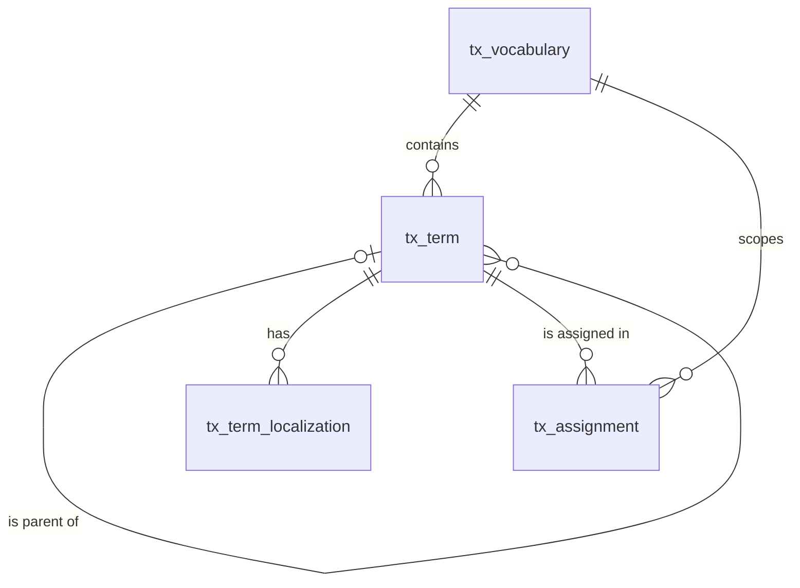

# 分类体系（taxonomy）模块设计

| 项 | 内容 |
|---|---|
| 模块 ID | `taxonomy` |
| 名称 | 分类体系 |
| 层 | L2 |
| 表前缀 | `tx_` |
| API 前缀 | `taxonomy` |
| 可停用 | 否 |
| 模块版本 | 1.0.0（module.json 的 version） |
| 平台版本 | `>=1.0.0 <2.0.0`（module.json 的 platform） |
| 里程碑切片 | M1：<…>；M2：<…>；M3：<…>；M4：<…>（详见第 13 节） |
| 模块负责人 | 待定 |
| 文档版本 | V1.0 |
| 状态 | 草案 |
| 更新日期 | 2026-10-14 |
| 依据 | 系统设计 V1.4 第 <…> 章；平台框架设计 V1.<x> 第 4 章 <…> 节；ADR-<…> |

> 本文只引用《平台框架设计》第 4 章中的契约，不定义新的跨模块契约；需要新契约时按平台框架设计 2.3 提出契约变更请求。

## 1. 职责与边界

### 1.1 职责

> 一段概述 + 要点列表；与系统设计 3.2 的职责描述一致，并细化到本模块的功能清单。

### 1.2 不负责的事

| 事项 | 归属模块 | 说明 |
|---|---|---|

### 1.3 协作概览

> 用图或表说明本模块与哪些模块协作、通过哪种方式（服务接口 / 事件 / 扩展点）。只画契约，不画实现。

### 1.4 适用的架构约束

> 列出与本模块直接相关的原则（P1–P8）、ADR 规则与 CLAUDE.md 禁止项，以及本模块如何满足。

## 2. 依赖与契约

### 2.1 module.json

```json
{
  "id": "<id>",
  "name": "<中文名称>",
  "version": "1.0.0",
  "layer": "L3",
  "platform": ">=1.0.0 <2.0.0",
  "requires": {},
  "optional": {},
  "disableable": true,
  "tablePrefix": "<前缀>_",
  "apiPrefix": "<id>",
  "permissions": [],
  "menus": [],
  "settings": null,
  "components": [],
  "events": { "publishes": [], "subscribes": [] }
}
```

> 完整描述符，须通过平台框架设计附录 A 的 Schema 与 A.3 的校验规则。

### 2.2 使用的服务接口

| 接口（平台框架设计小节） | 方法 | 用途 | 调用位置与时机（事务内 / 外） | 测试替身 |
|---|---|---|---|---|

### 2.3 提供的服务接口

| 接口（平台框架设计小节） | 方法 | 实现类 | 契约测试 | 说明（幂等、权限、性能目标） |
|---|---|---|---|---|

### 2.4 实现的扩展点

| 扩展点（平台框架设计小节） | 实现类 | 适用范围（内容类型 / 资源类型） | order | 收集方 |
|---|---|---|---|---|

### 2.5 收集的扩展点

| 扩展点 | 调用时机 | 过滤（站点启用状态、内容类型等） | 实现缺失或抛出异常时的行为 | 测试用示例实现 |
|---|---|---|---|---|

### 2.6 发布与订阅的事件

发布：

| 事件 | 触发时机（所在事务） | 关键字段 | 主要订阅方 |
|---|---|---|---|

订阅：

| 事件 | 处理 | 幂等方式 | 过期判断 | 失败与重试 |
|---|---|---|---|---|

### 2.7 使用的端口

| 端口 | 用途 | 测试替身 |
|---|---|---|

## 3. 领域模型

### 3.1 聚合、实体与值对象

| 类型 | 名称 | 说明 |
|---|---|---|
| 聚合根 | Vocabulary（`tx_vocabulary`） | 词汇表：key、是否层级、是否多选、是否可路由、是否必填、适用内容类型 |
| 聚合根 | Term（`tx_term`） | 分类项：所属词汇表、父项、物化路径、深度、排序、落地页内容（TERM_PAGE） |
| 实体 | TermLocalization（`tx_term_localization`） | 分类项在一种语言下的名称（站点资源）与描述（可路由时为 TERM_PAGE 的草稿内容） |
| 实体 | Assignment（`tx_assignment`） | 内容的草稿态分类指派；以内容为单位在“分类”标签页整体保存 |
| 值对象 | MaterializedPath | `/祖先 ID/…/自身 ID/`，如 `/1/5/9/` |
| 值对象 | VocabularySettings | `hierarchical`、`multiple`、`routable`、`required`、`applicable_types` |

在系统设计之外补充的字段：

| 补充 | 理由 |
|---|---|
| `tx_vocabulary.name`、`description`、`builtin`、`sort_order`、`deleted_at` | 后台显示与排序；内置词汇表（系统设计 7.2）不可删除；配置类实体软删除（本文 2.5） |
| `tx_term.deleted_at` | 分类项 ID 被快照、导航、图谱、URL 规则引用，软删除保留 ID，便于审计与恢复 |
| `tx_term_localization.description` 的归属 | 系统设计 7.1 把 description 放在本表，7.3 又规定描述随 TERM_PAGE 作为内容翻译：可路由分类项的 description 是 TERM_PAGE 的草稿业务字段，经 taxonomy 的 `PublishContributor` 进入快照、经 `TranslatableContentProvider` 翻译；不可路由分类项的 description 只在后台显示，不翻译。站点资源指纹只覆盖 `name` |
| `tx_assignment.vocabulary_id`、`primary_flag` | 用唯一索引保证“每个内容在每个词汇表最多一个主分类” |
| 词汇表名称不做本地化 | 词汇表名称只在后台显示；前台需要时（如筛选面板标题）使用文案键 `taxonomy.vocabulary.{vocab_key}`（界面文案，作为站点资源翻译） |

### 3.2 不变量

| # | 规则 | 保证方式 |
|---|---|---|
| 1 | 站点内未删除词汇表的 `vocab_key` 唯一；key 创建后不可修改 | 数据库：`uk_vocab_key`；应用层 |
| 2 | 内置词汇表不可删除；`routable` 只能在词汇表没有分类项时修改；有分类项的词汇表不能删除 | 应用层 |
| 3 | 根分类项 `parent_id` 为空且 `depth = 1`；子项 `depth` = 父项 `depth` + 1，最大 10 | 数据库：`ck_tx_term_depth`；应用层 |
| 4 | `path` = 父项 `path` + 自身 ID + `/`（根为 `/` + ID + `/`）；移动分类项时在同一事务中更新整棵子树的 `path` 与 `depth` | 应用层 |
| 5 | 子项与父项属于同一词汇表；非层级词汇表的分类项没有父项；不能移动到自身子树下 | 应用层 |
| 6 | 有子项或内容指派的分类项不能删除（先转移指派） | 数据库：`fk_tx_term_parent`、`fk_tx_asg_term`（RESTRICT，针对物理删除）；应用层（软删除前检查） |
| 7 | 可路由词汇表的分类项在中文名称存在时拥有一个 TERM_PAGE 内容；一个 TERM_PAGE 只属于一个分类项 | 数据库：`uk_term_content`；应用层 |
| 8 | 每个分类项每种语言最多一条本地化；中文行 `translation_state = NONE`、`source_fingerprint` 为空 | 数据库：`uk_tl_term_locale`；应用层 |
| 9 | 同一父项下（或同一词汇表的根之间）中文名称唯一 | 应用层 |
| 10 | 每个内容在每个词汇表最多一个主分类 | 数据库：`uk_asg_primary` |
| 11 | `multiple = 0` 的词汇表，每个内容最多一个指派（即主分类） | 应用层 |
| 12 | `required = 1` 的词汇表：适用类型的内容发布时必须有主分类（taxonomy 的 `PublishContributor.validate()` 报 ERROR；如产品的 `product_category`） | 应用层 |
| 13 | 指派的词汇表必须适用于该内容类型（`applicable_types`）；只能指派未删除的分类项 | 应用层 |
| 14 | `tx_assignment.vocabulary_id = tx_term.vocabulary_id` | 应用层 |

### 3.3 状态机

<<FILL: 状态与转换；没有状态机时写“不适用：<原因>”>>

## 4. 数据模型

> 遵守平台框架设计第 7 章的数据库通用约定。DDL 已在 MySQL 8.4 上执行通过；表结构以本节为准，与迁移脚本保持一致。

### 4.1 表清单

| 表 | 说明 | 站点级 | 软删除 | 预估规模（单站，按系统设计假设 A4） |
|---|---|---|---|---|
| `tx_vocabulary` | 词汇表 | 是 | 是（`deleted_at`） | 10–20 行 |
| `tx_term` | 分类项 | 是 | 是（`deleted_at`） | 1 千–5 千行 |
| `tx_term_localization` | 分类项本地化（站点资源） | 是 | 否（随分类项） | 1–5 万行（× 10 种语言） |
| `tx_assignment` | 草稿态分类指派 | 是 | 否 | ≈ 10 万行（2 万内容 × 平均 5 个分类项） |

### 4.2 ER 图



### 4.3 表结构

#### 4.3.1 `tx_vocabulary`：词汇表

| 字段 | 类型 | 可空 | 默认 | 说明 |
|---|---|---|---|---|
| `id` | BIGINT | 否 | — | 主键（TSID） |
| `site_id` | BIGINT | 否 | — | 站点 ID（sys_site.id） |
| `vocab_key` | VARCHAR(64) bin | 否 | — | 词汇表 key（小写字母、数字、下划线；创建后不可修改），如 product_category、application |
| `name` | VARCHAR(100) | 否 | — | 名称（中文，只在后台显示） |
| `description` | VARCHAR(500) | 是 | — | 说明（后台提示） |
| `hierarchical` | TINYINT(1) | 否 | `0` | 是否层级（分类项可以有父项） |
| `multiple` | TINYINT(1) | 否 | `1` | 一个内容是否可以指派多个分类项 |
| `routable` | TINYINT(1) | 否 | `0` | 分类项是否有落地页（TERM_PAGE） |
| `required` | TINYINT(1) | 否 | `0` | 适用类型的内容发布时是否必须有主分类 |
| `applicable_types` | JSON | 否 | `(JSON_ARRAY())` | 适用的内容类型数组，如 ["PRODUCT", "ARTICLE"]；取值见共享内容类型枚举 |
| `builtin` | TINYINT(1) | 否 | `0` | 是否内置（内置词汇表不可删除） |
| `sort_order` | INT | 否 | `0` | 后台显示顺序 |
| `deleted_at` | DATETIME(3) | 是 | — | 删除时间（软删除） |
| `alive` | TINYINT | 是 | 生成列 `IF(deleted_at IS NULL, 1, NULL)` | 未删除标记（唯一索引用） |
| `version` | INT | 否 | `0` | 乐观锁版本号 |
| `created_at` | DATETIME(3) | 否 | `CURRENT_TIMESTAMP(3)` | 创建时间（UTC） |
| `created_by` | BIGINT | 否 | `0` | 创建人用户 ID（0 = 系统） |
| `updated_at` | DATETIME(3) | 否 | `CURRENT_TIMESTAMP(3) ON UPDATE CURRENT_TIMESTAMP(3)` | 更新时间（UTC） |
| `updated_by` | BIGINT | 否 | `0` | 更新人用户 ID（0 = 系统） |

索引与约束：
- `PRIMARY KEY (id)`
- `uk_vocab_key (site_id, vocab_key, alive)`：未删除的 key 唯一；按 key 查找（数据源参数、快照 `terms[].vocabulary`、初始化）；站点的词汇表列表

```sql
CREATE TABLE tx_vocabulary (
  id                BIGINT        NOT NULL COMMENT '主键（TSID）',
  site_id           BIGINT        NOT NULL COMMENT '站点 ID（sys_site.id）',
  vocab_key         VARCHAR(64)   COLLATE utf8mb4_0900_bin NOT NULL COMMENT '词汇表 key（小写字母、数字、下划线；创建后不可修改），如 product_category、application',
  name              VARCHAR(100)  NOT NULL COMMENT '名称（中文，只在后台显示）',
  description       VARCHAR(500)  NULL COMMENT '说明（后台提示）',
  hierarchical      TINYINT(1)    NOT NULL DEFAULT 0 COMMENT '是否层级（分类项可以有父项）',
  multiple          TINYINT(1)    NOT NULL DEFAULT 1 COMMENT '一个内容是否可以指派多个分类项',
  routable          TINYINT(1)    NOT NULL DEFAULT 0 COMMENT '分类项是否有落地页（TERM_PAGE）',
  required          TINYINT(1)    NOT NULL DEFAULT 0 COMMENT '适用类型的内容发布时是否必须有主分类',
  applicable_types  JSON          NOT NULL DEFAULT (JSON_ARRAY()) COMMENT '适用的内容类型数组，如 ["PRODUCT", "ARTICLE"]；取值见共享内容类型枚举',
  builtin           TINYINT(1)    NOT NULL DEFAULT 0 COMMENT '是否内置（内置词汇表不可删除）',
  sort_order        INT           NOT NULL DEFAULT 0 COMMENT '后台显示顺序',
  deleted_at        DATETIME(3)   NULL COMMENT '删除时间（软删除）',
  alive             TINYINT       AS (IF(deleted_at IS NULL, 1, NULL)) STORED COMMENT '未删除标记（唯一索引用）',
  version           INT           NOT NULL DEFAULT 0 COMMENT '乐观锁版本号',
  created_at        DATETIME(3)   NOT NULL DEFAULT CURRENT_TIMESTAMP(3) COMMENT '创建时间（UTC）',
  created_by        BIGINT        NOT NULL DEFAULT 0 COMMENT '创建人用户 ID（0 = 系统）',
  updated_at        DATETIME(3)   NOT NULL DEFAULT CURRENT_TIMESTAMP(3) ON UPDATE CURRENT_TIMESTAMP(3) COMMENT '更新时间（UTC）',
  updated_by        BIGINT        NOT NULL DEFAULT 0 COMMENT '更新人用户 ID（0 = 系统）',
  PRIMARY KEY (id),
  UNIQUE KEY uk_vocab_key (site_id, vocab_key, alive)
) ENGINE = InnoDB DEFAULT CHARSET = utf8mb4 COLLATE = utf8mb4_0900_ai_ci COMMENT = '词汇表（产品分类、应用、行业、文章栏目、标签、认证及站点自定义）';
```

要点：站点创建或 taxonomy 安装时，为每个站点写入系统设计 7.2 的 6 个内置词汇表（`builtin = 1`），见第 23 章。

#### 4.3.2 `tx_term`：分类项

| 字段 | 类型 | 可空 | 默认 | 说明 |
|---|---|---|---|---|
| `id` | BIGINT | 否 | — | 主键（TSID） |
| `site_id` | BIGINT | 否 | — | 站点 ID（sys_site.id） |
| `vocabulary_id` | BIGINT | 否 | — | 词汇表 ID（tx_vocabulary.id） |
| `parent_id` | BIGINT | 是 | — | 父分类项 ID；根为空，非层级词汇表恒为空 |
| `path` | VARCHAR(255) bin | 否 | — | 物化路径：祖先与自身的 ID，如 /1/5/9/ |
| `depth` | TINYINT | 否 | `1` | 层级深度：根为 1，最大 10 |
| `sort_order` | INT | 否 | `0` | 同级排序 |
| `content_id` | BIGINT | 是 | — | 落地页内容 ID（cnt_content.id，类型 TERM_PAGE）；不可路由时为空 |
| `deleted_at` | DATETIME(3) | 是 | — | 删除时间（软删除） |
| `version` | INT | 否 | `0` | 乐观锁版本号 |
| `created_at` | DATETIME(3) | 否 | `CURRENT_TIMESTAMP(3)` | 创建时间（UTC） |
| `created_by` | BIGINT | 否 | `0` | 创建人用户 ID（0 = 系统） |
| `updated_at` | DATETIME(3) | 否 | `CURRENT_TIMESTAMP(3) ON UPDATE CURRENT_TIMESTAMP(3)` | 更新时间（UTC） |
| `updated_by` | BIGINT | 否 | `0` | 更新人用户 ID（0 = 系统） |

索引与约束：
- `PRIMARY KEY (id)`
- `uk_term_content (content_id)`：一个 TERM_PAGE 只属于一个分类项；按落地页内容反查分类项（面包屑、Delivery）
- `idx_term_vocab (vocabulary_id, parent_id, sort_order)`：加载词汇表的整棵树、根分类项列表；兼作 `fk_tx_term_vocab` 的索引
- `idx_term_parent (parent_id, sort_order)`：子分类列表（`term-children` 数据源、后台树展开）；兼作 `fk_tx_term_parent` 的索引
- `idx_term_path (site_id, path)`：子树查询（`path LIKE '/1/5/%'`：分类下含子分类的全部内容、移动时更新子树）
- `fk_tx_term_vocab`、`fk_tx_term_parent`：引用关系（RESTRICT）
- `ck_tx_term_depth`：见 3.2 不变量 3

```sql
CREATE TABLE tx_term (
  id             BIGINT        NOT NULL COMMENT '主键（TSID）',
  site_id        BIGINT        NOT NULL COMMENT '站点 ID（sys_site.id）',
  vocabulary_id  BIGINT        NOT NULL COMMENT '词汇表 ID（tx_vocabulary.id）',
  parent_id      BIGINT        NULL COMMENT '父分类项 ID；根为空，非层级词汇表恒为空',
  path           VARCHAR(255)  COLLATE utf8mb4_0900_bin NOT NULL COMMENT '物化路径：祖先与自身的 ID，如 /1/5/9/',
  depth          TINYINT       NOT NULL DEFAULT 1 COMMENT '层级深度：根为 1，最大 10',
  sort_order     INT           NOT NULL DEFAULT 0 COMMENT '同级排序',
  content_id     BIGINT        NULL COMMENT '落地页内容 ID（cnt_content.id，类型 TERM_PAGE）；不可路由时为空',
  deleted_at     DATETIME(3)   NULL COMMENT '删除时间（软删除）',
  version        INT           NOT NULL DEFAULT 0 COMMENT '乐观锁版本号',
  created_at     DATETIME(3)   NOT NULL DEFAULT CURRENT_TIMESTAMP(3) COMMENT '创建时间（UTC）',
  created_by     BIGINT        NOT NULL DEFAULT 0 COMMENT '创建人用户 ID（0 = 系统）',
  updated_at     DATETIME(3)   NOT NULL DEFAULT CURRENT_TIMESTAMP(3) ON UPDATE CURRENT_TIMESTAMP(3) COMMENT '更新时间（UTC）',
  updated_by     BIGINT        NOT NULL DEFAULT 0 COMMENT '更新人用户 ID（0 = 系统）',
  PRIMARY KEY (id),
  UNIQUE KEY uk_term_content (content_id),
  KEY idx_term_vocab (vocabulary_id, parent_id, sort_order),
  KEY idx_term_parent (parent_id, sort_order),
  KEY idx_term_path (site_id, path),
  CONSTRAINT fk_tx_term_vocab FOREIGN KEY (vocabulary_id) REFERENCES tx_vocabulary (id),
  CONSTRAINT fk_tx_term_parent FOREIGN KEY (parent_id) REFERENCES tx_term (id),
  CONSTRAINT ck_tx_term_depth CHECK ((parent_id IS NULL AND depth = 1) OR (parent_id IS NOT NULL AND depth BETWEEN 2 AND 10))
) ENGINE = InnoDB DEFAULT CHARSET = utf8mb4 COLLATE = utf8mb4_0900_ai_ci COMMENT = '分类项（物化路径树；可路由时关联 TERM_PAGE 内容）';
```

要点：
- `path` 最长 10 级 × 20 个字符（`/` + 最多 19 位 ID），`VARCHAR(255)` 足够。
- TERM_PAGE：可路由分类项的中文名称首次保存时，taxonomy 经 `ContentApi.create(TERM_PAGE, zh-CN)` 创建落地页并写入 `content_id`；其他语言名称首次写入时经 `ContentApi` 创建对应本地化（`translation_mode = AUTO`）；分类名变化时经 `ContentApi.updateDraftMeta()` 同步 `draft_title`。
- 新建、更名（任一语言）、移动、删除发布 `TermChangedEvent`（按 `t:{termId}` 失效缓存）；删除可路由分类项时，其 TERM_PAGE 以 `REDIRECT_PARENT`（301 到上级分类页；根分类项按 `GONE`）下线并移入回收站。

#### 4.3.3 `tx_term_localization`：分类项本地化

| 字段 | 类型 | 可空 | 默认 | 说明 |
|---|---|---|---|---|
| `id` | BIGINT | 否 | — | 主键（TSID） |
| `site_id` | BIGINT | 否 | — | 站点 ID（sys_site.id） |
| `term_id` | BIGINT | 否 | — | 分类项 ID（tx_term.id） |
| `locale` | VARCHAR(16) | 否 | — | 语言（BCP 47） |
| `name` | VARCHAR(200) | 否 | — | 分类名（站点资源：中文录入，其他语言由 translation 经 TranslatableResourceProvider 写入） |
| `description` | JSON | 是 | — | 分类描述（ProseMirror JSON）；可路由分类项的描述是 TERM_PAGE 的草稿内容，随落地页发布并作为内容翻译 |
| `translation_state` | VARCHAR(16) | 否 | `'NONE'` | 名称的翻译状态：NONE / QUEUED / TRANSLATED / NEEDS_REVIEW / FAILED / OUTDATED |
| `source_fingerprint` | CHAR(64) bin | 是 | — | 生成本行译文时中文行的指纹（规范化 name 的 SHA-256）；中文行为空；与当前中文指纹不同即为过期 |
| `version` | INT | 否 | `0` | 乐观锁版本号 |
| `created_at` | DATETIME(3) | 否 | `CURRENT_TIMESTAMP(3)` | 创建时间（UTC） |
| `created_by` | BIGINT | 否 | `0` | 创建人用户 ID（0 = 系统） |
| `updated_at` | DATETIME(3) | 否 | `CURRENT_TIMESTAMP(3) ON UPDATE CURRENT_TIMESTAMP(3)` | 更新时间（UTC） |
| `updated_by` | BIGINT | 否 | `0` | 更新人用户 ID（0 = 系统） |

索引与约束：
- `PRIMARY KEY (id)`
- `uk_tl_term_locale (term_id, locale)`：每种语言一条；按分类项取各语言名称；兼作 `fk_tx_tl_term` 的索引
- `idx_tl_name (site_id, locale, name)`：后台 TermPicker 按名称搜索（不区分大小写与重音）；产品导入按中文名称匹配分类
- `idx_tl_state (site_id, translation_state, locale)`：翻译中心列出待处理的分类名
- `fk_tx_tl_term`：组合关系，`ON DELETE CASCADE`

```sql
CREATE TABLE tx_term_localization (
  id                  BIGINT        NOT NULL COMMENT '主键（TSID）',
  site_id             BIGINT        NOT NULL COMMENT '站点 ID（sys_site.id）',
  term_id             BIGINT        NOT NULL COMMENT '分类项 ID（tx_term.id）',
  locale              VARCHAR(16)   NOT NULL COMMENT '语言（BCP 47）',
  name                VARCHAR(200)  NOT NULL COMMENT '分类名（站点资源：中文录入，其他语言由 translation 经 TranslatableResourceProvider 写入）',
  description         JSON          NULL COMMENT '分类描述（ProseMirror JSON）；可路由分类项的描述是 TERM_PAGE 的草稿内容，随落地页发布并作为内容翻译',
  translation_state   VARCHAR(16)   NOT NULL DEFAULT 'NONE' COMMENT '名称的翻译状态：NONE / QUEUED / TRANSLATED / NEEDS_REVIEW / FAILED / OUTDATED',
  source_fingerprint  CHAR(64)      COLLATE utf8mb4_0900_bin NULL COMMENT '生成本行译文时中文行的指纹（规范化 name 的 SHA-256）；中文行为空；与当前中文指纹不同即为过期',
  version             INT           NOT NULL DEFAULT 0 COMMENT '乐观锁版本号',
  created_at          DATETIME(3)   NOT NULL DEFAULT CURRENT_TIMESTAMP(3) COMMENT '创建时间（UTC）',
  created_by          BIGINT        NOT NULL DEFAULT 0 COMMENT '创建人用户 ID（0 = 系统）',
  updated_at          DATETIME(3)   NOT NULL DEFAULT CURRENT_TIMESTAMP(3) ON UPDATE CURRENT_TIMESTAMP(3) COMMENT '更新时间（UTC）',
  updated_by          BIGINT        NOT NULL DEFAULT 0 COMMENT '更新人用户 ID（0 = 系统）',
  PRIMARY KEY (id),
  UNIQUE KEY uk_tl_term_locale (term_id, locale),
  KEY idx_tl_name (site_id, locale, name),
  KEY idx_tl_state (site_id, translation_state, locale),
  CONSTRAINT fk_tx_tl_term FOREIGN KEY (term_id) REFERENCES tx_term (id) ON DELETE CASCADE
) ENGINE = InnoDB DEFAULT CHARSET = utf8mb4 COLLATE = utf8mb4_0900_ai_ci COMMENT = '分类项本地化（名称为站点资源，带翻译状态与源指纹）';
```

要点：
- 中文 `name` 变化时发布 `TranslatableResourceChangedEvent`（资源类型 `taxonomy.term`，ID 为 `term_id`）；translation 回写目标语言行时设置 `translation_state`（`TRANSLATED` / `NEEDS_REVIEW` / `FAILED`）与 `source_fingerprint`；人工修订在翻译编辑器中进行并写回翻译记忆。
- TERM_PAGE 的 `TranslatableContentProvider.apply()` 只写 `description`；目标语言行尚不存在时，同时写入经翻译记忆得到的 `name`（与站点资源翻译共用翻译记忆，结果一致）。

#### 4.3.4 `tx_assignment`：分类指派（草稿态）

| 字段 | 类型 | 可空 | 默认 | 说明 |
|---|---|---|---|---|
| `content_id` | BIGINT | 否 | — | 内容 ID（cnt_content.id） |
| `term_id` | BIGINT | 否 | — | 分类项 ID（tx_term.id） |
| `site_id` | BIGINT | 否 | — | 站点 ID（sys_site.id） |
| `vocabulary_id` | BIGINT | 否 | — | 词汇表 ID（冗余 tx_term.vocabulary_id，用于主分类唯一约束） |
| `is_primary` | TINYINT(1) | 否 | `0` | 是否该词汇表中的主分类（用于面包屑与结构化数据） |
| `primary_flag` | TINYINT | 是 | 生成列 `IF(is_primary = 1, 1, NULL)` | 主分类标记（唯一索引用） |
| `sort_order` | INT | 否 | `0` | 同一内容中的显示顺序 |
| `created_at` | DATETIME(3) | 否 | `CURRENT_TIMESTAMP(3)` | 创建时间（UTC） |
| `created_by` | BIGINT | 否 | `0` | 创建人用户 ID（0 = 系统，如导入） |
| `updated_at` | DATETIME(3) | 否 | `CURRENT_TIMESTAMP(3) ON UPDATE CURRENT_TIMESTAMP(3)` | 更新时间（UTC） |
| `updated_by` | BIGINT | 否 | `0` | 更新人用户 ID（0 = 系统） |

索引与约束：
- `PRIMARY KEY (content_id, term_id)`：读取一个内容的全部指派（编辑页“分类”标签、发布时组装快照 `terms`）
- `uk_asg_primary (content_id, vocabulary_id, primary_flag)`：每个内容在每个词汇表最多一个主分类
- `idx_asg_term (term_id)`：分类项下的内容（后台按分类筛选草稿、删除前检查指派数量）；兼作 `fk_tx_asg_term` 的索引
- `fk_tx_asg_term`：引用关系（RESTRICT）

```sql
CREATE TABLE tx_assignment (
  content_id     BIGINT        NOT NULL COMMENT '内容 ID（cnt_content.id）',
  term_id        BIGINT        NOT NULL COMMENT '分类项 ID（tx_term.id）',
  site_id        BIGINT        NOT NULL COMMENT '站点 ID（sys_site.id）',
  vocabulary_id  BIGINT        NOT NULL COMMENT '词汇表 ID（冗余 tx_term.vocabulary_id，用于主分类唯一约束）',
  is_primary     TINYINT(1)    NOT NULL DEFAULT 0 COMMENT '是否该词汇表中的主分类（用于面包屑与结构化数据）',
  primary_flag   TINYINT       AS (IF(is_primary = 1, 1, NULL)) STORED COMMENT '主分类标记（唯一索引用）',
  sort_order     INT           NOT NULL DEFAULT 0 COMMENT '同一内容中的显示顺序',
  created_at     DATETIME(3)   NOT NULL DEFAULT CURRENT_TIMESTAMP(3) COMMENT '创建时间（UTC）',
  created_by     BIGINT        NOT NULL DEFAULT 0 COMMENT '创建人用户 ID（0 = 系统，如导入）',
  updated_at     DATETIME(3)   NOT NULL DEFAULT CURRENT_TIMESTAMP(3) ON UPDATE CURRENT_TIMESTAMP(3) COMMENT '更新时间（UTC）',
  updated_by     BIGINT        NOT NULL DEFAULT 0 COMMENT '更新人用户 ID（0 = 系统）',
  PRIMARY KEY (content_id, term_id),
  UNIQUE KEY uk_asg_primary (content_id, vocabulary_id, primary_flag),
  KEY idx_asg_term (term_id),
  CONSTRAINT fk_tx_asg_term FOREIGN KEY (term_id) REFERENCES tx_term (id)
) ENGINE = InnoDB DEFAULT CHARSET = utf8mb4 COLLATE = utf8mb4_0900_ai_ci COMMENT = '内容的分类指派（草稿态，语言无关）';
```

要点：
- 指派是语言无关的非文本数据，所有语言沿用（系统设计 5.5）；修改指派只影响草稿，各本地化发布后才进入其快照与 `cnt_published_term`。
- 发布时 taxonomy 的 `PublishContributor` 把指派写入快照 `terms`（`vocabulary` 取词汇表 key，`primary` 取 `is_primary`），内核据此更新 `cnt_published_term`。

### 4.4 枚举

| 字段 | 取值 | 说明 |
|---|---|---|
| `tx_vocabulary.vocab_key`（内置） | `product_category` | 产品分类：层级，可路由，适用 PRODUCT，必填 |
| | `application` | 应用场景：非层级（可配置），可路由，适用 PRODUCT、ARTICLE、CASE_STUDY、PAGE |
| | `industry` | 行业：非层级，可路由，适用 PRODUCT、ARTICLE、CASE_STUDY |
| | `article_category` | 文章栏目：层级，可路由，适用 ARTICLE |
| | `tag` | 标签：非层级，不可路由，适用全部类型 |
| | `certification` | 认证（CE、UL、ISO…）：非层级，不可路由，适用 PRODUCT |
| `tx_vocabulary.applicable_types[]` | `PAGE` / `PRODUCT` / `ARTICLE` / `CASE_STUDY` / `FAQ` / `TERM_PAGE` / `GLOBAL_BLOCK` | 共享内容类型枚举 |
| `tx_term_localization.translation_state` | `NONE` / `QUEUED` / `TRANSLATED` / `NEEDS_REVIEW` / `FAILED` / `OUTDATED` | 共享翻译状态枚举；中文行为 `NONE`；站点资源以指纹判断过期，源语言变化后重新进入 `QUEUED` |

`product_category` 的“必填”是本文对系统设计 7.3“产品必须有一个主分类”的落实；其余内置词汇表 `required = 0`。

### 4.5 站点过滤

<<FILL: | 表 | 行级拦截器（不豁免 / 豁免） | 访问方式与理由 |>>

### 4.6 跨模块引用与清理

| 本模块字段 | 引用对象（模块.表） | 被引用对象删除 / 下线时的处理 | 触发事件 |
|---|---|---|---|
| `tx_term.content_id` | content.`cnt_content`（TERM_PAGE） | taxonomy 经 `ContentApi` 创建、下线、移入回收站；内容被彻底删除时置空（分类项仍存在时，下次保存中文名称时重新创建） | `ContentPurgedEvent` |
| `tx_assignment.content_id` | content.`cnt_content` | 内容彻底删除：删除其全部指派 | `ContentPurgedEvent` |
| `tx_vocabulary.applicable_types` | 内容类型（代码注册） | 所属模块停用或 MISSING：保留配置，指派与筛选中忽略该类型 | `ModuleDisabledEvent` |
| `tx_term_localization.locale` | core.`sys_site_locale` | 站点删除某语言：删除该语言的分类项本地化 | `SiteSettingsChangedEvent` |
| `created_by`、`updated_by` | core.`sys_user` | 不清理 | — |

本模块发布的事件：`TermChangedEvent`（新建、更名、移动、删除）、`TranslatableResourceChangedEvent`（资源类型 `taxonomy.term`）。订阅：`ContentPurgedEvent`。

以 `term_id` 引用本模块的其他表（`cnt_published_term`、`prd_product.primary_category_term_id`、`prd_category_attribute_set`、`nav_item.link_ref`、`url_pattern.vocabulary_id` 等）在收到 `TermChangedEvent`（DELETED / MOVED）后各自处理。

### 4.7 迁移脚本

| 文件 | 内容 | 里程碑 |
|---|---|---|
| `db/migration/taxonomy/V001__init.sql` | 4.3 中的全部表（4 张：`tx_vocabulary`、`tx_term`、`tx_term_localization`、`tx_assignment`），按本节顺序创建 | <见第 13 节> |

## 5. 业务流程

### 5.1 <流程名称>

```text
<步骤；标出事务边界、调用的服务接口、发布的事件、异步部分>
```

| 步骤 | 说明 | 失败处理 |
|---|---|---|

## 6. 接口

### 6.1 Admin 端点

| 方法 | 路径（/api/admin/v1/<apiPrefix>/…） | 说明 | 权限码 | 并发控制 / 幂等 | 审计 |
|---|---|---|---|---|---|

### 6.2 Public 端点

| 方法 | 路径（/api/public/v1/<apiPrefix>/…） | 说明 | 限流 | 缓存 |
|---|---|---|---|---|

### 6.3 Internal 端点

| 方法 | 路径（/api/internal/v1/<apiPrefix>/…） | 说明 | 调用方 |
|---|---|---|---|

### 6.4 权限码

| 权限码 | 名称 | 数据范围 | 高危（sensitive） | 受语言范围限制（localeScoped） |
|---|---|---|---|---|

### 6.5 错误码

| 错误码 | HTTP 状态 | 后台中文信息 | 前台文案键（仅公开接口） |
|---|---|---|---|

## 7. 后台界面

### 7.1 菜单与路由

| 菜单 key | 名称 | 父菜单 | 路由 | 权限码 |
|---|---|---|---|---|

### 7.2 页面

| 页面 | 路由 | 主要功能 | 使用的 admin-kit 组件 |
|---|---|---|---|

### 7.3 注册到内容编辑外壳的标签

| key | 适用内容类型 | 权限码 | 组件 |
|---|---|---|---|

### 7.4 界面文案

> texts.ts 中的分组与关键文案；后台只用简体中文。

## 8. 前台组件与模板

> 没有前台组件时写“不适用”。

### 8.1 组件

| 组件类型 | 名称（label） | 变体 | 分类 | allowedIn | 数据源 | 是否水合 |
|---|---|---|---|---|---|---|

### 8.2 属性与翻译

| 组件 | 属性 | 类型 / x-editor | x-translatable | maxLength |
|---|---|---|---|---|

### 8.3 模板

| 模板 key | 内容类型 | 固定区域与插槽 |
|---|---|---|

### 8.4 数据源

| key | 参数 | 返回 | 缓存标签 |
|---|---|---|---|

### 8.5 文案键

| 文案键 | 默认中文文案 | 使用位置 |
|---|---|---|

## 9. 配置项

### 9.1 站点设置（settings.schema.json）

| 键 | 类型 | 默认值 | 说明 | 敏感（x-secret） |
|---|---|---|---|---|

### 9.2 部署配置（application.yml，前缀 b2bweb.<id>）

| 属性 | 默认值 | 说明 |
|---|---|---|

## 10. 定时与异步任务

> 没有时写“不适用”。定时任务实现 `ScheduledTask`，通用异步任务实现 `JobHandler`（平台框架设计 4.4.12）；锁名与任务类型按平台框架设计 3.7 命名。事件监听器已在 2.6 中列出，这里只补充耗时长、需要单独调度或重试的处理。`PER_SITE` 任务由 core 在站点上下文中逐站点执行，停用了本模块的站点自动跳过（系统设计 3.8）。外部服务（AI 引擎、邮件、CDN）只在事务提交后的异步处理中调用，失败不回滚已提交的业务数据（ADR-003、ADR-017）。

| 任务 | 类型（定时 / sys_job / 事件监听） | 触发 | 锁名 | 幂等与重试 | 模块停用时 |
|---|---|---|---|---|---|

> 每个任务另写：执行粒度（`PER_SITE` / 系统级）、单次处理量与分批方式、超时、能否取消、失败后的可见结果（`sys_job` 的失败报告、指标 `b2bweb.<id>.*` 或告警）。

## 11. 测试要点

> 测试层级、替身与契约测试的写法见平台框架设计第 9 章，门禁与覆盖率见第 10 章。“至少”后的用例为必测项；不适用的行写“不适用：<原因>”，不得删除。

| 层级 | 覆盖内容 | 关键用例 |
|---|---|---|
| 单元 | <领域对象、不变量（3.2）、状态机（3.3）、扩展点实现（2.4）> | 至少：3.2 每条不变量的违反用例；3.3 每个非法状态转换被拒绝 |
| 模块集成（Testcontainers + 替身） | <应用服务 + 本模块的表与迁移> | 至少：迁移脚本在空库（MySQL 8.4）上执行通过；6.1 中声明的并发控制与幂等；唯一约束冲突转为 6.5 的错误码 |
| 契约（作为提供方） | <2.3 中本模块提供的服务接口> | 继承 testkit 中的 `<接口名>ContractTest`，用真实实现运行；不提供服务接口时写“不适用” |
| 事件（Scenario API，含重复投递） | <2.6 中发布与订阅的事件> | 至少：事件在业务事务内发布、事务回滚时不发布；每个监听器重复投递只生效一次、过期事件被丢弃（ADR-003） |
| 停用行为（可停用模块） | <系统设计 3.8 的各项> | 至少：停用后写操作与公开接口返回 `CORE_MODULE_DISABLED`；扩展点实现不再被收集；定时任务跳过；`analyzeDisableImpact` 的结果正确；重新启用后数据完整（S10） |
| 站点隔离 | <6.1 的全部后台接口与 4.5 的全部站点级表> | 至少：站点 A 的用户不能读写站点 B 的数据（遍历全部后台端点，系统设计 28）；豁免表只在 4.5 列出的位置访问 |
| 翻译（如有可翻译字段） | <`TranslatableContentProvider` / `TranslatableResourceProvider` 实现> | 至少：提取 → 回写往返一致；`x-translatable = false` 的字段不被提取；`HUMAN` / `REVIEWED` 段不被机器译文覆盖；资源变化时发布 `TranslatableResourceChangedEvent` |
| 前端（组件、Admin） | <主题组件、Admin 页面> | 至少：组件 Schema 校验与画廊示例（视觉回归）；前台文字只来自文案键、后台文字只来自 `texts.ts`；无权限时操作不可见 |
| E2E（场景） | <13.2 中验证方式为 E2E 的验收项> | Playwright 用例名包含 13.2 的验收项编号 |

## 12. 独立开发说明

### 12.1 依赖的测试替身

> 2.2 使用的每个服务接口、2.7 使用的每个端口、2.5 收集的每个扩展点，都要在此列出 testkit 中对应的替身或示例实现（平台框架设计 2.4、第 9 章）。testkit 中缺少的替身向框架组提出需求（DoR 第 3 条，平台框架设计 2.7），不在本模块中另建一套代替其他模块的模拟实现；单元测试可以用 Mockito 模拟个别方法，但对其他模块行为的假设以替身与契约测试为准。

| 替身（platform-testkit） | 代替的模块 | 用途 | 需要预置的数据 |
|---|---|---|---|

### 12.2 本模块提供的替身

> 只有提供服务接口的模块填写（core、content、url、media、taxonomy、form、notification、translation，见平台框架设计 4.2）；其他模块写“不适用：不提供服务接口”。替身由框架组编写并维护，与真实实现通过同一套契约测试；本模块改变服务接口的行为时，在同一个 PR 中同步修改契约测试，并通知框架组修改替身（平台框架设计 2.3）。无法消除的差异（如不做病毒扫描、不生成真实缩略图）列入下表，并确认不影响使用方的测试结论。

| 服务接口 | testkit 中的替身 | 与真实实现的差异（应为零，或已在契约测试中声明） |
|---|---|---|

### 12.3 本地运行

> 启动方式、依赖的本地服务（平台框架设计第 11 章）、需要的配置。

### 12.4 演示数据

> tools/demo-data 中本模块的数据及其用途。

## 13. 验收标准

### 13.1 里程碑切片

> 与平台框架设计 13.5 中本模块的一行一致；调整切片按平台框架设计 12.5 处理。该里程碑没有切片时写“—”（不表示不能提前开发）。

| 里程碑 | 交付功能 | 验收场景 |
|---|---|---|
| M1 | <…> | <S1、S2、S4 中与本模块相关的部分，或“模块自身”> |
| M2 | <…> | <…> |
| M3 | <…> | <…> |
| M4 | <…> | <…> |

### 13.2 验收项

> 每条验收项写明输入、期望结果与度量（如“5 分钟内”“P95 ≤ 200 ms”）。场景验收项只写本模块负责的部分（如 S2 中 url 负责“旧 URL 301 到新 URL、不产生重定向链”），不复述整个场景；各里程碑的场景见平台框架设计 13.6。验证方式为单元 / 集成 / E2E 时写出测试类或用例名；人工检查写明检查人与方法。

| # | 验收项 | 对应场景（S1–S13）或模块自身 | 验证方式（单元 / 集成 / E2E / 人工） | 里程碑 |
|---|---|---|---|---|
| A1 | <…> | <S? / 模块自身> | <集成：`<测试类>`> | M? |

> 每个模块都要包含以下通用验收项（不适用时注明原因）：架构测试与 Modulith 验证通过，无跨模块 import 与表访问；站点隔离测试覆盖全部后台接口；后台写操作都有权限码与审计记录；可停用模块满足 S10；可翻译字段与资源已登记并通过往返测试（S11、S12）；系统设计 1.5 中与本模块相关的非功能指标；文档与代码一致（DoD，平台框架设计 2.8）。

## 14. 待定问题

> 记录评审与开发中尚未决定的事项。“阻塞开发”的问题必须在评审通过（DoR）前关闭；需要新契约或修改上层文档的问题，写明契约变更请求或 Issue 编号。已关闭的问题保留在表中，填写结论。

| # | 问题 | 影响 | 是否阻塞开发 | 负责人 | 最晚解决 | 结论 |
|---|---|---|---|---|---|---|

## 修订记录

| 版本 | 日期 | 变更 |
|---|---|---|
| V1.0 | 2026-10-14 | 初稿 |
