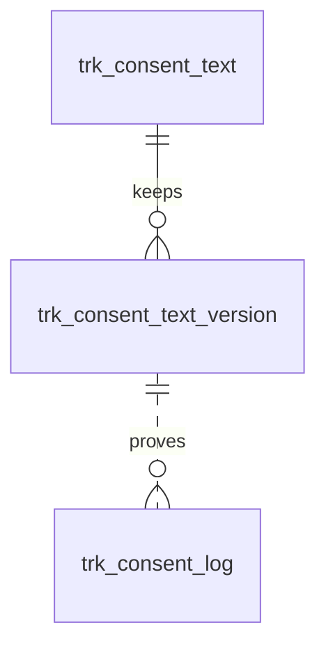

# 统计追踪与隐私同意（tracking）模块设计

| 项 | 内容 |
|---|---|
| 模块 ID | `tracking` |
| 名称 | 统计追踪与隐私同意 |
| 层 | L4 |
| 表前缀 | `trk_` |
| API 前缀 | `tracking` |
| 可停用 | 是 |
| 模块版本 | 1.0.0（module.json 的 version） |
| 平台版本 | `>=1.0.0 <2.0.0`（module.json 的 platform） |
| 里程碑切片 | M1：—（M1 的来源归因由前台插件采集）；M2：—；M3：统计配置、同意管理、GPC、同意记录、转化事件；M4：—（详见第 13 节） |
| 模块负责人 | 待定 |
| 文档版本 | V1.4 |
| 状态 | 草案 |
| 更新日期 | 2026-10-20 |
| 依据 | 系统设计 V1.7 第 20 章及 3.2、3.8、24–29 章；平台框架设计 V1.4 第 4、7–13 章；ADR-002、ADR-003、ADR-005、ADR-009、ADR-018 |

> 本文只引用《平台框架设计》第 4 章中的契约，不定义新的跨模块契约；需要新契约时按平台框架设计 2.3 提出契约变更请求。

## 1. 职责与边界

### 1.1 职责

维护统计服务、脚本与转化配置；提供按地区的同意管理、GPC 处理、版本化横幅及追加式同意记录，并按类别控制脚本和归因存储。

功能交付范围按第 13 章分为 M1–M4；表结构、约束与枚举以第 3、4 章为准。

### 1.2 不负责的事

| 事项 | 归属模块 | 边界 |
|---|---|---|
| 内容生命周期与路由 | content / url | 本模块只承担自身职责；不直接修改 cnt_、url_ 表 |
| 身份、权限、设置、任务及审计 | platform-core | 复用平台公共服务 |
| 第三方客户端与网络传输 | infrastructure | 仅经既有端口或 L2 服务使用，不在业务模块引入客户端 |

### 1.3 协作概览

| 协作方式 | 对象 | 本模块行为 |
|---|---|---|
| 服务接口 | 仅 core 公共服务 | 方法与事务边界见 2.2；无跨模块表访问 |
| 扩展点 | SiteBootstrapContributor、TranslatableResourceProvider | 实现/收集清单见 2.4、2.5 |
| 领域事件 | 见 2.6 | 与本地事务一起登记，提交后异步投递；重复与过期处理独立验证 |

### 1.4 适用的架构约束

遵守 P2、P3 与 ADR-018：编译依赖只到 platform-core/platform-api，跨模块协作只用第 2 章登记契约；只访问自己的表，禁止跨模块 JOIN/外键。遵守 ADR-003：事务内登记、提交后投递、监听器幂等并检查过期。遵守 ADR-009：每次请求/任务明确站点上下文，站点表默认过滤。

公开读取只用当前语言发布态，不跨语言回退（ADR-005）；预览与公开缓存隔离。后台中文文案与错误集中管理，前台文案经 UiTextApi，样式只用 Design Token。远程端口在数据库事务外调用，密钥经 SecretCipher，不写日志。

## 2. 依赖与契约

### 2.1 module.json

```json
{
  "id": "tracking",
  "name": "统计追踪与隐私同意",
  "version": "1.0.0",
  "layer": "L4",
  "platform": ">=1.0.0 <2.0.0",
  "requires": {},
  "optional": {},
  "disableable": true,
  "tablePrefix": "trk_",
  "apiPrefix": "tracking",
  "permissions": [
    {
      "code": "tracking:setting:manage",
      "name": "管理追踪设置"
    },
    {
      "code": "tracking:script:edit",
      "name": "管理自定义脚本",
      "sensitive": true
    },
    {
      "code": "tracking:consent:view",
      "name": "查看同意记录"
    }
  ],
  "menus": [
    {
      "key": "tracking",
      "name": "统计追踪与隐私同意",
      "parent": "settings",
      "route": "/tracking/settings",
      "permission": "tracking:setting:manage",
      "order": 100
    }
  ],
  "settings": null,
  "components": [],
  "events": {
    "publishes": [
      "TranslatableResourceChangedEvent",
      "SiteResourceChangedEvent"
    ],
    "subscribes": [
      "ContentUnpublishedEvent",
      "ContentTrashedEvent",
      "ContentPurgedEvent",
      "SiteSettingsChangedEvent",
      "ModuleDisabledEvent"
    ]
  }
}
```

描述符为 M0 工程建立后的实现要求；目前尚无实际控制器、Schema 或组件包。依赖只声明运行能力；Maven 仍只依赖 platform-api/core。组件清单是本模块负责的类型，运行时 UI 不登记成可拖入布局的组件。

### 2.2 使用的服务接口

| 接口（平台框架设计小节） | 方法 | 用途 | 调用位置与时机 | 测试替身 |
|---|---|---|---|---|
| `SiteApi`（4.4.1） | 按该契约声明的方法 | 语言、站点模块开关 | 业务事务内；站点切换由任务入口完成 | `InMemorySiteApi` |
| `SiteContextProvider`（4.4.2） | 按该契约声明的方法 | 当前站点；异步与任务由 core 恢复 | 业务事务内；站点切换由任务入口完成 | `FakeSiteContextProvider` |
| `PermissionChecker`（4.4.7） | 按该契约声明的方法 | 后台权限与数据范围 | 业务事务内；站点切换由任务入口完成 | `FakePermissionChecker` |
| `AuditApi`（4.4.9） | 按该契约声明的方法 | 同事务写审计，密钥与个人数据脱敏 | 业务事务内；站点切换由任务入口完成 | `InMemoryAuditApi` |
| `EventMetaFactory`（4.4.14） | 按该契约声明的方法 | 事件 ID、版本、站点与操作人 | 业务事务内；站点切换由任务入口完成 | `FakeEventMetaFactory` |
| `JobApi`（4.4.12） | 按该契约声明的方法 | 耗时任务提交、取消、进度与结果 | 业务事务内；站点切换由任务入口完成 | `InMemoryJobApi` |

所有 L2/L3/L4 读写隐式使用当前站点；按 ID 查询单批最多 500。可选服务用 ObjectProvider 注入并检查当前站点启用状态，缺失时降级，不通过业务表绕过服务。

### 2.3 提供的服务接口

不适用：本模块不提供跨模块服务接口；其他模块通过 2.4 的既有扩展点或领域事件协作。

### 2.4 实现的扩展点

| 扩展点（平台框架设计小节） | 计划实现类 | 适用范围 | order | 收集方 |
|---|---|---|---|---|
| `SiteBootstrapContributor`（4.5.8） | `TrackingSiteBootstrapContributor` | sectionKey=tracking：公开统计配置、横幅与类别 | DEFAULT=1000 | delivery |
| `TranslatableResourceProvider`（4.5.21） | `TrackingTranslatableResourceProvider` | 横幅、按钮、类别说明等资源；法律固定文字经术语表 | DEFAULT=1000 | translation |
| `PlatformModule`（4.5.22） | `TrackingModule` | 本模块安装/升级；可停用模块提供影响报告与停用后保留数据规则 | DEFAULT=1000 | core |

以上类名为待实现名称。PublishContributor 不调用调用方的写方法，不访问外部服务；翻译提供方只写本模块草稿/资源，先校验源指纹与共同 version。停用时 analyzeDisableImpact 返回本模块内容、组件及外部引用的影响，数据保留。

### 2.5 收集的扩展点

不适用：不收集业务扩展点；PlatformModule 与任务 SPI 由 core 收集。

### 2.6 发布与订阅的事件

发布：

| 事件 | 触发事务 | 现有 payload 字段 | 订阅方 |
|---|---|---|---|
| `TranslatableResourceChangedEvent` | 源语言可翻译文本实际变化时 UPSERTED，资源整体删除时 DELETED；非文本变化与目标语言 apply 不发布此事件 | meta、resourceType、resourceId、change | 框架 4.2.4；未登记发布方的差异在第 14 章列出 |

订阅：

| 事件 | 处理 | 幂等 | 过期与删除 | 失败与重试 |
|---|---|---|---|---|
| `ContentUnpublishedEvent` | 移除该语言的公开投影/候选/缓存依赖，人工关系及历史快照按 4.6 保留 | 本模块事务内的幂等标记与数据变更一起提交；缓存重复失效安全 | 读取当前状态/指纹；只有匹配的当前结果才更新；不以 occurredAt 单独当全序 | 失败抛出保留未完成投递；业务副作用转入已有任务/队列后重试 |
| `ContentTrashedEvent` | 按当前回收站状态排除公开读取；不把进回收站等同物理删除 | 本模块事务内的幂等标记与数据变更一起提交；缓存重复失效安全 | 读取当前状态/指纹；只有匹配的当前结果才更新；不以 occurredAt 单独当全序 | 失败抛出保留未完成投递；业务副作用转入已有任务/队列后重试 |
| `ContentPurgedEvent` | 按事件 contentId/localizationIds 清理本模块外部引用或子行；历史业务快照按 4.6 保留；不回查已不存在的父内容 | 本模块事务内的幂等标记与数据变更一起提交；缓存重复失效安全 | 清理使用事件中的 ID；查不到父对象仍须清理 | 失败抛出保留未完成投递；业务副作用转入已有任务/队列后重试 |
| `SiteSettingsChangedEvent` | 按 scopes、settingKeys、localeChanges 筛选 4.6 的相关变化；不对无关设置做全量重建 | 本模块事务内的幂等标记与数据变更一起提交；缓存重复失效安全 | 读取当前状态/指纹；只有匹配的当前结果才更新；不以 occurredAt 单独当全序 | 失败抛出保留未完成投递；业务副作用转入已有任务/队列后重试 |
| `ModuleDisabledEvent` | 当前站点隐藏该模块的公开能力，保留自身数据；处理事件.moduleId 而非假定是接收方自身 | 本模块事务内的幂等标记与数据变更一起提交；缓存重复失效安全 | 读取当前状态/指纹；只有匹配的当前结果才更新；不以 occurredAt 单独当全序 | 失败抛出保留未完成投递；业务副作用转入已有任务/队列后重试 |

监听器按框架 5.8 建立站点/system 上下文；`ContentPurgedEvent` 在模块停用时仍必须清理（deliverWhenModuleDisabled）。其他停用期间跳过并完成的事件，重新启用后通过扫描当前状态补偿，不能假定还会重投。数据库幂等标记与本模块数据在同一事务提交；外部发送、下载、搜索与 CDN 调用不得被数据库长事务包裹，使用已声明的任务/端口和业务幂等键。事件 payload 仅引用框架现有字段，本文不扩展签名。

SiteResourceChangedEvent（框架4.10.2，Proposed）：发布：tracking.setting/script保存、启停和删除，delivery可靠失效settings。字段meta/resourceType/resourceId/change，原事务登记，重复处理安全。

### 2.7 使用的端口

| 端口（平台框架小节） | 用途 | 测试替身 |
|---|---|---|
| `GeoIpResolver`（4.7.11） | 第 5 章外部能力；只通过端口调用基础设施 | `FakeGeoIpResolver` |
| `RateLimiter`（4.7.15） | 第 5 章外部能力；只通过端口调用基础设施 | `InMemoryRateLimiter` |

## 3. 领域模型

### 3.1 聚合、实体与值对象

| 类型 | 名称 | 说明 |
|---|---|---|
| 聚合根 | TrackingSetting（`trk_setting`） | 每站点一行：统计服务商及其 ID 或实例地址、GTM 容器 ID、Google Ads 转化 ID、Meta Pixel ID、LinkedIn Partner ID、标准转化事件配置、同意管理方式（内置横幅或第三方 CMP）、按地区的同意模式、Consent Mode 选项、隐私链接、同意 Cookie 有效期与同意记录保留期 |
| 聚合根 | Script（`trk_script`） | 开发者维护的自定义脚本：位置（head / body）、同意类别、需要加入 CSP 的来源、启用状态 |
| 聚合根 | ConsentText（`trk_consent_text`） | 一种语言的 Cookie 横幅文案（标题、说明、按钮、类别说明、“Cookie 设置”与退出链接文字）；zh-CN 行由编辑录入，其他语言行为译文（站点资源本地化）；本行文本每次变化 `text_version` + 1 |
| 实体（只追加） | ConsentTextVersion（`trk_consent_text_version`） | 横幅文案每个版本的快照，用于追溯同意记录“当时展示的文本” |
| 实体（只追加） | ConsentLog（`trk_consent_log`） | 访客的一次选择（接受、拒绝、修改、撤回、退出“出售 / 共享”、GPC 自动）：同意证明 |
| 值对象 | ConsentCategory | `NECESSARY`（必要，始终启用）/ `PREFERENCES`（偏好）/ `ANALYTICS`（分析）/ `MARKETING`（营销） |
| 值对象 | ConsentMode | `OPT_IN`（明示同意）/ `OPT_OUT`（告知 + 可退出） |
| 值对象 | RegionModes | 按地区组的同意模式（`trk_setting.region_modes`，见下） |
| 值对象 | ConsentCookie | 第一方 Cookie：同意 ID、各类别结果、退出“出售 / 共享”状态、语言、文案版本、同意时间；有效期为 `consent_max_age_days` |
| 值对象 | GoogleConsentDefaults | Consent Mode v2 四个参数（`ad_storage`、`analytics_storage`、`ad_user_data`、`ad_personalization`）的 `default` 值，按地区模式与 GPC 在浏览器端计算，不落库 |

在系统设计之外补充的字段与表：

| 补充 | 理由 |
|---|---|
| `trk_setting.analytics_provider`、`analytics_id`、`analytics_host` | 系统设计 20.1 的“统计服务商及其 Measurement ID 或站点地址”：服务商可切换（GA4 用 Measurement ID；Matomo 用实例地址 + 站点 ID；Plausible 用实例地址 + 域名），用一组通用列表示，不写死 GA4 |
| `trk_setting.conversion_events` | 模块职责中的“转化事件配置”（系统设计 3.2）：20.3 标准转化事件的开关（`view_item` 为可选事件）与 Google Ads 转化标签 |
| `trk_setting.consent_manager`、`external_cmp`、`banner_variant` | 20.2：可以关闭内置横幅改用第三方 CMP；横幅组件由主题提供变体 |
| `trk_setting.region_modes` | 20.2 按访客地区确定同意模式：只保存可配置的地区组，欧洲经济区、英国、瑞士固定为明示同意，不可配置 |
| `trk_setting.google_consent_mode`、`gtm_before_consent`、`analytics_sale_share` | 20.2 中“由法务确认”的三项做成开关，默认取从严的值：基本模式；同意前不加载 GTM；分析类视为“出售 / 共享”（退出时一并停止） |
| `trk_setting.privacy_choices_link`、`privacy_policy_content_id`、`cookie_policy_content_id` | 隐私链接配置：页脚“Do Not Sell or Share My Personal Information”或“Your Privacy Choices”链接（20.2、10.7）；横幅与设置面板链接隐私政策、Cookie 政策页面（保存内容 ID，前台按当前语言解析路径，不保存 URL） |
| `trk_setting.consent_max_age_days`、`reconsent_after`、`consent_log_retention_days` | 同意 Cookie 有效期 6–12 个月；隐私政策等变化时“要求重新征求同意”；同意记录保留期默认 3 年（由法务确认，系统设计 26.8） |
| `trk_script.csp_sources` | 20.1“CSP 白名单按已配置的服务商自动更新”：服务商的域名由代码维护，自定义脚本额外加载的来源必须显式声明 |
| `trk_consent_text` | 20.2 横幅文案作为站点资源翻译（tracking 实现 `TranslatableResourceProvider`）；系统设计 25.8 未列出此表 |
| 新增 `trk_consent_text_version` | 同意记录只保存 `locale` + `text_version`；要证明“当时展示的文本”，每个版本的文本须只追加保存（与 `frm_form_notice_version` 相同做法） |
| `trk_consent_log.consent_mode`、`opt_out_sale_share` | 证明本次按哪种模式展示；记录选择后的退出“出售 / 共享”状态（退出链接或 GPC） |
| 同意记录不保存 IP 与 UA | 数据最小化：限流计数只在 Redis 中，不落库；同意 ID 已足以关联同一浏览器的记录 |

**按地区的同意模式**（`trk_setting.region_modes`）：

```json
{ "schemaVersion": 1, "US": "OPT_OUT", "CA": "OPT_IN", "OTHER": "OPT_IN", "countries": { "BR": "OPT_IN" } }
```

| 键 | 说明 |
|---|---|
| （固定）欧洲经济区、英国、瑞士 | 始终 `OPT_IN`，不在 JSON 中配置；国家清单由代码维护 |
| `US` | `OPT_OUT`（默认）或 `OPT_IN`（站点配置为与欧盟相同） |
| `CA` | 法务确认前为 `OPT_IN`（系统设计 20.2） |
| `OTHER` | 其他地区：`OPT_IN`（默认）或 `OPT_OUT` |
| `countries` | 可选：按国家代码（ISO 3166-1 alpha-2）覆盖 `OTHER`；不能覆盖固定地区 |

地区未知、判定失败或超时时一律按 `OPT_IN` 处理。

### 3.2 不变量

| # | 规则 | 保证方式 |
|---|---|---|
| 1 | 每个站点最多一行统计与同意配置；选择了统计服务商时必须填写其站点标识 | 数据库：`uk_set_site`、`ck_trk_set_analytics` |
| 2 | 欧洲经济区、英国、瑞士与地区未知时为 `OPT_IN`；`region_modes` 只能配置 `US`、`CA`、`OTHER` 与 `countries`，取值只能是 `OPT_IN` / `OPT_OUT` | 应用层（保存时按 Schema 校验） |
| 3 | 非必要脚本（服务商标签与类别不是 `NECESSARY` 的自定义脚本）只在获得对应类别的同意后加载；`OPT_OUT` 地区访客未退出该类别时加载，收到 GPC 或已退出“出售 / 共享”时不加载 `MARKETING`（`analytics_sale_share = 1` 时也不加载 `ANALYTICS`）；地区判定完成前不加载非必要脚本 | 前台（主题横幅组件与脚本加载器） |
| 4 | Consent Mode 的 `default` 命令先于任何 Google 标签执行；`OPT_IN` 地区默认全部 `denied`；`google_consent_mode = 'BASIC'` 时获得同意前不加载 Google 标签；`gtm_before_consent = 0` 时同意前也不加载 GTM 容器 | 前台 |
| 5 | `region_modes.US = 'OPT_OUT'` 时 `privacy_choices_link` 不能为 `NONE`（横幅本身不能代替退出“出售 / 共享”的方式） | 应用层 |
| 6 | `consent_manager = 'EXTERNAL_CMP'` 时必须填写 `external_cmp`；此时内置横幅不显示、不写同意记录，同意记录与 GPC 由该 CMP 负责，CMP 脚本作为 `NECESSARY` 类别、`HEAD` 位置排在首位的自定义脚本配置 | 数据库：`ck_trk_set_cmp`；应用层 |
| 7 | 自定义脚本只能由持有 `tracking:script:edit`（高危，强制 2FA）的用户新增、修改、删除，修改记录差异审计（系统设计 20.1、26.5） | 应用层 |
| 8 | 每个站点每种语言最多一行横幅文案；zh-CN 行为源语言（`translation_state = 'NONE'`、`source_fingerprint` 为空），其他语言行只由 translation 经 `TranslatableResourceProvider` 回写或在翻译编辑器中按段修订 | 数据库：`uk_ct_locale`、`ck_trk_ct_source`；应用层 |
| 9 | 某语言行的任一文本变化（中文编辑、译文回写、人工修订）时，`text_version` + 1，并在同一事务中追加该版本的快照；版本快照只追加，不修改 | 数据库：`uk_ctv_version`；应用层 |
| 10 | 某语言没有横幅文案行时不回退显示其他语言的文案：该语言页面按 `OPT_IN` 只加载必要脚本，后台翻译中心提示缺失 | 应用层（delivery 组装引导数据时） |
| 11 | 访客重新选择的条件：没有同意 Cookie 或已过期；Cookie 中的 `text_version` 小于该 Cookie 所记语言当前的 `text_version`；同意时间早于 `reconsent_after` | 前台 |
| 12 | 同意记录只追加；`categories` 中 `NECESSARY` 恒为 `true`；`locale` 必须是站点已开放的语言，`text_version` 不大于该语言当前版本，`consent_id` 为 UUID 格式；`expires_at` 晚于 `created_at` | 应用层（公开接口校验）；数据库：`ck_trk_cl_expires` |

### 3.3 状态机

同意选择按动作追加历史记录：初次访问按地区模式初始化，访客可 ACCEPT_ALL、REJECT_ALL、CUSTOM 或 WITHDRAW；GPC 强制禁止营销并设置 opt_out_sale_share。NECESSARY 恒为 true；更换版本后保留旧选择历史，不修改既有记录。脚本启用状态不代替访客同意状态。

## 4. 数据模型

> 遵守平台框架设计第 7 章的数据库通用约定。本节给出待实现 DDL；本次文档审查未重跑 MySQL，不能据此认定 DDL 已验证。M0 后按第 11 章在 MySQL 8.4 空库验证，并使实际迁移脚本与本节一致。

### 4.1 表清单

| 表 | 说明 | 站点级 | 软删除 | 预估规模（单站，按系统设计假设 A4） |
|---|---|---|---|---|
| `trk_setting` | 统计与同意配置（每站点一行） | 是 | 否 | 1 行 |
| `trk_script` | 自定义脚本 | 是 | 是（`deleted_at`） | ≤ 20 行 |
| `trk_consent_text` | Cookie 横幅文案（站点资源本地化） | 是 | 否 | ≤ 10 行（每种语言一行） |
| `trk_consent_text_version` | 横幅文案版本快照（只追加） | 是 | 否（保留到引用它的最后一条同意记录被清理之后） | ≤ 数百行 |
| `trk_consent_log` | 同意记录（只追加） | 是 | 否（保留期满物理删除，默认 3 年） | 按每天数百至数千次选择估算，3 年 ≈ 50–300 万行 |

**站点过滤**：全部为站点级表，由拦截器过滤；公开接口按请求的 Host 解析站点。例外：每天的同意记录保留期清理任务按站点逐个执行（读取各站点的 `consent_log_retention_days`），使用显式设置站点上下文的专用查询。

### 4.2 ER 图



虚线表示按（`site_id`，`locale`，`text_version`）的逻辑关系：同意记录是高频写入的只追加表，不建外键。`trk_setting`、`trk_script` 在模块内没有外键关系，未画出。

### 4.3 表结构

#### 4.3.1 `trk_setting`：统计与同意配置

| 字段 | 类型 | 可空 | 默认 | 说明 |
|---|---|---|---|---|
| `id` | BIGINT | 否 | — | 主键（TSID） |
| `site_id` | BIGINT | 否 | — | 站点 ID（sys_site.id）；每站点一行 |
| `analytics_provider` | VARCHAR(16) | 否 | `'NONE'` | 统计服务商：NONE / GA4 / MATOMO / PLAUSIBLE |
| `analytics_id` | VARCHAR(100) bin | 是 | — | 服务商的站点标识：GA4 Measurement ID（G-XXXXXXX）/ Matomo 站点 ID / Plausible 域名 |
| `analytics_host` | VARCHAR(2048) | 是 | — | 统计服务实例地址（https；MATOMO、PLAUSIBLE 必填）；GA4 为空 |
| `gtm_container_id` | VARCHAR(32) bin | 是 | — | GTM 容器 ID（GTM-XXXXXXX） |
| `google_ads_id` | VARCHAR(32) bin | 是 | — | Google Ads 转化 ID（AW-XXXXXXXXX） |
| `meta_pixel_id` | VARCHAR(32) bin | 是 | — | Meta Pixel ID |
| `linkedin_partner_id` | VARCHAR(32) bin | 是 | — | LinkedIn Partner ID（Insight Tag） |
| `conversion_events` | JSON | 否 | `(JSON_OBJECT())` | 标准转化事件配置：开关与 Google Ads 转化标签；未列出的事件取默认值 |
| `consent_manager` | VARCHAR(16) | 否 | `'BUILT_IN'` | 同意管理方式：BUILT_IN（内置横幅）/ EXTERNAL_CMP（第三方 CMP） |
| `external_cmp` | VARCHAR(50) | 是 | — | 第三方 CMP 名称（如 Cookiebot、OneTrust；EXTERNAL_CMP 时必填） |
| `banner_variant` | VARCHAR(50) bin | 否 | `'default'` | 横幅组件的主题变体（由主题提供） |
| `region_modes` | JSON | 否 | 见 DDL | 按地区的同意模式（见 3） |
| `google_consent_mode` | VARCHAR(16) | 否 | `'BASIC'` | Google Consent Mode v2 实现方式：BASIC / ADVANCED（须法务确认） |
| `gtm_before_consent` | TINYINT(1) | 否 | `0` | 明示同意地区是否允许在同意前加载 GTM 容器（须法务确认） |
| `analytics_sale_share` | TINYINT(1) | 否 | `1` | 分析类工具是否视为“出售 / 共享”（法务确认前从严） |
| `privacy_choices_link` | VARCHAR(32) | 否 | `'NONE'` | 页脚退出链接：NONE / DO_NOT_SELL_OR_SHARE / YOUR_PRIVACY_CHOICES |
| `privacy_policy_content_id` | BIGINT | 是 | — | 隐私政策页（cnt_content.id） |
| `cookie_policy_content_id` | BIGINT | 是 | — | Cookie 政策页（cnt_content.id） |
| `consent_max_age_days` | SMALLINT | 否 | `365` | 同意 Cookie 有效期（天，180–366） |
| `reconsent_after` | DATETIME(3) | 是 | — | 早于此时间的同意需要重新征求 |
| `consent_log_retention_days` | INT | 否 | `1095` | 同意记录保留天数（默认 3 年，由法务确认） |
| `version` | INT | 否 | `0` | 乐观锁版本号 |
| `created_at` | DATETIME(3) | 否 | `CURRENT_TIMESTAMP(3)` | 创建时间（UTC） |
| `created_by` | BIGINT | 否 | `0` | 创建人用户 ID（0 = 系统） |
| `updated_at` | DATETIME(3) | 否 | `CURRENT_TIMESTAMP(3) ON UPDATE CURRENT_TIMESTAMP(3)` | 更新时间（UTC） |
| `updated_by` | BIGINT | 否 | `0` | 更新人用户 ID（0 = 系统） |

索引与约束：
- `PRIMARY KEY (id)`
- `uk_set_site (site_id)`：每站点一行；组装站点引导数据时按站点读取
- `ck_trk_set_analytics`、`ck_trk_set_cmp`：见 3.2 不变量 1、6
- `ck_trk_set_age`：同意 Cookie 有效期约 6–12 个月（系统设计 20.2）

```sql
CREATE TABLE trk_setting (
  id                          BIGINT         NOT NULL COMMENT '主键（TSID）',
  site_id                     BIGINT         NOT NULL COMMENT '站点 ID（sys_site.id）；每站点一行',
  analytics_provider          VARCHAR(16)    NOT NULL DEFAULT 'NONE' COMMENT '统计服务商：NONE（不使用）/ GA4 / MATOMO / PLAUSIBLE（后两者可选欧盟托管或自托管实例）',
  analytics_id                VARCHAR(100)   COLLATE utf8mb4_0900_bin NULL COMMENT '服务商的站点标识：GA4 Measurement ID（G-XXXXXXX）/ Matomo 站点 ID / Plausible 域名',
  analytics_host              VARCHAR(2048)  NULL COMMENT '统计服务实例地址（https；MATOMO、PLAUSIBLE 必填）；GA4 为空',
  gtm_container_id            VARCHAR(32)    COLLATE utf8mb4_0900_bin NULL COMMENT 'GTM 容器 ID（GTM-XXXXXXX）；使用 GTM 时其他标签建议在 GTM 内管理，本模块只注入 GTM、同意默认值与 dataLayer 事件',
  google_ads_id               VARCHAR(32)    COLLATE utf8mb4_0900_bin NULL COMMENT 'Google Ads 转化 ID（AW-XXXXXXXXX）',
  meta_pixel_id               VARCHAR(32)    COLLATE utf8mb4_0900_bin NULL COMMENT 'Meta Pixel ID',
  linkedin_partner_id         VARCHAR(32)    COLLATE utf8mb4_0900_bin NULL COMMENT 'LinkedIn Partner ID（Insight Tag）',
  conversion_events           JSON           NOT NULL DEFAULT (JSON_OBJECT()) COMMENT '标准转化事件配置：{"schemaVersion":1,"generate_lead":{"enabled":true,"adsLabel":"AbC123"},"view_item":{"enabled":false}}；未列出的事件取默认值（view_item 默认关闭，其余默认开启）',
  consent_manager             VARCHAR(16)    NOT NULL DEFAULT 'BUILT_IN' COMMENT '同意管理方式：BUILT_IN（内置横幅）/ EXTERNAL_CMP（第三方 CMP，同意记录与 GPC 由 CMP 负责）',
  external_cmp                VARCHAR(50)    NULL COMMENT '第三方 CMP 名称（如 Cookiebot、OneTrust；EXTERNAL_CMP 时必填，其脚本在 trk_script 中配置）',
  banner_variant              VARCHAR(50)    COLLATE utf8mb4_0900_bin NOT NULL DEFAULT 'default' COMMENT '横幅组件的主题变体（由主题提供，如 bar / modal）',
  region_modes                JSON           NOT NULL DEFAULT (JSON_OBJECT('schemaVersion', 1, 'US', 'OPT_OUT', 'CA', 'OPT_IN', 'OTHER', 'OPT_IN')) COMMENT '按地区的同意模式（OPT_IN / OPT_OUT）：{"schemaVersion":1,"US":"OPT_OUT","CA":"OPT_IN","OTHER":"OPT_IN","countries":{"BR":"OPT_IN"}}；欧洲经济区、英国、瑞士与地区未知时固定 OPT_IN，不在此配置',
  google_consent_mode         VARCHAR(16)    NOT NULL DEFAULT 'BASIC' COMMENT 'Google Consent Mode v2 实现方式：BASIC（获得同意前不加载 Google 标签）/ ADVANCED（同意前加载并发送无 Cookie 请求，须法务确认）',
  gtm_before_consent          TINYINT(1)     NOT NULL DEFAULT 0 COMMENT '明示同意地区是否允许在同意前加载 GTM 容器（须法务确认；默认否）',
  analytics_sale_share        TINYINT(1)     NOT NULL DEFAULT 1 COMMENT '分析类工具是否视为“出售 / 共享”：1 = 退出“出售 / 共享”或收到 GPC 时同时停止分析类（法务确认前从严）',
  privacy_choices_link        VARCHAR(32)    NOT NULL DEFAULT 'NONE' COMMENT '页脚退出链接：NONE / DO_NOT_SELL_OR_SHARE（Do Not Sell or Share My Personal Information）/ YOUR_PRIVACY_CHOICES（须附法规规定的退出图标）',
  privacy_policy_content_id   BIGINT         NULL COMMENT '隐私政策页（cnt_content.id，PAGE + legal 模板）；横幅与设置面板中的链接，前台按当前语言解析路径',
  cookie_policy_content_id    BIGINT         NULL COMMENT 'Cookie 政策页（cnt_content.id，PAGE + legal 模板）',
  consent_max_age_days        SMALLINT       NOT NULL DEFAULT 365 COMMENT '同意 Cookie 有效期（天，180–366，约 6–12 个月）；同意记录的 expires_at 据此计算',
  reconsent_after             DATETIME(3)    NULL COMMENT '早于此时间的同意需要重新征求（后台“要求重新征求同意”，如隐私政策重大修改）；为空表示不要求',
  consent_log_retention_days  INT            NOT NULL DEFAULT 1095 COMMENT '同意记录保留天数（默认 3 年，由法务确认）',
  version                     INT            NOT NULL DEFAULT 0 COMMENT '乐观锁版本号',
  created_at                  DATETIME(3)    NOT NULL DEFAULT CURRENT_TIMESTAMP(3) COMMENT '创建时间（UTC）',
  created_by                  BIGINT         NOT NULL DEFAULT 0 COMMENT '创建人用户 ID（0 = 系统，如站点启用模块时初始化）',
  updated_at                  DATETIME(3)    NOT NULL DEFAULT CURRENT_TIMESTAMP(3) ON UPDATE CURRENT_TIMESTAMP(3) COMMENT '更新时间（UTC）',
  updated_by                  BIGINT         NOT NULL DEFAULT 0 COMMENT '更新人用户 ID（0 = 系统）',
  PRIMARY KEY (id),
  UNIQUE KEY uk_set_site (site_id),
  CONSTRAINT ck_trk_set_analytics CHECK (analytics_provider = 'NONE' OR analytics_id IS NOT NULL),
  CONSTRAINT ck_trk_set_cmp CHECK (consent_manager <> 'EXTERNAL_CMP' OR external_cmp IS NOT NULL),
  CONSTRAINT ck_trk_set_age CHECK (consent_max_age_days BETWEEN 180 AND 366)
) ENGINE = InnoDB DEFAULT CHARSET = utf8mb4 COLLATE = utf8mb4_0900_ai_ci COMMENT = '统计追踪与同意配置（每站点一行）';
```

要点：
- 站点启用 tracking 时初始化本行（全部服务商为空、内置横幅、默认地区模式）与 zh-CN 横幅文案行（主题提供的默认中文文案）。
- 修改服务商、ID、同意相关设置记录审计日志；CSP 白名单按已配置的服务商与已启用脚本的 `csp_sources` 重新生成（系统设计 20.1）。
- 本表、`trk_script`、`trk_consent_text` 变化后须清除 `s{site}:settings` 缓存标签（系统设计 23.2）。系统设计 4.3 没有 tracking 的变更事件，需在平台框架中补充；具体通道由框架组在第 14 节 TRACKING-01 中统一确定，本文不定义新事件。

#### 4.3.2 `trk_script`：自定义脚本

| 字段 | 类型 | 可空 | 默认 | 说明 |
|---|---|---|---|---|
| `id` | BIGINT | 否 | — | 主键（TSID） |
| `site_id` | BIGINT | 否 | — | 站点 ID（sys_site.id） |
| `name` | VARCHAR(100) | 否 | — | 名称（中文，后台显示） |
| `position` | VARCHAR(8) | 否 | — | 注入位置：HEAD / BODY |
| `consent_category` | VARCHAR(16) | 否 | — | 同意类别：NECESSARY / PREFERENCES / ANALYTICS / MARKETING |
| `code` | TEXT | 否 | — | 脚本代码（HTML 片段） |
| `csp_sources` | JSON | 否 | `(JSON_OBJECT())` | 需要加入 CSP 白名单的来源（按指令分组） |
| `sort_order` | INT | 否 | `0` | 同一位置内的注入顺序 |
| `enabled` | TINYINT(1) | 否 | `1` | 是否启用 |
| `deleted_at` | DATETIME(3) | 是 | — | 删除时间（软删除） |
| `version` | INT | 否 | `0` | 乐观锁版本号 |
| `created_at` | DATETIME(3) | 否 | `CURRENT_TIMESTAMP(3)` | 创建时间（UTC） |
| `created_by` | BIGINT | 否 | `0` | 创建人用户 ID |
| `updated_at` | DATETIME(3) | 否 | `CURRENT_TIMESTAMP(3) ON UPDATE CURRENT_TIMESTAMP(3)` | 更新时间（UTC） |
| `updated_by` | BIGINT | 否 | `0` | 更新人用户 ID |

索引与约束：
- `PRIMARY KEY (id)`
- `idx_script_site (site_id, position, sort_order)`：组装站点引导数据时按位置与顺序加载已启用、未删除的脚本；后台列表

```sql
CREATE TABLE trk_script (
  id                BIGINT        NOT NULL COMMENT '主键（TSID）',
  site_id           BIGINT        NOT NULL COMMENT '站点 ID（sys_site.id）',
  name              VARCHAR(100)  NOT NULL COMMENT '名称（中文，后台显示），如“Microsoft Clarity”',
  position          VARCHAR(8)    NOT NULL COMMENT '注入位置：HEAD（<head> 末尾）/ BODY（</body> 之前）',
  consent_category  VARCHAR(16)   NOT NULL COMMENT '同意类别：NECESSARY / PREFERENCES / ANALYTICS / MARKETING；非 NECESSARY 的脚本只在获得该类别同意后加载',
  code              TEXT          NOT NULL COMMENT '脚本代码（HTML 片段：<script>、<noscript>；前台注入时为内联脚本加 CSP nonce，异步、延后执行）',
  csp_sources       JSON          NOT NULL DEFAULT (JSON_OBJECT()) COMMENT '需要加入 CSP 白名单的来源：{"script-src":["https://www.clarity.ms"],"connect-src":[],"img-src":[],"frame-src":[]}',
  sort_order        INT           NOT NULL DEFAULT 0 COMMENT '同一位置内的注入顺序（小的在前）',
  enabled           TINYINT(1)    NOT NULL DEFAULT 1 COMMENT '是否启用',
  deleted_at        DATETIME(3)   NULL COMMENT '删除时间（软删除）',
  version           INT           NOT NULL DEFAULT 0 COMMENT '乐观锁版本号',
  created_at        DATETIME(3)   NOT NULL DEFAULT CURRENT_TIMESTAMP(3) COMMENT '创建时间（UTC）',
  created_by        BIGINT        NOT NULL DEFAULT 0 COMMENT '创建人用户 ID（须持有 tracking:script:edit）',
  updated_at        DATETIME(3)   NOT NULL DEFAULT CURRENT_TIMESTAMP(3) ON UPDATE CURRENT_TIMESTAMP(3) COMMENT '更新时间（UTC）',
  updated_by        BIGINT        NOT NULL DEFAULT 0 COMMENT '更新人用户 ID（须持有 tracking:script:edit）',
  PRIMARY KEY (id),
  KEY idx_script_site (site_id, position, sort_order)
) ENGINE = InnoDB DEFAULT CHARSET = utf8mb4 COLLATE = utf8mb4_0900_ai_ci COMMENT = '自定义脚本（开发者维护，按同意类别加载）';
```

要点：
- 新增、修改、删除都记录审计日志，`code` 记录完整差异（系统设计 20.1、26.5）；脚本内容不翻译。
- 使用 GTM 时，其他标签建议在 GTM 内管理，不再作为自定义脚本重复加载（系统设计 20.1）。

#### 4.3.3 `trk_consent_text`：Cookie 横幅文案

| 字段 | 类型 | 可空 | 默认 | 说明 |
|---|---|---|---|---|
| `id` | BIGINT | 否 | — | 主键（TSID） |
| `site_id` | BIGINT | 否 | — | 站点 ID（sys_site.id） |
| `locale` | VARCHAR(16) | 否 | — | 语言（BCP 47）；zh-CN 为源语言 |
| `title` | VARCHAR(200) | 否 | — | 横幅标题 |
| `description` | VARCHAR(2000) | 否 | — | 横幅说明（纯文本） |
| `accept_all_label` | VARCHAR(50) | 否 | — | “全部接受”按钮文字 |
| `reject_all_label` | VARCHAR(50) | 否 | — | “全部拒绝”按钮文字 |
| `customize_label` | VARCHAR(50) | 否 | — | “自定义”按钮文字 |
| `save_label` | VARCHAR(50) | 否 | — | “保存选择”按钮文字 |
| `categories` | JSON | 否 | — | 四个类别的名称与说明 |
| `settings_link_label` | VARCHAR(50) | 否 | — | 页脚“Cookie 设置”入口文字 |
| `opt_out_link_label` | VARCHAR(100) | 是 | — | 页脚退出链接文字 |
| `opt_out_description` | VARCHAR(2000) | 是 | — | 退出“出售 / 共享”设置面板的说明 |
| `text_version` | INT | 否 | `1` | 文案版本：本行任一文本变化时 + 1 |
| `text_hash` | CHAR(64) bin | 否 | — | 本行全部文本规范化后拼接的 SHA-256 |
| `translation_state` | VARCHAR(16) | 否 | `'NONE'` | 翻译状态：NONE / QUEUED / TRANSLATED / NEEDS_REVIEW / FAILED / OUTDATED |
| `source_fingerprint` | CHAR(64) bin | 是 | — | 生成本行译文时 zh-CN 行的指纹；zh-CN 行为空 |
| `version` | INT | 否 | `0` | 乐观锁版本号 |
| `created_at` | DATETIME(3) | 否 | `CURRENT_TIMESTAMP(3)` | 创建时间（UTC） |
| `created_by` | BIGINT | 否 | `0` | 创建人用户 ID（0 = 系统，如翻译回写） |
| `updated_at` | DATETIME(3) | 否 | `CURRENT_TIMESTAMP(3) ON UPDATE CURRENT_TIMESTAMP(3)` | 更新时间（UTC） |
| `updated_by` | BIGINT | 否 | `0` | 更新人用户 ID（0 = 系统） |

索引与约束：
- `PRIMARY KEY (id)`
- `uk_ct_locale (site_id, locale)`：每种语言一行；组装站点引导数据时按（站点，语言）读取
- `idx_ct_state (site_id, translation_state, locale)`：翻译中心列出待处理的横幅文案
- `ck_trk_ct_source`：见 3.2 不变量 8

```sql
CREATE TABLE trk_consent_text (
  id                   BIGINT         NOT NULL COMMENT '主键（TSID）',
  site_id              BIGINT         NOT NULL COMMENT '站点 ID（sys_site.id）',
  locale               VARCHAR(16)    NOT NULL COMMENT '语言（BCP 47）；zh-CN 为源语言',
  title                VARCHAR(200)   NOT NULL COMMENT '横幅标题',
  description          VARCHAR(2000)  NOT NULL COMMENT '横幅说明（纯文本；隐私政策与 Cookie 政策链接由组件按 trk_setting 附加）',
  accept_all_label     VARCHAR(50)    NOT NULL COMMENT '“全部接受”按钮文字',
  reject_all_label     VARCHAR(50)    NOT NULL COMMENT '“全部拒绝”按钮文字（与“全部接受”同样显眼）',
  customize_label      VARCHAR(50)    NOT NULL COMMENT '“自定义”按钮文字（打开类别设置；类别不预先勾选）',
  save_label           VARCHAR(50)    NOT NULL COMMENT '“保存选择”按钮文字',
  categories           JSON           NOT NULL COMMENT '类别名称与说明：{"NECESSARY":{"label":"必要","description":"…"},"PREFERENCES":{…},"ANALYTICS":{…},"MARKETING":{…}}',
  settings_link_label  VARCHAR(50)    NOT NULL COMMENT '页脚“Cookie 设置”入口文字',
  opt_out_link_label   VARCHAR(100)   NULL COMMENT '页脚退出链接文字（对应 trk_setting.privacy_choices_link；英文等法定译法由术语表固定）；不配置退出链接时为空',
  opt_out_description  VARCHAR(2000)  NULL COMMENT '退出“出售 / 共享”设置面板的说明',
  text_version         INT            NOT NULL DEFAULT 1 COMMENT '文案版本：本行任一文本变化时 + 1（同时追加 trk_consent_text_version）；同意 Cookie 与同意记录保存该值',
  text_hash            CHAR(64)       COLLATE utf8mb4_0900_bin NOT NULL COMMENT '本行全部文本规范化后拼接的 SHA-256；判断文本是否真的变化；zh-CN 行的值即当前中文指纹',
  translation_state    VARCHAR(16)    NOT NULL DEFAULT 'NONE' COMMENT '翻译状态：NONE / QUEUED / TRANSLATED / NEEDS_REVIEW / FAILED / OUTDATED',
  source_fingerprint   CHAR(64)       COLLATE utf8mb4_0900_bin NULL COMMENT '生成本行译文时 zh-CN 行的指纹（即当时 zh-CN 行的 text_hash）；zh-CN 行为空；与当前中文指纹不同即为过期',
  version              INT            NOT NULL DEFAULT 0 COMMENT '乐观锁版本号',
  created_at           DATETIME(3)    NOT NULL DEFAULT CURRENT_TIMESTAMP(3) COMMENT '创建时间（UTC）',
  created_by           BIGINT         NOT NULL DEFAULT 0 COMMENT '创建人用户 ID（0 = 系统，如模块初始化、翻译回写）',
  updated_at           DATETIME(3)    NOT NULL DEFAULT CURRENT_TIMESTAMP(3) ON UPDATE CURRENT_TIMESTAMP(3) COMMENT '更新时间（UTC）',
  updated_by           BIGINT         NOT NULL DEFAULT 0 COMMENT '更新人用户 ID（0 = 系统）',
  PRIMARY KEY (id),
  UNIQUE KEY uk_ct_locale (site_id, locale),
  KEY idx_ct_state (site_id, translation_state, locale),
  CONSTRAINT ck_trk_ct_source CHECK (locale <> 'zh-CN' OR (translation_state = 'NONE' AND source_fingerprint IS NULL))
) ENGINE = InnoDB DEFAULT CHARSET = utf8mb4 COLLATE = utf8mb4_0900_ai_ci COMMENT = 'Cookie 横幅文案（站点资源，中文为源语言，带翻译状态与源指纹）';
```

要点：
- 翻译单元（资源类型 `tracking.consent_text`，ID 为 zh-CN 行的 `id`）：除 `locale` 与版本、指纹字段外的全部文本，`categories` 中每个 `label` 与 `description` 各为一个单元；类别键不翻译。zh-CN 行的文本变化时发布 `TranslatableResourceChangedEvent`。
- 法规规定的固定文字（“Do Not Sell or Share My Personal Information”“Your Privacy Choices”）通过术语表固定译法（系统设计 5.8、20.2）。
- 横幅文案不是法律页面，译文回写后直接生效；回写使目标语言行的 `text_version` + 1，该语言访客下次访问时重新选择。

#### 4.3.4 `trk_consent_text_version`：横幅文案版本快照

| 字段 | 类型 | 可空 | 默认 | 说明 |
|---|---|---|---|---|
| `id` | BIGINT | 否 | — | 主键（TSID） |
| `site_id` | BIGINT | 否 | — | 站点 ID（sys_site.id） |
| `consent_text_id` | BIGINT | 否 | — | 横幅文案 ID（trk_consent_text.id） |
| `locale` | VARCHAR(16) | 否 | — | 语言（冗余 trk_consent_text.locale） |
| `text_version` | INT | 否 | — | 文案版本号（从 1 开始） |
| `texts` | JSON | 否 | — | 该版本全部文本的快照 |
| `text_hash` | CHAR(64) bin | 否 | — | 该版本全部文本规范化后拼接的 SHA-256 |
| `created_at` | DATETIME(3) | 否 | `CURRENT_TIMESTAMP(3)` | 版本生效时间（UTC） |
| `created_by` | BIGINT | 否 | `0` | 修改人用户 ID（0 = 系统，即机器译文回写） |

索引与约束：
- `PRIMARY KEY (id)`
- `uk_ctv_version (consent_text_id, text_version)`：每个版本一行；兼作 `fk_trk_ctv_text` 的索引
- `idx_ctv_locale (site_id, locale, text_version)`：按同意记录的（语言，版本）取当时展示的文本
- `fk_trk_ctv_text`：引用关系（RESTRICT）：版本快照是同意证明，不随父行级联删除

```sql
CREATE TABLE trk_consent_text_version (
  id               BIGINT       NOT NULL COMMENT '主键（TSID）',
  site_id          BIGINT       NOT NULL COMMENT '站点 ID（sys_site.id）',
  consent_text_id  BIGINT       NOT NULL COMMENT '横幅文案 ID（trk_consent_text.id）',
  locale           VARCHAR(16)  NOT NULL COMMENT '语言（冗余 trk_consent_text.locale）',
  text_version     INT          NOT NULL COMMENT '文案版本号（与 trk_consent_text.text_version 对应，从 1 开始）',
  texts            JSON         NOT NULL COMMENT '该版本全部文本的快照：{"title","description","acceptAll","rejectAll","customize","save","categories":{…},"settingsLink","optOutLink","optOutDescription"}',
  text_hash        CHAR(64)     COLLATE utf8mb4_0900_bin NOT NULL COMMENT '该版本全部文本规范化后拼接的 SHA-256',
  created_at       DATETIME(3)  NOT NULL DEFAULT CURRENT_TIMESTAMP(3) COMMENT '版本生效时间（UTC）',
  created_by       BIGINT       NOT NULL DEFAULT 0 COMMENT '修改人用户 ID（0 = 系统，即机器译文回写）',
  PRIMARY KEY (id),
  UNIQUE KEY uk_ctv_version (consent_text_id, text_version),
  KEY idx_ctv_locale (site_id, locale, text_version),
  CONSTRAINT fk_trk_ctv_text FOREIGN KEY (consent_text_id) REFERENCES trk_consent_text (id)
) ENGINE = InnoDB DEFAULT CHARSET = utf8mb4 COLLATE = utf8mb4_0900_ai_ci COMMENT = 'Cookie 横幅文案的版本快照（只追加，用于追溯同意记录展示的文本）';
```

要点：只追加；某版本在被新版本取代后，保留到引用它的最后一条同意记录被清理之后（由同意记录保留期任务一并检查）。

#### 4.3.5 `trk_consent_log`：同意记录

| 字段 | 类型 | 可空 | 默认 | 说明 |
|---|---|---|---|---|
| `id` | BIGINT | 否 | — | 主键（TSID） |
| `site_id` | BIGINT | 否 | — | 站点 ID（sys_site.id） |
| `consent_id` | CHAR(36) bin | 否 | — | 同意 ID（UUID v4，与同意 Cookie 中的 ID 一致；假名标识） |
| `action` | VARCHAR(24) | 否 | — | 动作：ACCEPT_ALL / REJECT_ALL / CUSTOM / WITHDRAW / OPT_OUT_SALE_SHARE / GPC |
| `source` | VARCHAR(16) | 否 | — | 来源：BANNER / SETTINGS / OPT_OUT_LINK / GPC_AUTO |
| `consent_mode` | VARCHAR(8) | 否 | — | 本次展示的同意模式：OPT_IN / OPT_OUT |
| `text_version` | INT | 否 | — | 展示的横幅文案版本 |
| `locale` | VARCHAR(16) | 否 | — | 展示的语言 |
| `ui_version` | VARCHAR(50) bin | 否 | — | 横幅版式版本 |
| `categories` | JSON | 否 | — | 每个类别的选择结果（含拒绝项） |
| `opt_out_sale_share` | TINYINT(1) | 否 | `0` | 本次选择后是否已退出“出售 / 共享” |
| `region` | VARCHAR(8) | 是 | — | 访客地区（国家代码，可带子区划）；未知为空 |
| `gpc` | TINYINT(1) | 否 | `0` | 是否收到 GPC 信号 |
| `created_at` | DATETIME(3) | 否 | `CURRENT_TIMESTAMP(3)` | 记录时间（UTC） |
| `expires_at` | DATETIME(3) | 否 | — | 同意到期时间 |

索引与约束：
- `PRIMARY KEY (id)`
- `idx_cl_consent (site_id, consent_id, created_at)`：按同意 ID 查询某浏览器的同意历史（同意证明、访客凭同意 ID 提出的数据主体请求）
- `idx_cl_time (site_id, created_at)`：后台统计（接受率、拒绝率，按地区与语言）；保留期清理
- `ck_trk_cl_expires`：见 3.2 不变量 12

```sql
CREATE TABLE trk_consent_log (
  id                  BIGINT       NOT NULL COMMENT '主键（TSID）',
  site_id             BIGINT       NOT NULL COMMENT '站点 ID（sys_site.id）',
  consent_id          CHAR(36)     COLLATE utf8mb4_0900_bin NOT NULL COMMENT '同意 ID（浏览器首次选择时随机生成的 UUID v4，与同意 Cookie 中的 ID 一致；假名标识，按个人数据管理）',
  action              VARCHAR(24)  NOT NULL COMMENT '动作：ACCEPT_ALL / REJECT_ALL / CUSTOM / WITHDRAW / OPT_OUT_SALE_SHARE / GPC',
  source              VARCHAR(16)  NOT NULL COMMENT '来源：BANNER（横幅）/ SETTINGS（Cookie 设置）/ OPT_OUT_LINK（退出链接）/ GPC_AUTO（GPC 自动）',
  consent_mode        VARCHAR(8)   NOT NULL COMMENT '本次展示的同意模式：OPT_IN（明示同意）/ OPT_OUT（告知 + 可退出）',
  text_version        INT          NOT NULL COMMENT '展示的横幅文案版本（trk_consent_text.text_version；与 locale 一起定位 trk_consent_text_version）',
  locale              VARCHAR(16)  NOT NULL COMMENT '展示的语言（BCP 47）',
  ui_version          VARCHAR(50)  COLLATE utf8mb4_0900_bin NOT NULL COMMENT '横幅版式版本（主题横幅组件版本与变体，如 cookie-banner@2/bar）',
  categories          JSON         NOT NULL COMMENT '每个类别的选择结果（含拒绝项）：{"NECESSARY":true,"PREFERENCES":false,"ANALYTICS":true,"MARKETING":false}',
  opt_out_sale_share  TINYINT(1)   NOT NULL DEFAULT 0 COMMENT '本次选择后是否已退出“出售 / 共享”（退出链接或 GPC）',
  region              VARCHAR(8)   NULL COMMENT '访客地区（ISO 3166-1 alpha-2 国家代码，可带 ISO 3166-2 子区划，如 US-CA；取自 CDN 地理位置信息）；未知为空',
  gpc                 TINYINT(1)   NOT NULL DEFAULT 0 COMMENT '是否收到 GPC 信号（navigator.globalPrivacyControl）',
  created_at          DATETIME(3)  NOT NULL DEFAULT CURRENT_TIMESTAMP(3) COMMENT '记录时间（UTC，服务器时间）',
  expires_at          DATETIME(3)  NOT NULL COMMENT '同意到期时间（created_at + trk_setting.consent_max_age_days，与同意 Cookie 的到期时间一致）',
  PRIMARY KEY (id),
  KEY idx_cl_consent (site_id, consent_id, created_at),
  KEY idx_cl_time (site_id, created_at),
  CONSTRAINT ck_trk_cl_expires CHECK (expires_at > created_at)
) ENGINE = InnoDB DEFAULT CHARSET = utf8mb4 COLLATE = utf8mb4_0900_ai_ci COMMENT = 'Cookie 同意记录（只追加，作为同意证明）';
```

要点：
- 只追加，不修改、不软删除；超过 `consent_log_retention_days` 的记录由每天的清理任务物理删除（系统设计 26.8）。
- `GPC` 动作只在某同意 ID 首次检测到 GPC 或 GPC 状态变化时写一条，不在每次页面访问时写入；`WITHDRAW` 的 `categories` 除 `NECESSARY` 外全部为 `false`。
- 时间、动作、版本、语言、地区等字段由服务端校验后写入；`created_at` 用服务器时间，不信任浏览器时间。

### 4.4 枚举

| 字段 | 取值 | 说明 |
|---|---|---|
| `trk_setting.analytics_provider` | `NONE` / `GA4` / `MATOMO` / `PLAUSIBLE` | 不使用 / Google Analytics 4 / Matomo / Plausible（后两者可选欧盟托管或自托管实例） |
| `trk_setting.consent_manager` | `BUILT_IN` / `EXTERNAL_CMP` | 内置横幅 / 第三方 CMP |
| `trk_setting.region_modes.*`、`trk_consent_log.consent_mode` | `OPT_IN` / `OPT_OUT` | 明示同意 / 告知 + 可退出 |
| `trk_setting.google_consent_mode` | `BASIC` / `ADVANCED` | Consent Mode v2 基本模式 / 高级模式（须法务确认） |
| `trk_setting.privacy_choices_link` | `NONE` / `DO_NOT_SELL_OR_SHARE` / `YOUR_PRIVACY_CHOICES` | 不显示 / “Do Not Sell or Share My Personal Information” / “Your Privacy Choices”（附退出图标） |
| `trk_setting.conversion_events` 的键 | `generate_lead` / `file_download` / `contact_click` / `add_to_inquiry` / `search` / `view_item` | 系统设计 20.3 的标准转化事件；`view_item` 默认关闭 |
| `trk_script.position` | `HEAD` / `BODY` | `<head>` 末尾 / `</body>` 之前 |
| `trk_script.consent_category`、`trk_consent_text.categories` 与 `trk_consent_log.categories` 的键 | `NECESSARY` / `PREFERENCES` / `ANALYTICS` / `MARKETING` | 必要（始终启用）/ 偏好 / 分析 / 营销 |
| `trk_consent_text.translation_state` | `NONE` / `QUEUED` / `TRANSLATED` / `NEEDS_REVIEW` / `FAILED` / `OUTDATED` | 共享翻译状态枚举；zh-CN 行为 `NONE` |
| `trk_consent_log.action` | `ACCEPT_ALL` | 全部接受 |
| | `REJECT_ALL` | 全部拒绝 |
| | `CUSTOM` | 按类别选择或修改 |
| | `WITHDRAW` | 撤回（经页脚“Cookie 设置”） |
| | `OPT_OUT_SALE_SHARE` | 经退出链接退出“出售 / 共享” |
| | `GPC` | 收到 GPC 信号，自动退出营销类与“出售 / 共享” |
| `trk_consent_log.source` | `BANNER` / `SETTINGS` / `OPT_OUT_LINK` / `GPC_AUTO` | 横幅 / Cookie 设置 / 退出链接 / GPC 自动 |

### 4.5 站点过滤

| 表 | 行级拦截器 | 访问方式与理由 |
|---|---|---|
| `trk_setting` | 不豁免 | 请求和任务隐式使用当前站点；子表 site_id 与父表一致 |
| `trk_script` | 不豁免 | 请求和任务隐式使用当前站点；子表 site_id 与父表一致 |
| `trk_consent_text` | 不豁免 | 请求和任务隐式使用当前站点；子表 site_id 与父表一致 |
| `trk_consent_text_version` | 不豁免 | 请求和任务隐式使用当前站点；子表 site_id 与父表一致 |
| `trk_consent_log` | 不豁免 | 请求和任务隐式使用当前站点；子表 site_id 与父表一致 |

### 4.6 跨模块引用与清理

**本模块引用其他模块的对象**：

| 本模块字段 | 引用对象（模块.表） | 被引用对象删除 / 下线时的处理 | 触发事件 |
|---|---|---|---|
| 各表 `site_id` | core.`sys_site` | V1 不删除站点 | — |
| `trk_setting.privacy_policy_content_id`、`cookie_policy_content_id` | content.`cnt_content`（PAGE + `legal` 模板） | 下线或进回收站：保留 ID，前台在当前语言没有已发布页面时不显示该链接，后台提示；彻底删除：置空并提示重新选择 | `ContentUnpublishedEvent`、`ContentTrashedEvent`、`ContentPurgedEvent` |
| `trk_consent_text.locale`、`trk_consent_log.locale` | core.`sys_site_locale` | V1 不删除站点语言；开放新语言时由 translation 的批量任务生成该语言的横幅文案（系统设计 5.7） | `SiteSettingsChangedEvent` |
| `trk_consent_text`（目标语言行） | translation（经 `TranslatableResourceProvider` 提取与回写，资源类型 `tracking.consent_text`） | translation 停用：已生成的译文保留，zh-CN 变化后目标语言行标记为 `OUTDATED` | `TranslatableResourceChangedEvent` |
| `trk_consent_log.consent_id` | 访客浏览器（同意 Cookie） | 访客凭同意 ID（显示在“Cookie 设置”面板中）提出访问请求时，由系统管理接口查询与导出；同意记录是合规证明，删除请求的处理由法务确认，默认按保留期删除 | — |
| `trk_setting` 等全部配置（模块停用） | core.`sys_site_module` | 停用：站点引导数据不再输出追踪配置与横幅，前台不加载任何统计与自定义脚本，公开接口返回 404；数据保留 | `ModuleDisabledEvent` |
| `created_by`、`updated_by` | core.`sys_user` | 不清理 | — |

**其他模块引用本模块的对象**（其他章节需配合）：

| 被引用对象 | 引用方 | 说明 | 事件 |
|---|---|---|---|
| 同意状态（GPC、退出“出售 / 共享”） | form（`frm_submission.gpc`、`opt_out_sale_share`） | 由前台从同意 Cookie 与 GPC 信号读取后随表单提交上报，form 不查询本模块的表 | — |
| 追踪配置、脚本、横幅文案 | delivery（经 `SiteBootstrapContributor` 组装站点引导数据） | 变化后清除 `s{site}:settings` 缓存标签（事件待补充，见 4.3.1） | — |

本模块实现的扩展点：`SiteBootstrapContributor`、`TranslatableResourceProvider`（资源类型 `tracking.consent_text`）。发布：`TranslatableResourceChangedEvent`。订阅：`ContentUnpublishedEvent`、`ContentTrashedEvent`、`ContentPurgedEvent`（隐私链接）。

### 4.7 迁移脚本

| 文件 | 内容 | 里程碑 |
|---|---|---|
| `db/migration/tracking/V001__init.sql` | 4.3 中的全部表（5 张：`trk_setting`、`trk_script`、`trk_consent_text`、`trk_consent_text_version`、`trk_consent_log`），按本节顺序创建 | 按第 13.1 节分期启用，初始结构在首个有效切片建立 |

## 5. 业务流程

### 5.1 核心业务流程

| 步骤 | 事务及行为 | 失败处理 |
|---|---|---|
| 1 | 站点引导只输出公开统计标识和当前语言横幅，任何密钥不进入 HTML；SSR 不执行脚本；客户端先确定地区模式、既有选择与 GPC，再决定允许加载的类别。 | 输入或状态非法返回 4xx；数据库事务回滚；提交后外部处理失败进入重试与可见失败记录 |
| 2 | OPT_IN 在同意前不写非必要 Cookie/localStorage/sessionStorage；OPT_OUT 允许默认类别，收到 GPC 强制关闭营销和出售/共享；撤回时清理对应存储并停止后续事件。 | 输入或状态非法返回 4xx；数据库事务回滚；提交后外部处理失败进入重试与可见失败记录 |
| 3 | 提交同意携带文案版本、类别、动作和随机访客标识；服务端校验必要类始终为 true、版本存在并追加 trk_consent_log；横幅中文变化时追加版本并触发资源翻译。 | 输入或状态非法返回 4xx；数据库事务回滚；提交后外部处理失败进入重试与可见失败记录 |

后台读写先校验权限与站点/语言范围；草稿写入和审计在同一事务。远程操作不能使用数据库长事务包裹。幂等重放返回既有结果；参数不同却复用同一幂等键时拒绝。

### 5.2 一致性、失败与恢复约束

| 场景 | 必须满足的行为 | 可验证结果 |
|---|---|---|
| 地区判定和共享缓存 | 地区在不缓存轻请求中取得，不写共享 HTML；未知/查询失败在法务确认前按 OPT_IN。必要同意记录与非必要归因存储分开，未允许类别不得预先写标识。 | 不同地区访客命中同HTML；禁用地区服务后仍不产生分析/营销请求或相应存储，必要功能可用。 |
| GPC 与出售共享 | GPC 优先于已保存的营销允许选择；若 analytics_sale_share=true，退出出售共享也关闭相应分析传输。忽略客户端伪造的更宽松服务端政策，必要类别恒为 true。 | 带 GPC 且历史已接受全部，营销请求为零；把分析标记出售共享后，该分析请求也为零，表单携带 gpc/opt_out_sale_share。 |
| 撤回与第三方脚本 | 立即停止后续事件、调用支持的供应商撤回接口、清理本域归因与点击ID；已加载第三方代码及第三方域 Cookie 不能声称被本站完全删除，必要时重载页面到受限状态。 | 撤回后新 generate_lead/file_download 等不发往被拒类别；本域点击ID消失，重新加载后该脚本不再注入。 |
| 同意记录和脚本安全 | 有效 noticeVersion 与 locale 对应不可变文案快照；记录追加不改写旧选择。脚本仅开发者编辑，二次验证与脱敏差异审计，CSP 目标同步后才启用。 | 不存在版本/locale不匹配/必要类别=false拒绝；旧记录可还原文本；无权限用户即使直接调接口也不能保存脚本。 |

### 5.3 实现前统一方案与接入要求

依据[平台框架 4.10.2、4.10.3](../framework/platform-framework.md)及[设计问题处理说明](../reviews/design-issue-resolution-2026-10-20.md)。新增契约相关ADR仍为Proposed；下列方案已具体化，待评审冻结后同批实现，不能据此声明运行问题已验证。涉及本节的旧异步引用、原地索引写入或待定措辞按此方案替代。

- trk_setting与脚本保存/删除/启停的原事务发布SiteResourceChangedEvent，resourceType分别tracking.setting和tracking.script；事件只带ID和变化种类。
- delivery可靠清settings，翻译事件仅用于实际可翻译文本变化。脚本正文/密钥不得放入事件，缓存失败重试不重放脚本执行。
- 同意/GPC与脚本分类继续按原业务规则生效；验证只改开关、不改横幅文本时也能失效，且失败可重投。

## 6. 接口

### 6.1 Admin 端点

| 方法 | 路径（相对 /api/admin/v1/tracking） | 说明 | 权限码 | 并发控制 / 幂等 | 审计 |
|---|---|---|---|---|---|
| GET | `/settings` | 统计配置与类别 | `tracking:setting:manage` | 只读；不写入业务状态 | 否 |
| PUT | `/settings` | 保存地区规则及转换事件 | `tracking:setting:manage` | 聚合 version / If-Match；冲突 409 / 412，整笔回滚 | tracking.settings.put |
| GET | `/scripts` | 自定义脚本与类别 | `tracking:script:edit` | 只读；不写入业务状态 | 否 |
| POST | `/scripts` | 创建脚本 | `tracking:script:edit` | 唯一键检查；重复创建返回 409（不覆盖已有资源） | tracking.scripts.post |
| PUT | `/scripts/{id}` | 更新脚本与同意类别 | `tracking:script:edit` | 聚合 version / If-Match；冲突 409 / 412，整笔回滚 | tracking.scripts.{id}.put |
| DELETE | `/scripts/{id}` | 删除脚本 | `tracking:script:edit` | 校验聚合 version 与引用；已不存在返回 404，不能重复副作用 | tracking.scripts.{id}.delete |
| GET | `/consent-texts` | 横幅文案及语言状态 | `tracking:setting:manage` | 只读；不写入业务状态 | 否 |
| PUT | `/consent-texts/zh-CN` | 保存中文并追加版本 | `tracking:setting:manage` | 聚合 version / If-Match；冲突 409 / 412，整笔回滚 | tracking.consent-texts.zh-CN.put |
| GET | `/consents` | 按日期、版本检索同意记录 | `tracking:consent:view` | 只读；不写入业务状态 | 否 |
| GET | `/scripts/{id}` | 读取当前站点脚本与 version，开发者授权 | `tracking:script:edit` | 只读 | 否 |

ID 序列化为字符串，时间为 ISO-8601 UTC；列表 page/size（size ≤ 100），默认 size=20，排序字段白名单。版本化资源按框架 5.5.6 使用 ETag: "v{version}" 与 If-Match，不能用任意 JSON 摘要替代平台版本协议；无 version 的集合写入方式见本节补充约束。创建返回资源及标识；耗时 POST 返回 202 与 jobId；无跨站点 ID 访问。写操作审计不包含凭据、完整个人数据或任意脚本正文。

**请求与结果约束**：配置保存输入服务商公开 ID、地区模式、转换事件与同意策略；脚本仅开发者可编辑且需二次验证，审计保存摘要/哈希，不能泄露凭据。consents 请求带 visitorId、locale、noticeVersion、action、source、categories、gpc、optOutSaleShare，拒绝不存在版本、未知类别及必要类别 false。

### 6.2 Public 端点

POST `/api/public/v1/tracking/consents`，请求含文案版本、类别、动作、来源、GPC 与随机 visitorId；只追加经过校验的记录。Host 决定站点，禁止任意 siteId；限流与请求大小约束生效，成功返回记录标识，Cache-Control: no-store；不存原始 IP。

同意日志可在拒绝非必要类别时使用必要的最小同意标识；不得因日志接口失败而回退为默认接受全部。GPC 优先级在服务端和浏览器一致，Unknown 地区按 OPT_IN；必要的 cookie 选择记录不授权分析或营销归因存储。

按系统设计 26.4，同意写入限流为每站点/IP 30次/10分钟，超额静默丢弃并返回 204（无记录 ID），不表示已持久化同意日志；不能让请求失败改变浏览器已作出的选择。有效请求的显式字段错误仍按 4xx 处理。

### 6.3 Internal 端点

不适用：不新增 internal HTTP 端点；跨模块使用进程内 platform-api 契约。Nuxt 所需公共读取使用 6.2 的既有入口及可信代理认证。

### 6.4 权限码

| 权限码 | 名称 | 数据范围 | 高危 | 语言范围 |
|---|---|---|---|---|
| `tracking:setting:manage` | 管理追踪设置 | 当前站点 | 否 | 否 |
| `tracking:script:edit` | 管理自定义脚本 | 当前站点 | 是，敏感操作要求二次验证 | 否 |
| `tracking:consent:view` | 查看同意记录 | 当前站点 | 否 | 否 |

### 6.5 错误码

| 错误码 | HTTP 状态 | 后台中文信息 | 前台文案键 |
|---|---|---|---|
| `TRACKING_VALIDATION_FAILED` | 422 | 输入不符合本模块规则 | errors.validation |
| `TRACKING_NOT_FOUND` | 404 | 请求的资源不存在 | errors.notFound |
| `CORE_MODULE_DISABLED` | 404 | 站点已停用该模块 | errors.moduleDisabled |
| `TRACKING_VERSION_CONFLICT`（模块内部错误码） | 409 / 412 | 资源已被修改，请刷新后重试 | — |
| `TRACKING_NOTICE_VERSION_INVALID` | 422 | 同意文案版本不存在或语言不一致 | consent.errors.noticeVersion |
| `TRACKING_CATEGORY_INVALID` | 422 | 同意类别不合法 | consent.errors.categories |

跨模块错误使用框架已声明常量；本模块专用 HTTP 校验错误保存在本模块错误目录，不增加 platform-api 常量。公开接口不直接展示 detail；错误文案键统一登记在 UiTextApi。

**重点业务失败**：TRACKING_VALIDATION_FAILED、TRACKING_NOT_FOUND（本模块内部）。模块内部错误不扩展 platform-api；HTTP 状态按本节与框架错误常量映射。

本模块内部错误补充：`TRACKING_VERSION_CONFLICT` 默认 409，经 If-Match 提交为 412；幂等键复用但规范化业务请求不同为 `TRACKING_IDEMPOTENCY_CONFLICT`（409）；状态操作不适用为 `TRACKING_STATE_INVALID`（409）。只有实际存在相应端点时才注册/使用，均不新增跨模块错误常量。跨站点或数据范围外 ID 返回不泄露对象存在性的结果，日志保留 traceId 和授权判定。

以上公开 HTTP 错误属于模块内部错误映射，不扩展 platform-api；跨模块透传同语义错误时保持既有错误码。

## 7. 后台界面

### 7.1 菜单与路由

| 菜单 key | 名称 | 父菜单 | 路由 | 权限码 |
|---|---|---|---|---|
| tracking | 统计追踪与隐私同意 | settings | /tracking/settings | tracking:setting:manage |

### 7.2 页面

| 页面 | 路由 | 主要功能 | 共享组件 |
|---|---|---|---|
| 统计追踪与隐私同意 | /tracking/settings | 按第 6 章端点完成列表、筛选、详情与授权操作；失败保留编辑上下文 | 复用框架 8.2 的 SchemaForm 与通用选择器 |

### 7.3 注册到内容编辑外壳的标签

不适用：不向内容编辑外壳注册业务标签；公共生命周期控件由 content 外壳负责。

### 7.4 界面文案

| texts.ts 分组 | 中文文案 | 使用场景 |
|---|---|---|
| tracking.title | 统计追踪与隐私同意 | 页面标题 |
| tracking.save | 保存成功 | 保存反馈 |
| tracking.conflict | 内容已被修改，请刷新后重试 | 并发冲突 |
| tracking.confirm | 确认执行此操作？ | 有副作用操作确认 |

字段名、枚举标签、按钮、空状态、错误与任务进度统一集中在本模块 texts.ts；后台不引入 vue-i18n。无权限时隐藏操作，服务端仍再次校验。

## 8. 前台组件与模板

> 没有前台组件时写“不适用”。

### 8.1 组件

不适用：不拥有可拖入布局的组件类型。运行时 UI 或主题固定区域见第 5、6 章。

### 8.2 属性与翻译

不适用：无本模块组件属性；可翻译内容及资源按第 3、4 章登记的提供方处理。

### 8.3 模板

不适用：模板元数据由 page 的 TemplateProvider 提供；本模块只提供所属组件或数据。

### 8.4 数据源

不适用：不提供 DataSourceProvider；使用发布快照或既有贡献接口。

### 8.5 文案键

| 文案键 | 默认中文文案 | 位置 |
|---|---|---|
| consent.acceptAll | 全部接受 | 横幅 |
| consent.rejectAll | 全部拒绝 | 横幅 |
| consent.settings | Cookie 设置 | 横幅与页脚 |
| consent.save | 保存选择 | 设置面板 |

同意横幅是运行时 UI，不是布局组件。非中文无可用文案时不得偷偷显示中文；开放语言前完成横幅与法律文本准备。

| 公开错误文案键 | 默认中文文案 | 用途 |
|---|---|---|
| consent.errors.noticeVersion | 同意文案版本不存在或语言不一致 | 公开错误提示 |
| consent.errors.categories | 同意类别不合法 | 公开错误提示 |

### 8.6 视觉方向与组件呈现

遵循[前台视觉设计方向与 UI 基线](../design/visual-direction.md)，Token 集中在 design-tokens 包定义，变体由主题实现；后台仍使用 Element Plus。

Cookie 横幅和偏好面板沿用全站中性配色、字体和按钮尺度；接受与拒绝同等显眼，选择、撤回及 GPC 状态有可访问说明。面板支持键盘操作并与移动 CTA 错开；继续作为运行时 UI，不新增可拖拽布局组件，不以视觉设置覆盖同意策略。

视觉稿覆盖默认、加载、空、错误、成功及键盘焦点等适用状态；本节为呈现要求，未声称已有设计稿或组件实现。

## 9. 配置项

### 9.1 站点设置（settings.schema.json）

不新增 sys_setting 键；第 4 章业务配置表、模板或布局字段沿用各自定义及默认值，不能重复存放同一配置。没有独立站点设置 Schema 时，描述符 settings 为 null。

### 9.2 部署配置（application.yml）

本模块不另设连接地址或凭据前缀；数据库、Redis、对象存储及远程服务配置采用平台框架 5.12、5.14 的 `b2bweb.infra.*` 和环境变量。第 2.7 节列出的端口由 application 装配。部署地址、TLS 与密钥不写入仓库或响应。

执行批量任务时使用第 10 章的处理量与取消点；这些是初始运行预算，不能覆盖接口安全上限。任何新增可调参数先在本节明确类型、默认值及边界后再实现。

## 10. 定时与异步任务

| 任务 | 类型 | 触发 | 处理粒度与批量 | 锁与幂等 | 停用行为 |
|---|---|---|---|---|---|
| 同意记录保留期清理 | 定时 | 每日 | 500 条/批；默认 3 年；版本快照只在无记录引用后删除 | `tracking.prune_consents`；按站点和对象/版本认领，幂等完成 | 跳过并保留待处理数据 |

普通任务为 PER_SITE；全局引擎或跨站点认领仅在 4.5 允许的位置执行。每批完成后更新进度与心跳，检查取消；短事务不得包裹外部调用。单次工作预算 60 秒，到预算即保存游标并续跑，外部端口超时用框架 4.7 的各端口上限。可重试失败指数退避；永久失败写 sys_job 报告或领域任务状态并输出 `b2bweb.tracking.task.errors` 指标，不记录敏感载荷。

上述标识为本模块任务/锁的稳定名称；定时任务仅该任务互斥，不用一个 tracking.task 串行阻塞全部维护。core 已负责站点命名空间，不重复手工添加 s{siteId}。sys_job 进度写入后在安全批次边界响应取消；任务超时/租约丢失须停止提交新结果。

## 11. 测试要点

| 层级 | 覆盖内容 | 必测用例 |
|---|---|---|
| 单元 | 第 3.2 全部不变量、3.3 状态与纯计算 | 逐条构造非法输入；合法及非法转换均断言；业务用例见 13.2 |
| 模块集成（Testcontainers + 替身） | 第 6.1 全部端点、唯一约束和版本控制 | MySQL 8.4 空库迁移；跨站点 ID 拒绝；并发保存只成功一份；幂等重放不重复写入 |
| 契约（提供方） | 不适用：不提供服务接口 | 扩展点实现运行框架 4.8.5 中对应 Conformance 套件 |
| 事件（Scenario API） | 2.6 的发布与订阅 | 事务回滚无事件；重复投递不重复副作用；新修订后再投旧事件不回退 |
| 停用行为 | 系统设计 3.8 | 写与公开接口 404/CORE_MODULE_DISABLED；只读历史允许；扩展点过滤、任务跳过，重启用数据保留；验证影响报告 |
| 站点隔离 | 6.1 全部端点、4.5 全部站点表或缓存索引 | A/B 两站同构数据互不可见；全局豁免表只在显式系统权限处访问 |
| 翻译 | 可翻译内容/资源与人工保护 | 提取回写往返一致，非文本不翻译，HUMAN/REVIEWED 不覆盖，源变化标记过期 |
| 前端 | Admin、Schema、主题及权限 | Vitest 校验字段/权限/错误；组件画廊视觉回归、Token 及文案键检查；未授权操作不可见 |
| E2E | 13.2 用例 | Playwright 用例名包含模块及 A 编号；不得把未实现测试写成已通过 |

本章是实现后的测试要求；当前仓库没有应用或测试工程，本次只验证文档及契约引用，未执行上述应用测试。

## 12. 独立开发说明

### 12.1 依赖的测试替身

| 替身或夹具（platform-testkit） | 替代能力 | 用途 | 预置数据 |
|---|---|---|---|
| FakeGeoIpResolver | GeoIpResolver | 替代远程服务或共享基础设施 | 成功、超时、临时错误、永久拒绝与重复请求 |
| InMemoryRateLimiter | RateLimiter | 替代远程服务或共享基础设施 | 成功、超时、临时错误、永久拒绝与重复请求 |
| TestPlatform / TestSites / TestUsers | core 公共服务与站点身份 | 按框架 9.2 装配替身、ManualClock | A/B 站、不同角色/语言范围、停用模块 |
| InMemorySiteApi | SiteApi | 替代 core 公共服务；实现以框架 9.2 为准 | 当前站点、不同角色及成功/拒绝分支 |
| FakeSiteContextProvider | SiteContextProvider | 替代 core 公共服务；实现以框架 9.2 为准 | 当前站点、不同角色及成功/拒绝分支 |
| FakePermissionChecker | PermissionChecker | 替代 core 公共服务；实现以框架 9.2 为准 | 当前站点、不同角色及成功/拒绝分支 |
| InMemoryAuditApi | AuditApi | 替代 core 公共服务；实现以框架 9.2 为准 | 当前站点、不同角色及成功/拒绝分支 |
| FakeEventMetaFactory | EventMetaFactory | 替代 core 公共服务；实现以框架 9.2 为准 | 当前站点、不同角色及成功/拒绝分支 |
| InMemoryJobApi | JobApi | 替代 core 公共服务；实现以框架 9.2 为准 | 当前站点、不同角色及成功/拒绝分支 |

类名是平台框架已定义的 testkit 交付要求，仓库尚无实现。发现缺少夹具或行为时向框架组提出 DoR 阻塞，不在模块中建立另一套跨模块模拟。

### 12.2 本模块提供的替身

不适用：不提供服务接口。扩展点的 Sample 实现由 testkit 统一维护。

### 12.3 本地运行

当前仅文档，尚无可运行的 `tracking` 工程。M0 完成后，在仓库根目录按平台框架第 11 章启动 MySQL 8.4、Redis 及本模块 2.7 需要的本地服务；通过 application 的 dev/test profile 装配本模块及 TestPlatform，不能直接依赖其他业务模块的实现。

后端执行框架规定的 Maven 模块集成/契约测试，前端执行 pnpm lint、typecheck、test；演示环境再用 dev 装配执行第 13 章 E2E。具体命令以 M0 实际建立的 wrapper、脚本和锁文件为准，本文不虚构当前可运行命令。

### 12.4 演示数据

计划在框架规定的 `tools/demo-data` 中提供 `tracking` 的演示数据（该目录尚未建立）：两站相同业务 key、中文源内容、已发布英语与未公开语言、一个草稿/缺失语言对象、一个越权用户和一个故障服务场景。模块特有数据按 13.2 的四个输入构造；不得使用真实联系人或凭据。

加载器只经已授权后台接口录入中文源数据，不直接写数据库；目标语言通过翻译流程及假引擎生成。按自然键重复加载幂等，仅补缺；不实际建立此目录直到 M0 任务要求实现。

## 13. 验收标准

### 13.1 里程碑切片

| 里程碑 | 交付功能 | 验收场景 |
|---|---|---|
| M1 | —（M1 的来源归因由前台插件采集） | — |
| M2 | — | — |
| M3 | 统计配置、同意管理、GPC、同意记录、转化事件 | S5、S7–S9、S11–S13；S4 的同意/分配增强 |
| M4 | — | — |

切片逐字沿用平台框架 13.5；“—”表示没有该阶段集成要求，不表示不能提前实现。

### 13.2 验收项

| # | 输入与期望结果 | 场景 | 验证方式（计划用例名） | 里程碑 |
|---|---|---|---|---|
| A1 | 明示同意前第三方请求与非必要浏览器存储均为零 | S4 | 集成：`TrackingA1IT`；涉及界面时 E2E：`tracking-A1` | M3 |
| A2 | GPC 覆盖营销允许状态并设置退出出售/共享 | S4 | 集成：`TrackingA2IT`；涉及界面时 E2E：`tracking-A2` | M3 |
| A3 | 撤回营销同意后点击 ID 清空且不再发送营销转化 | S4 | 集成：`TrackingA3IT`；涉及界面时 E2E：`tracking-A3` | M3 |
| A4 | 历史同意能还原横幅版本，不记录原始 IP 与用户联系数据 | S4 | 集成：`TrackingA4IT`；涉及界面时 E2E：`tracking-A4` | M3 |
| A5 | ArchUnit 与 Modulith verify 通过；零业务模块编译依赖、跨表 JOIN/外键 | 模块自身 | 架构：`TrackingArchitectureTest` | M3 |
| A6 | 第 6.1 当前切片已交付后台端点覆盖 A/B 站隔离、权限拒绝；全部成功写操作有脱敏审计 | 模块自身 | 集成：`TrackingIsolationIT`、`TrackingAuditIT` | M3 |
| A7 | 停用与重新启用满足 S10，影响报告可列出内容与组件引用 | S10 | 集成：`TrackingModuleLifecycleIT` | M3 |
| A8 | 可翻译字段/资源登记并通过往返及人工保护测试 | S11、S12 | 集成：`TrackingLocaleIT` | M3 |
| A9 | 后台常规 API P95≤500ms（50并发用户）；标注为 Delivery 热路径的读方法 P95≤20ms；本模块公开数据变更在≤60s缓存预算内可见，记录数据规模及冷热缓存条件 | 模块自身 | 性能报告：`TrackingPerformanceIT`；架构负责人核对适用指标 | M3 |
| A10 | 实现与本文件、描述符、OpenAPI、Schema 和迁移保持一致；第 14 章阻塞项在开工前关闭 | 模块自身 | 人工：模块负责人逐项按框架 12.4 检查并附评审记录 | M3 |
| A11 | 不同地区访客命中同HTML；禁用地区服务后仍不产生分析/营销请求或相应存储，必要功能可用。 | 模块自身 / 5.2 | 集成：`TrackingA11IT`；涉及界面 E2E：`tracking-A11` | M3 |
| A12 | 带 GPC 且历史已接受全部，营销请求为零；把分析标记出售共享后，该分析请求也为零，表单携带 gpc/opt_out_sale_share。 | 模块自身 / 5.2 | 集成：`TrackingA12IT`；涉及界面 E2E：`tracking-A12` | M3 |
| A13 | 撤回后新 generate_lead/file_download 等不发往被拒类别；本域点击ID消失，重新加载后该脚本不再注入。 | 模块自身 / 5.2 | 集成：`TrackingA13IT`；涉及界面 E2E：`tracking-A13` | M3 |
| A14 | 不存在版本/locale不匹配/必要类别=false拒绝；旧记录可还原文本；无权限用户即使直接调接口也不能保存脚本。 | 模块自身 / 5.2 | 集成：`TrackingA14IT`；涉及界面 E2E：`tracking-A14` | M3 |

用例名为后续实现要求，不表示已有测试。性能测试需记录数据规模、并发、冷/热缓存与结果分位数；不以单次请求代替验收。

## 14. 待定问题

| # | 问题 | 影响 | 是否阻塞开发 | 负责人 | 最晚解决 | 结论/处理要求 |
|---|---|---|---|---|---|---|
| TRACKING-01 | trk_setting 与脚本保存后的 settings 标签失效缺少已登记的事件通道 | 对应契约或缓存行为 | 方案已补齐，待评审冻结 | 框架负责人 / 本模块负责人 | M3 追踪配置开工前 | 统一方案：资源事件与翻译事件分离，可靠清settings；ADR-025、020。详见框架4.10.2–4.10.3及本模块第5章；保留原编号追踪评审与实施，不宣称已实现。 |
| TRACKING-M0 | 工程骨架、冻结契约与 testkit 尚未建立 | 所有运行和测试用例 | 是 | 框架负责人 | M0 完成 | 按 ADR-018 与框架 13.1 交付后才满足模块开工前提；文档补齐不等于 DoR 已通过。 |

## 修订记录

| 版本 | 日期 | 变更 |
|---|---|---|
| V1.0 | 2026-10-14 | 初稿 |
| V1.1 | 2026-10-20 | 依据现有系统设计、框架契约与数据模型补齐职责、描述符、流程、接口、界面、测试及验收；保留未解决的上层契约问题，未声称运行测试通过 |
| V1.2 | 2026-10-20 | 全量复审：统一资源聚合标识、并发/失败恢复、接口闭环与验收里程碑；补充模块专项约束和审查记录，保留既有 SQL |
| V1.3 | 2026-10-20 | 补充 Tesla 参考下的前台视觉、响应式与交互状态要求，引用统一视觉基线；业务模型、接口与组件类型保持不变 |
| V1.4 | 2026-10-20 | 补齐实现前统一方案与事务/恢复接入要求；关联ADR待评审，未执行应用测试 |
