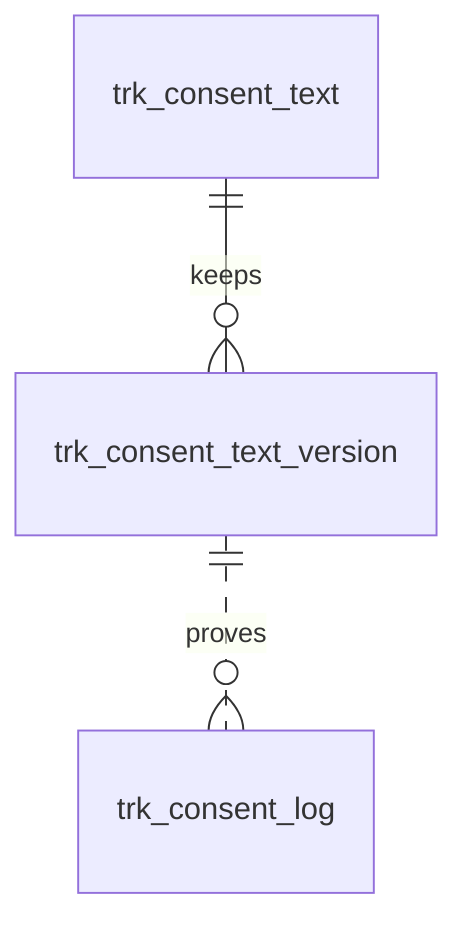

# 统计追踪与隐私同意（tracking）模块设计

| 项 | 内容 |
|---|---|
| 模块 ID | `tracking` |
| 名称 | 统计追踪与隐私同意 |
| 层 | L4 |
| 表前缀 | `trk_` |
| API 前缀 | `tracking` |
| 可停用 | 是 |
| 模块版本 | 1.0.0（module.json 的 version） |
| 平台版本 | `>=1.0.0 <2.0.0`（module.json 的 platform） |
| 里程碑切片 | M1：<…>；M2：<…>；M3：<…>；M4：<…>（详见第 13 节） |
| 模块负责人 | 待定 |
| 文档版本 | V1.0 |
| 状态 | 草案 |
| 更新日期 | 2026-10-14 |
| 依据 | 系统设计 V1.4 第 <…> 章；平台框架设计 V1.<x> 第 4 章 <…> 节；ADR-<…> |

> 本文只引用《平台框架设计》第 4 章中的契约，不定义新的跨模块契约；需要新契约时按平台框架设计 2.3 提出契约变更请求。

## 1. 职责与边界

### 1.1 职责

> 一段概述 + 要点列表；与系统设计 3.2 的职责描述一致，并细化到本模块的功能清单。

### 1.2 不负责的事

| 事项 | 归属模块 | 说明 |
|---|---|---|

### 1.3 协作概览

> 用图或表说明本模块与哪些模块协作、通过哪种方式（服务接口 / 事件 / 扩展点）。只画契约，不画实现。

### 1.4 适用的架构约束

> 列出与本模块直接相关的原则（P1–P8）、ADR 规则与 CLAUDE.md 禁止项，以及本模块如何满足。

## 2. 依赖与契约

### 2.1 module.json

```json
{
  "id": "<id>",
  "name": "<中文名称>",
  "version": "1.0.0",
  "layer": "L3",
  "platform": ">=1.0.0 <2.0.0",
  "requires": {},
  "optional": {},
  "disableable": true,
  "tablePrefix": "<前缀>_",
  "apiPrefix": "<id>",
  "permissions": [],
  "menus": [],
  "settings": null,
  "components": [],
  "events": { "publishes": [], "subscribes": [] }
}
```

> 完整描述符，须通过平台框架设计附录 A 的 Schema 与 A.3 的校验规则。

### 2.2 使用的服务接口

| 接口（平台框架设计小节） | 方法 | 用途 | 调用位置与时机（事务内 / 外） | 测试替身 |
|---|---|---|---|---|

### 2.3 提供的服务接口

| 接口（平台框架设计小节） | 方法 | 实现类 | 契约测试 | 说明（幂等、权限、性能目标） |
|---|---|---|---|---|

### 2.4 实现的扩展点

| 扩展点（平台框架设计小节） | 实现类 | 适用范围（内容类型 / 资源类型） | order | 收集方 |
|---|---|---|---|---|

### 2.5 收集的扩展点

| 扩展点 | 调用时机 | 过滤（站点启用状态、内容类型等） | 实现缺失或抛出异常时的行为 | 测试用示例实现 |
|---|---|---|---|---|

### 2.6 发布与订阅的事件

发布：

| 事件 | 触发时机（所在事务） | 关键字段 | 主要订阅方 |
|---|---|---|---|

订阅：

| 事件 | 处理 | 幂等方式 | 过期判断 | 失败与重试 |
|---|---|---|---|---|

### 2.7 使用的端口

| 端口 | 用途 | 测试替身 |
|---|---|---|

## 3. 领域模型

### 3.1 聚合、实体与值对象

| 类型 | 名称 | 说明 |
|---|---|---|
| 聚合根 | TrackingSetting（`trk_setting`） | 每站点一行：统计服务商及其 ID 或实例地址、GTM 容器 ID、Google Ads 转化 ID、Meta Pixel ID、LinkedIn Partner ID、标准转化事件配置、同意管理方式（内置横幅或第三方 CMP）、按地区的同意模式、Consent Mode 选项、隐私链接、同意 Cookie 有效期与同意记录保留期 |
| 聚合根 | Script（`trk_script`） | 开发者维护的自定义脚本：位置（head / body）、同意类别、需要加入 CSP 的来源、启用状态 |
| 聚合根 | ConsentText（`trk_consent_text`） | 一种语言的 Cookie 横幅文案（标题、说明、按钮、类别说明、“Cookie 设置”与退出链接文字）；zh-CN 行由编辑录入，其他语言行为译文（站点资源本地化）；本行文本每次变化 `text_version` + 1 |
| 实体（只追加） | ConsentTextVersion（`trk_consent_text_version`） | 横幅文案每个版本的快照，用于追溯同意记录“当时展示的文本” |
| 实体（只追加） | ConsentLog（`trk_consent_log`） | 访客的一次选择（接受、拒绝、修改、撤回、退出“出售 / 共享”、GPC 自动）：同意证明 |
| 值对象 | ConsentCategory | `NECESSARY`（必要，始终启用）/ `PREFERENCES`（偏好）/ `ANALYTICS`（分析）/ `MARKETING`（营销） |
| 值对象 | ConsentMode | `OPT_IN`（明示同意）/ `OPT_OUT`（告知 + 可退出） |
| 值对象 | RegionModes | 按地区组的同意模式（`trk_setting.region_modes`，见下） |
| 值对象 | ConsentCookie | 第一方 Cookie：同意 ID、各类别结果、退出“出售 / 共享”状态、语言、文案版本、同意时间；有效期为 `consent_max_age_days` |
| 值对象 | GoogleConsentDefaults | Consent Mode v2 四个参数（`ad_storage`、`analytics_storage`、`ad_user_data`、`ad_personalization`）的 `default` 值，按地区模式与 GPC 在浏览器端计算，不落库 |

在系统设计之外补充的字段与表：

| 补充 | 理由 |
|---|---|
| `trk_setting.analytics_provider`、`analytics_id`、`analytics_host` | 系统设计 20.1 的“统计服务商及其 Measurement ID 或站点地址”：服务商可切换（GA4 用 Measurement ID；Matomo 用实例地址 + 站点 ID；Plausible 用实例地址 + 域名），用一组通用列表示，不写死 GA4 |
| `trk_setting.conversion_events` | 模块职责中的“转化事件配置”（系统设计 3.2）：20.3 标准转化事件的开关（`view_item` 为可选事件）与 Google Ads 转化标签 |
| `trk_setting.consent_manager`、`external_cmp`、`banner_variant` | 20.2：可以关闭内置横幅改用第三方 CMP；横幅组件由主题提供变体 |
| `trk_setting.region_modes` | 20.2 按访客地区确定同意模式：只保存可配置的地区组，欧洲经济区、英国、瑞士固定为明示同意，不可配置 |
| `trk_setting.google_consent_mode`、`gtm_before_consent`、`analytics_sale_share` | 20.2 中“由法务确认”的三项做成开关，默认取从严的值：基本模式；同意前不加载 GTM；分析类视为“出售 / 共享”（退出时一并停止） |
| `trk_setting.privacy_choices_link`、`privacy_policy_content_id`、`cookie_policy_content_id` | 隐私链接配置：页脚“Do Not Sell or Share My Personal Information”或“Your Privacy Choices”链接（20.2、10.7）；横幅与设置面板链接隐私政策、Cookie 政策页面（保存内容 ID，前台按当前语言解析路径，不保存 URL） |
| `trk_setting.consent_max_age_days`、`reconsent_after`、`consent_log_retention_days` | 同意 Cookie 有效期 6–12 个月；隐私政策等变化时“要求重新征求同意”；同意记录保留期默认 3 年（由法务确认，系统设计 26.8） |
| `trk_script.csp_sources` | 20.1“CSP 白名单按已配置的服务商自动更新”：服务商的域名由代码维护，自定义脚本额外加载的来源必须显式声明 |
| `trk_consent_text` | 20.2 横幅文案作为站点资源翻译（tracking 实现 `TranslatableResourceProvider`）；系统设计 25.8 未列出此表 |
| 新增 `trk_consent_text_version` | 同意记录只保存 `locale` + `text_version`；要证明“当时展示的文本”，每个版本的文本须只追加保存（与 `frm_form_notice_version` 相同做法） |
| `trk_consent_log.consent_mode`、`opt_out_sale_share` | 证明本次按哪种模式展示；记录选择后的退出“出售 / 共享”状态（退出链接或 GPC） |
| 同意记录不保存 IP 与 UA | 数据最小化：限流计数只在 Redis 中，不落库；同意 ID 已足以关联同一浏览器的记录 |

**按地区的同意模式**（`trk_setting.region_modes`）：

```json
{ "schemaVersion": 1, "US": "OPT_OUT", "CA": "OPT_IN", "OTHER": "OPT_IN", "countries": { "BR": "OPT_IN" } }
```

| 键 | 说明 |
|---|---|
| （固定）欧洲经济区、英国、瑞士 | 始终 `OPT_IN`，不在 JSON 中配置；国家清单由代码维护 |
| `US` | `OPT_OUT`（默认）或 `OPT_IN`（站点配置为与欧盟相同） |
| `CA` | 法务确认前为 `OPT_IN`（系统设计 20.2） |
| `OTHER` | 其他地区：`OPT_IN`（默认）或 `OPT_OUT` |
| `countries` | 可选：按国家代码（ISO 3166-1 alpha-2）覆盖 `OTHER`；不能覆盖固定地区 |

地区未知、判定失败或超时时一律按 `OPT_IN` 处理。

### 3.2 不变量

| # | 规则 | 保证方式 |
|---|---|---|
| 1 | 每个站点最多一行统计与同意配置；选择了统计服务商时必须填写其站点标识 | 数据库：`uk_set_site`、`ck_trk_set_analytics` |
| 2 | 欧洲经济区、英国、瑞士与地区未知时为 `OPT_IN`；`region_modes` 只能配置 `US`、`CA`、`OTHER` 与 `countries`，取值只能是 `OPT_IN` / `OPT_OUT` | 应用层（保存时按 Schema 校验） |
| 3 | 非必要脚本（服务商标签与类别不是 `NECESSARY` 的自定义脚本）只在获得对应类别的同意后加载；`OPT_OUT` 地区访客未退出该类别时加载，收到 GPC 或已退出“出售 / 共享”时不加载 `MARKETING`（`analytics_sale_share = 1` 时也不加载 `ANALYTICS`）；地区判定完成前不加载非必要脚本 | 前台（主题横幅组件与脚本加载器） |
| 4 | Consent Mode 的 `default` 命令先于任何 Google 标签执行；`OPT_IN` 地区默认全部 `denied`；`google_consent_mode = 'BASIC'` 时获得同意前不加载 Google 标签；`gtm_before_consent = 0` 时同意前也不加载 GTM 容器 | 前台 |
| 5 | `region_modes.US = 'OPT_OUT'` 时 `privacy_choices_link` 不能为 `NONE`（横幅本身不能代替退出“出售 / 共享”的方式） | 应用层 |
| 6 | `consent_manager = 'EXTERNAL_CMP'` 时必须填写 `external_cmp`；此时内置横幅不显示、不写同意记录，同意记录与 GPC 由该 CMP 负责，CMP 脚本作为 `NECESSARY` 类别、`HEAD` 位置排在首位的自定义脚本配置 | 数据库：`ck_trk_set_cmp`；应用层 |
| 7 | 自定义脚本只能由持有 `tracking:script:edit`（高危，强制 2FA）的用户新增、修改、删除，修改记录差异审计（系统设计 20.1、26.5） | 应用层 |
| 8 | 每个站点每种语言最多一行横幅文案；zh-CN 行为源语言（`translation_state = 'NONE'`、`source_fingerprint` 为空），其他语言行只由 translation 经 `TranslatableResourceProvider` 回写或在翻译编辑器中按段修订 | 数据库：`uk_ct_locale`、`ck_trk_ct_source`；应用层 |
| 9 | 某语言行的任一文本变化（中文编辑、译文回写、人工修订）时，`text_version` + 1，并在同一事务中追加该版本的快照；版本快照只追加，不修改 | 数据库：`uk_ctv_version`；应用层 |
| 10 | 某语言没有横幅文案行时不回退显示其他语言的文案：该语言页面按 `OPT_IN` 只加载必要脚本，后台翻译中心提示缺失 | 应用层（delivery 组装引导数据时） |
| 11 | 访客重新选择的条件：没有同意 Cookie 或已过期；Cookie 中的 `text_version` 小于该 Cookie 所记语言当前的 `text_version`；同意时间早于 `reconsent_after` | 前台 |
| 12 | 同意记录只追加；`categories` 中 `NECESSARY` 恒为 `true`；`locale` 必须是站点已开放的语言，`text_version` 不大于该语言当前版本，`consent_id` 为 UUID 格式；`expires_at` 晚于 `created_at` | 应用层（公开接口校验）；数据库：`ck_trk_cl_expires` |

### 3.3 状态机

<<FILL: 状态与转换；没有状态机时写“不适用：<原因>”>>

## 4. 数据模型

> 遵守平台框架设计第 7 章的数据库通用约定。DDL 已在 MySQL 8.4 上执行通过；表结构以本节为准，与迁移脚本保持一致。

### 4.1 表清单

| 表 | 说明 | 站点级 | 软删除 | 预估规模（单站，按系统设计假设 A4） |
|---|---|---|---|---|
| `trk_setting` | 统计与同意配置（每站点一行） | 是 | 否 | 1 行 |
| `trk_script` | 自定义脚本 | 是 | 是（`deleted_at`） | ≤ 20 行 |
| `trk_consent_text` | Cookie 横幅文案（站点资源本地化） | 是 | 否 | ≤ 10 行（每种语言一行） |
| `trk_consent_text_version` | 横幅文案版本快照（只追加） | 是 | 否（保留到引用它的最后一条同意记录被清理之后） | ≤ 数百行 |
| `trk_consent_log` | 同意记录（只追加） | 是 | 否（保留期满物理删除，默认 3 年） | 按每天数百至数千次选择估算，3 年 ≈ 50–300 万行 |

**站点过滤**：全部为站点级表，由拦截器过滤；公开接口按请求的 Host 解析站点。例外：每天的同意记录保留期清理任务按站点逐个执行（读取各站点的 `consent_log_retention_days`），使用显式设置站点上下文的专用查询。

### 4.2 ER 图



虚线表示按（`site_id`，`locale`，`text_version`）的逻辑关系：同意记录是高频写入的只追加表，不建外键。`trk_setting`、`trk_script` 在模块内没有外键关系，未画出。

### 4.3 表结构

#### 4.3.1 `trk_setting`：统计与同意配置

| 字段 | 类型 | 可空 | 默认 | 说明 |
|---|---|---|---|---|
| `id` | BIGINT | 否 | — | 主键（TSID） |
| `site_id` | BIGINT | 否 | — | 站点 ID（sys_site.id）；每站点一行 |
| `analytics_provider` | VARCHAR(16) | 否 | `'NONE'` | 统计服务商：NONE / GA4 / MATOMO / PLAUSIBLE |
| `analytics_id` | VARCHAR(100) bin | 是 | — | 服务商的站点标识：GA4 Measurement ID（G-XXXXXXX）/ Matomo 站点 ID / Plausible 域名 |
| `analytics_host` | VARCHAR(2048) | 是 | — | 统计服务实例地址（https；MATOMO、PLAUSIBLE 必填）；GA4 为空 |
| `gtm_container_id` | VARCHAR(32) bin | 是 | — | GTM 容器 ID（GTM-XXXXXXX） |
| `google_ads_id` | VARCHAR(32) bin | 是 | — | Google Ads 转化 ID（AW-XXXXXXXXX） |
| `meta_pixel_id` | VARCHAR(32) bin | 是 | — | Meta Pixel ID |
| `linkedin_partner_id` | VARCHAR(32) bin | 是 | — | LinkedIn Partner ID（Insight Tag） |
| `conversion_events` | JSON | 否 | `(JSON_OBJECT())` | 标准转化事件配置：开关与 Google Ads 转化标签；未列出的事件取默认值 |
| `consent_manager` | VARCHAR(16) | 否 | `'BUILT_IN'` | 同意管理方式：BUILT_IN（内置横幅）/ EXTERNAL_CMP（第三方 CMP） |
| `external_cmp` | VARCHAR(50) | 是 | — | 第三方 CMP 名称（如 Cookiebot、OneTrust；EXTERNAL_CMP 时必填） |
| `banner_variant` | VARCHAR(50) bin | 否 | `'default'` | 横幅组件的主题变体（由主题提供） |
| `region_modes` | JSON | 否 | 见 DDL | 按地区的同意模式（见 3） |
| `google_consent_mode` | VARCHAR(16) | 否 | `'BASIC'` | Google Consent Mode v2 实现方式：BASIC / ADVANCED（须法务确认） |
| `gtm_before_consent` | TINYINT(1) | 否 | `0` | 明示同意地区是否允许在同意前加载 GTM 容器（须法务确认） |
| `analytics_sale_share` | TINYINT(1) | 否 | `1` | 分析类工具是否视为“出售 / 共享”（法务确认前从严） |
| `privacy_choices_link` | VARCHAR(32) | 否 | `'NONE'` | 页脚退出链接：NONE / DO_NOT_SELL_OR_SHARE / YOUR_PRIVACY_CHOICES |
| `privacy_policy_content_id` | BIGINT | 是 | — | 隐私政策页（cnt_content.id） |
| `cookie_policy_content_id` | BIGINT | 是 | — | Cookie 政策页（cnt_content.id） |
| `consent_max_age_days` | SMALLINT | 否 | `365` | 同意 Cookie 有效期（天，180–366） |
| `reconsent_after` | DATETIME(3) | 是 | — | 早于此时间的同意需要重新征求 |
| `consent_log_retention_days` | INT | 否 | `1095` | 同意记录保留天数（默认 3 年，由法务确认） |
| `version` | INT | 否 | `0` | 乐观锁版本号 |
| `created_at` | DATETIME(3) | 否 | `CURRENT_TIMESTAMP(3)` | 创建时间（UTC） |
| `created_by` | BIGINT | 否 | `0` | 创建人用户 ID（0 = 系统） |
| `updated_at` | DATETIME(3) | 否 | `CURRENT_TIMESTAMP(3) ON UPDATE CURRENT_TIMESTAMP(3)` | 更新时间（UTC） |
| `updated_by` | BIGINT | 否 | `0` | 更新人用户 ID（0 = 系统） |

索引与约束：
- `PRIMARY KEY (id)`
- `uk_set_site (site_id)`：每站点一行；组装站点引导数据时按站点读取
- `ck_trk_set_analytics`、`ck_trk_set_cmp`：见 3.2 不变量 1、6
- `ck_trk_set_age`：同意 Cookie 有效期约 6–12 个月（系统设计 20.2）

```sql
CREATE TABLE trk_setting (
  id                          BIGINT         NOT NULL COMMENT '主键（TSID）',
  site_id                     BIGINT         NOT NULL COMMENT '站点 ID（sys_site.id）；每站点一行',
  analytics_provider          VARCHAR(16)    NOT NULL DEFAULT 'NONE' COMMENT '统计服务商：NONE（不使用）/ GA4 / MATOMO / PLAUSIBLE（后两者可选欧盟托管或自托管实例）',
  analytics_id                VARCHAR(100)   COLLATE utf8mb4_0900_bin NULL COMMENT '服务商的站点标识：GA4 Measurement ID（G-XXXXXXX）/ Matomo 站点 ID / Plausible 域名',
  analytics_host              VARCHAR(2048)  NULL COMMENT '统计服务实例地址（https；MATOMO、PLAUSIBLE 必填）；GA4 为空',
  gtm_container_id            VARCHAR(32)    COLLATE utf8mb4_0900_bin NULL COMMENT 'GTM 容器 ID（GTM-XXXXXXX）；使用 GTM 时其他标签建议在 GTM 内管理，本模块只注入 GTM、同意默认值与 dataLayer 事件',
  google_ads_id               VARCHAR(32)    COLLATE utf8mb4_0900_bin NULL COMMENT 'Google Ads 转化 ID（AW-XXXXXXXXX）',
  meta_pixel_id               VARCHAR(32)    COLLATE utf8mb4_0900_bin NULL COMMENT 'Meta Pixel ID',
  linkedin_partner_id         VARCHAR(32)    COLLATE utf8mb4_0900_bin NULL COMMENT 'LinkedIn Partner ID（Insight Tag）',
  conversion_events           JSON           NOT NULL DEFAULT (JSON_OBJECT()) COMMENT '标准转化事件配置：{"schemaVersion":1,"generate_lead":{"enabled":true,"adsLabel":"AbC123"},"view_item":{"enabled":false}}；未列出的事件取默认值（view_item 默认关闭，其余默认开启）',
  consent_manager             VARCHAR(16)    NOT NULL DEFAULT 'BUILT_IN' COMMENT '同意管理方式：BUILT_IN（内置横幅）/ EXTERNAL_CMP（第三方 CMP，同意记录与 GPC 由 CMP 负责）',
  external_cmp                VARCHAR(50)    NULL COMMENT '第三方 CMP 名称（如 Cookiebot、OneTrust；EXTERNAL_CMP 时必填，其脚本在 trk_script 中配置）',
  banner_variant              VARCHAR(50)    COLLATE utf8mb4_0900_bin NOT NULL DEFAULT 'default' COMMENT '横幅组件的主题变体（由主题提供，如 bar / modal）',
  region_modes                JSON           NOT NULL DEFAULT (JSON_OBJECT('schemaVersion', 1, 'US', 'OPT_OUT', 'CA', 'OPT_IN', 'OTHER', 'OPT_IN')) COMMENT '按地区的同意模式（OPT_IN / OPT_OUT）：{"schemaVersion":1,"US":"OPT_OUT","CA":"OPT_IN","OTHER":"OPT_IN","countries":{"BR":"OPT_IN"}}；欧洲经济区、英国、瑞士与地区未知时固定 OPT_IN，不在此配置',
  google_consent_mode         VARCHAR(16)    NOT NULL DEFAULT 'BASIC' COMMENT 'Google Consent Mode v2 实现方式：BASIC（获得同意前不加载 Google 标签）/ ADVANCED（同意前加载并发送无 Cookie 请求，须法务确认）',
  gtm_before_consent          TINYINT(1)     NOT NULL DEFAULT 0 COMMENT '明示同意地区是否允许在同意前加载 GTM 容器（须法务确认；默认否）',
  analytics_sale_share        TINYINT(1)     NOT NULL DEFAULT 1 COMMENT '分析类工具是否视为“出售 / 共享”：1 = 退出“出售 / 共享”或收到 GPC 时同时停止分析类（法务确认前从严）',
  privacy_choices_link        VARCHAR(32)    NOT NULL DEFAULT 'NONE' COMMENT '页脚退出链接：NONE / DO_NOT_SELL_OR_SHARE（Do Not Sell or Share My Personal Information）/ YOUR_PRIVACY_CHOICES（须附法规规定的退出图标）',
  privacy_policy_content_id   BIGINT         NULL COMMENT '隐私政策页（cnt_content.id，PAGE + legal 模板）；横幅与设置面板中的链接，前台按当前语言解析路径',
  cookie_policy_content_id    BIGINT         NULL COMMENT 'Cookie 政策页（cnt_content.id，PAGE + legal 模板）',
  consent_max_age_days        SMALLINT       NOT NULL DEFAULT 365 COMMENT '同意 Cookie 有效期（天，180–366，约 6–12 个月）；同意记录的 expires_at 据此计算',
  reconsent_after             DATETIME(3)    NULL COMMENT '早于此时间的同意需要重新征求（后台“要求重新征求同意”，如隐私政策重大修改）；为空表示不要求',
  consent_log_retention_days  INT            NOT NULL DEFAULT 1095 COMMENT '同意记录保留天数（默认 3 年，由法务确认）',
  version                     INT            NOT NULL DEFAULT 0 COMMENT '乐观锁版本号',
  created_at                  DATETIME(3)    NOT NULL DEFAULT CURRENT_TIMESTAMP(3) COMMENT '创建时间（UTC）',
  created_by                  BIGINT         NOT NULL DEFAULT 0 COMMENT '创建人用户 ID（0 = 系统，如站点启用模块时初始化）',
  updated_at                  DATETIME(3)    NOT NULL DEFAULT CURRENT_TIMESTAMP(3) ON UPDATE CURRENT_TIMESTAMP(3) COMMENT '更新时间（UTC）',
  updated_by                  BIGINT         NOT NULL DEFAULT 0 COMMENT '更新人用户 ID（0 = 系统）',
  PRIMARY KEY (id),
  UNIQUE KEY uk_set_site (site_id),
  CONSTRAINT ck_trk_set_analytics CHECK (analytics_provider = 'NONE' OR analytics_id IS NOT NULL),
  CONSTRAINT ck_trk_set_cmp CHECK (consent_manager <> 'EXTERNAL_CMP' OR external_cmp IS NOT NULL),
  CONSTRAINT ck_trk_set_age CHECK (consent_max_age_days BETWEEN 180 AND 366)
) ENGINE = InnoDB DEFAULT CHARSET = utf8mb4 COLLATE = utf8mb4_0900_ai_ci COMMENT = '统计追踪与同意配置（每站点一行）';
```

要点：
- 站点启用 tracking 时初始化本行（全部服务商为空、内置横幅、默认地区模式）与 zh-CN 横幅文案行（主题提供的默认中文文案）。
- 修改服务商、ID、同意相关设置记录审计日志；CSP 白名单按已配置的服务商与已启用脚本的 `csp_sources` 重新生成（系统设计 20.1）。
- 本表、`trk_script`、`trk_consent_text` 变化后须清除 `s{site}:settings` 缓存标签（系统设计 23.2）。系统设计 4.3 没有 tracking 的变更事件，需在平台框架中补充（建议 `TrackingSettingsChangedEvent`，由 delivery 订阅）。

#### 4.3.2 `trk_script`：自定义脚本

| 字段 | 类型 | 可空 | 默认 | 说明 |
|---|---|---|---|---|
| `id` | BIGINT | 否 | — | 主键（TSID） |
| `site_id` | BIGINT | 否 | — | 站点 ID（sys_site.id） |
| `name` | VARCHAR(100) | 否 | — | 名称（中文，后台显示） |
| `position` | VARCHAR(8) | 否 | — | 注入位置：HEAD / BODY |
| `consent_category` | VARCHAR(16) | 否 | — | 同意类别：NECESSARY / PREFERENCES / ANALYTICS / MARKETING |
| `code` | TEXT | 否 | — | 脚本代码（HTML 片段） |
| `csp_sources` | JSON | 否 | `(JSON_OBJECT())` | 需要加入 CSP 白名单的来源（按指令分组） |
| `sort_order` | INT | 否 | `0` | 同一位置内的注入顺序 |
| `enabled` | TINYINT(1) | 否 | `1` | 是否启用 |
| `deleted_at` | DATETIME(3) | 是 | — | 删除时间（软删除） |
| `version` | INT | 否 | `0` | 乐观锁版本号 |
| `created_at` | DATETIME(3) | 否 | `CURRENT_TIMESTAMP(3)` | 创建时间（UTC） |
| `created_by` | BIGINT | 否 | `0` | 创建人用户 ID |
| `updated_at` | DATETIME(3) | 否 | `CURRENT_TIMESTAMP(3) ON UPDATE CURRENT_TIMESTAMP(3)` | 更新时间（UTC） |
| `updated_by` | BIGINT | 否 | `0` | 更新人用户 ID |

索引与约束：
- `PRIMARY KEY (id)`
- `idx_script_site (site_id, position, sort_order)`：组装站点引导数据时按位置与顺序加载已启用、未删除的脚本；后台列表

```sql
CREATE TABLE trk_script (
  id                BIGINT        NOT NULL COMMENT '主键（TSID）',
  site_id           BIGINT        NOT NULL COMMENT '站点 ID（sys_site.id）',
  name              VARCHAR(100)  NOT NULL COMMENT '名称（中文，后台显示），如“Microsoft Clarity”',
  position          VARCHAR(8)    NOT NULL COMMENT '注入位置：HEAD（<head> 末尾）/ BODY（</body> 之前）',
  consent_category  VARCHAR(16)   NOT NULL COMMENT '同意类别：NECESSARY / PREFERENCES / ANALYTICS / MARKETING；非 NECESSARY 的脚本只在获得该类别同意后加载',
  code              TEXT          NOT NULL COMMENT '脚本代码（HTML 片段：<script>、<noscript>；前台注入时为内联脚本加 CSP nonce，异步、延后执行）',
  csp_sources       JSON          NOT NULL DEFAULT (JSON_OBJECT()) COMMENT '需要加入 CSP 白名单的来源：{"script-src":["https://www.clarity.ms"],"connect-src":[],"img-src":[],"frame-src":[]}',
  sort_order        INT           NOT NULL DEFAULT 0 COMMENT '同一位置内的注入顺序（小的在前）',
  enabled           TINYINT(1)    NOT NULL DEFAULT 1 COMMENT '是否启用',
  deleted_at        DATETIME(3)   NULL COMMENT '删除时间（软删除）',
  version           INT           NOT NULL DEFAULT 0 COMMENT '乐观锁版本号',
  created_at        DATETIME(3)   NOT NULL DEFAULT CURRENT_TIMESTAMP(3) COMMENT '创建时间（UTC）',
  created_by        BIGINT        NOT NULL DEFAULT 0 COMMENT '创建人用户 ID（须持有 tracking:script:edit）',
  updated_at        DATETIME(3)   NOT NULL DEFAULT CURRENT_TIMESTAMP(3) ON UPDATE CURRENT_TIMESTAMP(3) COMMENT '更新时间（UTC）',
  updated_by        BIGINT        NOT NULL DEFAULT 0 COMMENT '更新人用户 ID（须持有 tracking:script:edit）',
  PRIMARY KEY (id),
  KEY idx_script_site (site_id, position, sort_order)
) ENGINE = InnoDB DEFAULT CHARSET = utf8mb4 COLLATE = utf8mb4_0900_ai_ci COMMENT = '自定义脚本（开发者维护，按同意类别加载）';
```

要点：
- 新增、修改、删除都记录审计日志，`code` 记录完整差异（系统设计 20.1、26.5）；脚本内容不翻译。
- 使用 GTM 时，其他标签建议在 GTM 内管理，不再作为自定义脚本重复加载（系统设计 20.1）。

#### 4.3.3 `trk_consent_text`：Cookie 横幅文案

| 字段 | 类型 | 可空 | 默认 | 说明 |
|---|---|---|---|---|
| `id` | BIGINT | 否 | — | 主键（TSID） |
| `site_id` | BIGINT | 否 | — | 站点 ID（sys_site.id） |
| `locale` | VARCHAR(16) | 否 | — | 语言（BCP 47）；zh-CN 为源语言 |
| `title` | VARCHAR(200) | 否 | — | 横幅标题 |
| `description` | VARCHAR(2000) | 否 | — | 横幅说明（纯文本） |
| `accept_all_label` | VARCHAR(50) | 否 | — | “全部接受”按钮文字 |
| `reject_all_label` | VARCHAR(50) | 否 | — | “全部拒绝”按钮文字 |
| `customize_label` | VARCHAR(50) | 否 | — | “自定义”按钮文字 |
| `save_label` | VARCHAR(50) | 否 | — | “保存选择”按钮文字 |
| `categories` | JSON | 否 | — | 四个类别的名称与说明 |
| `settings_link_label` | VARCHAR(50) | 否 | — | 页脚“Cookie 设置”入口文字 |
| `opt_out_link_label` | VARCHAR(100) | 是 | — | 页脚退出链接文字 |
| `opt_out_description` | VARCHAR(2000) | 是 | — | 退出“出售 / 共享”设置面板的说明 |
| `text_version` | INT | 否 | `1` | 文案版本：本行任一文本变化时 + 1 |
| `text_hash` | CHAR(64) bin | 否 | — | 本行全部文本规范化后拼接的 SHA-256 |
| `translation_state` | VARCHAR(16) | 否 | `'NONE'` | 翻译状态：NONE / QUEUED / TRANSLATED / NEEDS_REVIEW / FAILED / OUTDATED |
| `source_fingerprint` | CHAR(64) bin | 是 | — | 生成本行译文时 zh-CN 行的指纹；zh-CN 行为空 |
| `version` | INT | 否 | `0` | 乐观锁版本号 |
| `created_at` | DATETIME(3) | 否 | `CURRENT_TIMESTAMP(3)` | 创建时间（UTC） |
| `created_by` | BIGINT | 否 | `0` | 创建人用户 ID（0 = 系统，如翻译回写） |
| `updated_at` | DATETIME(3) | 否 | `CURRENT_TIMESTAMP(3) ON UPDATE CURRENT_TIMESTAMP(3)` | 更新时间（UTC） |
| `updated_by` | BIGINT | 否 | `0` | 更新人用户 ID（0 = 系统） |

索引与约束：
- `PRIMARY KEY (id)`
- `uk_ct_locale (site_id, locale)`：每种语言一行；组装站点引导数据时按（站点，语言）读取
- `idx_ct_state (site_id, translation_state, locale)`：翻译中心列出待处理的横幅文案
- `ck_trk_ct_source`：见 3.2 不变量 8

```sql
CREATE TABLE trk_consent_text (
  id                   BIGINT         NOT NULL COMMENT '主键（TSID）',
  site_id              BIGINT         NOT NULL COMMENT '站点 ID（sys_site.id）',
  locale               VARCHAR(16)    NOT NULL COMMENT '语言（BCP 47）；zh-CN 为源语言',
  title                VARCHAR(200)   NOT NULL COMMENT '横幅标题',
  description          VARCHAR(2000)  NOT NULL COMMENT '横幅说明（纯文本；隐私政策与 Cookie 政策链接由组件按 trk_setting 附加）',
  accept_all_label     VARCHAR(50)    NOT NULL COMMENT '“全部接受”按钮文字',
  reject_all_label     VARCHAR(50)    NOT NULL COMMENT '“全部拒绝”按钮文字（与“全部接受”同样显眼）',
  customize_label      VARCHAR(50)    NOT NULL COMMENT '“自定义”按钮文字（打开类别设置；类别不预先勾选）',
  save_label           VARCHAR(50)    NOT NULL COMMENT '“保存选择”按钮文字',
  categories           JSON           NOT NULL COMMENT '类别名称与说明：{"NECESSARY":{"label":"必要","description":"…"},"PREFERENCES":{…},"ANALYTICS":{…},"MARKETING":{…}}',
  settings_link_label  VARCHAR(50)    NOT NULL COMMENT '页脚“Cookie 设置”入口文字',
  opt_out_link_label   VARCHAR(100)   NULL COMMENT '页脚退出链接文字（对应 trk_setting.privacy_choices_link；英文等法定译法由术语表固定）；不配置退出链接时为空',
  opt_out_description  VARCHAR(2000)  NULL COMMENT '退出“出售 / 共享”设置面板的说明',
  text_version         INT            NOT NULL DEFAULT 1 COMMENT '文案版本：本行任一文本变化时 + 1（同时追加 trk_consent_text_version）；同意 Cookie 与同意记录保存该值',
  text_hash            CHAR(64)       COLLATE utf8mb4_0900_bin NOT NULL COMMENT '本行全部文本规范化后拼接的 SHA-256；判断文本是否真的变化；zh-CN 行的值即当前中文指纹',
  translation_state    VARCHAR(16)    NOT NULL DEFAULT 'NONE' COMMENT '翻译状态：NONE / QUEUED / TRANSLATED / NEEDS_REVIEW / FAILED / OUTDATED',
  source_fingerprint   CHAR(64)       COLLATE utf8mb4_0900_bin NULL COMMENT '生成本行译文时 zh-CN 行的指纹（即当时 zh-CN 行的 text_hash）；zh-CN 行为空；与当前中文指纹不同即为过期',
  version              INT            NOT NULL DEFAULT 0 COMMENT '乐观锁版本号',
  created_at           DATETIME(3)    NOT NULL DEFAULT CURRENT_TIMESTAMP(3) COMMENT '创建时间（UTC）',
  created_by           BIGINT         NOT NULL DEFAULT 0 COMMENT '创建人用户 ID（0 = 系统，如模块初始化、翻译回写）',
  updated_at           DATETIME(3)    NOT NULL DEFAULT CURRENT_TIMESTAMP(3) ON UPDATE CURRENT_TIMESTAMP(3) COMMENT '更新时间（UTC）',
  updated_by           BIGINT         NOT NULL DEFAULT 0 COMMENT '更新人用户 ID（0 = 系统）',
  PRIMARY KEY (id),
  UNIQUE KEY uk_ct_locale (site_id, locale),
  KEY idx_ct_state (site_id, translation_state, locale),
  CONSTRAINT ck_trk_ct_source CHECK (locale <> 'zh-CN' OR (translation_state = 'NONE' AND source_fingerprint IS NULL))
) ENGINE = InnoDB DEFAULT CHARSET = utf8mb4 COLLATE = utf8mb4_0900_ai_ci COMMENT = 'Cookie 横幅文案（站点资源，中文为源语言，带翻译状态与源指纹）';
```

要点：
- 翻译单元（资源类型 `tracking.consent_text`，ID 为 zh-CN 行的 `id`）：除 `locale` 与版本、指纹字段外的全部文本，`categories` 中每个 `label` 与 `description` 各为一个单元；类别键不翻译。zh-CN 行的文本变化时发布 `TranslatableResourceChangedEvent`。
- 法规规定的固定文字（“Do Not Sell or Share My Personal Information”“Your Privacy Choices”）通过术语表固定译法（系统设计 5.8、20.2）。
- 横幅文案不是法律页面，译文回写后直接生效；回写使目标语言行的 `text_version` + 1，该语言访客下次访问时重新选择。

#### 4.3.4 `trk_consent_text_version`：横幅文案版本快照

| 字段 | 类型 | 可空 | 默认 | 说明 |
|---|---|---|---|---|
| `id` | BIGINT | 否 | — | 主键（TSID） |
| `site_id` | BIGINT | 否 | — | 站点 ID（sys_site.id） |
| `consent_text_id` | BIGINT | 否 | — | 横幅文案 ID（trk_consent_text.id） |
| `locale` | VARCHAR(16) | 否 | — | 语言（冗余 trk_consent_text.locale） |
| `text_version` | INT | 否 | — | 文案版本号（从 1 开始） |
| `texts` | JSON | 否 | — | 该版本全部文本的快照 |
| `text_hash` | CHAR(64) bin | 否 | — | 该版本全部文本规范化后拼接的 SHA-256 |
| `created_at` | DATETIME(3) | 否 | `CURRENT_TIMESTAMP(3)` | 版本生效时间（UTC） |
| `created_by` | BIGINT | 否 | `0` | 修改人用户 ID（0 = 系统，即机器译文回写） |

索引与约束：
- `PRIMARY KEY (id)`
- `uk_ctv_version (consent_text_id, text_version)`：每个版本一行；兼作 `fk_trk_ctv_text` 的索引
- `idx_ctv_locale (site_id, locale, text_version)`：按同意记录的（语言，版本）取当时展示的文本
- `fk_trk_ctv_text`：引用关系（RESTRICT）：版本快照是同意证明，不随父行级联删除

```sql
CREATE TABLE trk_consent_text_version (
  id               BIGINT       NOT NULL COMMENT '主键（TSID）',
  site_id          BIGINT       NOT NULL COMMENT '站点 ID（sys_site.id）',
  consent_text_id  BIGINT       NOT NULL COMMENT '横幅文案 ID（trk_consent_text.id）',
  locale           VARCHAR(16)  NOT NULL COMMENT '语言（冗余 trk_consent_text.locale）',
  text_version     INT          NOT NULL COMMENT '文案版本号（与 trk_consent_text.text_version 对应，从 1 开始）',
  texts            JSON         NOT NULL COMMENT '该版本全部文本的快照：{"title","description","acceptAll","rejectAll","customize","save","categories":{…},"settingsLink","optOutLink","optOutDescription"}',
  text_hash        CHAR(64)     COLLATE utf8mb4_0900_bin NOT NULL COMMENT '该版本全部文本规范化后拼接的 SHA-256',
  created_at       DATETIME(3)  NOT NULL DEFAULT CURRENT_TIMESTAMP(3) COMMENT '版本生效时间（UTC）',
  created_by       BIGINT       NOT NULL DEFAULT 0 COMMENT '修改人用户 ID（0 = 系统，即机器译文回写）',
  PRIMARY KEY (id),
  UNIQUE KEY uk_ctv_version (consent_text_id, text_version),
  KEY idx_ctv_locale (site_id, locale, text_version),
  CONSTRAINT fk_trk_ctv_text FOREIGN KEY (consent_text_id) REFERENCES trk_consent_text (id)
) ENGINE = InnoDB DEFAULT CHARSET = utf8mb4 COLLATE = utf8mb4_0900_ai_ci COMMENT = 'Cookie 横幅文案的版本快照（只追加，用于追溯同意记录展示的文本）';
```

要点：只追加；某版本在被新版本取代后，保留到引用它的最后一条同意记录被清理之后（由同意记录保留期任务一并检查）。

#### 4.3.5 `trk_consent_log`：同意记录

| 字段 | 类型 | 可空 | 默认 | 说明 |
|---|---|---|---|---|
| `id` | BIGINT | 否 | — | 主键（TSID） |
| `site_id` | BIGINT | 否 | — | 站点 ID（sys_site.id） |
| `consent_id` | CHAR(36) bin | 否 | — | 同意 ID（UUID v4，与同意 Cookie 中的 ID 一致；假名标识） |
| `action` | VARCHAR(24) | 否 | — | 动作：ACCEPT_ALL / REJECT_ALL / CUSTOM / WITHDRAW / OPT_OUT_SALE_SHARE / GPC |
| `source` | VARCHAR(16) | 否 | — | 来源：BANNER / SETTINGS / OPT_OUT_LINK / GPC_AUTO |
| `consent_mode` | VARCHAR(8) | 否 | — | 本次展示的同意模式：OPT_IN / OPT_OUT |
| `text_version` | INT | 否 | — | 展示的横幅文案版本 |
| `locale` | VARCHAR(16) | 否 | — | 展示的语言 |
| `ui_version` | VARCHAR(50) bin | 否 | — | 横幅版式版本 |
| `categories` | JSON | 否 | — | 每个类别的选择结果（含拒绝项） |
| `opt_out_sale_share` | TINYINT(1) | 否 | `0` | 本次选择后是否已退出“出售 / 共享” |
| `region` | VARCHAR(8) | 是 | — | 访客地区（国家代码，可带子区划）；未知为空 |
| `gpc` | TINYINT(1) | 否 | `0` | 是否收到 GPC 信号 |
| `created_at` | DATETIME(3) | 否 | `CURRENT_TIMESTAMP(3)` | 记录时间（UTC） |
| `expires_at` | DATETIME(3) | 否 | — | 同意到期时间 |

索引与约束：
- `PRIMARY KEY (id)`
- `idx_cl_consent (site_id, consent_id, created_at)`：按同意 ID 查询某浏览器的同意历史（同意证明、访客凭同意 ID 提出的数据主体请求）
- `idx_cl_time (site_id, created_at)`：后台统计（接受率、拒绝率，按地区与语言）；保留期清理
- `ck_trk_cl_expires`：见 3.2 不变量 12

```sql
CREATE TABLE trk_consent_log (
  id                  BIGINT       NOT NULL COMMENT '主键（TSID）',
  site_id             BIGINT       NOT NULL COMMENT '站点 ID（sys_site.id）',
  consent_id          CHAR(36)     COLLATE utf8mb4_0900_bin NOT NULL COMMENT '同意 ID（浏览器首次选择时随机生成的 UUID v4，与同意 Cookie 中的 ID 一致；假名标识，按个人数据管理）',
  action              VARCHAR(24)  NOT NULL COMMENT '动作：ACCEPT_ALL / REJECT_ALL / CUSTOM / WITHDRAW / OPT_OUT_SALE_SHARE / GPC',
  source              VARCHAR(16)  NOT NULL COMMENT '来源：BANNER（横幅）/ SETTINGS（Cookie 设置）/ OPT_OUT_LINK（退出链接）/ GPC_AUTO（GPC 自动）',
  consent_mode        VARCHAR(8)   NOT NULL COMMENT '本次展示的同意模式：OPT_IN（明示同意）/ OPT_OUT（告知 + 可退出）',
  text_version        INT          NOT NULL COMMENT '展示的横幅文案版本（trk_consent_text.text_version；与 locale 一起定位 trk_consent_text_version）',
  locale              VARCHAR(16)  NOT NULL COMMENT '展示的语言（BCP 47）',
  ui_version          VARCHAR(50)  COLLATE utf8mb4_0900_bin NOT NULL COMMENT '横幅版式版本（主题横幅组件版本与变体，如 cookie-banner@2/bar）',
  categories          JSON         NOT NULL COMMENT '每个类别的选择结果（含拒绝项）：{"NECESSARY":true,"PREFERENCES":false,"ANALYTICS":true,"MARKETING":false}',
  opt_out_sale_share  TINYINT(1)   NOT NULL DEFAULT 0 COMMENT '本次选择后是否已退出“出售 / 共享”（退出链接或 GPC）',
  region              VARCHAR(8)   NULL COMMENT '访客地区（ISO 3166-1 alpha-2 国家代码，可带 ISO 3166-2 子区划，如 US-CA；取自 CDN 地理位置信息）；未知为空',
  gpc                 TINYINT(1)   NOT NULL DEFAULT 0 COMMENT '是否收到 GPC 信号（navigator.globalPrivacyControl）',
  created_at          DATETIME(3)  NOT NULL DEFAULT CURRENT_TIMESTAMP(3) COMMENT '记录时间（UTC，服务器时间）',
  expires_at          DATETIME(3)  NOT NULL COMMENT '同意到期时间（created_at + trk_setting.consent_max_age_days，与同意 Cookie 的到期时间一致）',
  PRIMARY KEY (id),
  KEY idx_cl_consent (site_id, consent_id, created_at),
  KEY idx_cl_time (site_id, created_at),
  CONSTRAINT ck_trk_cl_expires CHECK (expires_at > created_at)
) ENGINE = InnoDB DEFAULT CHARSET = utf8mb4 COLLATE = utf8mb4_0900_ai_ci COMMENT = 'Cookie 同意记录（只追加，作为同意证明）';
```

要点：
- 只追加，不修改、不软删除；超过 `consent_log_retention_days` 的记录由每天的清理任务物理删除（系统设计 26.8）。
- `GPC` 动作只在某同意 ID 首次检测到 GPC 或 GPC 状态变化时写一条，不在每次页面访问时写入；`WITHDRAW` 的 `categories` 除 `NECESSARY` 外全部为 `false`。
- 时间、动作、版本、语言、地区等字段由服务端校验后写入；`created_at` 用服务器时间，不信任浏览器时间。

### 4.4 枚举

| 字段 | 取值 | 说明 |
|---|---|---|
| `trk_setting.analytics_provider` | `NONE` / `GA4` / `MATOMO` / `PLAUSIBLE` | 不使用 / Google Analytics 4 / Matomo / Plausible（后两者可选欧盟托管或自托管实例） |
| `trk_setting.consent_manager` | `BUILT_IN` / `EXTERNAL_CMP` | 内置横幅 / 第三方 CMP |
| `trk_setting.region_modes.*`、`trk_consent_log.consent_mode` | `OPT_IN` / `OPT_OUT` | 明示同意 / 告知 + 可退出 |
| `trk_setting.google_consent_mode` | `BASIC` / `ADVANCED` | Consent Mode v2 基本模式 / 高级模式（须法务确认） |
| `trk_setting.privacy_choices_link` | `NONE` / `DO_NOT_SELL_OR_SHARE` / `YOUR_PRIVACY_CHOICES` | 不显示 / “Do Not Sell or Share My Personal Information” / “Your Privacy Choices”（附退出图标） |
| `trk_setting.conversion_events` 的键 | `generate_lead` / `file_download` / `contact_click` / `add_to_inquiry` / `search` / `view_item` | 系统设计 20.3 的标准转化事件；`view_item` 默认关闭 |
| `trk_script.position` | `HEAD` / `BODY` | `<head>` 末尾 / `</body>` 之前 |
| `trk_script.consent_category`、`trk_consent_text.categories` 与 `trk_consent_log.categories` 的键 | `NECESSARY` / `PREFERENCES` / `ANALYTICS` / `MARKETING` | 必要（始终启用）/ 偏好 / 分析 / 营销 |
| `trk_consent_text.translation_state` | `NONE` / `QUEUED` / `TRANSLATED` / `NEEDS_REVIEW` / `FAILED` / `OUTDATED` | 共享翻译状态枚举；zh-CN 行为 `NONE` |
| `trk_consent_log.action` | `ACCEPT_ALL` | 全部接受 |
| | `REJECT_ALL` | 全部拒绝 |
| | `CUSTOM` | 按类别选择或修改 |
| | `WITHDRAW` | 撤回（经页脚“Cookie 设置”） |
| | `OPT_OUT_SALE_SHARE` | 经退出链接退出“出售 / 共享” |
| | `GPC` | 收到 GPC 信号，自动退出营销类与“出售 / 共享” |
| `trk_consent_log.source` | `BANNER` / `SETTINGS` / `OPT_OUT_LINK` / `GPC_AUTO` | 横幅 / Cookie 设置 / 退出链接 / GPC 自动 |

### 4.5 站点过滤

<<FILL: | 表 | 行级拦截器（不豁免 / 豁免） | 访问方式与理由 |>>

### 4.6 跨模块引用与清理

**本模块引用其他模块的对象**：

| 本模块字段 | 引用对象（模块.表） | 被引用对象删除 / 下线时的处理 | 触发事件 |
|---|---|---|---|
| 各表 `site_id` | core.`sys_site` | V1 不删除站点 | — |
| `trk_setting.privacy_policy_content_id`、`cookie_policy_content_id` | content.`cnt_content`（PAGE + `legal` 模板） | 下线或进回收站：保留 ID，前台在当前语言没有已发布页面时不显示该链接，后台提示；彻底删除：置空并提示重新选择 | `ContentUnpublishedEvent`、`ContentTrashedEvent`、`ContentPurgedEvent` |
| `trk_consent_text.locale`、`trk_consent_log.locale` | core.`sys_site_locale` | V1 不删除站点语言；开放新语言时由 translation 的批量任务生成该语言的横幅文案（系统设计 5.7） | `SiteSettingsChangedEvent` |
| `trk_consent_text`（目标语言行） | translation（经 `TranslatableResourceProvider` 提取与回写，资源类型 `tracking.consent_text`） | translation 停用：已生成的译文保留，zh-CN 变化后目标语言行标记为 `OUTDATED` | `TranslatableResourceChangedEvent` |
| `trk_consent_log.consent_id` | 访客浏览器（同意 Cookie） | 访客凭同意 ID（显示在“Cookie 设置”面板中）提出访问请求时，由系统管理接口查询与导出；同意记录是合规证明，删除请求的处理由法务确认，默认按保留期删除 | — |
| `trk_setting` 等全部配置（模块停用） | core.`sys_site_module` | 停用：站点引导数据不再输出追踪配置与横幅，前台不加载任何统计与自定义脚本，公开接口返回 404；数据保留 | `ModuleDisabledEvent` |
| `created_by`、`updated_by` | core.`sys_user` | 不清理 | — |

**其他模块引用本模块的对象**（其他章节需配合）：

| 被引用对象 | 引用方 | 说明 | 事件 |
|---|---|---|---|
| 同意状态（GPC、退出“出售 / 共享”） | form（`frm_submission.gpc`、`opt_out_sale_share`） | 由前台从同意 Cookie 与 GPC 信号读取后随表单提交上报，form 不查询本模块的表 | — |
| 追踪配置、脚本、横幅文案 | delivery（经 `SiteBootstrapContributor` 组装站点引导数据） | 变化后清除 `s{site}:settings` 缓存标签（事件待补充，见 4.3.1） | — |

本模块实现的扩展点：`SiteBootstrapContributor`、`TranslatableResourceProvider`（资源类型 `tracking.consent_text`）。发布：`TranslatableResourceChangedEvent`。订阅：`ContentUnpublishedEvent`、`ContentTrashedEvent`、`ContentPurgedEvent`（隐私链接）。

### 4.7 迁移脚本

| 文件 | 内容 | 里程碑 |
|---|---|---|
| `db/migration/tracking/V001__init.sql` | 4.3 中的全部表（5 张：`trk_setting`、`trk_script`、`trk_consent_text`、`trk_consent_text_version`、`trk_consent_log`），按本节顺序创建 | <见第 13 节> |

## 5. 业务流程

### 5.1 <流程名称>

```text
<步骤；标出事务边界、调用的服务接口、发布的事件、异步部分>
```

| 步骤 | 说明 | 失败处理 |
|---|---|---|

## 6. 接口

### 6.1 Admin 端点

| 方法 | 路径（/api/admin/v1/<apiPrefix>/…） | 说明 | 权限码 | 并发控制 / 幂等 | 审计 |
|---|---|---|---|---|---|

### 6.2 Public 端点

| 方法 | 路径（/api/public/v1/<apiPrefix>/…） | 说明 | 限流 | 缓存 |
|---|---|---|---|---|

### 6.3 Internal 端点

| 方法 | 路径（/api/internal/v1/<apiPrefix>/…） | 说明 | 调用方 |
|---|---|---|---|

### 6.4 权限码

| 权限码 | 名称 | 数据范围 | 高危（sensitive） | 受语言范围限制（localeScoped） |
|---|---|---|---|---|

### 6.5 错误码

| 错误码 | HTTP 状态 | 后台中文信息 | 前台文案键（仅公开接口） |
|---|---|---|---|

## 7. 后台界面

### 7.1 菜单与路由

| 菜单 key | 名称 | 父菜单 | 路由 | 权限码 |
|---|---|---|---|---|

### 7.2 页面

| 页面 | 路由 | 主要功能 | 使用的 admin-kit 组件 |
|---|---|---|---|

### 7.3 注册到内容编辑外壳的标签

| key | 适用内容类型 | 权限码 | 组件 |
|---|---|---|---|

### 7.4 界面文案

> texts.ts 中的分组与关键文案；后台只用简体中文。

## 8. 前台组件与模板

> 没有前台组件时写“不适用”。

### 8.1 组件

| 组件类型 | 名称（label） | 变体 | 分类 | allowedIn | 数据源 | 是否水合 |
|---|---|---|---|---|---|---|

### 8.2 属性与翻译

| 组件 | 属性 | 类型 / x-editor | x-translatable | maxLength |
|---|---|---|---|---|

### 8.3 模板

| 模板 key | 内容类型 | 固定区域与插槽 |
|---|---|---|

### 8.4 数据源

| key | 参数 | 返回 | 缓存标签 |
|---|---|---|---|

### 8.5 文案键

| 文案键 | 默认中文文案 | 使用位置 |
|---|---|---|

## 9. 配置项

### 9.1 站点设置（settings.schema.json）

| 键 | 类型 | 默认值 | 说明 | 敏感（x-secret） |
|---|---|---|---|---|

### 9.2 部署配置（application.yml，前缀 b2bweb.<id>）

| 属性 | 默认值 | 说明 |
|---|---|---|

## 10. 定时与异步任务

> 没有时写“不适用”。定时任务实现 `ScheduledTask`，通用异步任务实现 `JobHandler`（平台框架设计 4.4.12）；锁名与任务类型按平台框架设计 3.7 命名。事件监听器已在 2.6 中列出，这里只补充耗时长、需要单独调度或重试的处理。`PER_SITE` 任务由 core 在站点上下文中逐站点执行，停用了本模块的站点自动跳过（系统设计 3.8）。外部服务（AI 引擎、邮件、CDN）只在事务提交后的异步处理中调用，失败不回滚已提交的业务数据（ADR-003、ADR-017）。

| 任务 | 类型（定时 / sys_job / 事件监听） | 触发 | 锁名 | 幂等与重试 | 模块停用时 |
|---|---|---|---|---|---|

> 每个任务另写：执行粒度（`PER_SITE` / 系统级）、单次处理量与分批方式、超时、能否取消、失败后的可见结果（`sys_job` 的失败报告、指标 `b2bweb.<id>.*` 或告警）。

## 11. 测试要点

> 测试层级、替身与契约测试的写法见平台框架设计第 9 章，门禁与覆盖率见第 10 章。“至少”后的用例为必测项；不适用的行写“不适用：<原因>”，不得删除。

| 层级 | 覆盖内容 | 关键用例 |
|---|---|---|
| 单元 | <领域对象、不变量（3.2）、状态机（3.3）、扩展点实现（2.4）> | 至少：3.2 每条不变量的违反用例；3.3 每个非法状态转换被拒绝 |
| 模块集成（Testcontainers + 替身） | <应用服务 + 本模块的表与迁移> | 至少：迁移脚本在空库（MySQL 8.4）上执行通过；6.1 中声明的并发控制与幂等；唯一约束冲突转为 6.5 的错误码 |
| 契约（作为提供方） | <2.3 中本模块提供的服务接口> | 继承 testkit 中的 `<接口名>ContractTest`，用真实实现运行；不提供服务接口时写“不适用” |
| 事件（Scenario API，含重复投递） | <2.6 中发布与订阅的事件> | 至少：事件在业务事务内发布、事务回滚时不发布；每个监听器重复投递只生效一次、过期事件被丢弃（ADR-003） |
| 停用行为（可停用模块） | <系统设计 3.8 的各项> | 至少：停用后写操作与公开接口返回 `CORE_MODULE_DISABLED`；扩展点实现不再被收集；定时任务跳过；`analyzeDisableImpact` 的结果正确；重新启用后数据完整（S10） |
| 站点隔离 | <6.1 的全部后台接口与 4.5 的全部站点级表> | 至少：站点 A 的用户不能读写站点 B 的数据（遍历全部后台端点，系统设计 28）；豁免表只在 4.5 列出的位置访问 |
| 翻译（如有可翻译字段） | <`TranslatableContentProvider` / `TranslatableResourceProvider` 实现> | 至少：提取 → 回写往返一致；`x-translatable = false` 的字段不被提取；`HUMAN` / `REVIEWED` 段不被机器译文覆盖；资源变化时发布 `TranslatableResourceChangedEvent` |
| 前端（组件、Admin） | <主题组件、Admin 页面> | 至少：组件 Schema 校验与画廊示例（视觉回归）；前台文字只来自文案键、后台文字只来自 `texts.ts`；无权限时操作不可见 |
| E2E（场景） | <13.2 中验证方式为 E2E 的验收项> | Playwright 用例名包含 13.2 的验收项编号 |

## 12. 独立开发说明

### 12.1 依赖的测试替身

> 2.2 使用的每个服务接口、2.7 使用的每个端口、2.5 收集的每个扩展点，都要在此列出 testkit 中对应的替身或示例实现（平台框架设计 2.4、第 9 章）。testkit 中缺少的替身向框架组提出需求（DoR 第 3 条，平台框架设计 2.7），不在本模块中另建一套代替其他模块的模拟实现；单元测试可以用 Mockito 模拟个别方法，但对其他模块行为的假设以替身与契约测试为准。

| 替身（platform-testkit） | 代替的模块 | 用途 | 需要预置的数据 |
|---|---|---|---|

### 12.2 本模块提供的替身

> 只有提供服务接口的模块填写（core、content、url、media、taxonomy、form、notification、translation，见平台框架设计 4.2）；其他模块写“不适用：不提供服务接口”。替身由框架组编写并维护，与真实实现通过同一套契约测试；本模块改变服务接口的行为时，在同一个 PR 中同步修改契约测试，并通知框架组修改替身（平台框架设计 2.3）。无法消除的差异（如不做病毒扫描、不生成真实缩略图）列入下表，并确认不影响使用方的测试结论。

| 服务接口 | testkit 中的替身 | 与真实实现的差异（应为零，或已在契约测试中声明） |
|---|---|---|

### 12.3 本地运行

> 启动方式、依赖的本地服务（平台框架设计第 11 章）、需要的配置。

### 12.4 演示数据

> tools/demo-data 中本模块的数据及其用途。

## 13. 验收标准

### 13.1 里程碑切片

> 与平台框架设计 13.5 中本模块的一行一致；调整切片按平台框架设计 12.5 处理。该里程碑没有切片时写“—”（不表示不能提前开发）。

| 里程碑 | 交付功能 | 验收场景 |
|---|---|---|
| M1 | <…> | <S1、S2、S4 中与本模块相关的部分，或“模块自身”> |
| M2 | <…> | <…> |
| M3 | <…> | <…> |
| M4 | <…> | <…> |

### 13.2 验收项

> 每条验收项写明输入、期望结果与度量（如“5 分钟内”“P95 ≤ 200 ms”）。场景验收项只写本模块负责的部分（如 S2 中 url 负责“旧 URL 301 到新 URL、不产生重定向链”），不复述整个场景；各里程碑的场景见平台框架设计 13.6。验证方式为单元 / 集成 / E2E 时写出测试类或用例名；人工检查写明检查人与方法。

| # | 验收项 | 对应场景（S1–S13）或模块自身 | 验证方式（单元 / 集成 / E2E / 人工） | 里程碑 |
|---|---|---|---|---|
| A1 | <…> | <S? / 模块自身> | <集成：`<测试类>`> | M? |

> 每个模块都要包含以下通用验收项（不适用时注明原因）：架构测试与 Modulith 验证通过，无跨模块 import 与表访问；站点隔离测试覆盖全部后台接口；后台写操作都有权限码与审计记录；可停用模块满足 S10；可翻译字段与资源已登记并通过往返测试（S11、S12）；系统设计 1.5 中与本模块相关的非功能指标；文档与代码一致（DoD，平台框架设计 2.8）。

## 14. 待定问题

> 记录评审与开发中尚未决定的事项。“阻塞开发”的问题必须在评审通过（DoR）前关闭；需要新契约或修改上层文档的问题，写明契约变更请求或 Issue 编号。已关闭的问题保留在表中，填写结论。

| # | 问题 | 影响 | 是否阻塞开发 | 负责人 | 最晚解决 | 结论 |
|---|---|---|---|---|---|---|

## 修订记录

| 版本 | 日期 | 变更 |
|---|---|---|
| V1.0 | 2026-10-14 | 初稿 |
