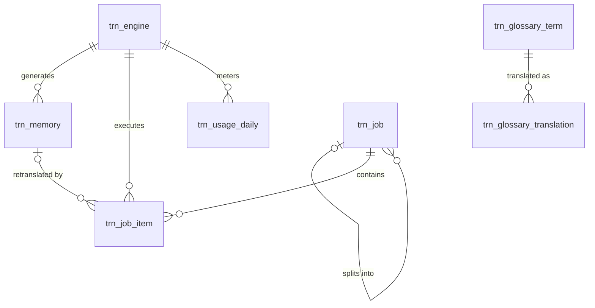

# AI 翻译（translation）模块设计

| 项 | 内容 |
|---|---|
| 模块 ID | `translation` |
| 名称 | AI 翻译 |
| 层 | L2 |
| 表前缀 | `trn_` |
| API 前缀 | `translation` |
| 可停用 | 是 |
| 模块版本 | 1.0.0（module.json 的 version） |
| 平台版本 | `>=1.0.0 <2.0.0`（module.json 的 platform） |
| 里程碑切片 | M1：—（数据模型字段由 content 承担）；M2：—；M3：全部：翻译记忆、术语表、风格指南、引擎、翻译编辑器、批量翻译、用量；询盘翻译；M4：—（详见第 13 节） |
| 模块负责人 | 待定 |
| 文档版本 | V1.2 |
| 状态 | 草案 |
| 更新日期 | 2026-10-20 |
| 依据 | 系统设计 V1.4 第 5 章及 3.2、3.8、24–29 章；平台框架设计 V1.0 第 4、7–13 章；ADR-002、ADR-003、ADR-005、ADR-009、ADR-018 |

> 本文只引用《平台框架设计》第 4 章中的契约，不定义新的跨模块契约；需要新契约时按平台框架设计 2.3 提出契约变更请求。

## 1. 职责与边界

### 1.1 职责

编排可翻译内容和站点资源的提取、记忆命中、AI 翻译、校验与回写；管理引擎、术语、风格、批量任务、审校、用量与预算；提供不复用个人数据的询盘按需翻译。

功能交付范围按第 13 章分为 M1–M4；表结构、约束与枚举以第 3、4 章为准。

### 1.2 不负责的事

| 事项 | 归属模块 | 边界 |
|---|---|---|
| 内容生命周期与路由 | content / url | 本模块只承担自身职责；不直接修改 cnt_、url_ 表 |
| 身份、权限、设置、任务及审计 | platform-core | 复用平台公共服务 |
| 第三方客户端与网络传输 | infrastructure | 仅经既有端口或 L2 服务使用，不在业务模块引入客户端 |

### 1.3 协作概览

| 协作方式 | 对象 | 本模块行为 |
|---|---|---|
| 服务接口 | ContentApi | 方法与事务边界见 2.2；无跨模块表访问 |
| 扩展点 | NotificationTemplateProvider、TranslatableContentProvider、TranslatableResourceProvider | 实现/收集清单见 2.4、2.5 |
| 领域事件 | 见 2.6 | 与本地事务一起登记，提交后异步投递；重复与过期处理独立验证 |

### 1.4 适用的架构约束

遵守 P2、P3 与 ADR-018：编译依赖只到 platform-core/platform-api，跨模块协作只用第 2 章登记契约；只访问自己的表，禁止跨模块 JOIN/外键。遵守 ADR-003：事务内登记、提交后投递、监听器幂等并检查过期。遵守 ADR-009：每次请求/任务明确站点上下文，站点表默认过滤。

公开读取只用当前语言发布态，不跨语言回退（ADR-005）；预览与公开缓存隔离。后台中文文案与错误集中管理，前台文案经 UiTextApi，样式只用 Design Token。远程端口在数据库事务外调用，密钥经 SecretCipher，不写日志。

## 2. 依赖与契约

### 2.1 module.json

```json
{
  "id": "translation",
  "name": "AI 翻译",
  "version": "1.0.0",
  "layer": "L2",
  "platform": ">=1.0.0 <2.0.0",
  "requires": {
    "content": "^1.0"
  },
  "optional": {},
  "disableable": true,
  "tablePrefix": "trn_",
  "apiPrefix": "translation",
  "permissions": [
    {
      "code": "translation:engine:view",
      "name": "查看引擎"
    },
    {
      "code": "translation:engine:manage",
      "name": "管理引擎",
      "sensitive": true
    },
    {
      "code": "translation:memory:view",
      "name": "查看翻译记忆"
    },
    {
      "code": "translation:memory:review",
      "name": "审核翻译记忆",
      "localeScoped": true
    },
    {
      "code": "translation:glossary:manage",
      "name": "管理术语",
      "localeScoped": true
    },
    {
      "code": "translation:job:manage",
      "name": "管理翻译任务",
      "localeScoped": true
    },
    {
      "code": "translation:job:view",
      "name": "查看翻译任务"
    },
    {
      "code": "translation:usage:view",
      "name": "查看用量"
    }
  ],
  "menus": [
    {
      "key": "translation",
      "name": "AI 翻译",
      "parent": "settings",
      "route": "/translation/engines",
      "permission": "translation:engine:view",
      "order": 100
    }
  ],
  "settings": "settings.schema.json",
  "components": [],
  "events": {
    "publishes": [
      "TranslationCompletedEvent",
      "TranslationFailedEvent"
    ],
    "subscribes": [
      "ContentPublishedEvent",
      "LocalizationCreatedEvent",
      "LocalizationDeletedEvent",
      "TranslationModeChangedEvent",
      "SiteSettingsChangedEvent",
      "TranslatableResourceChangedEvent",
      "ContentPurgedEvent",
      "ContentUnpublishedEvent",
      "ContentTrashedEvent",
      "ModuleDisabledEvent"
    ]
  }
}
```

描述符为 M0 工程建立后的实现要求；目前尚无实际控制器、Schema 或组件包。依赖只声明运行能力；Maven 仍只依赖 platform-api/core。组件清单是本模块负责的类型，运行时 UI 不登记成可拖入布局的组件。

### 2.2 使用的服务接口

| 接口（平台框架设计小节） | 方法 | 用途 | 调用位置与时机 | 测试替身 |
|---|---|---|---|---|
| `ContentApi`（4.4.16） | ensureTargetLocalization、updateTranslationState、findPublishedSnapshot、findRevision | 读当前发布快照与卡片；内容类型所属模块创建身份并标记草稿变化 | 读接口在查询阶段调用；写方法加入业务事务，远程文本翻译必须在事务外 | `InMemoryContentApi` |
| `SiteApi`（4.4.1） | 按该契约声明的方法 | 语言、站点模块开关 | 业务事务内；站点切换由任务入口完成 | `InMemorySiteApi` |
| `SiteContextProvider`（4.4.2） | 按该契约声明的方法 | 当前站点；异步与任务由 core 恢复 | 业务事务内；站点切换由任务入口完成 | `FakeSiteContextProvider` |
| `PermissionChecker`（4.4.7） | 按该契约声明的方法 | 后台权限与数据范围 | 业务事务内；站点切换由任务入口完成 | `FakePermissionChecker` |
| `AuditApi`（4.4.9） | 按该契约声明的方法 | 同事务写审计，密钥与个人数据脱敏 | 业务事务内；站点切换由任务入口完成 | `InMemoryAuditApi` |
| `EventMetaFactory`（4.4.14） | 按该契约声明的方法 | 事件 ID、版本、站点与操作人 | 业务事务内；站点切换由任务入口完成 | `FakeEventMetaFactory` |
| `ExtensionRegistry`（4.4.15） | 按该契约声明的方法 | 按启用模块收集 2.5 的扩展点 | 业务事务内；站点切换由任务入口完成 | `InMemoryExtensionRegistry` |
| `JobApi`（4.4.12） | 按该契约声明的方法 | 耗时任务提交、取消、进度与结果 | 业务事务内；站点切换由任务入口完成 | `InMemoryJobApi` |
| `SettingsApi`（4.4.3） | get；设置写入沿用 core 控制器 | 读取 9.1 的 Schema 默认与站点覆盖 | 事务内本地调用；明文只在事务外传入远程端口 | `InMemorySettingsApi` |
| `SecretCipher`（4.4.10） | encrypt、decrypt、mask | 凭据加解密及掩码，不记录明文 | 事务内本地调用；明文只在事务外传入远程端口 | `FakeSecretCipher` |

所有 L2/L3/L4 读写隐式使用当前站点；按 ID 查询单批最多 500。可选服务用 ObjectProvider 注入并检查当前站点启用状态，缺失时降级，不通过业务表绕过服务。

### 2.3 提供的服务接口

| 接口（平台框架设计小节） | 方法 | 实现类 | 契约测试 | 语义 |
|---|---|---|---|---|
| `TranslationApi`（4.4.22） | isTextTranslationAvailable、translateText、segmentOrigins | `TranslationApiImpl` | `TranslationApiContractTest` 继承 `TranslationApiContract` | 完整遵守框架签名、站点隔离、事务及异常语义；远程调用按第 5 章拆分短事务；标注的交付热路径 P95 ≤ 20ms |

### 2.4 实现的扩展点

| 扩展点（平台框架设计小节） | 计划实现类 | 适用范围 | order | 收集方 |
|---|---|---|---|---|
| `NotificationTemplateProvider`（4.5.19） | `TranslationNotificationTemplateProvider` | translation.failed.staff | DEFAULT=1000 | notification |
| `PlatformModule`（4.5.22） | `TranslationModule` | 本模块安装/升级；可停用模块提供影响报告与停用后保留数据规则 | DEFAULT=1000 | core |

以上类名为待实现名称。PublishContributor 不调用调用方的写方法，不访问外部服务；翻译提供方只写本模块草稿/资源，先校验源指纹与共同 version。停用时 analyzeDisableImpact 返回本模块内容、组件及外部引用的影响，数据保留。

### 2.5 收集的扩展点

| 扩展点 | 调用时机 | 过滤 | 失败行为 | 测试示例 |
|---|---|---|---|---|
| `TranslatableContentProvider`（4.5.20） | 见第 5 章流程 | ExtensionRegistry 按站点启用状态、内容类型或 key 过滤 | 事务内校验/发布异常则回滚；只读可选部分失败记指标并降级，核心部分失败返回 503 | `SampleTranslatableContentProvider` |
| `TranslatableResourceProvider`（4.5.21） | 见第 5 章流程 | ExtensionRegistry 按站点启用状态、内容类型或 key 过滤 | 事务内校验/发布异常则回滚；只读可选部分失败记指标并降级，核心部分失败返回 503 | `SampleTranslatableResourceProvider` |

### 2.6 发布与订阅的事件

发布：

| 事件 | 触发事务 | 现有 payload 字段 | 订阅方 |
|---|---|---|---|
| `TranslationCompletedEvent` | 目标草稿/资源回写与任务项计数提交的同事务；内容和资源 subject 恰好一个非空 | meta、jobId、content、resource、targetLocale、state、humanReviewRequired、autoPublish、stats | 框架 4.2.4；未登记发布方的差异在第 14 章列出 |
| `TranslationFailedEvent` | 任务项失败已确认、可见错误信息已脱敏的同事务；不携带原文/译文 | meta、jobId、content、resource、targetLocale、subjectTitle、errorCode、errorMessage、attempts | 框架 4.2.4；未登记发布方的差异在第 14 章列出 |

订阅：

| 事件 | 处理 | 幂等 | 过期与删除 | 失败与重试 |
|---|---|---|---|---|
| `ContentPublishedEvent` | 只处理 zh-CN 的当前发布修订，为自动翻译语言入队；目标语言发布不再触发源翻译 | 本模块事务内的幂等标记与数据变更一起提交；缓存重复失效安全 | 读取当前状态/指纹；只有匹配的当前结果才更新；不以 occurredAt 单独当全序 | 失败抛出保留未完成投递；业务副作用转入已有任务/队列后重试 |
| `LocalizationCreatedEvent` | 按第 4.6 节处理事件所标识的对象；副作用只发生在本模块数据范围 | 本模块事务内的幂等标记与数据变更一起提交；缓存重复失效安全 | 读取当前状态/指纹；只有匹配的当前结果才更新；不以 occurredAt 单独当全序 | 失败抛出保留未完成投递；业务副作用转入已有任务/队列后重试 |
| `LocalizationDeletedEvent` | 仅清理对应语言的本模块本地化/投影，不删除其他语言或共享业务字段 | 本模块事务内的幂等标记与数据变更一起提交；缓存重复失效安全 | 清理使用事件中的 ID；查不到父对象仍须清理 | 失败抛出保留未完成投递；业务副作用转入已有任务/队列后重试 |
| `TranslationModeChangedEvent` | AUTO→MANUAL 取消未完成项；MANUAL→AUTO 从当前源发布修订排队，不用旧草稿 | 本模块事务内的幂等标记与数据变更一起提交；缓存重复失效安全 | 读取当前状态/指纹；只有匹配的当前结果才更新；不以 occurredAt 单独当全序 | 失败抛出保留未完成投递；业务副作用转入已有任务/队列后重试 |
| `SiteSettingsChangedEvent` | 按 LOCALES 和 translation.config 的实际变化创建/暂停/取消任务，不处理无关主题设置 | 本模块事务内的幂等标记与数据变更一起提交；缓存重复失效安全 | 读取当前状态/指纹；只有匹配的当前结果才更新；不以 occurredAt 单独当全序 | 失败抛出保留未完成投递；业务副作用转入已有任务/队列后重试 |
| `TranslatableResourceChangedEvent` | 按已登记 resourceType/resourceId 为每个目标语言归并任务；DELETED 取消待执行项 | 本模块事务内的幂等标记与数据变更一起提交；缓存重复失效安全 | 读取当前状态/指纹；只有匹配的当前结果才更新；不以 occurredAt 单独当全序 | 失败抛出保留未完成投递；业务副作用转入已有任务/队列后重试 |
| `ContentPurgedEvent` | 按事件 contentId/localizationIds 清理本模块外部引用或子行；历史业务快照按 4.6 保留；不回查已不存在的父内容 | 本模块事务内的幂等标记与数据变更一起提交；缓存重复失效安全 | 清理使用事件中的 ID；查不到父对象仍须清理 | 失败抛出保留未完成投递；业务副作用转入已有任务/队列后重试 |
| `ContentUnpublishedEvent` | 移除该语言的公开投影/候选/缓存依赖，人工关系及历史快照按 4.6 保留 | 本模块事务内的幂等标记与数据变更一起提交；缓存重复失效安全 | 读取当前状态/指纹；只有匹配的当前结果才更新；不以 occurredAt 单独当全序 | 失败抛出保留未完成投递；业务副作用转入已有任务/队列后重试 |
| `ContentTrashedEvent` | 按当前回收站状态排除公开读取；不把进回收站等同物理删除 | 本模块事务内的幂等标记与数据变更一起提交；缓存重复失效安全 | 读取当前状态/指纹；只有匹配的当前结果才更新；不以 occurredAt 单独当全序 | 失败抛出保留未完成投递；业务副作用转入已有任务/队列后重试 |
| `ModuleDisabledEvent` | 当前站点隐藏该模块的公开能力，保留自身数据；处理事件.moduleId 而非假定是接收方自身 | 本模块事务内的幂等标记与数据变更一起提交；缓存重复失效安全 | 读取当前状态/指纹；只有匹配的当前结果才更新；不以 occurredAt 单独当全序 | 失败抛出保留未完成投递；业务副作用转入已有任务/队列后重试 |

监听器按框架 5.8 建立站点/system 上下文；`ContentPurgedEvent` 在模块停用时仍必须清理（deliverWhenModuleDisabled）。其他停用期间跳过并完成的事件，重新启用后通过扫描当前状态补偿，不能假定还会重投。数据库幂等标记与本模块数据在同一事务提交；外部发送、下载、搜索与 CDN 调用不得被数据库长事务包裹，使用已声明的任务/端口和业务幂等键。事件 payload 仅引用框架现有字段，本文不扩展签名。

### 2.7 使用的端口

| 端口（平台框架小节） | 用途 | 测试替身 |
|---|---|---|
| `TranslationEngine`（4.7.9） | 第 5 章外部能力；只通过端口调用基础设施 | `FakeTranslationEngine` |
| `DistributedLock`（4.7.16） | 第 5 章外部能力；只通过端口调用基础设施 | `InMemoryDistributedLock` |

## 3. 领域模型

### 3.1 聚合、实体与值对象

| 类型 | 名称 | 说明 |
|---|---|---|
| 聚合根 | Engine（`trn_engine`） | 全局的 OpenAI 兼容引擎配置：base URL、加密的 API Key、模型、温度、单次请求上限、超时、速率上限、结构化输出方式、单价；可配置多个，站点选择主引擎与备用引擎 |
| 聚合根 | MemoryEntry（`trn_memory`） | 翻译记忆条目：一个（站点，源语言，目标语言，原文哈希，变体）的有效译文；来源 `MACHINE` / `REVIEWED` / `HUMAN`；内容与站点资源共用 |
| 聚合根 | GlossaryTerm（`trn_glossary_term`） | 站点术语：中文术语、类别、是否禁止翻译、变更序号 |
| 实体 | GlossaryTranslation（`trn_glossary_translation`） | 术语在某目标语言的规定译法（随术语整体保存） |
| 聚合根 | StyleGuide（`trn_style_guide`） | 站点 × 目标语言的风格指南：称呼、语气、数字格式、其他要求 |
| 聚合根 | Job（`trn_job`） | 翻译任务：实时 / 资源 / 批量 / 重译 / 询盘；可拆为按目标语言的子任务（只有一层）；进度、单元统计、token 与费用 |
| 实体 | JobItem（`trn_job_item`） | 任务项：一个内容本地化、一个站点资源、一条翻译记忆或一段按需文本 × 目标语言；单元级统计与未通过校验的单元（`issues`） |
| 聚合根 | UsageDaily（`trn_usage_daily`） | 按（站点，日期，引擎，模型，任务类型）汇总的请求数、token 与费用 |
| 值对象 | TranslationUnit | 翻译单元：`key`（字段路径）、`text`、`format`（`TEXT` / `RICH_INLINE`）、`maxLength`、`context`；由扩展点在内存中产生，不落表（系统设计 3.7） |
| 值对象 | SourceHash | SHA-256(规范化原文)；规范化 = Unicode NFC、去除首尾空白、合并连续空白（系统设计 5.6） |
| 值对象 | Variant | `default`，或长度受限时的 `max{N}`（如 `max60`） |
| 值对象 | UnitIssue | 未通过校验的单元：字段路径、原文哈希、变体、失败的校验项、候选译文、说明（`trn_job_item.issues` 的元素） |
| 值对象 | TokenUsage | 请求数、输入 / 缓存命中输入 / 输出 token、耗时、估算费用 |
| 值对象 | EncryptedSecret | 与 core 共用的加密信封 `v1:{keyId}:{Base64(nonce‖密文‖tag)}`（AES-256-GCM，见 平台框架设计 6.1） |
| 值对象 | TranslationSiteConfig | 站点级翻译设置，保存在 `sys_setting`（键 `translation.config`，见下） |

### 3.2 不变量

| # | 规则 | 保证方式 |
|---|---|---|
| 1 | 同一（站点，源语言，目标语言，原文哈希，变体）最多一条 `ACTIVE` 记忆；作废（`OBSOLETE`）的条目保留备查，不再命中 | 数据库：`uk_mem_key`（含生成列 `active_flag`） |
| 2 | **机器译文永远不覆盖 `HUMAN` / `REVIEWED` 条目**：机器写入使用 `INSERT … ON DUPLICATE KEY UPDATE`，更新子句只在现有行 `origin = 'MACHINE'` 时替换译文；重译只选择 `origin = 'MACHINE'` 的条目 | 应用层（SQL 条件更新）+ 用假引擎的模块集成测试（系统设计 28） |
| 3 | 来源只升不降：`MACHINE → REVIEWED → HUMAN`、`MACHINE → HUMAN`；`REVIEWED` / `HUMAN` 条目必须有 `reviewed_at`、`reviewed_by` | 应用层；数据库 `ck_trn_mem_review`（`reviewed_at` 非空） |
| 4 | 只有通过全部自动校验（系统设计 5.8）的译文才写入翻译记忆；未通过的单元只记入 `trn_job_item.issues` | 应用层 |
| 5 | 询盘留言及其译文不写入翻译记忆；`TEXT` 类任务项的 `issues`、`error_message` 不含原文与译文 | 应用层 + 模块集成测试 |
| 6 | 源语言与目标语言不同 | 数据库：`ck_trn_mem_locale`、`ck_trn_job_locale` |
| 7 | 父任务的 `target_locale` 为空、没有任务项；子任务与普通任务的 `target_locale` 非空；只有一层父子关系 | 数据库：`ck_trn_job_locale`（子任务非空）；其余应用层 |
| 8 | 同一对象 × 目标语言最多一个“当前”任务项：创建新任务项时，在同一事务中把该对象 × 语言的旧项中 `PENDING` / `RUNNING` / `NEEDS_REVIEW` / `FAILED` 一律置为 `SUPERSEDED`（以新修订为准，系统设计 5.7）。因此 `NEEDS_REVIEW` / `FAILED` 的任务项总是该对象当前的问题记录 | 应用层（`idx_item_content` / `idx_item_resource` 上 `SELECT … FOR UPDATE`） |
| 9 | 任务项的类别与引用字段一致：`CONTENT` 只填内容字段，`RESOURCE` / `TEXT` 只填资源字段，`MEMORY` 只填 `memory_id` | 数据库：`ck_trn_item_kind` |
| 10 | 事件重复投递不重复建任务 | 数据库：`uk_job_dedup`（`dedup_key`） |
| 11 | `status = 'PAUSED'` ⇔ `pause_reason` 非空 | 数据库：`ck_trn_job_pause` |
| 12 | 任务的计数（任务项、单元、token、费用）等于其任务项之和；任务项结束时在同一事务中累加 | 应用层（父任务的进度在读取时由子任务汇总） |
| 13 | 翻译只在事务提交后异步执行，不在发布事务中调用引擎；AI 引擎故障不影响中文内容发布 | 应用层（`@ApplicationModuleListener`，ADR-003） |
| 14 | 法律页面与 `legal` 模板的机器译文不自动发布：translation 在 `TranslationCompletedEvent` 中给出站点的自动发布设置，内容内核再与 `cnt_content.translation_review_required` 合并判断 | 应用层（content 与 translation） |
| 15 | API Key 只以加密信封保存，接口与日志只出现 `api_key_hint`；连接测试结果不含密钥与响应正文 | 应用层（系统设计 26.6） |
| 16 | 被任一站点设为主引擎或备用引擎的引擎不能删除；停用（`enabled = 0`）后站点自动改用备用引擎 | 应用层（经 `SettingsApi` 查询各站点的 `translation.config`） |
| 17 | 达到月度预算时暂停站点的 `BATCH` / `RETRANSLATE` 任务（`pause_reason = 'BUDGET'`）；实时任务按 `realtimeOverBudget` 决定是否继续 | 应用层（系统设计 5.10） |
| 18 | 术语的任何变更（含其译法、删除）都取新的 TSID 写入 `change_seq`；站点术语表版本 = `MAX(change_seq)` | 应用层（术语聚合保存时） |
| 19 | 禁止翻译的术语不含中日韩文字（否则译文必然“残留中文”），且没有译法行；中文品牌名应配置各语言的固定译法 | 应用层 |
| 20 | 提示词中的单元 ID 由系统生成（`u1…un`），响应中的 ID 必须与请求一一对应；原文、译文与询盘留言一律按纯文本处理，不拼入指令部分 | 应用层（系统设计 5.9、26.3） |

**补充与取舍**（系统设计之外的补充及理由）：

| 项 | 内容与理由 |
|---|---|
| 站点级翻译设置用 `sys_setting` | 不建 `trn_site_config` 表：主 / 备引擎、自动发布、月度预算等是每站点一份的设置，沿用 core 的 `settings.schema.json` + Schema 表单（系统设计 3.5、22.4）与 4.4.16 的约定（模块业务设置统一放 `sys_setting`）；引擎引用由本模块监听器校验（见 4.6） |
| 新增 `trn_glossary_translation` | 系统设计 5.8 的“中文术语 → 各语言译法”是一对多；拆为子表才能按（站点，目标语言）一次加载术语并保证每种语言一条译法。不命名为 `*_localization`：译法由人工录入、不经过翻译流程，因此不带 `translation_state` / `source_fingerprint` |
| 术语表版本 = `MAX(change_seq)` | 系统设计 5.6 要求记忆条目记录“术语表版本”。用 TSID 作变更序号，无需单独的版本表；`trn_memory.glossary_version < 术语.change_seq` 即“在该术语变化前生成的机器译文”，一键重译据此筛选 |
| `trn_memory.status` + `active_flag` | “作废”后条目保留（审计、对比），下次遇到相同原文重新翻译并新建 `ACTIVE` 行；唯一约束只作用于 `ACTIVE` 行，避免“覆盖 `HUMAN` 条目”的歧义 |
| `trn_memory.machine_text`、`context`、`reviewed_*` | 人工修订时保留原机器译文，用于对比与抽检统计（系统设计 5.8）；`context` 在翻译中心显示单元用途；`reviewed_*` 记录确认或修订人 |
| `trn_engine` 的补充列 | `protocol`（为将来的其他接口预留，V1 只有 OpenAI 兼容接口）、`api_key_hint`（后台掩码显示）、`max_output_tokens`、`cached_input_price`（服务商自动前缀缓存的折扣价，系统设计 5.9 的稳定前缀）、`price_currency`、`extra_options`（兼容服务的附加头与参数）、连接测试结果 |
| 任务类型细分 | `job_type` 在“实时 / 批量”之外区分 `RESOURCE`、`RETRANSLATE`、`INQUIRY`，便于翻译中心筛选、按类型统计费用（`trn_usage_daily.job_type`）以及预算暂停只作用于批量类任务 |
| 父子任务 | 一次操作涉及多个目标语言时（开放多种语言、术语变化后重译），父任务只做汇总，每个目标语言一个子任务，可分别暂停、重试 |
| 任务项承载单元级状态 | 不建“每个单元一行”的表：全量批量翻译一次就有约 1 万产品 × 30 个单元 × 9 种语言 ≈ 270 万单元。单元级状态以计数列（命中、去重、机器、失败）+ `issues`（只记未通过校验或出错的单元）保存；通过校验的单元，其来源（`MACHINE` / `REVIEWED` / `HUMAN`）可直接查翻译记忆。任务项失败后重试代价很低：已写入记忆的单元直接命中 |
| `trn_job_item.resolved_*` | 人工在翻译编辑器中处理完全部问题单元后，把该项从 `NEEDS_REVIEW` 改为 `SUCCEEDED` 并记录处理人，翻译中心的“待审校”列表据此清除 |
| 术语变化后的“重新应用” | 不建“记忆条目被哪些内容使用”的反向索引（数量 ≈ 单元数 × 语言数）。`RETRANSLATE` 任务先重译相关的 `MACHINE` 条目（`MEMORY` 项），再按 `params.reapply` 创建 `BATCH` 子任务对该语言的 `AUTO` 对象重新提取与回写：全部命中记忆、不调用 AI，草稿未变化的对象不会产生新的发布 |
| `dedup_key`、`priority`、认领字段 | 事件至少投递一次，需要幂等；实时任务优先于批量任务；多实例按任务项认领（`worker_id`、`heartbeat_at`），心跳超时的项重新排队 |

**站点级翻译设置**（`sys_setting`，键 `translation.config`，`module_id = 'translation'`；没有行时取 Schema 默认值）：

```json
{
  "schemaVersion": 1,
  "primaryEngineId": "7201893453912345",
  "fallbackEngineId": "7201893453912399",
  "autoPublish": true,
  "inquiryTranslation": true,
  "monthlyBudget": 300.00,
  "budgetCurrency": "USD",
  "budgetAlertPercent": 80,
  "realtimeOverBudget": true,
  "batchConcurrency": 2,
  "failedItemAlertThreshold": 20,
  "jobRetentionDays": 180
}
```

| 键 | 默认 | 说明 |
|---|---|---|
| `primaryEngineId` / `fallbackEngineId` | 空 | 主引擎 / 备用引擎（`trn_engine.id`）；未设置主引擎时不创建自动翻译任务。主引擎连续失败（429 / 5xx 退避重试 3 次后仍失败）时切换备用引擎（系统设计 5.9）；二者 `price_currency` 必须与 `budgetCurrency` 相同 |
| `autoPublish` | `true` | 目标语言译文 `TRANSLATED` 后自动发布；`false` 时进入审核（系统设计 5.7、6.7）。法律页面一律审核 |
| `inquiryTranslation` | `true` | 询盘留言“翻译为中文”是否可用（系统设计 17.10） |
| `monthlyBudget` / `budgetCurrency` | 空 / `USD` | 月度预算上限（按 UTC 自然月汇总 `trn_usage_daily.cost`）；空表示不限 |
| `budgetAlertPercent` | 80 | 达到该比例时告警（系统设计 27.4） |
| `realtimeOverBudget` | `true` | 超出预算后实时任务（`REALTIME` / `RESOURCE` / `INQUIRY`）是否继续；批量类任务一律暂停 |
| `batchConcurrency` | 2 | 本站点同时执行的批量类任务项数上限（引擎的 RPM / TPM 上限在全部站点之间共享） |
| `failedItemAlertThreshold` | 20 | `FAILED` 任务项积压告警阈值（系统设计 27.4） |
| `jobRetentionDays` | 180 | 任务与任务项的保留天数（见本模块第 10 章） |

### 3.3 状态机

任务：PENDING → RUNNING → SUCCEEDED / FAILED；PENDING / RUNNING → PAUSED（同时写 MANUAL / BUDGET / ENGINE 原因），恢复清除原因并重新排队；未完成任务可 CANCELED。任务项：PENDING → RUNNING → SUCCEEDED / NEEDS_REVIEW / FAILED / SKIPPED；当前旧项被新任务替代为 SUPERSEDED；取消置 CANCELED。NEEDS_REVIEW 经人工解决为 SUCCEEDED。记忆来源只允许 MACHINE → REVIEWED → HUMAN 或 MACHINE → HUMAN；作废 ACTIVE → OBSOLETE，不能机器覆盖人工条目。

## 4. 数据模型

> 遵守平台框架设计第 7 章的数据库通用约定。本节给出待实现 DDL；本次文档审查未重跑 MySQL，不能据此认定 DDL 已验证。M0 后按第 11 章在 MySQL 8.4 空库验证，并使实际迁移脚本与本节一致。

### 4.1 表清单

| 表 | 说明 | 站点级 | 软删除 | 预估规模（单站，按系统设计假设 A4） |
|---|---|---|---|---|
| `trn_engine` | 翻译引擎配置 | 否（全局） | 是 | ≤ 10（全局） |
| `trn_memory` | 翻译记忆 | 是 | 否（`OBSOLETE` 作废，不设过期） | ≈ 40 万个不同原文 × 9 种目标语言 ≈ 300–400 万行，约 2 GB |
| `trn_glossary_term` | 术语 | 是 | 是 | ≤ 2 千 |
| `trn_glossary_translation` | 术语的各语言译法 | 是 | 否（随术语） | ≤ 2 万 |
| `trn_style_guide` | 风格指南 | 是 | 否（删除即恢复默认） | ≤ 10 |
| `trn_job` | 翻译任务 | 是 | 否（保留 180 天） | 实时任务 ≈ 每次源语言发布 × 自动翻译语言数，约 500–2 千 / 天；180 天 ≈ 10–30 万 |
| `trn_job_item` | 任务项 | 是 | 否（保留 180 天，见 4.3.7） | 实时 ≈ 500–2 千 / 天；开放一种新语言 ≈ 2 万项；180 天 ≈ 30–50 万 |
| `trn_usage_daily` | 用量日汇总 | 是 | 否（保留 3 年） | ≈ 10 行 / 天 |

**站点过滤**（行级拦截器，系统设计 25.7）：

| 表 | 拦截器 | 访问方式 |
|---|---|---|
| `trn_engine` | 豁免（全局表） | 只有系统管理员可写（权限 `translation:engine:manage`）；站点管理员在翻译设置中只能读取已启用引擎的名称与模型 |
| `trn_job`、`trn_job_item` | 不豁免 | 例外：调度器跨站点轮询可执行的任务与心跳超时的任务项，使用标注 `@InterceptorIgnore` 的专用查询 |
| 其余站点级表 | 不豁免 | — |

### 4.2 ER 图



`trn_style_guide` 与其他表无外键关系，未画出；术语表版本与记忆条目之间是按 `change_seq` / `glossary_version` 比较的逻辑关系，也未画出。

### 4.3 表结构

类型列中的 `bin` 表示 `COLLATE utf8mb4_0900_bin`；通用字段的定义见第 2.4 节。表按外键依赖顺序排列。

#### 4.3.1 `trn_engine`：翻译引擎

全局表（系统设计 5.9）：可配置多个 OpenAI 兼容服务（OpenAI、DeepSeek、通义千问、Kimi，或自部署的 vLLM、Ollama），由 infrastructure 中的适配器按本行配置调用 `POST {base_url}/chat/completions`；切换服务商只改配置。速率上限由适配器在 Redis 中按引擎 ID 实现令牌桶（全部站点、全部实例共享）。

| 字段 | 类型 | 可空 | 默认 | 说明 |
|---|---|---|---|---|
| `id` | BIGINT | 否 | — | 主键（TSID） |
| `name` | VARCHAR(100) | 否 | — | 引擎名称（中文，后台显示，如“DeepSeek 主引擎”） |
| `protocol` | VARCHAR(16) | 否 | `'OPENAI_CHAT'` | 接口协议；V1 只有 `OPENAI_CHAT`（OpenAI 兼容 Chat Completions） |
| `base_url` | VARCHAR(500) | 否 | — | 服务地址（不含 `/chat/completions`），如 `https://api.example.com/v1` |
| `api_key_encrypted` | VARCHAR(1000) | 是 | — | API Key 密文（EncryptedSecret 信封，AES-256-GCM，系统设计 26.6）；自部署服务无需鉴权时为空 |
| `api_key_hint` | VARCHAR(16) | 是 | — | API Key 掩码（只含末 4 位，如 `****a1b2`），后台显示用 |
| `model` | VARCHAR(128) | 否 | — | 模型名（由服务商决定） |
| `temperature` | DECIMAL(3,2) | 否 | 0.20 | 温度（0–2） |
| `max_units_per_request` | INT | 否 | 50 | 单次请求最大翻译单元数 |
| `max_request_tokens` | INT | 否 | 6000 | 单次请求输入 token 上限（按估算值分批：提示词 + 待翻译单元） |
| `max_output_tokens` | INT | 是 | — | 单次请求输出 token 上限（请求参数 `max_tokens`；为空不传） |
| `timeout_ms` | INT | 否 | 60000 | 单次请求超时（毫秒） |
| `rpm_limit` | INT | 是 | — | 每分钟请求数上限（全部站点合计；为空不限） |
| `tpm_limit` | INT | 是 | — | 每分钟 token 数上限（全部站点合计；为空不限） |
| `response_format` | VARCHAR(16) | 否 | `'JSON_SCHEMA'` | 结构化输出方式：`JSON_SCHEMA` / `JSON_OBJECT` / `NONE` |
| `input_price` | DECIMAL(12,6) | 否 | 0 | 输入 token 单价（每百万 token） |
| `cached_input_price` | DECIMAL(12,6) | 是 | — | 命中服务商前缀缓存的输入 token 单价（每百万 token；为空按 `input_price` 计） |
| `output_price` | DECIMAL(12,6) | 否 | 0 | 输出 token 单价（每百万 token） |
| `price_currency` | CHAR(3) | 否 | `'USD'` | 单价币种（ISO 4217） |
| `extra_options` | JSON | 是 | — | 附加选项（不得含密钥）：额外请求头与请求体参数，如 `{"headers":{"X-Region":"eu"},"body":{"seed":7}}` |
| `enabled` | TINYINT(1) | 否 | 1 | 启用；停用后站点不能选择，已选择它作主引擎的站点改用备用引擎 |
| `last_checked_at` | DATETIME(3) | 是 | — | 最近一次连接测试时间 |
| `last_check_ok` | TINYINT(1) | 是 | — | 最近一次连接测试是否成功 |
| `last_check_message` | VARCHAR(500) | 是 | — | 最近一次连接测试结果说明（错误摘要，不含密钥与响应正文） |
| `note` | VARCHAR(500) | 是 | — | 备注（服务商、数据区域、DPA 签署情况等，系统设计 26.8） |
| `deleted_at` | DATETIME(3) | 是 | — | 删除时间（软删除） |
| `alive` | TINYINT（生成列） | 是 | — | 未删除标记（唯一索引用） |
| `version` | INT | 否 | 0 | 乐观锁 |
| `created_at` | DATETIME(3) | 否 | CURRENT_TIMESTAMP(3) | 创建时间 |
| `created_by` | BIGINT | 否 | 0 | 创建人 |
| `updated_at` | DATETIME(3) | 否 | CURRENT_TIMESTAMP(3)，更新时自动刷新 | 更新时间 |
| `updated_by` | BIGINT | 否 | 0 | 更新人 |

索引与约束：
- `PRIMARY KEY (id)`
- `uk_eng_name (name, alive)`：未删除的引擎名称唯一（引擎列表 ≤ 10 行，无其他查询索引）
- `ck_trn_eng_temperature`：温度在 0–2 之间
- `ck_trn_eng_limits`：单元数、token 上限、超时为正数

```sql
CREATE TABLE trn_engine (
  id                     BIGINT         NOT NULL COMMENT '主键（TSID）',
  name                   VARCHAR(100)   NOT NULL COMMENT '引擎名称（中文，后台显示，如“DeepSeek 主引擎”）',
  protocol               VARCHAR(16)    NOT NULL DEFAULT 'OPENAI_CHAT' COMMENT '接口协议：OPENAI_CHAT（OpenAI 兼容 Chat Completions，POST {base_url}/chat/completions）',
  base_url               VARCHAR(500)   NOT NULL COMMENT '服务地址（不含 /chat/completions），如 https://api.example.com/v1',
  api_key_encrypted      VARCHAR(1000)  NULL COMMENT 'API Key 密文：加密信封 v1:{keyId}:{Base64(nonce‖密文‖tag)}（AES-256-GCM）；自部署服务无需鉴权时为空',
  api_key_hint           VARCHAR(16)    NULL COMMENT 'API Key 掩码（只含末 4 位，如 ****a1b2），后台显示用',
  model                  VARCHAR(128)   NOT NULL COMMENT '模型名（由服务商决定）',
  temperature            DECIMAL(3,2)   NOT NULL DEFAULT 0.20 COMMENT '温度（0–2，默认 0.2）',
  max_units_per_request  INT            NOT NULL DEFAULT 50 COMMENT '单次请求最大翻译单元数',
  max_request_tokens     INT            NOT NULL DEFAULT 6000 COMMENT '单次请求输入 token 上限（估算值：提示词 + 待翻译单元）',
  max_output_tokens      INT            NULL COMMENT '单次请求输出 token 上限（请求参数 max_tokens；为空不传）',
  timeout_ms             INT            NOT NULL DEFAULT 60000 COMMENT '单次请求超时（毫秒）',
  rpm_limit              INT            NULL COMMENT '每分钟请求数上限（RPM，全部站点合计；为空不限）',
  tpm_limit              INT            NULL COMMENT '每分钟 token 数上限（TPM，全部站点合计；为空不限）',
  response_format        VARCHAR(16)    NOT NULL DEFAULT 'JSON_SCHEMA' COMMENT '结构化输出方式：JSON_SCHEMA（json_schema 严格模式）/ JSON_OBJECT / NONE（不支持 response_format，靠提示词约束 + 严格解析 + 校验重试）',
  input_price            DECIMAL(12,6)  NOT NULL DEFAULT 0 COMMENT '输入 token 单价（每百万 token，币种见 price_currency）',
  cached_input_price     DECIMAL(12,6)  NULL COMMENT '命中服务商前缀缓存的输入 token 单价（每百万 token；为空按 input_price 计）',
  output_price           DECIMAL(12,6)  NOT NULL DEFAULT 0 COMMENT '输出 token 单价（每百万 token）',
  price_currency         CHAR(3)        NOT NULL DEFAULT 'USD' COMMENT '单价币种（ISO 4217，如 USD、CNY）',
  extra_options          JSON           NULL COMMENT '附加选项（不得含密钥）：额外请求头与请求体参数，如 {"headers":{"X-Region":"eu"},"body":{"seed":7}}',
  enabled                TINYINT(1)     NOT NULL DEFAULT 1 COMMENT '启用：0 时站点不能选择，已选择它作主引擎的站点改用备用引擎',
  last_checked_at        DATETIME(3)    NULL COMMENT '最近一次连接测试时间',
  last_check_ok          TINYINT(1)     NULL COMMENT '最近一次连接测试是否成功',
  last_check_message     VARCHAR(500)   NULL COMMENT '最近一次连接测试结果说明（错误摘要，不含密钥与响应正文）',
  note                   VARCHAR(500)   NULL COMMENT '备注（服务商、数据区域、DPA 签署情况等）',
  deleted_at             DATETIME(3)    NULL COMMENT '删除时间（软删除）',
  alive                  TINYINT AS (IF(deleted_at IS NULL, 1, NULL)) STORED COMMENT '未删除标记（唯一索引用）',
  version                INT            NOT NULL DEFAULT 0 COMMENT '乐观锁版本号',
  created_at             DATETIME(3)    NOT NULL DEFAULT CURRENT_TIMESTAMP(3) COMMENT '创建时间',
  created_by             BIGINT         NOT NULL DEFAULT 0 COMMENT '创建人（0 = 系统）',
  updated_at             DATETIME(3)    NOT NULL DEFAULT CURRENT_TIMESTAMP(3) ON UPDATE CURRENT_TIMESTAMP(3) COMMENT '更新时间',
  updated_by             BIGINT         NOT NULL DEFAULT 0 COMMENT '更新人（0 = 系统）',
  PRIMARY KEY (id),
  UNIQUE KEY uk_eng_name (name, alive),
  CONSTRAINT ck_trn_eng_temperature CHECK (temperature >= 0 AND temperature <= 2),
  CONSTRAINT ck_trn_eng_limits CHECK (max_units_per_request > 0 AND max_request_tokens > 0 AND timeout_ms > 0)
) ENGINE = InnoDB DEFAULT CHARSET = utf8mb4 COLLATE = utf8mb4_0900_ai_ci COMMENT = '翻译引擎（OpenAI 兼容接口，全局）';
```

#### 4.3.2 `trn_memory`：翻译记忆

站点内内容与站点资源共用（系统设计 5.6）。查找与写入规则：

- **查找**：对一批单元按（`site_id`，`source_locale`，`target_locale`，`source_hash IN (…)`，`active_flag = 1`）一次查询。单元有长度上限 N 时，先取 `default`，长度不超过 N 则使用；否则取 `max{N}`；都没有则送引擎。
- **写入**：引擎译文通过校验后写入。不受长度限制、或未超长的译文写 `default`；超长后带长度约束重译得到的译文写 `max{N}`。写入使用 `INSERT … ON DUPLICATE KEY UPDATE`，只在现有行 `origin = 'MACHINE'` 时替换 `target_text`、`engine_id`、`model`、`glossary_version`（不变量 2）。
- **人工修订**（翻译编辑器）：就地更新为 `origin = 'HUMAN'`，首次由机器译文改为人工时把原译文存入 `machine_text`；“确认”只把 `MACHINE` 改为 `REVIEWED`。修订后对当前对象重新执行回写（全部命中记忆）。
- **作废**：`status` 改为 `OBSOLETE`，不再命中；之后遇到相同原文重新翻译并新建 `ACTIVE` 行。
- **命中计数**：每个任务项结束时对本项命中的条目批量执行 `usage_count = usage_count + 1, last_used_at = …`（同一条目在一项中多次命中只加 1）。
- **重译**（术语变化后）：在 `idx_mem_list` 的（站点，目标语言，`MACHINE`）范围内按 `source_text LIKE '%术语%'` 与 `glossary_version < 术语.change_seq` 筛选；每个术语通常只涉及数百条，异步批量执行，可接受范围扫描。

| 字段 | 类型 | 可空 | 默认 | 说明 |
|---|---|---|---|---|
| `id` | BIGINT | 否 | — | 主键（TSID） |
| `site_id` | BIGINT | 否 | — | 站点 |
| `source_locale` | VARCHAR(16) | 否 | `'zh-CN'` | 源语言（V1 固定 `zh-CN`） |
| `target_locale` | VARCHAR(16) | 否 | — | 目标语言（BCP 47） |
| `source_hash` | CHAR(64) bin | 否 | — | 原文哈希：SHA-256(规范化原文) |
| `variant` | VARCHAR(16) bin | 否 | `'default'` | 变体：`default`，或长度受限的 `max{N}` |
| `format` | VARCHAR(16) | 否 | `'TEXT'` | 单元格式：`TEXT` / `RICH_INLINE` |
| `source_text` | TEXT | 否 | — | 规范化原文（富文本行内标记已转为编号占位标签 `<1>…</1>`） |
| `target_text` | TEXT | 否 | — | 译文（占位标签与原文一致） |
| `origin` | VARCHAR(10) | 否 | — | 来源：`MACHINE` / `REVIEWED` / `HUMAN` |
| `status` | VARCHAR(10) | 否 | `'ACTIVE'` | 状态：`ACTIVE` / `OBSOLETE` |
| `active_flag` | TINYINT（生成列） | 是 | — | `status = 'ACTIVE'` 时为 1，否则 NULL（唯一索引用） |
| `context` | VARCHAR(200) | 是 | — | 首次生成时的上下文说明（如“产品名称”“按钮文字”） |
| `engine_id` | BIGINT | 是 | — | 生成机器译文的引擎（`trn_engine.id`）；人工新建的条目为空 |
| `model` | VARCHAR(128) | 是 | — | 生成机器译文的模型名 |
| `glossary_version` | BIGINT | 是 | — | 生成机器译文时的站点术语表版本（当时的 `MAX(trn_glossary_term.change_seq)`） |
| `machine_text` | TEXT | 是 | — | 人工修订前的机器译文（首次改为 `HUMAN` 时保留） |
| `reviewed_by` | BIGINT | 是 | — | 确认或修订人（`REVIEWED` / `HUMAN`） |
| `reviewed_at` | DATETIME(3) | 是 | — | 确认或修订时间 |
| `usage_count` | INT | 否 | 0 | 命中复用次数（不含首次生成） |
| `last_used_at` | DATETIME(3) | 是 | — | 最后一次命中时间 |
| `version` | INT | 否 | 0 | 乐观锁（人工修订与机器写入并发） |
| `created_at` | DATETIME(3) | 否 | CURRENT_TIMESTAMP(3) | 创建时间 |
| `created_by` | BIGINT | 否 | 0 | 创建人（机器译文为 0） |
| `updated_at` | DATETIME(3) | 否 | CURRENT_TIMESTAMP(3)，更新时自动刷新 | 更新时间 |
| `updated_by` | BIGINT | 否 | 0 | 更新人 |

索引与约束：
- `PRIMARY KEY (id)`
- `uk_mem_key (site_id, source_locale, target_locale, source_hash, variant, active_flag)`：有效条目唯一；同时服务翻译时的批量查找（前缀 + `source_hash IN (…)`）
- `idx_mem_list (site_id, target_locale, origin, updated_at)`：翻译中心按语言、来源浏览（按更新时间倒序）；术语变化后筛选 `MACHINE` 条目
- `idx_mem_engine (engine_id)`：按引擎统计、引擎删除前检查；外键索引
- `fk_trn_mem_engine`：→ `trn_engine.id`（RESTRICT；引擎只软删除）
- `ck_trn_mem_locale`：源语言与目标语言不同
- `ck_trn_mem_review`：`REVIEWED` / `HUMAN` 必须有确认时间

```sql
CREATE TABLE trn_memory (
  id                BIGINT        NOT NULL COMMENT '主键（TSID）',
  site_id           BIGINT        NOT NULL COMMENT '站点',
  source_locale     VARCHAR(16)   NOT NULL DEFAULT 'zh-CN' COMMENT '源语言（V1 固定 zh-CN）',
  target_locale     VARCHAR(16)   NOT NULL COMMENT '目标语言（BCP 47，如 en、de）',
  source_hash       CHAR(64)      COLLATE utf8mb4_0900_bin NOT NULL COMMENT '原文哈希：SHA-256(规范化原文)；规范化 = Unicode NFC、去首尾空白、合并连续空白',
  variant           VARCHAR(16)   COLLATE utf8mb4_0900_bin NOT NULL DEFAULT 'default' COMMENT '变体：default，或长度受限且默认译文超长时的 max{N}（如 max60）',
  format            VARCHAR(16)   NOT NULL DEFAULT 'TEXT' COMMENT '单元格式：TEXT / RICH_INLINE（含编号占位标签 <1>…</1>）',
  source_text       TEXT          NOT NULL COMMENT '规范化原文（富文本行内标记已转为编号占位标签）',
  target_text       TEXT          NOT NULL COMMENT '译文（占位标签与原文一致）',
  origin            VARCHAR(10)   NOT NULL COMMENT '来源：MACHINE（机器译文）/ REVIEWED（人工确认的机器译文）/ HUMAN（人工修订）；优先级 HUMAN > REVIEWED > MACHINE',
  status            VARCHAR(10)   NOT NULL DEFAULT 'ACTIVE' COMMENT '状态：ACTIVE（可复用）/ OBSOLETE（已作废，不再命中，保留备查）',
  active_flag       TINYINT AS (IF(status = 'ACTIVE', 1, NULL)) STORED COMMENT '有效标记：ACTIVE 为 1，否则 NULL（唯一索引用）',
  context           VARCHAR(200)  NULL COMMENT '首次生成时的上下文说明（如“产品名称”“按钮文字”）',
  engine_id         BIGINT        NULL COMMENT '生成机器译文的引擎（trn_engine.id）；人工新建的条目为空',
  model             VARCHAR(128)  NULL COMMENT '生成机器译文的模型名',
  glossary_version  BIGINT        NULL COMMENT '生成机器译文时的站点术语表版本（当时的 MAX(trn_glossary_term.change_seq)）',
  machine_text      TEXT          NULL COMMENT '人工修订前的机器译文（首次由 MACHINE / REVIEWED 改为 HUMAN 时保留，用于对比与抽检统计）',
  reviewed_by       BIGINT        NULL COMMENT '确认或修订人（origin 为 REVIEWED / HUMAN 时）',
  reviewed_at       DATETIME(3)   NULL COMMENT '确认或修订时间',
  usage_count       INT           NOT NULL DEFAULT 0 COMMENT '命中复用次数（不含首次生成）',
  last_used_at      DATETIME(3)   NULL COMMENT '最后一次命中时间',
  version           INT           NOT NULL DEFAULT 0 COMMENT '乐观锁版本号（人工修订与机器写入并发）',
  created_at        DATETIME(3)   NOT NULL DEFAULT CURRENT_TIMESTAMP(3) COMMENT '创建时间',
  created_by        BIGINT        NOT NULL DEFAULT 0 COMMENT '创建人（0 = 系统，机器译文）',
  updated_at        DATETIME(3)   NOT NULL DEFAULT CURRENT_TIMESTAMP(3) ON UPDATE CURRENT_TIMESTAMP(3) COMMENT '更新时间',
  updated_by        BIGINT        NOT NULL DEFAULT 0 COMMENT '更新人（0 = 系统）',
  PRIMARY KEY (id),
  UNIQUE KEY uk_mem_key (site_id, source_locale, target_locale, source_hash, variant, active_flag),
  KEY idx_mem_list (site_id, target_locale, origin, updated_at),
  KEY idx_mem_engine (engine_id),
  CONSTRAINT fk_trn_mem_engine FOREIGN KEY (engine_id) REFERENCES trn_engine (id),
  CONSTRAINT ck_trn_mem_locale CHECK (source_locale <> target_locale),
  CONSTRAINT ck_trn_mem_review CHECK (origin = 'MACHINE' OR reviewed_at IS NOT NULL)
) ENGINE = InnoDB DEFAULT CHARSET = utf8mb4 COLLATE = utf8mb4_0900_ai_ci COMMENT = '翻译记忆（同站点内容与站点资源共用；同一原文只翻译一次）';
```

#### 4.3.3 `trn_glossary_term`：术语

站点级术语表（系统设计 5.8）：翻译时按（站点，目标语言）把术语及译法加载到缓存（以术语表版本为缓存键），对每批原文做多模式匹配（如 Aho-Corasick），只把出现在本批原文中的条目放入提示词；校验“禁止翻译的术语保留原样”“术语表译法被遵守”。法规规定的固定文字（如 “Do Not Sell or Share My Personal Information”）也通过术语表固定译法（系统设计 20.2）。

| 字段 | 类型 | 可空 | 默认 | 说明 |
|---|---|---|---|---|
| `id` | BIGINT | 否 | — | 主键（TSID） |
| `site_id` | BIGINT | 否 | — | 站点 |
| `term` | VARCHAR(200) | 否 | — | 术语原文（中文；按 NFC 规范化后在原文中匹配） |
| `category` | VARCHAR(16) | 否 | `'GENERAL'` | 类别：`BRAND` / `SERIES` / `MODEL` / `STANDARD` / `LEGAL` / `GENERAL` |
| `do_not_translate` | TINYINT(1) | 否 | 0 | 禁止翻译：1 = 各语言保留原样，不需要译法行 |
| `note` | VARCHAR(500) | 是 | — | 说明（含义、用法；随术语放入提示词） |
| `change_seq` | BIGINT | 否 | — | 变更序号：新建、修改本条或其译法、删除时取新的 TSID |
| `deleted_at` | DATETIME(3) | 是 | — | 删除时间（软删除；删除也更新 `change_seq`） |
| `alive` | TINYINT（生成列） | 是 | — | 未删除标记（唯一索引用） |
| `version` | INT | 否 | 0 | 乐观锁（术语与其译法整体保存） |
| `created_at` | DATETIME(3) | 否 | CURRENT_TIMESTAMP(3) | 创建时间 |
| `created_by` | BIGINT | 否 | 0 | 创建人 |
| `updated_at` | DATETIME(3) | 否 | CURRENT_TIMESTAMP(3)，更新时自动刷新 | 更新时间 |
| `updated_by` | BIGINT | 否 | 0 | 更新人 |

索引与约束：
- `PRIMARY KEY (id)`
- `uk_gls_term (site_id, term, alive)`：站点内未删除的术语唯一（默认排序规则，大小写不同视为重复）；后台按术语查找
- `idx_gls_change (site_id, change_seq)`：读取站点术语表版本（`MAX(change_seq)`，索引末端一次读取）；列出某版本之后变化的术语（触发重译）

```sql
CREATE TABLE trn_glossary_term (
  id                BIGINT        NOT NULL COMMENT '主键（TSID）',
  site_id           BIGINT        NOT NULL COMMENT '站点',
  term              VARCHAR(200)  NOT NULL COMMENT '术语原文（中文；按 NFC 规范化后在原文中匹配）',
  category          VARCHAR(16)   NOT NULL DEFAULT 'GENERAL' COMMENT '类别：BRAND（品牌）/ SERIES（产品系列）/ MODEL（型号）/ STANDARD（标准号）/ LEGAL（法规固定文字）/ GENERAL（一般术语）',
  do_not_translate  TINYINT(1)    NOT NULL DEFAULT 0 COMMENT '禁止翻译：1 = 各语言保留原样（不得含中日韩文字），不需要译法行',
  note              VARCHAR(500)  NULL COMMENT '说明（含义、用法；随术语放入提示词）',
  change_seq        BIGINT        NOT NULL COMMENT '变更序号：新建、修改本条或其译法、删除时取新的 TSID；站点术语表版本 = MAX(change_seq)（含已删除行）',
  deleted_at        DATETIME(3)   NULL COMMENT '删除时间（软删除）',
  alive             TINYINT AS (IF(deleted_at IS NULL, 1, NULL)) STORED COMMENT '未删除标记（唯一索引用）',
  version           INT           NOT NULL DEFAULT 0 COMMENT '乐观锁版本号（术语与其译法整体保存）',
  created_at        DATETIME(3)   NOT NULL DEFAULT CURRENT_TIMESTAMP(3) COMMENT '创建时间',
  created_by        BIGINT        NOT NULL DEFAULT 0 COMMENT '创建人（0 = 系统）',
  updated_at        DATETIME(3)   NOT NULL DEFAULT CURRENT_TIMESTAMP(3) ON UPDATE CURRENT_TIMESTAMP(3) COMMENT '更新时间',
  updated_by        BIGINT        NOT NULL DEFAULT 0 COMMENT '更新人（0 = 系统）',
  PRIMARY KEY (id),
  UNIQUE KEY uk_gls_term (site_id, term, alive),
  KEY idx_gls_change (site_id, change_seq)
) ENGINE = InnoDB DEFAULT CHARSET = utf8mb4 COLLATE = utf8mb4_0900_ai_ci COMMENT = '术语（站点级；可标记禁止翻译）';
```

#### 4.3.4 `trn_glossary_translation`：术语译法

术语在各目标语言的规定译法，人工录入，随术语整体保存（同一事务内更新术语的 `change_seq` 与 `version`）。

| 字段 | 类型 | 可空 | 默认 | 说明 |
|---|---|---|---|---|
| `id` | BIGINT | 否 | — | 主键（TSID） |
| `site_id` | BIGINT | 否 | — | 站点 |
| `term_id` | BIGINT | 否 | — | 术语（`trn_glossary_term.id`） |
| `target_locale` | VARCHAR(16) | 否 | — | 目标语言 |
| `translation` | VARCHAR(300) | 否 | — | 规定译法（翻译时必须使用） |
| `note` | VARCHAR(500) | 是 | — | 该语言的用法说明（如德语名词的性与复数） |
| `created_at` | DATETIME(3) | 否 | CURRENT_TIMESTAMP(3) | 创建时间 |
| `created_by` | BIGINT | 否 | 0 | 创建人 |
| `updated_at` | DATETIME(3) | 否 | CURRENT_TIMESTAMP(3)，更新时自动刷新 | 更新时间 |
| `updated_by` | BIGINT | 否 | 0 | 更新人 |

索引与约束：
- `PRIMARY KEY (id)`
- `uk_glt_locale (term_id, target_locale)`：每个术语每种语言一条译法；兼作外键索引
- `idx_glt_load (site_id, target_locale)`：翻译时加载（站点，目标语言）的全部译法
- `fk_trn_glt_term`：→ `trn_glossary_term.id`，`ON DELETE CASCADE`（术语只软删除；物理删除只发生在站点或模块数据清除时）

```sql
CREATE TABLE trn_glossary_translation (
  id             BIGINT        NOT NULL COMMENT '主键（TSID）',
  site_id        BIGINT        NOT NULL COMMENT '站点',
  term_id        BIGINT        NOT NULL COMMENT '术语（trn_glossary_term.id）',
  target_locale  VARCHAR(16)   NOT NULL COMMENT '目标语言（BCP 47）',
  translation    VARCHAR(300)  NOT NULL COMMENT '规定译法（翻译时必须使用；自动校验“术语表译法被遵守”）',
  note           VARCHAR(500)  NULL COMMENT '该语言的用法说明（如德语名词的性与复数）',
  created_at     DATETIME(3)   NOT NULL DEFAULT CURRENT_TIMESTAMP(3) COMMENT '创建时间',
  created_by     BIGINT        NOT NULL DEFAULT 0 COMMENT '创建人（0 = 系统）',
  updated_at     DATETIME(3)   NOT NULL DEFAULT CURRENT_TIMESTAMP(3) ON UPDATE CURRENT_TIMESTAMP(3) COMMENT '更新时间',
  updated_by     BIGINT        NOT NULL DEFAULT 0 COMMENT '更新人（0 = 系统）',
  PRIMARY KEY (id),
  UNIQUE KEY uk_glt_locale (term_id, target_locale),
  KEY idx_glt_load (site_id, target_locale),
  CONSTRAINT fk_trn_glt_term FOREIGN KEY (term_id) REFERENCES trn_glossary_term (id) ON DELETE CASCADE
) ENGINE = InnoDB DEFAULT CHARSET = utf8mb4 COLLATE = utf8mb4_0900_ai_ci COMMENT = '术语的各语言规定译法';
```

#### 4.3.5 `trn_style_guide`：风格指南

站点 × 目标语言一条（系统设计 5.8），作为系统提示词的一部分（固定前缀，便于服务商的前缀缓存）；没有行时使用该语言的内置默认。数字分隔符同时用于“数字与原文一致”的校验（按风格指南调整小数点与千位分隔符）。

| 字段 | 类型 | 可空 | 默认 | 说明 |
|---|---|---|---|---|
| `id` | BIGINT | 否 | — | 主键（TSID） |
| `site_id` | BIGINT | 否 | — | 站点 |
| `target_locale` | VARCHAR(16) | 否 | — | 目标语言 |
| `formality` | VARCHAR(16) | 否 | `'FORMAL'` | 称呼：`FORMAL` / `INFORMAL` / `NEUTRAL` |
| `tone` | VARCHAR(200) | 是 | — | 语气（如“专业、简洁，面向工程采购人员”） |
| `decimal_separator` | VARCHAR(4) | 是 | — | 小数点（如 `,`）；为空按该语言的 CLDR 默认 |
| `group_separator` | VARCHAR(4) | 是 | — | 千位分隔符（如 `.`、窄不换行空格 U+202F）；为空按 CLDR 默认 |
| `instructions` | TEXT | 是 | — | 其他要求（数字与单位格式、品牌写法、禁用表达等）；应用层限制 ≤ 4000 个字符 |
| `version` | INT | 否 | 0 | 乐观锁 |
| `created_at` | DATETIME(3) | 否 | CURRENT_TIMESTAMP(3) | 创建时间 |
| `created_by` | BIGINT | 否 | 0 | 创建人 |
| `updated_at` | DATETIME(3) | 否 | CURRENT_TIMESTAMP(3)，更新时自动刷新 | 更新时间 |
| `updated_by` | BIGINT | 否 | 0 | 更新人 |

索引与约束：
- `PRIMARY KEY (id)`
- `uk_style_locale (site_id, target_locale)`：每站点每种目标语言一条；翻译时按此读取（结果缓存）

```sql
CREATE TABLE trn_style_guide (
  id                 BIGINT        NOT NULL COMMENT '主键（TSID）',
  site_id            BIGINT        NOT NULL COMMENT '站点',
  target_locale      VARCHAR(16)   NOT NULL COMMENT '目标语言（BCP 47）',
  formality          VARCHAR(16)   NOT NULL DEFAULT 'FORMAL' COMMENT '称呼：FORMAL（敬称，如德语 Sie、法语 vous）/ INFORMAL（如德语 du）/ NEUTRAL（不区分或不限定）',
  tone               VARCHAR(200)  NULL COMMENT '语气（如“专业、简洁，面向工程采购人员”）',
  decimal_separator  VARCHAR(4)    NULL COMMENT '小数点（如 , 或 .）；为空按该语言的 CLDR 默认',
  group_separator    VARCHAR(4)    NULL COMMENT '千位分隔符（如 . 、, 或窄不换行空格 U+202F）；为空按 CLDR 默认',
  instructions       TEXT          NULL COMMENT '其他要求（数字与单位格式、品牌写法、禁用表达等），作为系统提示词的一部分；应用层限制 ≤ 4000 个字符',
  version            INT           NOT NULL DEFAULT 0 COMMENT '乐观锁版本号',
  created_at         DATETIME(3)   NOT NULL DEFAULT CURRENT_TIMESTAMP(3) COMMENT '创建时间',
  created_by         BIGINT        NOT NULL DEFAULT 0 COMMENT '创建人（0 = 系统）',
  updated_at         DATETIME(3)   NOT NULL DEFAULT CURRENT_TIMESTAMP(3) ON UPDATE CURRENT_TIMESTAMP(3) COMMENT '更新时间',
  updated_by         BIGINT        NOT NULL DEFAULT 0 COMMENT '更新人（0 = 系统）',
  PRIMARY KEY (id),
  UNIQUE KEY uk_style_locale (site_id, target_locale)
) ENGINE = InnoDB DEFAULT CHARSET = utf8mb4 COLLATE = utf8mb4_0900_ai_ci COMMENT = '风格指南（站点 × 目标语言）';
```

#### 4.3.6 `trn_job`：翻译任务

| 任务类型 | 触发 | 任务项 | 说明 |
|---|---|---|---|
| `REALTIME` | 源语言内容发布（`ContentPublishedEvent`，`locale = zh-CN`） | 1 个 `CONTENT` | 每个启用自动翻译的目标语言一个任务（系统设计 5.7）；`dedup_key = pub:{localizationId}:{revisionNo}:{targetLocale}` |
| `RESOURCE` | `TranslatableResourceChangedEvent` | 1 个 `RESOURCE` | 每个目标语言一个任务；`dedup_key = res:{resourceType}:{resourceId}:{fingerprint}:{targetLocale}` |
| `BATCH` | 开放新语言（`SiteSettingsChangedEvent`）、批量导入后、手动批量、重译后的重新应用 | 多个 `CONTENT` / `RESOURCE` | 按内容逐条排队，限制并发与速率；可暂停、取消、重试失败项（系统设计 5.7） |
| `RETRANSLATE` | 术语表变化后一键重译、翻译编辑器的单段重译 | 多个 `MEMORY` | 只重译 `MACHINE` 条目；单段重译 `HUMAN` / `REVIEWED` 条目时，结果作为候选放入 `issues`，由人工采纳（采纳即 `HUMAN`），不覆盖原条目 |
| `INQUIRY` | `TranslationApi.translateText`（销售点击“翻译为中文”） | 1 个 `TEXT` | 同步执行；只记录用量与结果状态，不保存留言与译文，不写翻译记忆（系统设计 17.10） |

状态流转：`PENDING → RUNNING → SUCCEEDED / FAILED`；`PENDING` / `RUNNING ⇄ PAUSED`；`PENDING` / `RUNNING` / `PAUSED → CANCELED`；`FAILED → RUNNING`（重试失败项：把 `FAILED` 任务项重置为 `PENDING`）。全部任务项结束且没有 `FAILED` 项为 `SUCCEEDED`（可有 `NEEDS_REVIEW` 项），有 `FAILED` 项为 `FAILED`。父任务的状态与进度在读取时由子任务汇总。

| 字段 | 类型 | 可空 | 默认 | 说明 |
|---|---|---|---|---|
| `id` | BIGINT | 否 | — | 主键（TSID） |
| `site_id` | BIGINT | 否 | — | 站点 |
| `parent_job_id` | BIGINT | 是 | — | 父任务（`trn_job.id`）；只有一层 |
| `job_type` | VARCHAR(16) | 否 | — | 任务类型：`REALTIME` / `RESOURCE` / `BATCH` / `RETRANSLATE` / `INQUIRY` |
| `trigger_type` | VARCHAR(24) | 否 | — | 触发来源：`CONTENT_PUBLISHED` / `RESOURCE_CHANGED` / `LOCALE_ENABLED` / `IMPORT` / `GLOSSARY_CHANGED` / `MANUAL` / `API` |
| `title` | VARCHAR(200) | 否 | — | 任务名称（中文，翻译中心列表显示） |
| `source_locale` | VARCHAR(16) | 否 | `'zh-CN'` | 源语言（`INQUIRY` 为询盘语言） |
| `target_locale` | VARCHAR(16) | 是 | — | 目标语言；只有父任务为空（`INQUIRY` 为 `zh-CN`） |
| `status` | VARCHAR(16) | 否 | `'PENDING'` | 状态：`PENDING` / `RUNNING` / `PAUSED` / `SUCCEEDED` / `FAILED` / `CANCELED` |
| `pause_reason` | VARCHAR(16) | 是 | — | 暂停原因：`MANUAL` / `BUDGET` / `ENGINE`；仅 `PAUSED` 时有值 |
| `priority` | INT | 否 | 0 | 优先级（大的先执行）：实时类默认 100，批量类默认 0 |
| `dedup_key` | VARCHAR(200) bin | 是 | — | 去重键（事件重复投递时幂等） |
| `params` | JSON | 是 | — | 任务参数：批量范围（内容类型、资源类型、内容 ID 列表）、重译的术语 ID、`reapply`（重译后是否重新应用）等 |
| `item_total` | INT | 否 | 0 | 任务项总数 |
| `item_succeeded` | INT | 否 | 0 | 成功的任务项数 |
| `item_needs_review` | INT | 否 | 0 | 待审校的任务项数 |
| `item_failed` | INT | 否 | 0 | 失败的任务项数 |
| `item_skipped` | INT | 否 | 0 | 跳过、被新修订取代或取消的任务项数 |
| `unit_total` | INT | 否 | 0 | 提取的翻译单元总数 |
| `unit_memory_hit` | INT | 否 | 0 | 翻译记忆命中数 |
| `unit_machine` | INT | 否 | 0 | 调用引擎翻译并通过校验的单元数 |
| `unit_failed` | INT | 否 | 0 | 未通过校验的单元数 |
| `request_count` | INT | 否 | 0 | 引擎请求次数（含重试） |
| `input_tokens` | BIGINT | 否 | 0 | 输入 token 数 |
| `cached_input_tokens` | BIGINT | 否 | 0 | 其中命中服务商前缀缓存的输入 token 数 |
| `output_tokens` | BIGINT | 否 | 0 | 输出 token 数 |
| `cost` | DECIMAL(14,6) | 否 | 0 | 估算费用 |
| `currency` | CHAR(3) | 否 | `'USD'` | 费用币种（站点预算币种） |
| `error_code` | VARCHAR(64) | 是 | — | 任务级失败错误码（`TRANSLATION_{REASON}`） |
| `error_message` | VARCHAR(1000) | 是 | — | 任务级失败说明（中文） |
| `started_at` | DATETIME(3) | 是 | — | 开始执行时间 |
| `finished_at` | DATETIME(3) | 是 | — | 结束时间 |
| `version` | INT | 否 | 0 | 乐观锁（暂停、取消、重试与执行器并发） |
| `created_at` | DATETIME(3) | 否 | CURRENT_TIMESTAMP(3) | 创建时间 |
| `created_by` | BIGINT | 否 | 0 | 发起人（事件触发为 0） |
| `updated_at` | DATETIME(3) | 否 | CURRENT_TIMESTAMP(3)，更新时自动刷新 | 更新时间 |
| `updated_by` | BIGINT | 否 | 0 | 更新人 |

索引与约束：
- `PRIMARY KEY (id)`
- `uk_job_dedup (site_id, dedup_key)`：事件幂等（NULL 不参与比较）
- `idx_job_poll (status, priority, created_at)`：调度器跨站点选取 `PENDING` / `RUNNING` 任务（按优先级、先后）（专用豁免查询）
- `idx_job_type (site_id, job_type, created_at)`：翻译中心按类型列出任务；预算暂停时查找站点的批量类任务
- `idx_job_list (site_id, created_at)`：翻译中心全部任务按时间倒序；保留期清理
- `idx_job_parent (parent_job_id)`：汇总子任务；外键索引
- `fk_trn_job_parent`：→ `trn_job.id`，`ON DELETE CASCADE`（子任务随父任务清理）
- `ck_trn_job_locale`：子任务必须有目标语言；目标语言与源语言不同
- `ck_trn_job_pause`：`PAUSED` ⇔ 有暂停原因

```sql
CREATE TABLE trn_job (
  id                   BIGINT         NOT NULL COMMENT '主键（TSID）',
  site_id              BIGINT         NOT NULL COMMENT '站点',
  parent_job_id        BIGINT         NULL COMMENT '父任务（trn_job.id）：涉及多个目标语言时按语言拆分子任务；只有一层',
  job_type             VARCHAR(16)    NOT NULL COMMENT '任务类型：REALTIME（源语言内容发布）/ RESOURCE（站点资源变化）/ BATCH（批量）/ RETRANSLATE（重译记忆条目）/ INQUIRY（询盘留言翻译为中文）',
  trigger_type         VARCHAR(24)    NOT NULL COMMENT '触发来源：CONTENT_PUBLISHED / RESOURCE_CHANGED / LOCALE_ENABLED / IMPORT / GLOSSARY_CHANGED / MANUAL / API',
  title                VARCHAR(200)   NOT NULL COMMENT '任务名称（中文，翻译中心列表显示，如“开放英语：翻译全部已发布内容”）',
  source_locale        VARCHAR(16)    NOT NULL DEFAULT 'zh-CN' COMMENT '源语言（INQUIRY 为询盘语言）',
  target_locale        VARCHAR(16)    NULL COMMENT '目标语言；只有父任务为空（INQUIRY 为 zh-CN）',
  status               VARCHAR(16)    NOT NULL DEFAULT 'PENDING' COMMENT '状态：PENDING / RUNNING / PAUSED / SUCCEEDED / FAILED / CANCELED',
  pause_reason         VARCHAR(16)    NULL COMMENT '暂停原因：MANUAL（人工）/ BUDGET（达到月度预算）/ ENGINE（主备引擎均不可用）；仅 PAUSED 时有值',
  priority             INT            NOT NULL DEFAULT 0 COMMENT '优先级（大的先执行）：REALTIME、RESOURCE、INQUIRY 默认 100，BATCH、RETRANSLATE 默认 0',
  dedup_key            VARCHAR(200)   COLLATE utf8mb4_0900_bin NULL COMMENT '去重键（事件重复投递时幂等），如 pub:{localizationId}:{revisionNo}:{targetLocale}',
  params               JSON           NULL COMMENT '任务参数：批量范围（内容类型、资源类型、内容 ID 列表）、重译的术语 ID、reapply（重译后是否重新应用）等',
  item_total           INT            NOT NULL DEFAULT 0 COMMENT '任务项总数',
  item_succeeded       INT            NOT NULL DEFAULT 0 COMMENT '成功的任务项数',
  item_needs_review    INT            NOT NULL DEFAULT 0 COMMENT '待审校的任务项数',
  item_failed          INT            NOT NULL DEFAULT 0 COMMENT '失败的任务项数',
  item_skipped         INT            NOT NULL DEFAULT 0 COMMENT '跳过、被新修订取代或取消的任务项数',
  unit_total           INT            NOT NULL DEFAULT 0 COMMENT '提取的翻译单元总数',
  unit_memory_hit      INT            NOT NULL DEFAULT 0 COMMENT '翻译记忆命中数（未调用 AI）',
  unit_machine         INT            NOT NULL DEFAULT 0 COMMENT '调用引擎翻译并通过校验的单元数',
  unit_failed          INT            NOT NULL DEFAULT 0 COMMENT '重试后仍未通过校验的单元数',
  request_count        INT            NOT NULL DEFAULT 0 COMMENT '引擎请求次数（含重试）',
  input_tokens         BIGINT         NOT NULL DEFAULT 0 COMMENT '输入 token 数',
  cached_input_tokens  BIGINT         NOT NULL DEFAULT 0 COMMENT '其中命中服务商前缀缓存的输入 token 数',
  output_tokens        BIGINT         NOT NULL DEFAULT 0 COMMENT '输出 token 数',
  cost                 DECIMAL(14,6)  NOT NULL DEFAULT 0 COMMENT '估算费用（按调用时引擎单价）',
  currency             CHAR(3)        NOT NULL DEFAULT 'USD' COMMENT '费用币种（站点预算币种，ISO 4217）',
  error_code           VARCHAR(64)    NULL COMMENT '任务级失败错误码（TRANSLATION_{REASON}）',
  error_message        VARCHAR(1000)  NULL COMMENT '任务级失败说明（中文）',
  started_at           DATETIME(3)    NULL COMMENT '开始执行时间',
  finished_at          DATETIME(3)    NULL COMMENT '结束时间（SUCCEEDED / FAILED / CANCELED）',
  version              INT            NOT NULL DEFAULT 0 COMMENT '乐观锁版本号（暂停、取消、重试与执行器并发）',
  created_at           DATETIME(3)    NOT NULL DEFAULT CURRENT_TIMESTAMP(3) COMMENT '创建时间',
  created_by           BIGINT         NOT NULL DEFAULT 0 COMMENT '发起人（0 = 系统，事件触发）',
  updated_at           DATETIME(3)    NOT NULL DEFAULT CURRENT_TIMESTAMP(3) ON UPDATE CURRENT_TIMESTAMP(3) COMMENT '更新时间',
  updated_by           BIGINT         NOT NULL DEFAULT 0 COMMENT '更新人（0 = 系统）',
  PRIMARY KEY (id),
  UNIQUE KEY uk_job_dedup (site_id, dedup_key),
  KEY idx_job_poll (status, priority, created_at),
  KEY idx_job_type (site_id, job_type, created_at),
  KEY idx_job_list (site_id, created_at),
  KEY idx_job_parent (parent_job_id),
  CONSTRAINT fk_trn_job_parent FOREIGN KEY (parent_job_id) REFERENCES trn_job (id) ON DELETE CASCADE,
  CONSTRAINT ck_trn_job_locale CHECK ((parent_job_id IS NULL OR target_locale IS NOT NULL) AND (target_locale IS NULL OR target_locale <> source_locale)),
  CONSTRAINT ck_trn_job_pause CHECK ((status = 'PAUSED') = (pause_reason IS NOT NULL))
) ENGINE = InnoDB DEFAULT CHARSET = utf8mb4 COLLATE = utf8mb4_0900_ai_ci COMMENT = '翻译任务（实时、资源、批量、重译、询盘；可拆为按目标语言的子任务）';
```

#### 4.3.7 `trn_job_item`：任务项

一个任务项 = 一个翻译对象 × 一个目标语言，是认领、执行、重试的单位。执行步骤（系统设计 5.7）：提取单元 → 查翻译记忆 → 去重后按引擎上限分批调用 → 校验（失败自动重试一次）→ 写入记忆 → 回写（`apply()`）→ 经 `ContentApi` 或资源提供方更新翻译状态 → 发布 `TranslationCompletedEvent` / `TranslationFailedEvent`。

| 类别 | 引用字段 | 结束状态 |
|---|---|---|
| `CONTENT` | `content_id`、`content_type`、`source_localization_id`、`source_revision_no`、`target_localization_id` | 全部单元通过 → `SUCCEEDED`（本地化 `TRANSLATED`）；有单元未通过 → `NEEDS_REVIEW`（已通过的单元照常回写，本地化 `NEEDS_REVIEW`，不自动发布）；引擎错误且重试耗尽 → `FAILED`（本地化 `FAILED`） |
| `RESOURCE` | `resource_type`、`resource_id`、`source_fingerprint` | 同上（状态写入资源本地化行的 `translation_state`） |
| `MEMORY` | `memory_id` | 重译通过 → `SUCCEEDED`；条目已不是 `MACHINE` → `SKIPPED` |
| `TEXT` | `resource_type`（调用方用途，如 `inquiry.message`）、`resource_id`（调用方对象 ID，只用于追踪） | 同步返回译文给调用方；只记录状态与用量 |

执行时目标对象已被删除、目标本地化已改为 `MANUAL`、或源语言已下线时置为 `SKIPPED`。重试：任务项级失败（实例失联、引擎持续不可用）按 `attempts` 退避，最多 3 次；“重试失败项”把 `FAILED` 项重置为 `PENDING`。人工在翻译编辑器中处理完全部问题单元后，项改为 `SUCCEEDED`（记录 `resolved_*`），并在同一事务中调整所属任务的计数。

保留期（本模块第 10 章）：先删除结束超过 `jobRetentionDays` 且状态不是 `NEEDS_REVIEW` / `FAILED` 的任务项，再删除结束超过保留期且已没有任务项的任务。`NEEDS_REVIEW` / `FAILED` 项总是对象当前的问题记录（不变量 8），保留到被新任务项取代或人工处理完毕。

| 字段 | 类型 | 可空 | 默认 | 说明 |
|---|---|---|---|---|
| `id` | BIGINT | 否 | — | 主键（TSID） |
| `site_id` | BIGINT | 否 | — | 站点 |
| `job_id` | BIGINT | 否 | — | 所属任务（`trn_job.id`） |
| `item_kind` | VARCHAR(10) | 否 | — | 类别：`CONTENT` / `RESOURCE` / `MEMORY` / `TEXT` |
| `target_locale` | VARCHAR(16) | 否 | — | 目标语言（冗余 `trn_job.target_locale`） |
| `content_id` | BIGINT | 是 | — | `CONTENT`：内容（`cnt_content.id`） |
| `content_type` | VARCHAR(32) | 是 | — | `CONTENT`：内容类型（选择 `TranslatableContentProvider`） |
| `source_localization_id` | BIGINT | 是 | — | `CONTENT`：源语言本地化（`cnt_localization.id`） |
| `source_revision_no` | INT | 是 | — | `CONTENT`：依据的源语言修订号 |
| `target_localization_id` | BIGINT | 是 | — | `CONTENT`：目标语言本地化（`cnt_localization.id`，创建任务时由内容内核创建或返回） |
| `resource_type` | VARCHAR(64) bin | 是 | — | `RESOURCE`：资源类型（`{moduleId}.{资源}`，如 `taxonomy.term`）；`TEXT`：调用方用途（如 `inquiry.message`） |
| `resource_id` | BIGINT | 是 | — | `RESOURCE`：资源 ID；`TEXT`：调用方对象 ID |
| `source_fingerprint` | CHAR(64) bin | 是 | — | `RESOURCE`：提取时的源语言指纹（回写目标语言行的 `source_fingerprint`） |
| `memory_id` | BIGINT | 是 | — | `MEMORY`：被重译的记忆条目（`trn_memory.id`） |
| `status` | VARCHAR(16) | 否 | `'PENDING'` | 状态：`PENDING` / `RUNNING` / `SUCCEEDED` / `NEEDS_REVIEW` / `FAILED` / `SKIPPED` / `SUPERSEDED` / `CANCELED` |
| `attempts` | INT | 否 | 0 | 已执行次数 |
| `next_attempt_at` | DATETIME(3) | 否 | CURRENT_TIMESTAMP(3) | 最早执行时间（重试退避） |
| `worker_id` | VARCHAR(64) | 是 | — | 执行实例标识 |
| `heartbeat_at` | DATETIME(3) | 是 | — | 执行实例最近心跳；超时视为失联，重新排队 |
| `engine_id` | BIGINT | 是 | — | 最后使用的引擎（主引擎或切换后的备用引擎） |
| `unit_total` | INT | 否 | 0 | 提取的翻译单元数 |
| `unit_memory_hit` | INT | 否 | 0 | 翻译记忆命中数 |
| `unit_deduped` | INT | 否 | 0 | 本项内重复原文数（只翻译一次） |
| `unit_machine` | INT | 否 | 0 | 调用引擎翻译并通过校验的单元数 |
| `unit_failed` | INT | 否 | 0 | 重试后仍未通过校验的单元数 |
| `request_count` | INT | 否 | 0 | 引擎请求次数（含重试） |
| `input_tokens` | INT | 否 | 0 | 输入 token 数 |
| `cached_input_tokens` | INT | 否 | 0 | 其中命中前缀缓存的输入 token 数 |
| `output_tokens` | INT | 否 | 0 | 输出 token 数 |
| `cost` | DECIMAL(14,6) | 否 | 0 | 估算费用 |
| `engine_ms` | INT | 否 | 0 | 引擎调用累计耗时（毫秒） |
| `issues` | JSON | 是 | — | 未通过校验或出错的单元（见下）；`TEXT` 项不含原文与译文 |
| `error_code` | VARCHAR(64) | 是 | — | 失败错误码（如 `TRANSLATION_ENGINE_UNAVAILABLE`） |
| `error_message` | VARCHAR(1000) | 是 | — | 失败说明（中文） |
| `resolved_by` | BIGINT | 是 | — | 人工处理完全部问题单元的用户 |
| `resolved_at` | DATETIME(3) | 是 | — | 人工处理完毕时间（`NEEDS_REVIEW` → `SUCCEEDED`） |
| `started_at` | DATETIME(3) | 是 | — | 开始执行时间 |
| `finished_at` | DATETIME(3) | 是 | — | 结束时间 |
| `created_at` | DATETIME(3) | 否 | CURRENT_TIMESTAMP(3) | 创建时间 |
| `updated_at` | DATETIME(3) | 否 | CURRENT_TIMESTAMP(3)，更新时自动刷新 | 更新时间 |

`issues` 示例（翻译编辑器据此标出问题段落，翻译中心“待审校”据此列出单元）：

```json
[
  { "key": "body[3]", "sourceHash": "9f2c…", "variant": "default",
    "checks": ["PLACEHOLDER", "NUMBER"], "candidate": "This product is <1>CE</1> certified…",
    "message": "占位标签 <2> 缺失；数字 3.7 与原文不一致" }
]
```

索引与约束：
- `PRIMARY KEY (id)`
- `idx_item_claim (job_id, status, next_attempt_at)`：执行器在选中的任务内认领到期的 `PENDING` 项（`FOR UPDATE SKIP LOCKED`）、查找心跳超时的 `RUNNING` 项；兼作外键索引
- `idx_item_content (site_id, content_id, target_locale, created_at)`：同一内容 × 目标语言的进行中项（作废旧项）；翻译编辑器读取最近一项的 `issues`；内容彻底删除时清理
- `idx_item_resource (site_id, resource_type, resource_id, target_locale, created_at)`：站点资源的同类查询
- `idx_item_review (site_id, status, target_locale)`：翻译中心“待审校”（`NEEDS_REVIEW` / `FAILED`）按语言列出；失败积压告警计数
- `idx_item_memory (memory_id)`：外键索引
- `idx_item_engine (engine_id)`：外键索引
- `fk_trn_item_job`：→ `trn_job.id`，`ON DELETE CASCADE`
- `fk_trn_item_memory`：→ `trn_memory.id`（RESTRICT；记忆条目不物理删除）
- `fk_trn_item_engine`：→ `trn_engine.id`（RESTRICT）
- `ck_trn_item_kind`：类别与引用字段一致（不变量 9）

```sql
CREATE TABLE trn_job_item (
  id                      BIGINT         NOT NULL COMMENT '主键（TSID）',
  site_id                 BIGINT         NOT NULL COMMENT '站点',
  job_id                  BIGINT         NOT NULL COMMENT '所属任务（trn_job.id）',
  item_kind               VARCHAR(10)    NOT NULL COMMENT '类别：CONTENT（内容本地化）/ RESOURCE（站点资源）/ MEMORY（记忆条目重译）/ TEXT（按需文本，如询盘留言）',
  target_locale           VARCHAR(16)    NOT NULL COMMENT '目标语言（冗余 trn_job.target_locale，供按对象查找进行中的任务项）',
  content_id              BIGINT         NULL COMMENT 'CONTENT：内容 ID（cnt_content.id）',
  content_type            VARCHAR(32)    NULL COMMENT 'CONTENT：内容类型（选择 TranslatableContentProvider）：PAGE / PRODUCT / ARTICLE / CASE_STUDY / FAQ / TERM_PAGE / GLOBAL_BLOCK',
  source_localization_id  BIGINT         NULL COMMENT 'CONTENT：源语言本地化（cnt_localization.id）',
  source_revision_no      INT            NULL COMMENT 'CONTENT：依据的源语言修订号；出现更新的修订时本项作废（SUPERSEDED）',
  target_localization_id  BIGINT         NULL COMMENT 'CONTENT：目标语言本地化（cnt_localization.id；创建任务时由内容内核创建或返回）',
  resource_type           VARCHAR(64)    COLLATE utf8mb4_0900_bin NULL COMMENT 'RESOURCE：资源类型（{moduleId}.{资源}，如 taxonomy.term）；TEXT：调用方用途（如 inquiry.message）',
  resource_id             BIGINT         NULL COMMENT 'RESOURCE：资源 ID；TEXT：调用方对象 ID（如询盘 ID，只用于追踪）',
  source_fingerprint      CHAR(64)       COLLATE utf8mb4_0900_bin NULL COMMENT 'RESOURCE：提取时的源语言指纹（回写目标语言行的 source_fingerprint）',
  memory_id               BIGINT         NULL COMMENT 'MEMORY：被重译的翻译记忆条目（trn_memory.id）',
  status                  VARCHAR(16)    NOT NULL DEFAULT 'PENDING' COMMENT '状态：PENDING / RUNNING / SUCCEEDED / NEEDS_REVIEW / FAILED / SKIPPED / SUPERSEDED / CANCELED',
  attempts                INT            NOT NULL DEFAULT 0 COMMENT '已执行次数',
  next_attempt_at         DATETIME(3)    NOT NULL DEFAULT CURRENT_TIMESTAMP(3) COMMENT '最早执行时间（重试退避）',
  worker_id               VARCHAR(64)    NULL COMMENT '执行实例标识（主机名 + 进程）',
  heartbeat_at            DATETIME(3)    NULL COMMENT '执行实例最近心跳；超时视为失联，重新排队',
  engine_id               BIGINT         NULL COMMENT '最后使用的引擎（trn_engine.id；主引擎或切换后的备用引擎）',
  unit_total              INT            NOT NULL DEFAULT 0 COMMENT '提取的翻译单元数',
  unit_memory_hit         INT            NOT NULL DEFAULT 0 COMMENT '翻译记忆命中数（未调用 AI）',
  unit_deduped            INT            NOT NULL DEFAULT 0 COMMENT '本项内重复原文数（同一原文只翻译一次）',
  unit_machine            INT            NOT NULL DEFAULT 0 COMMENT '调用引擎翻译并通过校验的单元数',
  unit_failed             INT            NOT NULL DEFAULT 0 COMMENT '重试后仍未通过校验的单元数（NEEDS_REVIEW）',
  request_count           INT            NOT NULL DEFAULT 0 COMMENT '引擎请求次数（含重试）',
  input_tokens            INT            NOT NULL DEFAULT 0 COMMENT '输入 token 数',
  cached_input_tokens     INT            NOT NULL DEFAULT 0 COMMENT '其中命中服务商前缀缓存的输入 token 数',
  output_tokens           INT            NOT NULL DEFAULT 0 COMMENT '输出 token 数',
  cost                    DECIMAL(14,6)  NOT NULL DEFAULT 0 COMMENT '估算费用（按调用时引擎单价，站点预算币种）',
  engine_ms               INT            NOT NULL DEFAULT 0 COMMENT '引擎调用累计耗时（毫秒）',
  issues                  JSON           NULL COMMENT '未通过校验或出错的单元：[{"key","sourceHash","variant","checks":[…],"candidate","message"}]；TEXT 项不含原文与译文',
  error_code              VARCHAR(64)    NULL COMMENT '失败错误码（如 TRANSLATION_ENGINE_UNAVAILABLE）',
  error_message           VARCHAR(1000)  NULL COMMENT '失败说明（中文；不含原文与译文）',
  resolved_by             BIGINT         NULL COMMENT '人工处理完全部问题单元的用户',
  resolved_at             DATETIME(3)    NULL COMMENT '人工处理完毕时间（NEEDS_REVIEW → SUCCEEDED）',
  started_at              DATETIME(3)    NULL COMMENT '开始执行时间',
  finished_at             DATETIME(3)    NULL COMMENT '结束时间',
  created_at              DATETIME(3)    NOT NULL DEFAULT CURRENT_TIMESTAMP(3) COMMENT '创建时间',
  updated_at              DATETIME(3)    NOT NULL DEFAULT CURRENT_TIMESTAMP(3) ON UPDATE CURRENT_TIMESTAMP(3) COMMENT '更新时间',
  PRIMARY KEY (id),
  KEY idx_item_claim (job_id, status, next_attempt_at),
  KEY idx_item_content (site_id, content_id, target_locale, created_at),
  KEY idx_item_resource (site_id, resource_type, resource_id, target_locale, created_at),
  KEY idx_item_review (site_id, status, target_locale),
  KEY idx_item_memory (memory_id),
  KEY idx_item_engine (engine_id),
  CONSTRAINT fk_trn_item_job FOREIGN KEY (job_id) REFERENCES trn_job (id) ON DELETE CASCADE,
  CONSTRAINT fk_trn_item_memory FOREIGN KEY (memory_id) REFERENCES trn_memory (id),
  CONSTRAINT fk_trn_item_engine FOREIGN KEY (engine_id) REFERENCES trn_engine (id),
  CONSTRAINT ck_trn_item_kind CHECK (
    (item_kind = 'CONTENT' AND content_id IS NOT NULL AND content_type IS NOT NULL AND source_revision_no IS NOT NULL AND resource_type IS NULL AND memory_id IS NULL)
    OR (item_kind IN ('RESOURCE', 'TEXT') AND resource_type IS NOT NULL AND content_id IS NULL AND memory_id IS NULL)
    OR (item_kind = 'MEMORY' AND memory_id IS NOT NULL AND content_id IS NULL AND resource_type IS NULL)
  )
) ENGINE = InnoDB DEFAULT CHARSET = utf8mb4 COLLATE = utf8mb4_0900_ai_ci COMMENT = '翻译任务项（一个对象 × 一个目标语言；含单元级统计与问题单元）';
```

#### 4.3.8 `trn_usage_daily`：用量日汇总

每次引擎调用后按增量写入（`INSERT … ON DUPLICATE KEY UPDATE x = x + 增量`；也可在内存中按分钟聚合后批量写入）。日期按 UTC；月度预算 = 当月各行 `cost` 之和（同一站点的主、备引擎币种与预算币种一致）。翻译记忆命中率等运行指标同时输出到 Prometheus（系统设计 27.4），本表只记录引擎调用。

| 字段 | 类型 | 可空 | 默认 | 说明 |
|---|---|---|---|---|
| `id` | BIGINT | 否 | — | 主键（TSID） |
| `site_id` | BIGINT | 否 | — | 站点 |
| `usage_date` | DATE | 否 | — | 日期（UTC） |
| `engine_id` | BIGINT | 否 | — | 引擎（`trn_engine.id`） |
| `model` | VARCHAR(128) | 否 | — | 模型名（引擎改模型后分行统计） |
| `job_type` | VARCHAR(16) | 否 | — | 任务类型：`REALTIME` / `RESOURCE` / `BATCH` / `RETRANSLATE` / `INQUIRY` |
| `request_count` | INT | 否 | 0 | 请求次数（含失败与重试） |
| `failed_request_count` | INT | 否 | 0 | 失败的请求次数（超时、429、5xx、响应无法解析） |
| `unit_count` | INT | 否 | 0 | 提交引擎翻译的单元数 |
| `input_tokens` | BIGINT | 否 | 0 | 输入 token 数 |
| `cached_input_tokens` | BIGINT | 否 | 0 | 其中命中前缀缓存的输入 token 数 |
| `output_tokens` | BIGINT | 否 | 0 | 输出 token 数 |
| `cost` | DECIMAL(14,6) | 否 | 0 | 估算费用（按调用时单价） |
| `currency` | CHAR(3) | 否 | — | 币种（引擎的 `price_currency`） |
| `latency_ms_total` | BIGINT | 否 | 0 | 请求耗时合计（毫秒；平均延迟 = 合计 / 请求次数） |
| `created_at` | DATETIME(3) | 否 | CURRENT_TIMESTAMP(3) | 创建时间 |
| `updated_at` | DATETIME(3) | 否 | CURRENT_TIMESTAMP(3)，更新时自动刷新 | 更新时间 |

索引与约束：
- `PRIMARY KEY (id)`
- `uk_usage_day (site_id, usage_date, engine_id, model, job_type)`：增量写入的目标行唯一；按站点、日期范围出报表与计算月度已用预算
- `idx_usage_engine (engine_id, usage_date)`：系统管理员按引擎查看全部站点的用量；外键索引
- `fk_trn_usage_engine`：→ `trn_engine.id`（RESTRICT）

```sql
CREATE TABLE trn_usage_daily (
  id                    BIGINT         NOT NULL COMMENT '主键（TSID）',
  site_id               BIGINT         NOT NULL COMMENT '站点',
  usage_date            DATE           NOT NULL COMMENT '日期（UTC）',
  engine_id             BIGINT         NOT NULL COMMENT '引擎（trn_engine.id）',
  model                 VARCHAR(128)   NOT NULL COMMENT '模型名（引擎改模型后分行统计）',
  job_type              VARCHAR(16)    NOT NULL COMMENT '任务类型：REALTIME / RESOURCE / BATCH / RETRANSLATE / INQUIRY',
  request_count         INT            NOT NULL DEFAULT 0 COMMENT '请求次数（含失败与重试）',
  failed_request_count  INT            NOT NULL DEFAULT 0 COMMENT '失败的请求次数（超时、429、5xx、响应无法解析）',
  unit_count            INT            NOT NULL DEFAULT 0 COMMENT '提交引擎翻译的单元数',
  input_tokens          BIGINT         NOT NULL DEFAULT 0 COMMENT '输入 token 数（取自响应 usage）',
  cached_input_tokens   BIGINT         NOT NULL DEFAULT 0 COMMENT '其中命中服务商前缀缓存的输入 token 数',
  output_tokens         BIGINT         NOT NULL DEFAULT 0 COMMENT '输出 token 数（取自响应 usage）',
  cost                  DECIMAL(14,6)  NOT NULL DEFAULT 0 COMMENT '估算费用（按调用时引擎单价）',
  currency              CHAR(3)        NOT NULL COMMENT '币种（引擎的 price_currency，ISO 4217）',
  latency_ms_total      BIGINT         NOT NULL DEFAULT 0 COMMENT '请求耗时合计（毫秒；平均延迟 = 合计 / 请求次数）',
  created_at            DATETIME(3)    NOT NULL DEFAULT CURRENT_TIMESTAMP(3) COMMENT '创建时间',
  updated_at            DATETIME(3)    NOT NULL DEFAULT CURRENT_TIMESTAMP(3) ON UPDATE CURRENT_TIMESTAMP(3) COMMENT '更新时间',
  PRIMARY KEY (id),
  UNIQUE KEY uk_usage_day (site_id, usage_date, engine_id, model, job_type),
  KEY idx_usage_engine (engine_id, usage_date),
  CONSTRAINT fk_trn_usage_engine FOREIGN KEY (engine_id) REFERENCES trn_engine (id)
) ENGINE = InnoDB DEFAULT CHARSET = utf8mb4 COLLATE = utf8mb4_0900_ai_ci COMMENT = '翻译用量日汇总（token 与费用）';
```

### 4.4 枚举

| 字段 | 取值 | 说明 |
|---|---|---|
| `trn_engine.protocol` | `OPENAI_CHAT` | OpenAI 兼容 Chat Completions（`POST {base_url}/chat/completions`）；V1 唯一取值 |
| `trn_engine.response_format` | `JSON_SCHEMA` | `response_format` 使用 `json_schema` 严格模式（默认） |
| | `JSON_OBJECT` | `response_format` 使用 `json_object` |
| | `NONE` | 不支持 `response_format`：依靠提示词约束 + 严格解析 + 校验重试 |
| `trn_memory.origin` | `MACHINE` / `REVIEWED` / `HUMAN` | 共享枚举：机器译文 / 人工确认的机器译文 / 人工修订；优先级 `HUMAN` > `REVIEWED` > `MACHINE` |
| `trn_memory.status` | `ACTIVE` | 有效，可命中复用（默认） |
| | `OBSOLETE` | 已作废：不再命中，保留备查 |
| `trn_memory.format` | `TEXT` / `RICH_INLINE` | 纯文本 / 含编号占位标签的富文本行内内容（系统设计 5.6） |
| `trn_memory.variant` | `default` / `max{N}` | 默认译文 / 长度上限为 N 时的变体（如 `max60`） |
| `trn_glossary_term.category` | `BRAND` / `SERIES` / `MODEL` / `STANDARD` / `LEGAL` / `GENERAL` | 品牌 / 产品系列 / 型号 / 标准号 / 法规固定文字 / 一般术语（默认） |
| `trn_style_guide.formality` | `FORMAL` / `INFORMAL` / `NEUTRAL` | 敬称（默认，如德语 Sie）/ 非正式称呼（如德语 du）/ 不区分 |
| `trn_job.job_type`、`trn_usage_daily.job_type` | `REALTIME` / `RESOURCE` / `BATCH` / `RETRANSLATE` / `INQUIRY` | 见 4.3.6 |
| `trn_job.trigger_type` | `CONTENT_PUBLISHED` | 源语言内容发布 |
| | `RESOURCE_CHANGED` | 站点资源变化 |
| | `LOCALE_ENABLED` | 站点语言开启自动翻译（开放新语言） |
| | `IMPORT` | 批量导入后 |
| | `GLOSSARY_CHANGED` | 术语表变化后重译 |
| | `MANUAL` | 后台手动创建（批量翻译、单段重译、重试） |
| | `API` | 其他模块经 `TranslationApi` 调用（询盘翻译） |
| `trn_job.status` | `PENDING` / `RUNNING` / `PAUSED` / `SUCCEEDED` / `FAILED` / `CANCELED` | 通用任务状态（共享枚举）+ `PAUSED`（批量翻译可暂停，系统设计 5.7、5.10） |
| `trn_job.pause_reason` | `MANUAL` / `BUDGET` / `ENGINE` | 人工暂停 / 达到月度预算 / 主备引擎均不可用 |
| `trn_job_item.item_kind` | `CONTENT` / `RESOURCE` / `MEMORY` / `TEXT` | 内容本地化 / 站点资源 / 记忆条目重译 / 按需文本 |
| `trn_job_item.status` | `PENDING` | 排队中 |
| | `RUNNING` | 执行中 |
| | `SUCCEEDED` | 全部单元已翻译并通过校验，已回写（或人工处理完毕） |
| | `NEEDS_REVIEW` | 有单元重试后仍未通过校验；已通过的单元已回写，不自动发布 |
| | `FAILED` | 引擎错误且重试耗尽 |
| | `SKIPPED` | 无需执行（对象已删除、目标改为 `MANUAL`、源语言已下线、记忆条目已不是 `MACHINE`） |
| | `SUPERSEDED` | 被同一对象 × 目标语言的新任务项取代（源语言发布了新修订、资源再次变化或重新翻译） |
| | `CANCELED` | 任务被取消 |
| `trn_job_item.issues[].checks[]` | `PLACEHOLDER` / `NUMBER` / `DO_NOT_TRANSLATE` / `GLOSSARY` / `LENGTH` / `RESIDUAL_CJK` / `FORMAT` | 自动校验项（系统设计 5.8）：占位标签 / 数字 / 禁止翻译的术语 / 术语表译法 / 长度上限 / 残留中文 / 输出格式（合法 JSON 且单元 ID 一一对应） |
| `cnt_localization.translation_state` 等 | `NONE` / `QUEUED` / `TRANSLATED` / `NEEDS_REVIEW` / `FAILED` / `OUTDATED` | 共享枚举，由各模块保存；本模块经 `ContentApi` 与资源提供方更新 |

### 4.5 站点过滤

| 表 | 行级拦截器 | 访问方式与理由 |
|---|---|---|
| `trn_engine` | 豁免 | 全局配置，系统级管理权限；站点仅可读允许的摘要 |
| `trn_memory` | 不豁免 | 请求和任务隐式使用当前站点；子表 site_id 与父表一致 |
| `trn_glossary_term` | 不豁免 | 请求和任务隐式使用当前站点；子表 site_id 与父表一致 |
| `trn_glossary_translation` | 不豁免 | 请求和任务隐式使用当前站点；子表 site_id 与父表一致 |
| `trn_style_guide` | 不豁免 | 请求和任务隐式使用当前站点；子表 site_id 与父表一致 |
| `trn_job` | 不豁免 | 请求和任务隐式使用当前站点；子表 site_id 与父表一致 |
| `trn_job_item` | 不豁免 | 请求和任务隐式使用当前站点；子表 site_id 与父表一致 |
| `trn_usage_daily` | 不豁免 | 请求和任务隐式使用当前站点；子表 site_id 与父表一致 |

系统调度器可用既有专用查询跨站点认领到期任务，认领后按记录 site_id 恢复上下文；业务处理不关闭拦截器。站点级全量任务使用 PER_SITE。

### 4.6 跨模块引用与清理

**本模块引用其他模块的对象**：

| 本模块字段 | 引用对象（模块.表） | 被引用对象删除 / 下线时的处理 | 触发事件 |
|---|---|---|---|
| 各表 `site_id` | core.`sys_site` | V1 不删除站点；站点归档时停止调度其任务 | — |
| `trn_memory.target_locale`、`trn_job.target_locale`、`trn_style_guide.target_locale`、`trn_glossary_translation.target_locale` | core.`sys_site_locale` | 开启自动翻译：创建 `BATCH` 任务（`LOCALE_ENABLED`）翻译全部已发布内容与站点资源；关闭自动翻译：取消该语言 `PENDING` 的实时与批量任务项；记忆、术语译法、风格指南保留 | `SiteSettingsChangedEvent`（需携带变化的语言与字段） |
| `sys_setting`（`translation.config`）中的 `primaryEngineId`、`fallbackEngineId` | 本模块 `trn_engine`（保存在 core 的表中） | 引擎被引用时拒绝删除；引擎停用时站点改用备用引擎，主备都不可用时暂停任务（`ENGINE`）并告警 | — |
| `trn_job_item.content_id`、`source_localization_id`、`target_localization_id` | content.`cnt_content`、`cnt_localization` | 内容彻底删除：删除其全部任务项（`idx_item_content`）；源语言下线或进回收站：取消该内容 `PENDING` / `RUNNING` 项（`AUTO` 目标语言由内核跟随下线）；目标本地化删除：删除对应任务项 | `ContentPurgedEvent`、`ContentUnpublishedEvent`、`ContentTrashedEvent`、`LocalizationDeletedEvent` |
| `trn_job_item.content_type` | 内容类型（代码注册） | 所属模块停用：该类型的待执行项置为 `SKIPPED`；重新启用后可重试 | `ModuleDisabledEvent` |
| `trn_job_item.resource_type`、`resource_id`（`RESOURCE`） | 各模块的站点资源（navigation、form、media、product、taxonomy、notification、core、tracking） | 资源删除：取消其 `PENDING` 项，历史项保留到保留期满 | `TranslatableResourceChangedEvent`（需携带变化类型 `DELETED`，见下） |
| `trn_job_item.resource_id`（`TEXT`，`inquiry.message`） | inquiry.`inq_inquiry` | 不清理：本表不保存留言、译文与联系人信息，只有询盘 ID 与用量；保留期满物理删除 | — |
| `created_by`、`updated_by`、`reviewed_by`、`resolved_by` | core.`sys_user` | 不清理（用户只停用或软删除） | — |

**本模块订阅与发布的事件**：

| 方向 | 事件 | 处理 |
|---|---|---|
| 订阅 | `ContentPublishedEvent`（`locale = zh-CN`） | 为每个启用自动翻译的目标语言创建 `REALTIME` 任务；同一内容 × 语言的旧项置为 `SUPERSEDED` |
| 订阅 | `TranslatableResourceChangedEvent` | 创建 `RESOURCE` 任务；`DELETED` 时取消待执行项 |
| 订阅 | `SiteSettingsChangedEvent` | 语言开启 / 关闭自动翻译时创建或取消任务（见上表） |
| 订阅 | `ContentUnpublishedEvent`、`ContentTrashedEvent`、`ContentPurgedEvent`、`LocalizationDeletedEvent`、`ModuleDisabledEvent` | 见上表 |
| 发布 | `TranslationCompletedEvent` | 任务项 `SUCCEEDED` / `NEEDS_REVIEW` 后发布；content 据此自动发布或进入审核，delivery 按缓存标签失效 |
| 发布 | `TranslationFailedEvent` | 任务项 `FAILED` 后发布；notification 通知翻译审校人员 |

**提供给其他模块的服务**（platform-api `TranslationApi`）：`translateText`（询盘按需翻译，结果由 inquiry 保存在 `inq_inquiry.message_translated`，见系统设计 17.10）；按本地化查询未经人工审校的机器译文段数（供 SEO 规则“关键页面的机器译文未经审校”使用，见 seo 模块设计 3）。

本模块停用（站点级）时：不再创建新任务，调度器跳过该站点的任务（保持原状态，重新启用后继续）；翻译记忆、术语表、风格指南与已生成的译文全部保留（系统设计 3.8、5.5）。

---

### 4.7 迁移脚本

| 文件 | 内容 | 里程碑 |
|---|---|---|
| `db/migration/translation/V001__init.sql` | 4.3 中的全部表（8 张：`trn_engine`、`trn_memory`、`trn_glossary_term`、`trn_glossary_translation`、`trn_style_guide`、`trn_job`、`trn_job_item`、`trn_usage_daily`），按本节顺序创建 | 按第 13.1 节分期启用，初始结构在首个有效切片建立 |

## 5. 业务流程

### 5.1 核心业务流程

| 步骤 | 事务及行为 | 失败处理 |
|---|---|---|
| 1 | 中文内容发布或资源变化的事件提交后为每个自动目标语言创建任务，dedupKey 防重复；同对象同语言新任务把旧项置 SUPERSEDED。提取源单元、规范化与哈希，先命中 ACTIVE 翻译记忆并优先 HUMAN/REVIEWED。 | 输入或状态非法返回 4xx；数据库事务回滚；提交后外部处理失败进入重试与可见失败记录 |
| 2 | 短事务认领任务后释放数据库事务，调用 TranslationEngine；只将单元纯文本置入数据区，严格校验 ID、占位、数字、术语、残留中文与长度；失败单元重试耗尽进入 NEEDS_REVIEW 或 FAILED。 | 输入或状态非法返回 4xx；数据库事务回滚；提交后外部处理失败进入重试与可见失败记录 |
| 3 | 回写前重验源修订/指纹及目标模式，过期结果丢弃；经 ContentApi 或 TranslatableResourceProvider 写目标草稿并发完成事件，法律页必须人工审校；询盘 translateText 不写记忆或日志，译文由 inquiry 保存。 | 输入或状态非法返回 4xx；数据库事务回滚；提交后外部处理失败进入重试与可见失败记录 |

后台读写先校验权限与站点/语言范围；草稿写入和审计在同一事务。远程操作不能使用数据库长事务包裹。幂等重放返回既有结果；参数不同却复用同一幂等键时拒绝。

### 5.2 一致性、失败与恢复约束

| 场景 | 必须满足的行为 | 可验证结果 |
|---|---|---|
| 只从指定发布修订提取 | 内容 extract 必须使用 ctx.sourceRevisionNo 对应发布快照；布局单元以稳定节点 ID 定位，属性选项以稳定 ID 定位。源草稿的新修改不能混入本次翻译。 | 发布 r1 后改草稿未发布，翻译仍等于 r1；仅移动布局节点顺序不导致所有段重新调用引擎。 |
| 认领、外部调用与过期回写 | 以 job/item 的 workerId 与租约认领，事务外请求引擎；回写短事务再核对当前项、源修订/资源指纹、AUTO 模式和目标人工来源。租约丢失或 SUPERSEDED 不再写回。 | r1 工作器暂停，发布 r2 并完成，再释放 r1；目标仍是 r2，r1 不增加发布次数，不降低 HUMAN/REVIEWED。 |
| 部分回写与预算 | 只回写通过校验或人工解决的单元；缺失 key 保留现值，否则留空并 NEEDS_REVIEW。80% 预算告警、100% 暂停批量任务；费用比较按引擎价格币种，不混加不同币种。 | 一批 3 段中 1 段丢占位，只有合法段回写且不自动发布；重复完成同 item 不重复计数或费用，达到预算后不认领新批量项。 |
| 取消、失败与个人文本 | 取消/暂停不保证中断已发往供应商的调用；只阻止后续认领/回写，已发生调用仍计费。询盘 TEXT 不写记忆，不把原文、译文、供应商响应写入错误或日志。 | 运行中取消后返回结果不覆盖目标；同询盘再次查看复用 inquiry 译文，查记忆/任务错误/日志无留言文本。 |

## 6. 接口

### 6.1 Admin 端点

| 方法 | 路径（相对 /api/admin/v1/translation） | 说明 | 权限码 | 并发控制 / 幂等 | 审计 |
|---|---|---|---|---|---|
| GET | `/engines` | 可用引擎摘要，密钥只返回掩码 | `translation:engine:view` | 只读；不写入业务状态 | 否 |
| POST | `/engines` | 系统管理员新增加密引擎 | `translation:engine:manage` | 唯一键检查；重复创建返回 409（不覆盖已有资源） | translation.engines.post |
| PUT | `/engines/{id}` | 系统管理员修改或轮换密钥 | `translation:engine:manage` | 聚合 version / If-Match；冲突 409 / 412，整笔回滚 | translation.engines.{id}.put |
| POST | `/engines/{id}/test` | 连接与输出结构测试 | `translation:engine:manage` | 校验当前状态；按业务动作幂等，不重复生成外部副作用 | translation.engines.{id}.test.post |
| GET | `/memory` | 分页查询当前站点翻译记忆 | `translation:memory:view` | 只读；不写入业务状态 | 否 |
| PUT | `/memory/{id}` | 人工修订并提升来源为 HUMAN | `translation:memory:review` | 聚合 version / If-Match；冲突 409 / 412，整笔回滚 | translation.memory.{id}.put |
| POST | `/memory/{id}/obsolete` | 作废并保留历史 | `translation:memory:review` | 校验当前状态；按业务动作幂等，不重复生成外部副作用 | translation.memory.{id}.obsolete.post |
| GET | `/glossary` | 术语及译法 | `translation:glossary:manage` | 只读；不写入业务状态 | 否 |
| PUT | `/glossary/{id}` | 保存术语与译法并更新 change_seq | `translation:glossary:manage` | 聚合 version / If-Match；冲突 409 / 412，整笔回滚 | translation.glossary.{id}.put |
| PUT | `/style-guides/{locale}` | 维护语言风格指南 | `translation:glossary:manage` | 聚合 version / If-Match；冲突 409 / 412，整笔回滚 | translation.style-guides.{locale}.put |
| POST | `/jobs` | 创建批量翻译或重译任务 | `translation:job:manage` | Idempotency-Key；同键同请求返回既有任务/结果 | translation.jobs.post |
| GET | `/jobs` | 任务进度、费用与暂停原因 | `translation:job:view` | 只读；不写入业务状态 | 否 |
| POST | `/jobs/{id}/pause` | 暂停未执行部分 | `translation:job:manage` | Idempotency-Key；同键同请求返回既有任务/结果 | translation.jobs.{id}.pause.post |
| POST | `/jobs/{id}/resume` | 恢复并检查预算/引擎 | `translation:job:manage` | Idempotency-Key；同键同请求返回既有任务/结果 | translation.jobs.{id}.resume.post |
| POST | `/jobs/{id}/cancel` | 取消未执行部分 | `translation:job:manage` | Idempotency-Key；同键同请求返回既有任务/结果 | translation.jobs.{id}.cancel.post |
| POST | `/jobs/{id}/retry` | 只重试可重试失败项 | `translation:job:manage` | Idempotency-Key；同键同请求返回既有任务/结果 | translation.jobs.{id}.retry.post |
| GET | `/review-items` | 当前待审单元 | `translation:memory:review` | 只读；不写入业务状态 | 否 |
| GET | `/usage` | 按日、模型和语言的 token 与费用 | `translation:usage:view` | 只读；不写入业务状态 | 否 |
| GET | `/engines/{id}` | 系统管理员读取完整非密钥配置与 version | `translation:engine:manage` | 只读 | 否 |
| DELETE | `/engines/{id}` | 系统管理员删除未被站点引用的引擎 | `translation:engine:manage` | 更新校验聚合 version；失败整笔回滚 | translation.engines.delete |
| GET | `/jobs/{id}` | 读取任务汇总、暂停原因及版本 | `translation:job:view` | 只读 | 否 |
| GET | `/jobs/{id}/items` | 读取任务项错误、计数与当前性 | `translation:job:view` | 只读 | 否 |
| POST | `/glossary` | 创建中文术语及人工固定译法 | `translation:glossary:manage` | 更新校验聚合 version；失败整笔回滚 | translation.glossary.post |
| DELETE | `/glossary/{id}` | 软删除术语并更新 change_seq | `translation:glossary:manage` | 更新校验聚合 version；失败整笔回滚 | translation.glossary.delete |
| GET | `/style-guides/{locale}` | 读取目标语言风格指南与版本 | `translation:glossary:manage` | 只读 | 否 |
| POST | `/memory/{id}/approve` | 确认机器译文并将来源提升为 REVIEWED | `translation:memory:review` | 更新校验聚合 version；失败整笔回滚 | translation.memory.post |
| POST | `/review-items/{id}/resolve` | 校验所有问题解决后关闭当前待审项 | `translation:memory:review` | 更新校验聚合 version；失败整笔回滚 | translation.review-items.post |

ID 序列化为字符串，时间为 ISO-8601 UTC；列表 page/size（size ≤ 100），默认 size=20，排序字段白名单。版本化资源按框架 5.5.6 使用 ETag: "v{version}" 与 If-Match，不能用任意 JSON 摘要替代平台版本协议；无 version 的集合写入方式见本节补充约束。创建返回资源及标识；耗时 POST 返回 202 与 jobId；无跨站点 ID 访问。写操作审计不包含凭据、完整个人数据或任意脚本正文。

**请求与结果约束**：批量任务请求含目标语言、对象范围、重译策略与幂等键；不接受任意跨站点对象。审校输入 memoryId、targetText 与 version，提升来源为 HUMAN 并写 reviewedBy/At；不能将来源降级。引擎写接口只限系统管理员，响应不给出密钥、连接测试响应正文或原始提示词；错误项不含询盘原文与译文。

### 6.2 Public 端点

不适用：内容、菜单、媒体引用等由 delivery 返回；本模块不增加绕过发布态约束的公开读取接口。

### 6.3 Internal 端点

不适用：不新增 internal HTTP 端点；跨模块使用进程内 platform-api 契约。Nuxt 所需公共读取使用 6.2 的既有入口及可信代理认证。

### 6.4 权限码

| 权限码 | 名称 | 数据范围 | 高危 | 语言范围 |
|---|---|---|---|---|
| `translation:engine:view` | 查看引擎 | 当前站点 | 否 | 否 |
| `translation:engine:manage` | 管理引擎 | 当前站点 | 是，敏感操作要求二次验证 | 否 |
| `translation:memory:view` | 查看翻译记忆 | 当前站点 | 否 | 否 |
| `translation:memory:review` | 审核翻译记忆 | 当前站点 | 否 | 是，按角色目标语言范围校验 |
| `translation:glossary:manage` | 管理术语 | 当前站点 | 否 | 是，按角色目标语言范围校验 |
| `translation:job:manage` | 管理翻译任务 | 当前站点 | 否 | 是，按角色目标语言范围校验 |
| `translation:job:view` | 查看翻译任务 | 当前站点 | 否 | 否 |
| `translation:usage:view` | 查看用量 | 当前站点 | 否 | 否 |

memory:review、job:manage、glossary:manage 的 localeScoped=true：批量多目标语言请求逐个取角色语言范围，含越权语言时整次拒绝，不只在 UI 过滤。中文源术语管理与全局引擎管理仍按各自权限，不给审校人员隐式授予系统级引擎管理能力。

### 6.5 错误码

| 错误码 | HTTP 状态 | 后台中文信息 | 前台文案键 |
|---|---|---|---|
| `TRANSLATION_FEATURE_DISABLED` | 422 | 站点已关闭该翻译功能 | —（仅后台） |
| `TRANSLATION_ENGINE_NOT_CONFIGURED` | 422 | 未配置可用的翻译引擎 | —（仅后台） |
| `TRANSLATION_ENGINE_UNAVAILABLE` | 503 | 翻译引擎暂时不可用 | —（仅后台） |
| `TRANSLATION_OUTPUT_INVALID` | 502 | 翻译引擎返回的结果无效 | —（仅后台） |
| `TRANSLATION_TEXT_TOO_LONG` | 422 | 待翻译文本过长 | —（仅后台） |
| `TRANSLATION_BUDGET_EXCEEDED` | 429 | 已达到本月翻译预算上限 | —（仅后台） |
| `CORE_MODULE_DISABLED` | 404 | 站点已停用该模块 | errors.moduleDisabled |
| `TRANSLATION_VERSION_CONFLICT`（模块内部错误码） | 409 / 412 | 资源已被修改，请刷新后重试 | — |

跨模块错误使用框架已声明常量；本模块专用 HTTP 校验错误保存在本模块错误目录，不增加 platform-api 常量。公开接口不直接展示 detail；错误文案键统一登记在 UiTextApi。

**重点业务失败**：TRANSLATION_ENGINE_NOT_CONFIGURED、TRANSLATION_BUDGET_EXCEEDED、TRANSLATION_OUTPUT_INVALID。模块内部错误不扩展 platform-api；HTTP 状态按本节与框架错误常量映射。

本模块内部错误补充：`TRANSLATION_VERSION_CONFLICT` 默认 409，经 If-Match 提交为 412；幂等键复用但规范化业务请求不同为 `TRANSLATION_IDEMPOTENCY_CONFLICT`（409）；状态操作不适用为 `TRANSLATION_STATE_INVALID`（409）。只有实际存在相应端点时才注册/使用，均不新增跨模块错误常量。跨站点或数据范围外 ID 返回不泄露对象存在性的结果，日志保留 traceId 和授权判定。

## 7. 后台界面

### 7.1 菜单与路由

| 菜单 key | 名称 | 父菜单 | 路由 | 权限码 |
|---|---|---|---|---|
| translation | AI 翻译 | settings | /translation/engines | translation:engine:view |

### 7.2 页面

| 页面 | 路由 | 主要功能 | 共享组件 |
|---|---|---|---|
| AI 翻译 | /translation/engines | 按第 6 章端点完成列表、筛选、详情与授权操作；失败保留编辑上下文 | 复用框架 8.2 的 SchemaForm 与通用选择器 |
| 翻译审校 | /translation/reviews | 逐单元原译文对比、错误定位、人工修订及来源提升；按语言授权 | SchemaForm、分页列表 |

### 7.3 注册到内容编辑外壳的标签

不适用：不向内容编辑外壳注册业务标签；公共生命周期控件由 content 外壳负责。

### 7.4 界面文案

| texts.ts 分组 | 中文文案 | 使用场景 |
|---|---|---|
| translation.title | AI 翻译 | 页面标题 |
| translation.save | 保存成功 | 保存反馈 |
| translation.conflict | 内容已被修改，请刷新后重试 | 并发冲突 |
| translation.confirm | 确认执行此操作？ | 有副作用操作确认 |

字段名、枚举标签、按钮、空状态、错误与任务进度统一集中在本模块 texts.ts；后台不引入 vue-i18n。无权限时隐藏操作，服务端仍再次校验。

## 8. 前台组件与模板

> 没有前台组件时写“不适用”。

### 8.1 组件

不适用：不拥有可拖入布局的组件类型。运行时 UI 或主题固定区域见第 5、6 章。

### 8.2 属性与翻译

不适用：无本模块组件属性；可翻译内容及资源按第 3、4 章登记的提供方处理。

### 8.3 模板

不适用：模板元数据由 page 的 TemplateProvider 提供；本模块只提供所属组件或数据。

### 8.4 数据源

不适用：不提供 DataSourceProvider；使用发布快照或既有贡献接口。

### 8.5 文案键

不适用：本模块不直接显示前台 UI；公开错误文案键见 6.5。

## 9. 配置项

### 9.1 站点设置（settings.schema.json）

| 键 | 类型 | 默认值 | 说明 | x-secret |
|---|---|---|---|---|
| translation.config | object | 见 3.2 的站点翻译配置 | 主备引擎引用、预算、自动发布及询盘功能开关；不在设置内保存明文 API Key | 否 |

默认对象以 3.2 已给出的配置表逐项为准，不把示例主/备引擎 ID 当成默认值；无可用引擎时 ENGINE_NOT_CONFIGURED，不能猜测供应商地址或模型。价格的币种不同先显示分别汇总，预算没有明确换算配置时拒绝混币种预算比较。

### 9.2 部署配置（application.yml）

本模块不另设连接地址或凭据前缀；数据库、Redis、对象存储及远程服务配置采用平台框架 5.12、5.14 的 `b2bweb.infra.*` 和环境变量。第 2.7 节列出的端口由 application 装配。部署地址、TLS 与密钥不写入仓库或响应。

执行批量任务时使用第 10 章的处理量与取消点；这些是初始运行预算，不能覆盖接口安全上限。任何新增可调参数先在本节明确类型、默认值及边界后再实现。

## 10. 定时与异步任务

| 任务 | 类型 | 触发 | 处理粒度与批量 | 锁与幂等 | 停用行为 |
|---|---|---|---|---|---|
| 翻译工作器 | 定时 | 任务到期与事件入队 | 逐任务项认领；按单元/token 分批；支持暂停取消 | `translation.run_items`；按站点和对象/版本认领，幂等完成 | 跳过并保留待处理数据 |
| 心跳恢复 | 定时 | 每分钟 | 回收超时 RUNNING；重新检查当前项及源版本 | `translation.recover_heartbeat`；按站点和对象/版本认领，幂等完成 | 跳过并保留待处理数据 |
| 历史任务清理 | 定时 | 每日 | 500 项/批；180 天；用量日汇总保留 3 年 | `translation.prune_history`；按站点和对象/版本认领，幂等完成 | 跳过并保留待处理数据 |

普通任务为 PER_SITE；全局引擎或跨站点认领仅在 4.5 允许的位置执行。每批完成后更新进度与心跳，检查取消；短事务不得包裹外部调用。单次工作预算 60 秒，到预算即保存游标并续跑，外部端口超时用框架 4.7 的各端口上限。可重试失败指数退避；永久失败写 sys_job 报告或领域任务状态并输出 `b2bweb.translation.task.errors` 指标，不记录敏感载荷。

上述标识为本模块任务/锁的稳定名称；定时任务仅该任务互斥，不用一个 translation.task 串行阻塞全部维护。core 已负责站点命名空间，不重复手工添加 s{siteId}。sys_job 进度写入后在安全批次边界响应取消；任务超时/租约丢失须停止提交新结果。

清理排除当前 NEEDS_REVIEW/FAILED 项，直到被新任务取代或人工解决（4.3.7）；暂停预算/引擎任务不被保留期任务误删。

## 11. 测试要点

| 层级 | 覆盖内容 | 必测用例 |
|---|---|---|
| 单元 | 第 3.2 全部不变量、3.3 状态与纯计算 | 逐条构造非法输入；合法及非法转换均断言；业务用例见 13.2 |
| 模块集成（Testcontainers + 替身） | 第 6.1 全部端点、唯一约束和版本控制 | MySQL 8.4 空库迁移；跨站点 ID 拒绝；并发保存只成功一份；幂等重放不重复写入 |
| 契约（提供方） | TranslationApi | TranslationApiContractTest 使用真实实现继承 TranslationApiContract，并与 InMemory 实现运行同一套夹具 |
| 事件（Scenario API） | 2.6 的发布与订阅 | 事务回滚无事件；重复投递不重复副作用；新修订后再投旧事件不回退 |
| 停用行为 | 系统设计 3.8 | 写与公开接口 404/CORE_MODULE_DISABLED；只读历史允许；扩展点过滤、任务跳过，重启用数据保留；验证影响报告 |
| 站点隔离 | 6.1 全部端点、4.5 全部站点表或缓存索引 | A/B 两站同构数据互不可见；全局豁免表只在显式系统权限处访问 |
| 翻译 | 可翻译内容/资源与人工保护 | 提取回写往返一致，非文本不翻译，HUMAN/REVIEWED 不覆盖，源变化标记过期 |
| 前端 | Admin、Schema、主题及权限 | Vitest 校验字段/权限/错误；组件画廊视觉回归、Token 及文案键检查；未授权操作不可见 |
| E2E | 13.2 用例 | Playwright 用例名包含模块及 A 编号；不得把未实现测试写成已通过 |

本章是实现后的测试要求；当前仓库没有应用或测试工程，本次只验证文档及契约引用，未执行上述应用测试。

## 12. 独立开发说明

### 12.1 依赖的测试替身

| 替身或夹具（platform-testkit） | 替代能力 | 用途 | 预置数据 |
|---|---|---|---|
| InMemoryContentApi | ContentApi | 替代对应 L2 模块 | 站点 A/B、公开与未公开语言、发布/草稿/下线对象 |
| FakeTranslationEngine | TranslationEngine | 替代远程服务或共享基础设施 | 成功、超时、临时错误、永久拒绝与重复请求 |
| InMemoryDistributedLock | DistributedLock | 替代远程服务或共享基础设施 | 成功、超时、临时错误、永久拒绝与重复请求 |
| SampleTranslatableContentProvider | TranslatableContentProvider | 验证收集过滤及缺省行为 | sample 类型、key、空输出与抛错实现 |
| SampleTranslatableResourceProvider | TranslatableResourceProvider | 验证收集过滤及缺省行为 | sample 类型、key、空输出与抛错实现 |
| TestPlatform / TestSites / TestUsers | core 公共服务与站点身份 | 按框架 9.2 装配替身、ManualClock | A/B 站、不同角色/语言范围、停用模块 |
| InMemorySiteApi | SiteApi | 替代 core 公共服务；实现以框架 9.2 为准 | 当前站点、不同角色及成功/拒绝分支 |
| FakeSiteContextProvider | SiteContextProvider | 替代 core 公共服务；实现以框架 9.2 为准 | 当前站点、不同角色及成功/拒绝分支 |
| FakePermissionChecker | PermissionChecker | 替代 core 公共服务；实现以框架 9.2 为准 | 当前站点、不同角色及成功/拒绝分支 |
| InMemoryAuditApi | AuditApi | 替代 core 公共服务；实现以框架 9.2 为准 | 当前站点、不同角色及成功/拒绝分支 |
| FakeEventMetaFactory | EventMetaFactory | 替代 core 公共服务；实现以框架 9.2 为准 | 当前站点、不同角色及成功/拒绝分支 |
| InMemoryExtensionRegistry | ExtensionRegistry | 替代 core 公共服务；实现以框架 9.2 为准 | 当前站点、不同角色及成功/拒绝分支 |
| InMemoryJobApi | JobApi | 替代 core 公共服务；实现以框架 9.2 为准 | 当前站点、不同角色及成功/拒绝分支 |
| InMemorySettingsApi | SettingsApi | 替代 core 公共服务；实现以框架 9.2 为准 | 当前站点、不同角色及成功/拒绝分支 |
| FakeSecretCipher | SecretCipher | 替代 core 公共服务；实现以框架 9.2 为准 | 当前站点、不同角色及成功/拒绝分支 |

类名是平台框架已定义的 testkit 交付要求，仓库尚无实现。发现缺少夹具或行为时向框架组提出 DoR 阻塞，不在模块中建立另一套跨模块模拟。

### 12.2 本模块提供的替身

| 服务接口 | 替身 | 差异与约束 |
|---|---|---|
| TranslationApi | InMemoryTranslationApi | 完整行为以 TranslationApiContract 为准；远程传输由端口假实现代替，真实端到端另测 |

### 12.3 本地运行

当前仅文档，尚无可运行的 `translation` 工程。M0 完成后，在仓库根目录按平台框架第 11 章启动 MySQL 8.4、Redis 及本模块 2.7 需要的本地服务；通过 application 的 dev/test profile 装配本模块及 TestPlatform，不能直接依赖其他业务模块的实现。

后端执行框架规定的 Maven 模块集成/契约测试，前端执行 pnpm lint、typecheck、test；演示环境再用 dev 装配执行第 13 章 E2E。具体命令以 M0 实际建立的 wrapper、脚本和锁文件为准，本文不虚构当前可运行命令。

### 12.4 演示数据

计划在框架规定的 `tools/demo-data` 中提供 `translation` 的演示数据（该目录尚未建立）：两站相同业务 key、中文源内容、已发布英语与未公开语言、一个草稿/缺失语言对象、一个越权用户和一个故障服务场景。模块特有数据按 13.2 的四个输入构造；不得使用真实联系人或凭据。

加载器只经已授权后台接口录入中文源数据，不直接写数据库；目标语言通过翻译流程及假引擎生成。按自然键重复加载幂等，仅补缺；不实际建立此目录直到 M0 任务要求实现。

## 13. 验收标准

### 13.1 里程碑切片

| 里程碑 | 交付功能 | 验收场景 |
|---|---|---|
| M1 | —（数据模型字段由 content 承担） | — |
| M2 | — | — |
| M3 | 全部：翻译记忆、术语表、风格指南、引擎、翻译编辑器、批量翻译、用量；询盘翻译 | S5、S7–S9、S11–S13；S4 的同意/分配增强 |
| M4 | — | — |

切片逐字沿用平台框架 13.5；“—”表示没有该阶段集成要求，不表示不能提前实现。

### 13.2 验收项

| # | 输入与期望结果 | 场景 | 验证方式（计划用例名） | 里程碑 |
|---|---|---|---|---|
| A1 | 开放英语后只处理 AUTO 内容和有提供方的资源，普通内容在 5 分钟目标内生成 | S11 | 集成：`TranslationA1IT`；涉及界面时 E2E：`translation-A1` | M3 |
| A2 | 修改一段只调用引擎处理该段，已有 HUMAN/REVIEWED 不被覆盖 | S12 | 集成：`TranslationA2IT`；涉及界面时 E2E：`translation-A2` | M3 |
| A3 | 旧修订完成结果不覆盖新任务，预算暂停与引擎恢复可继续处理 | S12 | 集成：`TranslationA3IT`；涉及界面时 E2E：`translation-A3` | M3 |
| A4 | 法律页保持待审；询盘原文译文不进入记忆、任务错误信息或日志 | S13 | 集成：`TranslationA4IT`；涉及界面时 E2E：`translation-A4` | M3 |
| A5 | ArchUnit 与 Modulith verify 通过；零业务模块编译依赖、跨表 JOIN/外键 | 模块自身 | 架构：`TranslationArchitectureTest` | M3 |
| A6 | 第 6.1 当前切片已交付后台端点覆盖 A/B 站隔离、权限拒绝；全部成功写操作有脱敏审计 | 模块自身 | 集成：`TranslationIsolationIT`、`TranslationAuditIT` | M3 |
| A7 | 停用与重新启用满足 S10，影响报告可列出内容与组件引用 | S10 | 集成：`TranslationModuleLifecycleIT` | M3 |
| A8 | 可翻译字段/资源登记并通过往返及人工保护测试 | S11、S12 | 集成：`TranslationLocaleIT` | M3 |
| A9 | 普通 AUTO 内容在引擎正常/预算允许/无人工审校条件下源发布至目标生成≤5分钟；记忆命中的相同原文引擎调用数=0；另报排队、供应商延迟与预算暂停 | 模块自身 | 性能报告：`TranslationPerformanceIT`；架构负责人核对适用指标 | M3 |
| A10 | 实现与本文件、描述符、OpenAPI、Schema 和迁移保持一致；第 14 章阻塞项在开工前关闭 | 模块自身 | 人工：模块负责人逐项按框架 12.4 检查并附评审记录 | M3 |
| A11 | 发布 r1 后改草稿未发布，翻译仍等于 r1；仅移动布局节点顺序不导致所有段重新调用引擎。 | 模块自身 / 5.2 | 集成：`TranslationA11IT`；涉及界面 E2E：`translation-A11` | M3 |
| A12 | r1 工作器暂停，发布 r2 并完成，再释放 r1；目标仍是 r2，r1 不增加发布次数，不降低 HUMAN/REVIEWED。 | 模块自身 / 5.2 | 集成：`TranslationA12IT`；涉及界面 E2E：`translation-A12` | M3 |
| A13 | 一批 3 段中 1 段丢占位，只有合法段回写且不自动发布；重复完成同 item 不重复计数或费用，达到预算后不认领新批量项。 | 模块自身 / 5.2 | 集成：`TranslationA13IT`；涉及界面 E2E：`translation-A13` | M3 |
| A14 | 运行中取消后返回结果不覆盖目标；同询盘再次查看复用 inquiry 译文，查记忆/任务错误/日志无留言文本。 | 模块自身 / 5.2 | 集成：`TranslationA14IT`；涉及界面 E2E：`translation-A14` | M3 |

用例名为后续实现要求，不表示已有测试。性能测试需记录数据规模、并发、冷/热缓存与结果分位数；不以单次请求代替验收。

## 14. 待定问题

| # | 问题 | 影响 | 是否阻塞开发 | 负责人 | 最晚解决 | 结论/处理要求 |
|---|---|---|---|---|---|---|
| TRANSLATION-M0 | 工程骨架、冻结契约与 testkit 尚未建立 | 所有运行和测试用例 | 是 | 框架负责人 | M0 完成 | 按 ADR-018 与框架 13.1 交付后才满足模块开工前提；文档补齐不等于 DoR 已通过。 |

## 修订记录

| 版本 | 日期 | 变更 |
|---|---|---|
| V1.0 | 2026-10-14 | 初稿 |
| V1.1 | 2026-10-20 | 依据现有系统设计、框架契约与数据模型补齐职责、描述符、流程、接口、界面、测试及验收；保留未解决的上层契约问题，未声称运行测试通过 |
| V1.2 | 2026-10-20 | 全量复审：统一资源聚合标识、并发/失败恢复、接口闭环与验收里程碑；补充模块专项约束和审查记录，保留既有 SQL |
