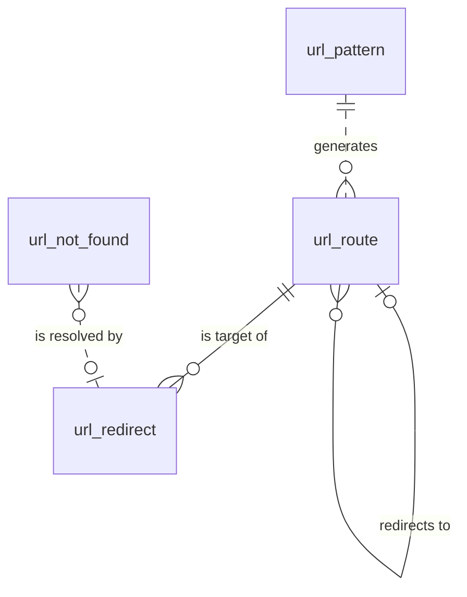

# URL 引擎（url）模块设计

| 项 | 内容 |
|---|---|
| 模块 ID | `url` |
| 名称 | URL 引擎 |
| 层 | L2 |
| 表前缀 | `url_` |
| API 前缀 | `url` |
| 可停用 | 否 |
| 模块版本 | 1.0.0（module.json 的 version） |
| 平台版本 | `>=1.0.0 <2.0.0`（module.json 的 platform） |
| 里程碑切片 | M1：路由、slug、自动 301；根路径 302；全部语言带前缀；M2：页面层级变化时重算子树路径；M3：重定向导入、前缀与正则重定向、404 日志；M4：—（详见第 13 节） |
| 模块负责人 | 待定 |
| 文档版本 | V1.4 |
| 状态 | 草案 |
| 更新日期 | 2026-10-20 |
| 依据 | 系统设计 V1.7 第 13 章及 3.2、3.8、24–29 章；平台框架设计 V1.5 第 4、7–13 章；ADR-002、ADR-003、ADR-005、ADR-009、ADR-018 |

> 本文只引用《平台框架设计》第 4 章中的契约，不定义新的跨模块契约；需要新契约时按平台框架设计 2.3 提出契约变更请求。

## 1. 职责与边界

### 1.1 职责

维护站点路由、slug 与 URL 规则；发布与下线时同步写入路由，历史地址直接指向本地化；提供手工及导入重定向、404 统计。

功能交付范围按第 13 章分为 M1–M4；表结构、约束与枚举以第 3、4 章为准。

### 1.2 不负责的事

| 事项 | 归属模块 | 边界 |
|---|---|---|
| 上层产品、文章、询盘业务 | 对应 L3 模块 | 不反向调用上层服务或访问其表 |
| 身份、权限、设置、任务及审计 | platform-core | 复用平台公共服务 |
| 第三方客户端与网络传输 | infrastructure | 仅经既有端口或 L2 服务使用，不在业务模块引入客户端 |

### 1.3 协作概览

| 协作方式 | 对象 | 本模块行为 |
|---|---|---|
| 服务接口 | 仅 core 公共服务 | 方法与事务边界见 2.2；无跨模块表访问 |
| 扩展点 | PlatformModule | 实现/收集清单见 2.4、2.5 |
| 领域事件 | 见 2.6 | 与本地事务一起登记，提交后异步投递；重复与过期处理独立验证 |

### 1.4 适用的架构约束

遵守 P2、P3 与 ADR-018：编译依赖只到 platform-core/platform-api，跨模块协作只用第 2 章登记契约；只访问自己的表，禁止跨模块 JOIN/外键。遵守 ADR-003：事务内登记、提交后投递、监听器幂等并检查过期。遵守 ADR-009：每次请求/任务明确站点上下文，站点表默认过滤。

公开读取只用当前语言发布态，不跨语言回退（ADR-005）；预览与公开缓存隔离。后台中文文案与错误集中管理，前台文案经 UiTextApi，样式只用 Design Token。远程端口在数据库事务外调用，密钥经 SecretCipher，不写日志。

## 2. 依赖与契约

### 2.1 module.json

```json
{
  "id": "url",
  "name": "URL 引擎",
  "version": "1.0.0",
  "layer": "L2",
  "platform": ">=1.0.0 <2.0.0",
  "requires": {},
  "optional": {},
  "disableable": false,
  "tablePrefix": "url_",
  "apiPrefix": "url",
  "permissions": [
    {
      "code": "url:redirect:view",
      "name": "查看重定向"
    },
    {
      "code": "url:redirect:manage",
      "name": "管理重定向"
    },
    {
      "code": "url:pattern:manage",
      "name": "管理URL 规则"
    },
    {
      "code": "url:redirect:import",
      "name": "导入重定向"
    }
  ],
  "menus": [
    {
      "key": "url",
      "name": "URL 引擎",
      "parent": "settings",
      "route": "/url/redirects",
      "permission": "url:redirect:view",
      "order": 100
    }
  ],
  "settings": null,
  "components": [],
  "events": {
    "publishes": [
      "ContentPathChangedEvent",
      "RedirectChangedEvent",
      "SiteResourceChangedEvent"
    ],
    "subscribes": [
      "SiteSettingsChangedEvent",
      "ContentPurgedEvent",
      "LocalizationDeletedEvent"
    ]
  }
}
```

描述符为 M0 工程建立后的实现要求；目前尚无实际控制器、Schema 或组件包。依赖只声明运行能力；Maven 仍只依赖 platform-api/core。组件清单是本模块负责的类型，运行时 UI 不登记成可拖入布局的组件。

### 2.2 使用的服务接口

| 接口（平台框架设计小节） | 方法 | 用途 | 调用位置与时机 | 测试替身 |
|---|---|---|---|---|
| `SiteApi`（4.4.1） | 按该契约声明的方法 | 语言、站点模块开关 | 业务事务内；站点切换由任务入口完成 | `InMemorySiteApi` |
| `SiteContextProvider`（4.4.2） | 按该契约声明的方法 | 当前站点；异步与任务由 core 恢复 | 业务事务内；站点切换由任务入口完成 | `FakeSiteContextProvider` |
| `PermissionChecker`（4.4.7） | 按该契约声明的方法 | 后台权限与数据范围 | 业务事务内；站点切换由任务入口完成 | `FakePermissionChecker` |
| `AuditApi`（4.4.9） | 按该契约声明的方法 | 同事务写审计，密钥与个人数据脱敏 | 业务事务内；站点切换由任务入口完成 | `InMemoryAuditApi` |
| `EventMetaFactory`（4.4.14） | 按该契约声明的方法 | 事件 ID、版本、站点与操作人 | 业务事务内；站点切换由任务入口完成 | `FakeEventMetaFactory` |
| `JobApi`（4.4.12） | 按该契约声明的方法 | 耗时任务提交、取消、进度与结果 | 业务事务内；站点切换由任务入口完成 | `InMemoryJobApi` |
| `ProjectionChangeApi`（4.10，Proposed） | searchChanged | 原保存事务内协调，失败回滚，站点隔离 | MANDATORY；不得afterCommit补写 | 框架4.10对应协议替身 |
| `TransactionMutexApi`（4.10，Proposed） | lock、advance | 原保存事务内协调，失败回滚，站点隔离 | MANDATORY；不得afterCommit补写 | 框架4.10对应协议替身 |

所有 L2/L3/L4 读写隐式使用当前站点；按 ID 查询单批最多 500。可选服务用 ObjectProvider 注入并检查当前站点启用状态，缺失时降级，不通过业务表绕过服务。


### 2.3 提供的服务接口

| 接口（平台框架设计小节） | 方法 | 实现类 | 契约测试 | 语义 |
|---|---|---|---|---|
| `UrlApi`（4.4.17） | reservePath、applyRoute、retireRoute、releaseRoutes、generateSlug、validateSlug、suggestAvailableSlug、resolve、pathOf、pathsOf、localeHomePath、absoluteUrl、recordNotFound、addRedirect | `UrlApiImpl` | `UrlApiContractTest` 继承 `UrlApiContract` | 完整遵守框架签名、站点隔离、事务及异常语义；远程调用按第 5 章拆分短事务；标注的交付热路径 P95 ≤ 20ms |

### 2.4 实现的扩展点

| 扩展点（平台框架设计小节） | 计划实现类 | 适用范围 | order | 收集方 |
|---|---|---|---|---|
| `PlatformModule`（4.5.22） | `UrlModule` | 本模块安装/升级；可停用模块提供影响报告与停用后保留数据规则 | DEFAULT=1000 | core |

以上类名为待实现名称。PublishContributor 不调用调用方的写方法，不访问外部服务；翻译提供方只写本模块草稿/资源，先校验源指纹与共同 version。本模块不可站点级停用；对可选依赖缺失/停用仍须按框架约定降级。

### 2.5 收集的扩展点

不适用：不收集业务扩展点；PlatformModule 与任务 SPI 由 core 收集。

### 2.6 发布与订阅的事件

补充：url模式保存/删除同事务发布SiteResourceChangedEvent(url.pattern, patternId, change)，content订阅并请求当前路由重算；完整新契约见框架4.10.2/4.10.5（Proposed）。

发布：

| 事件 | 触发事务 | 现有 payload 字段 | 订阅方 |
|---|---|---|---|
| `ContentPathChangedEvent` | applyRoute / retireRoute / 子树重算的路径实际变化事务；字段 reason 区分原因 | meta、contentId、localizationId、locale、previousPath、currentPath、reason、retireMode | 框架 4.2.4；未登记发布方的差异在第 14 章列出 |
| `RedirectChangedEvent` | 重定向新增、修改、删除同事务；同一事务没有变化则不重复发布 | meta、change、redirectId、sourcePath、matchType、count | 框架 4.2.4；未登记发布方的差异在第 14 章列出 |

订阅：

| 事件 | 处理 | 幂等 | 过期与删除 | 失败与重试 |
|---|---|---|---|---|
| `SiteSettingsChangedEvent` | 只在语言 URL 前缀、尾斜杠等路由相关 scope 改变时重算；输入来源缺口见第 14 章 | 本模块事务内的幂等标记与数据变更一起提交；缓存重复失效安全 | 读取当前状态/指纹；只有匹配的当前结果才更新；不以 occurredAt 单独当全序 | 失败抛出保留未完成投递；业务副作用转入已有任务/队列后重试 |
| `ContentPurgedEvent` | 按事件 contentId/localizationIds 清理本模块外部引用或子行；历史业务快照按 4.6 保留；不回查已不存在的父内容 | 本模块事务内的幂等标记与数据变更一起提交；缓存重复失效安全 | 清理使用事件中的 ID；查不到父对象仍须清理 | 失败抛出保留未完成投递；业务副作用转入已有任务/队列后重试 |
| `LocalizationDeletedEvent` | 仅清理对应语言的本模块本地化/投影，不删除其他语言或共享业务字段 | 本模块事务内的幂等标记与数据变更一起提交；缓存重复失效安全 | 清理使用事件中的 ID；查不到父对象仍须清理 | 失败抛出保留未完成投递；业务副作用转入已有任务/队列后重试 |

监听器按框架 5.8 建立站点/system 上下文；`ContentPurgedEvent` 在模块停用时仍必须清理（deliverWhenModuleDisabled）。其他停用期间跳过并完成的事件，重新启用后通过扫描当前状态补偿，不能假定还会重投。数据库幂等标记与本模块数据在同一事务提交；外部发送、下载、搜索与 CDN 调用不得被数据库长事务包裹，使用已声明的任务/端口和业务幂等键。事件 payload 仅引用框架现有字段，本文不扩展签名。

SiteResourceChangedEvent（框架4.10.2，Proposed）：发布：url.pattern变化，content重算全部配置语言；delivery清整站。字段meta/resourceType/resourceId/change，原事务登记，重复处理安全。

### 2.7 使用的端口

| 端口（平台框架小节） | 用途 | 测试替身 |
|---|---|---|
| `TaggedCache`（4.7.14） | 第 5 章外部能力；只通过端口调用基础设施 | `InMemoryTaggedCache` |
| `DistributedLock`（4.7.16） | 第 5 章外部能力；只通过端口调用基础设施 | `InMemoryDistributedLock` |
| `BufferStore`（4.7.17） | 第 5 章外部能力；只通过端口调用基础设施 | `InMemoryBufferStore` |

## 3. 领域模型

### 3.1 聚合、实体与值对象

| 类型 | 名称 | 说明 |
|---|---|---|
| 聚合根 | Route（`url_route`） | 一个可路由本地化的当前路径与在线状态；下线后保留为墓碑（`GONE` / `REDIRECT`），使原路径与所有指向它的重定向按下线策略返回 410 或 301 |
| 聚合根 | Redirect（`url_redirect`） | 源路径 → 目标；来源为自动（路径变化）、手工、导入 |
| 聚合根 | UrlPattern（`url_pattern`） | 站点 × 语言 × 内容类型（TERM_PAGE 可细分到词汇表）的 URL 规则；不含语言前缀 |
| 实体（统计） | NotFoundStat（`url_not_found`） | 按天聚合的 404 路径 |
| 值对象 | Path | 规范化路径：以 `/` 开头、含语言前缀、不带尾斜杠（尾斜杠策略只影响对外输出与规范化跳转）、合并重复斜杠、Unicode NFC |
| 值对象 | RedirectTarget | `target_kind` + 目标本地化 / 站内路径 / 外部 URL + `status_code` |
| 值对象 | RouteState | `ACTIVE` / `GONE` / `REDIRECT` |

在系统设计之外补充的字段：

| 补充 | 理由 |
|---|---|
| `url_route.state`、`redirect_localization_id`（路由墓碑） | 系统设计 13.4 要求“重定向指向本地化”且“L 下线时，指向它的重定向遵循 L 的下线策略”。把下线去向记在 L 的路由行上，所有指向 L 的重定向解析时都经过这一行：下线期间统一返回 410 / 301；L 重新发布后历史 URL 自动恢复跳转到 L；不需要批量改写重定向，也不产生重定向链 |
| `url_route.content_type` | 模块停用时按类型拒绝路由（系统设计 3.8）；URL 规则变化时按（语言, 类型）重算路径 |
| `url_redirect.target_url` 与 `target_path` 分开 | 站内路径（含语言前缀，可索引，用于链压缩与环路检测）与外部完整 URL（≤ 2048，不建索引）分开存储 |
| `url_redirect.sort_order`、`enabled`、`import_job_id`、`version` | PREFIX / REGEX 按顺序执行（系统设计 13.5）；临时停用规则；追溯导入批次；手工编辑的乐观锁 |
| `url_pattern.vocabulary_id` | TERM_PAGE 的规则按词汇表区分（`/product-category/{slug}`、`/applications/{slug}`）；0 表示适用于全部词汇表 |
| `url_not_found.path_hash`（生成列）、`locale` | 长路径不能直接建唯一索引；“未命中的旧 URL”报告按语言筛选 |

请求解析（对应系统设计 13.2 第 3–6 步；第 1、2 步的规范化与根路径跳转在此之前完成）：

```text
1. url_route (site_id, path)
     ACTIVE   → 200（Delivery 再检查该语言是否对外公开、所属模块是否启用，否则按 404）
     GONE     → 410
     REDIRECT → 取 redirect_localization_id 的路由行，按本步规则继续（最多 5 次，超出按 410）；
                得到 ACTIVE 时只返回一次 301 到其 path
2. url_redirect EXACT (site_id, source_path)，enabled = 1
     LOCALIZATION → 取 target_localization_id 的路由行，按第 1 步规则得到 301 / 410；没有路由行 → 410
     PATH / EXTERNAL → status_code（301 / 302 / 308）；GONE → 410
3. PREFIX → REGEX（enabled = 1，按 sort_order；规则在 Redis 中缓存）
4. 其余 → 404，计入 url_not_found
```

### 3.2 不变量

| # | 规则 | 保证方式 |
|---|---|---|
| 1 | 站点内路径唯一（包括墓碑） | 数据库：`uk_route_path` |
| 2 | 每个本地化最多一条路由行 | 数据库：`uk_route_loc` |
| 3 | `state = ACTIVE` ⇔ 本地化 `publish_state = PUBLISHED`，且 `path = cnt_localization.pub_path` | 应用层（content 在发布、下线事务内调用 url 服务接口） |
| 4 | `state = REDIRECT` ⇔ `redirect_localization_id` 非空 | 数据库：`ck_url_route_state` |
| 5 | 路由优先：新路由占用的路径上若有 EXACT 重定向或其他本地化的墓碑，在同一事务中删除，并提示“此 URL 以前属于 X”；手工重定向的源路径不能是 ACTIVE 路由，是墓碑时替换该墓碑 | 应用层 |
| 6 | 本地化路径变化时写入（旧路径 → `LOCALIZATION` 该本地化，301，`AUTO`）；同一本地化的历史路径全部直接指向本地化，不形成链 | 应用层 |
| 7 | 手工或导入的重定向保存时：目标路径是其他重定向的源 → 压缩为最终目标；目标路径是某本地化的路由 → 转为 `LOCALIZATION`；存在环路 → 拒绝 | 应用层 |
| 8 | 目标字段与 `target_kind`、`status_code` 一致：LOCALIZATION / PATH / EXTERNAL 使用 301 / 302 / 308，GONE 使用 410 | 数据库：`ck_url_redirect_target` |
| 9 | 每站 PREFIX 与 REGEX 规则合计不超过 200 条；REGEX 编译通过且有超时保护 | 应用层 |
| 10 | URL 规则不含语言前缀，必须包含 `{slug}`，只允许变量 `{slug}`、`{parentPath}`；同一范围只有一条未删除的规则 | 数据库：`uk_pattern_scope`；应用层 |
| 11 | 只有 TERM_PAGE 的规则可以指定词汇表 | 数据库：`ck_url_pattern_vocab` |
| 12 | 404 统计每站、每天、每个路径一行 | 数据库：`uk_nf_day_path` |

### 3.3 状态机

`url_route`：不存在 → ACTIVE（applyRoute）；ACTIVE → GONE / REDIRECT（retireRoute）；GONE / REDIRECT → ACTIVE（重新发布）。路径变更在同一事务生成自动 301；releaseRoutes 后原路径保留 GONE 记录。重定向目标失效时返回 410，禁止循环。

## 4. 数据模型

> 遵守平台框架设计第 7 章的数据库通用约定。本节给出待实现 DDL；本次文档审查未重跑 MySQL，不能据此认定 DDL 已验证。M0 后按第 11 章在 MySQL 8.4 空库验证，并使实际迁移脚本与本节一致。

### 4.1 表清单

| 表 | 说明 | 站点级 | 软删除 | 预估规模（单站，按系统设计假设 A4） |
|---|---|---|---|---|
| `url_route` | 路由表（含下线墓碑） | 是 | 否 | ≈ 18 万行（可路由的本地化） |
| `url_redirect` | 重定向 | 是 | 否（物理删除，变更写审计） | ≈ 5–20 万行（slug 变化 + 旧站导入） |
| `url_pattern` | URL 规则（覆盖代码中的默认规则） | 是 | 是（`deleted_at`） | < 100 行 |
| `url_not_found` | 404 路径日统计 | 是 | 否（保留 90 天） | 每天 1 千–1 万行，保留期内 ≤ 100 万行 |

### 4.2 ER 图



（`url_redirect.target_localization_id`、`url_route.redirect_localization_id` 与 `url_route.localization_id` 是逻辑关联，不建外键：路由行在内容彻底删除时会被删除，而指向它的重定向需要保留并返回 410。）

### 4.3 表结构

#### 4.3.1 `url_route`：路由

| 字段 | 类型 | 可空 | 默认 | 说明 |
|---|---|---|---|---|
| `id` | BIGINT | 否 | — | 主键（TSID） |
| `site_id` | BIGINT | 否 | — | 站点 ID（sys_site.id） |
| `locale` | VARCHAR(16) | 否 | — | 语言（BCP 47） |
| `path` | VARCHAR(500) bin | 否 | — | 完整路径（规范化，含语言前缀，不带尾斜杠），如 /zh/products/li-dian-chi-zu |
| `content_id` | BIGINT | 否 | — | 内容 ID（cnt_content.id） |
| `localization_id` | BIGINT | 否 | — | 本地化 ID（cnt_localization.id） |
| `content_type` | VARCHAR(32) | 否 | — | 内容类型：PAGE / PRODUCT / ARTICLE / CASE_STUDY / TERM_PAGE（可路由类型） |
| `state` | VARCHAR(16) | 否 | `'ACTIVE'` | 路由状态：ACTIVE（已发布，200）/ GONE（已下线，410）/ REDIRECT（已下线，301 到 redirect_localization_id 的当前路径） |
| `redirect_localization_id` | BIGINT | 是 | — | REDIRECT 状态的目标本地化 ID（下线时按下线策略解析出的同语言本地化） |
| `created_at` | DATETIME(3) | 否 | `CURRENT_TIMESTAMP(3)` | 创建时间（UTC） |
| `updated_at` | DATETIME(3) | 否 | `CURRENT_TIMESTAMP(3) ON UPDATE CURRENT_TIMESTAMP(3)` | 更新时间（UTC） |

索引与约束：
- `PRIMARY KEY (id)`
- `uk_route_path (site_id, path)`：请求解析的精确匹配（大写路径转小写后再查一次）；页面层级变化时按前缀范围扫描子树（`path LIKE '/zh/about/%'`）
- `uk_route_loc (localization_id)`：重定向解析（本地化 → 当前路径）；发布时更新路径
- `idx_route_scope (site_id, locale, content_type)`：URL 规则或语言前缀变化后按范围重算路径
- `idx_route_content (content_id)`：内容彻底删除时清理
- `idx_route_redirect (redirect_localization_id)`：目标本地化被删除时，把指向它的墓碑改为 `GONE`
- `ck_url_route_state`：见 3.2 不变量 4

```sql
CREATE TABLE url_route (
  id                        BIGINT        NOT NULL COMMENT '主键（TSID）',
  site_id                   BIGINT        NOT NULL COMMENT '站点 ID（sys_site.id）',
  locale                    VARCHAR(16)   NOT NULL COMMENT '语言（BCP 47）',
  path                      VARCHAR(500)  COLLATE utf8mb4_0900_bin NOT NULL COMMENT '完整路径（规范化，含语言前缀，不带尾斜杠），如 /zh/products/li-dian-chi-zu',
  content_id                BIGINT        NOT NULL COMMENT '内容 ID（cnt_content.id）',
  localization_id           BIGINT        NOT NULL COMMENT '本地化 ID（cnt_localization.id）',
  content_type              VARCHAR(32)   NOT NULL COMMENT '内容类型：PAGE / PRODUCT / ARTICLE / CASE_STUDY / TERM_PAGE（可路由类型）',
  state                     VARCHAR(16)   NOT NULL DEFAULT 'ACTIVE' COMMENT '路由状态：ACTIVE（已发布，200）/ GONE（已下线，410）/ REDIRECT（已下线，301 到 redirect_localization_id 的当前路径）',
  redirect_localization_id  BIGINT        NULL COMMENT 'REDIRECT 状态的目标本地化 ID（下线时按下线策略解析出的同语言本地化）',
  created_at                DATETIME(3)   NOT NULL DEFAULT CURRENT_TIMESTAMP(3) COMMENT '创建时间（UTC）',
  updated_at                DATETIME(3)   NOT NULL DEFAULT CURRENT_TIMESTAMP(3) ON UPDATE CURRENT_TIMESTAMP(3) COMMENT '更新时间（UTC）',
  PRIMARY KEY (id),
  UNIQUE KEY uk_route_path (site_id, path),
  UNIQUE KEY uk_route_loc (localization_id),
  KEY idx_route_scope (site_id, locale, content_type),
  KEY idx_route_content (content_id),
  KEY idx_route_redirect (redirect_localization_id),
  CONSTRAINT ck_url_route_state CHECK ((state = 'REDIRECT' AND redirect_localization_id IS NOT NULL) OR (state IN ('ACTIVE', 'GONE') AND redirect_localization_id IS NULL))
) ENGINE = InnoDB DEFAULT CHARSET = utf8mb4 COLLATE = utf8mb4_0900_ai_ci COMMENT = '路由表：可路由本地化的当前路径与状态（下线后保留为墓碑）';
```

要点（生命周期，均在 content 的发布事务内执行）：

| 事件 | 处理 |
|---|---|
| 首次发布 | 插入 `ACTIVE` 行；路径 = `/{url_prefix}` + URL 规则展开（`{slug}`、`{parentPath}`，见 4.3.3） |
| 路径变化 | 更新 `path`；写入（旧路径 → `LOCALIZATION`，301，`AUTO`）；发布 `ContentPathChangedEvent` |
| 下线 | `GONE`，或 `REDIRECT` + 目标本地化（REDIRECT_CONTENT 为目标内容、REDIRECT_PARENT 为上级页面的同语言本地化；该语言没有已发布的目标时退化为 `GONE`） |
| 重新发布 | 回到 `ACTIVE`（路径可能变化，按“路径变化”处理） |
| 新内容占用墓碑的路径 | 删除该墓碑行（被占用的本地化此后没有路由行，指向它的重定向返回 410；它再次发布时重新生成路由） |
| 内容彻底删除 / 本地化删除 | 删除路由行；若原路径未被占用，写入 `url_redirect`（原路径 → `GONE`，410，`AUTO`），使其继续返回 410 |

语言前缀取自 `sys_site_locale.url_prefix`；前缀或 URL 规则变化时，由任务重算范围内全部路由并按“路径变化”生成 301。

#### 4.3.2 `url_redirect`：重定向

| 字段 | 类型 | 可空 | 默认 | 说明 |
|---|---|---|---|---|
| `id` | BIGINT | 否 | — | 主键（TSID） |
| `site_id` | BIGINT | 否 | — | 站点 ID（sys_site.id） |
| `source_path` | VARCHAR(500) bin | 否 | — | 源：EXACT 为规范化路径，PREFIX 为路径前缀，REGEX 为正则表达式（整体匹配） |
| `match_type` | VARCHAR(10) | 否 | `'EXACT'` | 匹配方式：EXACT / PREFIX / REGEX |
| `sort_order` | INT | 否 | `0` | PREFIX / REGEX 的执行顺序（小的先执行）；EXACT 不使用 |
| `target_kind` | VARCHAR(16) | 否 | — | 目标类型：LOCALIZATION / PATH / EXTERNAL / GONE |
| `target_localization_id` | BIGINT | 是 | — | LOCALIZATION 的目标本地化 ID（cnt_localization.id），解析时取其当前路径 |
| `target_path` | VARCHAR(500) bin | 是 | — | PATH 的站内目标路径（含语言前缀；REGEX 可使用 $1 等分组引用） |
| `target_url` | VARCHAR(2048) | 是 | — | EXTERNAL 的外部完整 URL（https） |
| `status_code` | SMALLINT | 否 | `301` | HTTP 状态码：301 / 302 / 308 / 410 |
| `origin` | VARCHAR(10) | 否 | — | 来源：AUTO（路径变化或删除时自动生成）/ MANUAL（手工）/ IMPORT（CSV 导入） |
| `enabled` | TINYINT(1) | 否 | `1` | 是否启用 |
| `hits` | BIGINT | 否 | `0` | 命中次数（先在 Redis 计数，定期批量写库） |
| `last_hit_at` | DATETIME(3) | 是 | — | 最近命中时间（UTC） |
| `import_job_id` | BIGINT | 是 | — | IMPORT 来源的导入任务 ID（sys_job.id） |
| `note` | VARCHAR(500) | 是 | — | 备注 |
| `version` | INT | 否 | `0` | 乐观锁版本号 |
| `created_at` | DATETIME(3) | 否 | `CURRENT_TIMESTAMP(3)` | 创建时间（UTC） |
| `created_by` | BIGINT | 否 | `0` | 创建人用户 ID（0 = 系统） |
| `updated_at` | DATETIME(3) | 否 | `CURRENT_TIMESTAMP(3) ON UPDATE CURRENT_TIMESTAMP(3)` | 更新时间（UTC） |
| `updated_by` | BIGINT | 否 | `0` | 更新人用户 ID（0 = 系统） |

索引与约束：
- `PRIMARY KEY (id)`
- `uk_redirect_source (site_id, source_path, match_type)`：EXACT 精确匹配；同一源路径同类规则唯一
- `idx_redirect_target_loc (target_localization_id)`：本地化删除时把指向它的重定向改为 `GONE`；后台“哪些旧 URL 指向此内容”
- `idx_redirect_target_path (site_id, target_path)`：链压缩（新增重定向的源是已有重定向的目标时，改写已有重定向）；新路由出现时把指向该路径的 `PATH` 型重定向转为 `LOCALIZATION`
- `idx_redirect_rule (site_id, match_type, sort_order)`：加载站点的 PREFIX / REGEX 规则
- `ck_url_redirect_target`：见 3.2 不变量 8

```sql
CREATE TABLE url_redirect (
  id                      BIGINT         NOT NULL COMMENT '主键（TSID）',
  site_id                 BIGINT         NOT NULL COMMENT '站点 ID（sys_site.id）',
  source_path             VARCHAR(500)   COLLATE utf8mb4_0900_bin NOT NULL COMMENT '源：EXACT 为规范化路径，PREFIX 为路径前缀，REGEX 为正则表达式（整体匹配）',
  match_type              VARCHAR(10)    NOT NULL DEFAULT 'EXACT' COMMENT '匹配方式：EXACT / PREFIX / REGEX',
  sort_order              INT            NOT NULL DEFAULT 0 COMMENT 'PREFIX / REGEX 的执行顺序（小的先执行）；EXACT 不使用',
  target_kind             VARCHAR(16)    NOT NULL COMMENT '目标类型：LOCALIZATION / PATH / EXTERNAL / GONE',
  target_localization_id  BIGINT         NULL COMMENT 'LOCALIZATION 的目标本地化 ID（cnt_localization.id），解析时取其当前路径',
  target_path             VARCHAR(500)   COLLATE utf8mb4_0900_bin NULL COMMENT 'PATH 的站内目标路径（含语言前缀；REGEX 可使用 $1 等分组引用）',
  target_url              VARCHAR(2048)  NULL COMMENT 'EXTERNAL 的外部完整 URL（https）',
  status_code             SMALLINT       NOT NULL DEFAULT 301 COMMENT 'HTTP 状态码：301 / 302 / 308 / 410',
  origin                  VARCHAR(10)    NOT NULL COMMENT '来源：AUTO（路径变化或删除时自动生成）/ MANUAL（手工）/ IMPORT（CSV 导入）',
  enabled                 TINYINT(1)     NOT NULL DEFAULT 1 COMMENT '是否启用',
  hits                    BIGINT         NOT NULL DEFAULT 0 COMMENT '命中次数（先在 Redis 计数，定期批量写库）',
  last_hit_at             DATETIME(3)    NULL COMMENT '最近命中时间（UTC）',
  import_job_id           BIGINT         NULL COMMENT 'IMPORT 来源的导入任务 ID（sys_job.id）',
  note                    VARCHAR(500)   NULL COMMENT '备注',
  version                 INT            NOT NULL DEFAULT 0 COMMENT '乐观锁版本号',
  created_at              DATETIME(3)    NOT NULL DEFAULT CURRENT_TIMESTAMP(3) COMMENT '创建时间（UTC）',
  created_by              BIGINT         NOT NULL DEFAULT 0 COMMENT '创建人用户 ID（0 = 系统）',
  updated_at              DATETIME(3)    NOT NULL DEFAULT CURRENT_TIMESTAMP(3) ON UPDATE CURRENT_TIMESTAMP(3) COMMENT '更新时间（UTC）',
  updated_by              BIGINT         NOT NULL DEFAULT 0 COMMENT '更新人用户 ID（0 = 系统）',
  PRIMARY KEY (id),
  UNIQUE KEY uk_redirect_source (site_id, source_path, match_type),
  KEY idx_redirect_target_loc (target_localization_id),
  KEY idx_redirect_target_path (site_id, target_path),
  KEY idx_redirect_rule (site_id, match_type, sort_order),
  CONSTRAINT ck_url_redirect_target CHECK ((target_kind = 'LOCALIZATION' AND target_localization_id IS NOT NULL AND status_code IN (301, 302, 308)) OR (target_kind = 'PATH' AND target_path IS NOT NULL AND status_code IN (301, 302, 308)) OR (target_kind = 'EXTERNAL' AND target_url IS NOT NULL AND status_code IN (301, 302, 308)) OR (target_kind = 'GONE' AND status_code = 410))
) ENGINE = InnoDB DEFAULT CHARSET = utf8mb4 COLLATE = utf8mb4_0900_ai_ci COMMENT = '重定向（自动、手工、导入）';
```

要点：
- **与系统设计 25.9 的差异**：`target_path` 改为 `VARCHAR(500)` + bin（可建索引），外部 URL 移到 `target_url VARCHAR(2048)`；增加 `sort_order`、`enabled`、`import_job_id`、`version`；`status_code` 默认 301；索引名按平台框架设计 7.2。
- 旧站导入（系统设计 13.5）：源路径通常不带语言前缀，目标路径带前缀；导入先生成校验报告（目标不存在、环路、链、与现有路由冲突），确认后写入，`origin = IMPORT`。
- 增删改发布 `RedirectChangedEvent`（delivery 失效缓存）；删除为物理删除，后台操作写审计日志。

#### 4.3.3 `url_pattern`：URL 规则

| 字段 | 类型 | 可空 | 默认 | 说明 |
|---|---|---|---|---|
| `id` | BIGINT | 否 | — | 主键（TSID） |
| `site_id` | BIGINT | 否 | — | 站点 ID（sys_site.id） |
| `locale` | VARCHAR(16) | 否 | — | 语言（BCP 47） |
| `content_type` | VARCHAR(32) | 否 | — | 内容类型：PAGE / PRODUCT / ARTICLE / CASE_STUDY / TERM_PAGE（可路由类型） |
| `vocabulary_id` | BIGINT | 否 | `0` | TERM_PAGE 适用的词汇表 ID（tx_vocabulary.id）；0 = 不区分词汇表 |
| `pattern` | VARCHAR(200) bin | 否 | — | URL 规则（不含语言前缀），如 /produkte/{slug}；变量只允许 {slug}、{parentPath} |
| `deleted_at` | DATETIME(3) | 是 | — | 删除时间（软删除） |
| `alive` | TINYINT | 是 | 生成列 `IF(deleted_at IS NULL, 1, NULL)` | 未删除标记（唯一索引用） |
| `version` | INT | 否 | `0` | 乐观锁版本号 |
| `created_at` | DATETIME(3) | 否 | `CURRENT_TIMESTAMP(3)` | 创建时间（UTC） |
| `created_by` | BIGINT | 否 | `0` | 创建人用户 ID |
| `updated_at` | DATETIME(3) | 否 | `CURRENT_TIMESTAMP(3) ON UPDATE CURRENT_TIMESTAMP(3)` | 更新时间（UTC） |
| `updated_by` | BIGINT | 否 | `0` | 更新人用户 ID |

索引与约束：
- `PRIMARY KEY (id)`
- `uk_pattern_scope (site_id, locale, content_type, vocabulary_id, alive)`：同一范围只有一条未删除的规则；生成路径时按范围查找
- `ck_url_pattern_vocab`：只有 TERM_PAGE 可以指定词汇表

```sql
CREATE TABLE url_pattern (
  id             BIGINT        NOT NULL COMMENT '主键（TSID）',
  site_id        BIGINT        NOT NULL COMMENT '站点 ID（sys_site.id）',
  locale         VARCHAR(16)   NOT NULL COMMENT '语言（BCP 47）',
  content_type   VARCHAR(32)   NOT NULL COMMENT '内容类型：PAGE / PRODUCT / ARTICLE / CASE_STUDY / TERM_PAGE（可路由类型）',
  vocabulary_id  BIGINT        NOT NULL DEFAULT 0 COMMENT 'TERM_PAGE 适用的词汇表 ID（tx_vocabulary.id）；0 = 不区分词汇表',
  pattern        VARCHAR(200)  COLLATE utf8mb4_0900_bin NOT NULL COMMENT 'URL 规则（不含语言前缀），如 /produkte/{slug}；变量只允许 {slug}、{parentPath}',
  deleted_at     DATETIME(3)   NULL COMMENT '删除时间（软删除）',
  alive          TINYINT       AS (IF(deleted_at IS NULL, 1, NULL)) STORED COMMENT '未删除标记（唯一索引用）',
  version        INT           NOT NULL DEFAULT 0 COMMENT '乐观锁版本号',
  created_at     DATETIME(3)   NOT NULL DEFAULT CURRENT_TIMESTAMP(3) COMMENT '创建时间（UTC）',
  created_by     BIGINT        NOT NULL DEFAULT 0 COMMENT '创建人用户 ID',
  updated_at     DATETIME(3)   NOT NULL DEFAULT CURRENT_TIMESTAMP(3) ON UPDATE CURRENT_TIMESTAMP(3) COMMENT '更新时间（UTC）',
  updated_by     BIGINT        NOT NULL DEFAULT 0 COMMENT '更新人用户 ID',
  PRIMARY KEY (id),
  UNIQUE KEY uk_pattern_scope (site_id, locale, content_type, vocabulary_id, alive),
  CONSTRAINT ck_url_pattern_vocab CHECK (content_type = 'TERM_PAGE' OR vocabulary_id = 0)
) ENGINE = InnoDB DEFAULT CHARSET = utf8mb4 COLLATE = utf8mb4_0900_ai_ci COMMENT = 'URL 规则（站点 × 语言 × 内容类型或词汇表，不含语言前缀）';
```

要点：
- 规则查找顺序：（语言, 类型, 词汇表）→（语言, TERM_PAGE, 0）→ 源语言 `zh-CN` 的同范围规则 → 代码中的默认规则（`ContentTypeDefinition.defaultUrlPattern`；内置词汇表的 TERM_PAGE 默认规则由 taxonomy 提供）。自定义的可路由词汇表在创建时必须配置源语言规则。
- 完整路径 = `/{url_prefix}`（站点语言配置）+ 展开后的规则，如德语 `/de` + `/produkte/{slug}` = `/de/produkte/{slug}`（系统设计 5.4）。
- `{parentPath}` 展开为父页面在同一语言的当前路由路径（去掉语言前缀）；父页面在该语言没有 `ACTIVE` 路由时，子页面发布校验报错。首页（由 page 模块标记）的路径就是语言前缀本身，如 `/zh`。
- 新增、修改、删除规则后，由任务重算该范围内全部 `ACTIVE` 路由，并为变化的路径生成 301。

#### 4.3.4 `url_not_found`：404 路径日统计

| 字段 | 类型 | 可空 | 默认 | 说明 |
|---|---|---|---|---|
| `id` | BIGINT | 否 | — | 主键（TSID） |
| `site_id` | BIGINT | 否 | — | 站点 ID（sys_site.id） |
| `stat_date` | DATE | 否 | — | 统计日期（UTC） |
| `path` | VARCHAR(2048) bin | 否 | — | 未命中的路径（规范化后，不含查询参数，超长截断到 2048） |
| `path_hash` | CHAR(64) bin | 是 | 生成列 `SHA2(path, 256)` | 路径的 SHA-256（生成列，唯一索引用） |
| `locale` | VARCHAR(16) | 是 | — | 按路径前缀识别的语言；无法识别（如旧站 URL）为空 |
| `hits` | INT | 否 | `0` | 当天命中次数 |
| `first_seen_at` | DATETIME(3) | 否 | — | 当天首次出现时间（UTC） |
| `last_seen_at` | DATETIME(3) | 否 | — | 当天最近出现时间（UTC） |
| `last_referrer` | VARCHAR(2048) | 是 | — | 最近一次的来源页（Referer，去除查询参数） |
| `created_at` | DATETIME(3) | 否 | `CURRENT_TIMESTAMP(3)` | 创建时间（UTC） |
| `updated_at` | DATETIME(3) | 否 | `CURRENT_TIMESTAMP(3) ON UPDATE CURRENT_TIMESTAMP(3)` | 更新时间（UTC） |

索引与约束：
- `PRIMARY KEY (id)`
- `uk_nf_day_path (site_id, stat_date, path_hash)`：批量写库的 upsert（`INSERT … ON DUPLICATE KEY UPDATE hits = hits + ?`）；报表按日期范围聚合（`GROUP BY path_hash`）；按日期清理
- `idx_nf_path (site_id, path_hash)`：单个路径的历史趋势；创建重定向后查看该路径是否仍被访问

```sql
CREATE TABLE url_not_found (
  id             BIGINT         NOT NULL COMMENT '主键（TSID）',
  site_id        BIGINT         NOT NULL COMMENT '站点 ID（sys_site.id）',
  stat_date      DATE           NOT NULL COMMENT '统计日期（UTC）',
  path           VARCHAR(2048)  COLLATE utf8mb4_0900_bin NOT NULL COMMENT '未命中的路径（规范化后，不含查询参数，超长截断到 2048）',
  path_hash      CHAR(64)       COLLATE utf8mb4_0900_bin AS (SHA2(path, 256)) STORED COMMENT '路径的 SHA-256（生成列，唯一索引用）',
  locale         VARCHAR(16)    NULL COMMENT '按路径前缀识别的语言；无法识别（如旧站 URL）为空',
  hits           INT            NOT NULL DEFAULT 0 COMMENT '当天命中次数',
  first_seen_at  DATETIME(3)    NOT NULL COMMENT '当天首次出现时间（UTC）',
  last_seen_at   DATETIME(3)    NOT NULL COMMENT '当天最近出现时间（UTC）',
  last_referrer  VARCHAR(2048)  NULL COMMENT '最近一次的来源页（Referer，去除查询参数）',
  created_at     DATETIME(3)    NOT NULL DEFAULT CURRENT_TIMESTAMP(3) COMMENT '创建时间（UTC）',
  updated_at     DATETIME(3)    NOT NULL DEFAULT CURRENT_TIMESTAMP(3) ON UPDATE CURRENT_TIMESTAMP(3) COMMENT '更新时间（UTC）',
  PRIMARY KEY (id),
  UNIQUE KEY uk_nf_day_path (site_id, stat_date, path_hash),
  KEY idx_nf_path (site_id, path_hash)
) ENGINE = InnoDB DEFAULT CHARSET = utf8mb4 COLLATE = utf8mb4_0900_ai_ci COMMENT = '404 路径按天聚合统计';
```

要点：404 先在 Redis 中计数（按站点、日期、路径哈希），每分钟批量写库（系统设计 13.2）。“未命中的旧 URL”报告按日期范围聚合，排除当前已有路由或重定向的路径（同模块关联查询），SEO 专员可一键创建重定向。保留 90 天（本模块第 10 章）。

### 4.4 枚举

| 字段 | 取值 | 说明 |
|---|---|---|
| `url_route.state` | `ACTIVE` | 已发布，返回 200（默认） |
| | `GONE` | 已下线，返回 410 |
| | `REDIRECT` | 已下线，301 到 `redirect_localization_id` 的当前路径 |
| `url_route.content_type`、`url_pattern.content_type` | `PAGE` / `PRODUCT` / `ARTICLE` / `CASE_STUDY` / `TERM_PAGE` | 共享内容类型枚举中的可路由类型 |
| `url_redirect.match_type` | `EXACT` / `PREFIX` / `REGEX` | 精确（默认）/ 前缀 / 正则；按此顺序匹配 |
| `url_redirect.target_kind` | `LOCALIZATION` | 指向本地化，解析时取其当前路径（自动重定向、指向内容的手工重定向） |
| | `PATH` | 站内路径（目标暂不是任何路由时） |
| | `EXTERNAL` | 外部 URL |
| | `GONE` | 410 |
| `url_redirect.status_code` | `301` / `302` / `308` / `410` | 默认 301 |
| `url_redirect.origin` | `AUTO` / `MANUAL` / `IMPORT` | 系统生成 / 手工 / CSV 导入 |

### 4.5 站点过滤

| 表 | 行级拦截器 | 访问方式与理由 |
|---|---|---|
| `url_route` | 不豁免 | 请求和任务隐式使用当前站点；子表 site_id 与父表一致 |
| `url_redirect` | 不豁免 | 请求和任务隐式使用当前站点；子表 site_id 与父表一致 |
| `url_pattern` | 不豁免 | 请求和任务隐式使用当前站点；子表 site_id 与父表一致 |
| `url_not_found` | 不豁免 | 请求和任务隐式使用当前站点；子表 site_id 与父表一致 |

### 4.6 跨模块引用与清理

| 本模块字段 | 引用对象（模块.表） | 被引用对象删除 / 下线时的处理 | 触发事件 |
|---|---|---|---|
| `url_route.content_id`、`localization_id` | content.`cnt_content`、`cnt_localization` | 发布、下线：在 content 的发布事务中经服务接口同步维护（见 4.3.1）。彻底删除 / 本地化删除：删除路由行，原路径写为 GONE 重定向 | `ContentPurgedEvent`、`LocalizationDeletedEvent` |
| `url_route.redirect_localization_id` | content.`cnt_localization` | 目标被删除：墓碑改为 `GONE`（未清理前解析找不到目标时同样返回 410） | `ContentPurgedEvent`、`LocalizationDeletedEvent` |
| `url_redirect.target_localization_id` | content.`cnt_localization` | 目标被删除：改为 `target_kind = GONE`、`status_code = 410` | `ContentPurgedEvent`、`LocalizationDeletedEvent` |
| `url_route.locale`、`url_pattern.locale` | core.`sys_site_locale` | `url_prefix` 变化：任务重算该语言全部路由并生成 301；删除语言前，该语言的本地化先被删除（见上） | `SiteSettingsChangedEvent` |
| `url_pattern.vocabulary_id` | taxonomy.`tx_vocabulary` | 词汇表只能在没有分类项时删除（此时没有对应的 TERM_PAGE 路由）；残留规则没有匹配 RouteHints 时不再生效；url 不反向调用 TaxonomyApi，主动清理方案见第 14 节 URL-01 | — |
| `url_redirect.import_job_id` | core.`sys_job` | 任务记录清理后只作历史标识，不级联 | — |
| `created_by`、`updated_by` | core.`sys_user` | 不清理 | — |

本模块发布的事件：`ContentPathChangedEvent`（路径变化，含旧路径；seo 推送 IndexNow）、`RedirectChangedEvent`。

---

### 4.7 迁移脚本

| 文件 | 内容 | 里程碑 |
|---|---|---|
| `db/migration/url/V001__init.sql` | 4.3 中的全部表（4 张：`url_route`、`url_redirect`、`url_pattern`、`url_not_found`），按本节顺序创建 | 按第 13.1 节分期启用，初始结构在首个有效切片建立 |

## 5. 业务流程

### 5.1 核心业务流程

| 步骤 | 事务及行为 | 失败处理 |
|---|---|---|
| 1 | 发布事务内 reservePath 校验路径与保留字，applyRoute 更新路由并把旧路径记为 LOCALIZATION 重定向；同事务发布 ContentPathChangedEvent 与 RedirectChangedEvent。下线经 retireRoute 生成 410 或替代目标。 | 输入或状态非法返回 4xx；数据库事务回滚；提交后外部处理失败进入重试与可见失败记录 |
| 2 | 重定向保存先规范化 source/target，再检测环与路由冲突，把链压缩为最终目标；有冲突整笔回滚。CSV 先校验预览，确认后用 JobApi 分批提交，逐行报告。 | 输入或状态非法返回 4xx；数据库事务回滚；提交后外部处理失败进入重试与可见失败记录 |
| 3 | 父页面移动由content登记重算任务；content每批在互斥锁内读取当前RouteHints再调用url，url不持有任务输入快照，不反向调用content或taxonomy。 | 输入或状态非法返回 4xx；数据库事务回滚；提交后外部处理失败进入重试与可见失败记录 |

后台读写先校验权限与站点/语言范围；草稿写入和审计在同一事务。远程操作不能使用数据库长事务包裹。幂等重放返回既有结果；参数不同却复用同一幂等键时拒绝。

### 5.2 一致性、失败与恢复约束

| 场景 | 必须满足的行为 | 可验证结果 |
|---|---|---|
| 规范化与重定向优先级 | 按框架约定先规范化、查 ACTIVE 路由，再精确/前缀/正则规则；只用受限正则语法和执行预算，拒绝危险协议、控制字符与循环。目标路径含语言前缀，历史源可以是旧站无前缀地址。 | ACTIVE 路由覆盖同源规则；两次改 slug 后全部旧地址单跳到当前地址；构造正则最坏输入在预算内失败，不阻塞其他解析。 |
| CSV 预检与重复确认 | 确认请求绑定同站点文件哈希、列映射和预检结果；每行独立事务，幂等键与内容不匹配返回 409；取消只影响未处理行。 | 含合法/冲突/环路各一行，报告分别为成功/冲突/环路；同预检重复 commit 只有一个任务，重试不覆盖人工后改的规则。 |
| 404 计数合并 | 使用 BufferStore.drainCounters 原子取出并清零，按站点/日期/路径批量累加；它是尽力统计而非持久队列。已知回滚可重新 increment，提交结果不明或进程崩溃时记录不确定区间，不能承诺零丢失/恰好一次；原始 URL 不保留敏感查询参数。 | 正常并发场景两个周期计数等于输入；注入 drain 后进程退出/数据库提交未知时，报告不确定统计区间，不以该统计作为发布、计费或安全审计事实。 |
| 子树移动输入 | 只使用既有 UrlApi 与调用方提供的 RouteHints，不从 url 反向查询 page/taxonomy。任务恢复时再核对当前父路径，冲突暂停并逐项报告，不悄悄改 slug。 | 移动父页、并发再次移动及中途取消，成功项路径可解释、旧路径仍可跳转；任务按框架4.10.5的generation与当前树协议执行（ADR-022待评审）。 |

### 5.3 实现前统一方案与接入要求

依据[平台框架 4.10.4、4.10.5](../framework/platform-framework.md)及[设计问题处理说明](../reviews/design-issue-resolution-2026-10-20.md)。新增契约相关ADR仍为Proposed；下列方案已具体化，待评审冻结后同批实现，不能据此声明运行问题已验证。涉及本节的旧异步引用、原地索引写入或待定措辞按此方案替代。

- 子树重算由content任务编排；url不新增反向读取page/content/taxonomy接口。只接收任务按当前树生成的reservePath/applyRoute参数。
- 路由/模式相关写入口先取得content.route_tree数据库事务锁，输入变化推进generation；任务发现新generation从当前树重新开始。
- 模式变更通过SiteResourceChangedEvent(url.pattern)使content补交任务；语言前缀变化由core事件触发同类任务。冲突批次回滚并暂停，已提交批次不冒充整站原子切换。
- applyRoute/retireRoute等公开路径变化在原事务经ProjectionChangeApi捕获，保证搜索切换可追平路径变化。

## 6. 接口

### 6.1 Admin 端点

| 方法 | 路径（相对 /api/admin/v1/url） | 说明 | 权限码 | 并发控制 / 幂等 | 审计 |
|---|---|---|---|---|---|
| GET | `/redirects` | 分页检索重定向 | `url:redirect:view` | 只读；不写入业务状态 | 否 |
| POST | `/redirects` | 新建并检查环路 | `url:redirect:manage` | 唯一键检查；重复创建返回 409（不覆盖已有资源） | url.redirects.post |
| PUT | `/redirects/{id}` | 修改规则与优先级 | `url:redirect:manage` | 聚合 version / If-Match；冲突 409 / 412，整笔回滚 | url.redirects.{id}.put |
| DELETE | `/redirects/{id}` | 删除手工重定向 | `url:redirect:manage` | 校验聚合 version 与引用；已不存在返回 404，不能重复副作用 | url.redirects.{id}.delete |
| GET | `/patterns` | 读取 URL 模式 | `url:pattern:manage` | 只读；不写入业务状态 | 否 |
| PUT | `/patterns/{id}` | 保存允许变量的模式 | `url:pattern:manage` | 聚合 version / If-Match；冲突 409 / 412，整笔回滚 | url.patterns.{id}.put |
| GET | `/not-found` | 按天与路径聚合 404 | `url:redirect:view` | 只读；不写入业务状态 | 否 |
| POST | `/imports/validate` | 上传 CSV 并返回逐行预检报告 | `url:redirect:import` | Idempotency-Key；同键同请求返回既有任务/结果 | url.imports.validate.post |
| POST | `/imports/{id}/commit` | 确认导入并返回 jobId | `url:redirect:import` | Idempotency-Key；同键同请求返回既有任务/结果 | url.imports.{id}.commit.post |
| GET | `/redirects/{id}` | 读取规则及 version | `url:redirect:view` | 只读 | 否 |
| POST | `/patterns` | 创建未被占用作用域的 URL 规则 | `url:pattern:manage` | 更新校验聚合 version；失败整笔回滚 | url.patterns.post |
| DELETE | `/patterns/{id}` | 删除非必需自定义规则 | `url:pattern:manage` | 更新校验聚合 version；失败整笔回滚 | url.patterns.delete |
| GET | `/imports/{id}` | 读取预检逐行结果与确认状态 | `url:redirect:import` | 只读 | 否 |

ID 序列化为字符串，时间为 ISO-8601 UTC；列表 page/size（size ≤ 100），默认 size=20，排序字段白名单。版本化资源按框架 5.5.6 使用 ETag: "v{version}" 与 If-Match，不能用任意 JSON 摘要替代平台版本协议；无 version 的集合写入方式见本节补充约束。创建返回资源及标识；耗时 POST 返回 202 与 jobId；无跨站点 ID 访问。写操作审计不包含凭据、完整个人数据或任意脚本正文。

**请求与结果约束**：重定向定义：sourcePath、matchType、targetKind 与互斥目标、statusCode、priority；URL 规则：contentType、locale、vocabularyId、pattern。source/target 都先规范化，再做冲突/环路校验；CSV 报告包含行号、原值、规范化值、错误码。

### 6.2 Public 端点

不适用：内容、菜单、媒体引用等由 delivery 返回；本模块不增加绕过发布态约束的公开读取接口。

### 6.3 Internal 端点

不适用：不新增 internal HTTP 端点；跨模块使用进程内 platform-api 契约。Nuxt 所需公共读取使用 6.2 的既有入口及可信代理认证。

### 6.4 权限码

| 权限码 | 名称 | 数据范围 | 高危 | 语言范围 |
|---|---|---|---|---|
| `url:redirect:view` | 查看重定向 | 当前站点 | 否 | 否 |
| `url:redirect:manage` | 管理重定向 | 当前站点 | 否 | 否 |
| `url:pattern:manage` | 管理URL 规则 | 当前站点 | 否 | 否 |
| `url:redirect:import` | 导入重定向 | 当前站点 | 否 | 否 |

### 6.5 错误码

| 错误码 | HTTP 状态 | 后台中文信息 | 前台文案键 |
|---|---|---|---|
| `URL_PATH_CONFLICT` | 409 | 路径已被占用 | —（仅后台） |
| `URL_PATH_RESERVED` | 422 | 路径使用了保留字 | —（仅后台） |
| `URL_SLUG_INVALID` | 422 | slug 格式不正确 | —（仅后台） |
| `URL_PATTERN_INVALID` | 422 | URL 规则无法展开 | —（仅后台） |
| `URL_REDIRECT_LOOP` | 422 | 重定向形成环路 | —（仅后台） |
| `URL_REDIRECT_SOURCE_IS_ROUTE` | 409 | 源路径是现有内容的路由 | —（仅后台） |
| `URL_REDIRECT_LIMIT` | 422 | 前缀与正则重定向超过上限 | —（仅后台） |
| `URL_REDIRECT_INVALID` | 422 | 重定向定义不合法 | —（仅后台） |
| `CORE_MODULE_DISABLED` | 404 | 站点已停用该模块 | errors.moduleDisabled |
| `URL_VERSION_CONFLICT`（模块内部错误码） | 409 / 412 | 资源已被修改，请刷新后重试 | — |

跨模块错误使用框架已声明常量；本模块专用 HTTP 校验错误保存在本模块错误目录，不增加 platform-api 常量。公开接口不直接展示 detail；错误文案键统一登记在 UiTextApi。

**重点业务失败**：URL_PATH_CONFLICT、URL_REDIRECT_LOOP、URL_REDIRECT_SOURCE_IS_ROUTE、URL_REDIRECT_LIMIT。模块内部错误不扩展 platform-api；HTTP 状态按本节与框架错误常量映射。

本模块内部错误补充：`URL_VERSION_CONFLICT` 默认 409，经 If-Match 提交为 412；幂等键复用但规范化业务请求不同为 `URL_IDEMPOTENCY_CONFLICT`（409）；状态操作不适用为 `URL_STATE_INVALID`（409）。只有实际存在相应端点时才注册/使用，均不新增跨模块错误常量。跨站点或数据范围外 ID 返回不泄露对象存在性的结果，日志保留 traceId 和授权判定。

## 7. 后台界面

### 7.1 菜单与路由

| 菜单 key | 名称 | 父菜单 | 路由 | 权限码 |
|---|---|---|---|---|
| url | URL 引擎 | settings | /url/redirects | url:redirect:view |

### 7.2 页面

| 页面 | 路由 | 主要功能 | 共享组件 |
|---|---|---|---|
| URL 引擎 | /url/redirects | 按第 6 章端点完成列表、筛选、详情与授权操作；失败保留编辑上下文 | 复用框架 8.2 的 SchemaForm 与通用选择器 |

### 7.3 注册到内容编辑外壳的标签

不适用：不向内容编辑外壳注册业务标签；公共生命周期控件由 content 外壳负责。

### 7.4 界面文案

| texts.ts 分组 | 中文文案 | 使用场景 |
|---|---|---|
| url.title | URL 引擎 | 页面标题 |
| url.save | 保存成功 | 保存反馈 |
| url.conflict | 内容已被修改，请刷新后重试 | 并发冲突 |
| url.confirm | 确认执行此操作？ | 有副作用操作确认 |

字段名、枚举标签、按钮、空状态、错误与任务进度统一集中在本模块 texts.ts；后台不引入 vue-i18n。无权限时隐藏操作，服务端仍再次校验。

## 8. 前台组件与模板

> 没有前台组件时写“不适用”。

### 8.1 组件

不适用：不拥有可拖入布局的组件类型。运行时 UI 或主题固定区域见第 5、6 章。

### 8.2 属性与翻译

不适用：无本模块组件属性；可翻译内容及资源按第 3、4 章登记的提供方处理。

### 8.3 模板

不适用：模板元数据由 page 的 TemplateProvider 提供；本模块只提供所属组件或数据。

### 8.4 数据源

不适用：不提供 DataSourceProvider；使用发布快照或既有贡献接口。

### 8.5 文案键

不适用：本模块不直接显示前台 UI；公开错误文案键见 6.5。

## 9. 配置项

### 9.1 站点设置（settings.schema.json）

不新增 sys_setting 键；第 4 章业务配置表、模板或布局字段沿用各自定义及默认值，不能重复存放同一配置。没有独立站点设置 Schema 时，描述符 settings 为 null。

### 9.2 部署配置（application.yml）

本模块不另设连接地址或凭据前缀；数据库、Redis、对象存储及远程服务配置采用平台框架 5.12、5.14 的 `b2bweb.infra.*` 和环境变量。第 2.7 节列出的端口由 application 装配。部署地址、TLS 与密钥不写入仓库或响应。

执行批量任务时使用第 10 章的处理量与取消点；这些是初始运行预算，不能覆盖接口安全上限。任何新增可调参数先在本节明确类型、默认值及边界后再实现。

## 10. 定时与异步任务

| 任务 | 类型 | 触发 | 处理粒度与批量 | 锁与幂等 | 停用行为 |
|---|---|---|---|---|---|
| 重定向导入 | sys_job | 人工确认预检结果 | 300 行/批；检查取消；错误行不写入 | `url.import_redirects`；按站点和对象/版本认领，幂等完成 | 不可停用 |
| 路径重算协作 | content拥有的sys_job | 父页面移动/规则/前缀及候选集合变化 | content每批≤100路由；url仅执行reservePath/applyRoute | `content.recalculate_routes`（不再注册url任务）；事务互斥/generation/检查点见框架4.10.5 | 不可停用 |
| 404 汇总 | 定时 | 每分钟 | 从 BufferStore 取计数，以站点/天/路径 upsert | `url.flush_not_found`；按站点和对象/版本认领，幂等完成 | 不可停用 |

普通任务为 PER_SITE；全局引擎或跨站点认领仅在 4.5 允许的位置执行。每批完成后更新进度与心跳，检查取消；短事务不得包裹外部调用。单次工作预算 60 秒，到预算即保存游标并续跑，外部端口超时用框架 4.7 的各端口上限。可重试失败指数退避；永久失败写 sys_job 报告或领域任务状态并输出 `b2bweb.url.task.errors` 指标，不记录敏感载荷。

上述标识为本模块任务/锁的稳定名称；定时任务仅该任务互斥，不用一个 url.task 串行阻塞全部维护。core 已负责站点命名空间，不重复手工添加 s{siteId}。sys_job 进度写入后在安全批次边界响应取消；任务超时/租约丢失须停止提交新结果。

## 11. 测试要点

| 层级 | 覆盖内容 | 必测用例 |
|---|---|---|
| 单元 | 第 3.2 全部不变量、3.3 状态与纯计算 | 逐条构造非法输入；合法及非法转换均断言；业务用例见 13.2 |
| 模块集成（Testcontainers + 替身） | 第 6.1 全部端点、唯一约束和版本控制 | MySQL 8.4 空库迁移；跨站点 ID 拒绝；并发保存只成功一份；幂等重放不重复写入 |
| 契约（提供方） | UrlApi | UrlApiContractTest 使用真实实现继承 UrlApiContract，并与 InMemory 实现运行同一套夹具 |
| 事件（Scenario API） | 2.6 的发布与订阅 | 事务回滚无事件；重复投递不重复副作用；新修订后再投旧事件不回退 |
| 停用行为 | 系统设计 3.8 | 不适用：不可停用；验证停用其可选依赖后仍能降级 |
| 站点隔离 | 6.1 全部端点、4.5 全部站点表或缓存索引 | A/B 两站同构数据互不可见；全局豁免表只在显式系统权限处访问 |
| 翻译 | 可翻译内容/资源与人工保护 | 不适用：不持有翻译单元；读取不跨语言回退 |
| 前端 | Admin、Schema、主题及权限 | Vitest 校验字段/权限/错误；组件画廊视觉回归、Token 及文案键检查；未授权操作不可见 |
| E2E | 13.2 用例 | Playwright 用例名包含模块及 A 编号；不得把未实现测试写成已通过 |

本章是实现后的测试要求；当前仓库没有应用或测试工程，本次只验证文档及契约引用，未执行上述应用测试。

## 12. 独立开发说明

### 12.1 依赖的测试替身

| 替身或夹具（platform-testkit） | 替代能力 | 用途 | 预置数据 |
|---|---|---|---|
| InMemoryTaggedCache | TaggedCache | 替代远程服务或共享基础设施 | 成功、超时、临时错误、永久拒绝与重复请求 |
| InMemoryDistributedLock | DistributedLock | 替代远程服务或共享基础设施 | 成功、超时、临时错误、永久拒绝与重复请求 |
| InMemoryBufferStore | BufferStore | 替代远程服务或共享基础设施 | 成功、超时、临时错误、永久拒绝与重复请求 |
| TestPlatform / TestSites / TestUsers | core 公共服务与站点身份 | 按框架 9.2 装配替身、ManualClock | A/B 站、不同角色/语言范围、停用模块 |
| InMemorySiteApi | SiteApi | 替代 core 公共服务；实现以框架 9.2 为准 | 当前站点、不同角色及成功/拒绝分支 |
| FakeSiteContextProvider | SiteContextProvider | 替代 core 公共服务；实现以框架 9.2 为准 | 当前站点、不同角色及成功/拒绝分支 |
| FakePermissionChecker | PermissionChecker | 替代 core 公共服务；实现以框架 9.2 为准 | 当前站点、不同角色及成功/拒绝分支 |
| InMemoryAuditApi | AuditApi | 替代 core 公共服务；实现以框架 9.2 为准 | 当前站点、不同角色及成功/拒绝分支 |
| FakeEventMetaFactory | EventMetaFactory | 替代 core 公共服务；实现以框架 9.2 为准 | 当前站点、不同角色及成功/拒绝分支 |
| InMemoryJobApi | JobApi | 替代 core 公共服务；实现以框架 9.2 为准 | 当前站点、不同角色及成功/拒绝分支 |

类名是平台框架已定义的 testkit 交付要求，仓库尚无实现。发现缺少夹具或行为时向框架组提出 DoR 阻塞，不在模块中建立另一套跨模块模拟。

### 12.2 本模块提供的替身

| 服务接口 | 替身 | 差异与约束 |
|---|---|---|
| UrlApi | InMemoryUrlApi | 完整行为以 UrlApiContract 为准；远程传输由端口假实现代替，真实端到端另测 |

### 12.3 本地运行

当前仅文档，尚无可运行的 `url` 工程。M0 完成后，在仓库根目录按平台框架第 11 章启动 MySQL 8.4、Redis 及本模块 2.7 需要的本地服务；通过 application 的 dev/test profile 装配本模块及 TestPlatform，不能直接依赖其他业务模块的实现。

后端执行框架规定的 Maven 模块集成/契约测试，前端执行 pnpm lint、typecheck、test；演示环境再用 dev 装配执行第 13 章 E2E。具体命令以 M0 实际建立的 wrapper、脚本和锁文件为准，本文不虚构当前可运行命令。

### 12.4 演示数据

计划在框架规定的 `tools/demo-data` 中提供 `url` 的演示数据（该目录尚未建立）：两站相同业务 key、中文源内容、已发布英语与未公开语言、一个草稿/缺失语言对象、一个越权用户和一个故障服务场景。模块特有数据按 13.2 的四个输入构造；不得使用真实联系人或凭据。

加载器只经已授权后台接口录入中文源数据，不直接写数据库；目标语言通过翻译流程及假引擎生成。按自然键重复加载幂等，仅补缺；不实际建立此目录直到 M0 任务要求实现。

## 13. 验收标准

### 13.1 里程碑切片

| 里程碑 | 交付功能 | 验收场景 |
|---|---|---|
| M1 | 路由、slug、自动 301；根路径 302；全部语言带前缀 | S1、S2、S4（不含翻译/GA4） |
| M2 | 页面层级变化时重算子树路径 | S3、S10 |
| M3 | 重定向导入、前缀与正则重定向、404 日志 | S5、S7–S9、S11–S13；S4 的同意/分配增强 |
| M4 | — | — |

切片逐字沿用平台框架 13.5；“—”表示没有该阶段集成要求，不表示不能提前实现。

### 13.2 验收项

| # | 输入与期望结果 | 场景 | 验证方式（计划用例名） | 里程碑 |
|---|---|---|---|---|
| A1 | 连续改 slug 两次，两个旧地址都单跳 301 到当前地址 | S2 | 集成：`UrlA1IT`；涉及界面时 E2E：`url-A1` | M1 |
| A2 | 建立 A→B→A 的重定向被拒绝，已有路由不变 | S7 | 集成：`UrlA2IT`；涉及界面时 E2E：`url-A2` | M3 |
| A3 | 根路径 302 到默认公开语言，非公开语言返回 404 | S2 | 集成：`UrlA3IT`；涉及界面时 E2E：`url-A3` | M1 |
| A4 | 导入含冲突行的 CSV，报告准确且重试不产生重复重定向 | S7 | 集成：`UrlA4IT`；涉及界面时 E2E：`url-A4` | M3 |
| A5 | ArchUnit 与 Modulith verify 通过；零业务模块编译依赖、跨表 JOIN/外键 | 模块自身 | 架构：`UrlArchitectureTest` | M1 |
| A6 | 第 6.1 当前切片已交付后台端点覆盖 A/B 站隔离、权限拒绝；全部成功写操作有脱敏审计 | 模块自身 | 集成：`UrlIsolationIT`、`UrlAuditIT` | M1 |
| A7 | 自身停用被拒绝，可选依赖缺失不阻塞基础功能 | 模块自身 | 集成：`UrlModuleLifecycleIT` | M2 |
| A8 | 不适用：无翻译单元；验证公开读取不跨语言回退 | S11、S12 | 集成：`UrlLocaleIT` | M3 |
| A9 | 后台常规 API P95≤500ms（50并发用户）；标注为 Delivery 热路径的读方法 P95≤20ms；本模块公开数据变更在≤60s缓存预算内可见，记录数据规模及冷热缓存条件 | 模块自身 | 性能报告：`UrlPerformanceIT`；架构负责人核对适用指标 | M1 |
| A10 | 实现与本文件、描述符、OpenAPI、Schema 和迁移保持一致；第 14 章阻塞项在开工前关闭 | 模块自身 | 人工：模块负责人逐项按框架 12.4 检查并附评审记录 | M1 |
| A11 | ACTIVE 路由覆盖同源规则；两次改 slug 后全部旧地址单跳到当前地址；构造正则最坏输入在预算内失败，不阻塞其他解析。 | 模块自身 / 5.2 | 集成：`UrlA11IT`；涉及界面 E2E：`url-A11` | M3 |
| A12 | 含合法/冲突/环路各一行，报告分别为成功/冲突/环路；同预检重复 commit 只有一个任务，重试不覆盖人工后改的规则。 | 模块自身 / 5.2 | 集成：`UrlA12IT`；涉及界面 E2E：`url-A12` | M3 |
| A13 | 正常并发场景两个周期计数等于输入；注入 drain 后进程退出/数据库提交未知时，报告不确定统计区间，不以该统计作为发布、计费或安全审计事实。 | 模块自身 / 5.2 | 集成：`UrlA13IT`；涉及界面 E2E：`url-A13` | M3 |
| A14 | 移动父页、并发再次移动及中途取消，成功项路径可解释、旧路径仍可跳转；任务按框架4.10.5的generation与当前树协议执行（ADR-022待评审）。 | 模块自身 / 5.2 | 集成：`UrlA14IT`；涉及界面 E2E：`url-A14` | M2 |

用例名为后续实现要求，不表示已有测试。性能测试需记录数据规模、并发、冷/热缓存与结果分位数；不以单次请求代替验收。

## 14. 待定问题

| # | 问题 | 影响 | 是否阻塞开发 | 负责人 | 最晚解决 | 结论/处理要求 |
|---|---|---|---|---|---|---|
| URL-01 | 4.6 曾要求夜间任务调用 TaxonomyApi 核对词汇表，与框架 4.1.3 禁止 url → taxonomy 冲突 | 对应契约或缓存行为 | 否（已澄清） | 框架负责人 / 本模块负责人 | 相关切片开工前 | 已按框架 4.1.3 澄清为不反向查询 taxonomy：没有匹配 RouteHints 的历史作用域规则不生效，V1 不额外承诺主动清理；需主动清理时另提契约需求，不阻塞基础路由。 |
| URL-M0 | 工程骨架、冻结契约与 testkit 尚未建立 | 所有运行和测试用例 | 是 | 框架负责人 | M0 完成 | 按 ADR-018 与框架 13.1 交付后才满足模块开工前提；文档补齐不等于 DoR 已通过。 |
| URL-02 | 父页面移动/语言前缀变化任务缺少允许方向内的 RouteHints 输入和重启后重新取当前树的协议 | M2 子树路径重算 | 方案已补齐，待评审冻结 | 框架负责人 / 模块负责人 | M2 子树移动开工前 | 统一方案：content编排当前树重算，数据库事务互斥/generation、父先子后与冲突恢复；ADR-022。详见框架4.10.5及本模块第5章；保留原编号追踪评审与实施，不宣称已实现。 |

## 修订记录

| 版本 | 日期 | 变更 |
|---|---|---|
| V1.0 | 2026-10-14 | 初稿 |
| V1.1 | 2026-10-20 | 依据现有系统设计、框架契约与数据模型补齐职责、描述符、流程、接口、界面、测试及验收；保留未解决的上层契约问题，未声称运行测试通过 |
| V1.2 | 2026-10-20 | 全量复审：统一资源聚合标识、并发/失败恢复、接口闭环与验收里程碑；补充模块专项约束和审查记录，保留既有 SQL |
| V1.3 | 2026-10-20 | 补齐实现前统一方案与事务/恢复接入要求；关联ADR待评审，未执行应用测试 |
| V1.4 | 2026-10-20 | M0-07B实测任务归属content，删除旧url重算任务注册；url只维护自己的路由/重定向表；详见路由协议复审，未代替正式服务验收 |
