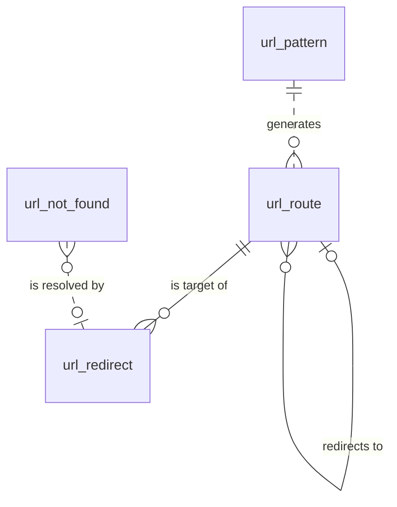

# URL 引擎（url）模块设计

| 项 | 内容 |
|---|---|
| 模块 ID | `url` |
| 名称 | URL 引擎 |
| 层 | L2 |
| 表前缀 | `url_` |
| API 前缀 | `url` |
| 可停用 | 否 |
| 模块版本 | 1.0.0（module.json 的 version） |
| 平台版本 | `>=1.0.0 <2.0.0`（module.json 的 platform） |
| 里程碑切片 | M1：<…>；M2：<…>；M3：<…>；M4：<…>（详见第 13 节） |
| 模块负责人 | 待定 |
| 文档版本 | V1.0 |
| 状态 | 草案 |
| 更新日期 | 2026-10-14 |
| 依据 | 系统设计 V1.4 第 <…> 章；平台框架设计 V1.<x> 第 4 章 <…> 节；ADR-<…> |

> 本文只引用《平台框架设计》第 4 章中的契约，不定义新的跨模块契约；需要新契约时按平台框架设计 2.3 提出契约变更请求。

## 1. 职责与边界

### 1.1 职责

> 一段概述 + 要点列表；与系统设计 3.2 的职责描述一致，并细化到本模块的功能清单。

### 1.2 不负责的事

| 事项 | 归属模块 | 说明 |
|---|---|---|

### 1.3 协作概览

> 用图或表说明本模块与哪些模块协作、通过哪种方式（服务接口 / 事件 / 扩展点）。只画契约，不画实现。

### 1.4 适用的架构约束

> 列出与本模块直接相关的原则（P1–P8）、ADR 规则与 CLAUDE.md 禁止项，以及本模块如何满足。

## 2. 依赖与契约

### 2.1 module.json

```json
{
  "id": "<id>",
  "name": "<中文名称>",
  "version": "1.0.0",
  "layer": "L3",
  "platform": ">=1.0.0 <2.0.0",
  "requires": {},
  "optional": {},
  "disableable": true,
  "tablePrefix": "<前缀>_",
  "apiPrefix": "<id>",
  "permissions": [],
  "menus": [],
  "settings": null,
  "components": [],
  "events": { "publishes": [], "subscribes": [] }
}
```

> 完整描述符，须通过平台框架设计附录 A 的 Schema 与 A.3 的校验规则。

### 2.2 使用的服务接口

| 接口（平台框架设计小节） | 方法 | 用途 | 调用位置与时机（事务内 / 外） | 测试替身 |
|---|---|---|---|---|

### 2.3 提供的服务接口

| 接口（平台框架设计小节） | 方法 | 实现类 | 契约测试 | 说明（幂等、权限、性能目标） |
|---|---|---|---|---|

### 2.4 实现的扩展点

| 扩展点（平台框架设计小节） | 实现类 | 适用范围（内容类型 / 资源类型） | order | 收集方 |
|---|---|---|---|---|

### 2.5 收集的扩展点

| 扩展点 | 调用时机 | 过滤（站点启用状态、内容类型等） | 实现缺失或抛出异常时的行为 | 测试用示例实现 |
|---|---|---|---|---|

### 2.6 发布与订阅的事件

发布：

| 事件 | 触发时机（所在事务） | 关键字段 | 主要订阅方 |
|---|---|---|---|

订阅：

| 事件 | 处理 | 幂等方式 | 过期判断 | 失败与重试 |
|---|---|---|---|---|

### 2.7 使用的端口

| 端口 | 用途 | 测试替身 |
|---|---|---|

## 3. 领域模型

### 3.1 聚合、实体与值对象

| 类型 | 名称 | 说明 |
|---|---|---|
| 聚合根 | Route（`url_route`） | 一个可路由本地化的当前路径与在线状态；下线后保留为墓碑（`GONE` / `REDIRECT`），使原路径与所有指向它的重定向按下线策略返回 410 或 301 |
| 聚合根 | Redirect（`url_redirect`） | 源路径 → 目标；来源为自动（路径变化）、手工、导入 |
| 聚合根 | UrlPattern（`url_pattern`） | 站点 × 语言 × 内容类型（TERM_PAGE 可细分到词汇表）的 URL 规则；不含语言前缀 |
| 实体（统计） | NotFoundStat（`url_not_found`） | 按天聚合的 404 路径 |
| 值对象 | Path | 规范化路径：以 `/` 开头、含语言前缀、不带尾斜杠（尾斜杠策略只影响对外输出与规范化跳转）、合并重复斜杠、Unicode NFC |
| 值对象 | RedirectTarget | `target_kind` + 目标本地化 / 站内路径 / 外部 URL + `status_code` |
| 值对象 | RouteState | `ACTIVE` / `GONE` / `REDIRECT` |

在系统设计之外补充的字段：

| 补充 | 理由 |
|---|---|
| `url_route.state`、`redirect_localization_id`（路由墓碑） | 系统设计 13.4 要求“重定向指向本地化”且“L 下线时，指向它的重定向遵循 L 的下线策略”。把下线去向记在 L 的路由行上，所有指向 L 的重定向解析时都经过这一行：下线期间统一返回 410 / 301；L 重新发布后历史 URL 自动恢复跳转到 L；不需要批量改写重定向，也不产生重定向链 |
| `url_route.content_type` | 模块停用时按类型拒绝路由（系统设计 3.8）；URL 规则变化时按（语言, 类型）重算路径 |
| `url_redirect.target_url` 与 `target_path` 分开 | 站内路径（含语言前缀，可索引，用于链压缩与环路检测）与外部完整 URL（≤ 2048，不建索引）分开存储 |
| `url_redirect.sort_order`、`enabled`、`import_job_id`、`version` | PREFIX / REGEX 按顺序执行（系统设计 13.5）；临时停用规则；追溯导入批次；手工编辑的乐观锁 |
| `url_pattern.vocabulary_id` | TERM_PAGE 的规则按词汇表区分（`/product-category/{slug}`、`/applications/{slug}`）；0 表示适用于全部词汇表 |
| `url_not_found.path_hash`（生成列）、`locale` | 长路径不能直接建唯一索引；“未命中的旧 URL”报告按语言筛选 |

请求解析（对应系统设计 13.2 第 3–6 步；第 1、2 步的规范化与根路径跳转在此之前完成）：

```text
1. url_route (site_id, path)
     ACTIVE   → 200（Delivery 再检查该语言是否对外公开、所属模块是否启用，否则按 404）
     GONE     → 410
     REDIRECT → 取 redirect_localization_id 的路由行，按本步规则继续（最多 5 次，超出按 410）；
                得到 ACTIVE 时只返回一次 301 到其 path
2. url_redirect EXACT (site_id, source_path)，enabled = 1
     LOCALIZATION → 取 target_localization_id 的路由行，按第 1 步规则得到 301 / 410；没有路由行 → 410
     PATH / EXTERNAL → status_code（301 / 302 / 308）；GONE → 410
3. PREFIX → REGEX（enabled = 1，按 sort_order；规则在 Redis 中缓存）
4. 其余 → 404，计入 url_not_found
```

### 3.2 不变量

| # | 规则 | 保证方式 |
|---|---|---|
| 1 | 站点内路径唯一（包括墓碑） | 数据库：`uk_route_path` |
| 2 | 每个本地化最多一条路由行 | 数据库：`uk_route_loc` |
| 3 | `state = ACTIVE` ⇔ 本地化 `publish_state = PUBLISHED`，且 `path = cnt_localization.pub_path` | 应用层（content 在发布、下线事务内调用 url 服务接口） |
| 4 | `state = REDIRECT` ⇔ `redirect_localization_id` 非空 | 数据库：`ck_url_route_state` |
| 5 | 路由优先：新路由占用的路径上若有 EXACT 重定向或其他本地化的墓碑，在同一事务中删除，并提示“此 URL 以前属于 X”；手工重定向的源路径不能是 ACTIVE 路由，是墓碑时替换该墓碑 | 应用层 |
| 6 | 本地化路径变化时写入（旧路径 → `LOCALIZATION` 该本地化，301，`AUTO`）；同一本地化的历史路径全部直接指向本地化，不形成链 | 应用层 |
| 7 | 手工或导入的重定向保存时：目标路径是其他重定向的源 → 压缩为最终目标；目标路径是某本地化的路由 → 转为 `LOCALIZATION`；存在环路 → 拒绝 | 应用层 |
| 8 | 目标字段与 `target_kind`、`status_code` 一致：LOCALIZATION / PATH / EXTERNAL 使用 301 / 302 / 308，GONE 使用 410 | 数据库：`ck_url_redirect_target` |
| 9 | 每站 PREFIX 与 REGEX 规则合计不超过 200 条；REGEX 编译通过且有超时保护 | 应用层 |
| 10 | URL 规则不含语言前缀，必须包含 `{slug}`，只允许变量 `{slug}`、`{parentPath}`；同一范围只有一条未删除的规则 | 数据库：`uk_pattern_scope`；应用层 |
| 11 | 只有 TERM_PAGE 的规则可以指定词汇表 | 数据库：`ck_url_pattern_vocab` |
| 12 | 404 统计每站、每天、每个路径一行 | 数据库：`uk_nf_day_path` |

### 3.3 状态机

<<FILL: 状态与转换；没有状态机时写“不适用：<原因>”>>

## 4. 数据模型

> 遵守平台框架设计第 7 章的数据库通用约定。DDL 已在 MySQL 8.4 上执行通过；表结构以本节为准，与迁移脚本保持一致。

### 4.1 表清单

| 表 | 说明 | 站点级 | 软删除 | 预估规模（单站，按系统设计假设 A4） |
|---|---|---|---|---|
| `url_route` | 路由表（含下线墓碑） | 是 | 否 | ≈ 18 万行（可路由的本地化） |
| `url_redirect` | 重定向 | 是 | 否（物理删除，变更写审计） | ≈ 5–20 万行（slug 变化 + 旧站导入） |
| `url_pattern` | URL 规则（覆盖代码中的默认规则） | 是 | 是（`deleted_at`） | < 100 行 |
| `url_not_found` | 404 路径日统计 | 是 | 否（保留 90 天） | 每天 1 千–1 万行，保留期内 ≤ 100 万行 |

### 4.2 ER 图



（`url_redirect.target_localization_id`、`url_route.redirect_localization_id` 与 `url_route.localization_id` 是逻辑关联，不建外键：路由行在内容彻底删除时会被删除，而指向它的重定向需要保留并返回 410。）

### 4.3 表结构

#### 4.3.1 `url_route`：路由

| 字段 | 类型 | 可空 | 默认 | 说明 |
|---|---|---|---|---|
| `id` | BIGINT | 否 | — | 主键（TSID） |
| `site_id` | BIGINT | 否 | — | 站点 ID（sys_site.id） |
| `locale` | VARCHAR(16) | 否 | — | 语言（BCP 47） |
| `path` | VARCHAR(500) bin | 否 | — | 完整路径（规范化，含语言前缀，不带尾斜杠），如 /zh/products/li-dian-chi-zu |
| `content_id` | BIGINT | 否 | — | 内容 ID（cnt_content.id） |
| `localization_id` | BIGINT | 否 | — | 本地化 ID（cnt_localization.id） |
| `content_type` | VARCHAR(32) | 否 | — | 内容类型：PAGE / PRODUCT / ARTICLE / CASE_STUDY / TERM_PAGE（可路由类型） |
| `state` | VARCHAR(16) | 否 | `'ACTIVE'` | 路由状态：ACTIVE（已发布，200）/ GONE（已下线，410）/ REDIRECT（已下线，301 到 redirect_localization_id 的当前路径） |
| `redirect_localization_id` | BIGINT | 是 | — | REDIRECT 状态的目标本地化 ID（下线时按下线策略解析出的同语言本地化） |
| `created_at` | DATETIME(3) | 否 | `CURRENT_TIMESTAMP(3)` | 创建时间（UTC） |
| `updated_at` | DATETIME(3) | 否 | `CURRENT_TIMESTAMP(3) ON UPDATE CURRENT_TIMESTAMP(3)` | 更新时间（UTC） |

索引与约束：
- `PRIMARY KEY (id)`
- `uk_route_path (site_id, path)`：请求解析的精确匹配（大写路径转小写后再查一次）；页面层级变化时按前缀范围扫描子树（`path LIKE '/zh/about/%'`）
- `uk_route_loc (localization_id)`：重定向解析（本地化 → 当前路径）；发布时更新路径
- `idx_route_scope (site_id, locale, content_type)`：URL 规则或语言前缀变化后按范围重算路径
- `idx_route_content (content_id)`：内容彻底删除时清理
- `idx_route_redirect (redirect_localization_id)`：目标本地化被删除时，把指向它的墓碑改为 `GONE`
- `ck_url_route_state`：见 3.2 不变量 4

```sql
CREATE TABLE url_route (
  id                        BIGINT        NOT NULL COMMENT '主键（TSID）',
  site_id                   BIGINT        NOT NULL COMMENT '站点 ID（sys_site.id）',
  locale                    VARCHAR(16)   NOT NULL COMMENT '语言（BCP 47）',
  path                      VARCHAR(500)  COLLATE utf8mb4_0900_bin NOT NULL COMMENT '完整路径（规范化，含语言前缀，不带尾斜杠），如 /zh/products/li-dian-chi-zu',
  content_id                BIGINT        NOT NULL COMMENT '内容 ID（cnt_content.id）',
  localization_id           BIGINT        NOT NULL COMMENT '本地化 ID（cnt_localization.id）',
  content_type              VARCHAR(32)   NOT NULL COMMENT '内容类型：PAGE / PRODUCT / ARTICLE / CASE_STUDY / TERM_PAGE（可路由类型）',
  state                     VARCHAR(16)   NOT NULL DEFAULT 'ACTIVE' COMMENT '路由状态：ACTIVE（已发布，200）/ GONE（已下线，410）/ REDIRECT（已下线，301 到 redirect_localization_id 的当前路径）',
  redirect_localization_id  BIGINT        NULL COMMENT 'REDIRECT 状态的目标本地化 ID（下线时按下线策略解析出的同语言本地化）',
  created_at                DATETIME(3)   NOT NULL DEFAULT CURRENT_TIMESTAMP(3) COMMENT '创建时间（UTC）',
  updated_at                DATETIME(3)   NOT NULL DEFAULT CURRENT_TIMESTAMP(3) ON UPDATE CURRENT_TIMESTAMP(3) COMMENT '更新时间（UTC）',
  PRIMARY KEY (id),
  UNIQUE KEY uk_route_path (site_id, path),
  UNIQUE KEY uk_route_loc (localization_id),
  KEY idx_route_scope (site_id, locale, content_type),
  KEY idx_route_content (content_id),
  KEY idx_route_redirect (redirect_localization_id),
  CONSTRAINT ck_url_route_state CHECK ((state = 'REDIRECT' AND redirect_localization_id IS NOT NULL) OR (state IN ('ACTIVE', 'GONE') AND redirect_localization_id IS NULL))
) ENGINE = InnoDB DEFAULT CHARSET = utf8mb4 COLLATE = utf8mb4_0900_ai_ci COMMENT = '路由表：可路由本地化的当前路径与状态（下线后保留为墓碑）';
```

要点（生命周期，均在 content 的发布事务内执行）：

| 事件 | 处理 |
|---|---|
| 首次发布 | 插入 `ACTIVE` 行；路径 = `/{url_prefix}` + URL 规则展开（`{slug}`、`{parentPath}`，见 4.3.3） |
| 路径变化 | 更新 `path`；写入（旧路径 → `LOCALIZATION`，301，`AUTO`）；发布 `ContentPathChangedEvent` |
| 下线 | `GONE`，或 `REDIRECT` + 目标本地化（REDIRECT_CONTENT 为目标内容、REDIRECT_PARENT 为上级页面的同语言本地化；该语言没有已发布的目标时退化为 `GONE`） |
| 重新发布 | 回到 `ACTIVE`（路径可能变化，按“路径变化”处理） |
| 新内容占用墓碑的路径 | 删除该墓碑行（被占用的本地化此后没有路由行，指向它的重定向返回 410；它再次发布时重新生成路由） |
| 内容彻底删除 / 本地化删除 | 删除路由行；若原路径未被占用，写入 `url_redirect`（原路径 → `GONE`，410，`AUTO`），使其继续返回 410 |

语言前缀取自 `sys_site_locale.url_prefix`；前缀或 URL 规则变化时，由任务重算范围内全部路由并按“路径变化”生成 301。

#### 4.3.2 `url_redirect`：重定向

| 字段 | 类型 | 可空 | 默认 | 说明 |
|---|---|---|---|---|
| `id` | BIGINT | 否 | — | 主键（TSID） |
| `site_id` | BIGINT | 否 | — | 站点 ID（sys_site.id） |
| `source_path` | VARCHAR(500) bin | 否 | — | 源：EXACT 为规范化路径，PREFIX 为路径前缀，REGEX 为正则表达式（整体匹配） |
| `match_type` | VARCHAR(10) | 否 | `'EXACT'` | 匹配方式：EXACT / PREFIX / REGEX |
| `sort_order` | INT | 否 | `0` | PREFIX / REGEX 的执行顺序（小的先执行）；EXACT 不使用 |
| `target_kind` | VARCHAR(16) | 否 | — | 目标类型：LOCALIZATION / PATH / EXTERNAL / GONE |
| `target_localization_id` | BIGINT | 是 | — | LOCALIZATION 的目标本地化 ID（cnt_localization.id），解析时取其当前路径 |
| `target_path` | VARCHAR(500) bin | 是 | — | PATH 的站内目标路径（含语言前缀；REGEX 可使用 $1 等分组引用） |
| `target_url` | VARCHAR(2048) | 是 | — | EXTERNAL 的外部完整 URL（https） |
| `status_code` | SMALLINT | 否 | `301` | HTTP 状态码：301 / 302 / 308 / 410 |
| `origin` | VARCHAR(10) | 否 | — | 来源：AUTO（路径变化或删除时自动生成）/ MANUAL（手工）/ IMPORT（CSV 导入） |
| `enabled` | TINYINT(1) | 否 | `1` | 是否启用 |
| `hits` | BIGINT | 否 | `0` | 命中次数（先在 Redis 计数，定期批量写库） |
| `last_hit_at` | DATETIME(3) | 是 | — | 最近命中时间（UTC） |
| `import_job_id` | BIGINT | 是 | — | IMPORT 来源的导入任务 ID（sys_job.id） |
| `note` | VARCHAR(500) | 是 | — | 备注 |
| `version` | INT | 否 | `0` | 乐观锁版本号 |
| `created_at` | DATETIME(3) | 否 | `CURRENT_TIMESTAMP(3)` | 创建时间（UTC） |
| `created_by` | BIGINT | 否 | `0` | 创建人用户 ID（0 = 系统） |
| `updated_at` | DATETIME(3) | 否 | `CURRENT_TIMESTAMP(3) ON UPDATE CURRENT_TIMESTAMP(3)` | 更新时间（UTC） |
| `updated_by` | BIGINT | 否 | `0` | 更新人用户 ID（0 = 系统） |

索引与约束：
- `PRIMARY KEY (id)`
- `uk_redirect_source (site_id, source_path, match_type)`：EXACT 精确匹配；同一源路径同类规则唯一
- `idx_redirect_target_loc (target_localization_id)`：本地化删除时把指向它的重定向改为 `GONE`；后台“哪些旧 URL 指向此内容”
- `idx_redirect_target_path (site_id, target_path)`：链压缩（新增重定向的源是已有重定向的目标时，改写已有重定向）；新路由出现时把指向该路径的 `PATH` 型重定向转为 `LOCALIZATION`
- `idx_redirect_rule (site_id, match_type, sort_order)`：加载站点的 PREFIX / REGEX 规则
- `ck_url_redirect_target`：见 3.2 不变量 8

```sql
CREATE TABLE url_redirect (
  id                      BIGINT         NOT NULL COMMENT '主键（TSID）',
  site_id                 BIGINT         NOT NULL COMMENT '站点 ID（sys_site.id）',
  source_path             VARCHAR(500)   COLLATE utf8mb4_0900_bin NOT NULL COMMENT '源：EXACT 为规范化路径，PREFIX 为路径前缀，REGEX 为正则表达式（整体匹配）',
  match_type              VARCHAR(10)    NOT NULL DEFAULT 'EXACT' COMMENT '匹配方式：EXACT / PREFIX / REGEX',
  sort_order              INT            NOT NULL DEFAULT 0 COMMENT 'PREFIX / REGEX 的执行顺序（小的先执行）；EXACT 不使用',
  target_kind             VARCHAR(16)    NOT NULL COMMENT '目标类型：LOCALIZATION / PATH / EXTERNAL / GONE',
  target_localization_id  BIGINT         NULL COMMENT 'LOCALIZATION 的目标本地化 ID（cnt_localization.id），解析时取其当前路径',
  target_path             VARCHAR(500)   COLLATE utf8mb4_0900_bin NULL COMMENT 'PATH 的站内目标路径（含语言前缀；REGEX 可使用 $1 等分组引用）',
  target_url              VARCHAR(2048)  NULL COMMENT 'EXTERNAL 的外部完整 URL（https）',
  status_code             SMALLINT       NOT NULL DEFAULT 301 COMMENT 'HTTP 状态码：301 / 302 / 308 / 410',
  origin                  VARCHAR(10)    NOT NULL COMMENT '来源：AUTO（路径变化或删除时自动生成）/ MANUAL（手工）/ IMPORT（CSV 导入）',
  enabled                 TINYINT(1)     NOT NULL DEFAULT 1 COMMENT '是否启用',
  hits                    BIGINT         NOT NULL DEFAULT 0 COMMENT '命中次数（先在 Redis 计数，定期批量写库）',
  last_hit_at             DATETIME(3)    NULL COMMENT '最近命中时间（UTC）',
  import_job_id           BIGINT         NULL COMMENT 'IMPORT 来源的导入任务 ID（sys_job.id）',
  note                    VARCHAR(500)   NULL COMMENT '备注',
  version                 INT            NOT NULL DEFAULT 0 COMMENT '乐观锁版本号',
  created_at              DATETIME(3)    NOT NULL DEFAULT CURRENT_TIMESTAMP(3) COMMENT '创建时间（UTC）',
  created_by              BIGINT         NOT NULL DEFAULT 0 COMMENT '创建人用户 ID（0 = 系统）',
  updated_at              DATETIME(3)    NOT NULL DEFAULT CURRENT_TIMESTAMP(3) ON UPDATE CURRENT_TIMESTAMP(3) COMMENT '更新时间（UTC）',
  updated_by              BIGINT         NOT NULL DEFAULT 0 COMMENT '更新人用户 ID（0 = 系统）',
  PRIMARY KEY (id),
  UNIQUE KEY uk_redirect_source (site_id, source_path, match_type),
  KEY idx_redirect_target_loc (target_localization_id),
  KEY idx_redirect_target_path (site_id, target_path),
  KEY idx_redirect_rule (site_id, match_type, sort_order),
  CONSTRAINT ck_url_redirect_target CHECK ((target_kind = 'LOCALIZATION' AND target_localization_id IS NOT NULL AND status_code IN (301, 302, 308)) OR (target_kind = 'PATH' AND target_path IS NOT NULL AND status_code IN (301, 302, 308)) OR (target_kind = 'EXTERNAL' AND target_url IS NOT NULL AND status_code IN (301, 302, 308)) OR (target_kind = 'GONE' AND status_code = 410))
) ENGINE = InnoDB DEFAULT CHARSET = utf8mb4 COLLATE = utf8mb4_0900_ai_ci COMMENT = '重定向（自动、手工、导入）';
```

要点：
- **与系统设计 25.9 的差异**：`target_path` 改为 `VARCHAR(500)` + bin（可建索引），外部 URL 移到 `target_url VARCHAR(2048)`；增加 `sort_order`、`enabled`、`import_job_id`、`version`；`status_code` 默认 301；索引名按本文 2.2。
- 旧站导入（系统设计 13.5）：源路径通常不带语言前缀，目标路径带前缀；导入先生成校验报告（目标不存在、环路、链、与现有路由冲突），确认后写入，`origin = IMPORT`。
- 增删改发布 `RedirectChangedEvent`（delivery 失效缓存）；删除为物理删除，后台操作写审计日志。

#### 4.3.3 `url_pattern`：URL 规则

| 字段 | 类型 | 可空 | 默认 | 说明 |
|---|---|---|---|---|
| `id` | BIGINT | 否 | — | 主键（TSID） |
| `site_id` | BIGINT | 否 | — | 站点 ID（sys_site.id） |
| `locale` | VARCHAR(16) | 否 | — | 语言（BCP 47） |
| `content_type` | VARCHAR(32) | 否 | — | 内容类型：PAGE / PRODUCT / ARTICLE / CASE_STUDY / TERM_PAGE（可路由类型） |
| `vocabulary_id` | BIGINT | 否 | `0` | TERM_PAGE 适用的词汇表 ID（tx_vocabulary.id）；0 = 不区分词汇表 |
| `pattern` | VARCHAR(200) bin | 否 | — | URL 规则（不含语言前缀），如 /produkte/{slug}；变量只允许 {slug}、{parentPath} |
| `deleted_at` | DATETIME(3) | 是 | — | 删除时间（软删除） |
| `alive` | TINYINT | 是 | 生成列 `IF(deleted_at IS NULL, 1, NULL)` | 未删除标记（唯一索引用） |
| `version` | INT | 否 | `0` | 乐观锁版本号 |
| `created_at` | DATETIME(3) | 否 | `CURRENT_TIMESTAMP(3)` | 创建时间（UTC） |
| `created_by` | BIGINT | 否 | `0` | 创建人用户 ID |
| `updated_at` | DATETIME(3) | 否 | `CURRENT_TIMESTAMP(3) ON UPDATE CURRENT_TIMESTAMP(3)` | 更新时间（UTC） |
| `updated_by` | BIGINT | 否 | `0` | 更新人用户 ID |

索引与约束：
- `PRIMARY KEY (id)`
- `uk_pattern_scope (site_id, locale, content_type, vocabulary_id, alive)`：同一范围只有一条未删除的规则；生成路径时按范围查找
- `ck_url_pattern_vocab`：只有 TERM_PAGE 可以指定词汇表

```sql
CREATE TABLE url_pattern (
  id             BIGINT        NOT NULL COMMENT '主键（TSID）',
  site_id        BIGINT        NOT NULL COMMENT '站点 ID（sys_site.id）',
  locale         VARCHAR(16)   NOT NULL COMMENT '语言（BCP 47）',
  content_type   VARCHAR(32)   NOT NULL COMMENT '内容类型：PAGE / PRODUCT / ARTICLE / CASE_STUDY / TERM_PAGE（可路由类型）',
  vocabulary_id  BIGINT        NOT NULL DEFAULT 0 COMMENT 'TERM_PAGE 适用的词汇表 ID（tx_vocabulary.id）；0 = 不区分词汇表',
  pattern        VARCHAR(200)  COLLATE utf8mb4_0900_bin NOT NULL COMMENT 'URL 规则（不含语言前缀），如 /produkte/{slug}；变量只允许 {slug}、{parentPath}',
  deleted_at     DATETIME(3)   NULL COMMENT '删除时间（软删除）',
  alive          TINYINT       AS (IF(deleted_at IS NULL, 1, NULL)) STORED COMMENT '未删除标记（唯一索引用）',
  version        INT           NOT NULL DEFAULT 0 COMMENT '乐观锁版本号',
  created_at     DATETIME(3)   NOT NULL DEFAULT CURRENT_TIMESTAMP(3) COMMENT '创建时间（UTC）',
  created_by     BIGINT        NOT NULL DEFAULT 0 COMMENT '创建人用户 ID',
  updated_at     DATETIME(3)   NOT NULL DEFAULT CURRENT_TIMESTAMP(3) ON UPDATE CURRENT_TIMESTAMP(3) COMMENT '更新时间（UTC）',
  updated_by     BIGINT        NOT NULL DEFAULT 0 COMMENT '更新人用户 ID',
  PRIMARY KEY (id),
  UNIQUE KEY uk_pattern_scope (site_id, locale, content_type, vocabulary_id, alive),
  CONSTRAINT ck_url_pattern_vocab CHECK (content_type = 'TERM_PAGE' OR vocabulary_id = 0)
) ENGINE = InnoDB DEFAULT CHARSET = utf8mb4 COLLATE = utf8mb4_0900_ai_ci COMMENT = 'URL 规则（站点 × 语言 × 内容类型或词汇表，不含语言前缀）';
```

要点：
- 规则查找顺序：（语言, 类型, 词汇表）→（语言, TERM_PAGE, 0）→ 源语言 `zh-CN` 的同范围规则 → 代码中的默认规则（`ContentTypeDefinition.defaultUrlPattern`；内置词汇表的 TERM_PAGE 默认规则由 taxonomy 提供）。自定义的可路由词汇表在创建时必须配置源语言规则。
- 完整路径 = `/{url_prefix}`（站点语言配置）+ 展开后的规则，如德语 `/de` + `/produkte/{slug}` = `/de/produkte/{slug}`（系统设计 5.4）。
- `{parentPath}` 展开为父页面在同一语言的当前路由路径（去掉语言前缀）；父页面在该语言没有 `ACTIVE` 路由时，子页面发布校验报错。首页（由 page 模块标记）的路径就是语言前缀本身，如 `/zh`。
- 新增、修改、删除规则后，由任务重算该范围内全部 `ACTIVE` 路由，并为变化的路径生成 301。

#### 4.3.4 `url_not_found`：404 路径日统计

| 字段 | 类型 | 可空 | 默认 | 说明 |
|---|---|---|---|---|
| `id` | BIGINT | 否 | — | 主键（TSID） |
| `site_id` | BIGINT | 否 | — | 站点 ID（sys_site.id） |
| `stat_date` | DATE | 否 | — | 统计日期（UTC） |
| `path` | VARCHAR(2048) bin | 否 | — | 未命中的路径（规范化后，不含查询参数，超长截断到 2048） |
| `path_hash` | CHAR(64) bin | 是 | 生成列 `SHA2(path, 256)` | 路径的 SHA-256（生成列，唯一索引用） |
| `locale` | VARCHAR(16) | 是 | — | 按路径前缀识别的语言；无法识别（如旧站 URL）为空 |
| `hits` | INT | 否 | `0` | 当天命中次数 |
| `first_seen_at` | DATETIME(3) | 否 | — | 当天首次出现时间（UTC） |
| `last_seen_at` | DATETIME(3) | 否 | — | 当天最近出现时间（UTC） |
| `last_referrer` | VARCHAR(2048) | 是 | — | 最近一次的来源页（Referer，去除查询参数） |
| `created_at` | DATETIME(3) | 否 | `CURRENT_TIMESTAMP(3)` | 创建时间（UTC） |
| `updated_at` | DATETIME(3) | 否 | `CURRENT_TIMESTAMP(3) ON UPDATE CURRENT_TIMESTAMP(3)` | 更新时间（UTC） |

索引与约束：
- `PRIMARY KEY (id)`
- `uk_nf_day_path (site_id, stat_date, path_hash)`：批量写库的 upsert（`INSERT … ON DUPLICATE KEY UPDATE hits = hits + ?`）；报表按日期范围聚合（`GROUP BY path_hash`）；按日期清理
- `idx_nf_path (site_id, path_hash)`：单个路径的历史趋势；创建重定向后查看该路径是否仍被访问

```sql
CREATE TABLE url_not_found (
  id             BIGINT         NOT NULL COMMENT '主键（TSID）',
  site_id        BIGINT         NOT NULL COMMENT '站点 ID（sys_site.id）',
  stat_date      DATE           NOT NULL COMMENT '统计日期（UTC）',
  path           VARCHAR(2048)  COLLATE utf8mb4_0900_bin NOT NULL COMMENT '未命中的路径（规范化后，不含查询参数，超长截断到 2048）',
  path_hash      CHAR(64)       COLLATE utf8mb4_0900_bin AS (SHA2(path, 256)) STORED COMMENT '路径的 SHA-256（生成列，唯一索引用）',
  locale         VARCHAR(16)    NULL COMMENT '按路径前缀识别的语言；无法识别（如旧站 URL）为空',
  hits           INT            NOT NULL DEFAULT 0 COMMENT '当天命中次数',
  first_seen_at  DATETIME(3)    NOT NULL COMMENT '当天首次出现时间（UTC）',
  last_seen_at   DATETIME(3)    NOT NULL COMMENT '当天最近出现时间（UTC）',
  last_referrer  VARCHAR(2048)  NULL COMMENT '最近一次的来源页（Referer，去除查询参数）',
  created_at     DATETIME(3)    NOT NULL DEFAULT CURRENT_TIMESTAMP(3) COMMENT '创建时间（UTC）',
  updated_at     DATETIME(3)    NOT NULL DEFAULT CURRENT_TIMESTAMP(3) ON UPDATE CURRENT_TIMESTAMP(3) COMMENT '更新时间（UTC）',
  PRIMARY KEY (id),
  UNIQUE KEY uk_nf_day_path (site_id, stat_date, path_hash),
  KEY idx_nf_path (site_id, path_hash)
) ENGINE = InnoDB DEFAULT CHARSET = utf8mb4 COLLATE = utf8mb4_0900_ai_ci COMMENT = '404 路径按天聚合统计';
```

要点：404 先在 Redis 中计数（按站点、日期、路径哈希），每分钟批量写库（系统设计 13.2）。“未命中的旧 URL”报告按日期范围聚合，排除当前已有路由或重定向的路径（同模块关联查询），SEO 专员可一键创建重定向。保留 90 天（第 22 章）。

### 4.4 枚举

| 字段 | 取值 | 说明 |
|---|---|---|
| `url_route.state` | `ACTIVE` | 已发布，返回 200（默认） |
| | `GONE` | 已下线，返回 410 |
| | `REDIRECT` | 已下线，301 到 `redirect_localization_id` 的当前路径 |
| `url_route.content_type`、`url_pattern.content_type` | `PAGE` / `PRODUCT` / `ARTICLE` / `CASE_STUDY` / `TERM_PAGE` | 共享内容类型枚举中的可路由类型 |
| `url_redirect.match_type` | `EXACT` / `PREFIX` / `REGEX` | 精确（默认）/ 前缀 / 正则；按此顺序匹配 |
| `url_redirect.target_kind` | `LOCALIZATION` | 指向本地化，解析时取其当前路径（自动重定向、指向内容的手工重定向） |
| | `PATH` | 站内路径（目标暂不是任何路由时） |
| | `EXTERNAL` | 外部 URL |
| | `GONE` | 410 |
| `url_redirect.status_code` | `301` / `302` / `308` / `410` | 默认 301 |
| `url_redirect.origin` | `AUTO` / `MANUAL` / `IMPORT` | 系统生成 / 手工 / CSV 导入 |

### 4.5 站点过滤

<<FILL: | 表 | 行级拦截器（不豁免 / 豁免） | 访问方式与理由 |>>

### 4.6 跨模块引用与清理

| 本模块字段 | 引用对象（模块.表） | 被引用对象删除 / 下线时的处理 | 触发事件 |
|---|---|---|---|
| `url_route.content_id`、`localization_id` | content.`cnt_content`、`cnt_localization` | 发布、下线：在 content 的发布事务中经服务接口同步维护（见 4.3.1）。彻底删除 / 本地化删除：删除路由行，原路径写为 GONE 重定向 | `ContentPurgedEvent`、`LocalizationDeletedEvent` |
| `url_route.redirect_localization_id` | content.`cnt_localization` | 目标被删除：墓碑改为 `GONE`（未清理前解析找不到目标时同样返回 410） | `ContentPurgedEvent`、`LocalizationDeletedEvent` |
| `url_redirect.target_localization_id` | content.`cnt_localization` | 目标被删除：改为 `target_kind = GONE`、`status_code = 410` | `ContentPurgedEvent`、`LocalizationDeletedEvent` |
| `url_route.locale`、`url_pattern.locale` | core.`sys_site_locale` | `url_prefix` 变化：任务重算该语言全部路由并生成 301；删除语言前，该语言的本地化先被删除（见上） | `SiteSettingsChangedEvent` |
| `url_pattern.vocabulary_id` | taxonomy.`tx_vocabulary` | 词汇表只能在没有分类项时删除（此时没有对应的 TERM_PAGE 路由）；残留规则不再生效，由夜间维护任务经 `TaxonomyApi` 核对后软删除 | — |
| `url_redirect.import_job_id` | core.`sys_job` | 任务记录清理后只作历史标识，不级联 | — |
| `created_by`、`updated_by` | core.`sys_user` | 不清理 | — |

本模块发布的事件：`ContentPathChangedEvent`（路径变化，含旧路径；seo 推送 IndexNow）、`RedirectChangedEvent`。

---

### 4.7 迁移脚本

| 文件 | 内容 | 里程碑 |
|---|---|---|
| `db/migration/url/V001__init.sql` | 4.3 中的全部表（4 张：`url_route`、`url_redirect`、`url_pattern`、`url_not_found`），按本节顺序创建 | <见第 13 节> |

## 5. 业务流程

### 5.1 <流程名称>

```text
<步骤；标出事务边界、调用的服务接口、发布的事件、异步部分>
```

| 步骤 | 说明 | 失败处理 |
|---|---|---|

## 6. 接口

### 6.1 Admin 端点

| 方法 | 路径（/api/admin/v1/<apiPrefix>/…） | 说明 | 权限码 | 并发控制 / 幂等 | 审计 |
|---|---|---|---|---|---|

### 6.2 Public 端点

| 方法 | 路径（/api/public/v1/<apiPrefix>/…） | 说明 | 限流 | 缓存 |
|---|---|---|---|---|

### 6.3 Internal 端点

| 方法 | 路径（/api/internal/v1/<apiPrefix>/…） | 说明 | 调用方 |
|---|---|---|---|

### 6.4 权限码

| 权限码 | 名称 | 数据范围 | 高危（sensitive） | 受语言范围限制（localeScoped） |
|---|---|---|---|---|

### 6.5 错误码

| 错误码 | HTTP 状态 | 后台中文信息 | 前台文案键（仅公开接口） |
|---|---|---|---|

## 7. 后台界面

### 7.1 菜单与路由

| 菜单 key | 名称 | 父菜单 | 路由 | 权限码 |
|---|---|---|---|---|

### 7.2 页面

| 页面 | 路由 | 主要功能 | 使用的 admin-kit 组件 |
|---|---|---|---|

### 7.3 注册到内容编辑外壳的标签

| key | 适用内容类型 | 权限码 | 组件 |
|---|---|---|---|

### 7.4 界面文案

> texts.ts 中的分组与关键文案；后台只用简体中文。

## 8. 前台组件与模板

> 没有前台组件时写“不适用”。

### 8.1 组件

| 组件类型 | 名称（label） | 变体 | 分类 | allowedIn | 数据源 | 是否水合 |
|---|---|---|---|---|---|---|

### 8.2 属性与翻译

| 组件 | 属性 | 类型 / x-editor | x-translatable | maxLength |
|---|---|---|---|---|

### 8.3 模板

| 模板 key | 内容类型 | 固定区域与插槽 |
|---|---|---|

### 8.4 数据源

| key | 参数 | 返回 | 缓存标签 |
|---|---|---|---|

### 8.5 文案键

| 文案键 | 默认中文文案 | 使用位置 |
|---|---|---|

## 9. 配置项

### 9.1 站点设置（settings.schema.json）

| 键 | 类型 | 默认值 | 说明 | 敏感（x-secret） |
|---|---|---|---|---|

### 9.2 部署配置（application.yml，前缀 b2bweb.<id>）

| 属性 | 默认值 | 说明 |
|---|---|---|

## 10. 定时与异步任务

> 没有时写“不适用”。定时任务实现 `ScheduledTask`，通用异步任务实现 `JobHandler`（平台框架设计 4.4.12）；锁名与任务类型按平台框架设计 3.7 命名。事件监听器已在 2.6 中列出，这里只补充耗时长、需要单独调度或重试的处理。`PER_SITE` 任务由 core 在站点上下文中逐站点执行，停用了本模块的站点自动跳过（系统设计 3.8）。外部服务（AI 引擎、邮件、CDN）只在事务提交后的异步处理中调用，失败不回滚已提交的业务数据（ADR-003、ADR-017）。

| 任务 | 类型（定时 / sys_job / 事件监听） | 触发 | 锁名 | 幂等与重试 | 模块停用时 |
|---|---|---|---|---|---|

> 每个任务另写：执行粒度（`PER_SITE` / 系统级）、单次处理量与分批方式、超时、能否取消、失败后的可见结果（`sys_job` 的失败报告、指标 `b2bweb.<id>.*` 或告警）。

## 11. 测试要点

> 测试层级、替身与契约测试的写法见平台框架设计第 9 章，门禁与覆盖率见第 10 章。“至少”后的用例为必测项；不适用的行写“不适用：<原因>”，不得删除。

| 层级 | 覆盖内容 | 关键用例 |
|---|---|---|
| 单元 | <领域对象、不变量（3.2）、状态机（3.3）、扩展点实现（2.4）> | 至少：3.2 每条不变量的违反用例；3.3 每个非法状态转换被拒绝 |
| 模块集成（Testcontainers + 替身） | <应用服务 + 本模块的表与迁移> | 至少：迁移脚本在空库（MySQL 8.4）上执行通过；6.1 中声明的并发控制与幂等；唯一约束冲突转为 6.5 的错误码 |
| 契约（作为提供方） | <2.3 中本模块提供的服务接口> | 继承 testkit 中的 `<接口名>ContractTest`，用真实实现运行；不提供服务接口时写“不适用” |
| 事件（Scenario API，含重复投递） | <2.6 中发布与订阅的事件> | 至少：事件在业务事务内发布、事务回滚时不发布；每个监听器重复投递只生效一次、过期事件被丢弃（ADR-003） |
| 停用行为（可停用模块） | <系统设计 3.8 的各项> | 至少：停用后写操作与公开接口返回 `CORE_MODULE_DISABLED`；扩展点实现不再被收集；定时任务跳过；`analyzeDisableImpact` 的结果正确；重新启用后数据完整（S10） |
| 站点隔离 | <6.1 的全部后台接口与 4.5 的全部站点级表> | 至少：站点 A 的用户不能读写站点 B 的数据（遍历全部后台端点，系统设计 28）；豁免表只在 4.5 列出的位置访问 |
| 翻译（如有可翻译字段） | <`TranslatableContentProvider` / `TranslatableResourceProvider` 实现> | 至少：提取 → 回写往返一致；`x-translatable = false` 的字段不被提取；`HUMAN` / `REVIEWED` 段不被机器译文覆盖；资源变化时发布 `TranslatableResourceChangedEvent` |
| 前端（组件、Admin） | <主题组件、Admin 页面> | 至少：组件 Schema 校验与画廊示例（视觉回归）；前台文字只来自文案键、后台文字只来自 `texts.ts`；无权限时操作不可见 |
| E2E（场景） | <13.2 中验证方式为 E2E 的验收项> | Playwright 用例名包含 13.2 的验收项编号 |

## 12. 独立开发说明

### 12.1 依赖的测试替身

> 2.2 使用的每个服务接口、2.7 使用的每个端口、2.5 收集的每个扩展点，都要在此列出 testkit 中对应的替身或示例实现（平台框架设计 2.4、第 9 章）。testkit 中缺少的替身向框架组提出需求（DoR 第 3 条，平台框架设计 2.7），不在本模块中另建一套代替其他模块的模拟实现；单元测试可以用 Mockito 模拟个别方法，但对其他模块行为的假设以替身与契约测试为准。

| 替身（platform-testkit） | 代替的模块 | 用途 | 需要预置的数据 |
|---|---|---|---|

### 12.2 本模块提供的替身

> 只有提供服务接口的模块填写（core、content、url、media、taxonomy、form、notification、translation，见平台框架设计 4.2）；其他模块写“不适用：不提供服务接口”。替身由框架组编写并维护，与真实实现通过同一套契约测试；本模块改变服务接口的行为时，在同一个 PR 中同步修改契约测试，并通知框架组修改替身（平台框架设计 2.3）。无法消除的差异（如不做病毒扫描、不生成真实缩略图）列入下表，并确认不影响使用方的测试结论。

| 服务接口 | testkit 中的替身 | 与真实实现的差异（应为零，或已在契约测试中声明） |
|---|---|---|

### 12.3 本地运行

> 启动方式、依赖的本地服务（平台框架设计第 11 章）、需要的配置。

### 12.4 演示数据

> tools/demo-data 中本模块的数据及其用途。

## 13. 验收标准

### 13.1 里程碑切片

> 与平台框架设计 13.5 中本模块的一行一致；调整切片按平台框架设计 12.5 处理。该里程碑没有切片时写“—”（不表示不能提前开发）。

| 里程碑 | 交付功能 | 验收场景 |
|---|---|---|
| M1 | <…> | <S1、S2、S4 中与本模块相关的部分，或“模块自身”> |
| M2 | <…> | <…> |
| M3 | <…> | <…> |
| M4 | <…> | <…> |

### 13.2 验收项

> 每条验收项写明输入、期望结果与度量（如“5 分钟内”“P95 ≤ 200 ms”）。场景验收项只写本模块负责的部分（如 S2 中 url 负责“旧 URL 301 到新 URL、不产生重定向链”），不复述整个场景；各里程碑的场景见平台框架设计 13.6。验证方式为单元 / 集成 / E2E 时写出测试类或用例名；人工检查写明检查人与方法。

| # | 验收项 | 对应场景（S1–S13）或模块自身 | 验证方式（单元 / 集成 / E2E / 人工） | 里程碑 |
|---|---|---|---|---|
| A1 | <…> | <S? / 模块自身> | <集成：`<测试类>`> | M? |

> 每个模块都要包含以下通用验收项（不适用时注明原因）：架构测试与 Modulith 验证通过，无跨模块 import 与表访问；站点隔离测试覆盖全部后台接口；后台写操作都有权限码与审计记录；可停用模块满足 S10；可翻译字段与资源已登记并通过往返测试（S11、S12）；系统设计 1.5 中与本模块相关的非功能指标；文档与代码一致（DoD，平台框架设计 2.8）。

## 14. 待定问题

> 记录评审与开发中尚未决定的事项。“阻塞开发”的问题必须在评审通过（DoR）前关闭；需要新契约或修改上层文档的问题，写明契约变更请求或 Issue 编号。已关闭的问题保留在表中，填写结论。

| # | 问题 | 影响 | 是否阻塞开发 | 负责人 | 最晚解决 | 结论 |
|---|---|---|---|---|---|---|

## 修订记录

| 版本 | 日期 | 变更 |
|---|---|---|
| V1.0 | 2026-10-14 | 初稿 |
