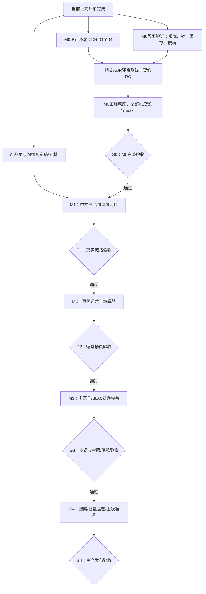

# 开发流程与分阶段任务计划

| 项 | 约定 |
|---|---|
| 版本 / 日期 | V1.5 / 2026-10-20 |
| 依据 | [正式评审FR-2026-10-20](../reviews/formal-design-review-2026-10-20.md)、系统设计29～30章、框架2.7/2.8/12/13章、Accepted ADR-018 |
| 当前阶段 | M0正式工程候选：协议原型116项、Core与开发构件、testkit目录及前端底座已落地；完整G0未通过，继续上下文/契约/预览与安全门禁，不提前进入M1 |
| 已确认协作方式 | 业主负责验收、Codex协助实现，按单实现通道排队；每周实际投入仍待执行中校准，不假设同时启动17模块 |
| 范围 | 保持V1=M0基础加M1～M4全部交付；不把M1演示默认改成公众生产上线 |
| 工期口径 | 按依赖和证据关卡推进；首个迭代结束后用实际吞吐估算。以下顺序与工作包可执行，未承诺日历交付日期 |

## 1. 先整改、验证和冻结，再逐条业务链开发

图中的“通过”由验收证据决定，不能只移动看板状态。未通过的工作项回到对应整改队列，不直接流入下一关。开发者可以用已冻结的契约与替身处理后续切片，但每次只保持有限在制工作；集成验收仍按M1～M4顺序。

## 2. M0：从当前评审结果开始的工作队列

| 任务 | 交付物 | 依赖 / 完成判据 | 建议PR边界 |
|---|---|---|---|
| M0-01 整理基线与责任 | 当前文档基线、ADR状态清单、模块/框架负责人角色到人员的映射 | 记录未提交方案，评审对象与实际提交一致；不自动批准21份Proposed | 文档基线与评审记录 |
| M0-02 统一法律审校策略 | 关闭DR-01；内容策略字段、写入聚合/锁/版本与目标事件一致 | 框架/content/page/translation/ADR-024同批对齐，有跨语言与旧事件预期 | 一项策略问题一个文档PR |
| M0-03 明确媒体三种生命周期操作 | 关闭DR-02；软删除/恢复/物理清理矩阵 | 未删除谓词、文件保留和并发用例明确，ADR-019对齐 | 媒体事务协议PR |
| M0-04 统一下载提交结果 | 关闭DR-03；提交/票据/发件箱失败矩阵 | ACCEPT/QUARANTINE/REJECT/测试完整，幂等结果和票据暴露时点明确 | form通知边界PR |
| M0-05 清理双重契约 | 关闭DR-04及DR-09目录部分 | 完整接口/示例/事件/替身要求/缓存头/模块引用同一语义，不只补注释 | 按媒体、翻译、缓存分别小PR |
| M0-06 版本兼容原型 | ADR-011实际版本表、可复现启动/构建记录 | Boot/Modulith/MyBatis-Plus/Flyway/MySQL与Nuxt最小组合真实通过，失败则调整选型再评审 | 隔离验证分支；结论与配置后续进入M0 |
| M0-07 并发/缓存原型 | 媒体锁、路由generation、回填fence及持久重试的实测结果 | D01～D11核心时序；软删除场景使用整改后规则；Redis重启/回填/CDN失败有证据 | 每种高风险机制一个验证PR |
| M0-07D 初始化协议复查 | graph集合状态及JobApi幂等读取的并发证据 | 复用排他upsert、旧快照和死锁反例；明确完整事务重试/返回结果 | 独立协议验证PR，正式core/testkit再复跑 |
| M0-08 搜索架构原型 | 关闭DR-05；容量/延迟标准、采纳结论 | 单语/多语、突发发布、源事务行锁开销、迟到请求/worker、日志与GC实测；失败回ADR修改 | 独立原型；不提前开发M4后台/筛选页 |
| M0-09 决策与契约RC复审 | 核心ADR采纳记录、唯一契约目录与版本候选 | DR-01～05关闭；相关角色签审；部署/法务业主自管边界不扩大 | 契约RC文档PR |
| M0-10 工程骨架与共享API | Monorepo、后端模块、前端共享包、17模块骨架、目录守护 | 边界约束与ADR-018一致；只实现底座，不一次填完17模块业务 | 后端/前端/模块脚手架分批PR |
| M0-11 core与适配器 | 站点上下文/隔离、权限、统一错误/审计、事件重投、任务、迁移和本地服务 | core测试与本地环境冒烟；119张表DDL证据转化为实际模块迁移，不直接拼成单个生产迁移 | 每种底座能力独立PR |
| M0-12 testkit及契约测试 | 全部V1服务替身、端口假实现、SPI示例和统一契约套件 | 与真实提供方适配同套测试；包含新协调器/回填/目标版本行为 | 契约与替身同批维护 |
| M0-13 前端底座 | Admin壳、Nuxt SSR框架、api-client生成、Token、Schema校验、画廊/iframe最小预览 | 前后台样式隔离，文案键、真实预览/预览鉴权可验证 | 管理壳、渲染壳、Token/Schema分PR |
| M0-14 版本冻结与G0 | platform-api 1.0.0、CI、启动说明、M1模块DoR | 框架13.1全部检查通过，不以RC或“替身可用”代替真实机制验证 | 冻结/验收PR |

M0-06～08是框架验证，不表示业务模块已被批准提前开工；验证阶段允许使用RC契约，M0结束才正式冻结全部V1契约。不能为了先写M1，把已会影响接口形状的搜索/翻译/资源SPI决定拖到M4再做。M0-10～13可在相关RC走查通过后交错推进，但未通过G0前不宣称所有模块可全面开工。

已经完成的MySQL空库执行不必由人再次手工复制119个DDL；将相同SQL接入Flyway/CI，重点补升级顺序、首次启用、回滚/补偿、站点与权限行为。原迁移一旦合入就追加变更，不改写旧文件。

## 3. 首个迭代的实际安排

按已确认的单实现通道，活动编码/整改项WIP=1，最多另有1项等待评审；同一时间只为一项关键决定产出代码。当前建议首个迭代以约10个工作日为观察窗口，每周实际投入尚未固定，因此是执行顺序和目标，不是交付承诺：

| 顺序 | 优先工作 | 必须留下的证据 |
|---|---|---|
| 1 | M0-01及M0-02 | 基线、责任矩阵、审校策略一致性整改PR |
| 2 | M0-03与M0-04 | 媒体生命周期及下载失败矩阵PR |
| 3 | M0-05；开始M0-06 | 无双重有效描述；实际兼容性验证记录 |
| 4 | 风险最高的M0-07、M0-08验证 | 可重复的并发/容量原型与采纳建议 |
| 贯穿 | M1产品详情、分类、询盘、后台编辑/预览样稿 | 1440/768/390及360补测、关键状态、素材清单；Tesla方向转为可验收稿 |

若验证没有按窗口完成，保留真实状态，先调整估算，不压缩关卡来制造“完成”。本迭代结束以完成项数量、返工原因和评审等待时间重估后续工作；不把AI会话数量当人力工期。

## 4. M1：先让一个产品真正产生询盘

按以下链路逐段交付，用一份真实PRODUCT数据贯穿，不先堆管理页面：

| 次序 | 切片 | 涉及模块 | 验收结果 |
|---|---|---|---|
| M1-01 | 中文站点与操作员 | core、Admin | 站点A/B、用户/角色/2FA/审计可用；跨站ID和无权限请求被拒 |
| M1-02 | 媒体上传与产品草稿 | media、taxonomy、content、product | 上传/扫描、属性/分类及媒体引用可保存；两个编辑窗口不能相互覆盖；软删除与新引用竞争正确 |
| M1-03 | 产品发布到SSR页面 | url、content、product、page、delivery、seo | /zh语言路径、自动301、product-detail、Meta/JSON-LD可从SSR读取；草稿不可公开，预览不进公共缓存 |
| M1-04 | 表单到询盘到邮件 | form、inquiry、notification | Turnstile/附件/反垃圾/幂等、询盘落库、发件箱与邮件重试形成闭环；结果未知不伪装成功 |
| M1-05 | G1完整演示 | 上述真实实现替代替身 | 编辑产品→发布→访问→提交→销售查到询盘→查看通知结果；S1中文、S2、S4非GA4部分通过 |

M1私有能力先满足表单附件：PRIVATE上传、扫描、员工授权下载；M3才提供留资门控票据及邮件。法律政策正式发布、同意和隐私工具仍须按M3/M4验收，因此M1闭环只作为内部dev/staging演示，不据此提前对公众生产上线。

## 5. 后续阶段保持完整V1范围

| 阶段 | 建议交付顺序 | 出口关卡 |
|---|---|---|
| M2 页面运营 | 文章/案例/FAQ与作者→导航/站点资料→主题组件/模板插槽→全局区块→页面编辑器→审核/定时/回滚→路由重算及可靠缓存 | G2：运营独立搭页、三档预览、发布/冲突恢复、S3/S10；作者引用和缓存/路由D05～D11实测 |
| M3 多语言与获客完善 | 法律页及审校→翻译记忆/引擎/回写→英语和多语SEO→站点资源翻译→同意/GPC/统计→分配/SLA/报表/询价篮→下载留资→graph及SEO健康 | G3：S5/S7/S8/S9/S11/S12/S13；HUMAN保护、旧事件不发布新稿、目标语言通知、图谱集合冲突、脚本同意实测 |
| M4 规模运营及上线 | 导入导出/型号表→接入已验证的search捕获/代次/筛选→数据范围→数据主体请求/保留期→规模压测/安全/发布准备 | G4：S6、无高危安全发现、性能预算、真实备份恢复、发布及回退演练；D20～D25和整条业务回归 |

阶段内可以调整任务顺序，但不改变框架13.5中的功能归属。M0必须交付Design Token机制，M1产品主题就消费Token，M2再扩展组件/变体和完整编辑器，避免临时硬编码后重写主题。36个注册组件按各模块切片交付，不能只完成“至少20个”就忽略V1其余业务组件。

M3和M4的可选模块在未就绪前不装配真实处理器；M0以替身覆盖协议，production不装配测试替身。search未启用时捕获协调器不影响事实保存；首次启用/重新启用前完成控制表迁移并记录fullRefresh，详情并入框架正式契约，不能靠应用启动顺序碰运气。

## 6. 每个工作项从需求到合并

1. **领取**：写明任务ID、模块/切片、输入版本、关联DR/ADR、交付范围和验收证据；同类需求先查已有组件、数据源、模板与扩展点。
2. **准备**：按框架2.7确认DoR：文档/契约已评审，替身存在，DDL与迁移方案验证，权限/审计、失败/并发状态和负责人明确。缺契约回框架处理，不在模块里另写共享接口。
3. **实现**：短功能分支，一个PR聚焦一个可检查的行为；实现、必要测试、Schema/API生成产物和文档同批更新。UI覆盖适用的加载/空/错误/成功/焦点状态，不为可逆文字修改补无意义测试。
4. **验证**：运行与改动相关的单元/契约/数据库/站点权限测试；接口更新生成api-client；组件更新画廊/axe/截图；发布链和并发机制运行其关键故障用例。再执行仓库要求的完整CI门禁。
5. **评审**：普通PR按29.4至少1人；platform-core/platform-api按原规则需要2人且含架构负责人。AI走查不能冒充两名独立人工批准；人员未到位时可继续起草/验证，受保护合并保留待审。
6. **集成**：squash合入后在dev用真实提供方替换对应替身，运行目标场景；前后端分别通过不等于链路通过。
7. **验收**：业主根据页面/数据/通知结果和测试证据验收，失败回到原任务。只在目标切片真实通过后把模块标“已实现（M?）”。

任务记录建议字段：`ID / 模块与阶段 / 负责人 / 前置任务 / 关联DR与ADR / 输入基线 / 验收步骤 / 证据链接 / 状态 / 下一步`。当前只是仓库内工作队列，没有擅自在外部系统创建Issue或通知他人。

## 7. 必须保留的检查与证据

| 层级 | 要检查的内容 | 何时执行 |
|---|---|---|
| 文档 | 路径/章节、描述符Schema、权限/组件唯一性、事件发布订阅和表归属；字段/事务语义人工核对 | 文档PR与每次契约调整 |
| 后端 | `./mvnw verify`：架构边界、契约、MySQL/Redis等适用集成检查 | 骨架建立后的PR/CI；当前命令还不可运行 |
| 前端 | `pnpm lint && pnpm typecheck && pnpm test`、构建、SSR/水合及适用画廊检查 | 前端PR/CI；当前无应用代码 |
| 边界反例 | 跨模块import/跨表访问、缺site_id、非法依赖、硬编码文案/Token、旧迁移改写会使检查失败 | M0构建检查本身，并持续CI |
| 关键故障 | 原25项D01～D25按整改后的协议执行，补软删除/恢复、旧策略/目标版本时序 | M0机制原型及对应里程碑真实实现 |
| 非功能 | 产品页LCP≤2.5s、INP≤200ms、CLS≤0.1、首屏gzip JS≤150KB；移动Lighthouse性能≥90、SEO=100、无障碍≥95 | M1先基线；M2主题/编辑器回归；M3/M4复测 |
| 上线 | 配置/凭据/健康监控、迁移顺序、备份恢复、业务/SEO回归和回退演练；部署/法务按业主既有责任 | G4；不以临时数据库建表成功代替 |

CI尚未建立时，“计划执行”与“实际通过”在任务记录中分开。DDL空库已通过只给数据库语法与依赖顺序证据，不能替代ORM、迁移升级、并发锁或跨站权限检查。

## 8. 人员投入变化时如何安排

| 模式 | 工作分配 | 同时进行的工作上限建议 |
|---|---|---|
| 业主验收、单实现通道 | 按M0队列及M1链路逐项推进，业主提供产品样本/素材、评审反馈与业务验收；正式评审角色按原治理规则落实 | 1项实现，最多1项等待评审；UI样稿可作为独立准备任务 |
| 2～3名开发 | 一人守框架/内核，一人呈现/业务链，第三人可承担获客/测试；契约改动仍有单一负责人 | M0相关RC通过后最多2～3个切片，优先服务同一条集成链 |
| 4～6名开发 | 沿用框架13.4的F/K/P/B/G/T角色映射，按真实人员兼组；不自动派生六支独立团队 | 有审查与集成能力才增加WIP，每人至多1项主任务 |

每周一次可演示链路检查，记录完成、阻塞、返工与下周目标；每个里程碑一次复盘。日历排期需要实际人员投入、评审等待时间、产品属性/素材规模和M0原型结果，再给区间估算。

## 9. 现在与下一步的边界

本批已完成DR-01～04设计整改，执行119个CREATE及3个ALTER，并交付可复现后端/前端隔离原型。后端7测试与前端类型检查、构建、三个视口的SSR/懒水合交互通过。详细证据与限制见[M0首批复审](../reviews/m0-remediation-2026-10-20.md)。业务工程骨架、完整契约冻结和人工签审仍未完成。

| 任务 | 当前实际状态 | 下一步关闭条件 |
|---|---|---|
| M0-01 | 文档基线及角色已记录，人工责任映射/签审未完成 | 真实负责人与治理角色落实，不以AI代替人工审批 |
| M0-02～05 | 四项设计冲突已整改；仍保留运行验收关卡 | M0-07/core/testkit验证对应锁、失败及重放时序后再关闭原DR |
| M0-06 | 最小候选组合通过，未正式冻结版本 | 补ADR-011逐项能力及正式工程CI门禁 |
| M0-07 / 07D | 原型已覆盖初始化等核心时序，累计116项；正式协调器与任务机制已落地 | 正式缓存广播/恢复及完整Core反例矩阵继续验证 |
| M0-08 | 合成10语言容量与100次增删追平通过，阈值在实现前记录于ADR-021 | 生产发布源锁矩阵、进程kill等剩余证据，正式采纳仍需评审 |
| M0-09 | 396个公开类型已编译，RC修正写入ADR-026～029 | 设计/行为复核与架构签审，不自动冻结 |
| M0-10～11 | 工程、17骨架、18迁移history、Core、S3/SMTP/搜索适配器进入正式工程 | Core上下文及剩余第5章矩阵；MinIO候选复核 |
| M0-12 | 25服务/17端口/25扩展点有显式替身/示例；已有共享内容/任务套件 | 共享行为覆盖、跨服务一致性及真实提供方复跑，不能只看目录 |
| M0-13 | Admin认证/站点壳、Nuxt SSR/画廊、Schema/Token、真实客户端生成、一键HTTPS栈已验证 | iframe鉴权预览、动态路由与主题框架剩余检查 |
| M0-14 | CI文件、安全扫描及版本候选已补 | 构建依赖两个无发布修复的高危通告、后端漏洞数据库访问、全部G0及人工评审 |

最新证据和逐项G0结论见[M0工程记录](../reviews/m0-engineering-review-2026-10-20.md)。下一项在制为Core公开/内部/异步上下文；不把M0剩余项下移M1，不以测试替身或工程启动代替真实业务验收。Tesla方向继续作为前台基线，画廊样例不等于视觉稿交付。

## 修订记录

| 版本 | 日期 | 变更 |
|---|---|---|
| V1.0 | 2026-10-20 | 根据正式评审建立M0整改/验证队列、M1业务链、M2～M4顺序与开发/验收关卡；协作模式已由业主确认，日历估算待实际投入校准 |
| V1.1 | 2026-10-20 | 登记首批实际执行结果与M0-07在制项，区分设计整改、最小兼容通过和完整关闭门槛 |
| V1.2 | 2026-10-20 | 登记39项事务协议验证及7项兼容回归，下一项为M0-07B路由，随后缓存和搜索原型；保留正式实现验收关卡 |
| V1.3 | 2026-10-20 | 先推送7184981，再完成19项路由原型；下一项M0-07C缓存，搜索及完整G0仍待验证 |
| V1.4 | 2026-10-20 | 缓存37项新增、后端累计102项；下一项M0-07D初始化路径复查，随后搜索；生产恢复协调器与完整G0保留 |
| V1.5 | 2026-10-20 | 记录正式工程、25/17/25 testkit目录、开发栈和116项原型；逐项保留未通过的G0、安全与人工评审关卡，下一项Core上下文 |
